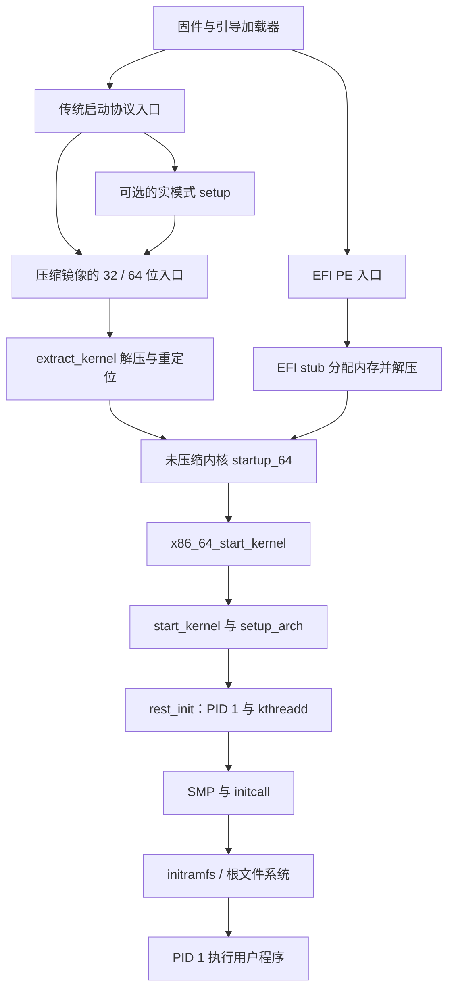

# 第 1 章 启动过程

本章沿 Linux v6.18.60 在 x86_64 上从内核镜像交接到 PID 1 执行用户程序的路径展开。固件如何完成上电自检、引导加载器如何读取磁盘，不在内核源码的职责范围内；本章从它们必须交付的 CPU 状态、镜像与参数开始分析。

启动不是一个可以任意调换顺序的函数列表，而是执行条件的逐步建立：从没有通用分配器、调度器和驱动的早期环境，建立地址空间、内存管理、中断与时间基础，再启动其他 CPU、初始化设备并接通用户空间。

*图 1-0：启动主线及 EFI 路径与传统路径的汇合点；箭头表示控制流，包含汇编跳转与可选分支*

上述两条解压路径分别依据 [`arch/x86/boot/compressed/head_64.S:445-476`](../../linux/arch/x86/boot/compressed/head_64.S#L445-L476) 与 [`drivers/firmware/efi/libstub/x86-stub.c:812-950`](../../linux/drivers/firmware/efi/libstub/x86-stub.c#L812-L950)。不要把两个不同镜像中的 `startup_64` 当成同一符号，也不要假定每次启动都会执行实模式 `main()`。

## 阅读建议

- 1.1 给出全章路线与阶段边界；初读时可先接着读 1.7、1.9～1.11，理解通用启动过程。
- 1.2～1.5 讨论 x86 特有的交接契约、CPU 模式和早期地址空间，建议结合汇编阅读。
- 1.6 只追踪平台与物理内存视图如何形成；页分配器内部细节转到 [4.2 内存初始化](../04-memory/02-init.md)。
- 1.8 区分启动处理器与应用处理器的路径；调度拓扑细节见 [第 3 章](../03-scheduler/README.md)，中断控制器见 [第 5 章](../05-interrupt/README.md)。
- 1.9 的启动跟踪方法适用于分析驱动初始化耗时，但不能覆盖固件、实模式代码与全部异步工作。

## 本章配置

取值来自 [`linux/.config`](../../linux/.config)。编译支持不等于运行时一定启用：例如 EFI、五级页表与 SMP 的实际路径还取决于固件、CPU 和启动参数。

| 配置项 | 当前取值 | 本章中的影响 |
|---|---|---|
| `CONFIG_X86_64` / `CONFIG_PGTABLE_LEVELS` | y / 5 | 分析 64 位内核，支持按运行环境选择页表层数 |
| `CONFIG_EFI` / `CONFIG_EFI_STUB` / `CONFIG_EFI_MIXED` | y / y / y | 支持 EFI 启动及混合位宽固件；正文主讲 64 位 EFI |
| `CONFIG_EFI_HANDOVER_PROTOCOL` | y | 保留 EFI handover 入口；不能与 PE 入口混为一谈 |
| `CONFIG_RELOCATABLE` / `CONFIG_RANDOMIZE_BASE` | y / y | 支持内核重定位及内核镜像地址随机化 |
| `CONFIG_RANDOMIZE_MEMORY` | y | 内核部分内存区域的基址随机化，与镜像随机化分开处理 |
| `CONFIG_KERNEL_ZSTD` | y | 内核镜像采用 Zstd 压缩 |
| `CONFIG_SMP` / `CONFIG_HOTPLUG_CPU` / `CONFIG_HOTPLUG_PARALLEL` | y / y / y | 支持多 CPU、热插拔状态机及并行启动优化 |
| `CONFIG_NR_CPUS` | 8192 | 编译期 CPU 编号容量，不是虚拟机实际 CPU 数 |
| `CONFIG_BLK_DEV_INITRD` / `CONFIG_INITRAMFS_SOURCE` | y / 空字符串 | 可接收外部初始镜像；没有配置自定义内置文件树 |
| `CONFIG_BLK_DEV_RAM` | m | 传统块设备 initrd 路径需额外注意模块可用性 |
| `CONFIG_TMPFS` / `CONFIG_DEVTMPFS` / `CONFIG_DEVTMPFS_MOUNT` | y / y / y | rootfs 可选 tmpfs，支持设备节点文件系统及条件自动挂载 |
| `CONFIG_DEFAULT_INIT` | 空字符串 | 不指定额外的编译期默认 init 路径 |
| `CONFIG_BOOT_CONFIG` | y | 支持 bootconfig；仍需相应输入与启动选项 |
| `CONFIG_PRINTK` / `CONFIG_PRINTK_TIME` / `CONFIG_EARLY_PRINTK` | y / y / y | 内核日志、日志时间戳与 x86 早期控制台 |
| `CONFIG_X86_VERBOSE_BOOTUP` | n | 传统解压器的普通调试输出被裁掉，错误输出仍保留 |
| `CONFIG_TRACEPOINTS` / `CONFIG_EVENT_TRACING` / `CONFIG_FTRACE` | y / y / y | 可用启动事件跟踪；必须在事件发生前启用 |
| `CONFIG_PROC_FS` / `CONFIG_SYSFS` / `CONFIG_DEBUG_FS` / `CONFIG_ARCH_KEEP_MEMBLOCK` | y / y / y / y | 支持本章使用的运行时观测接口 |
| `CONFIG_STRICT_KERNEL_RWX` | y | 初始化结束后收紧内核映射权限 |

## 小节索引

| 小节 | 主要问题 | 状态 |
|---|---|---|
| [1.1 启动全景：从固件到用户空间](01-overview.md) | 各阶段交付什么执行条件？ | 已撰写 |
| [1.2 内核镜像、启动协议与 EFI stub](02-boot-protocol.md) | 引导加载器必须传入什么？ | 已撰写 |
| [1.3 实模式准备与保护模式切换](03-real-mode.md) | BIOS setup 如何退出实模式？ | 已撰写 |
| [1.4 解压、重定位与 KASLR](04-decompress.md) | 内核如何放到可运行的位置？ | 已撰写 |
| [1.5 内核 64 位入口与早期页表](05-head64.md) | 如何从恒等映射进入内核高地址？ | 已撰写 |
| [1.6 setup_arch：建立平台与内存视图](06-setup-arch.md) | 固件信息如何转成内核可用资源？ | 已撰写 |
| [1.7 start_kernel：通用初始化与执行环境](07-start-kernel.md) | 为什么初始化必须遵循特定顺序？ | 已撰写 |
| [1.8 SMP：启动其他处理器](08-smp.md) | 其他 CPU 怎样加入系统？ | 已撰写 |
| [1.9 initcall：分级初始化与启动跟踪](09-initcalls.md) | 分散的初始化函数如何有序执行？ | 已撰写 |
| [1.10 initramfs 与根文件系统](10-rootfs.md) | `/init` 与 `root=` 分别负责哪条路径？ | 已撰写 |
| [1.11 PID 1：从内核初始化到用户程序](11-userspace.md) | 谁执行第一个用户程序，如何选择？ | 已撰写 |

## 待完善

- [ ] 本章实验尚未在 dev 虚拟机中实测，需在确认运行的是目标内核后补充真实日志与 trace 输出。
- [ ] Mermaid 图需在目标 Markdown 渲染器中检查显示效果。
- [ ] EFI mixed-mode、Xen PV、机密虚拟机与 kexec 的专用入口仅标明边界，未逐指令展开。
- [ ] 传统块设备 initrd 的 `/linuxrc` 兼容路径不作完整分析；本章重点是 cpio 格式的 initramfs。

本章不修改内核源码，也不要求在宿主机安装或替换内核。启动参数实验只应在可恢复、可选择旧内核启动的虚拟机中进行。
