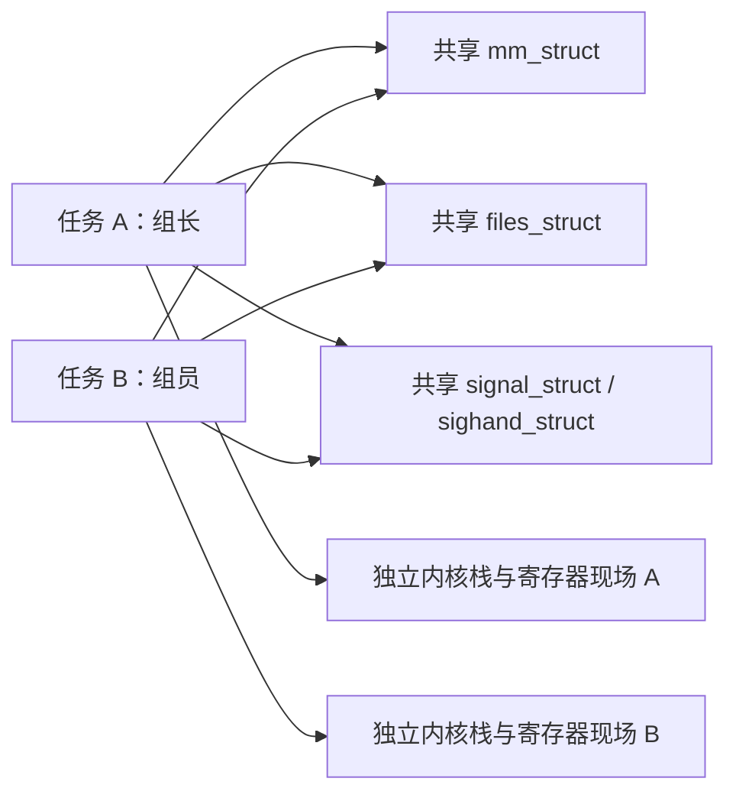

# 2.1 进程管理全景：任务、资源与生命周期

> **本节源码**：[`include/linux/sched.h`](../../linux/include/linux/sched.h)、[`kernel/fork.c`](../../linux/kernel/fork.c)、[`fs/exec.c`](../../linux/fs/exec.c)、[`kernel/exit.c`](../../linux/kernel/exit.c)、[`kernel/signal.c`](../../linux/kernel/signal.c)
> **关键函数**：`kernel_clone()`、`copy_process()`、`begin_new_exec()`、`do_exit()`、`do_wait()`
> **前置知识**：C 结构体与指针、虚拟内存基础；1.7 初始任务与 PID 1、1.11 用户程序交接

## 概述

进程管理需要回答四个问题：谁在执行、它使用哪些资源、如何与其他执行主体交互，以及退出后由谁回收。Linux 不为“进程”和“线程”建立两套独立的调度对象，而是用任务（Task）作为统一执行主体，通过共享关系表达二者的差别。任务创建、程序替换与任务销毁是三个不同操作：fork 增加任务，exec 更换当前程序，exit 开始结束当前执行。本章沿这条生命周期主线展开，把用户接口与内核对象连接起来。

## 核心对象：一个执行主体，多组资源关系

每个任务对应一个 `task_struct`。用户空间的线程（Thread）也有自己的任务描述符、寄存器现场与内核栈；同一进程（Process）内的线程通常共享地址空间、文件表和信号处理方式。线程组（Thread Group）把这些任务组织为用户空间通常所说的进程。

字段依据见 [`include/linux/sched.h:815-859`](../../linux/include/linux/sched.h#L815-L859)、[`include/linux/sched.h:953-963`](../../linux/include/linux/sched.h#L953-L963)、[`include/linux/sched.h:1059-1108`](../../linux/include/linux/sched.h#L1059-L1108)、[`include/linux/sched.h:1184-1204`](../../linux/include/linux/sched.h#L1184-L1204)。

| 对象 | 回答的问题 | 主要关系 |
|---|---|---|
| `task_struct` | 哪个任务在执行、是否可运行 | 每个线程一份 |
| `mm_struct` | 用户虚拟地址如何解释 | 普通线程共享；普通 fork 建立独立地址空间 |
| `files_struct` | fd 下标指向哪些打开文件 | 可以共享，也可以复制表而保留底层文件引用 |
| `fs_struct` | 根目录、工作目录与 umask 是什么 | 与 fd 表是不同资源 |
| `sighand_struct` | 收到某个信号后采用什么处理方式 | 同线程组共享 |
| `signal_struct` | 线程组公共信号状态、退出状态与资源统计 | 同线程组共享 |
| `struct pid` | 哪个稳定身份对象对应这些数字 PID | 同一对象可携带多层命名空间（Namespace）编号 |
| `cred` / `nsproxy` | 以什么进程凭据（Credentials）、在哪个资源视图中执行 | 引用独立管理，不能合并为一个“进程环境指针” |



*图 2-1：典型多线程进程的任务与资源关系，图中共享方式不代表所有 clone 组合*

### 共享资源不等于属于同一线程组

`CLONE_VM` 只要求共享地址空间，不自动要求 `CLONE_THREAD`。反方向则有明确约束：`CLONE_THREAD` 要求 `CLONE_SIGHAND`，而 `CLONE_SIGHAND` 要求 `CLONE_VM`，见 [`kernel/fork.c:1958-1971`](../../linux/kernel/fork.c#L1958-L1971)。因此不能看到两个任务的 `mm` 相同，就断言它们属于同一进程。

用户线程库封装了这些底层组合，还负责线程局部存储、用户栈和线程加入协议。`pthread_create()` 不是内核内部函数，也不是“一条 clone 指令”的同义词。

## 主流程分析

以下按生命周期列出主入口；exec 和退出不是 `kernel_clone()` 的子调用。

```text
任务创建
kernel_clone()                         kernel/fork.c
├── copy_process()                     kernel/fork.c
│   ├── dup_task_struct()
│   ├── copy_files() / copy_mm() / copy_namespaces()
│   ├── copy_thread()                  arch/x86/kernel/process.c
│   └── alloc_pid()                    kernel/pid.c
└── wake_up_new_task()                  kernel/sched/core.c

程序替换
bprm_execve()                          fs/exec.c
└── exec_binprm() → search_binary_handler()
    └── load_elf_binary()〔ELF 分支〕   fs/binfmt_elf.c
        └── begin_new_exec()           fs/exec.c

退出与回收
 do_exit()                            kernel/exit.c
 ├── exit_mm() / exit_files() / exit_fs()
 ├── exit_notify()
 └── do_task_dead()                    kernel/sched/core.c
父任务 do_wait() → wait_task_zombie() → release_task()
                                      kernel/exit.c
```

调用顺序依据见 [`kernel/fork.c:2573-2660`](../../linux/kernel/fork.c#L2573-L2660)、[`fs/exec.c:1674-1804`](../../linux/fs/exec.c#L1674-L1804)、[`kernel/exit.c:907-1033`](../../linux/kernel/exit.c#L907-L1033)。

### 创建：先构造，再发布，最后允许调度

`copy_process()` 完成任务及资源关系的构造，并在 `tasklist_lock` 保护下发布父子、线程组和 PID 关联。`kernel_clone()` 随后调用 `wake_up_new_task()`。这意味着“能被其他任务查找到”和“已经执行过一条用户指令”不是同一时刻，见 [`kernel/fork.c:2322-2448`](../../linux/kernel/fork.c#L2322-L2448)、[`kernel/fork.c:2619-2645`](../../linux/kernel/fork.c#L2619-L2645)。

### exec：替换程序，而不是创建新进程

exec 建立新地址空间、装载程序、更新凭据和寄存器。多线程进程还必须通过 `de_thread()` 去掉其他线程；若调用者不是组长，它接管原组长的身份，见 [`fs/exec.c:912-1036`](../../linux/fs/exec.c#L912-L1036)。用户看到的进程 PID 通常保持不变，但不能由此推断调用线程的 TID 一定不变。

### 退出：停止执行与回收对象分离

退出任务先释放地址空间等资源，再通知父进程。需要父进程等待的任务会保留僵尸（Zombie）状态，让退出码和统计可被读取；父进程回收后，仍须满足引用计数与 RCU 的释放条件，见 [`kernel/exit.c:747-789`](../../linux/kernel/exit.c#L747-L789)、[`kernel/exit.c:228-245`](../../linux/kernel/exit.c#L228-L245)。

僵尸不是“还在执行但没有 CPU 时间”的进程。反过来，一个已不再接受调度的任务对象，也不保证在那一刻已经释放。

## 关键细节 / 设计考量

### 信号是跨越生命周期的异步协议

信号（Signal）可以触发普通处理器、停止 / 继续或线程组退出。生成端先更新待决状态，接收任务在合适的处理路径中决定动作，二者不是一次同步函数调用，见 [`kernel/signal.c:1081-1200`](../../linux/kernel/signal.c#L1081-L1200)、[`kernel/signal.c:2885-3125`](../../linux/kernel/signal.c#L2885-L3125)。

### 分开理解进程树、线程组与进程组

父子关系决定等待和重托管；线程组决定哪些任务构成一个多线程进程；进程组（Process Group）和会话（Session）服务于作业控制与终端语义。它们不能画成一棵统一的“进程关系树”。PID 类型定义见 [`include/linux/pid_types.h`](../../linux/include/linux/pid_types.h)，父子关系字段见 [`include/linux/sched.h:1072-1083`](../../linux/include/linux/sched.h#L1072-L1083)。

### 本章不提前展开调度器与页表算法

本章解释 `TASK_RUNNING`、资源复制与首次运行的接口边界；第 3 章再回答“哪个任务先运行”，第 4 章回答“地址空间怎样落实为页表和物理页”。这样可以避免把 fork 等同于调度，把 exec 等同于把整个文件读入物理内存。

## 小结

- Linux 以任务为执行主体，以共享资源和线程组表达进程 / 线程关系。
- fork 增加任务，exec 替换程序，exit 开始终止；三者不能互相替代。
- 数字 PID、`struct pid`、`task_struct` 和资源对象具有不同生命周期。
- 任务发布、可运行、实际执行和最终释放是不同边界。
- 父子关系、线程组、进程组和会话各自解决不同问题。

## 参考

- [`Documentation/filesystems/proc.rst`](../../linux/Documentation/filesystems/proc.rst)：从用户空间查看任务的基础接口。
- [`Documentation/security/credentials.rst`](../../linux/Documentation/security/credentials.rst)：任务身份与共享资源的区别。
- [第 3 章 调度器](../03-scheduler/README.md)、[第 4 章 内存管理](../04-memory/README.md)。
