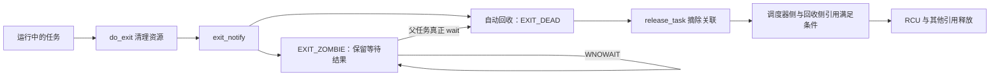

# 2.7 任务退出、僵尸与等待回收

> **本节源码**：[`kernel/exit.c`](../../linux/kernel/exit.c)、[`kernel/signal.c`](../../linux/kernel/signal.c)、[`kernel/fork.c`](../../linux/kernel/fork.c)、[`include/linux/sched/signal.h`](../../linux/include/linux/sched/signal.h)
> **关键函数**：`do_exit()`、`do_group_exit()`、`exit_notify()`、`forget_original_parent()`、`do_wait()`、`wait_task_zombie()`、`release_task()`
> **前置知识**：2.2 状态与引用；2.3 父子与线程组关系；2.5 资源引用

## 概述

任务停止执行以后，父进程仍可能需要取得退出码和资源统计，因此“结束运行”不能等同于“立即释放全部对象”。Linux 把资源清理、退出通知、父侧回收和引用释放拆开处理。普通子进程可以在清理主要资源后保留僵尸状态，等待父进程确认。多线程、父进程先退出、ptrace 和自动回收又会改变这条路径的细节。

## 核心数据结构

| 状态 / 字段 | 用途 | 源码 |
|---|---|---|
| `task_struct.exit_code` | 当前任务记录的等待状态值，不等于未经编码的 `main()` 返回值 | [`include/linux/sched.h:961-963`](../../linux/include/linux/sched.h#L961-L963) |
| `task_struct.exit_state` | `EXIT_ZOMBIE`、`EXIT_DEAD` 等回收阶段 | [`include/linux/sched.h:110-113`](../../linux/include/linux/sched.h#L110-L113) |
| `signal_struct.live` | 仍存活的线程数量，最后一个线程触发组级清理 | [`include/linux/sched/signal.h:95-100`](../../linux/include/linux/sched/signal.h#L95-L100) |
| `group_exit_code` / `SIGNAL_GROUP_EXIT` | 统一线程组退出结果与组退出状态 | [`include/linux/sched/signal.h:118-128`](../../linux/include/linux/sched/signal.h#L118-L128)、[`include/linux/sched/signal.h:263`](../../linux/include/linux/sched/signal.h#L263) |
| `wait_chldexit` | 父线程组等待子任务状态变化的等待队列 | [`include/linux/sched/signal.h:102-104`](../../linux/include/linux/sched/signal.h#L102-L104) |
| `wait_opts` | 等待目标、选项、结果与等待队列项的内部请求对象 | [`kernel/exit.c`](../../linux/kernel/exit.c) |

## 主流程分析

```text
exit 系统调用 → do_exit()              kernel/exit.c
exit_group 系统调用 → do_group_exit()
                      ├── zap_other_threads()  kernel/signal.c
                      └── do_exit()            kernel/exit.c
                          ├── exit_signals()
                          ├── 最后线程的组级资源处理
                          ├── exit_mm() / exit_files() / exit_fs()
                          ├── exit_notify()
                          │   ├── forget_original_parent()
                          │   ├── 设置 EXIT_ZOMBIE，通知父任务
                          │   └── 满足自动回收条件时 release_task()
                          └── do_task_dead()   kernel/sched/core.c

父任务 wait4() / waitid()              kernel/exit.c
└── do_wait()
    └── __do_wait()
        └── wait_consider_task() → wait_task_zombie()
            └── 取得唯一回收权 → release_task()
```

### 一、单任务退出和线程组退出不同

内核 `exit` 系统调用直接结束调用任务；`exit_group` 通过 `do_group_exit()` 协调整个线程组，见 [`kernel/exit.c:1089-1139`](../../linux/kernel/exit.c#L1089-L1139)。libc 的 `exit()`、`_exit()` 与内核同名系统调用不能只按名称一一对应；现代用户库通常用组退出完成进程终止。

普通退出码在进入 `do_exit()` 前按等待 ABI 编码：正常退出低 8 位左移 8 位；由信号终止则使用相应信号状态。读取结果应使用 `WIFEXITED()`、`WEXITSTATUS()`、`WIFSIGNALED()` 等宏，不能直接打印原始 status 当成退出码。

### 二、释放主要资源早于父进程回收

`do_exit()` 标记退出、减少 `signal->live`，在最后一个线程退出时处理定时器等组级资源。随后记录退出状态、发出退出事件并清理 mm、文件表、目录与命名空间引用，见 [`kernel/exit.c:907-987`](../../linux/kernel/exit.c#L907-L987)。

释放资源指放下任务持有的引用。若别的任务仍共享 `mm` 或 `struct file`，对象继续存在。僵尸不再保留一个可运行的旧程序地址空间；它主要保留等待结果所需的身份和统计状态。

### 三、通知阶段决定是否保留僵尸

[`kernel/exit.c:758-779`](../../linux/kernel/exit.c#L758-L779)（v6.18.60）

```c
	tsk->exit_state = EXIT_ZOMBIE;

	if (unlikely(tsk->ptrace)) {
		int sig = thread_group_leader(tsk) &&
				thread_group_empty(tsk) &&
				!ptrace_reparented(tsk) ?
			tsk->exit_signal : SIGCHLD;
		autoreap = do_notify_parent(tsk, sig);
	} else if (thread_group_leader(tsk)) {
		autoreap = thread_group_empty(tsk) &&
			do_notify_parent(tsk, tsk->exit_signal);
	} else {
		autoreap = true;
		/* untraced sub-thread */
		do_notify_pidfd(tsk);
	}

	if (autoreap) {
		tsk->exit_state = EXIT_DEAD;
		list_add(&tsk->ptrace_entry, &dead);
	}
```

普通未被 ptrace 的非组长线程会走自动回收，而不是逐个成为必须由父进程 wait 的僵尸。组长若先于其他线程退出，还需要保留到组内相关条件满足；最后组员退出时可继续触发组长通知，见 [`kernel/exit.c:281-298`](../../linux/kernel/exit.c#L281-L298)。

父进程显式设置 `SIGCHLD=SIG_IGN` 或 `SA_NOCLDWAIT` 时，`do_notify_parent()` 可选择自动回收，见 [`kernel/signal.c:2318-2340`](../../linux/kernel/signal.c#L2318-L2340)。`SIGCHLD` 默认动作的“忽略”与显式安装 `SIG_IGN` 的回收语义不同，不能混为一谈。

### 四、wait 是按条件循环，不是每个信号对应一次收割

`do_wait()` 先把等待项加入 `wait_chldexit`，设置可中断等待状态，再扫描符合条件的子任务；没有结果且仍可继续等待时才调度，见 [`kernel/exit.c:1718-1741`](../../linux/kernel/exit.c#L1718-L1741)。

`WNOHANG` 在有潜在匹配子任务、但暂时无可报告状态时返回 0；`ECHILD` 表示没有符合等待关系和筛选条件的目标。`waitid()` 还可报告停止和继续事件，不是只能回收退出任务。

标准 `SIGCHLD` 会合并，不能假设“收到一次信号只退出了一个孩子”。事件循环通常需要持续执行非阻塞等待，直到没有可报告结果。

### 五、唯一回收权与仅查看模式

`wait_task_zombie()` 用 `cmpxchg()` 将 `EXIT_ZOMBIE` 转为回收状态，只有成功者获得该次回收权，见 [`kernel/exit.c:1181-1210`](../../linux/kernel/exit.c#L1181-L1210)。它随后汇总统计并调用 `release_task()`。

`waitid(..., WNOWAIT)` 则只读取结果，不消耗退出状态；之后仍需真正回收。`release_task()` 从各种任务关系中摘除目标、释放 PID 关联，最终通过 RCU 用户引用协议继续推进释放，见 [`kernel/exit.c:249-321`](../../linux/kernel/exit.c#L249-L321)。



*图 2-2：退出通知与回收边界，图中对象释放不保证紧随事件同步完成*

## 关键细节 / 设计考量

### 父任务先退出：重托管给谁

`forget_original_parent()` 为仍在的子任务重选父关系。优先考虑原父线程组中的存活线程，再寻找合适的子收割者（Child Subreaper），最后使用所在 PID 命名空间的收割者，见 [`kernel/exit.c:608-745`](../../linux/kernel/exit.c#L608-L745)。不是所有孤儿都无条件交给宿主 PID 1。

`PR_SET_CHILD_SUBREAPER` 使服务管理器可以接管后代孤儿的回收责任。字段说明见 [`include/linux/sched/signal.h:136-148`](../../linux/include/linux/sched/signal.h#L136-L148)。命名空间 PID 1 自己退出还会触发专门清理，详见 2.11。

### 退出事件不等于回收事件

`sched_process_exit` 在 mm 等主要资源清理之前发出，`sched_process_free` 在后续 RCU 回调中发出。二者之间可能包含父进程迟迟未回收的时间，不能把两者差值直接当成 `do_exit()` 的执行耗时。

## 可观测性

| 入口 | 看什么、怎么解读 | 源码与配置 |
|---|---|---|
| `sched:sched_process_exit` | `pid`、`comm`、`group_dead`；后者表示是否为最后存活线程，不是“所有内存已释放” | [`include/trace/events/sched.h:335-359`](../../linux/include/trace/events/sched.h#L335-L359)、[`kernel/exit.c:955-959`](../../linux/kernel/exit.c#L955-L959)，`CONFIG_EVENT_TRACING=y` |
| `sched:sched_process_wait` | 等待请求中的目标 PID 对象编号；按组或任意子任务筛选时可能为 0，不是完成回收事件 | [`include/trace/events/sched.h:371-391`](../../linux/include/trace/events/sched.h#L371-L391)、[`kernel/exit.c:1722`](../../linux/kernel/exit.c#L1722)，`CONFIG_EVENT_TRACING=y` |
| `sched:sched_process_free` | 延迟释放阶段到达任务引用放下点 | [`kernel/exit.c:228-237`](../../linux/kernel/exit.c#L228-L237)、[`include/trace/events/sched.h:324-326`](../../linux/include/trace/events/sched.h#L324-L326)，`CONFIG_EVENT_TRACING=y` |
| `/proc/<pid>/status` 的 `State: Z` | 退出后保留等待状态；不是仍可被普通信号“杀掉”的执行主体 | [`fs/proc/array.c:129-146`](../../linux/fs/proc/array.c#L129-L146)，`CONFIG_PROC_FS=y` |
| `wait_task_zombie()` / `release_task()` 探针 | 区分状态查看、取得回收权与对象摘除；ptrace 情形需单独解释 | [`kernel/exit.c:1181-1304`](../../linux/kernel/exit.c#L1181-L1304)、[`kernel/exit.c:249-321`](../../linux/kernel/exit.c#L249-L321)，`CONFIG_KPROBES=y`，须确认符号可探测 |

## 动手实验：用 `WNOWAIT` 保留一个可观察僵尸

[lifecycle.c](examples/lifecycle.c) 在 `waitid(WEXITED | WNOWAIT)` 返回后，打印子 PID 并停留 5 秒，再执行真正回收。先在一个终端运行：

```bash
cd /root/linux
work=$(mktemp -d /tmp/process-wait.XXXXXX)
cc -O2 -Wall -Wextra -std=c11 book/02-process/examples/lifecycle.c -o "$work/lifecycle"
"$work/lifecycle" --run
rm -r -- "$work"
```

另一个终端在提示窗口内，使用程序打印的 PID：

```bash
child=1234
ps -p "$child" -o pid,ppid,stat,comm
grep -E '^(State|Pid|PPid):' /proc/"$child"/status
```

预期先看到 `Z`，真正回收后对应目录消失；若错过窗口，文件不存在是正常结果。实验程序自行恢复默认 `SIGCHLD` 处理，避免继承显式忽略状态改变回收语义。此处描述为预期，尚未在目标内核上实测。

## 小结

- 内核的单任务退出、线程组退出和用户库接口不能按同名直接等同。
- 退出任务先释放资源引用，僵尸主要保留等待结果。
- 不是所有线程都需父进程 wait；显式忽略 `SIGCHLD` 等会改变回收策略。
- wait 的结果筛选、`WNOHANG` 和 `WNOWAIT` 分别表达不同语义。
- 父进程先退出会重托管，真正对象释放还需满足引用与 RCU 条件。

## 参考

- [`Documentation/filesystems/proc.rst`](../../linux/Documentation/filesystems/proc.rst)。
- [`include/linux/sched/signal.h`](../../linux/include/linux/sched/signal.h)：线程组退出、等待与子收割者字段。
- [2.11 命名空间：资源视图与身份边界](11-namespaces.md)。
