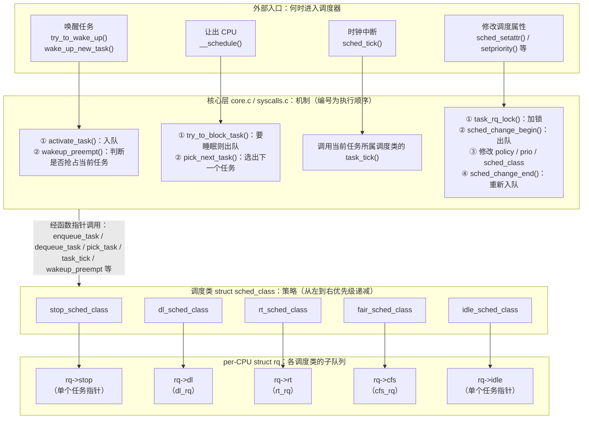
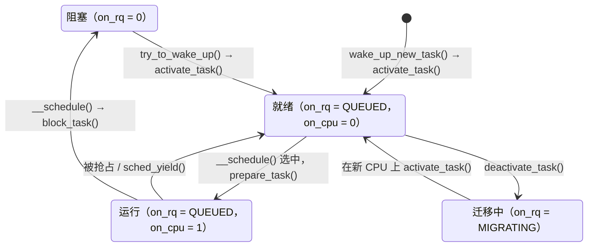

# 3.1 调度器框架：调度策略、调度类与运行队列

> **本节源码**：[`kernel/sched/core.c`](../../linux/kernel/sched/core.c)、[`kernel/sched/sched.h`](../../linux/kernel/sched/sched.h)、[`kernel/sched/syscalls.c`](../../linux/kernel/sched/syscalls.c)、[`kernel/sched/stop_task.c`](../../linux/kernel/sched/stop_task.c)、[`kernel/sched/idle.c`](../../linux/kernel/sched/idle.c)、[`include/linux/sched.h`](../../linux/include/linux/sched.h)、[`include/linux/sched/prio.h`](../../linux/include/linux/sched/prio.h)、[`include/uapi/linux/sched.h`](../../linux/include/uapi/linux/sched.h)、[`include/asm-generic/vmlinux.lds.h`](../../linux/include/asm-generic/vmlinux.lds.h)
> **关键函数**：`__normal_prio()`、`__setscheduler_class()`、`set_load_weight()`、`task_rq_lock()`、`enqueue_task()`、`dequeue_task()`、`activate_task()`、`deactivate_task()`、`wakeup_preempt()`、`sched_change_begin()`、`check_class_changed()`
> **前置知识**：第 2 章 进程管理（`task_struct` 与进程状态）、7.4 自旋锁与 qspinlock

## 概述

调度器（Scheduler）要回答的问题只有一个：**此刻这个 CPU 该运行哪个任务**。难点在于任务的诉求差别很大：交互任务要低延迟，批处理任务要吞吐，实时任务要确定性，截止期任务要在期限内拿到约定的 CPU 时间。没有一种算法能同时满足所有诉求。

Linux 的做法是**机制与策略分离**。核心层（`kernel/sched/core.c`）实现与策略无关的机制：运行队列加锁、rq 时钟、任务状态维护、上下文切换（Context Switch）；调度类（Scheduling Class）实现具体策略：任务如何排队、下一个选谁、何时抢占（Preemption）。各调度类之间有固定的优先级，核心层从高到低依次询问，第一个给出任务的调度类胜出。

每个 CPU 有一个独立的运行队列（Runqueue，`struct rq`），其中为 dl、rt、fair 等调度类内嵌了各自的子队列（stop 与 idle 类各只需一个任务指针）。绝大多数调度操作只需持有本 CPU 的 rq 锁，这是调度器能在多核上扩展的基础。

本节先介绍框架的数据结构——调度策略与优先级、调度类、运行队列、调度实体、权重，再分析核心层如何通过一组包装函数驱动调度类：加锁、入队出队、选择任务、唤醒抢占和修改调度属性。`__schedule()` 与上下文切换本身留给 3.2 节。

图 3-1 从上到下分四层：外部入口决定**何时**进入调度器；核心层按固定步骤执行与策略无关的机制，框内的编号即执行顺序；核心层通过 `struct sched_class` 的函数指针把具体决策交给调度类；每个调度类管理 `struct rq` 中属于自己的那部分子队列。



*图 3-1：调度器的分层结构。核心层每个框内的编号表示同一路径上的调用顺序，各步骤由核心层依次调用，彼此之间不是调用关系；选任务时核心层按调度类优先级从高到低逐个询问（`ext_sched_class` 依赖 `CONFIG_SCHED_CLASS_EXT`，本书配置未开启，图中省略）*

## 核心数据结构

### 调度策略

用户态通过 `sched_setscheduler(2)` / `sched_setattr(2)` 为线程指定调度策略（Scheduling Policy）：

[`include/uapi/linux/sched.h:114-121`](../../linux/include/uapi/linux/sched.h#L114-L121)（v6.18.60）

```c
#define SCHED_NORMAL		0
#define SCHED_FIFO		1
#define SCHED_RR		2
#define SCHED_BATCH		3
/* SCHED_ISO: reserved but not implemented yet */
#define SCHED_IDLE		5
#define SCHED_DEADLINE		6
#define SCHED_EXT		7
```

| 策略 | 含义 | 所属调度类 |
|---|---|---|
| `SCHED_NORMAL` | 普通分时任务（用户态常称 `SCHED_OTHER`） | `fair_sched_class` |
| `SCHED_BATCH` | 批处理任务，不期望唤醒抢占 | `fair_sched_class` |
| `SCHED_IDLE` | 权重极低的任务，基本只在系统空闲时运行 | `fair_sched_class` |
| `SCHED_FIFO` | 实时，同优先级先进先出，无时间片 | `rt_sched_class` |
| `SCHED_RR` | 实时，同优先级按时间片轮转 | `rt_sched_class` |
| `SCHED_DEADLINE` | 基于 EDF + CBS 的截止期调度 | `dl_sched_class` |
| `SCHED_EXT` | 由 BPF 程序实现的可扩展调度 | `ext_sched_class`（依赖 `CONFIG_SCHED_CLASS_EXT`） |

几点说明：

- 值 4 预留给从未实现的 `SCHED_ISO`。
- 策略值可以与 `SCHED_RESET_ON_FORK`（[`include/uapi/linux/sched.h:124`](../../linux/include/uapi/linux/sched.h#L124)）按位或，使子进程在 `fork()` 时不继承特权调度属性：实时与 Deadline 策略退回 `SCHED_NORMAL` 且 nice 置为 0；其他策略保持不变，只把负的 nice 值重置为 0。`sched_fork()` 中的处理见 [`kernel/sched/core.c:4715-4734`](../../linux/kernel/sched/core.c#L4715-L4734)。
- `SCHED_IDLE` 策略与 `idle_sched_class` 毫无关系：前者是公平调度类中权重最低的普通任务，后者只服务每个 CPU 上的 idle 线程（`swapper/N`，名字由 `init_idle()` 设置，见 [`kernel/sched/core.c:8040`](../../linux/kernel/sched/core.c#L8040)）。
- 内核用 `idle_policy()`、`fair_policy()`、`rt_policy()`、`dl_policy()` 判断策略（[`kernel/sched/sched.h:187-214`](../../linux/kernel/sched/sched.h#L187-L214)）。注意 `fair_policy()` 只包括 `SCHED_NORMAL` 和 `SCHED_BATCH`，不包括 `SCHED_IDLE`，尽管三者都归公平调度类管理。
- 本书配置中 `CONFIG_SCHED_CLASS_EXT` 未开启，`SCHED_EXT` 相关代码不参与编译，本节不再展开（见 3.11 节）。

### 优先级

#### 统一的数值空间

内核内部用一个整数 `prio` 统一表示所有任务的优先级，**数值越小优先级越高**：

[`include/linux/sched/prio.h:16-28`](../../linux/include/linux/sched/prio.h#L16-L28)（v6.18.60）

```c
#define MAX_RT_PRIO		100
#define MAX_DL_PRIO		0

#define MAX_PRIO		(MAX_RT_PRIO + NICE_WIDTH)
#define DEFAULT_PRIO		(MAX_RT_PRIO + NICE_WIDTH / 2)

/*
 * Convert user-nice values [ -20 ... 0 ... 19 ]
 * to static priority [ MAX_RT_PRIO..MAX_PRIO-1 ],
 * and back.
 */
#define NICE_TO_PRIO(nice)	((nice) + DEFAULT_PRIO)
#define PRIO_TO_NICE(prio)	((prio) - DEFAULT_PRIO)
```

其中 `NICE_WIDTH` 为 40（[`include/linux/sched/prio.h:5-7`](../../linux/include/linux/sched/prio.h#L5-L7)），所以 `MAX_PRIO` 为 140，`DEFAULT_PRIO` 为 120（对应 nice 0）。三类任务在数值空间中各占一段：

| `prio` | 任务 | 换算方式 |
|---|---|---|
| -1 | `SCHED_DEADLINE` | 固定为 `MAX_DL_PRIO - 1` |
| 0～98 | `SCHED_FIFO` / `SCHED_RR` | `MAX_RT_PRIO - 1 - rt_priority`，`rt_priority` 取 1～99 |
| 100～139 | `SCHED_NORMAL` / `SCHED_BATCH` / `SCHED_IDLE` | `NICE_TO_PRIO(nice)`，nice 取 -20～19 |

判断 `prio` 落在哪一段的辅助函数是 `dl_prio()`（`prio < 0`，[`include/linux/sched/deadline.h:13-16`](../../linux/include/linux/sched/deadline.h#L13-L16)）和 `rt_prio()`（`0 <= prio < 100`，[`include/linux/sched/rt.h:9-12`](../../linux/include/linux/sched/rt.h#L9-L12)）。

#### task_struct 中的四个优先级字段

| 字段 | 含义 |
|---|---|
| `static_prio` | 由 nice 值换算的静态优先级，只对普通任务有意义 |
| `rt_priority` | 用户指定的实时优先级 1～99，**数值越大越高**，与 `prio` 方向相反 |
| `normal_prio` | 只根据策略及上面两个值算出的"本来"优先级 |
| `prio` | 调度器实际使用的有效优先级，可能被优先级继承（Priority Inheritance，PI）临时提升 |

`normal_prio` 由 `__normal_prio()` 计算：

[`kernel/sched/syscalls.c:19-31`](../../linux/kernel/sched/syscalls.c#L19-L31)（v6.18.60）

```c
static inline int __normal_prio(int policy, int rt_prio, int nice)
{
	int prio;

	if (dl_policy(policy))
		prio = MAX_DL_PRIO - 1;
	else if (rt_policy(policy))
		prio = MAX_RT_PRIO - 1 - rt_prio;
	else
		prio = NICE_TO_PRIO(nice);

	return prio;
}
```

`prio` 与 `normal_prio` 的区别体现在 `effective_prio()` 中：

[`kernel/sched/syscalls.c:52-63`](../../linux/kernel/sched/syscalls.c#L52-L63)（v6.18.60）

```c
static int effective_prio(struct task_struct *p)
{
	p->normal_prio = normal_prio(p);
	/*
	 * If we are RT tasks or we were boosted to RT priority,
	 * keep the priority unchanged. Otherwise, update priority
	 * to the normal priority:
	 */
	if (!rt_or_dl_prio(p->prio))
		return p->normal_prio;
	return p->prio;
}
```

如果任务当前的 `prio` 已经处于实时或 Deadline 区间——无论是因为它本身就是实时任务，还是因为 PI 被临时提升——就保持 `prio` 不变，只刷新 `normal_prio`。这样，被 PI 提升的任务即使在持锁期间被修改 nice 值，也不会丢掉继承来的优先级。

#### 从优先级到调度类

任务属于哪个调度类，由**有效优先级 `prio`** 决定，而不是由 `policy` 决定：

[`kernel/sched/core.c:7281-7295`](../../linux/kernel/sched/core.c#L7281-L7295)（v6.18.60）

```c
const struct sched_class *__setscheduler_class(int policy, int prio)
{
	if (dl_prio(prio))
		return &dl_sched_class;

	if (rt_prio(prio))
		return &rt_sched_class;

#ifdef CONFIG_SCHED_CLASS_EXT
	if (task_should_scx(policy))
		return &ext_sched_class;
#endif

	return &fair_sched_class;
}
```

正因为如此，rt_mutex 的优先级继承只需把持锁者的 `prio` 改到实时区间，就能把一个 `SCHED_NORMAL` 任务临时移入实时调度类（7.8 节、3.6 节）。

`__setscheduler_class()` 只会返回 dl、rt、ext、fair 四个类之一。stop 与 idle 两个调度类不对用户开放，由内核直接赋值：`sched_set_stop_task()` 把每 CPU 的 stopper 线程设为 `stop_sched_class`（[`kernel/sched/core.c:3610-3627`](../../linux/kernel/sched/core.c#L3610-L3627)），`init_idle()` 把 idle 线程设为 `idle_sched_class`（[`kernel/sched/core.c:8037`](../../linux/kernel/sched/core.c#L8037)）。新任务的调度类在 `sched_fork()` 中按同样的规则选定（[`kernel/sched/core.c:4736-4749`](../../linux/kernel/sched/core.c#L4736-L4749)），其中 Deadline 任务不允许直接 `fork()`，会返回 `-EAGAIN`。

### struct sched_class：调度类接口

`struct sched_class` 是一张函数指针表，相当于 C 语言中的"接口"。前半部分是任务排队与选择相关的方法：

[`kernel/sched/sched.h:2412-2441`](../../linux/kernel/sched/sched.h#L2412-L2441)（v6.18.60）

```c
struct sched_class {

#ifdef CONFIG_UCLAMP_TASK
	int uclamp_enabled;
#endif

	void (*enqueue_task) (struct rq *rq, struct task_struct *p, int flags);	// [注] 任务变为可运行
	bool (*dequeue_task) (struct rq *rq, struct task_struct *p, int flags);	// [注] 任务变为不可运行，可能"失败"
	void (*yield_task)   (struct rq *rq);
	bool (*yield_to_task)(struct rq *rq, struct task_struct *p);

	void (*wakeup_preempt)(struct rq *rq, struct task_struct *p, int flags);	// [注] 被唤醒任务是否应抢占当前任务

	int (*balance)(struct rq *rq, struct rq_flags *rf);	// [注] 选任务前给本类一次拉任务的机会
	struct task_struct *(*pick_task)(struct rq *rq);	// [注] 选出本类最该运行的任务
	/*
	 * Optional! When implemented pick_next_task() should be equivalent to:
	 *
	 *   next = pick_task();
	 *   if (next) {
	 *       put_prev_task(prev);
	 *       set_next_task_first(next);
	 *   }
	 */
	struct task_struct *(*pick_next_task)(struct rq *rq, struct task_struct *prev);

	void (*put_prev_task)(struct rq *rq, struct task_struct *p, struct task_struct *next);	// [注] 当前任务让出 CPU
	void (*set_next_task)(struct rq *rq, struct task_struct *p, bool first);	// [注] 任务成为当前任务

	int  (*select_task_rq)(struct task_struct *p, int task_cpu, int flags);	// [注] 唤醒 / fork / exec 时选择 CPU
```

后半部分是 SMP、时钟、属性变更相关的方法：

[`kernel/sched/sched.h:2443-2474`](../../linux/kernel/sched/sched.h#L2443-L2474)（v6.18.60）

```c
	void (*migrate_task_rq)(struct task_struct *p, int new_cpu);	// [注] 任务换 CPU 时通知旧类

	void (*task_woken)(struct rq *this_rq, struct task_struct *task);

	void (*set_cpus_allowed)(struct task_struct *p, struct affinity_context *ctx);

	void (*rq_online)(struct rq *rq);
	void (*rq_offline)(struct rq *rq);

	struct rq *(*find_lock_rq)(struct task_struct *p, struct rq *rq);

	void (*task_tick)(struct rq *rq, struct task_struct *p, int queued);	// [注] 时钟中断回调
	void (*task_fork)(struct task_struct *p);
	void (*task_dead)(struct task_struct *p);

	/*
	 * The switched_from() call is allowed to drop rq->lock, therefore we
	 * cannot assume the switched_from/switched_to pair is serialized by
	 * rq->lock. They are however serialized by p->pi_lock.
	 */
	void (*switching_to) (struct rq *this_rq, struct task_struct *task);
	void (*switched_from)(struct rq *this_rq, struct task_struct *task);
	void (*switched_to)  (struct rq *this_rq, struct task_struct *task);
	void (*reweight_task)(struct rq *this_rq, struct task_struct *task,
			      const struct load_weight *lw);
	void (*prio_changed) (struct rq *this_rq, struct task_struct *task,
			      int oldprio);

	unsigned int (*get_rr_interval)(struct rq *rq,
					struct task_struct *task);

	void (*update_curr)(struct rq *rq);
```

结构体末尾还有依赖 `CONFIG_FAIR_GROUP_SCHED` 的 `task_change_group()` 和依赖 `CONFIG_SCHED_CORE` 的 `task_is_throttled()`（[`kernel/sched/sched.h:2476-2482`](../../linux/kernel/sched/sched.h#L2476-L2482)）。

各方法由核心层的固定位置调用：

| 方法 | 核心层调用者 | 时机 |
|---|---|---|
| `enqueue_task()` / `dequeue_task()` | `enqueue_task()` / `dequeue_task()`（[`kernel/sched/core.c:2096-2141`](../../linux/kernel/sched/core.c#L2096-L2141)） | 唤醒、睡眠、迁移、属性修改 |
| `wakeup_preempt()` | `wakeup_preempt()`（[`kernel/sched/core.c:2219`](../../linux/kernel/sched/core.c#L2219)） | 任务入队后判断是否抢占当前任务 |
| `balance()` | `prev_balance()`（[`kernel/sched/core.c:5938`](../../linux/kernel/sched/core.c#L5938)） | 选任务之前 |
| `pick_task()` / `pick_next_task()` | `__pick_next_task()`（[`kernel/sched/core.c:5974`](../../linux/kernel/sched/core.c#L5974)） | `__schedule()` 选择 next |
| `put_prev_task()` / `set_next_task()` | `put_prev_set_next_task()` 等（[`kernel/sched/sched.h:2485-2519`](../../linux/kernel/sched/sched.h#L2485-L2519)） | 当前任务让出 / 新任务上台 |
| `select_task_rq()` | `select_task_rq()`（[`kernel/sched/core.c:3583`](../../linux/kernel/sched/core.c#L3583)）、`sched_exec()` | 唤醒、新任务首次入队、`exec()` |
| `migrate_task_rq()` | `set_task_cpu()`（[`kernel/sched/core.c:3302`](../../linux/kernel/sched/core.c#L3302)） | 任务换 CPU |
| `task_woken()` | `ttwu_do_activate()`、`wake_up_new_task()` | 唤醒完成后，RT / DL 借此推任务到其他 CPU |
| `task_tick()` | `sched_tick()`、`hrtick()`、`sched_tick_remote()` | 时钟中断 |
| `task_fork()` / `task_dead()` | `sched_cgroup_fork()` / `finish_task_switch()` | 任务创建 / 死亡 |
| `switching_to()` / `switched_from()` / `switched_to()` / `prio_changed()` | `check_class_changing()` / `check_class_changed()`（[`kernel/sched/core.c:2192-2217`](../../linux/kernel/sched/core.c#L2192-L2217)） | 调度类或优先级改变 |
| `reweight_task()` | `set_load_weight()`（[`kernel/sched/core.c:1448`](../../linux/kernel/sched/core.c#L1448)） | nice 值改变 |
| `yield_task()` | `do_sched_yield()`（[`kernel/sched/syscalls.c:1357`](../../linux/kernel/sched/syscalls.c#L1357)） | `sched_yield(2)` |

其中选择与切换相关的四个方法要配合使用：`balance()` → `pick_task()` → `put_prev_task()` → `set_next_task()`。`pick_task()` 只负责"选"，不切换当前任务；真正让旧任务下台、新任务上台的是后两个方法。不过"选"并非毫无副作用：例如 `pick_task_fair()` 会先调用 `update_curr()` 结算当前任务的运行时间，选到延迟出队的实体时还会就地把它真正出队并重新选择（[`kernel/sched/fair.c:5690-5704`](../../linux/kernel/sched/fair.c#L5690-L5704)、[`kernel/sched/fair.c:9112-9143`](../../linux/kernel/sched/fair.c#L9112-L9143)）。`pick_next_task()` 是可选的合并优化，按注释它等价于"`pick_task()` 成功后再调用 `put_prev_task()` 与 `set_next_task()`"，目前只有公平调度类实现了它（[`kernel/sched/fair.c:14122`](../../linux/kernel/sched/fair.c#L14122)）。

并非每个方法都是必需的。核心层在调用 `task_fork`、`task_dead`、`migrate_task_rq`、`task_woken`、`reweight_task`、`switched_from` 等可选方法前都会先判空；idle 类甚至没有实现 `enqueue_task()`。

### 两个最简单的调度类：stop 与 idle

在深入复杂的公平类之前，先看看接口的最小实现。stop 调度类只服务每 CPU 一个的 stopper 线程（`migration/N`），用于任务迁移、CPU 热插拔、`stop_machine()` 等必须"立即独占 CPU"的场景。

stopper 线程由 `cpu_stop_init()` 在 `early_initcall` 阶段通过 `smpboot_register_percpu_thread()` 注册，线程名模板为 `"migration/%u"`（[`kernel/stop_machine.c:559-585`](../../linux/kernel/stop_machine.c#L559-L585)）。early_initcall 早于 `smp_init()` 执行，此时只有引导 CPU 在线：注册函数只为在线 CPU 创建线程，并把描述符挂入热插拔线程链表（[`kernel/smpboot.c:284-303`](../../linux/kernel/smpboot.c#L284-L303)），其余 CPU 的 stopper 线程在该 CPU 上线过程中由 `smpboot_create_threads()` 创建（[`kernel/smpboot.c:209`](../../linux/kernel/smpboot.c#L209)）。创建回调 `cpu_stop_create()` 调用 `sched_set_stop_task()`，把线程切到 stop 类并记入 `rq->stop`（[`kernel/stop_machine.c:539-542`](../../linux/kernel/stop_machine.c#L539-L542)、[`kernel/sched/core.c:3644`](../../linux/kernel/sched/core.c#L3644)）。调用者通过 `cpu_stop_queue_work()` 把工作挂到目标 CPU 的 `stopper->works` 链表并唤醒其 stopper 线程（[`kernel/stop_machine.c:91-111`](../../linux/kernel/stop_machine.c#L91-L111)），线程主体 `cpu_stopper_thread()` 逐个取出工作，在 `in_atomic()` 为真的状态下执行回调，回调不得睡眠（[`kernel/stop_machine.c:487-525`](../../linux/kernel/stop_machine.c#L487-L525)）。

stop 类的入队、出队与选择方法如下：

[`kernel/sched/stop_task.c:35-54`](../../linux/kernel/sched/stop_task.c#L35-L54)（v6.18.60）

```c
static struct task_struct *pick_task_stop(struct rq *rq)
{
	if (!sched_stop_runnable(rq))
		return NULL;

	return rq->stop;
}

static void
enqueue_task_stop(struct rq *rq, struct task_struct *p, int flags)
{
	add_nr_running(rq, 1);
}

static bool
dequeue_task_stop(struct rq *rq, struct task_struct *p, int flags)
{
	sub_nr_running(rq, 1);
	return true;
}
```

stop 类没有子队列：一个 CPU 只有一个 stopper 线程，用 `rq->stop` 指针记录即可；入队、出队只需维护 `rq->nr_running` 计数。它的方法表也非常短：

[`kernel/sched/stop_task.c:96-117`](../../linux/kernel/sched/stop_task.c#L96-L117)（v6.18.60）

```c
DEFINE_SCHED_CLASS(stop) = {

	.enqueue_task		= enqueue_task_stop,
	.dequeue_task		= dequeue_task_stop,
	.yield_task		= yield_task_stop,

	.wakeup_preempt		= wakeup_preempt_stop,

	.pick_task		= pick_task_stop,
	.put_prev_task		= put_prev_task_stop,
	.set_next_task          = set_next_task_stop,

	.balance		= balance_stop,
	.select_task_rq		= select_task_rq_stop,
	.set_cpus_allowed	= set_cpus_allowed_common,

	.task_tick		= task_tick_stop,

	.prio_changed		= prio_changed_stop,
	.switched_to		= switched_to_stop,
	.update_curr		= update_curr_stop,
};
```

`wakeup_preempt_stop()` 是空函数（"we're never preempted"），`select_task_rq_stop()` 总是返回任务当前所在的 CPU，`switched_to_stop()` 与 `prio_changed_stop()` 直接 `BUG()`——任务不可能经由常规路径切入 stop 类，也不可能改变 stop 任务的优先级。反方向由 `__sched_setscheduler()` 拦截：对 stopper 线程修改调度策略会直接返回 `-EINVAL`（[`kernel/sched/syscalls.c:612-618`](../../linux/kernel/sched/syscalls.c#L612-L618)）。

idle 类是另一个极端：它总能给出任务，作为整个选择过程的兜底。

[`kernel/sched/idle.c:496-500`](../../linux/kernel/sched/idle.c#L496-L500)（v6.18.60）

```c
struct task_struct *pick_task_idle(struct rq *rq)
{
	scx_update_idle(rq, true, false);
	return rq->idle;
}
```

idle 线程从不入队，也不计入 `nr_running`；`dequeue_task_idle()` 被调用意味着有人在 idle 线程里睡眠，会打印 `"bad: scheduling from the idle thread!"`（[`kernel/sched/idle.c:506-514`](../../linux/kernel/sched/idle.c#L506-L514)）。

idle 线程有两个来源。引导 CPU 的 idle 线程就是 0 号进程本身，由 `sched_init()` 调用 `init_idle()` 转换而来（见后文"初始化"）；其余 CPU 的 idle 线程由 `smp_init()` 调用 `idle_threads_init()`，再经 `idle_init()` 调用 `fork_idle()` 创建（[`kernel/smpboot.c:48-74`](../../linux/kernel/smpboot.c#L48-L74)、[`kernel/fork.c:2524-2542`](../../linux/kernel/fork.c#L2524-L2542)），`fork_idle()` 同样以 `init_idle()` 收尾。`init_idle()` 负责设置 `rq->idle`、`idle_sched_class` 和 `swapper/N` 线程名（[`kernel/sched/core.c:7983-8041`](../../linux/kernel/sched/core.c#L7983-L8041)）。

idle 线程运行的是 `cpu_startup_entry()` 中的无限循环（[`kernel/sched/idle.c:443-450`](../../linux/kernel/sched/idle.c#L443-L450)）：每轮 `do_idle()` 在 `need_resched()` 为假时让 CPU 进入低功耗状态，一旦有任务需要运行就调用 `schedule_idle()` 让出 CPU（[`kernel/sched/idle.c:276-383`](../../linux/kernel/sched/idle.c#L276-L383)）。引导 CPU 在 `rest_init()` 末尾进入该循环（[`init/main.c:718`](../../linux/init/main.c#L718)），x86 的其他 CPU 在 `start_secondary()` 末尾进入（[`arch/x86/kernel/smpboot.c:315`](../../linux/arch/x86/kernel/smpboot.c#L315)）。

相比之下，公平调度类（[`kernel/sched/fair.c:14112-14159`](../../linux/kernel/sched/fair.c#L14112-L14159)）实现了表中几乎所有方法，并且是唯一实现 `pick_next_task()` 快速路径的调度类。

### 调度类的优先级：链接顺序

v6.18.60 定义了 6 个调度类，按优先级从高到低：

| 调度类 | 定义位置 | 服务对象 |
|---|---|---|
| `stop_sched_class` | [`kernel/sched/stop_task.c:96`](../../linux/kernel/sched/stop_task.c#L96) | 每 CPU 的 stopper 线程（`migration/N`） |
| `dl_sched_class` | [`kernel/sched/deadline.c:3321`](../../linux/kernel/sched/deadline.c#L3321) | `SCHED_DEADLINE` 任务，以及 `fair_server` 等 dl_server（3.7 节） |
| `rt_sched_class` | [`kernel/sched/rt.c:2587`](../../linux/kernel/sched/rt.c#L2587) | `SCHED_FIFO` / `SCHED_RR` |
| `fair_sched_class` | [`kernel/sched/fair.c:14112`](../../linux/kernel/sched/fair.c#L14112) | `SCHED_NORMAL` / `SCHED_BATCH` / `SCHED_IDLE`，采用 EEVDF 算法（3.3 节） |
| `ext_sched_class` | [`kernel/sched/ext.c:3400`](../../linux/kernel/sched/ext.c#L3400) | `SCHED_EXT`（依赖 `CONFIG_SCHED_CLASS_EXT`） |
| `idle_sched_class` | [`kernel/sched/idle.c:546`](../../linux/kernel/sched/idle.c#L546) | 每 CPU 的 idle 线程 |

调度类之间的优先级没有用整数字段表示，而是**用它们在内存中的地址顺序**表示。`DEFINE_SCHED_CLASS()` 把每个实例放进以类名命名的独立段：

[`kernel/sched/sched.h:2521-2534`](../../linux/kernel/sched/sched.h#L2521-L2534)（v6.18.60）

```c
/*
 * Helper to define a sched_class instance; each one is placed in a separate
 * section which is ordered by the linker script:
 *
 *   include/asm-generic/vmlinux.lds.h
 *
 * *CAREFUL* they are laid out in *REVERSE* order!!!
 *
 * Also enforce alignment on the instance, not the type, to guarantee layout.
 */
#define DEFINE_SCHED_CLASS(name) \
const struct sched_class name##_sched_class \
	__aligned(__alignof__(struct sched_class)) \
	__section("__" #name "_sched_class")
```

链接脚本再按固定顺序把这些段排在一起，并在首尾定义两个边界符号：

[`include/asm-generic/vmlinux.lds.h:131-145`](../../linux/include/asm-generic/vmlinux.lds.h#L131-L145)（v6.18.60）

```c
/*
 * The order of the sched class addresses are important, as they are
 * used to determine the order of the priority of each sched class in
 * relation to each other.
 */
#define SCHED_DATA				\
	STRUCT_ALIGN();				\
	__sched_class_highest = .;		\
	*(__stop_sched_class)			\
	*(__dl_sched_class)			\
	*(__rt_sched_class)			\
	*(__fair_sched_class)			\
	*(__ext_sched_class)			\
	*(__idle_sched_class)			\
	__sched_class_lowest = .;
```

调度类实例都是 `const` 对象，`SCHED_DATA` 被放在只读数据段 `.rodata` 中（[`include/asm-generic/vmlinux.lds.h:461-466`](../../linux/include/asm-generic/vmlinux.lds.h#L461-L466)）。下面是本仓库按 `linux/.config` 编译出的 `linux/System.map` 中的实际地址：

```
    地址（System.map）        符号 / 内容
    ffffffff82d68a60  ──►  __sched_class_highest
                          ┌──────────────────┐
    ffffffff82d68a60      │ stop_sched_class │  优先级最高
                          ├──────────────────┤
    ffffffff82d68b50      │ dl_sched_class   │
                          ├──────────────────┤
    ffffffff82d68c40      │ rt_sched_class   │
                          ├──────────────────┤
    ffffffff82d68d30      │ fair_sched_class │
                          ├──────────────────┤
    ffffffff82d68e20      │ idle_sched_class │  优先级最低
                          └──────────────────┘
    ffffffff82d68f10  ──►  __sched_class_lowest
```

*图 3-2：调度类在 `.rodata` 段中的布局（地址从上到下递增；`CONFIG_SCHED_CLASS_EXT` 未开启，`fair` 与 `idle` 之间没有 `ext`）*

相邻两个实例恰好相差 0xf0（240）字节，正是 `sizeof(struct sched_class)`：一个 `int uclamp_enabled` 补齐到 8 字节，加上 29 个函数指针。由于每个实例都按结构体对齐、紧密排列，这一段内存可以当作一个 `struct sched_class` 数组来遍历：

[`kernel/sched/sched.h:2562-2574`](../../linux/kernel/sched/sched.h#L2562-L2574)（v6.18.60）

```c
#define for_class_range(class, _from, _to) \
	for (class = (_from); class < (_to); class++)

#define for_each_class(class) \
	for_class_range(class, __sched_class_highest, __sched_class_lowest)

#define for_active_class_range(class, _from, _to)				\
	for (class = (_from); class != (_to); class = next_active_class(class))

#define for_each_active_class(class)						\
	for_active_class_range(class, __sched_class_highest, __sched_class_lowest)

#define sched_class_above(_a, _b)	((_a) < (_b))
```

- `for_each_class()` 从最高优先级遍历到最低，`class++` 就是跳到下一个调度类；
- `sched_class_above(a, b)` 判断 a 是否比 b 优先级高，只是一次指针比较；
- `for_each_active_class()` 使用 `next_active_class()`（[`kernel/sched/sched.h:2550-2560`](../../linux/kernel/sched/sched.h#L2550-L2560)），在 sched_ext 接管全部公平任务时跳过 fair 类、在 sched_ext 未启用时跳过 ext 类；本书配置下它就是 `class++`。

这种做法依赖链接器的行为，所以 `sched_init()` 一开始就做了断言：

[`kernel/sched/core.c:8648-8656`](../../linux/kernel/sched/core.c#L8648-L8656)（v6.18.60）

```c
	/* Make sure the linker didn't screw up */
	BUG_ON(!sched_class_above(&stop_sched_class, &dl_sched_class));
	BUG_ON(!sched_class_above(&dl_sched_class, &rt_sched_class));
	BUG_ON(!sched_class_above(&rt_sched_class, &fair_sched_class));
	BUG_ON(!sched_class_above(&fair_sched_class, &idle_sched_class));
#ifdef CONFIG_SCHED_CLASS_EXT
	BUG_ON(!sched_class_above(&fair_sched_class, &ext_sched_class));
	BUG_ON(!sched_class_above(&ext_sched_class, &idle_sched_class));
#endif
```

### 运行队列 struct rq

#### per-CPU 运行队列

每个 CPU 拥有一个 `struct rq`，定义为 per-CPU 变量（[`kernel/sched/core.c:126`](../../linux/kernel/sched/core.c#L126)）：

```c
DEFINE_PER_CPU_SHARED_ALIGNED(struct rq, runqueues);
```

并配有一组访问宏：

[`kernel/sched/sched.h:1360-1364`](../../linux/kernel/sched/sched.h#L1360-L1364)（v6.18.60）

```c
#define cpu_rq(cpu)		(&per_cpu(runqueues, (cpu)))
#define this_rq()		this_cpu_ptr(&runqueues)
#define task_rq(p)		cpu_rq(task_cpu(p))
#define cpu_curr(cpu)		(cpu_rq(cpu)->curr)
#define raw_rq()		raw_cpu_ptr(&runqueues)
```

各 CPU 的 `rq` 副本本来就位于各自的 per-CPU 区域，彼此相距甚远，不会落在同一缓存行。`SHARED_ALIGNED` 针对的是同一 CPU 内部的布局：`rq` 会被其他 CPU 直接访问，把它放进专门的 per-CPU 段并按缓存行对齐，可以避免它无谓地跨越缓存行，也避免它与本 CPU 上相邻的其他 per-CPU 变量共享缓存行而产生伪共享（False Sharing）（[`include/linux/percpu-defs.h:129-146`](../../linux/include/linux/percpu-defs.h#L129-L146)）。调度器的大部分操作——时钟中断、`__schedule()`、本地唤醒——只触及本 CPU 的 `rq`；只有远程唤醒、负载均衡、迁移等少数路径需要访问其他 CPU 的 `rq`。

#### 关键字段

`struct rq` 有上百个字段，下面分两段列出与调度主流程相关的部分。第一段是锁、计数和各调度类的子队列：

[`kernel/sched/sched.h:1119-1154`](../../linux/kernel/sched/sched.h#L1119-L1154)（v6.18.60，节选）

```c
struct rq {
	/* runqueue lock: */
	raw_spinlock_t		__lock;	// [注] 保护整个 rq，经 rq_lock() 等接口访问

	unsigned int		nr_running;	// [注] 本 CPU 上各调度类可运行任务总数（不含 idle）
	...
	u64			nr_switches;	// [注] 上下文切换次数
	...
	struct cfs_rq		cfs;	// [注] 公平调度类的根运行队列
	struct rt_rq		rt;	// [注] 实时调度类运行队列
	struct dl_rq		dl;	// [注] Deadline 调度类运行队列
#ifdef CONFIG_SCHED_CLASS_EXT
	struct scx_rq		scx;
#endif

	struct sched_dl_entity	fair_server;	// [注] 为公平任务预留带宽的 dl_server（3.7 节）
```

第二段是当前任务、特殊线程、时钟以及与 SMP 相关的字段：

[`kernel/sched/sched.h:1168-1226`](../../linux/kernel/sched/sched.h#L1168-L1226)（v6.18.60，节选）

```c
	unsigned long 		nr_uninterruptible;

	/* 省略 CONFIG_SCHED_PROXY_EXEC 相关代码 */
	union {
		struct task_struct __rcu *donor; /* Scheduler context */
		struct task_struct __rcu *curr;  /* Execution context */
	};
	struct sched_dl_entity	*dl_server;
	struct task_struct	*idle;	// [注] 本 CPU 的 idle 线程
	struct task_struct	*stop;	// [注] 本 CPU 的 stopper 线程
	unsigned long		next_balance;	// [注] 下一次周期性负载均衡的时刻（jiffies）
	struct mm_struct	*prev_mm;

	unsigned int		clock_update_flags;
	u64			clock;	// [注] rq 时钟，由 update_rq_clock() 更新（3.5 节）
	/* Ensure that all clocks are in the same cache line */
	u64			clock_task ____cacheline_aligned;	// [注] 扣除中断 / steal 时间后的任务时钟
	u64			clock_pelt;	// [注] PELT 使用的时钟（3.8 节）
	...
	struct root_domain		*rd;
	struct sched_domain __rcu	*sd;	// [注] 调度域层级（3.9 节）

	unsigned long		cpu_capacity;	// [注] CPU 算力，满额为 1024
	...
	/* CPU of this runqueue: */
	int			cpu;
	int			online;
```

几点说明：

1. **每类一个子队列**。`rq` 本身不对任务排序，排序交给各调度类自己的子队列；核心层只关心 `nr_running` 这个总数。各调度类的组织方式见下表。
2. **`nr_running` 由各调度类维护**。各类在自己的 `enqueue_task()` / `dequeue_task()` 中调用 `add_nr_running()` / `sub_nr_running()`（[`kernel/sched/sched.h:2743-2767`](../../linux/kernel/sched/sched.h#L2743-L2767)），前面的 stop 类就是例子。idle 线程从不入队，所以 `nr_running == 0` 就意味着这个 CPU 空闲。
3. **`curr` 与 `donor`**。代理执行（Proxy Execution）把"使用谁的调度参数"（donor）与"谁在实际执行"（curr）分开。本书配置中 `CONFIG_SCHED_PROXY_EXEC` 未开启，二者通过 `union` 合成同一个指针，可视为等价；后文的代码中二者都会出现。
4. **`fair_server`**。v6.12 起，内核用一个 Deadline 实体为公平任务预留一小份带宽，防止实时任务长期占满 CPU 导致公平任务饿死（3.7 节）。

| 调度类 | `rq` 中的位置 | 组织方式 |
|---|---|---|
| stop | `rq->stop` | 单个指针 |
| dl | `rq->dl`（`struct dl_rq`，[`kernel/sched/sched.h:861`](../../linux/kernel/sched/sched.h#L861)） | 按绝对截止时间排序的红黑树 |
| rt | `rq->rt`（`struct rt_rq`，[`kernel/sched/sched.h:826`](../../linux/kernel/sched/sched.h#L826)） | 100 个优先级链表 + 位图（`struct rt_prio_array`，[`kernel/sched/sched.h:309-312`](../../linux/kernel/sched/sched.h#L309-L312)） |
| fair | `rq->cfs`（`struct cfs_rq`，[`kernel/sched/sched.h:676`](../../linux/kernel/sched/sched.h#L676)） | 按虚拟截止时间排序的增强红黑树 |
| ext | `rq->scx` | 调度队列（DSQ），依赖 `CONFIG_SCHED_CLASS_EXT` |
| idle | `rq->idle` | 单个指针，从不入队 |

#### 初始化

`sched_init()` 在 `start_kernel()` 早期为每个可能的 CPU 初始化运行队列：

[`kernel/sched/core.c:8708-8718`](../../linux/kernel/sched/core.c#L8708-L8718)（v6.18.60）

```c
	for_each_possible_cpu(i) {
		struct rq *rq;

		rq = cpu_rq(i);
		raw_spin_lock_init(&rq->__lock);
		rq->nr_running = 0;
		rq->calc_load_active = 0;
		rq->calc_load_update = jiffies + LOAD_FREQ;
		init_cfs_rq(&rq->cfs);
		init_rt_rq(&rq->rt);
		init_dl_rq(&rq->dl);
```

循环结束后，`sched_init()` 调用 `init_idle(current, smp_processor_id())`（[`kernel/sched/core.c:8821-8822`](../../linux/kernel/sched/core.c#L8821-L8822)），把当前执行流——引导 CPU 上的 0 号进程——变成该 CPU 的 idle 线程。从这一刻起，`__pick_next_task()` 总能在 idle 类中找到任务。

### task_struct 中的调度字段

`task_struct` 中与调度相关的字段集中在结构体前部：

[`include/linux/sched.h:844-873`](../../linux/include/linux/sched.h#L844-L873)（v6.18.60，节选）

```c
	int				on_cpu;	// [注] 任务是否正在 CPU 上执行
	struct __call_single_node	wake_entry;	// [注] 远程唤醒时挂入目标 CPU 队列的节点（3.4 节）
	...
	int				recent_used_cpu;
	int				wake_cpu;
	int				on_rq;	// [注] 0 / TASK_ON_RQ_QUEUED / TASK_ON_RQ_MIGRATING

	int				prio;
	int				static_prio;
	int				normal_prio;
	unsigned int			rt_priority;

	struct sched_entity		se;	// [注] 公平调度实体
	struct sched_rt_entity		rt;	// [注] 实时调度实体
	struct sched_dl_entity		dl;	// [注] Deadline 调度实体
	struct sched_dl_entity		*dl_server;
#ifdef CONFIG_SCHED_CLASS_EXT
	struct sched_ext_entity		scx;
#endif
	const struct sched_class	*sched_class;	// [注] 当前所属调度类
```

[`include/linux/sched.h:915-920`](../../linux/include/linux/sched.h#L915-L920)（v6.18.60）

```c
	unsigned int			policy;
	unsigned long			max_allowed_capacity;
	int				nr_cpus_allowed;
	const cpumask_t			*cpus_ptr;
	cpumask_t			*user_cpus_ptr;
	cpumask_t			cpus_mask;
```

`policy` 保存用户设置的策略；`cpus_ptr` 指向任务允许运行的 CPU 集合，通常就指向 `cpus_mask`。处于禁止迁移（`migrate_disable()`）状态的任务被切换出去时，`migrate_disable_switch()` 会让它临时指向只含当前 CPU 的掩码（[`kernel/sched/core.c:2383-2400`](../../linux/kernel/sched/core.c#L2383-L2400)）。

`on_rq` 与 `on_cpu` 是两个**独立**的状态位，组合起来描述任务在调度器眼中的处境：

| `on_rq` | `on_cpu` | 含义 |
|---|---|---|
| 0 | 0 | 已睡眠并完全换出 |
| `TASK_ON_RQ_QUEUED` | 0 | 可运行，在队列中等待 CPU |
| `TASK_ON_RQ_QUEUED` | 1 | 正在 CPU 上运行 |
| 0 | 1 | 已出队睡眠，但切换尚未完成（`__schedule()` 到 `finish_task()` 之间） |
| `TASK_ON_RQ_MIGRATING` | 0 | 正在两个 CPU 的运行队列之间搬移 |

`TASK_ON_RQ_QUEUED` 与 `TASK_ON_RQ_MIGRATING` 的值分别为 1 和 2（[`kernel/sched/sched.h:97-98`](../../linux/kernel/sched/sched.h#L97-L98)）。`on_cpu` 由 `prepare_task()` 在切入前置 1、由 `finish_task()` 在切出后清零（[`kernel/sched/core.c:4956-4982`](../../linux/kernel/sched/core.c#L4956-L4982)），所以一个 CPU 上短时间内可能有两个任务的 `on_cpu` 同时为 1。另外，公平类的延迟出队任务（`se.sched_delayed`）虽然 `on_rq` 非零，却不被视为可运行（[`kernel/sched/core.c:606-609`](../../linux/kernel/sched/core.c#L606-L609)）。

### 调度实体

dl、rt、fair 三个调度类在内部操作的对象不是 `task_struct`，而是嵌入其中的**调度实体**（Scheduling Entity）；stop 与 idle 类则直接使用 `task_struct` 指针。这样做有两个好处：每个调度类只需关心自己那份数据；在组调度中，一个实体还可以代表一组任务（3.10 节）。公平调度类的实体如下：

[`include/linux/sched.h:570-616`](../../linux/include/linux/sched.h#L570-L616)（v6.18.60，节选）

```c
struct sched_entity {
	/* For load-balancing: */
	struct load_weight		load;	// [注] 权重，由 nice 值决定
	struct rb_node			run_node;	// [注] 在 cfs_rq->tasks_timeline 红黑树中的节点
	u64				deadline;	// [注] EEVDF 虚拟截止时间
	u64				min_vruntime;
	u64				min_slice;
	u64				max_slice;

	struct list_head		group_node;
	unsigned char			on_rq;
	unsigned char			sched_delayed;	// [注] 延迟出队标记（3.3 节）
	unsigned char			rel_deadline;
	unsigned char			custom_slice;
					/* hole */

	u64				exec_start;
	u64				sum_exec_runtime;	// [注] 累计实际运行时间（ns）
	u64				prev_sum_exec_runtime;
	u64				vruntime;	// [注] 虚拟运行时间
	/* Approximated virtual lag: */
	s64				vlag;
	/* 'Protected' deadline, to give out minimum quantums: */
	u64				vprot;
	u64				slice;	// [注] 请求的时间片长度

	...
#ifdef CONFIG_FAIR_GROUP_SCHED
	int				depth;
	struct sched_entity		*parent;	// [注] 组调度中的父实体
	/* rq on which this entity is (to be) queued: */
	struct cfs_rq			*cfs_rq;	// [注] 本实体排在哪个 cfs_rq 上
	/* rq "owned" by this entity/group: */
	struct cfs_rq			*my_q;	// [注] 本实体（代表任务组时）拥有的 cfs_rq
	...
#endif

	...
	struct sched_avg		avg;	// [注] PELT 负载信号（3.8 节）
};
```

`vruntime`、`deadline`、`vlag`、`slice` 是 EEVDF 算法的核心变量，3.3 节会详细分析；`avg` 的类型 `struct sched_avg`（[`include/linux/sched.h:460-515`](../../linux/include/linux/sched.h#L460-L515)）承载 PELT 负载信号。实时类的实体 `struct sched_rt_entity`（[`include/linux/sched.h:618-634`](../../linux/include/linux/sched.h#L618-L634)）核心是挂入优先级链表的 `run_list` 和 `SCHED_RR` 的 `time_slice`；Deadline 类的实体 `struct sched_dl_entity`（[`include/linux/sched.h:639`](../../linux/include/linux/sched.h#L639) 起）保存运行时间、截止时间、周期等 CBS 参数。

注意每个 `task_struct` **同时嵌入** `se`、`rt`、`dl` 三个实体，而任一时刻只有当前调度类对应的那个参与排队。例外是 `se` 中的运行时统计字段：`exec_start`、`sum_exec_runtime` 被所有调度类共用，rt、dl 类通过 `update_curr_common()` 更新的就是 `rq->donor->se`（[`kernel/sched/fair.c:1286-1289`](../../linux/kernel/sched/fair.c#L1286-L1289)），stop 类的 `set_next_task_stop()` 也会写 `se.exec_start`。这是一种以空间换时间的设计：调度类切换（例如 PI 提升）时不需要分配内存，只需改变 `sched_class` 指针并重新入队。

### 权重：nice 值如何变成 CPU 份额

公平调度类按**权重**（Load Weight）比例分配 CPU 时间。`struct load_weight` 只有两个字段（[`include/linux/sched.h:455-458`](../../linux/include/linux/sched.h#L455-L458)）：权重 `weight` 和它的倒数 `inv_weight`。nice 值通过一张预先计算的表映射为权重：

[`kernel/sched/core.c:10331-10340`](../../linux/kernel/sched/core.c#L10331-L10340)（v6.18.60）

```c
const int sched_prio_to_weight[40] = {
 /* -20 */     88761,     71755,     56483,     46273,     36291,
 /* -15 */     29154,     23254,     18705,     14949,     11916,
 /* -10 */      9548,      7620,      6100,      4904,      3906,
 /*  -5 */      3121,      2501,      1991,      1586,      1277,
 /*   0 */      1024,       820,       655,       526,       423,
 /*   5 */       335,       272,       215,       172,       137,
 /*  10 */       110,        87,        70,        56,        45,
 /*  15 */        36,        29,        23,        18,        15,
};
```

相邻两级的权重之比约为 1.25。源码注释（[`kernel/sched/core.c:10319-10329`](../../linux/kernel/sched/core.c#L10319-L10329)）解释了这一取值：nice 值每变化 1，CPU 密集型任务获得的 CPU 时间约变化 10%——这是相对于自身原有份额的变化，而不是百分点。例如两个 CPU 密集型任务原本都是 nice 0，各占 50%；把其中一个改为 nice 1 后：

```
nice 0: 1024 / (1024 + 820) ≈ 55.5%    相对 50% 增加约 11%
nice 1:  820 / (1024 + 820) ≈ 44.5%    相对 50% 减少约 11%
```

一个减少约 10%、一个增加约 10%，二者之间的相对差距就是约 25%（55.5 / 44.5 ≈ 1.25），正是相邻两级的权重比。由于比例是乘性的，"差 1 级"在任意 nice 值上效果相同，权重的绝对大小并不重要。

权重由 `set_load_weight()` 写入调度实体：

[`kernel/sched/core.c:1448-1469`](../../linux/kernel/sched/core.c#L1448-L1469)（v6.18.60）

```c
void set_load_weight(struct task_struct *p, bool update_load)
{
	int prio = p->static_prio - MAX_RT_PRIO;
	struct load_weight lw;

	if (task_has_idle_policy(p)) {
		lw.weight = scale_load(WEIGHT_IDLEPRIO);
		lw.inv_weight = WMULT_IDLEPRIO;
	} else {
		lw.weight = scale_load(sched_prio_to_weight[prio]);
		lw.inv_weight = sched_prio_to_wmult[prio];
	}

	/*
	 * SCHED_OTHER tasks have to update their load when changing their
	 * weight
	 */
	if (update_load && p->sched_class->reweight_task)
		p->sched_class->reweight_task(task_rq(p), p, &lw);
	else
		p->se.load = lw;
}
```

- 下标是 `static_prio - 100`，即 nice + 20，所以 `sched_prio_to_weight[20]` 对应 nice 0。
- `SCHED_IDLE` 策略的任务权重固定为 `WEIGHT_IDLEPRIO`，即 3（[`kernel/sched/sched.h:2350-2351`](../../linux/kernel/sched/sched.h#L2350-L2351)），比 nice 19 的 15 还低。
- `inv_weight` 取自 `sched_prio_to_wmult[]`（[`kernel/sched/core.c:10349-10358`](../../linux/kernel/sched/core.c#L10349-L10358)），是预先算好的 `2^32 / weight`，用于把除法换成乘法加移位。
- 64 位内核上，`scale_load()` 把权重左移 `SCHED_FIXEDPOINT_SHIFT`（10）位以提高定点精度（[`kernel/sched/sched.h:147-157`](../../linux/kernel/sched/sched.h#L147-L157)），因此 nice 0 对应的内部负载 `NICE_0_LOAD` 是 `1 << 20`（[`kernel/sched/sched.h:173`](../../linux/kernel/sched/sched.h#L173)），而不是 1024。
- `update_load` 为 true 表示修改的是一个已经参与调度的任务（来自 `set_user_nice()`、`__setscheduler_params()`）。对公平任务而言，权重变化还要同步缩放实体的 lag、虚拟截止时间和 PELT 负载（`reweight_entity()`，[`kernel/sched/fair.c:3957-4005`](../../linux/kernel/sched/fair.c#L3957-L4005)），所以交给调度类的 `reweight_task()` 处理；只有 fair 类和 ext 类实现了该方法。其他情况——`sched_fork()` 等初始化路径，或当前调度类未实现 `reweight_task()`——直接赋值给 `p->se.load`。例如实时任务切回公平类时，`__setscheduler_params()` 在 `p->sched_class` 仍指向 rt 类时调用本函数，走的就是直接赋值分支。

## 主流程分析

### 调用链总览

核心层与调度类的交互集中在少数几个包装函数中。按入口分类：

```
try_to_wake_up()                                 kernel/sched/core.c
├── ttwu_runnable()                              （任务仍在队列上时直接完成唤醒）
├── select_task_rq() → class->select_task_rq()
└── ttwu_queue()
    └── ttwu_do_activate()                       （或经 ttwu_queue_wakelist() 交给目标 CPU）
        ├── activate_task()
        │   └── enqueue_task() → class->enqueue_task()
        ├── wakeup_preempt() → class->wakeup_preempt() 或 resched_curr()
        └── class->task_woken()

wake_up_new_task()                               kernel/sched/core.c
├── select_task_rq() → class->select_task_rq()
├── activate_task()
│   └── enqueue_task() → class->enqueue_task()
├── wakeup_preempt() → class->wakeup_preempt() 或 resched_curr()
└── class->task_woken()

__schedule()                                     kernel/sched/core.c
├── try_to_block_task() → block_task()
│   └── dequeue_task() → class->dequeue_task()
└── pick_next_task() → __pick_next_task()
    ├── pick_next_task_fair()                    kernel/sched/fair.c（快速路径）
    ├── prev_balance() → class->balance()
    ├── class->pick_next_task()                  （仅公平类实现）
    ├── class->pick_task()                       （其余调度类）
    └── put_prev_set_next_task()                 kernel/sched/sched.h
        ├── prev->sched_class->put_prev_task()
        └── next->sched_class->set_next_task()

sched_tick() → donor->sched_class->task_tick()   kernel/sched/core.c

__sched_setscheduler()                           kernel/sched/syscalls.c
├── task_rq_lock()                               kernel/sched/core.c
├── sched_change_begin()                         kernel/sched/core.c
│   ├── dequeue_task() → class->dequeue_task()
│   └── put_prev_task() → class->put_prev_task()
├── 修改 policy / prio / sched_class / se.load
├── check_class_changing() → class->switching_to()
├── sched_change_end()                           kernel/sched/core.c
│   ├── enqueue_task() → class->enqueue_task()
│   └── set_next_task() → class->set_next_task()
└── check_class_changed() → switched_from() / switched_to() / prio_changed()

set_user_nice()                                  kernel/sched/syscalls.c
├── task_rq_lock()                               kernel/sched/core.c
├── sched_change_begin()                         （同上）
├── 修改 static_prio / se.load / prio
├── sched_change_end()                           （同上）
└── class->prio_changed()
```

几点说明：

- `__pick_next_task()` 中的各分支是并列关系，不是嵌套调用：当 sched_ext 未启用、`rq->donor` 所属调度类不高于公平类、且队列中全是公平任务时，走快速路径 `pick_next_task_fair()`（前一个任务若属于更高的类，即使剩下的都是公平任务也不走快速路径，以便让该类先通过 `balance()` 拉任务）；否则先 `prev_balance()`，再按优先级逐类询问。`class->pick_next_task()` 与快速路径选到公平任务时，在 `pick_next_task_fair()` 内部完成 `put_prev_set_next_task()`；只实现了 `pick_task()` 的调度类（以及快速路径回退到 idle 任务时），由 `__pick_next_task()` 在选出任务后调用 `put_prev_set_next_task()`（[`kernel/sched/core.c:5990-6020`](../../linux/kernel/sched/core.c#L5990-L6020)）。
- 本书配置开启了 `CONFIG_SCHED_CORE`，此时 `pick_next_task()` 是核心调度版本，未对该 `rq` 启用核心调度时直接调用 `__pick_next_task()`（[`kernel/sched/core.c:6077-6078`](../../linux/kernel/sched/core.c#L6077-L6078)）。
- `set_user_nice()` 不改变调度类，因此不经过 `check_class_changed()`，而是在 `sched_change` 块结束后直接调用 `prio_changed()`（[`kernel/sched/syscalls.c:103`](../../linux/kernel/sched/syscalls.c#L103)）。

唤醒与新任务首次入队（3.4 节）、`__schedule()`（3.2 节）、时钟中断（3.5 节）各有专门的小节，下面聚焦这些路径共用的部分：锁、入队出队、跨类选择、唤醒抢占和属性修改。

### 串行化规则：pi_lock 与 rq->lock

调度器状态由两把锁保护：每个任务的 `p->pi_lock` 和每个 CPU 的 `rq->__lock`。`kernel/sched/core.c` 中有一段集中说明串行化规则的注释（[`kernel/sched/core.c:549-644`](../../linux/kernel/sched/core.c#L549-L644)），要点如下：

- **加锁顺序**：先 `p->pi_lock`，后 `rq->lock`；需要同时持有两个 `rq` 锁时，按 `rq_order_less()` 规定的顺序加锁（[`kernel/sched/sched.h:2928-2952`](../../linux/kernel/sched/sched.h#L2928-L2952)，开启核心调度时先比较 core 编号，再比较 CPU 编号）。
- **常规调度状态**由 `rq->lock` 保护：`__schedule()` 持本地 `rq` 锁选择任务，入队操作也在目标 `rq` 锁下进行。
- **系统调用等外部修改**使用 `task_rq_lock()` 同时持有两把锁，因此 `p->sched_class`、`p->policy`、`p->*prio`、`p->se.load`、`p->cpus_ptr` 等字段在持有其中任意一把锁时都是稳定的。
- **`p->on_rq`** 由 `activate_task()` / `deactivate_task()` 在 `rq` 锁下修改；`TASK_ON_RQ_MIGRATING` 表示 `task_cpu(p)` 不稳定。
- **`task_cpu(p)`** 对已经存在的任务只能由 `set_task_cpu()` 修改（新任务与 idle 线程首次设置 CPU 时用的是 `__set_task_cpu()`）：唤醒路径在 `p->pi_lock` 下修改，迁移路径在 `rq` 锁或 `double_rq_lock()` 下修改。

要锁住"任务所在的 `rq`"并不简单：读出 `task_cpu(p)` 到真正拿到锁之间，任务可能已经被迁走。`task_rq_lock()` 用一个重试循环解决这个问题：

[`kernel/sched/core.c:744-781`](../../linux/kernel/sched/core.c#L744-L781)（v6.18.60）

```c
struct rq *task_rq_lock(struct task_struct *p, struct rq_flags *rf)
	__acquires(p->pi_lock)
	__acquires(rq->lock)
{
	struct rq *rq;

	for (;;) {
		raw_spin_lock_irqsave(&p->pi_lock, rf->flags);
		rq = task_rq(p);
		raw_spin_rq_lock(rq);
		/* [注] 省略与 move_queued_task() 配对的内存序说明 */
		if (likely(rq == task_rq(p) && !task_on_rq_migrating(p))) {
			rq_pin_lock(rq, rf);
			return rq;
		}
		raw_spin_rq_unlock(rq);
		raw_spin_unlock_irqrestore(&p->pi_lock, rf->flags);

		while (unlikely(task_on_rq_migrating(p)))
			cpu_relax();
	}
}
```

拿到锁后再次确认两件事：任务仍属于这个 `rq`，且不处于迁移途中。任一条件不满足就释放锁，等迁移完成后重试。`__task_rq_lock()`（[`kernel/sched/core.c:720-739`](../../linux/kernel/sched/core.c#L720-L739)）是调用者已持有 `p->pi_lock` 时使用的版本。新代码多使用作用域守卫形式 `CLASS(task_rq_lock, ...)`（[`kernel/sched/sched.h:1861-1864`](../../linux/kernel/sched/sched.h#L1861-L1864)），离开作用域时自动解锁。

需要注意，"`rq` 锁"不一定是 `rq->__lock` 本身。开启核心调度（Core Scheduling，`CONFIG_SCHED_CORE`）后，同一物理核上的 SMT 兄弟 CPU 共用 core 主 `rq` 的锁（[`kernel/sched/sched.h:1397-1403`](../../linux/kernel/sched/sched.h#L1397-L1403)），所以代码总是通过 `rq_lockp()` / `__rq_lockp()` 取得真正的锁。本书配置编译了 `CONFIG_SCHED_CORE`，但只有在用户通过 `prctl(PR_SCHED_CORE)` 为任务设置 cookie 后才会启用。

### 入队与出队

#### enqueue_task() 与 dequeue_task()

核心层在调用调度类的 `enqueue_task()` / `dequeue_task()` 前后，还要处理一系列与具体策略无关的横切逻辑：

[`kernel/sched/core.c:2096-2117`](../../linux/kernel/sched/core.c#L2096-L2117)（v6.18.60）

```c
void enqueue_task(struct rq *rq, struct task_struct *p, int flags)
{
	if (!(flags & ENQUEUE_NOCLOCK))
		update_rq_clock(rq);

	/*
	 * Can be before ->enqueue_task() because uclamp considers the
	 * ENQUEUE_DELAYED task before its ->sched_delayed gets cleared
	 * in ->enqueue_task().
	 */
	uclamp_rq_inc(rq, p, flags);

	p->sched_class->enqueue_task(rq, p, flags);

	psi_enqueue(p, flags);

	if (!(flags & ENQUEUE_RESTORE))
		sched_info_enqueue(rq, p);

	if (sched_core_enabled(rq))
		sched_core_enqueue(rq, p);
}
```

[`kernel/sched/core.c:2119-2141`](../../linux/kernel/sched/core.c#L2119-L2141)（v6.18.60）

```c
/*
 * Must only return false when DEQUEUE_SLEEP.
 */
inline bool dequeue_task(struct rq *rq, struct task_struct *p, int flags)
{
	if (sched_core_enabled(rq))
		sched_core_dequeue(rq, p, flags);

	if (!(flags & DEQUEUE_NOCLOCK))
		update_rq_clock(rq);

	if (!(flags & DEQUEUE_SAVE))
		sched_info_dequeue(rq, p);

	psi_dequeue(p, flags);

	/*
	 * Must be before ->dequeue_task() because ->dequeue_task() can 'fail'
	 * and mark the task ->sched_delayed.
	 */
	uclamp_rq_dec(rq, p);
	return p->sched_class->dequeue_task(rq, p, flags);
}
```

二者结构对称：

- 默认先调用 `update_rq_clock()` 更新 rq 时钟。调用者如果已经更新过，就传 `ENQUEUE_NOCLOCK` / `DEQUEUE_NOCLOCK` 避免重复更新。
- uclamp（利用率钳制，`CONFIG_UCLAMP_TASK`）、PSI（压力停顿信息，`CONFIG_PSI`）、调度延迟统计（`sched_info_*`）、核心调度在这里统一处理，调度类无需关心。
- `uclamp_rq_dec()` 必须在 `->dequeue_task()` 之前调用，因为后者可能"失败"并把任务标记为 `sched_delayed`（见下文"关键细节"）。

#### 入队、出队标志

`flags` 参数告诉调度类这次入队、出队的原因（[`kernel/sched/sched.h:2356-2400`](../../linux/kernel/sched/sched.h#L2356-L2400)）。常用的几个：

| 出队标志 | 入队标志 | 含义 |
|---|---|---|
| `DEQUEUE_SLEEP` | `ENQUEUE_WAKEUP` | 任务睡眠 / 被唤醒 |
| `DEQUEUE_SAVE` | `ENQUEUE_RESTORE` | 为修改属性而临时出队、再入队，应尽量保持原有状态 |
| `DEQUEUE_MOVE` | `ENQUEUE_MOVE` | 与 SAVE / RESTORE 配合，表示不必保持在队列中的位置 |
| `DEQUEUE_NOCLOCK` | `ENQUEUE_NOCLOCK` | 跳过 `update_rq_clock()` |
| `DEQUEUE_MIGRATING` | `ENQUEUE_MIGRATING` | 任务处于 `TASK_ON_RQ_MIGRATING` 时的出入队（目前只由 Deadline 类内部设置） |
| `DEQUEUE_DELAYED` | `ENQUEUE_DELAYED` | 与延迟出队相关 |
| — | `ENQUEUE_HEAD` | 放到队首而非队尾 |
| — | `ENQUEUE_MIGRATED` | 任务换了 CPU（唤醒时迁移，或经 `deactivate_task()` 迁移后到达） |
| — | `ENQUEUE_INITIAL` | 新任务首次入队 |
| — | `ENQUEUE_REPLENISH` | Deadline 类按 CBS 规则补充预算 |

成对的标志取相同的数值（如 `DEQUEUE_SLEEP` 与 `ENQUEUE_WAKEUP` 都是 0x01），方便把出队时的标志直接用于随后的入队。

#### activate_task() 与 deactivate_task()

`enqueue_task()` / `dequeue_task()` 只操作队列，`task_struct::on_rq` 由更上一层的函数维护：

[`kernel/sched/core.c:2143-2175`](../../linux/kernel/sched/core.c#L2143-L2175)（v6.18.60）

```c
void activate_task(struct rq *rq, struct task_struct *p, int flags)
{
	if (task_on_rq_migrating(p))
		flags |= ENQUEUE_MIGRATED;
	if (flags & ENQUEUE_MIGRATED)
		sched_mm_cid_migrate_to(rq, p);

	enqueue_task(rq, p, flags);

	WRITE_ONCE(p->on_rq, TASK_ON_RQ_QUEUED);
	ASSERT_EXCLUSIVE_WRITER(p->on_rq);
}

void deactivate_task(struct rq *rq, struct task_struct *p, int flags)
{
	WARN_ON_ONCE(flags & DEQUEUE_SLEEP);

	WRITE_ONCE(p->on_rq, TASK_ON_RQ_MIGRATING);
	ASSERT_EXCLUSIVE_WRITER(p->on_rq);

	/*
	 * Code explicitly relies on TASK_ON_RQ_MIGRATING begin set *before*
	 * dequeue_task() and cleared *after* enqueue_task().
	 */

	dequeue_task(rq, p, flags);
}

static void block_task(struct rq *rq, struct task_struct *p, int flags)
{
	if (dequeue_task(rq, p, DEQUEUE_SLEEP | flags))
		__block_task(rq, p);
}
```

三个函数对应三种场景：

- `activate_task()`：任务变为可运行（唤醒、新建、迁移到达），先入队，再把 `on_rq` 置为 `TASK_ON_RQ_QUEUED`。
- `deactivate_task()`：任务**仍可运行**但要离开本 `rq`（迁移），先把 `on_rq` 置为 `TASK_ON_RQ_MIGRATING`，再出队。它显式禁止 `DEQUEUE_SLEEP`。
- `block_task()`：任务要睡眠，由 `__schedule()` 调用（3.2 节）。只有 `dequeue_task()` 返回 true 时才调用 `__block_task()` 把 `on_rq` 清零（[`kernel/sched/sched.h:2769-2810`](../../linux/kernel/sched/sched.h#L2769-L2810)）。

`move_queued_task()` 是一次完整迁移的范例：

[`kernel/sched/core.c:2480-2497`](../../linux/kernel/sched/core.c#L2480-L2497)（v6.18.60）

```c
static struct rq *move_queued_task(struct rq *rq, struct rq_flags *rf,
				   struct task_struct *p, int new_cpu)
{
	lockdep_assert_rq_held(rq);

	deactivate_task(rq, p, DEQUEUE_NOCLOCK);
	set_task_cpu(p, new_cpu);
	rq_unlock(rq, rf);

	rq = cpu_rq(new_cpu);

	rq_lock(rq, rf);
	WARN_ON_ONCE(task_cpu(p) != new_cpu);
	activate_task(rq, p, 0);
	wakeup_preempt(rq, p, 0);

	return rq;
}
```

整个过程中任何时刻只持有一个 `rq` 锁：在旧 `rq` 锁下标记 `MIGRATING` 并出队，修改 `task_cpu`，释放旧锁；再拿新 `rq` 锁入队，并检查是否需要抢占新 CPU 上的当前任务。需要注意，`move_queued_task()` 的现有调用者（`migration_cpu_stop()`、`__balance_push_cpu_stop()`、`affine_move_task()`）全程持有 `p->pi_lock`，所以在两把 `rq` 锁之间的空窗期，其他 CPU 上的 `task_rq_lock()` 会先阻塞在 `pi_lock` 上。真正依赖 `MIGRATING` 的是不持 `pi_lock` 的迁移路径，例如负载均衡中的 `detach_task()` / `attach_task()`（[`kernel/sched/fair.c:9784-9785`](../../linux/kernel/sched/fair.c#L9784-L9785)）：在它们之间的空窗期，`task_rq_lock()` 即使拿到了锁，也会因为看到 `MIGRATING` 而释放锁并自旋等待。

把以上函数串起来，就得到任务在调度器眼中的状态转换：



*图 3-3：任务在核心层视角下的状态转换（公平类的延迟出队会让 `block_task()` 后任务仍保持 `on_rq` 非零，细节见 3.3 节图 3-7）*

### 选择下一个任务：按优先级询问调度类

`__schedule()` 通过 `__pick_next_task()` 选择下一个任务。抛开公平任务的快速路径（3.2 节），它的通用路径就是本节框架的直接体现：

[`kernel/sched/core.c:6006-6023`](../../linux/kernel/sched/core.c#L6006-L6023)（v6.18.60）

```c
restart:
	prev_balance(rq, rf);

	for_each_active_class(class) {
		if (class->pick_next_task) {
			p = class->pick_next_task(rq, rq->donor);
			if (p)
				return p;
		} else {
			p = class->pick_task(rq);
			if (p) {
				put_prev_set_next_task(rq, rq->donor, p);
				return p;
			}
		}
	}

	BUG(); /* The idle class should always have a runnable task. */
```

- `prev_balance()` 从 `prev` 所属的调度类开始，向低优先级方向依次调用各类的 `balance()`，一旦某个类报告存在不低于该类优先级的可运行任务就停止（[`kernel/sched/core.c:5938-5968`](../../linux/kernel/sched/core.c#L5938-L5968)）。这让 `prev` 所属的类（例如 RT 类）在 `prev` 让出 CPU 时有机会先从其他 CPU 拉来任务。
- 然后从最高优先级的 stop 类开始，依次调用各类的 `pick_task()`，第一个返回非空的类胜出。因此只要存在可运行的高优先级类任务，低优先级类的任务就不会被选中——调度类之间是**严格优先级**关系。
- idle 类的 `pick_task_idle()` 总是返回 `rq->idle`，所以循环必然在 idle 类终止；走到 `BUG()` 说明框架本身出了问题。

严格优先级意味着实时任务可以饿死公平任务。v6.18 用 `fair_server`（一个 Deadline 类中的 dl_server）为公平任务保留带宽：它作为 dl 类中的实体参与选择，被选中时再从 `cfs_rq` 中挑一个公平任务运行（3.7 节）。

### 唤醒抢占：跨类比较与类内比较

任务入队后，需要判断它是否应当抢占当前任务：

[`kernel/sched/core.c:2219-2234`](../../linux/kernel/sched/core.c#L2219-L2234)（v6.18.60）

```c
void wakeup_preempt(struct rq *rq, struct task_struct *p, int flags)
{
	struct task_struct *donor = rq->donor;

	if (p->sched_class == donor->sched_class)
		donor->sched_class->wakeup_preempt(rq, p, flags);
	else if (sched_class_above(p->sched_class, donor->sched_class))
		resched_curr(rq);

	/*
	 * A queue event has occurred, and we're going to schedule.  In
	 * this case, we can save a useless back to back clock update.
	 */
	if (task_on_rq_queued(donor) && test_tsk_need_resched(rq->curr))
		rq_clock_skip_update(rq);
}
```

这段代码体现了核心层与调度类的分工：

- 被唤醒任务所属的类**更高**：核心层直接 `resched_curr()`，不需要询问任何调度类。
- **同类**：交给该类自己判断，例如公平类的 `check_preempt_wakeup_fair()` 比较 EEVDF 的合格性与虚拟截止时间，实时类的 `wakeup_preempt_rt()` 比较 `prio`。
- **更低**：什么也不做。

`resched_curr()` 只是给当前任务打上 `TIF_NEED_RESCHED` 标记，真正的切换发生在下一个抢占点（3.2 节）。最后两行是一个小优化：既然马上就要调度，就通过 `rq_clock_skip_update()` 跳过 `__schedule()` 中紧接着的那次 rq 时钟更新（3.5 节）。

### 修改调度属性：sched_change 模式

调度类的子队列是按调度属性排序的：公平类的红黑树按虚拟截止时间排序，实时类按 `prio` 挂入不同链表，Deadline 类按绝对截止时间排序。如果在任务还排在队列中时直接修改这些属性，队列的不变式就会被破坏。

因此修改调度属性的标准做法是：**先把任务从调度器中摘下来，修改，再放回去**。v6.18.60 把这个模式封装成了 `sched_change`：

[`kernel/sched/core.c:10888-10921`](../../linux/kernel/sched/core.c#L10888-L10921)（v6.18.60）

```c
struct sched_change_ctx *sched_change_begin(struct task_struct *p, unsigned int flags)
{
	struct sched_change_ctx *ctx = this_cpu_ptr(&sched_change_ctx);
	struct rq *rq = task_rq(p);

	lockdep_assert_rq_held(rq);

	*ctx = (struct sched_change_ctx){
		.p = p,
		.flags = flags,
		.queued = task_on_rq_queued(p),
		.running = task_current_donor(rq, p),
	};

	if (ctx->queued)
		dequeue_task(rq, p, flags);
	if (ctx->running)
		put_prev_task(rq, p);

	return ctx;
}

void sched_change_end(struct sched_change_ctx *ctx)
{
	struct task_struct *p = ctx->p;
	struct rq *rq = task_rq(p);

	lockdep_assert_rq_held(rq);

	if (ctx->queued)
		enqueue_task(rq, p, ctx->flags | ENQUEUE_NOCLOCK);
	if (ctx->running)
		set_next_task(rq, p);
}
```

`sched_change_begin()` 记录任务原本是否在队列中（`queued`）、是否是当前任务（`running`），并据此执行出队和 `put_prev_task()`；`sched_change_end()` 按记录的状态对称地入队和 `set_next_task()`。由于 `sched_change` 被定义为作用域守卫（[`kernel/sched/sched.h:3928-3933`](../../linux/kernel/sched/sched.h#L3928-L3933)），调用者只需把修改代码写进 `scoped_guard (sched_change, p, flags) { ... }` 块，离开块时自动执行 `sched_change_end()`。调用者通常须已持有 `task_rq_lock()`，即同时持有 `p->pi_lock` 与 `rq` 锁；源码注释列出的两个例外都在 sched_ext 中，只持有 `rq->lock`（[`kernel/sched/sched.h:3901-3911`](../../linux/kernel/sched/sched.h#L3901-L3911)），代码本身也只断言持有 `rq` 锁。

最简单的使用者是 `set_user_nice()`：

[`kernel/sched/syscalls.c:65-104`](../../linux/kernel/sched/syscalls.c#L65-L104)（v6.18.60，节选）

```c
void set_user_nice(struct task_struct *p, long nice)
{
	struct rq *rq;
	int old_prio;

	if (task_nice(p) == nice || nice < MIN_NICE || nice > MAX_NICE)
		return;
	...
	CLASS(task_rq_lock, rq_guard)(p);
	rq = rq_guard.rq;

	update_rq_clock(rq);

	...
	if (task_has_dl_policy(p) || task_has_rt_policy(p)) {
		p->static_prio = NICE_TO_PRIO(nice);
		return;
	}

	scoped_guard (sched_change, p, DEQUEUE_SAVE | DEQUEUE_NOCLOCK) {
		p->static_prio = NICE_TO_PRIO(nice);
		set_load_weight(p, true);
		old_prio = p->prio;
		p->prio = effective_prio(p);
	}

	/*
	 * If the task increased its priority or is running and
	 * lowered its priority, then reschedule its CPU:
	 */
	p->sched_class->prio_changed(rq, p, old_prio);
}
```

- 实时与 Deadline 任务只记录新的 `static_prio`，不影响当前调度，等它回到公平类时才生效。
- 普通任务在 `sched_change` 块内同时更新 `static_prio`、权重和 `prio`。出队标志是 `DEQUEUE_SAVE`，表示"临时出队，尽量保持原状态"。
- 最后调用 `prio_changed()`，由调度类决定是否需要抢占。

修改调度策略的 `__sched_setscheduler()` 更复杂，但核心部分是同一个模式：

[`kernel/sched/syscalls.c:713-740`](../../linux/kernel/sched/syscalls.c#L713-L740)（v6.18.60）

```c
	prev_class = p->sched_class;
	next_class = __setscheduler_class(policy, newprio);

	if (prev_class != next_class && p->se.sched_delayed)
		dequeue_task(rq, p, DEQUEUE_SLEEP | DEQUEUE_DELAYED | DEQUEUE_NOCLOCK);

	scoped_guard (sched_change, p, queue_flags) {

		if (!(attr->sched_flags & SCHED_FLAG_KEEP_PARAMS)) {
			__setscheduler_params(p, attr);
			p->sched_class = next_class;
			p->prio = newprio;
			__setscheduler_dl_pi(newprio, policy, p, scope);
		}
		__setscheduler_uclamp(p, attr);
		check_class_changing(rq, p, prev_class);

		if (scope->queued) {
			/*
			 * We enqueue to tail when the priority of a task is
			 * increased (user space view).
			 */
			if (oldprio < p->prio)
				scope->flags |= ENQUEUE_HEAD;
		}
	}

	check_class_changed(rq, p, prev_class, oldprio);
```

1. `__setscheduler_class()` 根据新策略和新优先级算出目标调度类。
2. 如果要换调度类，而任务正处于公平类的延迟出队状态，先把它彻底出队，否则新的调度类会看到一个它不认识的"半出队"任务。
3. 在 `sched_change` 块内修改策略参数、`sched_class` 指针和 `prio`；`check_class_changing()` 调用新类的 `switching_to()`。
4. 降低优先级时设置 `ENQUEUE_HEAD`，让任务排到新优先级队列的队首，提高优先级时排到队尾，这与 `man 7 sched` 对 `SCHED_FIFO` 的描述一致。
5. 块结束后任务重新入队，`check_class_changed()` 再通知新旧调度类：

[`kernel/sched/core.c:2199-2217`](../../linux/kernel/sched/core.c#L2199-L2217)（v6.18.60）

```c
/*
 * switched_from, switched_to and prio_changed must _NOT_ drop rq->lock,
 * use the balance_callback list if you want balancing.
 *
 * this means any call to check_class_changed() must be followed by a call to
 * balance_callback().
 */
void check_class_changed(struct rq *rq, struct task_struct *p,
			 const struct sched_class *prev_class,
			 int oldprio)
{
	if (prev_class != p->sched_class) {
		if (prev_class->switched_from)
			prev_class->switched_from(rq, p);

		p->sched_class->switched_to(rq, p);
	} else if (oldprio != p->prio || dl_task(p))
		p->sched_class->prio_changed(rq, p, oldprio);
}
```

换了调度类时依次调用旧类的 `switched_from()` 和新类的 `switched_to()`；类不变但优先级变了（Deadline 任务总是视为变化）时调用 `prio_changed()`。这些回调通常会检查是否需要抢占当前任务，或者登记负载均衡回调（`balance_callback`），在 `rq` 锁释放后再推、拉任务。

PI 提升走的 `rt_mutex_setprio()` 使用同样的结构（[`kernel/sched/core.c:7413-7419`](../../linux/kernel/sched/core.c#L7413-L7419)），只是它修改的是 `prio` 而不是 `normal_prio`。

## 关键细节 / 设计考量

- **优先级与调度类解耦**。决定调度类的是有效优先级 `prio`，而不是 `policy`。这让 rt_mutex 的优先级继承可以临时把任务移入更高的调度类，结束后再移回，`policy` 始终反映用户的设置。
- **`dequeue_task()` 可能"失败"**。`dequeue_task()` 返回 `bool`，注释要求"只有 `DEQUEUE_SLEEP` 时才可能返回 false"（[`kernel/sched/core.c:2119-2121`](../../linux/kernel/sched/core.c#L2119-L2121)）。这来自 v6.12 引入的延迟出队（Delayed Dequeue）：公平类中一个不合格（lag 为负）的任务睡眠时，先以 `sched_delayed` 状态留在红黑树中，等到它再次被选中、即已经合格时才真正出队（[`kernel/sched/fair.c:5579-5584`](../../linux/kernel/sched/fair.c#L5579-L5584)）。3.3 节会详细讨论。
- **用地址顺序表达优先级**。早期内核在每个 `sched_class` 中用 `next` 指针把调度类串成单链表；v5.9 起改为用链接段排序。遍历不再需要解引用指针，`sched_class_above()` 也只是一次地址比较。需要留意的是，`DEFINE_SCHED_CLASS()` 上方的注释仍写着"they are laid out in *REVERSE* order"（[`kernel/sched/sched.h:2521-2530`](../../linux/kernel/sched/sched.h#L2521-L2530)），这与当前链接脚本"高优先级在低地址"的布局不符，应以 `SCHED_DATA` 和 `sched_init()` 中的断言为准。
- **回调的锁约定**。几乎所有 `sched_class` 方法都在持有 `rq` 锁时调用。关于 `switched_from()`，源码中有两处说法不一致的注释：`struct sched_class` 中说它"允许释放 `rq->lock`"（[`kernel/sched/sched.h:2458-2462`](../../linux/kernel/sched/sched.h#L2458-L2462)），`check_class_changed()` 上方则要求 `switched_from` / `switched_to` / `prio_changed` "不得释放 `rq->lock`"，需要负载均衡时改用 `balance_callback`（[`kernel/sched/core.c:2199-2205`](../../linux/kernel/sched/core.c#L2199-L2205)）。前者还说明这组回调由 `p->pi_lock` 串行化；核心层中的调用路径（`__sched_setscheduler()`、`rt_mutex_setprio()`）确实都同时持有 `p->pi_lock` 与 `rq` 锁，`check_class_changing()` 上方的注释也写明 `switching_to()` 在这两把锁下调用（[`kernel/sched/core.c:2188-2191`](../../linux/kernel/sched/core.c#L2188-L2191)）。现有实现遵循"不得释放锁"这一条，例如 `switched_from_rt()`（[`kernel/sched/rt.c:2401-2414`](../../linux/kernel/sched/rt.c#L2401-L2414)）只通过 `rt_queue_pull_task()` 登记一个拉任务的回调，并不释放锁。
- **`pick_task()` 与 `put_prev_task()` / `set_next_task()` 分离**。"选"不切换当前任务，"换"才切换（"选"仍可能有延迟出队等副作用，见前文）。这一拆分使核心调度可以为多个 SMT 兄弟 CPU 分别"试选"任务、比较后再决定真正运行哪一个；`put_prev_set_next_task()` 在选出的任务就是 `prev` 时，只通过 `__put_prev_set_next_dl_server()` 交接 dl_server 指针，然后直接返回，跳过 `put_prev_task()` 与 `set_next_task()`（[`kernel/sched/sched.h:2506-2519`](../../linux/kernel/sched/sched.h#L2506-L2519)）。
- **每个任务携带全部调度实体**。`se`、`rt`、`dl` 同时嵌入 `task_struct`，切换调度类时无需分配内存；代价是每个任务都要为用不到的实体付出空间。
- **per-CPU 与缓存行**。`runqueues` 按缓存行对齐；`struct rq` 内部也刻意安排字段位置，例如 `clock_task` 用 `____cacheline_aligned` 保证几种 rq 时钟落在同一缓存行。

## 动手实验

以下实验在 **dev 虚拟机** 中进行，各步骤注明了所需权限。

1. **查看调度类在内存中的顺序**。在编译目录中可以直接查 `System.map`（下面是本仓库编译产物的实际内容），在虚拟机中则需要 root 读取 `/proc/kallsyms`（本书配置开启了 `CONFIG_KALLSYMS_ALL`，数据符号可见）：

   ```bash
   # 宿主机，仓库根目录
   grep -E ' (__sched_class_(highest|lowest)|[a-z]+_sched_class)$' linux/System.map
   # 虚拟机，root
   grep -E ' (__sched_class_(highest|lowest)|[a-z]+_sched_class)$' /proc/kallsyms
   ```

   ```
   ffffffff82d68a60 D __sched_class_highest
   ffffffff82d68a60 D stop_sched_class
   ffffffff82d68b50 D dl_sched_class
   ffffffff82d68c40 D rt_sched_class
   ffffffff82d68d30 D fair_sched_class
   ffffffff82d68e20 D idle_sched_class
   ffffffff82d68f10 D __sched_class_lowest
   ```

   开启 KASLR 时 `/proc/kallsyms` 中的地址整体平移，但相对顺序和间距不变。

2. **查看线程的调度策略与优先级**：

   ```bash
   # 虚拟机，普通用户
   ps -eLo pid,tid,cls,rtprio,pri,ni,comm | head -20
   chrt -p $$
   chrt -p $(pgrep -x migration/0)
   ```

   `cls` 列中 `TS` 表示 `SCHED_NORMAL`，`FF` / `RR` 表示实时策略，`B` 表示 `SCHED_BATCH`，`IDL` 表示 `SCHED_IDLE`，`DLN` 表示 `SCHED_DEADLINE`。`migration/0` 是 stopper 线程，它实际属于 stop 调度类，但 `sched_set_stop_task()` 先把它设成了 `SCHED_FIFO` 99，所以用户态看到的是 `SCHED_FIFO`、优先级 99。

3. **观察 nice 与策略对 `prio`、权重的影响**：

   ```bash
   # 虚拟机，root
   sleep 1000 &
   grep -E '^(policy|prio|se.load.weight)' /proc/$!/sched
   renice -n 5 -p $!
   grep -E '^(policy|prio|se.load.weight)' /proc/$!/sched
   chrt -f -p 10 $!
   grep -E '^(policy|prio)' /proc/$!/sched
   ```

   初始时 `prio` 为 120、`se.load.weight` 为 `1024 << 10` = 1048576；nice 改为 5 后，`prio` 为 125、`se.load.weight` 为 `335 << 10` = 343040；切到 `SCHED_FIFO` 10 后，`policy` 为 1、`prio` 为 `99 - 10` = 89。

4. **统计各调度类的入队次数**。本书配置未开启 `CONFIG_DEBUG_INFO_BTF`，这里直接用 kprobe 挂在各调度类的 `enqueue_task_*()` 上（它们在 `System.map` 中都是独立符号，没有被内联）：

   ```bash
   # 虚拟机，root
   bpftrace -e 'kprobe:enqueue_task_* { @[probe] = count(); } interval:s:5 { exit(); }'
   ```

   空闲系统上 `enqueue_task_fair` 应占绝大多数；`enqueue_task_stop` 只在迁移、CPU 热插拔等场景出现。

5. **查看每个 CPU 的运行队列**（依赖 `CONFIG_DEBUG_FS`）：

   ```bash
   # 虚拟机，root
   less /sys/kernel/debug/sched/debug
   ```

   每个 `cpu#N` 段落依次给出 `.nr_running`、`.nr_switches` 等 `struct rq` 字段，以及该 CPU 上 `cfs_rq`、`rt_rq`、`dl_rq` 的状态。

## 小结

- 调度器分为策略无关的**核心层**和实现具体策略的**调度类**两层，调度类通过 `struct sched_class` 函数指针表接入核心层；核心层负责锁、时钟、`on_rq` 状态及 uclamp、PSI 等横切逻辑。
- v6.18.60 有 stop、dl、rt、fair、ext、idle 六个调度类，它们是严格优先级关系；优先级由链接脚本 `SCHED_DATA` 决定的**地址顺序**表示，遍历是 `class++`，比较是一次指针比较。
- 内核内部优先级 `prio` 位于 -1～139，数值越小越高；任务所属调度类由有效优先级 `prio` 而非 `policy` 决定，从而支持优先级继承。stop 与 idle 类不对用户开放。
- 每个 CPU 有一个 `struct rq`，内嵌 `cfs_rq`、`rt_rq`、`dl_rq` 等子队列；`task_rq_lock()` 按 `pi_lock` → `rq->lock` 的顺序加锁，并通过重试处理迁移中的任务。
- `on_rq`（0 / QUEUED / MIGRATING）与 `on_cpu` 是两个独立状态，分别由 `activate_task()` / `deactivate_task()` / `block_task()` 和 `prepare_task()` / `finish_task()` 维护。
- 修改调度属性遵循 `sched_change` 模式：出队并 `put_prev_task()` → 修改 → 入队并 `set_next_task()` → `check_class_changed()` 通知调度类。
- nice 值经 `sched_prio_to_weight[]` 映射为权重，相邻两级相差约 1.25 倍，对应约 10% 的 CPU 时间变化。

## 参考

- `linux/Documentation/scheduler/sched-design-CFS.rst`：CFS 设计文档，其中"Scheduling Classes"一节介绍了 `sched_class` 接口。
- `linux/Documentation/scheduler/sched-eevdf.rst`：EEVDF 调度器简介。
- `linux/Documentation/scheduler/sched-nice-design.rst`：nice 值与权重表的设计背景。
- `linux/Documentation/scheduler/sched-deadline.rst`：`SCHED_DEADLINE` 的 CBS 规则与准入控制。
- `linux/Documentation/scheduler/sched-rt-group.rst`：实时带宽限制，以及为公平类 dl_server 保留带宽的说明。
- [`kernel/sched/core.c:549-644`](../../linux/kernel/sched/core.c#L549-L644)：调度器串行化规则的集中说明。
- `man 7 sched`：用户态视角的调度策略说明。
