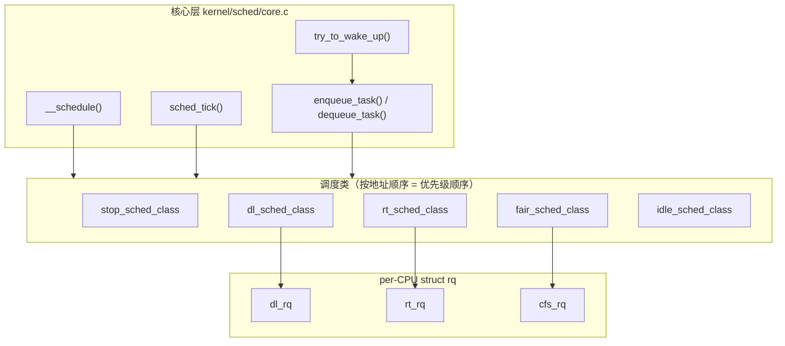

# 3.1 调度器框架：调度策略、调度类与运行队列

> **本节源码**：[`kernel/sched/core.c`](../../linux/kernel/sched/core.c)、[`kernel/sched/sched.h`](../../linux/kernel/sched/sched.h)、[`kernel/sched/syscalls.c`](../../linux/kernel/sched/syscalls.c)、[`include/linux/sched.h`](../../linux/include/linux/sched.h)、[`include/linux/sched/prio.h`](../../linux/include/linux/sched/prio.h)、[`include/uapi/linux/sched.h`](../../linux/include/uapi/linux/sched.h)、[`include/asm-generic/vmlinux.lds.h`](../../linux/include/asm-generic/vmlinux.lds.h)
> **关键函数**：`__setscheduler_class()`、`__normal_prio()`、`set_load_weight()`、`enqueue_task()`、`activate_task()`、`wakeup_preempt()`
> **前置知识**：第 2 章 进程管理（`task_struct` 与进程状态）

## 概述

调度器（Scheduler）要回答的问题只有一个：**此刻这个 CPU 该运行哪个任务**。难点在于不同任务的诉求差别很大：交互进程要求低延迟，批处理任务要求吞吐，实时任务要求确定性，截止期任务要求在期限内拿到指定的 CPU 时间。

Linux 的做法是把"选择任务"这件事拆成两层：**核心层**（`kernel/sched/core.c`）负责加锁、时钟、上下文切换（Context Switch）等与策略无关的机制；**调度类**（Scheduling Class）负责各自策略下的入队、出队、选取和抢占（Preemption）判断。核心层按固定优先级依次询问各个调度类，第一个给出任务的调度类胜出。

每个 CPU 有一个独立的运行队列（Runqueue，`struct rq`），其中为每个调度类嵌入了各自的子队列。本节先建立这套框架的整体图景，后续各节再深入具体调度类。

## 调度策略与优先级

### 调度策略

用户态通过 `sched_setscheduler(2)` / `sched_setattr(2)` 为线程指定调度策略（Scheduling Policy）：

[`include/uapi/linux/sched.h:114-121`](../../linux/include/uapi/linux/sched.h#L114-L121)（v6.18.60）

```c
#define SCHED_NORMAL		0
#define SCHED_FIFO		1
#define SCHED_RR		2
#define SCHED_BATCH		3
/* SCHED_ISO: reserved but not implemented yet */
#define SCHED_IDLE		5
#define SCHED_DEADLINE		6
#define SCHED_EXT		7
```

| 策略 | 含义 | 所属调度类 |
|---|---|---|
| `SCHED_NORMAL` | 普通分时任务（用户态常称 `SCHED_OTHER`） | `fair_sched_class` |
| `SCHED_BATCH` | 批处理任务，不期望唤醒抢占 | `fair_sched_class` |
| `SCHED_IDLE` | 极低权重任务，只在系统空闲时运行 | `fair_sched_class` |
| `SCHED_FIFO` | 实时，先进先出，无时间片 | `rt_sched_class` |
| `SCHED_RR` | 实时，同优先级间轮转 | `rt_sched_class` |
| `SCHED_DEADLINE` | 基于 EDF + CBS 的截止期调度 | `dl_sched_class` |
| `SCHED_EXT` | 由 BPF 程序实现的可扩展调度 | `ext_sched_class`（依赖 `CONFIG_SCHED_CLASS_EXT`） |

注意 `SCHED_IDLE` 策略并**不**属于 `idle_sched_class`：前者是公平调度类中权重极低的普通任务，后者只服务每个 CPU 上的 idle 线程（swapper）。本书使用的 `linux/.config` 中 `CONFIG_SCHED_CLASS_EXT` 未开启，因此 `SCHED_EXT` 相关代码在默认配置下不参与编译。

### 优先级的数值空间

内核内部用一个整数表示优先级，实时与普通任务位于 `[0, 140)`，Deadline 任务固定为 -1，**数值越小优先级越高**：

[`include/linux/sched/prio.h:16-28`](../../linux/include/linux/sched/prio.h#L16-L28)（v6.18.60）

```c
#define MAX_RT_PRIO		100
#define MAX_DL_PRIO		0

#define MAX_PRIO		(MAX_RT_PRIO + NICE_WIDTH)
#define DEFAULT_PRIO		(MAX_RT_PRIO + NICE_WIDTH / 2)

/*
 * Convert user-nice values [ -20 ... 0 ... 19 ]
 * to static priority [ MAX_RT_PRIO..MAX_PRIO-1 ],
 * and back.
 */
#define NICE_TO_PRIO(nice)	((nice) + DEFAULT_PRIO)
#define PRIO_TO_NICE(prio)	((prio) - DEFAULT_PRIO)
```

其中 `NICE_WIDTH` 为 40（[`include/linux/sched/prio.h:7`](../../linux/include/linux/sched/prio.h#L7)），所以 `MAX_PRIO` = 140，`DEFAULT_PRIO` = 120（即 nice 0）。

```
  prio:  -1   0 ......................... 99  100 ............ 120 ............ 139
         │    │<------- 实时 (RT) ------->│   │<------- 普通 (nice -20 ~ +19) --->│
         │    99 - rt_priority                 NICE_TO_PRIO(nice)
     DEADLINE
   (MAX_DL_PRIO - 1)
       优先级高  <──────────────────────────────────────────────────────>  优先级低
```

*图 3-1：内核内部优先级数值空间（从左到右数值递增、优先级递减）*

`task_struct` 中有四个与优先级相关的字段：

| 字段 | 含义 |
|---|---|
| `static_prio` | 由 nice 值换算的静态优先级，只对普通任务有意义 |
| `rt_priority` | 用户指定的实时优先级 `1..99`，**数值越大越高**，与 `prio` 方向相反 |
| `normal_prio` | 只根据策略和上面两个值算出的"本来"优先级 |
| `prio` | 调度器实际使用的动态优先级，可能因优先级继承（Priority Inheritance，PI）被临时提升 |

`normal_prio` 的计算规则一目了然：

[`kernel/sched/syscalls.c:19-31`](../../linux/kernel/sched/syscalls.c#L19-L31)（v6.18.60）

```c
static inline int __normal_prio(int policy, int rt_prio, int nice)
{
	int prio;

	if (dl_policy(policy))
		prio = MAX_DL_PRIO - 1;
	else if (rt_policy(policy))
		prio = MAX_RT_PRIO - 1 - rt_prio;
	else
		prio = NICE_TO_PRIO(nice);

	return prio;
}
```

`SCHED_DEADLINE` 任务的 `prio` 固定为 -1，排在所有实时优先级之前；实时任务的 `rt_priority` 越大，`prio` 越小。

### 从优先级到调度类

任务属于哪个调度类，由 `prio`（而不是 `policy`）决定，这样 PI 提升可以把一个普通任务临时"升格"到实时调度类：

[`kernel/sched/core.c:7281-7295`](../../linux/kernel/sched/core.c#L7281-L7295)（v6.18.60）

```c
const struct sched_class *__setscheduler_class(int policy, int prio)
{
	if (dl_prio(prio))
		return &dl_sched_class;

	if (rt_prio(prio))
		return &rt_sched_class;

#ifdef CONFIG_SCHED_CLASS_EXT
	if (task_should_scx(policy))
		return &ext_sched_class;
#endif

	return &fair_sched_class;
}
```

`dl_prio()` 判断 `prio < MAX_DL_PRIO`（[`include/linux/sched/deadline.h:13`](../../linux/include/linux/sched/deadline.h#L13)），`rt_prio()` 判断 `MAX_DL_PRIO <= prio < MAX_RT_PRIO`（[`include/linux/sched/rt.h:9`](../../linux/include/linux/sched/rt.h#L9)）。

## 调度类：面向对象的调度框架

### struct sched_class

`struct sched_class` 是一张函数指针表，相当于 C 语言里的"接口"。下面只保留本章会反复出现的方法：

[`kernel/sched/sched.h:2412-2456`](../../linux/kernel/sched/sched.h#L2412-L2456)（v6.18.60）

```c
struct sched_class {

#ifdef CONFIG_UCLAMP_TASK
	int uclamp_enabled;
#endif

	void (*enqueue_task) (struct rq *rq, struct task_struct *p, int flags);	// [注] 任务进入运行队列
	bool (*dequeue_task) (struct rq *rq, struct task_struct *p, int flags);	// [注] 任务离开运行队列
	void (*yield_task)   (struct rq *rq);
	bool (*yield_to_task)(struct rq *rq, struct task_struct *p);

	void (*wakeup_preempt)(struct rq *rq, struct task_struct *p, int flags);	// [注] 新任务是否应抢占当前任务

	int (*balance)(struct rq *rq, struct rq_flags *rf);	// [注] 选任务前从其他 CPU 拉任务
	struct task_struct *(*pick_task)(struct rq *rq);	// [注] 选出下一个任务（不切换状态）
	...
	struct task_struct *(*pick_next_task)(struct rq *rq, struct task_struct *prev);

	void (*put_prev_task)(struct rq *rq, struct task_struct *p, struct task_struct *next);	// [注] 当前任务让出 CPU
	void (*set_next_task)(struct rq *rq, struct task_struct *p, bool first);	// [注] 任务成为当前任务

	int  (*select_task_rq)(struct task_struct *p, int task_cpu, int flags);	// [注] 唤醒/fork 时选 CPU

	void (*migrate_task_rq)(struct task_struct *p, int new_cpu);
	...
	void (*task_tick)(struct rq *rq, struct task_struct *p, int queued);	// [注] 时钟中断回调
	void (*task_fork)(struct task_struct *p);
	void (*task_dead)(struct task_struct *p);
	...
```

方法可以分成几组：

- **队列维护**：`enqueue_task()` / `dequeue_task()`，任务变为可运行或不可运行时调用。
- **选择与切换**：`balance()` → `pick_task()` → `put_prev_task()` → `set_next_task()`，在 `__schedule()` 中被依次调用（见 3.2 节）。`pick_next_task()` 是可选的合并优化，目前只有公平调度类实现了它。
- **抢占判断**：`wakeup_preempt()` 在唤醒时调用，`task_tick()` 在时钟中断中调用。
- **SMP 相关**：`select_task_rq()`、`migrate_task_rq()`、`rq_online()` / `rq_offline()` 等。
- **属性变更**：`switched_from()` / `switched_to()` / `prio_changed()` / `reweight_task()`。

### 内核中的调度类实例

v6.18.60 定义了 6 个调度类，按优先级从高到低：

| 调度类 | 定义位置 | 服务对象 |
|---|---|---|
| `stop_sched_class` | [`kernel/sched/stop_task.c:96`](../../linux/kernel/sched/stop_task.c#L96) | 每 CPU 一个的 stopper 线程（`migration/N`），用于迁移、CPU 热插拔等 |
| `dl_sched_class` | [`kernel/sched/deadline.c:3321`](../../linux/kernel/sched/deadline.c#L3321) | `SCHED_DEADLINE` 任务，以及 `fair_server` 等 dl_server |
| `rt_sched_class` | [`kernel/sched/rt.c:2587`](../../linux/kernel/sched/rt.c#L2587) | `SCHED_FIFO` / `SCHED_RR` |
| `fair_sched_class` | [`kernel/sched/fair.c:14112`](../../linux/kernel/sched/fair.c#L14112) | `SCHED_NORMAL` / `SCHED_BATCH` / `SCHED_IDLE`，使用 EEVDF 算法 |
| `ext_sched_class` | [`kernel/sched/ext.c:3400`](../../linux/kernel/sched/ext.c#L3400) | `SCHED_EXT`（依赖 `CONFIG_SCHED_CLASS_EXT`） |
| `idle_sched_class` | [`kernel/sched/idle.c:546`](../../linux/kernel/sched/idle.c#L546) | 每 CPU 的 idle 线程 |

以公平调度类为例，它的实例是这样填写的（节选）：

[`kernel/sched/fair.c:14112-14134`](../../linux/kernel/sched/fair.c#L14112-L14134)（v6.18.60）

```c
DEFINE_SCHED_CLASS(fair) = {

	.enqueue_task		= enqueue_task_fair,
	.dequeue_task		= dequeue_task_fair,
	.yield_task		= yield_task_fair,
	.yield_to_task		= yield_to_task_fair,

	.wakeup_preempt		= check_preempt_wakeup_fair,

	.pick_task		= pick_task_fair,
	.pick_next_task		= __pick_next_task_fair,
	.put_prev_task		= put_prev_task_fair,
	.set_next_task          = set_next_task_fair,

	.balance		= balance_fair,
	.select_task_rq		= select_task_rq_fair,
	.migrate_task_rq	= migrate_task_rq_fair,

	.rq_online		= rq_online_fair,
	.rq_offline		= rq_offline_fair,

	.task_dead		= task_dead_fair,
	.set_cpus_allowed	= set_cpus_allowed_fair,
```

### 用链接顺序表达优先级

调度类之间的优先级没有用一个整数字段表示，而是**用它们在内存中的地址顺序**表示。`DEFINE_SCHED_CLASS()` 把每个实例放进独立的段：

[`kernel/sched/sched.h:2531-2534`](../../linux/kernel/sched/sched.h#L2531-L2534)（v6.18.60）

```c
#define DEFINE_SCHED_CLASS(name) \
const struct sched_class name##_sched_class \
	__aligned(__alignof__(struct sched_class)) \
	__section("__" #name "_sched_class")
```

链接脚本再按固定顺序把这些段排在一起，并在首尾定义两个边界符号：

[`include/asm-generic/vmlinux.lds.h:136-145`](../../linux/include/asm-generic/vmlinux.lds.h#L136-L145)（v6.18.60）

```c
#define SCHED_DATA				\
	STRUCT_ALIGN();				\
	__sched_class_highest = .;		\
	*(__stop_sched_class)			\
	*(__dl_sched_class)			\
	*(__rt_sched_class)			\
	*(__fair_sched_class)			\
	*(__ext_sched_class)			\
	*(__idle_sched_class)			\
	__sched_class_lowest = .;
```

```
   低地址  __sched_class_highest ──► ┌──────────────────┐
                                     │ stop_sched_class │  优先级最高
                                     ├──────────────────┤
                                     │ dl_sched_class   │
                                     ├──────────────────┤
                                     │ rt_sched_class   │
                                     ├──────────────────┤
                                     │ fair_sched_class │
                                     ├──────────────────┤
                                     │ ext_sched_class  │  （CONFIG_SCHED_CLASS_EXT）
                                     ├──────────────────┤
                                     │ idle_sched_class │  优先级最低
   高地址  __sched_class_lowest  ──► └──────────────────┘
```

*图 3-2：调度类在 `.data` 中的布局（地址从上到下递增）*

于是"比较优先级"和"遍历调度类"都退化成了指针运算：

[`kernel/sched/sched.h:2562-2574`](../../linux/kernel/sched/sched.h#L2562-L2574)（v6.18.60）

```c
#define for_class_range(class, _from, _to) \
	for (class = (_from); class < (_to); class++)

#define for_each_class(class) \
	for_class_range(class, __sched_class_highest, __sched_class_lowest)

#define for_active_class_range(class, _from, _to)				\
	for (class = (_from); class != (_to); class = next_active_class(class))

#define for_each_active_class(class)						\
	for_active_class_range(class, __sched_class_highest, __sched_class_lowest)

#define sched_class_above(_a, _b)	((_a) < (_b))
```

`next_active_class()`（[`kernel/sched/sched.h:2550`](../../linux/kernel/sched/sched.h#L2550)）在 `class++` 的基础上，处理 sched_ext 接管全部公平任务或未启用时跳过对应类的情况；未开启 `CONFIG_SCHED_CLASS_EXT` 时它就是简单的 `class++`。

为了防止链接顺序出错，`sched_init()` 一开始就做了断言：

[`kernel/sched/core.c:8649-8652`](../../linux/kernel/sched/core.c#L8649-L8652)（v6.18.60）

```c
	BUG_ON(!sched_class_above(&stop_sched_class, &dl_sched_class));
	BUG_ON(!sched_class_above(&dl_sched_class, &rt_sched_class));
	BUG_ON(!sched_class_above(&rt_sched_class, &fair_sched_class));
	BUG_ON(!sched_class_above(&fair_sched_class, &idle_sched_class));
```

> 设计考量：早期内核在每个 `sched_class` 中用 `next` 指针串成单链表。v5.9 起改为链接段排序，遍历时不再需要解引用指针，`sched_class_above()` 也只是一次地址比较，热路径上更便宜。

## 运行队列 struct rq

### per-CPU 运行队列

每个 CPU 拥有一个 `struct rq`，定义为 per-CPU 变量：

[`kernel/sched/core.c:126`](../../linux/kernel/sched/core.c#L126)（v6.18.60）

```c
DEFINE_PER_CPU_SHARED_ALIGNED(struct rq, runqueues);
```

[`kernel/sched/sched.h:1360-1363`](../../linux/kernel/sched/sched.h#L1360-L1363)（v6.18.60）

```c
#define cpu_rq(cpu)		(&per_cpu(runqueues, (cpu)))
#define this_rq()		this_cpu_ptr(&runqueues)
#define task_rq(p)		cpu_rq(task_cpu(p))
#define cpu_curr(cpu)		(cpu_rq(cpu)->curr)
```

`SHARED_ALIGNED` 保证不同 CPU 的 `rq` 不会落在同一缓存行，避免伪共享。由于绝大多数调度操作只涉及本 CPU 的 `rq`，per-CPU 设计让调度器在多核上几乎没有全局锁竞争。

### 关键字段

`struct rq` 有上百个字段，下面只保留与调度主流程相关的部分：

[`kernel/sched/sched.h:1119-1228`](../../linux/kernel/sched/sched.h#L1119-L1228)（v6.18.60，节选）

```c
struct rq {
	/* runqueue lock: */
	raw_spinlock_t		__lock;		// [注] 保护本 rq 的自旋锁，通过 rq_lock() 等接口访问

	unsigned int		nr_running;	// [注] 本 CPU 上所有调度类的可运行任务总数
	...
	u64			nr_switches;	// [注] 上下文切换计数
	...
	struct cfs_rq		cfs;		// [注] 公平调度类的根运行队列
	struct rt_rq		rt;		// [注] 实时调度类运行队列
	struct dl_rq		dl;		// [注] Deadline 调度类运行队列
#ifdef CONFIG_SCHED_CLASS_EXT
	struct scx_rq		scx;
#endif

	struct sched_dl_entity	fair_server;	// [注] 为公平任务预留带宽的 dl_server，见 3.7 节
	...
	unsigned long 		nr_uninterruptible;
	...
	union {
		struct task_struct __rcu *donor; /* Scheduler context */
		struct task_struct __rcu *curr;  /* Execution context */
	};
	/* 省略 CONFIG_SCHED_PROXY_EXEC 相关代码 */
	struct sched_dl_entity	*dl_server;
	struct task_struct	*idle;		// [注] 本 CPU 的 idle 线程
	struct task_struct	*stop;		// [注] 本 CPU 的 stopper 线程
	unsigned long		next_balance;	// [注] 下一次周期性负载均衡的时刻（jiffies）
	struct mm_struct	*prev_mm;	// [注] 上下文切换中延迟释放的 mm
	...
	u64			clock;		// [注] rq 时钟，由 update_rq_clock() 更新
	/* Ensure that all clocks are in the same cache line */
	u64			clock_task ____cacheline_aligned;	// [注] 扣除中断/steal 时间后的任务时钟
	u64			clock_pelt;	// [注] PELT 使用的时钟，见 3.8 节
	...
	struct root_domain		*rd;
	struct sched_domain __rcu	*sd;	// [注] 调度域层级，见 3.9 节

	unsigned long		cpu_capacity;	// [注] CPU 算力（满额为 1024）
	...
	/* CPU of this runqueue: */
	int			cpu;
	int			online;

	struct list_head cfs_tasks;
	...
```

几点说明：

1. **每类一个子队列**。`rq` 本身不排序任务，而是为每个调度类内嵌一个子队列：`cfs_rq` 用红黑树组织调度实体，`rt_rq` 用"位图 + 每优先级链表"，`dl_rq` 用按截止期排序的红黑树。核心层只关心 `nr_running`，具体顺序交给调度类。
2. **`curr` 与 `donor`**。代理执行（Proxy Execution）把"谁的调度参数被使用"（donor）与"谁在实际执行"（curr）区分开。本书配置中 `CONFIG_SCHED_PROXY_EXEC` 未开启，二者通过 `union` 合为同一个指针，可以视为等价。
3. **`fair_server`**。从 v6.12 起，内核用一个 Deadline 实体为公平任务保留一小份带宽，防止实时任务长期霸占 CPU 导致公平任务饿死，取代了旧的 RT throttling 的部分职能。

### 初始化

`sched_init()` 在 `start_kernel()` 早期为每个可能的 CPU 初始化运行队列：

[`kernel/sched/core.c:8708-8718`](../../linux/kernel/sched/core.c#L8708-L8718)（v6.18.60）

```c
	for_each_possible_cpu(i) {
		struct rq *rq;

		rq = cpu_rq(i);
		raw_spin_lock_init(&rq->__lock);
		rq->nr_running = 0;
		rq->calc_load_active = 0;
		rq->calc_load_update = jiffies + LOAD_FREQ;
		init_cfs_rq(&rq->cfs);
		init_rt_rq(&rq->rt);
		init_dl_rq(&rq->dl);
```

循环结束后，`sched_init()` 通过 `init_idle(current, smp_processor_id())`（[`kernel/sched/core.c:8822`](../../linux/kernel/sched/core.c#L8822)）把当前执行流——也就是引导 CPU 上的 0 号进程——变成该 CPU 的 idle 线程。

## task_struct 中的调度字段

`task_struct` 中与调度相关的字段集中在前部：

[`include/linux/sched.h:844-873`](../../linux/include/linux/sched.h#L844-L873)（v6.18.60，节选）

```c
	int				on_cpu;		// [注] 任务是否正在某个 CPU 上执行（含切换过程中）
	struct __call_single_node	wake_entry;	// [注] 远程唤醒队列节点
	...
	int				recent_used_cpu;
	int				wake_cpu;
	int				on_rq;		// [注] 0 / TASK_ON_RQ_QUEUED / TASK_ON_RQ_MIGRATING

	int				prio;
	int				static_prio;
	int				normal_prio;
	unsigned int			rt_priority;

	struct sched_entity		se;		// [注] 公平调度实体
	struct sched_rt_entity		rt;		// [注] 实时调度实体
	struct sched_dl_entity		dl;		// [注] Deadline 调度实体
	struct sched_dl_entity		*dl_server;
#ifdef CONFIG_SCHED_CLASS_EXT
	struct sched_ext_entity		scx;
#endif
	const struct sched_class	*sched_class;	// [注] 当前所属调度类
```

[`include/linux/sched.h:915-920`](../../linux/include/linux/sched.h#L915-L920)（v6.18.60）

```c
	unsigned int			policy;
	unsigned long			max_allowed_capacity;
	int				nr_cpus_allowed;
	const cpumask_t			*cpus_ptr;
	cpumask_t			*user_cpus_ptr;
	cpumask_t			cpus_mask;
```

`on_rq` 与 `on_cpu` 是两个独立的状态：一个任务可以在队列上但没在运行（等待 CPU），也可以正在运行。处于 `TASK_ON_RQ_MIGRATING`（[`kernel/sched/sched.h:98`](../../linux/kernel/sched/sched.h#L98)）时，任务正在两个 CPU 的运行队列之间搬移。

### 调度实体

调度类操作的对象不是 `task_struct`，而是嵌入其中的**调度实体**（Scheduling Entity）。这样做有两个好处：每个调度类只需关心自己的那份数据；在组调度中，一个实体还可以代表一组任务（见 3.10 节）。公平调度类的实体如下：

[`include/linux/sched.h:570-616`](../../linux/include/linux/sched.h#L570-L616)（v6.18.60，节选）

```c
struct sched_entity {
	/* For load-balancing: */
	struct load_weight		load;		// [注] 权重，由 nice 值决定
	struct rb_node			run_node;	// [注] 在 cfs_rq->tasks_timeline 红黑树中的节点
	u64				deadline;	// [注] EEVDF 虚拟截止时间
	u64				min_vruntime;
	u64				min_slice;
	u64				max_slice;

	struct list_head		group_node;
	unsigned char			on_rq;
	unsigned char			sched_delayed;	// [注] 延迟出队标记，见 3.3 节
	unsigned char			rel_deadline;
	unsigned char			custom_slice;
					/* hole */

	u64				exec_start;
	u64				sum_exec_runtime;	// [注] 累计实际运行时间（ns）
	u64				prev_sum_exec_runtime;
	u64				vruntime;	// [注] 虚拟运行时间
	/* Approximated virtual lag: */
	s64				vlag;
	/* 'Protected' deadline, to give out minimum quantums: */
	u64				vprot;
	u64				slice;		// [注] 请求的时间片长度
	...
#ifdef CONFIG_FAIR_GROUP_SCHED
	int				depth;
	struct sched_entity		*parent;
	/* rq on which this entity is (to be) queued: */
	struct cfs_rq			*cfs_rq;
	/* rq "owned" by this entity/group: */
	struct cfs_rq			*my_q;
	...
#endif
	...
	struct sched_avg		avg;		// [注] PELT 负载信号
};
```

`vruntime`、`deadline`、`vlag`、`slice` 是 EEVDF 算法的核心变量，3.3 节会详细分析。

## 权重：nice 值如何变成 CPU 份额

公平调度类按**权重**（Load Weight）比例分配 CPU 时间。nice 值通过一张预先计算的表映射为权重：

[`kernel/sched/core.c:10331-10340`](../../linux/kernel/sched/core.c#L10331-L10340)（v6.18.60）

```c
const int sched_prio_to_weight[40] = {
 /* -20 */     88761,     71755,     56483,     46273,     36291,
 /* -15 */     29154,     23254,     18705,     14949,     11916,
 /* -10 */      9548,      7620,      6100,      4904,      3906,
 /*  -5 */      3121,      2501,      1991,      1586,      1277,
 /*   0 */      1024,       820,       655,       526,       423,
 /*   5 */       335,       272,       215,       172,       137,
 /*  10 */       110,        87,        70,        56,        45,
 /*  15 */        36,        29,        23,        18,        15,
};
```

相邻两级的权重之比约为 1.25。源码注释（[`kernel/sched/core.c:10319-10329`](../../linux/kernel/sched/core.c#L10319-L10329)）解释了这一取值：nice 值每变化 1，任务获得的 CPU 时间相对变化约 10%。例如两个 CPU 密集型任务分别为 nice 0 和 nice 1，它们的 CPU 份额为：

```
nice 0: 1024 / (1024 + 820) ≈ 55.5%
nice 1:  820 / (1024 + 820) ≈ 44.5%
```

权重由 `set_load_weight()` 写入调度实体：

[`kernel/sched/core.c:1448-1469`](../../linux/kernel/sched/core.c#L1448-L1469)（v6.18.60）

```c
void set_load_weight(struct task_struct *p, bool update_load)
{
	int prio = p->static_prio - MAX_RT_PRIO;
	struct load_weight lw;

	if (task_has_idle_policy(p)) {
		lw.weight = scale_load(WEIGHT_IDLEPRIO);
		lw.inv_weight = WMULT_IDLEPRIO;
	} else {
		lw.weight = scale_load(sched_prio_to_weight[prio]);
		lw.inv_weight = sched_prio_to_wmult[prio];
	}

	/*
	 * SCHED_OTHER tasks have to update their load when changing their
	 * weight
	 */
	if (update_load && p->sched_class->reweight_task)
		p->sched_class->reweight_task(task_rq(p), p, &lw);
	else
		p->se.load = lw;
}
```

- `SCHED_IDLE` 策略的任务权重固定为 `WEIGHT_IDLEPRIO` = 3（[`kernel/sched/sched.h:2350`](../../linux/kernel/sched/sched.h#L2350)），比 nice 19 的 15 还低。
- `inv_weight` 是预先计算的 `2^32 / weight`，用来把除法换成乘法加移位。
- 在 64 位内核上，`scale_load()` 把权重左移 `SCHED_FIXEDPOINT_SHIFT`（10）位以提高定点精度（[`kernel/sched/sched.h:147-149`](../../linux/kernel/sched/sched.h#L147-L149)），因此 nice 0 对应的内部负载 `NICE_0_LOAD` 为 `1 << 20`，而不是 1024。

## 核心层如何调用调度类

核心层通过少数几个包装函数调用调度类方法。以入队为例：

[`kernel/sched/core.c:2096-2117`](../../linux/kernel/sched/core.c#L2096-L2117)（v6.18.60）

```c
void enqueue_task(struct rq *rq, struct task_struct *p, int flags)
{
	if (!(flags & ENQUEUE_NOCLOCK))
		update_rq_clock(rq);

	/*
	 * Can be before ->enqueue_task() because uclamp considers the
	 * ENQUEUE_DELAYED task before its ->sched_delayed gets cleared
	 * in ->enqueue_task().
	 */
	uclamp_rq_inc(rq, p, flags);

	p->sched_class->enqueue_task(rq, p, flags);

	psi_enqueue(p, flags);

	if (!(flags & ENQUEUE_RESTORE))
		sched_info_enqueue(rq, p);

	if (sched_core_enabled(rq))
		sched_core_enqueue(rq, p);
}
```

`enqueue_task()` 先更新 rq 时钟，再分派给 `p->sched_class->enqueue_task()`，前后穿插 uclamp、PSI、调度统计、核心调度（Core Scheduling）等横切逻辑。`activate_task()` 在此基础上再设置 `on_rq`：

[`kernel/sched/core.c:2143-2154`](../../linux/kernel/sched/core.c#L2143-L2154)（v6.18.60）

```c
void activate_task(struct rq *rq, struct task_struct *p, int flags)
{
	if (task_on_rq_migrating(p))
		flags |= ENQUEUE_MIGRATED;
	if (flags & ENQUEUE_MIGRATED)
		sched_mm_cid_migrate_to(rq, p);

	enqueue_task(rq, p, flags);

	WRITE_ONCE(p->on_rq, TASK_ON_RQ_QUEUED);
	ASSERT_EXCLUSIVE_WRITER(p->on_rq);
}
```

唤醒抢占的判断同样体现了"跨类比较由核心层做、类内比较由调度类做"的分工：

[`kernel/sched/core.c:2219-2234`](../../linux/kernel/sched/core.c#L2219-L2234)（v6.18.60）

```c
void wakeup_preempt(struct rq *rq, struct task_struct *p, int flags)
{
	struct task_struct *donor = rq->donor;

	if (p->sched_class == donor->sched_class)
		donor->sched_class->wakeup_preempt(rq, p, flags);
	else if (sched_class_above(p->sched_class, donor->sched_class))
		resched_curr(rq);

	/*
	 * A queue event has occurred, and we're going to schedule.  In
	 * this case, we can save a useless back to back clock update.
	 */
	if (task_on_rq_queued(donor) && test_tsk_need_resched(rq->curr))
		rq_clock_skip_update(rq);
}
```

被唤醒任务所属的调度类更高时，直接 `resched_curr()` 要求重新调度；同类时交给该类自己的 `wakeup_preempt()` 判断（公平类中是 `check_preempt_wakeup_fair()`）；更低时什么也不做。

整体分层关系如下：



*图 3-3：调度器核心层、调度类与运行队列的关系*

## 关键细节 / 设计考量

- **`dequeue_task()` 可能"失败"**。`dequeue_task()` 返回 `bool`，注释明确"只有 `DEQUEUE_SLEEP` 时才可能返回 false"（[`kernel/sched/core.c:2119-2121`](../../linux/kernel/sched/core.c#L2119-L2121)）。这是 v6.12 引入的延迟出队（Delayed Dequeue）：公平类中一个尚有负 lag 的任务睡眠时，会先以 `sched_delayed` 状态留在红黑树里，直到它"还清"欠下的时间才真正离开（[`kernel/sched/fair.c:5579-5584`](../../linux/kernel/sched/fair.c#L5579-L5584)）。3.3 节会详细讨论。
- **优先级与调度类解耦**。决定调度类的是动态的 `prio`，因此 rt_mutex 的优先级继承可以临时把任务移入更高的调度类，结束后再移回，调用 `check_class_changed()`（[`kernel/sched/core.c:2206`](../../linux/kernel/sched/core.c#L2206)）通知新旧调度类。
- **核心层与调度类的锁约定**。几乎所有 `sched_class` 方法都在持有 `rq->__lock` 的情况下被调用；`switched_from()` 例外，它允许释放 rq 锁，此时由 `p->pi_lock` 保证串行化（见 [`kernel/sched/sched.h:2458-2462`](../../linux/kernel/sched/sched.h#L2458-L2462) 注释）。

## 动手实验

以下实验在 **dev 虚拟机** 中进行，查看 debugfs 需要 **root 权限**。

1. 查看线程的调度策略与优先级：

   ```bash
   # 虚拟机，普通用户
   ps -eLo pid,tid,cls,rtprio,pri,ni,comm | head -20
   chrt -p $$
   ```

   `cls` 列中 `TS` 表示 `SCHED_NORMAL`，`FF` / `RR` 表示实时策略，`B` 表示 `SCHED_BATCH`，`IDL` 表示 `SCHED_IDLE`，`DLN` 表示 `SCHED_DEADLINE`。

2. 修改策略并观察 `/proc/<pid>/sched` 中的 `policy`、`prio` 与 `se.load.weight`：

   ```bash
   # 虚拟机，root
   sleep 1000 &
   cat /proc/$!/sched | grep -E 'policy|prio|load.weight'
   renice -n 5 -p $!
   cat /proc/$!/sched | grep -E 'policy|prio|load.weight'
   chrt -f -p 10 $!
   cat /proc/$!/sched | grep -E 'policy|prio'
   ```

   nice 改为 5 后，`se.load.weight` 应为 `335 << 10`；切到 `SCHED_FIFO` 10 后，`prio` 应为 `99 - 10 = 89`。

3. 查看每个 CPU 的运行队列（依赖 `CONFIG_DEBUG_FS`）：

   ```bash
   # 虚拟机，root
   cat /sys/kernel/debug/sched/debug | less
   ```

   输出中每个 `cpu#N` 段落依次给出 `.nr_running`、`.nr_switches`，以及该 CPU 上 `cfs_rq`、`rt_rq`、`dl_rq` 的状态。

## 小结

- 调度器分为策略无关的**核心层**和策略相关的**调度类**两层，调度类通过 `struct sched_class` 函数指针表接入核心层。
- v6.18.60 有 stop、dl、rt、fair、ext、idle 六个调度类，它们的优先级由链接脚本 `SCHED_DATA` 决定的**地址顺序**表示，`sched_class_above()` 只是一次指针比较。
- 内核内部优先级 `prio` 位于 `[-1, 140)`，数值越小越高；任务所属调度类由 `prio` 而非 `policy` 决定，从而支持优先级继承。
- 每个 CPU 有一个 `struct rq`，内嵌 `cfs_rq`、`rt_rq`、`dl_rq` 等子队列，绝大多数调度操作只需持有本 CPU 的 rq 锁。
- 调度类操作的是嵌入 `task_struct` 的调度实体（`se` / `rt` / `dl`），公平类的实体还可以代表任务组。
- nice 值经 `sched_prio_to_weight[]` 映射为权重，相邻两级相差约 1.25 倍，对应约 10% 的 CPU 份额变化。

## 参考

- `linux/Documentation/scheduler/sched-design-CFS.rst`：CFS 设计文档，其中"调度类"一节描述了 `sched_class` 的接口。
- `linux/Documentation/scheduler/sched-eevdf.rst`：EEVDF 调度器简介。
- `linux/Documentation/scheduler/sched-nice-design.rst`：nice 值与权重表的设计背景。
- `linux/Documentation/scheduler/sched-deadline.rst`：`SCHED_DEADLINE` 的 CBS 规则与准入控制。
- `linux/Documentation/scheduler/sched-rt-group.rst`：实时带宽限制，2.1 节提到为公平类 dl_server 保留带宽。
- `man 7 sched`：用户态视角的调度策略说明。
