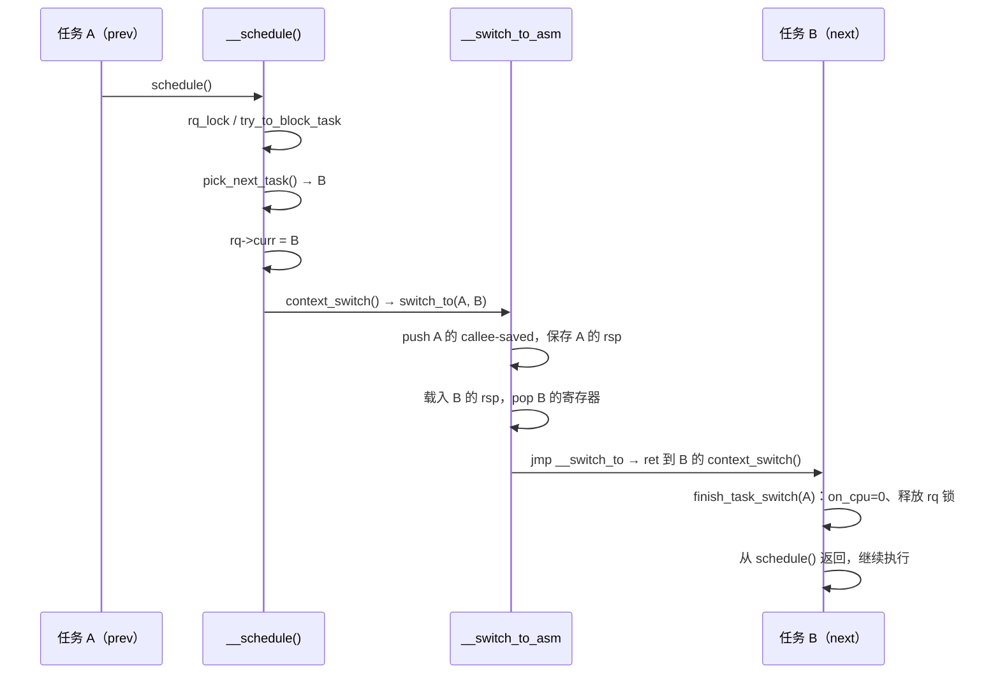

# 3.2 主调度函数与上下文切换

> **本节源码**：`kernel/sched/core.c`、`kernel/sched/sched.h`、`kernel/entry/common.c`、`include/linux/preempt.h`、`arch/x86/include/asm/preempt.h`、`arch/x86/include/asm/switch_to.h`、`arch/x86/entry/entry_64.S`、`arch/x86/kernel/process_64.c`
> **关键函数**：`schedule()`、`__schedule()`、`try_to_block_task()`、`pick_next_task()`、`__pick_next_task()`、`context_switch()`、`__switch_to_asm()`、`__switch_to()`、`finish_task_switch()`、`resched_curr()`
> **前置知识**：3.1 调度器框架

## 概述

`__schedule()` 是调度器的心脏：它在当前 CPU 上完成"让出 → 选择 → 切换"三步。所有调度路径——任务主动睡眠、内核抢占、中断返回抢占、idle 循环——最终都汇入这一个函数，只是传入的 `sched_mode` 不同。

本节先说明调度在什么时候发生，再逐段拆解 `__schedule()`，最后深入 `context_switch()`，看 x86_64 上地址空间、内核栈和寄存器是如何换掉的。具体调度类如何"选出下一个任务"留给 3.3 节及之后各节。

## 调度的触发时机

### 主动调度与被动调度

进入调度器的方式分两类：

- **主动调度**：任务自己调用 `schedule()`，通常是因为要等待某个事件（锁、I/O、等待队列），调用前已把 `__state` 设为非 `TASK_RUNNING`。这种切换计入**自愿上下文切换**（Voluntary Context Switch，`nvcsw`）。
- **被动调度（抢占，Preemption）**：其他代码判断当前任务应当让出 CPU，于是给它打上 `TIF_NEED_RESCHED` 标记，等到下一个**抢占点**再调用 `__schedule(SM_PREEMPT)`。这种切换计入**非自愿上下文切换**（Involuntary Context Switch，`nivcsw`）。

源码在 `__schedule()` 之前的长注释（`kernel/sched/core.c:6762-6799`）列出了这些驱动方式。需要强调的是：**唤醒本身不会进入 `schedule()`**，它只把任务放回运行队列，必要时设置 `TIF_NEED_RESCHED`。

### 设置重调度标记：resched_curr()

```c
// kernel/sched/core.c:1113-1147（v6.18.60）
static void __resched_curr(struct rq *rq, int tif)
{
	struct task_struct *curr = rq->curr;
	struct thread_info *cti = task_thread_info(curr);
	int cpu;

	lockdep_assert_rq_held(rq);

	/*
	 * Always immediately preempt the idle task; no point in delaying doing
	 * actual work.
	 */
	if (is_idle_task(curr) && tif == TIF_NEED_RESCHED_LAZY)
		tif = TIF_NEED_RESCHED;

	if (cti->flags & ((1 << tif) | _TIF_NEED_RESCHED))
		return;

	cpu = cpu_of(rq);

	trace_sched_set_need_resched_tp(curr, cpu, tif);
	if (cpu == smp_processor_id()) {
		set_ti_thread_flag(cti, tif);
		if (tif == TIF_NEED_RESCHED)
			set_preempt_need_resched();
		return;
	}

	if (set_nr_and_not_polling(cti, tif)) {
		if (tif == TIF_NEED_RESCHED)
			smp_send_reschedule(cpu);
	} else {
		trace_sched_wake_idle_without_ipi(cpu);
	}
}
```

- **本 CPU**：设置 `thread_info->flags` 中的标志位；若是 `TIF_NEED_RESCHED`，还要同步到 `preempt_count`（见下文）。
- **远程 CPU**：用 `set_nr_and_not_polling()` 原子地设置标志，如果目标 CPU 不在 idle 轮询状态，就发送重调度 IPI（`smp_send_reschedule()`）把它"敲醒"；如果目标 CPU 正在 idle 中轮询 `TIF_NEED_RESCHED`（`TIF_POLLING_NRFLAG`），就省掉这次 IPI。

`resched_curr()` 传入 `TIF_NEED_RESCHED`，`resched_curr_lazy()` 则在惰性抢占（Lazy Preemption）开启时传入 `TIF_NEED_RESCHED_LAZY`（`core.c:1155-1184`）。后者只要求"在返回用户态或下一个 tick 时再调度"，不会在 `preempt_enable()` 处立即抢占。本书配置开启了 `CONFIG_PREEMPT_LAZY` 和 `CONFIG_PREEMPT_DYNAMIC`，抢占模型的细节在 3.5 节展开。

### x86 上的 preempt_count 小技巧

x86 把"需要重调度"的信息同时折叠进 per-CPU 的 `__preempt_count` 最高位，而且是**取反**存放：

```c
// arch/x86/include/asm/preempt.h:12-19（v6.18.60）
/* We use the MSB mostly because its available */
#define PREEMPT_NEED_RESCHED	0x80000000

/*
 * We use the PREEMPT_NEED_RESCHED bit as an inverted NEED_RESCHED such
 * that a decrement hitting 0 means we can and should reschedule.
 */
#define PREEMPT_ENABLED	(0 + PREEMPT_NEED_RESCHED)
```

`set_preempt_need_resched()` **清除**这一位（`arch/x86/include/asm/preempt.h:59-62`）。这样 `preempt_enable()` 只需一条 `decl` 指令，结果为 0 即同时说明"抢占计数为 0"且"需要重调度"：

```c
// include/linux/preempt.h:230-235（v6.18.60）
#define preempt_enable() \
do { \
	barrier(); \
	if (unlikely(preempt_count_dec_and_test())) \
		__preempt_schedule(); \
} while (0)
```

### 抢占点与入口函数

| 入口 | `sched_mode` | 典型调用者 |
|---|---|---|
| `schedule()` | `SM_NONE` | 等待队列、mutex、`exit_to_user_mode_loop()` |
| `preempt_schedule()` | `SM_PREEMPT` | `preempt_enable()` 计数归零时（依赖 `CONFIG_PREEMPTION`） |
| `preempt_schedule_irq()` | `SM_PREEMPT` | 中断返回内核态时 `raw_irqentry_exit_cond_resched()` |
| `schedule_idle()` | `SM_IDLE` | idle 循环 `do_idle()` |
| `do_task_dead()` | `SM_NONE` | 进程退出 `do_exit()` 的最后一步 |
| `schedule_rtlock()` | `SM_RTLOCK_WAIT` | PREEMPT_RT 下的睡眠自旋锁（依赖 `CONFIG_PREEMPT_RT`） |

```c
// kernel/sched/core.c:6533-6536（v6.18.60）
#define SM_IDLE			(-1)
#define SM_NONE			0
#define SM_PREEMPT		1
#define SM_RTLOCK_WAIT		2
```

返回用户态时检查标记的代码位于通用入口层：

```c
// kernel/entry/common.c:26-31（v6.18.60）
	while (ti_work & EXIT_TO_USER_MODE_WORK) {

		local_irq_enable_exit_to_user(ti_work);

		if (ti_work & (_TIF_NEED_RESCHED | _TIF_NEED_RESCHED_LAZY))
			schedule();
```

中断返回内核态时，只有 `preempt_count()` 为 0 才允许抢占：

```c
// kernel/entry/common.c:160-168（v6.18.60）
void raw_irqentry_exit_cond_resched(void)
{
	if (!preempt_count()) {
		/* Sanity check RCU and thread stack */
		rcu_irq_exit_check_preempt();
		if (IS_ENABLED(CONFIG_DEBUG_ENTRY))
			WARN_ON_ONCE(!on_thread_stack());
		if (need_resched() && arch_irqentry_exit_need_resched())
			preempt_schedule_irq();
```

注意返回用户态的路径同时检查 `_TIF_NEED_RESCHED_LAZY`，而内核态抢占点只看 `TIF_NEED_RESCHED`，这正是惰性抢占的实现基础。

## 调用链总览

```
schedule()                                   kernel/sched/core.c
├── sched_submit_work()                      // 睡眠前：通知 workqueue、刷出 plug I/O
├── __schedule_loop(SM_NONE)
│   └── __schedule()
│       ├── rq_lock() + update_rq_clock()
│       ├── try_to_block_task()              // prev 要睡眠：出队
│       │   └── block_task() → dequeue_task()
│       ├── pick_next_task()                 // CONFIG_SCHED_CORE 版本
│       │   └── __pick_next_task()
│       │       ├── pick_next_task_fair()    kernel/sched/fair.c  // 快速路径
│       │       └── for_each_active_class(): class->pick_task()
│       └── context_switch()
│           ├── prepare_task_switch()
│           ├── switch_mm_irqs_off()         arch/x86/mm/tlb.c
│           ├── switch_to()                  arch/x86/include/asm/switch_to.h
│           │   └── __switch_to_asm()        arch/x86/entry/entry_64.S
│           │       └── __switch_to()        arch/x86/kernel/process_64.c
│           └── finish_task_switch()
└── sched_update_worker()
```

## schedule() 与 __schedule_loop()

```c
// kernel/sched/core.c:7016-7037（v6.18.60）
static __always_inline void __schedule_loop(int sched_mode)
{
	do {
		preempt_disable();
		__schedule(sched_mode);
		sched_preempt_enable_no_resched();
	} while (need_resched());
}

asmlinkage __visible void __sched schedule(void)
{
	struct task_struct *tsk = current;

#ifdef CONFIG_RT_MUTEXES
	lockdep_assert(!tsk->sched_rt_mutex);
#endif

	if (!task_is_running(tsk))
		sched_submit_work(tsk);
	__schedule_loop(SM_NONE);
	sched_update_worker(tsk);
}
```

- `sched_submit_work()`（`core.c:6969`）只在任务**真的要睡眠**时调用：如果是 workqueue 工作线程，通知 workqueue 可能需要唤醒另一个 worker 维持并发度；如果有被 plug 住的块 I/O，先提交出去，以免自己睡眠时没人提交而死锁。
- `__schedule()` 要求调用者已关闭抢占，所以循环里先 `preempt_disable()`。返回后用 `sched_preempt_enable_no_resched()` 恢复，**不**在这里触发抢占，而是用 `while (need_resched())` 显式重试——切回本任务时可能又有新的重调度请求。

## __schedule() 逐段分析

### 第一步：关中断、加锁、更新时钟

```c
// kernel/sched/core.c:6801-6856（v6.18.60，节选）
static void __sched notrace __schedule(int sched_mode)
{
	struct task_struct *prev, *next;
	...
	bool preempt = sched_mode > SM_NONE;
	bool is_switch = false;
	unsigned long *switch_count;
	unsigned long prev_state;
	struct rq_flags rf;
	struct rq *rq;
	int cpu;
	...
	cpu = smp_processor_id();
	rq = cpu_rq(cpu);
	prev = rq->curr;

	schedule_debug(prev, preempt);

	if (sched_feat(HRTICK) || sched_feat(HRTICK_DL))
		hrtick_clear(rq);

	klp_sched_try_switch(prev);

	local_irq_disable();
	rcu_note_context_switch(preempt);
	...
	rq_lock(rq, &rf);
	smp_mb__after_spinlock();

	/* Promote REQ to ACT */
	rq->clock_update_flags <<= 1;
	update_rq_clock(rq);
	rq->clock_update_flags = RQCF_UPDATED;
```

- `prev` 就是当前 CPU 的 `rq->curr`，也就是 `current`。
- `schedule_debug()` 检查是否在原子上下文中调用了 `schedule()`（著名的 "scheduling while atomic" 报错就出自这里）。
- `rcu_note_context_switch()` 向 RCU 报告一个静止状态（Quiescent State）；对于在 RCU 读临界区中被抢占的任务，把它挂到阻塞链表上（依赖 `CONFIG_PREEMPT_RCU`）。
- `smp_mb__after_spinlock()` 提供一个完整内存屏障，与 `signal_wake_up()` 一侧的屏障配对：保证下文 `signal_pending_state()` 读到的信号状态不会早于调用者设置 `__state` 的那次写（源码在 `core.c:6833-6849` 的注释中画出了这个竞态）。
- `update_rq_clock()` 在每次调度时只更新一次 rq 时钟，后续 `dequeue_task()` 等调用都带 `*_NOCLOCK` 标志以避免重复更新。

### 第二步：处理 prev——要不要出队

```c
// kernel/sched/core.c:6858-6884（v6.18.60，节选）
	switch_count = &prev->nivcsw;

	/* Task state changes only considers SM_PREEMPT as preemption */
	preempt = sched_mode == SM_PREEMPT;
	...
	prev_state = READ_ONCE(prev->__state);
	if (sched_mode == SM_IDLE) {
		/* SCX must consult the BPF scheduler to tell if rq is empty */
		if (!rq->nr_running && !scx_enabled()) {
			next = prev;
			goto picked;
		}
	} else if (!preempt && prev_state) {
		...
		try_to_block_task(rq, prev, &prev_state,
				  !task_is_blocked(prev));
		switch_count = &prev->nvcsw;
	}
```

这里决定了 `prev` 的命运：

1. **idle 快速路径**：从 idle 循环进入且运行队列为空时，直接 `next = prev`，跳过选择过程。
2. **被抢占**（`SM_PREEMPT`）：无论 `prev->__state` 是什么都**不出队**。这一点非常关键——一个任务可能刚执行完 `set_current_state(TASK_UNINTERRUPTIBLE)`、还没来得及调用 `schedule()` 就被抢占，如果此时把它出队，就会丢失随后的唤醒。
3. **主动睡眠**（`prev_state != TASK_RUNNING`）：调用 `try_to_block_task()` 尝试出队，并把计数器切换为 `nvcsw`。

`try_to_block_task()` 的核心逻辑：

```c
// kernel/sched/core.c:6546-6589（v6.18.60，节选）
static bool try_to_block_task(struct rq *rq, struct task_struct *p,
			      unsigned long *task_state_p, bool should_block)
{
	unsigned long task_state = *task_state_p;
	int flags = DEQUEUE_NOCLOCK;

	if (signal_pending_state(task_state, p)) {
		WRITE_ONCE(p->__state, TASK_RUNNING);
		*task_state_p = TASK_RUNNING;
		return false;
	}
	...
	if (!should_block)
		return false;

	p->sched_contributes_to_load =
		(task_state & TASK_UNINTERRUPTIBLE) &&
		!(task_state & TASK_NOLOAD) &&
		!(task_state & TASK_FROZEN);

	if (unlikely(is_special_task_state(task_state)))
		flags |= DEQUEUE_SPECIAL;
	...
	block_task(rq, p, flags);
	return true;
}
```

- 如果任务以可被信号打断的状态睡眠且已有挂起信号，就把它改回 `TASK_RUNNING` 并保留在队列中——`schedule()` 返回后由调用者处理信号。
- `sched_contributes_to_load` 决定这次睡眠是否计入 `nr_uninterruptible`，也就是 `/proc/loadavg` 中 D 状态任务的贡献。`TASK_IDLE`（`TASK_UNINTERRUPTIBLE | TASK_NOLOAD`）正是为了"不可中断但不计入负载"而设计的。
- `block_task()`（`core.c:2171-2175`）调用 `dequeue_task(rq, p, DEQUEUE_SLEEP | flags)`；只有调度类真正出队时才继续调用 `__block_task()` 把 `p->on_rq` 清 0。公平类可能因延迟出队而返回 false，此时任务保持 `on_rq` 并带着 `sched_delayed` 标记留在队列中（见 3.3 节）。

`__block_task()` 用 `smp_store_release()` 清除 `on_rq`，此后其他 CPU 上的 `try_to_wake_up()` 可以立即把该任务迁走：

```c
// kernel/sched/sched.h:2806-2809（v6.18.60）
	 * Callers must ensure to not reference @p after this -- we no longer
	 * own it.
	 */
	smp_store_release(&p->on_rq, 0);
```

### 第三步：选择 next

```c
// kernel/sched/core.c:6886-6901（v6.18.60）
pick_again:
	assert_balance_callbacks_empty(rq);
	next = pick_next_task(rq, &rf);
	rq_set_donor(rq, next);
	if (unlikely(task_is_blocked(next))) {
		next = find_proxy_task(rq, next, &rf);
		if (!next)
			goto pick_again;
		if (next == rq->idle)
			goto keep_resched;
	}
picked:
	clear_tsk_need_resched(prev);
	clear_preempt_need_resched();
keep_resched:
	rq->last_seen_need_resched_ns = 0;
```

本书配置开启了 `CONFIG_SCHED_CORE`，因此 `pick_next_task()` 是 `core.c:6066` 处的核心调度版本：它在 SMT 兄弟线程间协调选择，以防止不同信任域的任务同时运行在同一物理核上。但只要当前核未启用核心调度（`sched_core_enabled(rq)` 为假，默认如此），它会直接调用 `__pick_next_task()`。`task_is_blocked()` 与 `find_proxy_task()` 服务于代理执行，在未开启 `CONFIG_SCHED_PROXY_EXEC` 时 `task_is_blocked()` 恒为 false。

选出 `next` 之后立即清除 `prev` 的 `TIF_NEED_RESCHED` 和 `preempt_count` 中的重调度位——本次调度已经响应了这个请求。

#### __pick_next_task()：按优先级询问调度类

```c
// kernel/sched/core.c:5973-6024（v6.18.60）
static inline struct task_struct *
__pick_next_task(struct rq *rq, struct rq_flags *rf)
{
	const struct sched_class *class;
	struct task_struct *p;

	rq->dl_server = NULL;

	if (scx_enabled())
		goto restart;

	/*
	 * Optimization: we know that if all tasks are in the fair class we can
	 * call that function directly, but only if the @prev task wasn't of a
	 * higher scheduling class, because otherwise those lose the
	 * opportunity to pull in more work from other CPUs.
	 */
	if (likely(!sched_class_above(rq->donor->sched_class, &fair_sched_class) &&
		   rq->nr_running == rq->cfs.h_nr_queued)) {

		p = pick_next_task_fair(rq, rq->donor, rf);
		if (unlikely(p == RETRY_TASK))
			goto restart;

		/* Assume the next prioritized class is idle_sched_class */
		if (!p) {
			p = pick_task_idle(rq);
			put_prev_set_next_task(rq, rq->donor, p);
		}

		return p;
	}

restart:
	prev_balance(rq, rf);

	for_each_active_class(class) {
		if (class->pick_next_task) {
			p = class->pick_next_task(rq, rq->donor);
			if (p)
				return p;
		} else {
			p = class->pick_task(rq);
			if (p) {
				put_prev_set_next_task(rq, rq->donor, p);
				return p;
			}
		}
	}

	BUG(); /* The idle class should always have a runnable task. */
}
```

**快速路径**：如果 `prev` 不属于比公平类更高的调度类，且 rq 上所有可运行任务都是公平任务（`nr_running == cfs.h_nr_queued`），就跳过逐类遍历，直接调用 `pick_next_task_fair()`。在绝大多数桌面和服务器负载下，这条路径命中率极高。`RETRY_TASK` 表示公平类在 `newidle` 负载均衡中释放过 rq 锁、期间有更高优先级任务到来，需要从头再选。

**慢速路径**：

1. `prev_balance()`（`core.c:5938-5968`）从 `prev` 所属的调度类开始向下调用各类的 `balance()`，让 RT / DL 类有机会在选择前从其他 CPU 拉任务（pull）。之所以必须在 `put_prev_task()` 之前做，是因为 `balance()` 可能释放 rq 锁，此时 `prev` 的状态必须保持一致。
2. 按优先级遍历调度类，第一个返回非空任务的调度类胜出。对于只实现了 `pick_task()` 的调度类，由 `put_prev_set_next_task()` 完成"`prev` 让出、`next` 就任"的记账。
3. idle 调度类总能返回本 CPU 的 idle 线程，所以循环一定会终止；走到 `BUG()` 说明 rq 状态已被破坏。

`put_prev_set_next_task()` 在 `prev == next` 时只交接 dl_server 指针、跳过 `put_prev_task()` / `set_next_task()`（`sched.h:2506-2515`），避免了"同一个任务先放回再取出"的无谓开销。

### 第四步：切换或不切换

```c
// kernel/sched/core.c:6903-6951（v6.18.60，节选）
	is_switch = prev != next;
	if (likely(is_switch)) {
		rq->nr_switches++;
		...
		RCU_INIT_POINTER(rq->curr, next);
		...
		++*switch_count;

		migrate_disable_switch(rq, prev);
		psi_account_irqtime(rq, prev, next);
		psi_sched_switch(prev, next, !task_on_rq_queued(prev) ||
					     prev->se.sched_delayed);

		trace_sched_switch(preempt, prev, next, prev_state);

		/* Also unlocks the rq: */
		rq = context_switch(rq, prev, next, &rf);
	} else {
		rq_unpin_lock(rq, &rf);
		__balance_callbacks(rq);
		raw_spin_rq_unlock_irq(rq);
	}
	trace_sched_exit_tp(is_switch);
}
```

- 在真正切换之前就把 `rq->curr` 改为 `next`，因此从此刻起其他 CPU 通过 `cpu_curr()` 看到的已经是新任务。
- `++*switch_count` 根据第二步的结果累加 `nvcsw` 或 `nivcsw`，它们就是 `/proc/<pid>/status` 中的 `voluntary_ctxt_switches` 与 `nonvoluntary_ctxt_switches`。
- `trace_sched_switch` 是 ftrace / perf / bpftrace 最常用的调度事件。
- 若 `prev == next`（例如被抢占后发现自己仍是最优任务），则只执行挂起的 balance 回调并解锁返回。
- `context_switch()` 返回时，执行流**已经在另一个任务的栈上**——严格来说是"很久以后，某个 CPU 又切回 `prev` 时"才返回。返回值 `rq` 需要重新获取，因为 `prev` 可能已被迁移到别的 CPU。

## context_switch()：切换的三个层次

`context_switch()` 依次切换三样东西：**调度器记账状态**、**地址空间**、**寄存器与内核栈**。

### 准备：prepare_task_switch()

```c
// kernel/sched/core.c:5135-5147（v6.18.60）
static inline void
prepare_task_switch(struct rq *rq, struct task_struct *prev,
		    struct task_struct *next)
{
	kcov_prepare_switch(prev);
	sched_info_switch(rq, prev, next);
	perf_event_task_sched_out(prev, next);
	rseq_preempt(prev);
	fire_sched_out_preempt_notifiers(prev, next);
	kmap_local_sched_out();
	prepare_task(next);
	prepare_arch_switch(next);
}
```

其中 `prepare_task()` 执行 `WRITE_ONCE(next->on_cpu, 1)`（`core.c:4965`），宣告 `next` 已占用 CPU。`on_cpu` 要等到 `finish_task()` 才对 `prev` 清零，`try_to_wake_up()` 依赖这个标志判断任务是否还在某个 CPU 上"没切换完"（3.4 节）。`fire_sched_out_preempt_notifiers()` 是 KVM 等模块挂接的回调（依赖 `CONFIG_PREEMPT_NOTIFIERS`），用于在 vCPU 线程被换出时保存客户机状态。

### 切换地址空间

```c
// kernel/sched/core.c:5292-5341（v6.18.60，节选）
static __always_inline struct rq *
context_switch(struct rq *rq, struct task_struct *prev,
	       struct task_struct *next, struct rq_flags *rf)
{
	prepare_task_switch(rq, prev, next);
	...
	arch_start_context_switch(prev);

	/*
	 * kernel -> kernel   lazy + transfer active
	 *   user -> kernel   lazy + mmgrab_lazy_tlb() active
	 *
	 * kernel ->   user   switch + mmdrop_lazy_tlb() active
	 *   user ->   user   switch
	 *
	 * switch_mm_cid() needs to be updated if the barriers provided
	 * by context_switch() are modified.
	 */
	if (!next->mm) {                                // to kernel
		enter_lazy_tlb(prev->active_mm, next);

		next->active_mm = prev->active_mm;
		if (prev->mm)                           // from user
			mmgrab_lazy_tlb(prev->active_mm);
		else
			prev->active_mm = NULL;
	} else {                                        // to user
		membarrier_switch_mm(rq, prev->active_mm, next->mm);
		...
		switch_mm_irqs_off(prev->active_mm, next->mm, next);
		lru_gen_use_mm(next->mm);

		if (!prev->mm) {                        // from kernel
			/* will mmdrop_lazy_tlb() in finish_task_switch(). */
			rq->prev_mm = prev->active_mm;
			prev->active_mm = NULL;
		}
	}
```

内核线程没有自己的用户地址空间（`mm == NULL`），但 CPU 总要有一个有效的页表。内核的做法是**惰性 TLB**（Lazy TLB）：切到内核线程时不换页表，直接"借用"上一个任务的 `active_mm`，因为所有进程页表的内核部分都相同。源码注释给出了四种组合：

| prev → next | 页表（CR3） | `active_mm` 处理 |
|---|---|---|
| 内核 → 内核 | 不切换 | `next` 接过 `prev` 借来的 `active_mm` |
| 用户 → 内核 | 不切换 | `next` 借用 `prev->mm`，`mmgrab_lazy_tlb()` 加引用 |
| 内核 → 用户 | `switch_mm_irqs_off()` | 借来的 mm 记入 `rq->prev_mm`，在 `finish_task_switch()` 中释放引用 |
| 用户 → 用户 | `switch_mm_irqs_off()` | 正常切换 |

引用释放被推迟到 `finish_task_switch()`，是因为 `mmdrop` 可能触发 mm 的释放，不宜在持有 rq 锁时进行。x86 的 `switch_mm_irqs_off()`（`arch/x86/mm/tlb.c`）负责加载新的 CR3，并利用 PCID 尽量避免整个 TLB 被刷掉，内存管理章节会再讨论。

### 切换寄存器与栈

```c
// kernel/sched/core.c:5343-5353（v6.18.60）
	/* switch_mm_cid() requires the memory barriers above. */
	switch_mm_cid(rq, prev, next);

	prepare_lock_switch(rq, next, rf);

	/* Here we just switch the register state and the stack. */
	switch_to(prev, next, prev);
	barrier();

	return finish_task_switch(prev);
}
```

注意 rq 锁**跨越了 `switch_to()`**：它由 `prev` 在 `__schedule()` 中获取，却由 `next` 在 `finish_task_switch()` → `finish_lock_switch()` 中释放。`prepare_lock_switch()`（`core.c:5066-5080`）就是为此向 lockdep 声明"锁的持有者要换人了"。

x86_64 的 `switch_to()` 是一个简单的宏：

```c
// arch/x86/include/asm/switch_to.h:49-52（v6.18.60）
#define switch_to(prev, next, last)					\
do {									\
	((last) = __switch_to_asm((prev), (next)));			\
} while (0)
```

真正的栈切换在汇编中完成：

```asm
// arch/x86/entry/entry_64.S:177-217（v6.18.60）
SYM_FUNC_START(__switch_to_asm)
	ANNOTATE_NOENDBR
	/*
	 * Save callee-saved registers
	 * This must match the order in inactive_task_frame
	 */
	pushq	%rbp
	pushq	%rbx
	pushq	%r12
	pushq	%r13
	pushq	%r14
	pushq	%r15

	/* switch stack */
	movq	%rsp, TASK_threadsp(%rdi)
	movq	TASK_threadsp(%rsi), %rsp

#ifdef CONFIG_STACKPROTECTOR
	movq	TASK_stack_canary(%rsi), %rbx
	movq	%rbx, PER_CPU_VAR(__stack_chk_guard)
#endif

	/*
	 * When switching from a shallower to a deeper call stack
	 * the RSB may either underflow or use entries populated
	 * with userspace addresses. On CPUs where those concerns
	 * exist, overwrite the RSB with entries which capture
	 * speculative execution to prevent attack.
	 */
	FILL_RETURN_BUFFER %r12, RSB_CLEAR_LOOPS, X86_FEATURE_RSB_CTXSW

	/* restore callee-saved registers */
	popq	%r15
	popq	%r14
	popq	%r13
	popq	%r12
	popq	%rbx
	popq	%rbp

	jmp	__switch_to
SYM_FUNC_END(__switch_to_asm)
```

整个过程可以这样理解：

1. 依据 System V x86_64 调用约定，调用 `__switch_to_asm()` 的 C 代码已自行保存了 caller-saved 寄存器，这里只需压入 6 个 callee-saved 寄存器。`call` 指令压入的返回地址正好位于它们之上。
2. 把当前 `%rsp` 存入 `prev->thread.sp`，再从 `next->thread.sp` 载入 `%rsp`——**这一条 `movq` 就是"切换任务"的那一刻**。
3. 在 `next` 的栈上弹出它当初保存的寄存器。
4. `jmp __switch_to` 而不是 `call`：`__switch_to()` 执行完 `ret` 时，弹出的是 `next` 栈上的返回地址，于是直接回到 `next` 当初调用 `__switch_to_asm()` 的地方（即它自己的 `context_switch()` 中）。

`next` 栈顶的布局与 `struct inactive_task_frame` 一一对应：

```
  next->thread.sp ──► ┌──────────────┐  低地址
                      │     r15      │
                      │     r14      │
                      │     r13      │
                      │     r12      │
                      │     rbx      │
                      │     rbp      │
                      │   ret_addr   │  ← 普通任务：context_switch() 中 switch_to 之后
                      └──────────────┘     新建任务：ret_from_fork_asm
                        ...               高地址
```

*图 3-4：被换出任务内核栈顶的 `inactive_task_frame`（地址从上到下递增）*

`__switch_to()` 处理 C 层面的其余状态：

```c
// arch/x86/kernel/process_64.c:611-675（v6.18.60，节选）
__switch_to(struct task_struct *prev_p, struct task_struct *next_p)
{
	struct thread_struct *prev = &prev_p->thread;
	struct thread_struct *next = &next_p->thread;
	int cpu = smp_processor_id();
	...
	switch_fpu(prev_p, cpu);	// [注] 标记 FPU 状态需要在返回用户态前恢复
	...
	save_fsgs(prev_p);
	...
	load_TLS(next, cpu);
	...
	x86_fsgsbase_load(prev, next);	// [注] 切换用户态 FS/GS base（TLS）

	x86_pkru_load(prev, next);
	...
	raw_cpu_write(current_task, next_p);	// [注] 从此 current 指向 next
	raw_cpu_write(cpu_current_top_of_stack, task_top_of_stack(next_p));

	/* Reload sp0. */
	update_task_stack(next_p);
	...
```

`__switch_to()` 最后 `return prev_p`（`process_64.c:714`），返回值经 `%rax` 带回，成为 `switch_to()` 宏中的 `last`。

#### 为什么 switch_to 需要第三个参数

`switch_to(prev, next, prev)` 看起来奇怪：为什么要把返回值再赋给 `prev`？考虑任务 A 切换到 B，之后 B 切到 C……最终某个任务 X 切回 A。当 A 从 `switch_to()` 返回时，A 的栈上局部变量 `prev` 仍是 A 自己（栈恢复了当初的值），但 `finish_task_switch()` 需要清理的是**刚刚被换出的 X**。`__switch_to()` 返回的 `prev_p` 正是 X，于是通过第三个参数把它写回 `prev`。

### 收尾：finish_task_switch()

```c
// kernel/sched/core.c:5168-5191（v6.18.60，节选）
static struct rq *finish_task_switch(struct task_struct *prev)
	__releases(rq->lock)
{
	struct rq *rq = this_rq();
	struct mm_struct *mm = rq->prev_mm;
	unsigned int prev_state;

	/*
	 * The previous task will have left us with a preempt_count of 2
	 * because it left us after:
	 *
	 *	schedule()
	 *	  preempt_disable();			// 1
	 *	  __schedule()
	 *	    raw_spin_lock_irq(&rq->lock)	// 2
	 *
	 * Also, see FORK_PREEMPT_COUNT.
	 */
	if (WARN_ONCE(preempt_count() != 2*PREEMPT_DISABLE_OFFSET,
		      "corrupted preempt_count: %s/%d/0x%x\n",
		      current->comm, current->pid, preempt_count()))
		preempt_count_set(FORK_PREEMPT_COUNT);

	rq->prev_mm = NULL;
```

它在 `next` 的上下文中运行，负责收拾 `prev` 留下的现场：

1. `finish_task(prev)` 以 release 语义清零 `prev->on_cpu`（`core.c:4968-4982`），此后 `prev` 可以被其他 CPU 唤醒并运行。**在此之前必须读出 `prev->__state`**，否则 `prev` 可能已在别处运行并改变了状态。
2. `finish_lock_switch()` 执行挂起的 balance 回调（如 RT 的 push 操作），然后释放 rq 锁并开中断（`core.c:5082-5092`）。
3. 若 `rq->prev_mm` 非空（"内核 → 用户"切换），调用 `mmdrop_lazy_tlb_sched()` 释放借用的 mm 引用。
4. 若 `prev_state == TASK_DEAD`，调用调度类的 `task_dead()`，释放内核栈，并通过 `put_task_struct_rcu_user()` 放掉 "current" 那份引用（`core.c:5245-5253`）。进程无法自己释放正在使用的栈，所以这件事只能交给下一个任务来做。

### 新任务的第一次调度

新 fork 的任务从未调用过 `__switch_to_asm()`，它的 `inactive_task_frame` 由 `copy_thread()` 伪造，`ret_addr` 被设为 `ret_from_fork_asm`（`arch/x86/kernel/process.c:186`）。因此 `__switch_to()` 的 `ret` 会跳到 `ret_from_fork_asm`，进而调用 `ret_from_fork()` → `schedule_tail()`：

```c
// arch/x86/kernel/process.c:151-154（v6.18.60）
__visible void ret_from_fork(struct task_struct *prev, struct pt_regs *regs,
				     int (*fn)(void *), void *fn_arg)
{
	schedule_tail(prev);
```

`schedule_tail()`（`core.c:5262`）调用 `finish_task_switch(prev)` 完成与普通切换相同的收尾工作，再执行 `preempt_enable()`。新任务的 `preempt_count` 初值为 `FORK_PREEMPT_COUNT`，恰好模拟了"在 `__schedule()` 中持锁"的状态，这就是 `finish_task_switch()` 中断言值为 2 的另一个来源。



*图 3-5：一次上下文切换的时序*

## 关键细节 / 设计考量

- **rq 锁跨越切换**。rq 锁由 `prev` 获取、`next` 释放，这保证了切换期间 `rq->curr`、`on_cpu` 等状态对其他 CPU 而言是一致的。代价是任何在切换路径上的代码都不能再次获取 rq 锁，需要加锁的操作（如 RT push）只能注册为 balance 回调，在 `finish_lock_switch()` 解锁前执行。
- **`on_rq` 与 `on_cpu` 的双重标志**。`prev` 在 `__schedule()` 中出队（`on_rq = 0`）之后、`finish_task()` 之前（`on_cpu = 1`），它既不在队列上、又还占着 CPU。并发唤醒必须等待 `on_cpu` 清零才能在别的 CPU 上运行它，否则两个 CPU 会同时使用同一个内核栈。3.4 节将分析 `try_to_wake_up()` 中的 `smp_cond_load_acquire(&p->on_cpu, !VAL)`。
- **抢占时不出队**。`SM_PREEMPT` 模式忽略 `prev->__state`，这消除了"设置状态与调用 `schedule()` 之间被抢占"导致的丢失唤醒问题，使 `set_current_state()` + 条件检查 + `schedule()` 的经典睡眠模式在可抢占内核中依然安全。
- **快速路径的前提**。`__pick_next_task()` 的快速路径要求 `prev` 不高于公平类：如果 `prev` 是 RT 任务，它让出 CPU 时必须走 `prev_balance()`，让 RT 类有机会从其他 CPU 拉来实时任务。
- **安全相关的开销**。`__switch_to_asm()` 中的 `FILL_RETURN_BUFFER` 用于缓解 Spectre-RSB 类攻击，`switch_mm_irqs_off()` 在切换到不同用户地址空间时还会按缓解策略执行 IBPB（`arch/x86/mm/tlb.c` 中的 `LAST_USER_MM_IBPB` 逻辑），这些都在近年显著增加了上下文切换的成本。

## 动手实验

以下实验在 **dev 虚拟机** 中进行，需要 **root 权限**。

1. 观察自愿与非自愿上下文切换计数：

   ```bash
   # 虚拟机，普通用户
   grep ctxt_switches /proc/self/status
   # 一个纯计算任务：几乎全部是非自愿切换
   sh -c 'while :; do :; done' & pid=$!; sleep 2; grep ctxt /proc/$pid/status; kill $pid
   ```

2. 用 bpftrace 统计 `sched_switch` 中 `prev_state` 的分布，区分抢占（`R` / `R+`）与睡眠（`S` / `D`）：

   ```bash
   # 虚拟机，root
   bpftrace -e 'tracepoint:sched:sched_switch { @[args.prev_state] = count(); }'
   ```

   `prev_state` 并非直接取自 `prev->__state`，而是经 `__trace_sched_switch_state()` 转换后的值（`include/trace/events/sched.h:190-214`）：`SM_PREEMPT` 抢占时固定报告为 `TASK_REPORT_MAX`（0x100，即 256，文本输出中显示为 `R+`）；0 表示 `prev` 以 `TASK_RUNNING` 状态、但不是经 `SM_PREEMPT` 让出 CPU（如 `sched_yield()`，或返回用户态时的 `schedule()`）；其余值对应第 2 章介绍的 `TASK_*` 状态位（如 1 为 `S`、2 为 `D`）。

3. 用 ftrace 观察一次完整的调度函数调用路径。`__schedule()` 带有 `notrace` 属性，不能作为跟踪入口，这里改用 `schedule()`；输出中 `__schedule()` 本身不会出现，但它调用的、未被内联的函数（如 `pick_next_task_fair()`）会出现在 `schedule()` 之下：

   ```bash
   # 虚拟机，root
   cd /sys/kernel/tracing
   echo schedule > set_graph_function
   echo 3 > max_graph_depth
   echo function_graph > current_tracer
   sleep 0.1; head -60 trace
   echo nop > current_tracer
   ```

## 小结

- 所有调度路径都汇入 `__schedule(sched_mode)`；主动睡眠用 `SM_NONE`，抢占用 `SM_PREEMPT`，idle 用 `SM_IDLE`。
- 抢占通过 `resched_curr()` 设置 `TIF_NEED_RESCHED` 延迟发起，在 `preempt_enable()`、中断返回、返回用户态等抢占点真正执行；x86 把该标志取反折叠进 `preempt_count`，使 `preempt_enable()` 只需一次减法判断。
- `__schedule()` 的四步是：关中断加锁并更新时钟 → 必要时让 `prev` 出队 → 按调度类优先级选出 `next`（公平任务有快速路径）→ `context_switch()`。
- 被抢占的任务永远不会在 `__schedule()` 中出队，这是可抢占内核中睡眠/唤醒协议正确性的基础。
- `context_switch()` 依次切换记账状态、地址空间（内核线程使用惰性 TLB 借用 `active_mm`）和寄存器/内核栈；x86_64 上真正的切换是 `__switch_to_asm()` 中对 `%rsp` 的一次赋值。
- rq 锁由 `prev` 获取、由 `next` 在 `finish_task_switch()` 中释放；`finish_task_switch()` 还负责清零 `prev->on_cpu`、释放借用的 mm 和已死亡任务的栈。

## 参考

- `linux/Documentation/scheduler/sched-arch.rst`：架构相关的调度接口（`switch_to`、idle 轮询等）。
- `linux/Documentation/scheduler/membarrier.rst`：`__schedule()` 与 `context_switch()` 中内存屏障的由来。
- `linux/Documentation/trace/ftrace.rst`：function_graph tracer 的使用方法。
- `linux/kernel/Kconfig.preempt:75-85`：`CONFIG_PREEMPT_LAZY` 的说明，惰性抢占模型的设计目标。
