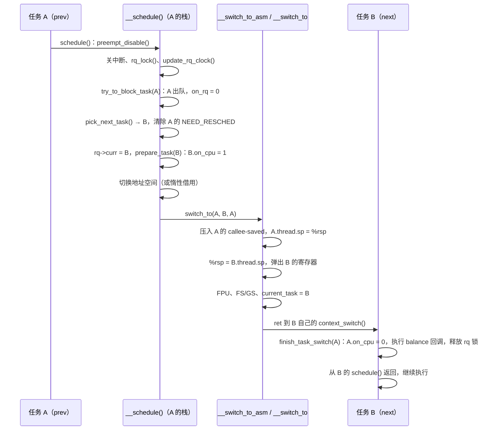

# 3.2 主调度函数与上下文切换

> **本节源码**：[`kernel/sched/core.c`](../../linux/kernel/sched/core.c)、[`kernel/sched/sched.h`](../../linux/kernel/sched/sched.h)、[`kernel/sched/fair.c`](../../linux/kernel/sched/fair.c)、[`kernel/entry/common.c`](../../linux/kernel/entry/common.c)、[`include/linux/preempt.h`](../../linux/include/linux/preempt.h)、[`arch/x86/include/asm/preempt.h`](../../linux/arch/x86/include/asm/preempt.h)、[`arch/x86/include/asm/switch_to.h`](../../linux/arch/x86/include/asm/switch_to.h)、[`arch/x86/entry/entry_64.S`](../../linux/arch/x86/entry/entry_64.S)、[`arch/x86/kernel/process_64.c`](../../linux/arch/x86/kernel/process_64.c)、[`arch/x86/kernel/process.c`](../../linux/arch/x86/kernel/process.c)、[`arch/x86/mm/tlb.c`](../../linux/arch/x86/mm/tlb.c)、[`include/trace/events/sched.h`](../../linux/include/trace/events/sched.h)
> **关键函数**：`resched_curr()`、`schedule()`、`preempt_schedule_irq()`、`__schedule()`、`try_to_block_task()`、`__pick_next_task()`、`put_prev_set_next_task()`、`context_switch()`、`switch_mm_irqs_off()`、`__switch_to_asm()`、`__switch_to()`、`finish_task_switch()`
> **前置知识**：3.1 调度器框架（调度类、运行队列、`on_rq` 与 `block_task()`）、7.1 并发来源与执行上下文（`preempt_count`）

## 概述

调度器要回答两个问题：下一个该运行谁（策略），以及怎样把 CPU 从一个任务交给另一个任务（机制）。3.1 节建立了策略框架，本节分析机制的核心 `__schedule()`。任务主动睡眠、内核抢占、中断返回时抢占、idle 线程发现有新任务，这些路径最终都调用同一个 `__schedule()`，区别只在传入的调度模式 `sched_mode`。

`__schedule()` 在持有本 CPU 运行队列锁的情况下完成四件事：决定 `prev` 是否离开运行队列，选出 `next`，更新 `rq->curr`，再调用 `context_switch()` 依次切换地址空间、内核栈和寄存器。

本节先介绍相关数据结构和调度的触发方式，再逐段拆解 `__schedule()`，最后深入 x86_64 上的上下文切换，以及新建任务如何"第一次"从切换中返回。各调度类如何选出任务留给 3.3 节及之后各节。

## 核心数据结构

### 调度模式

[`kernel/sched/core.c:6533-6536`](../../linux/kernel/sched/core.c#L6533-L6536)（v6.18.60）

```c
#define SM_IDLE			(-1)
#define SM_NONE			0
#define SM_PREEMPT		1
#define SM_RTLOCK_WAIT		2
```

| 模式 | 含义 | 入口 |
|---|---|---|
| `SM_IDLE` | idle 线程发起调度，运行队列为空时可走快速路径 | `schedule_idle()` |
| `SM_NONE` | 普通调用，任务可能要睡眠 | `schedule()`、`do_task_dead()`、`rt_mutex_schedule()` |
| `SM_PREEMPT` | 抢占：当前任务仍然可运行，只是被要求让出 CPU | `preempt_schedule()`、`preempt_schedule_notrace()`、`preempt_schedule_irq()`、`__cond_resched()` |
| `SM_RTLOCK_WAIT` | 在 PREEMPT_RT 的"睡眠自旋锁"上阻塞（依赖 `CONFIG_PREEMPT_RT`，本书配置未开启） | `schedule_rtlock()` |

### task_struct 中的相关字段

| 字段 | 位置 | 本节中的作用 |
|---|---|---|
| `__state` | [`include/linux/sched.h:823`](../../linux/include/linux/sched.h#L823) | 任务状态。`TASK_RUNNING`（0）以外的值表示"想要睡眠" |
| `on_cpu` | [`include/linux/sched.h:844`](../../linux/include/linux/sched.h#L844) | 任务正占用某个 CPU（包括正在被切换出去的过程中） |
| `on_rq` | [`include/linux/sched.h:859`](../../linux/include/linux/sched.h#L859) | 任务在运行队列上（3.1 节） |
| `mm` / `active_mm` | [`include/linux/sched.h:957-958`](../../linux/include/linux/sched.h#L957-L958) | 自己的用户地址空间 / 当前实际使用的地址空间 |
| `nvcsw` / `nivcsw` | [`include/linux/sched.h:1126-1127`](../../linux/include/linux/sched.h#L1126-L1127) | 自愿 / 非自愿上下文切换计数 |
| `thread.sp` | [`arch/x86/include/asm/processor.h:454`](../../linux/arch/x86/include/asm/processor.h#L454) | 任务被换出时的内核栈指针，x86_64 上下文切换的关键 |

`on_rq` 与 `on_cpu` 是两个独立的维度：任务可以"在队列上但不在 CPU 上"（就绪），也可以"不在队列上但仍在 CPU 上"（正在睡下、切换尚未完成）。后一种窗口是 3.4 节唤醒路径必须处理的难点。

### struct rq 中的相关字段

[`kernel/sched/sched.h:1170-1185`](../../linux/kernel/sched/sched.h#L1170-L1185)（v6.18.60）

```c
#ifdef CONFIG_SCHED_PROXY_EXEC
	struct task_struct __rcu	*donor;  /* Scheduling context */
	struct task_struct __rcu	*curr;   /* Execution context */
#else
	union {
		struct task_struct __rcu *donor; /* Scheduler context */
		struct task_struct __rcu *curr;  /* Execution context */
	};
#endif
	struct sched_dl_entity	*dl_server;	// [注] 本次选出的公平任务若由 fair_server 代为运行，记录该 server
	struct task_struct	*idle;		// [注] 本 CPU 的 idle 线程
	struct task_struct	*stop;
	unsigned long		next_balance;
	struct mm_struct	*prev_mm;	// [注] 待 finish_task_switch() 释放的惰性 TLB mm

	unsigned int		clock_update_flags;
```

本书配置未开启 `CONFIG_SCHED_PROXY_EXEC`，`donor` 与 `curr` 是同一个指针的两个名字，下文的 `rq->donor` 都可以读作 `rq->curr`。另有两个字段：`nr_switches`（[`kernel/sched/sched.h:1138`](../../linux/kernel/sched/sched.h#L1138)）累计本 CPU 的切换次数，各 CPU 之和即 `/proc/stat` 中的 `ctxt`；`balance_callback`（[`kernel/sched/sched.h:1212`](../../linux/kernel/sched/sched.h#L1212)）是待执行的 balance 回调链表，见下文"balance 回调"。

### 重调度标志与 x86 的 preempt_count

调度器认定"当前任务应当让出 CPU"的那一刻，往往不能立即切换：这个决定可能是在中断处理函数里做出的，可能来自另一个 CPU，当前任务也可能正处在关抢占的临界区中。因此内核把抢占拆成两步：先**登记请求**，即给当前任务设置重调度标志；等它运行到可以安全切换的位置，即**抢占点**，再**响应请求**。本小节说明请求记录在哪里，以及 x86 如何把"检查有没有请求"做到只需一条指令。请求的发起与响应流程见下文"调度的触发"。

#### 请求记在哪里：TIF 标志

请求记录在任务的 `thread_info->flags` 中。这是一个按位使用的标志字，与调度有关的是下面三位（[`include/asm-generic/thread_info_tif.h:21-31`](../../linux/include/asm-generic/thread_info_tif.h#L21-L31)）：

| 标志 | 含义 | 在哪里被响应 |
|---|---|---|
| `TIF_NEED_RESCHED` | 需要尽快重新调度 | 所有抢占点：`preempt_enable()`、中断返回内核态、返回用户态 |
| `TIF_NEED_RESCHED_LAZY` | 惰性请求，允许推迟（`CONFIG_PREEMPT_LAZY`，3.5 节） | 只在返回用户态时响应；到下一个 tick 仍未响应，则升级为 `TIF_NEED_RESCHED` |
| `TIF_POLLING_NRFLAG` | 不是请求，而是 idle 线程的状态：它正在循环检查 `TIF_NEED_RESCHED` | 其他 CPU 据此判断：只需设置标志就能让它退出空闲，不必发送 IPI |

请求总是设置在目标 CPU 当前运行的任务（`rq->curr`）上；调度器响应请求、选出下一个任务后，再把它从被换下的任务上清除。

#### 抢占要同时满足两个条件

一次抢占真正发生，需要同时满足：

1. **需要调度**：当前任务设置了 `TIF_NEED_RESCHED`；
2. **允许调度**：抢占计数 `preempt_count` 为 0，即当前不在关抢占的临界区、软中断或硬中断中（各计数域的编码见 7.1 节）。

`preempt_enable()` 是检查这两个条件最频繁的地方，每次释放自旋锁都会调用它（[`include/linux/spinlock_api_smp.h:139-144`](../../linux/include/linux/spinlock_api_smp.h#L139-L144)）。按字面实现，它要先把计数减 1、判断是否为 0，再读取 TIF 标志做第二次判断。不针对体系结构优化的通用实现就是这样写的：

[`include/asm-generic/preempt.h:62-70`](../../linux/include/asm-generic/preempt.h#L62-L70)（v6.18.60）

```c
static __always_inline bool __preempt_count_dec_and_test(void)
{
	/*
	 * Because of load-store architectures cannot do per-cpu atomic
	 * operations; we cannot use PREEMPT_NEED_RESCHED because it might get
	 * lost.
	 */
	return !--*preempt_count_ptr() && tif_need_resched();
}
```

#### x86 的做法：把两个条件合成一个数

x86 把"需要调度"也放进抢占计数。x86 的抢占计数是一个 per-CPU 的 32 位整数 `__preempt_count`，低位是各计数域，最高位（bit 31）存放 `TIF_NEED_RESCHED` 的一个副本：

[`arch/x86/include/asm/preempt.h:12-19`](../../linux/arch/x86/include/asm/preempt.h#L12-L19)（v6.18.60）

```c
/* We use the MSB mostly because its available */
#define PREEMPT_NEED_RESCHED	0x80000000

/*
 * We use the PREEMPT_NEED_RESCHED bit as an inverted NEED_RESCHED such
 * that a decrement hitting 0 means we can and should reschedule.
 */
#define PREEMPT_ENABLED	(0 + PREEMPT_NEED_RESCHED)
```

关键在于这一位**取反**存放：1 表示"不需要调度"，0 表示"需要调度"。因此 `set_preempt_need_resched()`（登记请求）是**清除**这一位，`clear_preempt_need_resched()`（撤销请求）是**设置**这一位（[`arch/x86/include/asm/preempt.h:59-67`](../../linux/arch/x86/include/asm/preempt.h#L59-L67)）。没有任何请求、也没有关抢占时，整个值是 `0x80000000`，这就是 `PREEMPT_ENABLED`。

把两个条件的四种组合列出来：

| 抢占计数 | 需要调度 | bit 31 | `__preempt_count` | 能否抢占 |
|---|---|---|---|---|
| 0 | 否 | 1 | `0x80000000` | 否：没有请求 |
| 0 | 是 | 0 | `0x00000000` | **能** |
| 1 | 否 | 1 | `0x80000001` | 否 |
| 1 | 是 | 0 | `0x00000001` | 否：仍在临界区内 |

只有"能抢占"这一行的值为 0。两个条件的检查于是合并为一个："整个 32 位值是否为 0"。`preempt_enable()` 要做的"减 1 再判断"，正好用一条 `decl` 指令完成：`decl` 在减 1 的同时设置零标志 ZF，随后的条件跳转只看 ZF（宏参数 `e` 即"等于 0"）：

[`arch/x86/include/asm/preempt.h:88-97`](../../linux/arch/x86/include/asm/preempt.h#L88-L97)（v6.18.60）

```c
/*
 * Because we keep PREEMPT_NEED_RESCHED set when we do _not_ need to reschedule
 * a decrement which hits zero means we have no preempt_count and should
 * reschedule.
 */
static __always_inline bool __preempt_count_dec_and_test(void)
{
	return GEN_UNARY_RMWcc("decl", __my_cpu_var(__preempt_count), e,
			       __percpu_arg([var]));
}
```

取反是这个技巧成立的前提。假如按常规用 1 表示"需要调度"，"可以抢占"对应的值就是 `0x80000000`，减 1 之后还得再比较一次，判断省不掉。取反之后，"需要调度"与"计数为 0"都表现为"相应的位全为 0"，两者同时成立时整个数恰好为 0。

下面用一个例子把过程串起来。任务在 CPU 0 上运行，先进入一段关抢占的临界区，期间本 CPU 的中断处理函数唤醒了一个要在本 CPU 上运行、优先级更高的实时任务：

| 步骤 | 发生的事 | `__preempt_count` |
|---|---|---|
| 1 | 初始：没有关抢占，没有请求 | `0x80000000` |
| 2 | `preempt_disable()`：计数加 1 | `0x80000001` |
| 3 | 中断处理函数唤醒实时任务，`resched_curr()` 设置 `TIF_NEED_RESCHED`，并调用 `set_preempt_need_resched()` 清除 bit 31 | `0x00000001` |
| 4 | 中断返回：计数不为 0，不能抢占，回到临界区继续执行 | `0x00000001` |
| 5 | `preempt_enable()`：`decl` 后结果为 0，调用 `__preempt_schedule()` 进入调度器 | `0x00000000` |
| 6 | 调度器入口再次关抢占并获取 rq 锁，选出下一个任务后调用 `clear_preempt_need_resched()`，bit 31 恢复为 1 | `0x80000002` |

第 6 步中计数部分为 2，来源见本小节最后一部分。

#### 正本与副本的同步

这样一来，x86 上的"需要调度"有两份记录：任务 `thread_info->flags` 中的 `TIF_NEED_RESCHED` 是正本，所有体系结构都有；`__preempt_count` 的 bit 31 是 x86 为 `preempt_enable()` 准备的副本，只反映**本 CPU** 当前任务的情况。内核在以下位置让副本跟上正本：

| 场景 | 副本如何更新 |
|---|---|
| 本 CPU 发起请求 | `__resched_curr()` 设置 TIF 标志后，立即调用 `set_preempt_need_resched()` |
| 其他 CPU 发起请求 | 对方只能设置 TIF 标志，再发送重调度 IPI；本 CPU 在 IPI 处理中由 `scheduler_ipi()` 把 TIF 标志"折叠"进 bit 31 |
| 轮询中的 idle 线程被设置标志唤醒（没有 IPI） | `do_idle()` 退出轮询后自己调用 `preempt_set_need_resched()` 补上 |
| 调度器响应了请求 | `__schedule()` 选出下一个任务后，同时清除 TIF 标志与 bit 31 |

各场景的代码见下文"调度的触发"与"`__schedule()` 逐段分析"。另有两点需要注意：

- 只有 `TIF_NEED_RESCHED` 会被折叠，`TIF_NEED_RESCHED_LAZY` 不会。`preempt_enable()` 因此看不到惰性请求，这是惰性抢占能把抢占推迟到返回用户态的原因之一（3.5 节）。
- 其他代码通过 `preempt_count()` 读取抢占计数，它会屏蔽 bit 31（[`arch/x86/include/asm/preempt.h:21-28`](../../linux/arch/x86/include/asm/preempt.h#L21-L28)），所以 `in_atomic()` 等判断不受这一技巧影响。

为什么通用实现不这样做？上面通用代码的注释给出了原因：在 load-store 架构上，"减 1"要拆成读、改、写三条指令。如果中断恰好在读与写之间到来，并清除了 bit 31 来登记请求，随后的写回会用旧值把它覆盖，请求就丢了。x86 的 `decl`、`andl`、`orl` 可以直接对 per-CPU 内存执行读改写，一条指令完成，中断只能发生在指令之间，不存在这个窗口。

#### 抢占计数不随任务保存

最后一个容易让人困惑的地方：x86 的 `__preempt_count` 是 **per-CPU 变量**，属于 CPU 而不属于任务，上下文切换时既不保存也不恢复。通用实现把计数放在每个任务自己的 `thread_info->preempt_count` 中（[`include/asm-generic/preempt.h:9-17`](../../linux/include/asm-generic/preempt.h#L9-L17)），随任务切换是自然的事。x86 放在 per-CPU 变量中，`preempt_enable()` 用一条带 `%gs` 段前缀的指令就能完成读改写，不必先取得 `current` 再访问它的 `thread_info`。

不保存也不会出错，是因为所有任务都在同一种位置被切换出去，而在这个位置上，计数总是 2：

| 时刻 | 计数 | 来源 |
|---|---|---|
| 进入调度入口，如 `schedule()` 中的 `__schedule_loop()`（[`kernel/sched/core.c:7016-7023`](../../linux/kernel/sched/core.c#L7016-L7023)） | 1 | 入口自己的 `preempt_disable()` |
| `__schedule()` 获取 rq 锁（[`kernel/sched/core.c:6850`](../../linux/kernel/sched/core.c#L6850)）直到切换发生 | 2 | 获取自旋锁会再关一次抢占 |
| 切换后在 `finish_task_switch()` 中释放 rq 锁（[`kernel/sched/core.c:5209`](../../linux/kernel/sched/core.c#L5209)） | 1 | |
| 回到调度入口，`sched_preempt_enable_no_resched()` | 0 | |

设 CPU 0 从任务 A 切换到任务 B。切换时计数为 2，这个 2 原样留给了 B。而 B 上一次被切换出去时，计数同样是 2，因为它也是从这个位置离开的。所以 B 恢复运行时看到的，正是自己离开时的值；接下来它沿上表后两行把计数降回 0。bit 31 在切换前已经被调度器置 1（步骤 6），B 从"没有请求"的状态开始。

新建任务从来没有被切换出去过，怎样满足这个条件？通用实现在 fork 时把新任务的计数直接初始化为 `FORK_PREEMPT_COUNT`，即计数为 2（[`include/linux/preempt.h:67-76`](../../linux/include/linux/preempt.h#L67-L76)、[`include/asm-generic/preempt.h:27-29`](../../linux/include/asm-generic/preempt.h#L27-L29)）。x86 的 `init_task_preempt_count()` 则是空操作（[`arch/x86/include/asm/preempt.h:44`](../../linux/arch/x86/include/asm/preempt.h#L44)）：新任务第一次运行时，per-CPU 计数里已经是前一个任务留下的 2。`finish_task_switch()` 开头检查这个不变式，发现计数不是 2 就告警并修正（[`kernel/sched/core.c:5175-5189`](../../linux/kernel/sched/core.c#L5175-L5189)，见下文"新任务的第一次调度"与"关键细节"）。

### inactive_task_frame

任务被换出时，其内核栈顶保存着一个固定格式的帧，`thread.sp` 指向它：

[`arch/x86/include/asm/switch_to.h:23-42`](../../linux/arch/x86/include/asm/switch_to.h#L23-L42)（v6.18.60）

```c
struct inactive_task_frame {
#ifdef CONFIG_X86_64
	unsigned long r15;
	unsigned long r14;
	unsigned long r13;
	unsigned long r12;
#else
	unsigned long flags;
	unsigned long si;
	unsigned long di;
#endif
	unsigned long bx;

	/*
	 * These two fields must be together.  They form a stack frame header,
	 * needed by get_frame_pointer().
	 */
	unsigned long bp;
	unsigned long ret_addr;
};
```

字段顺序必须与 `__switch_to_asm()` 的压栈顺序严格对应：6 个 callee-saved 寄存器加上 `call` 指令压入的返回地址。新建任务没有真正执行过 `__switch_to_asm()`，`copy_thread()` 会伪造一个这样的帧（见"新任务的第一次调度"）。

## 主流程分析

### 调用链总览

```
schedule()                                   kernel/sched/core.c
├── sched_submit_work()                      // 将要睡眠：通知 workqueue、提交 plug 的块 I/O
├── __schedule_loop(SM_NONE)
│   └── __schedule()
│       ├── schedule_debug()                 // "scheduling while atomic" 检查
│       ├── rcu_note_context_switch()        kernel/rcu/tree_plugin.h
│       ├── rq_lock() + update_rq_clock()
│       ├── try_to_block_task()              // prev 要睡眠：出队
│       │   └── block_task() → dequeue_task()
│       ├── pick_next_task()                 // CONFIG_SCHED_CORE 包装
│       │   └── __pick_next_task()
│       │       ├── pick_next_task_fair()    kernel/sched/fair.c   // 快速路径
│       │       └── prev_balance() + 逐类 pick_task()              // 通用路径
│       └── context_switch()
│           ├── prepare_task_switch()        // next->on_cpu = 1
│           ├── switch_mm_irqs_off()         arch/x86/mm/tlb.c     // 或 enter_lazy_tlb()
│           ├── switch_to()                  arch/x86/include/asm/switch_to.h
│           │   └── __switch_to_asm()        arch/x86/entry/entry_64.S
│           │       └── __switch_to()        arch/x86/kernel/process_64.c
│           └── finish_task_switch()         // prev->on_cpu = 0、释放 rq 锁
└── sched_update_worker()
```

### 调度的触发

#### 主动调度与被动调度

进入调度器的方式分两类：

- **主动调度**：任务自己调用 `schedule()`。典型情形是等待某个事件（锁、I/O、等待队列），调用前已把 `__state` 设为非 `TASK_RUNNING`。这种切换计入**自愿上下文切换**（Voluntary Context Switch，`nvcsw`）。
- **被动调度（抢占）**：其他代码判断当前任务应当让出 CPU，给它设置重调度标志；当前任务运行到下一个**抢占点**（Preemption Point）时检查到标志，进入调度器（内核态抢占点使用 `SM_PREEMPT`，返回用户态时则直接调用 `schedule()`）。这种切换计入**非自愿上下文切换**（Involuntary Context Switch，`nivcsw`）。

`__schedule()` 之前的长注释（[`kernel/sched/core.c:6763-6799`](../../linux/kernel/sched/core.c#L6763-L6799)）列举了这些驱动方式，并特别指出：**唤醒本身不会进入 `schedule()`**，它只把任务放回运行队列，必要时设置重调度标志。注释中"见 `arch/x86/entry_64.S`"的说法已经过时，x86 现在使用 `kernel/entry/common.c` 中的通用入口代码。

#### 发起请求：resched_curr()

[`kernel/sched/core.c:1113-1147`](../../linux/kernel/sched/core.c#L1113-L1147)（v6.18.60）

```c
static void __resched_curr(struct rq *rq, int tif)
{
	struct task_struct *curr = rq->curr;
	struct thread_info *cti = task_thread_info(curr);
	int cpu;

	lockdep_assert_rq_held(rq);

	/*
	 * Always immediately preempt the idle task; no point in delaying doing
	 * actual work.
	 */
	if (is_idle_task(curr) && tif == TIF_NEED_RESCHED_LAZY)
		tif = TIF_NEED_RESCHED;

	if (cti->flags & ((1 << tif) | _TIF_NEED_RESCHED))
		return;

	cpu = cpu_of(rq);

	trace_sched_set_need_resched_tp(curr, cpu, tif);
	if (cpu == smp_processor_id()) {
		set_ti_thread_flag(cti, tif);
		if (tif == TIF_NEED_RESCHED)
			set_preempt_need_resched();
		return;
	}

	if (set_nr_and_not_polling(cti, tif)) {
		if (tif == TIF_NEED_RESCHED)
			smp_send_reschedule(cpu);
	} else {
		trace_sched_wake_idle_without_ipi(cpu);
	}
}
```

- 调用者必须持有目标 `rq` 的锁，这保证了 `rq->curr` 在设置标志期间不会改变。
- 如果已经设置了相同或更强的标志（`TIF_NEED_RESCHED` 总是"更强"），直接返回。
- **本 CPU**：设置 TIF 标志；若是 `TIF_NEED_RESCHED`，同步清除 `__preempt_count` 中的取反位，使下一个 `preempt_enable()` 能立即察觉。
- **远程 CPU**：`set_nr_and_not_polling()` 用一次 `fetch_or` 原子地设置标志并读回旧值（[`kernel/sched/core.c:980-983`](../../linux/kernel/sched/core.c#L980-L983)）。如果目标 CPU 的 idle 线程正在轮询（`TIF_POLLING_NRFLAG`），设置标志就足以让它退出轮询，省掉 IPI；否则发送重调度 IPI。惰性请求即使发往远程 CPU 也不发 IPI，等对方自己在返回用户态或 tick 时发现。

远程路径只设置了目标任务的 TIF 标志，目标 CPU 上 `__preempt_count` 的取反位并没有变化。重调度 IPI 的处理函数 `sysvec_reschedule_ipi()`（[`arch/x86/kernel/smp.c:248-255`](../../linux/arch/x86/kernel/smp.c#L248-L255)）除了应答中断、累加 `/proc/interrupts` 中 `RES` 行的计数，只调用 `scheduler_ipi()`（[`include/linux/sched.h:2011-2019`](../../linux/include/linux/sched.h#L2011-L2019)），由 `preempt_fold_need_resched()` 把 `TIF_NEED_RESCHED` 折叠进本 CPU 的 `__preempt_count`（[`include/linux/preempt.h:313-317`](../../linux/include/linux/preempt.h#L313-L317)）。处理函数本身并不调度：真正的调度发生在中断**返回**路径的抢占点上，IPI 的作用是让目标 CPU 尽快经过一次这样的抢占点，同时让此后的 `preempt_enable()` 也能察觉请求。走免 IPI 路径的轮询 idle 线程得不到这次折叠，所以 `do_idle()` 退出轮询后要自己调用 `preempt_set_need_resched()` 补上（[`kernel/sched/idle.c:356-363`](../../linux/kernel/sched/idle.c#L356-L363)）。

`resched_curr()` 传入 `TIF_NEED_RESCHED`；公平类使用的 `resched_curr_lazy()` 则由当前抢占模型决定设置哪一位：

[`kernel/sched/core.c:1173-1184`](../../linux/kernel/sched/core.c#L1173-L1184)（v6.18.60）

```c
static __always_inline int get_lazy_tif_bit(void)
{
	if (dynamic_preempt_lazy())
		return TIF_NEED_RESCHED_LAZY;

	return TIF_NEED_RESCHED;
}

void resched_curr_lazy(struct rq *rq)
{
	__resched_curr(rq, get_lazy_tif_bit());
}
```

本书配置开启了 `CONFIG_PREEMPT_LAZY` 与 `CONFIG_PREEMPT_DYNAMIC`，`dynamic_preempt_lazy()` 读取一个 static key，在 lazy 模型下为真，而 lazy 正是本书配置启动时的默认模型（[`kernel/sched/core.c:7766-7782`](../../linux/kernel/sched/core.c#L7766-L7782)）。抢占模型的细节见 3.5 节。

#### 响应请求：抢占点

标志设置之后，要等当前任务运行到抢占点才会真正调度。本书配置下主要有三类抢占点（依赖 `CONFIG_PREEMPTION`）。

**一是 `preempt_enable()`**。抢占计数减到 0 且需要重调度时，调用 `__preempt_schedule()`：

[`include/linux/preempt.h:230-235`](../../linux/include/linux/preempt.h#L230-L235)（v6.18.60）

```c
#define preempt_enable() \
do { \
	barrier(); \
	if (unlikely(preempt_count_dec_and_test())) \
		__preempt_schedule(); \
} while (0)
```

开启 `CONFIG_PREEMPT_DYNAMIC` 时，x86 的 `__preempt_schedule()` 经 static call 调用 `preempt_schedule_thunk`，后者保存 caller-saved 寄存器后调用 `preempt_schedule()`（[`arch/x86/include/asm/preempt.h:125-129`](../../linux/arch/x86/include/asm/preempt.h#L125-L129)）。none / voluntary 模型下这个 static call 被置空，`preempt_enable()` 不再触发抢占。

**二是中断返回内核态**。`irqentry_exit()` 只在被打断的内核上下文开着中断时才考虑抢占（[`kernel/entry/common.c:192-211`](../../linux/kernel/entry/common.c#L192-L211)），还要求 `preempt_count()` 为 0：

[`kernel/entry/common.c:160-170`](../../linux/kernel/entry/common.c#L160-L170)（v6.18.60）

```c
void raw_irqentry_exit_cond_resched(void)
{
	if (!preempt_count()) {
		/* Sanity check RCU and thread stack */
		rcu_irq_exit_check_preempt();
		if (IS_ENABLED(CONFIG_DEBUG_ENTRY))
			WARN_ON_ONCE(!on_thread_stack());
		if (need_resched() && arch_irqentry_exit_need_resched())
			preempt_schedule_irq();
	}
}
```

**三是返回用户态**。这里同时检查两种标志：

[`kernel/entry/common.c:26-31`](../../linux/kernel/entry/common.c#L26-L31)（v6.18.60）

```c
	while (ti_work & EXIT_TO_USER_MODE_WORK) {

		local_irq_enable_exit_to_user(ti_work);

		if (ti_work & (_TIF_NEED_RESCHED | _TIF_NEED_RESCHED_LAZY))
			schedule();
```

`need_resched()` 只测试 `TIF_NEED_RESCHED`（[`include/linux/sched.h:2231-2234`](../../linux/include/linux/sched.h#L2231-L2234)），而返回用户态的路径还额外测试 `_TIF_NEED_RESCHED_LAZY`。前两类抢占点对惰性请求"视而不见"，这正是惰性抢占的实现基础：公平任务之间的抢占被推迟到返回用户态或下一个 tick，减少对持锁内核代码的打断。

注意返回用户态时调用的是 `schedule()` 而不是 `preempt_schedule()`。此时任务状态为 `TASK_RUNNING`，`__schedule()` 不会让它出队，效果与抢占相同，但计入的是 `nivcsw`（见"关键细节"）。

前两类抢占点还受运行时抢占模型控制（`CONFIG_PREEMPT_DYNAMIC`）：none / voluntary 模型下，`preempt_schedule` 与 `irqentry_exit_cond_resched` 两个 static call 被置空，内核态只在 `cond_resched()` 等显式位置让出 CPU；full / lazy 模型下二者生效，`cond_resched()` 反而变为空操作（[`kernel/sched/core.c:7597-7636`](../../linux/kernel/sched/core.c#L7597-L7636) 的对照表）。返回用户态这一类抢占点在所有模型下都生效。

#### 入口函数

各入口最终都调用 `__schedule()`，区别在于外围的抢占计数与中断处理。最常用的 `schedule()`：

[`kernel/sched/core.c:7016-7037`](../../linux/kernel/sched/core.c#L7016-L7037)（v6.18.60）

```c
static __always_inline void __schedule_loop(int sched_mode)
{
	do {
		preempt_disable();
		__schedule(sched_mode);
		sched_preempt_enable_no_resched();
	} while (need_resched());
}

asmlinkage __visible void __sched schedule(void)
{
	struct task_struct *tsk = current;

#ifdef CONFIG_RT_MUTEXES
	lockdep_assert(!tsk->sched_rt_mutex);
#endif

	if (!task_is_running(tsk))
		sched_submit_work(tsk);
	__schedule_loop(SM_NONE);
	sched_update_worker(tsk);
}
```

- `sched_submit_work()`（[`kernel/sched/core.c:6969-7004`](../../linux/kernel/sched/core.c#L6969-L7004)）只在任务**真的要睡眠**时调用：workqueue 或 io_uring 的工作线程要睡眠时，通知线程池考虑唤醒另一个 worker 以维持并发度；当前任务若有被 plug 暂存的块 I/O，先提交出去，否则自己睡下后这些 I/O 就无人提交，可能形成死锁。`sched_update_worker()` 在醒来后做反向通知。
- `__schedule()` 要求调用者已关闭抢占，所以先 `preempt_disable()`。返回后用 `sched_preempt_enable_no_resched()` 只减计数、**不**在这里触发抢占，而是由 `while (need_resched())` 显式重试——任务被切回来时可能已经又有新的重调度请求。

中断返回路径使用的 `preempt_schedule_irq()` 结构类似：

[`kernel/sched/core.c:7253-7271`](../../linux/kernel/sched/core.c#L7253-L7271)（v6.18.60）

```c
asmlinkage __visible void __sched preempt_schedule_irq(void)
{
	enum ctx_state prev_state;

	/* Catch callers which need to be fixed */
	BUG_ON(preempt_count() || !irqs_disabled());

	prev_state = exception_enter();

	do {
		preempt_disable();
		local_irq_enable();
		__schedule(SM_PREEMPT);
		local_irq_disable();
		sched_preempt_enable_no_resched();
	} while (need_resched());

	exception_exit(prev_state);
}
```

它在关中断的上下文中被调用，进入 `__schedule()` 前重新打开中断（`__schedule()` 自己会再关），返回中断出口前再关上。其余入口：

| 入口 | 位置 | 说明 |
|---|---|---|
| `preempt_schedule()` | [`kernel/sched/core.c:7138`](../../linux/kernel/sched/core.c#L7138) | `preempt_enable()` 触发；先检查 `preemptible()`，再进入 `preempt_schedule_common()` 循环调用 `__schedule(SM_PREEMPT)` |
| `schedule_idle()` | [`kernel/sched/core.c:7050-7063`](../../linux/kernel/sched/core.c#L7050-L7063) | idle 循环 `do_idle()` 调用（[`kernel/sched/idle.c:379`](../../linux/kernel/sched/idle.c#L379)）；idle 线程本身就以关抢占状态运行，所以这里不再 `preempt_disable()` |
| `do_task_dead()` | [`kernel/sched/core.c:6953-6967`](../../linux/kernel/sched/core.c#L6953-L6967) | `do_exit()` 的最后一步；设置 `TASK_DEAD` 后调用 `__schedule(SM_NONE)`，永不返回 |
| `schedule_preempt_disabled()` | [`kernel/sched/core.c:7089-7094`](../../linux/kernel/sched/core.c#L7089-L7094) | 供已关抢占的调用者使用，如 mutex 慢速路径 |
| `io_schedule()` | [`kernel/sched/core.c:7881`](../../linux/kernel/sched/core.c#L7881) | 先设置 `current->in_iowait = 1` 再 `schedule()`，睡眠计入 iowait |

### __schedule() 逐段分析

`__schedule()` 中有一个名为 `preempt` 的局部变量，前后取值口径不同：开头为 `sched_mode > SM_NONE`，把 `SM_RTLOCK_WAIT` 也算作抢占，供 `schedule_debug()` 和 RCU 使用；加锁之后被改为 `sched_mode == SM_PREEMPT`，用于决定任务是否出队以及 `sched_switch` 跟踪点（Tracepoint）的输出。

#### 第一步：调试检查与 RCU

[`kernel/sched/core.c:6816-6831`](../../linux/kernel/sched/core.c#L6816-L6831)（v6.18.60）

```c
	/* Trace preemptions consistently with task switches */
	trace_sched_entry_tp(sched_mode == SM_PREEMPT);

	cpu = smp_processor_id();
	rq = cpu_rq(cpu);
	prev = rq->curr;

	schedule_debug(prev, preempt);

	if (sched_feat(HRTICK) || sched_feat(HRTICK_DL))
		hrtick_clear(rq);

	klp_sched_try_switch(prev);

	local_irq_disable();
	rcu_note_context_switch(preempt);
```

- `prev` 取自 `rq->curr`，即当前任务。
- `schedule_debug()`（[`kernel/sched/core.c:5907-5936`](../../linux/kernel/sched/core.c#L5907-L5936)）检查栈尾魔数是否被破坏（`CONFIG_SCHED_STACK_END_CHECK`），并用 `in_atomic_preempt_off()` 检查抢占计数是否恰好为 1（即只有入口函数那一次 `preempt_disable()`）。持有自旋锁或在中断上下文中调用 `schedule()` 会使计数大于 1，触发著名的 "BUG: scheduling while atomic" 报错（[`kernel/sched/core.c:5879-5902`](../../linux/kernel/sched/core.c#L5879-L5902)）。
- `hrtick_clear()` 取消高精度 tick 定时器，默认不生效（3.5 节）；`klp_sched_try_switch()` 在 livepatch 迁移期间尝试把 `prev` 切换到新补丁（`CONFIG_LIVEPATCH`）。
- `rcu_note_context_switch()` 必须在关中断后调用（[`kernel/rcu/tree_plugin.h:324-373`](../../linux/kernel/rcu/tree_plugin.h#L324-L373)，`CONFIG_PREEMPT_RCU`）。如果 `prev` 在 RCU 读临界区内被抢占，就把它挂到 `rcu_node` 的阻塞任务链表上，使当前宽限期等待它；然后为本 CPU 报告一个**静止状态**（Quiescent State）。非抢占（`preempt` 为假）时仍处于读临界区会触发警告，因为 RCU 读临界区内不允许主动睡眠。

#### 第二步：加锁与更新时钟

[`kernel/sched/core.c:6850-6856`](../../linux/kernel/sched/core.c#L6850-L6856)（v6.18.60）

```c
	rq_lock(rq, &rf);
	smp_mb__after_spinlock();

	/* Promote REQ to ACT */
	rq->clock_update_flags <<= 1;
	update_rq_clock(rq);
	rq->clock_update_flags = RQCF_UPDATED;
```

- `rq_lock()` 不关中断，因为上一步已经关过。开启核心调度时，同一物理核的 SMT 兄弟共用一把锁（3.1 节）。
- `smp_mb__after_spinlock()` 提供完整内存屏障，有两个用途。其一，与 `signal_wake_up()` 一侧的屏障配对，保证第三步中的 `signal_pending_state()` 不会读到早于调用者写 `__state` 的旧信号状态，避免错过信号（源码注释 [`kernel/sched/core.c:6833-6849`](../../linux/kernel/sched/core.c#L6833-L6849) 画出了这个竞态）。其二，满足 `membarrier()` 系统调用"从用户态进入后、修改 `rq->curr` 之前要有完整屏障"的要求。
- 时钟更新只在这里做一次。`clock_update_flags <<= 1` 把此前 `rq_clock_skip_update()` 设置的 `RQCF_REQ_SKIP`（0x01）提升为 `RQCF_ACT_SKIP`（0x02），使紧接着的 `update_rq_clock()` 直接跳过（[`kernel/sched/sched.h:1678-1680`](../../linux/kernel/sched/sched.h#L1678-L1680)，3.5 节）。后续的 `dequeue_task()` 等调用都带 `*_NOCLOCK` 标志，不再重复更新。

#### 第三步：prev 的去留

[`kernel/sched/core.c:6858-6884`](../../linux/kernel/sched/core.c#L6858-L6884)（v6.18.60，节选）

```c
	switch_count = &prev->nivcsw;

	/* Task state changes only considers SM_PREEMPT as preemption */
	preempt = sched_mode == SM_PREEMPT;
	...
	prev_state = READ_ONCE(prev->__state);
	if (sched_mode == SM_IDLE) {
		/* SCX must consult the BPF scheduler to tell if rq is empty */
		if (!rq->nr_running && !scx_enabled()) {
			next = prev;
			goto picked;
		}
	} else if (!preempt && prev_state) {
		...
		try_to_block_task(rq, prev, &prev_state,
				  !task_is_blocked(prev));
		switch_count = &prev->nvcsw;
	}
```

这里决定 `prev` 的命运，共三种情况：

1. **idle 快速路径**：从 idle 循环进入且运行队列为空，直接 `next = prev`，跳过整个选择过程。这种情况并不少见：向正在轮询的 idle CPU 投递跨核函数调用时，内核会改为设置它的 `TIF_NEED_RESCHED` 以省掉 IPI（[`kernel/sched/core.c:3844-3852`](../../linux/kernel/sched/core.c#L3844-L3852)），idle 线程因此退出轮询并调用 `schedule_idle()`，但并没有新任务入队。
2. **被抢占**（`SM_PREEMPT`）：无论 `prev->__state` 是什么都**不出队**。一个任务可能刚执行完 `set_current_state(TASK_UNINTERRUPTIBLE)`、还没来得及检查等待条件就被抢占。如果此时让它出队，它就失去了检查条件的机会；倘若条件早已满足、唤醒方也已经发过唤醒，就再没有人会唤醒它。抢占时保持在队列上，任务稍后被再次选中、继续检查条件，再由自己的 `schedule()` 调用按正常流程睡眠。
3. **主动睡眠**（`prev_state` 非 0）：调用 `try_to_block_task()` 尝试出队，并把计数器切换为 `nvcsw`。

`prev_state` 只读一次（`READ_ONCE`），与唤醒路径形成控制依赖，见 [`kernel/sched/core.c:6576-6585`](../../linux/kernel/sched/core.c#L6576-L6585) 的注释。

[`kernel/sched/core.c:6546-6589`](../../linux/kernel/sched/core.c#L6546-L6589)（v6.18.60，节选）

```c
static bool try_to_block_task(struct rq *rq, struct task_struct *p,
			      unsigned long *task_state_p, bool should_block)
{
	unsigned long task_state = *task_state_p;
	int flags = DEQUEUE_NOCLOCK;

	if (signal_pending_state(task_state, p)) {
		WRITE_ONCE(p->__state, TASK_RUNNING);
		*task_state_p = TASK_RUNNING;
		return false;
	}
	...
	if (!should_block)
		return false;

	p->sched_contributes_to_load =
		(task_state & TASK_UNINTERRUPTIBLE) &&
		!(task_state & TASK_NOLOAD) &&
		!(task_state & TASK_FROZEN);

	if (unlikely(is_special_task_state(task_state)))
		flags |= DEQUEUE_SPECIAL;
	...
	block_task(rq, p, flags);
	return true;
}
```

- **挂起信号**：`signal_pending_state()` 在状态含 `TASK_INTERRUPTIBLE` 且有挂起信号，或含 `TASK_WAKEKILL` 且有致命信号时返回真（[`include/linux/sched/signal.h:431-439`](../../linux/include/linux/sched/signal.h#L431-L439)）。此时把任务改回 `TASK_RUNNING` 并留在队列上，`schedule()` 返回后由调用者处理信号。
- **负载贡献**：`sched_contributes_to_load` 决定这次睡眠是否计入 `rq->nr_uninterruptible`，即 `/proc/loadavg` 中 D 状态任务的贡献。`TASK_IDLE`（`TASK_UNINTERRUPTIBLE | TASK_NOLOAD`）就是为"不可中断但不计入负载"的内核线程设计的。
- **特殊状态**：`__TASK_STOPPED`、`__TASK_TRACED`、`TASK_PARKED`、`TASK_DEAD`、`TASK_FROZEN` 属于特殊状态（[`include/linux/sched.h:160-162`](../../linux/include/linux/sched.h#L160-L162)）。公平类的延迟出队依赖"伪唤醒"来回收延迟实体，而这些状态不能容忍伪唤醒，所以 `DEQUEUE_SPECIAL` 会强制立即出队（[`kernel/sched/fair.c:5570-5575`](../../linux/kernel/sched/fair.c#L5570-L5575)）。
- `should_block` 为假只发生在代理执行中（任务阻塞在 mutex 上，留在队列中以便被选作 donor），本书配置下恒为真。

`block_task()`（[`kernel/sched/core.c:2171-2175`](../../linux/kernel/sched/core.c#L2171-L2175)）调用 `dequeue_task(rq, p, DEQUEUE_SLEEP | flags)`，只有调度类真正出队时才调用 `__block_task()`（[`kernel/sched/sched.h:2769-2810`](../../linux/kernel/sched/sched.h#L2769-L2810)），后者更新 `nr_uninterruptible`、`nr_iowait`，最后清零 `on_rq`：

[`kernel/sched/sched.h:2806-2809`](../../linux/kernel/sched/sched.h#L2806-L2809)（v6.18.60）

```c
	 * Callers must ensure to not reference @p after this -- we no longer
	 * own it.
	 */
	smp_store_release(&p->on_rq, 0);
```

这次 release 写一旦完成，其他 CPU 上的 `try_to_wake_up()` 就可以把该任务迁到别处，因此此后本 CPU 不能再通过 rq 锁来保护它。不过 `prev` 此时仍在本 CPU 上运行（`on_cpu == 1`），真正在别处运行还要等 `finish_task_switch()`。公平类的 `dequeue_task()` 可能因延迟出队返回 false，此时任务保持 `on_rq`、带着 `sched_delayed` 标记留在队列中：之后它若被选中，才真正出队并执行 `__block_task()`；若在此之前就被唤醒，则在唤醒路径中清除延迟标记，直接恢复为普通的可运行状态（3.3、3.4 节）。

#### 第四步：选择 next

[`kernel/sched/core.c:6886-6901`](../../linux/kernel/sched/core.c#L6886-L6901)（v6.18.60）

```c
pick_again:
	assert_balance_callbacks_empty(rq);
	next = pick_next_task(rq, &rf);
	rq_set_donor(rq, next);
	if (unlikely(task_is_blocked(next))) {
		next = find_proxy_task(rq, next, &rf);
		if (!next)
			goto pick_again;
		if (next == rq->idle)
			goto keep_resched;
	}
picked:
	clear_tsk_need_resched(prev);
	clear_preempt_need_resched();
keep_resched:
	rq->last_seen_need_resched_ns = 0;
```

本书配置开启了 `CONFIG_SCHED_CORE`，`pick_next_task()` 是核心调度版本（[`kernel/sched/core.c:6066`](../../linux/kernel/sched/core.c#L6066)），在 SMT 兄弟之间协调选择，避免不同信任域的任务同时运行在同一物理核上。但只要系统中还没有任务通过 `prctl(PR_SCHED_CORE)` 设置 cookie，核心调度就处于关闭状态（`sched_core_enabled()` 为假，[`kernel/sched/sched.h:1383-1386`](../../linux/kernel/sched/sched.h#L1383-L1386)），它直接转调 `__pick_next_task()`（[`kernel/sched/core.c:6077-6078`](../../linux/kernel/sched/core.c#L6077-L6078)）。`rq_set_donor()`、`task_is_blocked()`、`find_proxy_task()` 服务于代理执行，本书配置下前者为空操作、`task_is_blocked()` 恒为假（[`kernel/sched/sched.h:2304-2310`](../../linux/kernel/sched/sched.h#L2304-L2310)）。

选出 `next` 后，立即清除 `prev` 的 `TIF_NEED_RESCHED` 与 `TIF_NEED_RESCHED_LAZY`（[`include/linux/sched.h:2066-2070`](../../linux/include/linux/sched.h#L2066-L2070)），以及本 CPU `__preempt_count` 中的重调度位：本次调度已经响应了请求。

随后清零的 `rq->last_seen_need_resched_ns` 服务于调度延迟告警：开启 `LATENCY_WARN` 特性时，tick 中的 `cpu_resched_latency()` 记下第一次观察到 `need_resched()` 的时刻，超过 `latency_warn_ms` 仍未调度就打印警告（[`kernel/sched/core.c:5548-5577`](../../linux/kernel/sched/core.c#L5548-L5577)）。每次经过这里都把时间戳清零，重新计时（见"可观测性"）。

#### 选择 next：公平类快速路径

3.1 节介绍了 `__pick_next_task()` 的通用路径：先 `prev_balance()`，再按优先级逐类调用 `pick_task()`。这里关注它前面的快速路径：

[`kernel/sched/core.c:5973-6004`](../../linux/kernel/sched/core.c#L5973-L6004)（v6.18.60）

```c
static inline struct task_struct *
__pick_next_task(struct rq *rq, struct rq_flags *rf)
{
	const struct sched_class *class;
	struct task_struct *p;

	rq->dl_server = NULL;

	if (scx_enabled())
		goto restart;

	/*
	 * Optimization: we know that if all tasks are in the fair class we can
	 * call that function directly, but only if the @prev task wasn't of a
	 * higher scheduling class, because otherwise those lose the
	 * opportunity to pull in more work from other CPUs.
	 */
	if (likely(!sched_class_above(rq->donor->sched_class, &fair_sched_class) &&
		   rq->nr_running == rq->cfs.h_nr_queued)) {

		p = pick_next_task_fair(rq, rq->donor, rf);
		if (unlikely(p == RETRY_TASK))
			goto restart;

		/* Assume the next prioritized class is idle_sched_class */
		if (!p) {
			p = pick_task_idle(rq);
			put_prev_set_next_task(rq, rq->donor, p);
		}

		return p;
	}
```

快速路径的条件有两个：

- **`prev` 不高于公平类**。如果 `prev` 是 RT 或 Deadline 任务，它让出 CPU 时本 CPU 的"最高优先级"可能下降，必须经过 `prev_balance()` 让 RT / DL 类有机会从其他 CPU 拉来任务（3.6 节）。
- **rq 上所有可运行任务都在公平类中**（`nr_running == cfs.h_nr_queued`）。`h_nr_queued` 统计整个组调度层级中的任务数（3.3 节）。

条件满足时，直接调用 `pick_next_task_fair()`，省去逐类询问 stop、dl、rt 的开销。桌面和服务器负载中绝大多数调度都走这条路径。

`pick_next_task_fair()`（[`kernel/sched/fair.c:9148-9229`](../../linux/kernel/sched/fair.c#L9148-L9229)）先用 `pick_task_fair()` 逐层选出任务，再完成"`prev` 交出、`next` 接任"的记账。开启 `CONFIG_FAIR_GROUP_SCHED` 且 `prev` 也是公平任务时，它只沿两者的调度实体向上走到共同的 `cfs_rq`，只对路径上不同的部分调用 `put_prev_entity()` / `set_next_entity()`：

[`kernel/sched/fair.c:9178-9200`](../../linux/kernel/sched/fair.c#L9178-L9200)（v6.18.60）

```c
	if (prev != p) {
		struct sched_entity *pse = &prev->se;
		struct cfs_rq *cfs_rq;

		while (!(cfs_rq = is_same_group(se, pse))) {
			int se_depth = se->depth;
			int pse_depth = pse->depth;

			if (se_depth <= pse_depth) {
				put_prev_entity(cfs_rq_of(pse), pse);
				pse = parent_entity(pse);
			}
			if (se_depth >= pse_depth) {
				set_next_entity(cfs_rq_of(se), se, true);
				se = parent_entity(se);
			}
		}

		put_prev_entity(cfs_rq, pse);
		set_next_entity(cfs_rq, se, true);

		__set_next_task_fair(rq, p, true);
	}
```

同一 cgroup 内的两个任务互相切换时，循环一次都不执行，只需处理最底层的一对实体。公平类选不出任务时，它会调用 `sched_balance_newidle()` 尝试从其他 CPU 拉任务（3.9 节）。该函数会临时释放 rq 锁，期间若有更高优先级类的任务到来，就返回 `RETRY_TASK`（[`kernel/sched/sched.h:2402`](../../linux/kernel/sched/sched.h#L2402)），`__pick_next_task()` 转入通用路径重选。仍然没有任务时返回 NULL，快速路径直接取 idle 线程。

快速路径条件不满足时，通用路径先调用 `prev_balance()`：

[`kernel/sched/core.c:5938-5968`](../../linux/kernel/sched/core.c#L5938-L5968)（v6.18.60，节选）

```c
static void prev_balance(struct rq *rq, struct rq_flags *rf)
{
	const struct sched_class *start_class = rq->donor->sched_class;
	const struct sched_class *class;

#ifdef CONFIG_SCHED_CLASS_EXT
	/* 省略 CONFIG_SCHED_CLASS_EXT 相关代码（3.11 节） */
#endif

	/*
	 * We must do the balancing pass before put_prev_task(), such
	 * that when we release the rq->lock the task is in the same
	 * state as before we took rq->lock.
	 *
	 * We can terminate the balance pass as soon as we know there is
	 * a runnable task of @class priority or higher.
	 */
	for_active_class_range(class, start_class, &idle_sched_class) {
		if (class->balance && class->balance(rq, rf))
			break;
	}
}
```

它从 `prev` 所属的调度类开始向下调用各类的 `balance()`，一旦某类报告已有不低于自身优先级的可运行任务就停止。例如 RT 任务睡眠后，RT 类的 `balance()` 尝试从其他 CPU 拉一个实时任务过来（3.6 节）；公平类的 `balance_fair()` 则在没有公平任务时做 newidle 均衡（[`kernel/sched/fair.c:8890-8897`](../../linux/kernel/sched/fair.c#L8890-L8897)）。`balance()` 可能临时释放 rq 锁，所以必须在 `put_prev_task()` 之前完成：此时 `prev` 仍处在加锁前的状态，其他 CPU 在空窗期间看到的是一致的视图。之后的逐类 `pick_task()` 见 3.1 节。

#### 选择 next：put_prev_set_next_task() 交接记账

在通用路径中，只实现了 `pick_task()` 的调度类由核心层完成交接；快速路径中取 idle 线程、`pick_next_task_fair()` 遇到 `prev` 不是公平任务时，也调用同一个函数：

[`kernel/sched/sched.h:2496-2519`](../../linux/kernel/sched/sched.h#L2496-L2519)（v6.18.60）

```c
static inline void
__put_prev_set_next_dl_server(struct rq *rq,
			      struct task_struct *prev,
			      struct task_struct *next)
{
	prev->dl_server = NULL;
	next->dl_server = rq->dl_server;
	rq->dl_server = NULL;
}

static inline void put_prev_set_next_task(struct rq *rq,
					  struct task_struct *prev,
					  struct task_struct *next)
{
	WARN_ON_ONCE(rq->donor != prev);

	__put_prev_set_next_dl_server(rq, prev, next);

	if (next == prev)
		return;

	prev->sched_class->put_prev_task(rq, prev, next);
	next->sched_class->set_next_task(rq, next, true);
}
```

- `put_prev_task()` 让 `prev` 所属的调度类结算它的运行时间，并把它从"正在运行"的位置放回队列（公平类中即放回红黑树）；`set_next_task()` 则把 `next` 设为调度类眼中的当前任务（公平类中即从红黑树取出、设为 `cfs_rq->curr`）。
- `__put_prev_set_next_dl_server()` 交接 `dl_server` 指针：如果 `next` 是 fair_server 代为选出的公平任务，`__pick_next_task()` 开头清零的 `rq->dl_server` 此时已被设置，转存到 `next->dl_server`，记下"这个公平任务是代表 dl_server 在运行"（3.7 节）。核心调度比较 SMT 兄弟上的任务优先级时会据此把它当作 Deadline 任务对待（[`kernel/sched/core.c:195-213`](../../linux/kernel/sched/core.c#L195-L213)）。
- `prev == next` 时只交接指针，避免"把同一个任务放回再取出"的开销。被抢占后发现自己仍是最优任务，就属于这种情况。

#### 第五步：切换或不切换

[`kernel/sched/core.c:6903-6951`](../../linux/kernel/sched/core.c#L6903-L6951)（v6.18.60，节选）

```c
	is_switch = prev != next;
	if (likely(is_switch)) {
		rq->nr_switches++;
		/*
		 * RCU users of rcu_dereference(rq->curr) may not see
		 * changes to task_struct made by pick_next_task().
		 */
		RCU_INIT_POINTER(rq->curr, next);
		...
		++*switch_count;

		migrate_disable_switch(rq, prev);
		psi_account_irqtime(rq, prev, next);
		psi_sched_switch(prev, next, !task_on_rq_queued(prev) ||
					     prev->se.sched_delayed);

		trace_sched_switch(preempt, prev, next, prev_state);

		/* Also unlocks the rq: */
		rq = context_switch(rq, prev, next, &rf);
	} else {
		rq_unpin_lock(rq, &rf);
		__balance_callbacks(rq);
		raw_spin_rq_unlock_irq(rq);
	}
	trace_sched_exit_tp(is_switch);
}
```

- 在真正切换**之前**就把 `rq->curr` 改为 `next`。从此刻起，其他 CPU 通过 `cpu_curr()` 看到的已经是新任务，尽管本 CPU 实际上还在执行 `prev` 的代码。
- `++*switch_count` 根据第三步的结果累加 `nvcsw` 或 `nivcsw`，即 `/proc/<pid>/status` 中的 `voluntary_ctxt_switches` 与 `nonvoluntary_ctxt_switches`（[`fs/proc/array.c:396-402`](../../linux/fs/proc/array.c#L396-L402)）。
- `migrate_disable_switch()` 处理调用过 `migrate_disable()` 的 `prev`：把它的可运行 CPU 掩码临时收窄为本 CPU，防止它在换出期间被负载均衡迁走（[`kernel/sched/core.c:2383-2400`](../../linux/kernel/sched/core.c#L2383-L2400)）。只在被换出时才收窄，使 `migrate_disable()` 本身保持廉价。
- `psi_sched_switch()` 更新压力停顿信息（`CONFIG_PSI`）：`prev` 已出队或处于延迟出队状态，都视为"睡眠"。
- `trace_sched_switch` 是 ftrace、perf、bpftrace 最常用的调度事件。
- 若 `prev == next`，执行挂起的 balance 回调后解锁返回。
- `context_switch()` 返回时，执行流已经在别的任务栈上转了一圈：它是在"很久以后，某个 CPU 又切回 `prev`"时才返回的。返回值 `rq` 必须重新获取，因为 `prev` 可能已经在另一个 CPU 上恢复运行。

### context_switch()：切换的三个层次

`context_switch()` 依次切换三样东西：**调度器与子系统的记账状态**、**地址空间**、**内核栈与寄存器**。

#### 准备：prepare_task_switch()

[`kernel/sched/core.c:5135-5147`](../../linux/kernel/sched/core.c#L5135-L5147)（v6.18.60）

```c
static inline void
prepare_task_switch(struct rq *rq, struct task_struct *prev,
		    struct task_struct *next)
{
	kcov_prepare_switch(prev);
	sched_info_switch(rq, prev, next);
	perf_event_task_sched_out(prev, next);
	rseq_preempt(prev);
	fire_sched_out_preempt_notifiers(prev, next);
	kmap_local_sched_out();
	prepare_task(next);
	prepare_arch_switch(next);
}
```

- `sched_info_switch()` 更新调度延迟统计（`CONFIG_SCHED_INFO`，[`kernel/sched/stats.h:323-336`](../../linux/kernel/sched/stats.h#L323-L336)）：把 `next` 在队列中等待的时长累加到 `run_delay`、运行次数 `pcount` 加一，即 `/proc/<pid>/schedstat` 后两列的来源；`prev` 若仍可运行（被抢占），则从此刻开始计算它的等待时间。
- `perf_event_task_sched_out()` 停止 `prev` 的 per-task perf 计数；`rseq_preempt()` 记录一次抢占事件并设置 `TIF_NOTIFY_RESUME`，`prev` 返回用户态时据此中止正在执行的 rseq 临界区（`CONFIG_RSEQ`）。
- `fire_sched_out_preempt_notifiers()` 调用 KVM 等模块注册的回调（`CONFIG_PREEMPT_NOTIFIERS`），用于在 vCPU 线程被换出时保存客户机状态。
- `prepare_task()` 执行 `WRITE_ONCE(next->on_cpu, 1)`（[`kernel/sched/core.c:4956-4966`](../../linux/kernel/sched/core.c#L4956-L4966)），在切换之前就宣告 `next` 已占用 CPU。

#### 切换地址空间：惰性 TLB

[`kernel/sched/core.c:5292-5341`](../../linux/kernel/sched/core.c#L5292-L5341)（v6.18.60，节选）

```c
static __always_inline struct rq *
context_switch(struct rq *rq, struct task_struct *prev,
	       struct task_struct *next, struct rq_flags *rf)
{
	prepare_task_switch(rq, prev, next);
	...
	arch_start_context_switch(prev);

	/*
	 * kernel -> kernel   lazy + transfer active
	 *   user -> kernel   lazy + mmgrab_lazy_tlb() active
	 *
	 * kernel ->   user   switch + mmdrop_lazy_tlb() active
	 *   user ->   user   switch
	 *
	 * switch_mm_cid() needs to be updated if the barriers provided
	 * by context_switch() are modified.
	 */
	if (!next->mm) {                                // to kernel
		enter_lazy_tlb(prev->active_mm, next);

		next->active_mm = prev->active_mm;
		if (prev->mm)                           // from user
			mmgrab_lazy_tlb(prev->active_mm);
		else
			prev->active_mm = NULL;
	} else {                                        // to user
		membarrier_switch_mm(rq, prev->active_mm, next->mm);
		...
		switch_mm_irqs_off(prev->active_mm, next->mm, next);
		lru_gen_use_mm(next->mm);

		if (!prev->mm) {                        // from kernel
			/* will mmdrop_lazy_tlb() in finish_task_switch(). */
			rq->prev_mm = prev->active_mm;
			prev->active_mm = NULL;
		}
	}
```

`arch_start_context_switch()` 是半虚拟化钩子（`CONFIG_PARAVIRT_XXL`），裸机上是空操作（[`arch/x86/kernel/paravirt.c:158`](../../linux/arch/x86/kernel/paravirt.c#L158)）。在 Xen PV 客户机中，它进入惰性 CPU 模式（[`arch/x86/xen/enlighten_pv.c:423-432`](../../linux/arch/x86/xen/enlighten_pv.c#L423-L432)），随后的 CR3 写入、`load_TLS()` 等特权操作被攒成一批，到 `__switch_to()` 中的 `arch_end_context_switch()` 再一次性提交，即源码注释所说的"把页表重载与切换后端合并为一次 hypercall"。

内核线程没有自己的用户地址空间（`mm == NULL`），只访问内核地址，而所有进程页表的内核部分都相同。所以切换到内核线程时不必换页表，直接"借用"上一个任务正在使用的 `active_mm`，这就是**惰性 TLB**（Lazy TLB）。源码注释列出了四种组合：

| prev → next | 页表（CR3） | `active_mm` 处理 |
|---|---|---|
| 内核 → 内核 | 不切换 | `next` 接过 `prev` 借来的 `active_mm`，引用随之转移 |
| 用户 → 内核 | 不切换 | `next` 借用 `prev->mm`，`mmgrab_lazy_tlb()` 加一次引用 |
| 内核 → 用户 | `switch_mm_irqs_off()` | 借来的 mm 记入 `rq->prev_mm`，在 `finish_task_switch()` 中释放引用 |
| 用户 → 用户 | `switch_mm_irqs_off()` | 正常切换；同一进程的两个线程间则无需重载 CR3 |

借用的引用推迟到 `finish_task_switch()` 释放有两个原因。一是引用归零时 `mmdrop` 会释放整个 mm，代价较高，放在释放 rq 锁之后可以缩短持锁时间。二是 `mmdrop_lazy_tlb_sched()` 隐含的完整内存屏障正好满足 `membarrier()` 对"用户 → 内核线程 → 用户"这类不经过 `switch_mm()` 的切换的要求（[`kernel/sched/core.c:5228-5239`](../../linux/kernel/sched/core.c#L5228-L5239) 的注释）。`lru_gen_use_mm()` 告诉多代 LRU 这个 mm 最近被使用过，页面回收时值得扫描其页表（`CONFIG_LRU_GEN`，4.10 节）。

x86 的 `switch_mm_irqs_off()`（[`arch/x86/mm/tlb.c:782-971`](../../linux/arch/x86/mm/tlb.c#L782-L971)）有几处值得注意：

- 它忽略第一个参数，而是从 per-CPU 的 `cpu_tlbstate.loaded_mm` 读取本 CPU 真正加载的 mm（[`arch/x86/mm/tlb.c:785`](../../linux/arch/x86/mm/tlb.c#L785)）。
- **新旧 mm 相同**（[`arch/x86/mm/tlb.c:840`](../../linux/arch/x86/mm/tlb.c#L840)）：同一进程的线程间切换，或"用户 → 内核 → 同一用户进程"。若中间没有经过惰性 TLB 状态，直接返回（[`arch/x86/mm/tlb.c:880-881`](../../linux/arch/x86/mm/tlb.c#L880-L881)）；否则比较 TLB 代数 `tlb_gen`，只有借用期间错过了 TLB 刷新才需要重新加载。
- **新旧 mm 不同**：先由 `cond_mitigation()` 按缓解策略决定是否执行 IBPB，阻止一个进程通过分支预测器攻击另一个进程（[`arch/x86/mm/tlb.c:665-726`](../../linux/arch/x86/mm/tlb.c#L665-L726)）；再由 `choose_new_asid()` 为新 mm 挑选一个**进程上下文标识符**（Process-Context Identifier，PCID）。如果这个 mm 最近在本 CPU 上用过且 TLB 未过期，加载 CR3 时可以保留其 TLB 项，不必全部刷新。每个 CPU 只为最近使用的 `TLB_NR_DYN_ASIDS`（6）个 mm 保留 PCID（[`arch/x86/include/asm/tlbflush.h:66`](../../linux/arch/x86/include/asm/tlbflush.h#L66)）；CPU 不支持 PCID 时，每次切换地址空间都要整体刷新 TLB（[`arch/x86/mm/tlb.c:229-233`](../../linux/arch/x86/mm/tlb.c#L229-L233)）。

TLB 刷新协议（`tlb_gen`、跨 CPU 刷新 IPI）本身超出本节范围，跨 CPU 刷新的 IPI 路径见 5.11 节。

#### 切换内核栈：__switch_to_asm()

[`kernel/sched/core.c:5343-5353`](../../linux/kernel/sched/core.c#L5343-L5353)（v6.18.60）

```c
	/* switch_mm_cid() requires the memory barriers above. */
	switch_mm_cid(rq, prev, next);

	prepare_lock_switch(rq, next, rf);

	/* Here we just switch the register state and the stack. */
	switch_to(prev, next, prev);
	barrier();

	return finish_task_switch(prev);
}
```

`switch_mm_cid()` 维护经 rseq 暴露给用户态的 per-mm 并发 ID（`mm_cid`，`CONFIG_SCHED_MM_CID`）。注意 rq 锁**跨越了 `switch_to()`**：它由 `prev` 在 `__schedule()` 中获取，却由 `next` 在 `finish_task_switch()` 中释放。`prepare_lock_switch()`（[`kernel/sched/core.c:5065-5080`](../../linux/kernel/sched/core.c#L5065-L5080)）为此提前向 lockdep 声明释放，`finish_lock_switch()` 再在 `next` 一侧重新声明获取。

x86_64 的 `switch_to()` 只是一个宏：

[`arch/x86/include/asm/switch_to.h:49-52`](../../linux/arch/x86/include/asm/switch_to.h#L49-L52)（v6.18.60）

```c
#define switch_to(prev, next, last)					\
do {									\
	((last) = __switch_to_asm((prev), (next)));			\
} while (0)
```

真正的栈切换由汇编完成：

[`arch/x86/entry/entry_64.S:177-217`](../../linux/arch/x86/entry/entry_64.S#L177-L217)（v6.18.60）

```asm
SYM_FUNC_START(__switch_to_asm)
	ANNOTATE_NOENDBR
	/*
	 * Save callee-saved registers
	 * This must match the order in inactive_task_frame
	 */
	pushq	%rbp
	pushq	%rbx
	pushq	%r12
	pushq	%r13
	pushq	%r14
	pushq	%r15

	/* switch stack */
	movq	%rsp, TASK_threadsp(%rdi)
	movq	TASK_threadsp(%rsi), %rsp

#ifdef CONFIG_STACKPROTECTOR
	movq	TASK_stack_canary(%rsi), %rbx
	movq	%rbx, PER_CPU_VAR(__stack_chk_guard)
#endif

	/*
	 * When switching from a shallower to a deeper call stack
	 * the RSB may either underflow or use entries populated
	 * with userspace addresses. On CPUs where those concerns
	 * exist, overwrite the RSB with entries which capture
	 * speculative execution to prevent attack.
	 */
	FILL_RETURN_BUFFER %r12, RSB_CLEAR_LOOPS, X86_FEATURE_RSB_CTXSW

	/* restore callee-saved registers */
	popq	%r15
	popq	%r14
	popq	%r13
	popq	%r12
	popq	%rbx
	popq	%rbp

	jmp	__switch_to
SYM_FUNC_END(__switch_to_asm)
```

按 System V x86_64 调用约定，`%rdi` 是 `prev`，`%rsi` 是 `next`。整个过程分四步：

1. **保存**：调用 `__switch_to_asm()` 的 C 代码已经自行处理了 caller-saved 寄存器，这里只需压入 6 个 callee-saved 寄存器。`call` 指令压入的返回地址正好位于它们之上，合起来就是一个 `inactive_task_frame`。
2. **换栈**：把 `%rsp` 存入 `prev->thread.sp`（`TASK_threadsp` 是 `asm-offsets` 生成的字段偏移，[`arch/x86/kernel/asm-offsets.c:45`](../../linux/arch/x86/kernel/asm-offsets.c#L45)），再从 `next->thread.sp` 载入 `%rsp`。**这一条 `movq` 就是"切换任务"的那一刻**，此后的每条指令都在 `next` 的栈上执行。
3. **恢复**：更新栈保护金丝雀值（每个任务有自己的 canary，`CONFIG_STACKPROTECTOR`）；在需要的 CPU 上填充**返回栈缓冲区**（Return Stack Buffer，RSB），防止推测执行沿着 `prev` 遗留的返回地址预测；然后从 `next` 的栈上弹出它当初保存的寄存器。
4. **返回**：用 `jmp` 而不是 `call` 进入 `__switch_to()`。这样 `__switch_to()` 末尾的 `ret` 弹出的是 `next` 栈上的返回地址，直接回到 `next` 当初调用 `__switch_to_asm()` 的位置，也就是 `next` 自己那次 `context_switch()` 中 `switch_to()` 的下一条指令。

```
            prev 的内核栈                                  next 的内核栈
     （压栈之后，换栈之前）                         （next 上次被换出时留下）

高地址 ┌──────────────────────┐                  ┌──────────────────────┐ 高地址
       │ ...                  │                  │ ...                  │
       │ __schedule() 的栈帧  │                  │ __schedule() 的栈帧  │
       ├──────────────────────┤                  ├──────────────────────┤
       │ ret_addr             │ ← call 压入      │ ret_addr             │ → __switch_to() 的 ret
       │ rbp                  │                  │ rbp                  │   返回到这里
       │ rbx                  │                  │ rbx                  │
       │ r12                  │                  │ r12                  │
       │ r13                  │                  │ r13                  │
       │ r14                  │                  │ r14                  │
%rsp ─►│ r15                  │                  │ r15                  │◄─ next->thread.sp
低地址 └──────────────────────┘                  └──────────────────────┘ 低地址
           │                                                ▲
           │ movq %rsp, TASK_threadsp(%rdi)                 │ movq TASK_threadsp(%rsi), %rsp
           ▼                                                │
     prev->thread.sp                                     %rsp
```

*图 3-4：`__switch_to_asm()` 换栈前后两个任务内核栈顶的 `inactive_task_frame`（地址从上到下递减；`context_switch()` 被内联进 `__schedule()`，故 `ret_addr` 指向 `__schedule()` 内部）*

#### 切换其余 CPU 状态：__switch_to()

[`arch/x86/kernel/process_64.c:609-715`](../../linux/arch/x86/kernel/process_64.c#L609-L715)（v6.18.60，节选）

```c
__no_kmsan_checks
__visible __notrace_funcgraph struct task_struct *
__switch_to(struct task_struct *prev_p, struct task_struct *next_p)
{
	struct thread_struct *prev = &prev_p->thread;
	struct thread_struct *next = &next_p->thread;
	int cpu = smp_processor_id();
	...
	switch_fpu(prev_p, cpu);
	...
	save_fsgs(prev_p);
	...
	load_TLS(next, cpu);
	...
	arch_end_context_switch(next_p);
	...
	x86_fsgsbase_load(prev, next);

	x86_pkru_load(prev, next);

	/*
	 * Switch the PDA and FPU contexts.
	 */
	raw_cpu_write(current_task, next_p);
	raw_cpu_write(cpu_current_top_of_stack, task_top_of_stack(next_p));

	/* Reload sp0. */
	update_task_stack(next_p);

	switch_to_extra(prev_p, next_p);
	...
	return prev_p;
}
```

它在 `next` 的栈上运行，处理寄存器之外的 CPU 状态：

- **FPU**：`switch_fpu()` 只**保存** `prev` 的 FPU/SIMD 寄存器，并给 `prev` 设置 `TIF_NEED_FPU_LOAD`（[`arch/x86/include/asm/fpu/sched.h:32-53`](../../linux/arch/x86/include/asm/fpu/sched.h#L32-L53)），不在此时加载 `next` 的状态。`next` 的 FPU 寄存器推迟到返回用户态时才恢复（[`arch/x86/include/asm/entry-common.h:56-57`](../../linux/arch/x86/include/asm/entry-common.h#L56-L57)）。内核线程不使用用户 FPU 状态，在两个用户任务之间切过一串内核线程时，这样能省下多次无用的保存和恢复；如果任务切回时仍在同一 CPU 上且寄存器内容未被他人覆盖，甚至可以完全跳过恢复。
- **段与 TLS**：保存 `prev` 的 FS/GS 选择子与基址，加载 `next` 的 TLS 描述符和 FS/GS 基址。用户态线程局部存储（TLS）就依赖 FS 基址。
- **PKRU**：切换内存保护键权限寄存器（`CONFIG_X86_INTEL_MEMORY_PROTECTION_KEYS`）。
- **`current`**：x86 的 `current` 读取 per-CPU 变量 `current_task`（[`arch/x86/include/asm/current.h:20-26`](../../linux/arch/x86/include/asm/current.h#L20-L26)），直到这里才被改为 `next`。`cpu_current_top_of_stack` 供入口代码从跳板栈切换到任务栈时使用（5.2 节）。`update_task_stack()` 在 x86_64 上只对 Xen PV 有实际动作，因为 TSS 的 `sp0` 固定指向 per-CPU 的入口跳板栈（[`arch/x86/include/asm/switch_to.h:69-79`](../../linux/arch/x86/include/asm/switch_to.h#L69-L79)）。启用 FRED 时（`CONFIG_X86_FRED`，且 CPU 支持），来自用户态的事件由硬件直接切到 `MSR_IA32_FRED_RSP0` 指定的任务栈，这个 MSR 同样不在切换时更新，而是推迟到返回用户态前由 `fred_update_rsp0()` 按需写入（[`arch/x86/include/asm/fred.h:99-107`](../../linux/arch/x86/include/asm/fred.h#L99-L107)，调用点见 [`arch/x86/include/asm/entry-common.h:68`](../../linux/arch/x86/include/asm/entry-common.h#L68)）。
- **其他**：`switch_to_extra()` 在任一任务带有特殊标志时调用 `__switch_to_xtra()`，处理 I/O 位图、调试寄存器、推测执行缓解（如 STIBP）等（[`arch/x86/kernel/process.h:13-39`](../../linux/arch/x86/kernel/process.h#L13-L39)）。

`__switch_to()` 带有 `__notrace_funcgraph` 属性，开启 `CONFIG_FUNCTION_GRAPH_TRACER` 时它等同于 `notrace`（[`include/linux/ftrace.h:1251`](../../linux/include/linux/ftrace.h#L1251)），function 与 function_graph tracer 都不跟踪它。这样做是因为它由 `prev` 一侧的 `jmp` 进入，`ret` 却返回到 `next` 的调用点，函数中途 `current` 也发生了变化，跟踪器无法把它的入口与返回配对。

最后 `return prev_p`，返回值经 `%rax` 带回，成为 `switch_to()` 宏的第三个参数 `last`。

#### 为什么 switch_to() 需要第三个参数

`switch_to(prev, next, prev)` 看起来多此一举。考虑任务 A 切换到 B，之后 B 切到 C……最终某个任务 X 切回 A。A 从 `switch_to()` 返回时，它栈上的局部变量 `prev` 恢复成了当初保存的值，也就是 A 自己；但接下来 `finish_task_switch()` 要清理的是**刚刚被换出的 X**。A 无从得知 X 是谁，而 `__switch_to()` 是在 X 的上下文中以 `prev_p = X` 调用的，它的返回值恰好就是 X。第三个参数把这个值写回 A 的局部变量 `prev`。

#### 收尾：finish_task_switch()

[`kernel/sched/core.c:5168-5191`](../../linux/kernel/sched/core.c#L5168-L5191)（v6.18.60）

```c
static struct rq *finish_task_switch(struct task_struct *prev)
	__releases(rq->lock)
{
	struct rq *rq = this_rq();
	struct mm_struct *mm = rq->prev_mm;
	unsigned int prev_state;

	/*
	 * The previous task will have left us with a preempt_count of 2
	 * because it left us after:
	 *
	 *	schedule()
	 *	  preempt_disable();			// 1
	 *	  __schedule()
	 *	    raw_spin_lock_irq(&rq->lock)	// 2
	 *
	 * Also, see FORK_PREEMPT_COUNT.
	 */
	if (WARN_ONCE(preempt_count() != 2*PREEMPT_DISABLE_OFFSET,
		      "corrupted preempt_count: %s/%d/0x%x\n",
		      current->comm, current->pid, preempt_count()))
		preempt_count_set(FORK_PREEMPT_COUNT);

	rq->prev_mm = NULL;
```

它运行在 `next`（也就是现在的 `current`）的上下文中，负责收拾 `prev` 留下的现场。`this_rq()` 必须重新计算，原因同上：`current` 可能是在另一个 CPU 上被换出的。开头的检查验证了前文所说的不变式：所有入口都在抢占计数为 1 时调用 `__schedule()`，加 rq 锁后变为 2。

[`kernel/sched/core.c:5204-5209`](../../linux/kernel/sched/core.c#L5204-L5209)（v6.18.60）

```c
	prev_state = READ_ONCE(prev->__state);
	vtime_task_switch(prev);
	perf_event_task_sched_in(prev, current);
	finish_task(prev);
	tick_nohz_task_switch();
	finish_lock_switch(rq);
```

1. **先读 `prev->__state`，再清 `on_cpu`**。`finish_task()` 以 release 语义清零 `prev->on_cpu`（[`kernel/sched/core.c:4968-4982`](../../linux/kernel/sched/core.c#L4968-L4982)），与 `try_to_wake_up()` 中的 `smp_cond_load_acquire(&p->on_cpu, !VAL)` 配对。此后 `prev` 可以在其他 CPU 上运行，它的状态随时可能改变。如果顺序颠倒，一个刚被唤醒、又在别处执行到 `do_exit()` 的 `prev` 可能让这里误读到 `TASK_DEAD`，导致重复释放。
2. `vtime_task_switch()` 结算基于上下文跟踪的 CPU 时间（`CONFIG_VIRT_CPU_ACCOUNTING_GEN`）；`tick_nohz_task_switch()` 在 `NO_HZ_FULL` CPU 上根据 `next` 的需要重新评估 tick 依赖（3.5 节）。
3. `finish_lock_switch()` 执行挂起的 balance 回调，然后释放 rq 锁并开中断（[`kernel/sched/core.c:5082-5092`](../../linux/kernel/sched/core.c#L5082-L5092)）。

[`kernel/sched/core.c:5240-5255`](../../linux/kernel/sched/core.c#L5240-L5255)（v6.18.60）

```c
	if (mm) {
		membarrier_mm_sync_core_before_usermode(mm);
		mmdrop_lazy_tlb_sched(mm);
	}

	if (unlikely(prev_state == TASK_DEAD)) {
		if (prev->sched_class->task_dead)
			prev->sched_class->task_dead(prev);

		/* Task is done with its stack. */
		put_task_stack(prev);

		put_task_struct_rcu_user(prev);
	}

	return rq;
```

4. 若 `rq->prev_mm` 非空（"内核 → 用户"切换），释放借用的 mm 引用。
5. 若 `prev` 已死亡，调用调度类的 `task_dead()`（v6.18 中只有公平类实现了它，[`kernel/sched/fair.c:8841-8858`](../../linux/kernel/sched/fair.c#L8841-L8858)：死亡任务若仍处于延迟出队状态，就在这里完成出队，并把它的 PELT 负载从所在 `cfs_rq` 中移除，3.8 节），释放内核栈，并通过 `put_task_struct_rcu_user()` 放掉 "current" 那份引用。任务无法释放自己正在使用的栈，这件事只能由下一个任务代劳。

切换过程中，几个"谁在运行"的标志并不是同时改变的：

| 时间点 | `rq->curr` | `next->on_cpu` | `%rsp` | `current` | `prev->on_cpu` | rq 锁 |
|---|---|---|---|---|---|---|
| `RCU_INIT_POINTER(rq->curr, next)` | next | 0 | prev 栈 | prev | 1 | 持有 |
| `prepare_task(next)` | next | 1 | prev 栈 | prev | 1 | 持有 |
| `__switch_to_asm()` 换栈 | next | 1 | next 栈 | prev | 1 | 持有 |
| `__switch_to()` 写 `current_task` | next | 1 | next 栈 | next | 1 | 持有 |
| `finish_task(prev)` | next | 1 | next 栈 | next | 0 | 持有 |
| `finish_lock_switch()` | next | 1 | next 栈 | next | 0 | 释放 |

整个窗口都在 rq 锁和关中断的保护下，所以本 CPU 上的代码不会观察到中间状态。其他 CPU 只能通过 `rq->curr`（持 rq 锁或 RCU 读取）和 `on_cpu`（唤醒路径）观察，两者的语义各自自洽。

#### balance 回调

RT 和 Deadline 类经常需要在选出任务后把多余的任务**推**（push）给其他 CPU，或在优先级下降时从其他 CPU **拉**（pull）任务（3.6、3.7 节）。这些操作要同时锁住两个 rq，可能临时释放本 rq 的锁，而在 `__schedule()` 选择和切换的中途释放锁会破坏 `prev` / `next` 状态的一致性。

内核的做法是 **balance 回调**（Balance Callback）：调度类在持锁期间用 `queue_balance_callback()` 把操作登记到 `rq->balance_callback` 链表（[`kernel/sched/sched.h:1991-2009`](../../linux/kernel/sched/sched.h#L1991-L2009)），等切换完成、`finish_lock_switch()` 释放锁之前（或不切换时在 `__schedule()` 末尾）统一执行：

[`kernel/sched/core.c:4984-4999`](../../linux/kernel/sched/core.c#L4984-L4999)（v6.18.60）

```c
static void do_balance_callbacks(struct rq *rq, struct balance_callback *head)
{
	void (*func)(struct rq *rq);
	struct balance_callback *next;

	lockdep_assert_rq_held(rq);

	while (head) {
		func = (void (*)(struct rq *))head->func;
		next = head->next;
		head->next = NULL;
		head = next;

		func(rq);
	}
}
```

此时 `prev` 和 `next` 的交接已经完成，回调可以自由地释放、重新获取 rq 锁。v6.18 中登记回调的有 RT 类的 `push_rt_tasks()` / `pull_rt_task()`（[`kernel/sched/rt.c:389-394`](../../linux/kernel/sched/rt.c#L389-L394)）、Deadline 类的 `push_dl_tasks()` / `pull_dl_task()`（[`kernel/sched/deadline.c:644-649`](../../linux/kernel/sched/deadline.c#L644-L649)）以及核心调度的 `sched_core_balance()`（[`kernel/sched/core.c:6400`](../../linux/kernel/sched/core.c#L6400)）；开启 `CONFIG_SCHED_CLASS_EXT` 时 sched_ext 也会登记，本书配置未开启。`__schedule()` 在选择之前用 `assert_balance_callbacks_empty()` 确认没有遗留的回调（下文的 `balance_push_callback` 除外），但这项检查只在 `CONFIG_PROVE_LOCKING` 下生效（[`kernel/sched/sched.h:1790-1795`](../../linux/kernel/sched/sched.h#L1790-L1795)），本书配置未开启。

CPU 下线时使用的 `balance_push_callback` 是一个特例：CPU 即将下线时，它被直接挂到 `rq->balance_callback` 上并一直保留，使该 CPU 上的每次 `__schedule()` 都把可迁移的任务推离（[`kernel/sched/core.c:5003-5017`](../../linux/kernel/sched/core.c#L5003-L5017)）。

### 新任务的第一次调度

新 fork 的任务从未调用过 `__switch_to_asm()`，它的 `inactive_task_frame` 由 `copy_thread()` 伪造：

[`arch/x86/kernel/process.c:185-187`](../../linux/arch/x86/kernel/process.c#L185-L187)（v6.18.60）

```c
	frame->bp = encode_frame_pointer(childregs);
	frame->ret_addr = (unsigned long) ret_from_fork_asm;
	p->thread.sp = (unsigned long) fork_frame;
```

`fork_frame` 由 `inactive_task_frame` 和紧随其后的 `pt_regs` 组成（[`arch/x86/include/asm/switch_to.h:44-47`](../../linux/arch/x86/include/asm/switch_to.h#L44-L47)），位于新任务内核栈的顶端。对内核线程，以及创建时带有 `args->fn` 的用户态工作线程（如 io_uring 的 io-wq worker），`kthread_frame_init()` 还把线程函数和参数分别放进帧中的 `bx` 与 `r12` 槽位（[`arch/x86/include/asm/switch_to.h:81-90`](../../linux/arch/x86/include/asm/switch_to.h#L81-L90)、[`arch/x86/kernel/process.c:248-263`](../../linux/arch/x86/kernel/process.c#L248-L263)）；普通用户进程的 `bx` 为 0（[`arch/x86/kernel/process.c:242`](../../linux/arch/x86/kernel/process.c#L242)）。

于是新任务第一次被选中时，`__switch_to_asm()` 弹出这些伪造的值，`__switch_to()` 的 `ret` 跳到 `ret_from_fork_asm`：

[`arch/x86/entry/entry_64.S:241-245`](../../linux/arch/x86/entry/entry_64.S#L241-L245)（v6.18.60）

```asm
	movq	%rax, %rdi		/* prev */
	movq	%rsp, %rsi		/* regs */
	movq	%rbx, %rdx		/* fn */
	movq	%r12, %rcx		/* fn_arg */
	call	ret_from_fork
```

`%rax` 是 `__switch_to()` 的返回值 `prev`，`%rsp` 此时恰好指向 `pt_regs`，`%rbx` / `%r12` 是刚弹出的线程函数和参数。

[`arch/x86/kernel/process.c:151-168`](../../linux/arch/x86/kernel/process.c#L151-L168)（v6.18.60）

```c
__visible void ret_from_fork(struct task_struct *prev, struct pt_regs *regs,
				     int (*fn)(void *), void *fn_arg)
{
	schedule_tail(prev);

	/* Is this a kernel thread? */
	if (unlikely(fn)) {
		fn(fn_arg);
		/*
		 * A kernel thread is allowed to return here after successfully
		 * calling kernel_execve().  Exit to userspace to complete the
		 * execve() syscall.
		 */
		regs->ax = 0;
	}

	syscall_exit_to_user_mode(regs);
}
```

`schedule_tail()`（[`kernel/sched/core.c:5262-5287`](../../linux/kernel/sched/core.c#L5262-L5287)）调用 `finish_task_switch(prev)` 完成与普通切换相同的收尾，然后 `preempt_enable()`，再处理 `CLONE_CHILD_SETTID`。新任务没有经过 `__schedule()`，但切换发生时本 CPU 的抢占计数仍是 `prev` 留下的 2，正好满足 `finish_task_switch()` 的检查，`preempt_enable()` 之后归零。之后用户进程经 `syscall_exit_to_user_mode()` 以 `fork()` 返回 0 的身份回到用户态，内核线程则开始执行线程函数。



*图 3-5：任务 A 主动睡眠、切换到任务 B 的时序*

## 关键细节 / 设计考量

### rq 锁跨越切换

rq 锁由 `prev` 获取、由 `next` 释放，保证了 `rq->curr`、`on_cpu`、调度类内部状态在整个切换过程中对其他 CPU 都是一致的。代价是切换路径上的代码不能再获取 rq 锁，需要操作其他 rq 的工作只能注册为 balance 回调。`Documentation/scheduler/sched-arch.rst` 仍写着架构可以定义 `__ARCH_WANT_UNLOCKED_CTXSW` 来要求在不持锁时调用 `switch_to`，但 v6.18.60 源码中已不存在这个宏，所有架构都在持锁状态下切换。

### 抢占不出队

`SM_PREEMPT` 模式忽略 `prev->__state`，消除了"设置状态与调用 `schedule()` 之间被抢占"所导致的**丢失唤醒**（Lost Wakeup）。这使得"`set_current_state()` → 检查条件 → `schedule()`"这一经典睡眠写法在可抢占内核中依然安全（3.4 节）。`sched_switch` 跟踪点据此把被抢占任务的状态一律报告为可运行。

### 自愿与非自愿切换的统计口径

`nvcsw` / `nivcsw` 的划分取决于 `__schedule()` 中的判断，与直觉略有出入：

- 只要不是抢占且 `prev_state` 非 0，就计入 `nvcsw`，**即使**因为挂起信号而没有真正出队；
- 以 `TASK_RUNNING` 状态调用 `schedule()` 计入 `nivcsw`，例如 `sched_yield()` 和返回用户态时响应 `TIF_NEED_RESCHED[_LAZY]`；
- 计数只在 `prev != next` 时累加，被"抢占"后又选中自己不算一次切换。

因此一个纯计算的用户态任务，其切换几乎全部计入 `nivcsw`，并且大多发生在返回用户态的路径上，而非内核态抢占。

### per-CPU 抢占计数的前提

x86 不随任务保存抢占计数，依赖"切换时计数恒为 2"的不变式。任何在持有额外自旋锁、或在中断上下文中调用 `schedule()` 的代码都会破坏它，`schedule_debug()` 与 `finish_task_switch()` 中的两道检查分别在切换前后捕获这类错误，并用 `preempt_count_set()` 修正，避免错误扩散到下一个任务。

### 惰性 FPU 恢复与内核线程

`switch_fpu()` 只保存不恢复，配合惰性 TLB，使得"用户任务 → 内核线程 → 同一用户任务"这样的往返代价很低：页表不切换，FPU 寄存器也不必重新加载。这也是 kworker、ksoftirqd 等内核线程频繁插入运行时，用户任务性能不至于明显下降的原因之一。

### 安全缓解的开销

`__switch_to_asm()` 中的 RSB 填充、`switch_mm_irqs_off()` 中的条件 IBPB、`__switch_to_xtra()` 中的 STIBP 切换，以及返回用户态时的缓冲区清除，都是 2018 年以来为应对推测执行漏洞加入的。它们是近年上下文切换成本上升的主要原因，具体启用哪些取决于 CPU 型号与启动参数（如 `spectre_v2=`、`mitigations=`）。

## 可观测性

本节的机制可以从跟踪点、/proc 与 /sys 接口、动态探针三个层面观察。下文列出的入口在本书配置下均可用，例外处单独注明；具体操作见"动手实验"。

### 跟踪点

| 跟踪点 | 触发位置 | 观察内容 |
|---|---|---|
| `sched:sched_switch` | `__schedule()` 调用 `context_switch()` 之前（[`kernel/sched/core.c:6941`](../../linux/kernel/sched/core.c#L6941)） | 每次真正的切换记录一条：`prev_comm` / `prev_pid` / `prev_prio` / `prev_state` 与 `next_*`（字段定义见 [`include/trace/events/sched.h:220-267`](../../linux/include/trace/events/sched.h#L220-L267)）。`prev == next` 时不触发；`prev_state` 的编码见实验 2 |
| `sched:sched_wake_idle_without_ipi` | `__resched_curr()`（[`kernel/sched/core.c:1145`](../../linux/kernel/sched/core.c#L1145)）、`call_function_single_prep_ipi()`（[`kernel/sched/core.c:3847`](../../linux/kernel/sched/core.c#L3847)）等 | 目标 CPU 的 idle 线程正在轮询，只设置标志、省掉一次 IPI |
| `irq_vectors:reschedule_entry` / `reschedule_exit` | `sysvec_reschedule_ipi()`（[`arch/x86/kernel/smp.c:251-254`](../../linux/arch/x86/kernel/smp.c#L251-L254)） | 重调度 IPI 在目标 CPU 上的处理区间 |
| `tlb:tlb_flush` | `switch_mm_irqs_off()` 加载 CR3 处（[`arch/x86/mm/tlb.c:952`](../../linux/arch/x86/mm/tlb.c#L952)、[`arch/x86/mm/tlb.c:957`](../../linux/arch/x86/mm/tlb.c#L957)） | `reason` 为 `flush on task switch`（枚举值 0）时，`pages:-1` 表示随 CR3 加载整体刷新该 PCID 的 TLB，`pages:0` 表示 PCID 中的 TLB 项仍可复用。新旧 mm 相同且中间未经过惰性 TLB 状态时不加载 CR3，也就不触发 |
| `x86_fpu:x86_fpu_regs_deactivated` / `x86_fpu_regs_activated` | `switch_fpu()` 保存 `prev` 的 FPU 状态（[`arch/x86/include/asm/fpu/sched.h:51`](../../linux/arch/x86/include/asm/fpu/sched.h#L51)）/ `fpregs_restore_userregs()` 重新加载后经 `fpregs_activate()` 触发（[`arch/x86/kernel/fpu/context.h:47-51`](../../linux/arch/x86/kernel/fpu/context.h#L47-L51)） | 前者在换出寄存器内容有效的用户任务时触发，后者只在返回用户态且寄存器内容确已失效时触发，二者的差额大致反映惰性恢复省下的加载次数 |
| `rcu:rcu_utilization` | `rcu_note_context_switch()` 首尾（[`kernel/rcu/tree_plugin.h:330`](../../linux/kernel/rcu/tree_plugin.h#L330)、[`kernel/rcu/tree_plugin.h:372`](../../linux/kernel/rcu/tree_plugin.h#L372)） | 事件字符串为 `Start context switch` / `End context switch` |

`__schedule()` 中还有三个**裸跟踪点**（Bare Tracepoint）。它们用 `DECLARE_TRACE()` 定义（[`include/trace/events/sched.h:882-897`](../../linux/include/trace/events/sched.h#L882-L897)），不导出到 tracefs（[`include/trace/events/sched.h:829-832`](../../linux/include/trace/events/sched.h#L829-L832)），只能由内核模块或 BPF raw tracepoint 挂接：

- `sched_entry_tp(preempt)`：进入 `__schedule()` 时触发，参数表示是否为 `SM_PREEMPT`（[`kernel/sched/core.c:6817`](../../linux/kernel/sched/core.c#L6817)）。
- `sched_exit_tp(is_switch)`：离开 `__schedule()` 时触发（[`kernel/sched/core.c:6950`](../../linux/kernel/sched/core.c#L6950)），新任务则在 `schedule_tail()` 中补发一次（[`kernel/sched/core.c:5280`](../../linux/kernel/sched/core.c#L5280)）。发生切换时，这一点已经在 `next` 的上下文中执行，因此进出事件应按 CPU 而不是按任务配对，两者之差就是该 CPU 在调度器中停留的时间。
- `sched_set_need_resched_tp(tsk, cpu, tif)`：设置重调度标志时触发（[`kernel/sched/core.c:1133`](../../linux/kernel/sched/core.c#L1133)、[`kernel/sched/core.c:1151`](../../linux/kernel/sched/core.c#L1151)），用法见 3.5 节实验。

内核中这三个跟踪点的使用者是**运行时验证**（Runtime Verification，RV）的调度器监视器，它们用自动机模型在线检查调度器的行为规约，例如 scpd 监视器要求进入调度器时抢占已经关闭，snep 监视器要求调度过程中不重新打开抢占（[`Documentation/trace/rv/monitor_sched.rst`](../../linux/Documentation/trace/rv/monitor_sched.rst)）。本书配置开启了 `CONFIG_RV`，但未开启这组监视器（`CONFIG_RV_MON_SCHED`）。

### /proc 与 /sys 接口

| 接口 | 内容 | 源码中的来源 |
|---|---|---|
| `/proc/<pid>/status` 的 `voluntary_ctxt_switches` / `nonvoluntary_ctxt_switches` | 任务的自愿 / 非自愿切换次数 | `nvcsw` / `nivcsw`，由 `task_context_switch_counts()` 输出（[`fs/proc/array.c:396-402`](../../linux/fs/proc/array.c#L396-L402)），在 `__schedule()` 的 `++*switch_count` 处递增 |
| `/proc/<pid>/sched` 的 `nr_switches`、`nr_voluntary_switches`、`nr_involuntary_switches` | 同上，第一项为后两项之和 | `proc_sched_show_task()`（[`kernel/sched/debug.c:1228-1230`](../../linux/kernel/sched/debug.c#L1228-L1230)） |
| `/proc/<pid>/schedstat` | 累计运行时间、在队列中等待的时间 `run_delay`（均为 ns）、被调度上 CPU 的次数 `pcount` | `proc_pid_schedstat()`（[`fs/proc/base.c:508-520`](../../linux/fs/proc/base.c#L508-L520)）；后两项由 `prepare_task_switch()` 中的 `sched_info_switch()` 更新（`CONFIG_SCHED_INFO`） |
| `/proc/stat` 的 `ctxt` | 开机以来全系统的切换次数 | `nr_context_switches()` 对各 CPU 的 `rq->nr_switches` 求和（[`kernel/sched/core.c:5395-5404`](../../linux/kernel/sched/core.c#L5395-L5404)、[`fs/proc/stat.c:174-179`](../../linux/fs/proc/stat.c#L174-L179)） |
| `/proc/schedstat` 的 `cpuN` 行 | 第 3、4 个数为 `sched_count`、`sched_goidle`，最后三个数为 `rq_cpu_time`、`run_delay`、`pcount` | `show_schedstat()`（[`kernel/sched/stats.c:124-130`](../../linux/kernel/sched/stats.c#L124-L130)）。`sched_count` 在 `schedule_debug()` 中递增，`sched_goidle` 在选中 idle 线程时递增（[`kernel/sched/idle.c:486`](../../linux/kernel/sched/idle.c#L486)），二者只在开启 schedstats 后计数（`sysctl kernel.sched_schedstats=1` 或启动参数 `schedstats=enable`，默认关闭，[`kernel/sched/core.c:4574`](../../linux/kernel/sched/core.c#L4574)）；后三项由 `sched_info` 维护，不受此开关影响 |
| `/proc/interrupts` 的 `RES` 行 | 每个 CPU 收到的重调度 IPI 数 | `irq_resched_count`，在 `sysvec_reschedule_ipi()` 中递增（[`arch/x86/kernel/smp.c:252`](../../linux/arch/x86/kernel/smp.c#L252)、[`arch/x86/kernel/irq.c:106-109`](../../linux/arch/x86/kernel/irq.c#L106-L109)） |
| `/proc/<pid>/wchan`、`/proc/<pid>/stack` | 睡眠任务停在哪个函数、内核栈回溯 | 从 `thread.sp` 处的 `inactive_task_frame` 开始展开，见实验 5 |
| `/sys/kernel/debug/sched/preempt` | 当前抢占模型（带括号者），可写入以切换 | `sched_dynamic_write()` / `sched_dynamic_show()`（[`kernel/sched/debug.c:220-266`](../../linux/kernel/sched/debug.c#L220-L266)，`CONFIG_PREEMPT_DYNAMIC`） |
| `/sys/kernel/debug/sched/debug` | 每个 CPU 的 `.nr_switches`、`.curr->pid` 等 | `print_cpu()`（[`kernel/sched/debug.c:954-958`](../../linux/kernel/sched/debug.c#L954-L958)） |
| `/sys/kernel/debug/sched/features` 中的 `LATENCY_WARN`，配合 `latency_warn_ms` | 设置 `TIF_NEED_RESCHED` 后迟迟不调度时在内核日志中告警 | `cpu_resched_latency()`（[`kernel/sched/core.c:5548-5577`](../../linux/kernel/sched/core.c#L5548-L5577)）以 `rq->last_seen_need_resched_ns` 计时，`__schedule()` 选出 `next` 后将其清零（[`kernel/sched/core.c:6901`](../../linux/kernel/sched/core.c#L6901)）；该特性默认关闭（[`kernel/sched/features.h:131`](../../linux/kernel/sched/features.h#L131)） |
| `/sys/devices/system/cpu/vulnerabilities/spectre_v2` | `IBPB: conditional`、`STIBP: ...`、`RSB filling` 等字样 | `spectre_v2_show_state()`（[`arch/x86/kernel/cpu/bugs.c:3597-3616`](../../linux/arch/x86/kernel/cpu/bugs.c#L3597-L3616)），分别对应 `cond_mitigation()`、`switch_to_extra()` 与 `__switch_to_asm()` 中 `FILL_RETURN_BUFFER` 三处切换开销 |

### 动态探针

- `__schedule()`、`preempt_schedule()`、`preempt_schedule_common()` 带 `notrace`，不出现在 function / function_graph tracer 中，也不能用 fentry 挂钩；`preempt_schedule()` 还以 `NOKPROBE_SYMBOL` 拒绝 kprobe（[`kernel/sched/core.c:7148`](../../linux/kernel/sched/core.c#L7148)）。观察调度器的进出应优先使用上面的跟踪点。
- `context_switch()` 是 `__always_inline`，`prepare_task_switch()` 是 `static inline`，`switch_to()` 是宏，都没有独立符号；`__switch_to()` 在本书配置下等同于 `notrace`（见上文）。
- 适合挂探针的是 `schedule()`、`preempt_schedule_irq()`、`pick_next_task_fair()`、`switch_mm_irqs_off()`、`schedule_tail()` 等全局函数。`finish_task_switch()`、`try_to_block_task()` 等 static 函数可能被内联，或带上 `.isra.0` 之类的编译器后缀，挂探针前先在 `/sys/kernel/tracing/available_filter_functions` 中确认。
- 本书配置未开启 `CONFIG_DEBUG_INFO_BTF`，bpftrace 的 fentry / fexit 探针不可用，裸跟踪点的参数也只能按位置用 `arg0`、`arg1` 访问。

### 调试选项

- `CONFIG_SCHED_STACK_END_CHECK`（开启）：`schedule_debug()` 在每次调度时检查 `prev` 的栈尾魔数，发现越界直接 panic。
- `CONFIG_DEBUG_PREEMPT`（未开启）：开启后"scheduling while atomic"报告会附带最近一次关抢占的位置（[`kernel/sched/core.c:5894-5897`](../../linux/kernel/sched/core.c#L5894-L5897)）。
- `CONFIG_DEBUG_ATOMIC_SLEEP`（未开启）：在 `might_sleep()` 等位置提前发现"在原子上下文中可能睡眠"，不必等到真正进入 `schedule()`。
- `CONFIG_PROVE_LOCKING`（未开启）：启用 lockdep，使 `prepare_lock_switch()` / `finish_lock_switch()` 中 rq 锁的交接声明与 `assert_balance_callbacks_empty()` 生效。

## 动手实验

以下实验在 **dev 虚拟机** 中进行，标注了所需权限。

1. **观察自愿与非自愿切换计数**：

   ```bash
   # 虚拟机，普通用户
   grep ctxt_switches /proc/self/status
   # 纯计算任务：几乎全部是非自愿切换
   sh -c 'while :; do :; done' & pid=$!; sleep 2; grep ctxt /proc/$pid/status; kill $pid
   # 反复睡眠的任务：几乎全部是自愿切换
   sh -c 'while :; do sleep 0.01; done' & pid=$!; sleep 2; grep ctxt /proc/$pid/status; kill $pid
   # 全系统累计切换次数（各 CPU rq->nr_switches 之和）
   grep ctxt /proc/stat
   ```

   纯计算任务只有在与其他任务争抢同一 CPU 时才会积累较多非自愿切换，可以用 `taskset -c 0` 把两个计算循环绑到同一个 CPU 上对比。

2. **统计 `sched_switch` 中 `prev_state` 的分布**：

   ```bash
   # 虚拟机，root
   bpftrace -e 'tracepoint:sched:sched_switch { @[args.prev_state] = count(); }'
   ```

   `prev_state` 并非直接取自 `prev->__state`，而是经 `__trace_sched_switch_state()` 转换后的值（[`include/trace/events/sched.h:190-214`](../../linux/include/trace/events/sched.h#L190-L214)）：`SM_PREEMPT` 抢占时固定为 `TASK_REPORT_MAX`（0x100，即 256，文本输出中显示为 `R+`）；0 表示以 `TASK_RUNNING` 状态让出 CPU，但不是 `SM_PREEMPT`，如 `sched_yield()`、返回用户态时的 `schedule()`，以及因挂起信号而放弃睡眠的情况（`try_to_block_task()` 会把 `prev_state` 改为 `TASK_RUNNING`）；1、2 分别对应 `S`、`D`；`TASK_IDLE` 睡眠的内核线程报告为 0x80（显示为 `I`）。

3. **对比进程切换与线程切换的开销**：

   ```bash
   # 虚拟机，普通用户
   perf bench sched pipe -l 200000        # 两个进程通过管道互相唤醒：切换页表
   perf bench sched pipe -l 200000 -T     # 同一进程的两个线程：不切换页表
   taskset -c 0 perf bench sched pipe -l 200000   # 绑定到同一 CPU，每次往返两次上下文切换
   ```

   每次操作是一次往返：一方写管道唤醒对方、再在读管道时睡眠，对方读到数据后写回。绑定到同一 CPU 时每次操作包含两次上下文切换，测得的 `usecs/op` 主要反映切换本身以及睡眠、唤醒路径的成本；不绑定时还包含跨 CPU 唤醒与 idle 退出的延迟。线程模式少了 `switch_mm_irqs_off()` 中的 CR3 加载和可能的 IBPB，差值随 CPU 型号与缓解策略而变。

4. **观察 `schedule()` 之下的调用**：

   ```bash
   # 虚拟机，root
   cd /sys/kernel/tracing
   echo schedule > set_graph_function
   echo 3 > max_graph_depth
   echo function_graph > current_tracer
   sleep 0.1; head -60 trace
   echo nop > current_tracer
   ```

   `__schedule()` 带有 `notrace` 属性，不会出现在输出中，但它调用的、未被内联的函数（如 `rcu_note_context_switch()`、`pick_next_task_fair()`；`finish_task_switch()` 等 static 函数是否出现取决于编译器是否把它内联）会直接挂在 `schedule()` 之下；`__switch_to()` 带 `__notrace_funcgraph`，同样不会出现。

5. **查看睡眠任务停在哪里**：

   ```bash
   # 虚拟机，root
   sleep 100 & pid=$!; sleep 0.1
   cat /proc/$pid/wchan; echo; cat /proc/$pid/stack; kill $pid
   ```

   两者都从被换出任务 `thread.sp` 处的 `inactive_task_frame` 开始展开栈，其 `ret_addr` 指向 `__schedule()` 内部。但它们都会跳过 `.sched.text` 段中的函数（带 `__sched` 标记的 `schedule()`、`__schedule()`、`do_nanosleep()` 等，判断函数为 [`kernel/sched/core.c:8624-8629`](../../linux/kernel/sched/core.c#L8624-L8629) 的 `in_sched_functions()`）：`stack` 经 `stack_trace_save_tsk()` 过滤（[`kernel/stacktrace.c:97-102`](../../linux/kernel/stacktrace.c#L97-L102)），`wchan` 只报告第一个非调度函数（[`arch/x86/kernel/process.c:1040-1061`](../../linux/arch/x86/kernel/process.c#L1040-L1061)）。

6. **观察切换时的 TLB 刷新与 FPU 惰性恢复**：

   ```bash
   # 虚拟机，root
   grep -m1 -o -w pcid /proc/cpuinfo        # 无输出说明（虚拟）CPU 不支持 PCID
   cat /sys/devices/system/cpu/vulnerabilities/spectre_v2   # 切换路径上启用了哪些缓解
   bpftrace -e '
   tracepoint:tlb:tlb_flush /args.reason == 0/ { @tlb[args.pages == 0 ? "reuse" : "flush"] = count(); }
   tracepoint:x86_fpu:x86_fpu_regs_deactivated { @fpu["save"] = count(); }
   tracepoint:x86_fpu:x86_fpu_regs_activated   { @fpu["restore"] = count(); }
   interval:s:5 { exit(); }'
   ```

   `reason == 0` 即 `TLB_FLUSH_ON_TASK_SWITCH`。在运行 `perf bench sched pipe`（进程模式）的同时观察，通常以 `reuse` 为主：两个进程各自占用一个 PCID，来回切换时 TLB 项得以保留。若 CPU 不支持 PCID，则只有 `flush`。`save` 与 `restore` 的差额大致是惰性恢复省下的 FPU 加载次数。

7. **观察重调度 IPI 与免 IPI 唤醒**：

   ```bash
   # 虚拟机，root
   grep RES /proc/interrupts
   perf stat -a -e irq_vectors:reschedule_entry -e sched:sched_wake_idle_without_ipi -- sleep 5
   ```

   两个计数大致对应远程重调度请求的两种结果（`__resched_curr()`、`wake_up_idle_cpu()` 等）：目标 CPU 不在轮询时发送 IPI，正在轮询的 idle CPU 则只需设置标志。二者的比例取决于 idle 的实现：以 `hlt` 进入空闲的 CPU 会先清除 `TIF_POLLING_NRFLAG`（[`kernel/sched/idle.c:116`](../../linux/kernel/sched/idle.c#L116)），只能靠 IPI 唤醒；以 MWAIT 进入空闲时则保持该标志并监视 `thread_info->flags`，写入标志即可唤醒（[`arch/x86/include/asm/mwait.h:116-134`](../../linux/arch/x86/include/asm/mwait.h#L116-L134)）。虚拟机通常不向客户机提供 MWAIT，多为前一种情况。

## 小结

- 所有调度路径都汇入 `__schedule(sched_mode)`：主动睡眠用 `SM_NONE`，抢占用 `SM_PREEMPT`，idle 用 `SM_IDLE`。调用前抢占计数必须恰好为 1。
- 抢占分两步：`resched_curr()` 设置 `TIF_NEED_RESCHED`（必要时发 IPI），当前任务到达 `preempt_enable()`、中断返回或返回用户态等抢占点时才真正调度。惰性请求 `TIF_NEED_RESCHED_LAZY` 只在返回用户态时响应。x86 把重调度标志取反折叠进 per-CPU 抢占计数，`preempt_enable()` 只需一条 `decl`。
- `__schedule()` 依次完成：调试检查与 RCU 静止状态报告 → 加锁并更新时钟 → 主动睡眠时 `try_to_block_task()` 让 `prev` 出队，被抢占时不出队 → 选出 `next`（公平任务有快速路径）→ 更新 `rq->curr` 并 `context_switch()`。
- `context_switch()` 先切换记账状态，再切换地址空间（内核线程借用 `active_mm`，x86 用 PCID 减少 TLB 刷新），最后由 `__switch_to_asm()` 换栈、`__switch_to()` 切换 FPU、TLS 和 `current`。真正的任务切换就是一条对 `%rsp` 的 `movq`。
- rq 锁由 `prev` 获取、由 `next` 释放；`finish_task_switch()` 先读 `prev->__state` 再清零 `prev->on_cpu`，然后执行 balance 回调、释放锁、归还借用的 mm、回收已死亡任务的栈。
- 新任务的 `inactive_task_frame` 由 `copy_thread()` 伪造，第一次被调度时从 `ret_from_fork_asm` 进入 `schedule_tail()`，以与普通切换相同的方式完成收尾。
- 观察切换以 `sched:sched_switch` 跟踪点和 `nvcsw` / `nivcsw`、`rq->nr_switches` 等计数为主；`__schedule()` 带 `notrace`，不能用 function tracer 或 fentry 挂钩，观察进出调度器可用裸跟踪点 `sched_entry_tp` / `sched_exit_tp`，且应按 CPU 配对。

## 参考

- [`Documentation/scheduler/sched-arch.rst`](../../linux/Documentation/scheduler/sched-arch.rst)：架构相关的调度接口（idle 轮询 `need_resched` 的规则；其中关于 `__ARCH_WANT_UNLOCKED_CTXSW` 的内容已过时）。
- [`Documentation/scheduler/membarrier.rst`](../../linux/Documentation/scheduler/membarrier.rst)：`__schedule()` 与 `context_switch()` 中内存屏障的来由。
- [`Documentation/scheduler/sched-stats.rst`](../../linux/Documentation/scheduler/sched-stats.rst)：`/proc/<pid>/schedstat` 与 `sched_info` 统计。
- [`Documentation/arch/x86/kernel-stacks.rst`](../../linux/Documentation/arch/x86/kernel-stacks.rst)：x86_64 的任务栈、中断栈与入口栈。
- [`Documentation/trace/ftrace.rst`](../../linux/Documentation/trace/ftrace.rst)：function_graph tracer 的使用方法。
- [`Documentation/trace/events.rst`](../../linux/Documentation/trace/events.rst)：跟踪点事件的启用、过滤与格式。
- [`Documentation/trace/rv/monitor_sched.rst`](../../linux/Documentation/trace/rv/monitor_sched.rst)：基于 `sched_entry_tp` 等裸跟踪点的调度器运行时验证监视器。
- [`Documentation/filesystems/proc.rst`](../../linux/Documentation/filesystems/proc.rst)：`/proc/<pid>/status` 中 `voluntary_ctxt_switches` 等字段的说明。
- [`Documentation/admin-guide/hw-vuln/spectre.rst`](../../linux/Documentation/admin-guide/hw-vuln/spectre.rst)：IBPB、STIBP、RSB 填充等缓解措施及 `spectre_v2` 状态文件的含义。
- [`kernel/Kconfig.preempt:75-85`](../../linux/kernel/Kconfig.preempt#L75-L85)：`CONFIG_PREEMPT_LAZY` 的说明，惰性抢占模型的设计目标。
