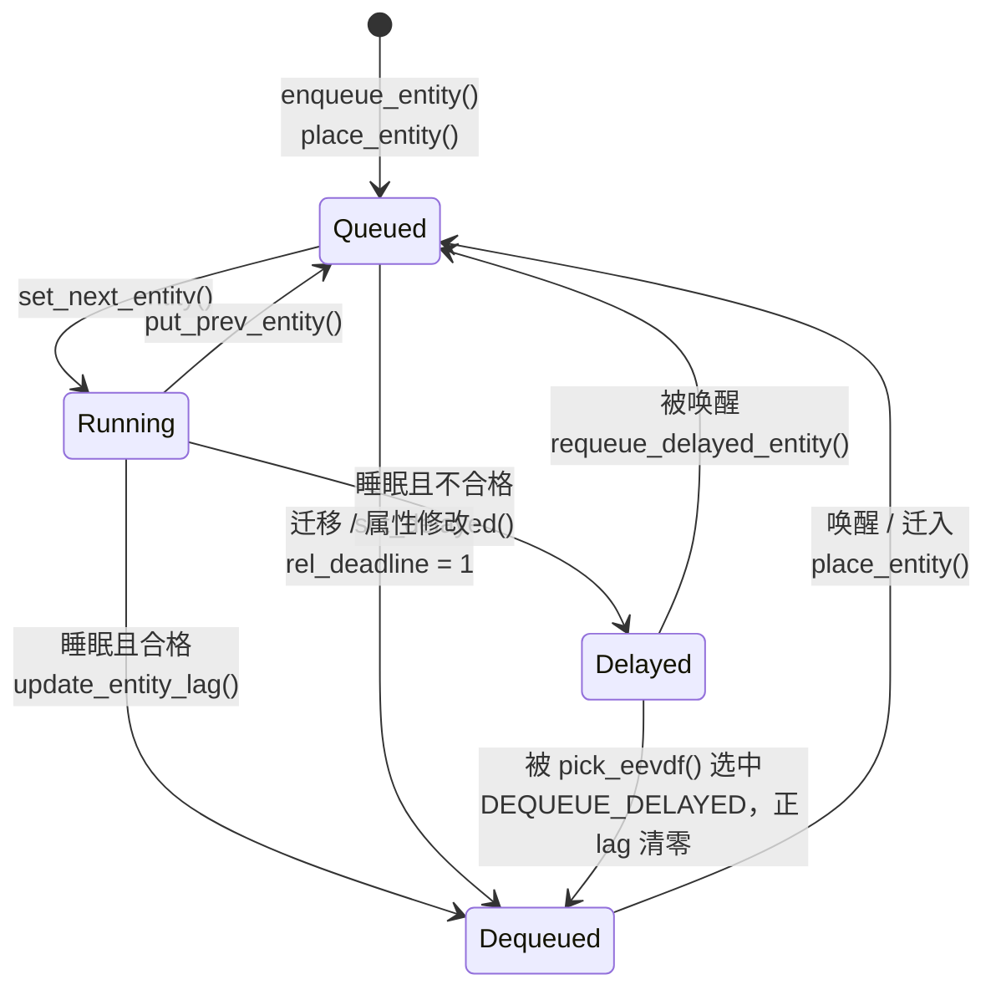

# 3.3 EEVDF 公平调度算法

> **本节源码**：[`kernel/sched/fair.c`](../../linux/kernel/sched/fair.c)、[`kernel/sched/features.h`](../../linux/kernel/sched/features.h)、[`kernel/sched/sched.h`](../../linux/kernel/sched/sched.h)、[`include/linux/sched.h`](../../linux/include/linux/sched.h)、[`kernel/sched/core.c`](../../linux/kernel/sched/core.c)、[`kernel/sched/debug.c`](../../linux/kernel/sched/debug.c)
> **关键函数**：`update_curr()`、`update_deadline()`、`avg_vruntime()`、`vruntime_eligible()`、`pick_eevdf()`、`set_protect_slice()`、`place_entity()`、`dequeue_entity()`、`requeue_delayed_entity()`、`check_preempt_wakeup_fair()`、`pick_task_fair()`
> **前置知识**：3.1 调度器框架（调度类、权重与调度实体）、3.2 主调度函数

## 概述

公平调度类（`fair_sched_class`）服务 `SCHED_NORMAL`、`SCHED_BATCH` 和 `SCHED_IDLE` 三种策略，系统中绝大多数任务都在这个类中。它要同时满足两个目标：**按权重分配 CPU**，即 nice 值不同的任务长期得到的 CPU 时间与权重成正比；**控制调度延迟**，即对延迟敏感的任务在变为可运行后能较快得到 CPU。

从 v2.6.23 到 v6.5，公平调度类采用完全公平调度器（Completely Fair Scheduler，CFS）：总是挑选虚拟运行时间最小的任务。CFS 能保证长期公平，但延迟只能靠 `sched_latency_ns`、`sched_min_granularity_ns`、`sched_wakeup_granularity_ns` 等全局启发式参数来调节，无法表达"这个任务每次只运行很短时间，但希望尽快被调度"这样的单任务需求。

v6.6 起，公平调度类改用**最早合格虚拟截止时间优先**（Earliest Eligible Virtual Deadline First，EEVDF）算法。该算法由 Stoica 等人于 1995 年提出，在"公平"之外引入"虚拟截止时间"来刻画延迟需求；v6.12 又加入了延迟出队和自定义时间片，补齐了 CFS 留下的空缺。

EEVDF 的选择规则可以概括为一句话：**在所有没有多占 CPU 的任务（合格任务）中，选虚拟截止时间最早的那个**。本节先建立算法模型，再看内核用哪些数据结构表示它，最后沿记账、选取、入队、出队、抢占的顺序分析源码。

## 算法模型

### 虚拟运行时间

每个调度实体用 `vruntime` 记录它按权重折算后运行了多久。实际运行 `delta` 纳秒，`vruntime` 增加：

```
Δvruntime = delta × NICE_0_LOAD / weight
```

权重越大，`vruntime` 增长越慢。nice 0 任务（权重 1024）的 `vruntime` 与真实时间同速增长；nice -5 任务（权重 3121）约为真实时间的 1/3（权重表见 [`kernel/sched/core.c:10331-10340`](../../linux/kernel/sched/core.c#L10331-L10340)）。对应的代码是：

[`kernel/sched/fair.c:290-296`](../../linux/kernel/sched/fair.c#L290-L296)（v6.18.60）

```c
static inline u64 calc_delta_fair(u64 delta, struct sched_entity *se)
{
	if (unlikely(se->load.weight != NICE_0_LOAD))
		delta = __calc_delta(delta, NICE_0_LOAD, &se->load);

	return delta;
}
```

nice 0 实体直接返回 `delta`，省掉了乘除法。其他权重由 `__calc_delta()`（[`kernel/sched/fair.c:260-285`](../../linux/kernel/sched/fair.c#L260-L285)）计算：它利用 3.1 节介绍的 `inv_weight`（约为 2^32 / weight）把除法换成"乘法 + 右移"，并在中间结果超过 32 位时动态减小移位量以避免溢出。

`calc_delta_fair()` 在本节反复出现：除了把实际运行时间折算成 `vruntime`，它也用来把时间片（真实时间）折算成虚拟时间长度。

### 虚拟时间 V 与 lag

设想一台理想处理器，能把 CPU 按权重**同时**分给所有可运行任务。在这台处理器上，每个任务在任一时刻得到的服务都恰好等于它应得的份额。EEVDF 用**虚拟时间**（Virtual Time）`V` 描述这台理想处理器的进度。

任务 i 的 **lag** 是它应得服务与实际服务之差：

```
lagᵢ = wᵢ × (V − vᵢ)
```

- `lag > 0`：任务少拿了 CPU，系统欠它的；
- `lag < 0`：任务多拿了 CPU，它欠系统的。

公平调度器满足"所有任务的 lag 之和为 0"。代入上式即可解出 `V`，它恰好是所有可运行实体 `vruntime` 的**加权平均**（推导见源码注释 [`kernel/sched/fair.c:616-649`](../../linux/kernel/sched/fair.c#L616-L649)）：

```
       Σ wᵢ·vᵢ
  V = ─────────
        Σ wᵢ
```

注释同时指出了一个重要前提：只有当实体在 lag 为 0 时加入或离开队列，`V` 才与理想处理器一致。若一个 lag 非零的实体加入或离开，加权平均会发生跳变（`V ±= lagᵢ / W`），进而改变其他所有实体的 lag（[`kernel/sched/fair.c:642-648`](../../linux/kernel/sched/fair.c#L642-L648)）。后文的 lag 膨胀修正和延迟出队都是为了处理这一问题。

### 合格性

EEVDF 规定只有 `lag ≥ 0`（即 `vᵢ ≤ V`）的实体才是**合格的**（Eligible），才有资格被选中。这条规则保证了已经多拿 CPU 的任务不能继续抢先，是 EEVDF 公平性的来源。

### 虚拟截止时间

每个实体还声明一个**时间片**（Slice），即它每次请求连续运行的真实时间长度 `rᵢ`，保存在 `se->slice` 中。由此得到**虚拟截止时间**（Virtual Deadline）：

```
dᵢ = vᵢ + rᵢ / wᵢ        （rᵢ / wᵢ 即 calc_delta_fair(slice, se)）
```

在合格实体中，EEVDF 选择截止时间最早的那个。时间片越短，截止时间越早，任务越容易在竞争中胜出，但它每次也只能连续运行较短时间。这样，**权重决定长期份额，时间片决定响应延迟**，两者被解耦：缩短时间片可以降低调度延迟，却不能多拿 CPU。

### 示例

假设 3 个 nice 0 任务同在一个 CPU 上，权重相同，虚拟时间单位为 ms：

| 任务 | vruntime | slice | deadline | 是否合格（V ≈ 11.67） |
|---|---|---|---|---|
| A | 16 | 0.3 | 16.3 | 否（16 > V） |
| B | 8 | 10 | 18 | 是 |
| C | 11 | 6 | 17 | 是 |

`V = (16 + 8 + 11) / 3 ≈ 11.67`。按截止时间排序为 A < C < B，但 A 已经多拿了 CPU，不合格；合格的 B、C 中 C 的截止时间更早，因此 EEVDF 选 **C**。作为对比，CFS 会选 `vruntime` 最小的 B。

### 与 CFS 的对比

| 方面 | CFS（≤ v6.5） | EEVDF（≥ v6.6，v6.18.60） |
|---|---|---|
| 选择依据 | `vruntime` 最小 | 合格实体中 `deadline` 最早 |
| 延迟控制 | 全局启发式参数（调度周期、最小粒度、唤醒粒度） | 每个实体的时间片 `slice` |
| 唤醒放置 | 只保证 `vruntime` 不低于 `min_vruntime` 减去固定补偿，lag 不被精确保存 | 保持出队时的 lag（`PLACE_LAG`） |
| 唤醒抢占 | 被唤醒者 `vruntime` 比当前任务小出唤醒粒度即抢占 | 模拟一次 EEVDF 选取，选中被唤醒者才抢占 |
| 可调参数 | 多个相互关联的 sysctl | 基础时间片 `base_slice_ns` 与若干特性开关 |

## 核心数据结构

### 调度实体中的 EEVDF 字段

`struct sched_entity` 的完整定义见 3.1 节（[`include/linux/sched.h:570-616`](../../linux/include/linux/sched.h#L570-L616)）。与 EEVDF 相关的字段如下：

| 字段 | 类型 | 含义 | 主要维护者 |
|---|---|---|---|
| `load` | `struct load_weight` | 权重及其倒数 `inv_weight` | `set_load_weight()`、`reweight_entity()` |
| `vruntime` | `u64` | 虚拟运行时间 `vᵢ` | `update_curr()`、`place_entity()` |
| `deadline` | `u64` | 虚拟截止时间 `dᵢ`；迁移途中暂存相对值 | `update_deadline()`、`place_entity()` |
| `slice` | `u64` | 时间片 `rᵢ`（真实时间，ns） | `place_entity()`、`__setparam_fair()` |
| `custom_slice` | `unsigned char` | 时间片由用户指定，不随 `base_slice_ns` 变化 | `__setparam_fair()` |
| `vlag` | `s64` | 出队时保存的虚拟 lag（`V − vᵢ`） | `update_entity_lag()` |
| `vprot` | `u64` | 时间片保护期的结束点（虚拟时间） | `set_protect_slice()` |
| `rel_deadline` | `unsigned char` | `deadline` 当前保存的是相对值 | `dequeue_entity()`、`place_entity()` |
| `sched_delayed` | `unsigned char` | 处于延迟出队状态 | `set_delayed()`、`clear_delayed()` |
| `min_vruntime`、`min_slice`、`max_slice` | `u64` | 以本节点为根的子树中的最小 `vruntime`、最小 / 最大 `slice` | 增强红黑树回调 |
| `on_rq` | `unsigned char` | 是否在 `cfs_rq` 上（含延迟出队状态） | `enqueue_entity()`、`dequeue_entity()` |

注意 `vlag` 保存的是**虚拟** lag，即 `V − vᵢ`，没有乘权重。源码注释称其为"Approximated virtual lag"。

### cfs_rq 中的 EEVDF 字段

[`kernel/sched/sched.h:676-699`](../../linux/kernel/sched/sched.h#L676-L699)（v6.18.60）

```c
struct cfs_rq {
	struct load_weight	load;		// [注] 队列上所有实体（含 curr）权重之和
	unsigned int		nr_queued;	// [注] 本层直接排队的实体数（含 curr 与延迟实体）
	unsigned int		h_nr_queued;       /* SCHED_{NORMAL,BATCH,IDLE} */
	unsigned int		h_nr_runnable;     /* SCHED_{NORMAL,BATCH,IDLE} */
	unsigned int		h_nr_idle; /* SCHED_IDLE */

	s64			sum_w_vruntime;	// [注] Σ (vᵢ − zero_vruntime) × wᵢ，不含 curr
	u64			sum_weight;	// [注] Σ wᵢ，不含 curr

	u64			zero_vruntime;	// [注] 计算 V 的参考原点 v0，紧跟 V 移动
#ifdef CONFIG_SCHED_CORE
	unsigned int		forceidle_seq;
	u64			zero_vruntime_fi;
#endif

	struct rb_root_cached	tasks_timeline;	// [注] 按 deadline 排序的增强红黑树

	/*
	 * 'curr' points to currently running entity on this cfs_rq.
	 * It is set to NULL otherwise (i.e when none are currently running).
	 */
	struct sched_entity	*curr;
	struct sched_entity	*next;		// [注] next buddy：优先考虑的实体
```

- `h_` 前缀表示 hierarchical，统计本 `cfs_rq` 及其所有子组中的**任务**数。`h_nr_runnable` 不计入延迟出队的任务，因此 `h_nr_queued − h_nr_runnable` 就是延迟出队任务的数量（`cfs_h_nr_delayed()`，[`kernel/sched/fair.c:7351-7354`](../../linux/kernel/sched/fair.c#L7351-L7354)）。
- **正在运行的实体 `curr` 不在红黑树中**，也不计入 `sum_w_vruntime` / `sum_weight`：`set_next_entity()` 选中实体时会调用 `__dequeue_entity()` 把它从树中摘下（[`kernel/sched/fair.c:5644-5652`](../../linux/kernel/sched/fair.c#L5644-L5652)），`put_prev_entity()` 再把它放回（[`kernel/sched/fair.c:5720-5726`](../../linux/kernel/sched/fair.c#L5720-L5726)）。因此凡是需要"全体实体"的计算，都要单独把 `curr` 加回去。这样设计是因为 `curr` 的 `vruntime` 一直在变化，若留在树中，每次记账都要调整树结构和累加和。
- `zero_vruntime_fi` 只用于核心调度（`CONFIG_SCHED_CORE`）在 SMT 兄弟之间比较公平任务的优先级，本节不展开。

### 增强红黑树

`tasks_timeline` 中的实体按 `deadline` 排序：

[`kernel/sched/fair.c:582-590`](../../linux/kernel/sched/fair.c#L582-L590)（v6.18.60）

```c
static inline bool entity_before(const struct sched_entity *a,
				 const struct sched_entity *b)
{
	/*
	 * Tiebreak on vruntime seems unnecessary since it can
	 * hardly happen.
	 */
	return vruntime_cmp(a->deadline, "<", b->deadline);
}
```

而合格性是按 `vruntime` 判断的。为了在按截止时间排序的树上快速找到合格者，每个节点额外维护其子树中 `vruntime` 的最小值 `min_vruntime`，这就是**增强红黑树**（Augmented RB-tree）。节点同时维护子树中的 `min_slice` 与 `max_slice`，供时间片保护和 lag 上界使用：

[`kernel/sched/fair.c:893-922`](../../linux/kernel/sched/fair.c#L893-L922)（v6.18.60）

```c
/*
 * se->min_vruntime = min(se->vruntime, {left,right}->min_vruntime)
 */
static inline bool min_vruntime_update(struct sched_entity *se, bool exit)
{
	u64 old_min_vruntime = se->min_vruntime;
	u64 old_min_slice = se->min_slice;
	u64 old_max_slice = se->max_slice;
	struct rb_node *node = &se->run_node;

	se->min_vruntime = se->vruntime;
	__min_vruntime_update(se, node->rb_right);
	__min_vruntime_update(se, node->rb_left);

	se->min_slice = se->slice;
	__min_slice_update(se, node->rb_right);
	__min_slice_update(se, node->rb_left);

	se->max_slice = se->slice;
	__max_slice_update(se, node->rb_right);
	__max_slice_update(se, node->rb_left);

	return se->min_vruntime == old_min_vruntime &&
	       se->min_slice == old_min_slice &&
	       se->max_slice == old_max_slice;
}


RB_DECLARE_CALLBACKS_MULTI(static, min_vruntime_cb, struct sched_entity,
		     run_node, min_vruntime_copy, min_vruntime_update);
```

`RB_DECLARE_CALLBACKS_MULTI` 生成一组回调：红黑树在插入、删除、旋转时调用它们，自底向上重新计算受影响节点的聚合值。`min_vruntime_update()` 返回 true 表示本节点的聚合值没有变化，传播可以提前停止。

插入和删除时，除了操作红黑树，还要同步维护计算 `V` 所需的累加和：

[`kernel/sched/fair.c:927-943`](../../linux/kernel/sched/fair.c#L927-L943)（v6.18.60）

```c
static void __enqueue_entity(struct cfs_rq *cfs_rq, struct sched_entity *se)
{
	sum_w_vruntime_add(cfs_rq, se);
	se->min_vruntime = se->vruntime;
	se->min_slice = se->slice;
	se->max_slice = se->slice;

	rb_add_augmented_cached(&se->run_node, &cfs_rq->tasks_timeline,
				__entity_less, &min_vruntime_cb);
}

static void __dequeue_entity(struct cfs_rq *cfs_rq, struct sched_entity *se)
{
	rb_erase_augmented_cached(&se->run_node, &cfs_rq->tasks_timeline,
				  &min_vruntime_cb);
	sum_w_vruntime_sub(cfs_rq, se);
}
```

于是这棵树既是按 `deadline` 排序的二叉搜索树，又是按 `vruntime` 的最小堆：若某棵子树的 `min_vruntime` 都不合格，整棵子树都可以剪掉。上文示例中的 3 个任务在树中的形态如图 3-6 所示（假设三者都在树中，即没有正在运行的 `curr`）：

```
                       ┌───────────────────────┐
                       │ C  d=17   v=11        │
                       │ min_vruntime = 8      │
                       └──────────┬────────────┘
                ┌─────────────────┴──────────────────┐
     ┌──────────┴───────────┐             ┌──────────┴───────────┐
     │ A  d=16.3   v=16     │             │ B  d=18    v=8       │
     │ min_vruntime = 16    │             │ min_vruntime = 8     │
     └──────────────────────┘             └──────────────────────┘
       左子树：deadline 更早                  右子树：deadline 更晚
```

*图 3-6：按 deadline 排序、维护子树 min_vruntime 的增强红黑树（对应上文示例，V ≈ 11.67）*

### 时间值的比较

`vruntime`、`deadline`、`vprot` 都是会回绕的 `u64`。所有比较都通过 `vruntime_cmp()` 宏（[`kernel/sched/fair.c:531-548`](../../linux/kernel/sched/fair.c#L531-L548)）把差值转换为 `s64` 再与 0 比较，减法通过 `vruntime_op()`（[`kernel/sched/fair.c:552-563`](../../linux/kernel/sched/fair.c#L552-L563)）完成。只要两个值相差不超过 2^63，回绕就不会导致比较错误。这两个宏用 `__builtin_strcmp()` 在编译期解析运算符字符串，写错运算符会引用一个未定义的函数而在链接时报错。

为了尽早暴露遗漏 `vruntime_cmp()` 的错误比较，`init_cfs_rq()` 把 `zero_vruntime` 初始化为 `-(1LL << 20)`（[`kernel/sched/fair.c:13813`](../../linux/kernel/sched/fair.c#L13813)），即距回绕点约 1 ms，系统启动后很快就会发生一次回绕。

## 主流程分析

### 调用链总览

```
记账（时钟中断、入队、出队、唤醒抢占前）
update_curr()                              kernel/sched/fair.c
├── update_se()                            // 结算 sum_exec_runtime
├── curr->vruntime += calc_delta_fair()
├── update_deadline()                      // 时间片用完：发起新请求
├── dl_server_update()                     // fair_server 预算（3.7 节）
├── account_cfs_rq_runtime()               // CPU 带宽（3.10 节）
└── resched_curr_lazy()                    // 用完或保护期结束：请求重调度

选取（__schedule() → pick_next_task()）
pick_next_task_fair()                      kernel/sched/fair.c
├── pick_task_fair()                       // 自顶向下逐层选取
│   └── pick_next_entity()
│       ├── pick_eevdf()                   // EEVDF 选择
│       └── dequeue_entities()             // 选中延迟实体：真正出队并重选
└── put_prev_entity() / set_next_entity()  // set_next_entity() 设置保护期

入队
enqueue_task_fair()                        kernel/sched/fair.c
├── requeue_delayed_entity()               // ENQUEUE_DELAYED：唤醒延迟实体
└── enqueue_entity()
    ├── place_entity()                     // 恢复 lag，计算 deadline
    └── __enqueue_entity()

出队
dequeue_task_fair()                        kernel/sched/fair.c
└── dequeue_entities()
    └── dequeue_entity()
        ├── set_delayed()                  // 不合格的睡眠任务：延迟出队
        └── update_entity_lag()            // 保存 vlag

唤醒抢占
check_preempt_wakeup_fair()                kernel/sched/fair.c
└── pick_next_entity() → resched_curr_lazy()
```

### 记账：update_curr()

[`kernel/sched/fair.c:1294-1341`](../../linux/kernel/sched/fair.c#L1294-L1341)（v6.18.60，节选）

```c
static void update_curr(struct cfs_rq *cfs_rq)
{
	...
	struct sched_entity *curr = cfs_rq->curr;
	struct rq *rq = rq_of(cfs_rq);
	s64 delta_exec;
	bool resched;

	if (unlikely(!curr))
		return;

	delta_exec = update_se(rq, curr);
	if (unlikely(delta_exec <= 0))
		return;

	curr->vruntime += calc_delta_fair(delta_exec, curr);
	resched = update_deadline(cfs_rq, curr);

	if (entity_is_task(curr)) {
		...
		if (dl_server_active(&rq->fair_server))
			dl_server_update(&rq->fair_server, delta_exec);
	}

	account_cfs_rq_runtime(cfs_rq, delta_exec);

	if (cfs_rq->nr_queued == 1)
		return;

	if (resched || !protect_slice(curr)) {
		resched_curr_lazy(rq);
		clear_buddies(cfs_rq, curr);
	}
}
```

`update_curr()` 是公平类中调用最频繁的函数。时钟中断、入队、出队、唤醒抢占判断之前都会先调用它，把 `curr` 自上次记账以来的运行时间结算掉：

1. `update_se()`（[`kernel/sched/fair.c:1242-1279`](../../linux/kernel/sched/fair.c#L1242-L1279)）以 `rq_clock_task()` 为准计算 `delta_exec`，累加到 `sum_exec_runtime`，并更新线程组和 cgroup 的 CPU 时间统计。`rq_clock_task()` 不含中断处理时间（3.5 节）。
2. 把 `delta_exec` 按权重折算后累加到 `vruntime`。
3. `update_deadline()` 检查本次请求是否完成。
4. 若本 CPU 的 `fair_server` 处于活动状态，同步扣减其预算（3.7 节）。
5. `account_cfs_rq_runtime()` 扣减 CPU 带宽配额（依赖 `CONFIG_CFS_BANDWIDTH`，3.10 节）。
6. 队列中只有一个实体时无需重调度；否则，若时间片已用完，或已超出时间片保护期（`protect_slice()`，见下文），调用 `resched_curr_lazy()` 请求重调度。

第 6 步只是"请求"重新选择，不代表一定切换：保护期结束后，每次 `update_curr()` 都会请求重调度，由 `pick_eevdf()` 按 EEVDF 规则重新裁决，结果仍可能是 `curr`。使用惰性版本 `resched_curr_lazy()` 意味着在 `CONFIG_PREEMPT_LAZY` 模型下，公平任务之间的时间片抢占会推迟到返回用户态或下一个 tick（3.5 节）。

源码开头的注释提醒：`cfs_rq->curr` 对应的是被选中的任务 `rq->donor`，在代理执行（Proxy Execution）下可能不是实际运行的 `rq->curr`。本书配置未开启 `CONFIG_SCHED_PROXY_EXEC`，两者等价。

### 推进截止时间：update_deadline()

[`kernel/sched/fair.c:1123-1150`](../../linux/kernel/sched/fair.c#L1123-L1150)（v6.18.60）

```c
/*
 * XXX: strictly: vd_i += N*r_i/w_i such that: vd_i > ve_i
 * this is probably good enough.
 */
static bool update_deadline(struct cfs_rq *cfs_rq, struct sched_entity *se)
{
	if (vruntime_cmp(se->vruntime, "<", se->deadline))
		return false;

	/*
	 * For EEVDF the virtual time slope is determined by w_i (iow.
	 * nice) while the request time r_i is determined by
	 * sysctl_sched_base_slice.
	 */
	if (!se->custom_slice)
		se->slice = sysctl_sched_base_slice;

	/*
	 * EEVDF: vd_i = ve_i + r_i / w_i
	 */
	se->deadline = se->vruntime + calc_delta_fair(se->slice, se);
	avg_vruntime(cfs_rq);

	/*
	 * The task has consumed its request, reschedule.
	 */
	return true;
}
```

`vruntime` 追上 `deadline`，说明本次请求（一个时间片）已经用完，于是发起下一个请求：新截止时间等于当前 `vruntime` 加上一个折算后的时间片。

- 没有自定义时间片的实体，每次发起新请求时都重新读取 `sysctl_sched_base_slice`，因此通过 debugfs 修改基础时间片后，现有任务会在下一次请求时生效。
- 开头的 XXX 注释说明这里是近似做法：严格的 EEVDF 应把截止时间按整数个 `r/w` 递增，直到超过 `vruntime`；内核直接以当前 `vruntime` 为起点，差别只在于丢弃了超出 `deadline` 的那一小段。
- `avg_vruntime()` 在这里被调用并不是为了使用返回值，而是借它的副作用更新 `zero_vruntime`（见下一小节）。

### 维护虚拟时间：avg_vruntime()

直接计算 `Σ wᵢ·vᵢ` 会溢出 64 位。内核选一个参考原点 `v0`，只累加相对值：

```
       Σ (vᵢ − v0)·wᵢ
  V = ──────────────── + v0  =  sum_w_vruntime / sum_weight + zero_vruntime
           Σ wᵢ
```

`__enqueue_entity()` / `__dequeue_entity()` 中的 `sum_w_vruntime_add()` / `sum_w_vruntime_sub()`（[`kernel/sched/fair.c:673-691`](../../linux/kernel/sched/fair.c#L673-L691)）增量维护两个累加和。其中的相对值 `vᵢ − v0` 由 `entity_key()`（[`kernel/sched/fair.c:607-610`](../../linux/kernel/sched/fair.c#L607-L610)）计算，权重先经 `scale_load_down()` 缩回 10 位精度，以减小乘积。

[`kernel/sched/fair.c:715-749`](../../linux/kernel/sched/fair.c#L715-L749)（v6.18.60）

```c
u64 avg_vruntime(struct cfs_rq *cfs_rq)
{
	struct sched_entity *curr = cfs_rq->curr;
	long weight = cfs_rq->sum_weight;
	s64 delta = 0;

	if (curr && !curr->on_rq)
		curr = NULL;

	if (weight) {
		s64 runtime = cfs_rq->sum_w_vruntime;

		if (curr) {
			unsigned long w = scale_load_down(curr->load.weight);

			runtime += entity_key(cfs_rq, curr) * w;
			weight += w;
		}

		/* sign flips effective floor / ceiling */
		if (runtime < 0)
			runtime -= (weight - 1);

		delta = div_s64(runtime, weight);
	} else if (curr) {
		/*
		 * When there is but one element, it is the average.
		 */
		delta = curr->vruntime - cfs_rq->zero_vruntime;
	}

	update_zero_vruntime(cfs_rq, delta);

	return cfs_rq->zero_vruntime;
}
```

- **把 `curr` 加回**：树中的累加和不含 `curr`，这里临时加上它的贡献，得到全体实体的加权平均。
- **向下取整**：`div_s64()` 向零截断，对负数相当于向上取整。`runtime -= weight - 1` 把它改成向下取整，使结果略微偏小。函数前的注释（[`kernel/sched/fair.c:703-714`](../../linux/kernel/sched/fair.c#L703-L714)）给出了原因：必须保证 `vruntime` 恰好等于返回值的实体被判为合格，否则以 `V` 放置的新实体可能一入队就不合格。
- **移动原点**：`update_zero_vruntime()`（[`kernel/sched/fair.c:693-701`](../../linux/kernel/sched/fair.c#L693-L701)）把 `zero_vruntime` 移到刚算出的 `V`，同时从 `sum_w_vruntime` 中减去 `delta × sum_weight`，使两者表示的 `V` 不变。

第三点使 `zero_vruntime` 始终贴近 `V`，所有 `vᵢ − v0` 都保持在 lag 的量级。注释估计 `key × weight` 的最大值约为 44 位（[`kernel/sched/fair.c:592-606`](../../linux/kernel/sched/fair.c#L592-L606)、[`kernel/sched/fair.c:671`](../../linux/kernel/sched/fair.c#L671)），远离 64 位溢出。`avg_vruntime()` 只在 `place_entity()`、`update_entity_lag()`、`update_deadline()` 等少数位置被调用，所以 `zero_vruntime` 相对真实的 `V` 会稍有滞后，但滞后量有界。

> **版本差异**：v6.6 首次引入 EEVDF 时，以 `cfs_rq->min_vruntime`（所有实体 `vruntime` 的单调下界）为原点，用 `avg_vruntime` / `avg_load` 字段保存累加和。v6.18.60 中这三个字段分别变为 `zero_vruntime`、`sum_w_vruntime`、`sum_weight`，原点直接跟踪 `V`（即 lag 为零的点），`min_vruntime` 只剩下增强红黑树节点中的子树最小值这一种含义。阅读其他版本的资料时要注意区分。

### 合格性判断：vruntime_eligible()

[`kernel/sched/fair.c:802-821`](../../linux/kernel/sched/fair.c#L802-L821)（v6.18.60）

```c
static int vruntime_eligible(struct cfs_rq *cfs_rq, u64 vruntime)
{
	struct sched_entity *curr = cfs_rq->curr;
	s64 avg = cfs_rq->sum_w_vruntime;
	long load = cfs_rq->sum_weight;

	if (curr && curr->on_rq) {
		unsigned long weight = scale_load_down(curr->load.weight);

		avg += entity_key(cfs_rq, curr) * weight;
		load += weight;
	}

	return avg >= vruntime_op(vruntime, "-", cfs_rq->zero_vruntime) * load;
}

int entity_eligible(struct cfs_rq *cfs_rq, struct sched_entity *se)
{
	return vruntime_eligible(cfs_rq, se->vruntime);
}
```

`vᵢ ≤ V` 等价于 `(vᵢ − v0) × Σw ≤ Σ(vⱼ − v0)·wⱼ`。把除法移到不等式另一侧变成乘法，既省掉了除法，也避免了整数除法的截断误差（注释 [`kernel/sched/fair.c:799-800`](../../linux/kernel/sched/fair.c#L799-L800) 特意指出，直接比较 `avg_vruntime() > se->vruntime` 是不准确的）。

与 `avg_vruntime()` 不同，这个函数没有副作用，不移动原点，可以在搜索过程中被反复调用。参数是 `u64 vruntime` 而非实体，这样 `pick_eevdf()` 可以直接传入子树的 `min_vruntime` 来判断整棵子树中是否存在合格实体。

### 选取：pick_eevdf()

`pick_eevdf()` 是 EEVDF 选择规则的直接实现。前半部分处理几种可以提前返回的情况：

[`kernel/sched/fair.c:1025-1053`](../../linux/kernel/sched/fair.c#L1025-L1053)（v6.18.60）

```c
static struct sched_entity *pick_eevdf(struct cfs_rq *cfs_rq, bool protect)
{
	struct rb_node *node = cfs_rq->tasks_timeline.rb_root.rb_node;
	struct sched_entity *se = __pick_first_entity(cfs_rq);
	struct sched_entity *curr = cfs_rq->curr;
	struct sched_entity *best = NULL;

	/*
	 * We can safely skip eligibility check if there is only one entity
	 * in this cfs_rq, saving some cycles.
	 */
	if (cfs_rq->nr_queued == 1)
		return curr && curr->on_rq ? curr : se;

	/*
	 * Picking the ->next buddy will affect latency but not fairness.
	 */
	if (sched_feat(PICK_BUDDY) &&
	    cfs_rq->next && entity_eligible(cfs_rq, cfs_rq->next)) {
		/* ->next will never be delayed */
		WARN_ON_ONCE(cfs_rq->next->sched_delayed);
		return cfs_rq->next;
	}

	if (curr && (!curr->on_rq || !entity_eligible(cfs_rq, curr)))
		curr = NULL;

	if (curr && protect && protect_slice(curr))
		return curr;
```

1. **只有一个实体**：无需判断合格性。
2. **next buddy**：若设置了 `cfs_rq->next` 且它合格，直接选它。buddy 必须先合格，所以它只影响"合格者中选谁"，不破坏公平性（buddy 的来源见"关键细节"）。
3. **排除 `curr`**：`curr` 已出队（`on_rq == 0`，例如刚睡眠）或不合格时，不参与竞争。
4. **时间片保护**：`curr` 合格且仍在保护期内，继续运行 `curr`，避免频繁切换。

后半部分是在增强红黑树上的搜索：

[`kernel/sched/fair.c:1055-1094`](../../linux/kernel/sched/fair.c#L1055-L1094)（v6.18.60）

```c
	/* Pick the leftmost entity if it's eligible */
	if (se && entity_eligible(cfs_rq, se)) {
		best = se;
		goto found;
	}

	/* Heap search for the EEVD entity */
	while (node) {
		struct rb_node *left = node->rb_left;

		/*
		 * Eligible entities in left subtree are always better
		 * choices, since they have earlier deadlines.
		 */
		if (left && vruntime_eligible(cfs_rq,
					__node_2_se(left)->min_vruntime)) {
			node = left;
			continue;
		}

		se = __node_2_se(node);

		/*
		 * The left subtree either is empty or has no eligible
		 * entity, so check the current node since it is the one
		 * with earliest deadline that might be eligible.
		 */
		if (entity_eligible(cfs_rq, se)) {
			best = se;
			break;
		}

		node = node->rb_right;
	}
found:
	if (!best || (curr && entity_before(curr, best)))
		best = curr;

	return best;
}
```

1. **最左节点**：它的截止时间最早，若合格就是答案。这是最常见的情况，`__pick_first_entity()` 读取缓存的最左节点，开销为 O(1)。
2. **堆搜索**：从根开始，若左子树的 `min_vruntime` 合格，说明左子树中存在截止时间更早的合格实体，向左走；否则左子树可以整体剪掉，检查当前节点；当前节点也不合格就向右走。每层只走一步，复杂度为 O(log n)。
3. **与 `curr` 比较**：`curr` 不在树中，最后单独比较。若树中没有合格实体，或 `curr` 的截止时间更早，选 `curr`。

以图 3-6 为例：最左节点 A 不合格；从根 C 出发，左孩子 A 的 `min_vruntime = 16` 不合格，于是检查 C 本身，`11 ≤ 11.67`，合格，选中 C。

从数学上讲，`pick_eevdf()` 总能找到一个实体：`V` 是参与竞争的全体实体的加权平均，其中 `vruntime` 最小者必然满足 `vᵢ ≤ V`，因此至少存在一个合格实体。`vruntime_eligible()` 用乘法做精确比较，正是为了让这个性质在整数运算中同样成立；`pick_next_entity()` 直接解引用返回值，也依赖于此。

### 时间片保护：set_protect_slice()

如果严格执行 EEVDF，一旦 `curr` 运行到不合格，或者有截止时间更早的任务被唤醒，就应立即切换。这在多个任务的 `vruntime` 很接近时会导致频繁切换。`RUN_TO_PARITY` 特性（[`kernel/sched/features.h:16-20`](../../linux/kernel/sched/features.h#L16-L20)，默认开启）为被选中的实体设置一个保护期，保护期的终点记录在 `se->vprot` 中：

[`kernel/sched/fair.c:973-1004`](../../linux/kernel/sched/fair.c#L973-L1004)（v6.18.60）

```c
static inline void set_protect_slice(struct cfs_rq *cfs_rq, struct sched_entity *se)
{
	u64 slice = normalized_sysctl_sched_base_slice;
	u64 vprot = se->deadline;

	if (sched_feat(RUN_TO_PARITY))
		slice = cfs_rq_min_slice(cfs_rq);

	slice = min(slice, se->slice);
	if (slice != se->slice)
		vprot = min_vruntime(vprot, se->vruntime + calc_delta_fair(slice, se));

	se->vprot = vprot;
}

static inline void update_protect_slice(struct cfs_rq *cfs_rq, struct sched_entity *se)
{
	u64 slice = cfs_rq_min_slice(cfs_rq);

	se->vprot = min_vruntime(se->vprot, se->vruntime + calc_delta_fair(slice, se));
}

static inline bool protect_slice(struct sched_entity *se)
{
	return vruntime_cmp(se->vruntime, "<", se->vprot);
}

static inline void cancel_protect_slice(struct sched_entity *se)
{
	if (protect_slice(se))
		se->vprot = se->vruntime;
}
```

- **设置**：`set_next_entity()` 在实体被新选中（`first` 为 true）时调用 `set_protect_slice()`（[`kernel/sched/fair.c:5655-5656`](../../linux/kernel/sched/fair.c#L5655-L5656)）。此时该实体已从树中摘下，`cfs_rq->curr` 尚未指向它，所以 `cfs_rq_min_slice()`（[`kernel/sched/fair.c:823-836`](../../linux/kernel/sched/fair.c#L823-L836)）得到的是**其他**实体中的最短时间片。保护期默认持续到本次请求的 `deadline`；若其他实体中有更短的时间片，则只保护这个更短的时长。
- **收紧**：唤醒抢占判断没有触发抢占时，`update_protect_slice()` 根据新的最短时间片（此时包括刚入队的实体）收紧保护期，只缩短、不延长。
- **取消**：`cancel_protect_slice()` 把 `vprot` 设为当前 `vruntime`，立即结束保护期。

关闭 `RUN_TO_PARITY` 后，保护期退化为 `min(0.7 ms, 自身时间片)`（`normalized_sysctl_sched_base_slice` 是未按 CPU 数缩放的基准值），对应注释所说的"给运行实体一个最小量子以保证进展"（[`kernel/sched/fair.c:965-972`](../../linux/kernel/sched/fair.c#L965-L972)）。

保护期内，`update_curr()` 只在时间片用完时请求重调度，`pick_eevdf(protect = true)` 也会继续返回合格的 `curr`。注意保护的前提是 `curr` 合格：`pick_eevdf()` 先排除不合格的 `curr`，再检查保护期。

### 入队：place_entity()

任务被唤醒、新建或迁入时，应以什么 `vruntime` 加入竞争？CFS 只保证唤醒任务的 `vruntime` 不低于 `min_vruntime` 减去一个固定补偿量，睡眠前的 lag 并未被精确保存：长时间睡眠的任务总是获得同样的补偿，而与它睡眠前实际的欠账或盈余无关。EEVDF 的策略是**保持 lag**：任务出队时记下 `vlag = V − v`，入队时恢复为 `v = V − vlag`。

[`kernel/sched/fair.c:5312-5398`](../../linux/kernel/sched/fair.c#L5312-L5398)（v6.18.60，节选）

```c
static void
place_entity(struct cfs_rq *cfs_rq, struct sched_entity *se, int flags)
{
	u64 vslice, vruntime = avg_vruntime(cfs_rq);
	s64 lag = 0;

	if (!se->custom_slice)
		se->slice = sysctl_sched_base_slice;
	vslice = calc_delta_fair(se->slice, se);
	...
	if (sched_feat(PLACE_LAG) && cfs_rq->nr_queued && se->vlag) {
		struct sched_entity *curr = cfs_rq->curr;
		unsigned long load;

		lag = se->vlag;
		...
		load = cfs_rq->sum_weight;
		if (curr && curr->on_rq)
			load += scale_load_down(curr->load.weight);

		lag *= load + scale_load_down(se->load.weight);
		if (WARN_ON_ONCE(!load))
			load = 1;
		lag = div_s64(lag, load);
	}

	se->vruntime = vruntime - lag;
```

**lag 膨胀修正**。新实体加入后，加权平均 `V` 本身会被它拉动。若直接以 `V − vlag` 放置，加入后的实际 lag 会小于 `vlag`。注释（[`kernel/sched/fair.c:5336-5387`](../../linux/kernel/sched/fair.c#L5336-L5387)）推导出修正公式：

```
vl_i = (W + w_i) × vl'_i / W        （W 为加入前的总权重，vl'_i 为希望保持的 lag）
```

代码中的 `lag *= load + w; lag /= load` 正是这一步。举例来说，队列中已有两个 nice 0 任务（`W = 2048`），一个 nice 0 任务带着 `vlag = 3 ms` 醒来：修正后 `lag = 3 × 3072 / 2048 = 4.5 ms`，放置在 `V − 4.5`；加入后 `V' = V − 1024 × 4.5 / 3072 = V − 1.5`，实际 lag 为 `V' − v = 3 ms`，与出队时一致。

条件 `cfs_rq->nr_queued` 意味着：若队列为空，lag 不起作用，实体直接以 `V` 加入。因为只有一个实体时，它自己就是平均值，lag 无从谈起。

[`kernel/sched/fair.c:5400-5418`](../../linux/kernel/sched/fair.c#L5400-L5418)（v6.18.60）

```c
	if (sched_feat(PLACE_REL_DEADLINE) && se->rel_deadline) {
		se->deadline += se->vruntime;
		se->rel_deadline = 0;
		return;
	}

	/*
	 * When joining the competition; the existing tasks will be,
	 * on average, halfway through their slice, as such start tasks
	 * off with half a slice to ease into the competition.
	 */
	if (sched_feat(PLACE_DEADLINE_INITIAL) && (flags & ENQUEUE_INITIAL))
		vslice /= 2;

	/*
	 * EEVDF: vd_i = ve_i + r_i/w_i
	 */
	se->deadline = se->vruntime + vslice;
}
```

确定 `vruntime` 后再设置截止时间，分三种情况：

- **保留相对截止时间**：非睡眠出队（迁移、修改属性等）时，`dequeue_entity()` 把 `deadline` 转成相对 `vruntime` 的值并置 `rel_deadline`，这里再加回来。这样任务在两个 CPU 之间迁移时不会丢掉剩余的请求量。
- **新任务半个时间片**：`wake_up_new_task()` 以 `ENQUEUE_INITIAL` 入队（[`kernel/sched/core.c:4854`](../../linux/kernel/sched/core.c#L4854)）。注释的解释是：已在竞争中的任务平均已用掉半个时间片，新任务以半个时间片起步更公平。
- **其他情况**：截止时间为 `vruntime` 加一个完整的时间片。

新 fork 的任务在 `__sched_fork()` 中 `vlag` 被清零（[`kernel/sched/core.c:4466`](../../linux/kernel/sched/core.c#L4466)），因此以 `V` 加入，既不因 fork 获得份额，也不因此失去份额。

`place_entity()` 由 `enqueue_entity()`（[`kernel/sched/fair.c:5426-5490`](../../linux/kernel/sched/fair.c#L5426-L5490)）调用，入队的顺序是：

1. `update_curr()` 结算当前实体；
2. `update_load_avg()` 更新 PELT 负载（3.8 节），`update_cfs_group()` 按新份额调整组实体权重（3.10 节）；
3. `place_entity()` 放置——必须在权重调整之后，因为 lag 与截止时间的折算都依赖权重；
4. `account_entity_enqueue()` 累加 `cfs_rq->load` 与 `nr_queued`；
5. `__enqueue_entity()` 插入红黑树，置 `on_rq = 1`。

若入队的就是 `curr`（例如属性修改时的出队再入队），`place_entity()` 会提前到 `update_curr()` 之前执行，`__enqueue_entity()` 则跳过，因为 `curr` 不在树中。

### 出队：保存 lag

`dequeue_entity()` 的前半部分决定是否延迟出队（下一小节）。真正出队时，它保存 lag，并在非睡眠出队时把截止时间转为相对值：

[`kernel/sched/fair.c:5604-5613`](../../linux/kernel/sched/fair.c#L5604-L5613)（v6.18.60）

```c
	update_entity_lag(cfs_rq, se);
	if (sched_feat(PLACE_REL_DEADLINE) && !sleep) {
		se->deadline -= se->vruntime;
		se->rel_deadline = 1;
	}

	if (se != cfs_rq->curr)
		__dequeue_entity(cfs_rq, se);
	se->on_rq = 0;
	account_entity_dequeue(cfs_rq, se);
```

`update_entity_lag()` 计算 `vlag = V − v`，并加以限制：

[`kernel/sched/fair.c:767-783`](../../linux/kernel/sched/fair.c#L767-L783)（v6.18.60）

```c
static s64 entity_lag(struct cfs_rq *cfs_rq, struct sched_entity *se, u64 avruntime)
{
	u64 max_slice = cfs_rq_max_slice(cfs_rq) + TICK_NSEC;
	s64 vlag, limit;

	vlag = avruntime - se->vruntime;
	limit = calc_delta_fair(max_slice, se);

	return clamp(vlag, -limit, limit);
}

static void update_entity_lag(struct cfs_rq *cfs_rq, struct sched_entity *se)
{
	WARN_ON_ONCE(!se->on_rq);

	se->vlag = entity_lag(cfs_rq, se, avg_vruntime(cfs_rq));
}
```

EEVDF 论文证明，稳态系统中 lag 满足 `-r_max < lag < max(r_max, q)`（`r_max` 为最大请求长度，`q` 为调度粒度）。但内核中的 `V` 是近似值，实体的加入、离开和权重调整都会让它跳动，lag 可能累积得比理论值更大。因此源码把 lag 限制在"队列中最长时间片 + 一个 tick"折算后的范围内（[`kernel/sched/fair.c:752-766`](../../linux/kernel/sched/fair.c#L752-L766)），`TICK_NSEC` 体现了时钟中断的计时粒度。

### 延迟出队

保持 lag 还留下两个问题：

1. **负 lag 永不消退**。一个多拿了 CPU 的任务睡眠后，负 lag 被原样保存。无论它睡多久，醒来后都要先还完这笔账才能变得合格。直观上，长时间睡眠的任务应该被"原谅"。
2. **出队扰动 V**。负 lag 实体的 `vruntime` 高于 `V`，它离开后剩余实体的加权平均变小，`V` 发生倒退，其他任务的 lag 随之变小。`place_entity()` 中的注释把这种现象称为"move 'time' backwards"（[`kernel/sched/fair.c:5322-5329`](../../linux/kernel/sched/fair.c#L5322-L5329)）。

v6.12 引入的**延迟出队**（Delayed Dequeue）同时解决了这两个问题：不合格（负 lag）的任务睡眠时，**不立即离开队列**，而是标记 `sched_delayed`，继续以原 `vruntime` 参与竞争。随着其他任务运行，`V` 逐渐增大，它的 lag 自然回升；等到它被 `pick_eevdf()` 选中时——按定义此时已经合格——才真正出队（[`kernel/sched/features.h:49-59`](../../linux/kernel/sched/features.h#L49-L59)）。这样负 lag 随着虚拟时间的流逝而衰减，实体离开时 lag 已不为负，也就不会让 `V` 倒退。

[`kernel/sched/fair.c:5557-5585`](../../linux/kernel/sched/fair.c#L5557-L5585)（v6.18.60）

```c
static bool
dequeue_entity(struct cfs_rq *cfs_rq, struct sched_entity *se, int flags)
{
	bool sleep = flags & DEQUEUE_SLEEP;
	int action = UPDATE_TG;

	update_curr(cfs_rq);
	clear_buddies(cfs_rq, se);

	if (flags & DEQUEUE_DELAYED) {
		WARN_ON_ONCE(!se->sched_delayed);
	} else {
		bool delay = sleep;
		/*
		 * DELAY_DEQUEUE relies on spurious wakeups, special task
		 * states must not suffer spurious wakeups, excempt them.
		 */
		if (flags & (DEQUEUE_SPECIAL | DEQUEUE_THROTTLE))
			delay = false;

		WARN_ON_ONCE(delay && se->sched_delayed);

		if (sched_feat(DELAY_DEQUEUE) && delay &&
		    !entity_eligible(cfs_rq, se)) {
			update_load_avg(cfs_rq, se, 0);
			set_delayed(se);
			return false;
		}
	}
```

- 只有睡眠出队（`DEQUEUE_SLEEP`）才可能延迟。`DEQUEUE_SPECIAL`（如 `TASK_STOPPED`、`TASK_TRACED` 等特殊状态）和 `DEQUEUE_THROTTLE`（带宽节流，3.10 节）除外，注释说明延迟出队依赖"虚假唤醒"，这些特殊状态不能承受。
- 不合格的睡眠实体在这里返回 false。这就是 3.1 节提到的"`dequeue_task()` 可能失败"，也是 3.2 节 `block_task()` 只在返回 true 时才清除 `on_rq` 的原因。`dequeue_entities()` 发现任务本身被延迟时返回 -1，`dequeue_task_fair()` 据此返回 false（[`kernel/sched/fair.c:7340-7341`](../../linux/kernel/sched/fair.c#L7340-L7341)）。
- `set_delayed()`（[`kernel/sched/fair.c:5511-5528`](../../linux/kernel/sched/fair.c#L5511-L5528)）置 `sched_delayed`，并把各层 `h_nr_runnable` 减一，使延迟任务不被统计为可运行。核心层通过 `task_is_runnable()`（`p->on_rq && !p->se.sched_delayed`，[`include/linux/sched.h:2261-2264`](../../linux/include/linux/sched.h#L2261-L2264)）区分这两种状态。

组实体也可能被延迟：当组内最后一个任务出队、组的 `cfs_rq` 变空时，`dequeue_entities()` 会以 `DEQUEUE_SLEEP` 继续出队上层的组实体，若该组实体不合格，同样进入延迟状态。

延迟实体的结局有两种。

**结局一：被选中后真正出队**。`pick_next_entity()` 发现 `pick_eevdf()` 选出的是延迟实体时，以 `DEQUEUE_DELAYED` 把它真正出队，然后返回 NULL，让调用者重新选择：

[`kernel/sched/fair.c:5690-5704`](../../linux/kernel/sched/fair.c#L5690-L5704)（v6.18.60）

```c
static struct sched_entity *
pick_next_entity(struct rq *rq, struct cfs_rq *cfs_rq, bool protect)
{
	struct sched_entity *se;

	se = pick_eevdf(cfs_rq, protect);
	if (se->sched_delayed) {
		dequeue_entities(rq, se, DEQUEUE_SLEEP | DEQUEUE_DELAYED);
		/*
		 * Must not reference @se again, see __block_task().
		 */
		return NULL;
	}
	return se;
}
```

`dequeue_entities()` 在最后调用 `__block_task()` 补完 `block_task()` 当初跳过的工作（清除 `on_rq` 等，[`kernel/sched/fair.c:7306-7319`](../../linux/kernel/sched/fair.c#L7306-L7319)），之后任务可能被其他 CPU 唤醒甚至释放，所以注释强调不能再访问 `se`。`dequeue_entity()` 走到末尾时，通过 `finish_delayed_dequeue_entity()` 清除延迟标记，并在 `DELAY_ZERO` 开启时把正 lag 清零（[`kernel/sched/fair.c:5550-5555`](../../linux/kernel/sched/fair.c#L5550-L5555)）。

**结局二：在被选中前被唤醒**。任务仍在队列中（`on_rq` 非零），`ttwu_runnable()` 以 `ENQUEUE_DELAYED` 调用 `enqueue_task()`（[`kernel/sched/core.c:3784-3785`](../../linux/kernel/sched/core.c#L3784-L3785)，3.4 节），公平类执行 `requeue_delayed_entity()`：

[`kernel/sched/fair.c:7051-7080`](../../linux/kernel/sched/fair.c#L7051-L7080)（v6.18.60）

```c
static void
requeue_delayed_entity(struct sched_entity *se)
{
	struct cfs_rq *cfs_rq = cfs_rq_of(se);

	/*
	 * se->sched_delayed should imply: se->on_rq == 1.
	 * Because a delayed entity is one that is still on
	 * the runqueue competing until elegibility.
	 */
	WARN_ON_ONCE(!se->sched_delayed);
	WARN_ON_ONCE(!se->on_rq);

	if (sched_feat(DELAY_ZERO)) {
		update_entity_lag(cfs_rq, se);
		if (se->vlag > 0) {
			cfs_rq->nr_queued--;
			if (se != cfs_rq->curr)
				__dequeue_entity(cfs_rq, se);
			se->vlag = 0;
			place_entity(cfs_rq, se, 0);
			if (se != cfs_rq->curr)
				__enqueue_entity(cfs_rq, se);
			cfs_rq->nr_queued++;
		}
	}

	update_load_avg(cfs_rq, se, 0);
	clear_delayed(se);
}
```

若醒来时 lag 已经转正，`DELAY_ZERO` 把它截断为 0，并以 `V` 重新放置；若 lag 仍为负，实体保持原位置，只清除延迟标记。无论哪种情况，任务都没有离开过红黑树，唤醒的开销很小。

两种结局都执行了 `DELAY_ZERO` 截断，其含义是：**经历延迟出队的任务，带走或带回的 lag 至多为 0**，睡眠本身换不来额外的 CPU 份额。注意这只针对延迟出队路径。睡眠时就已合格的任务直接出队，保存的非负 `vlag` 不受 `DELAY_ZERO` 影响，只受 `entity_lag()` 的上界限制。

延迟状态还会在以下情况被强制结束，以免任务离开公平类或被销毁时仍挂在队列上：

- 任务退出：`task_dead_fair()`（[`kernel/sched/fair.c:8841-8858`](../../linux/kernel/sched/fair.c#L8841-L8858)）；
- 调度类改变：`__sched_setscheduler()`（[`kernel/sched/syscalls.c:716-717`](../../linux/kernel/sched/syscalls.c#L716-L717)）与 `rt_mutex_setprio()`（[`kernel/sched/core.c:7416-7417`](../../linux/kernel/sched/core.c#L7416-L7417)）；
- 等待任务真正离开 CPU：`wait_task_inactive()`（[`kernel/sched/core.c:2318-2319`](../../linux/kernel/sched/core.c#L2318-L2319)）；
- 任务组销毁：`unregister_fair_sched_group()`（[`kernel/sched/fair.c:13921-13926`](../../linux/kernel/sched/fair.c#L13921-L13926)）。

此外，负载均衡通常不迁移延迟任务，只有迁移类型为 `migrate_load` 时才允许（[`kernel/sched/fair.c:9678`](../../linux/kernel/sched/fair.c#L9678)，3.9 节）。



*图 3-7：公平调度实体的状态转换（含延迟出队；Delayed 状态下实体仍在红黑树中）*

### 唤醒抢占：check_preempt_wakeup_fair()

任务被唤醒并入队后，核心层的 `wakeup_preempt()` 判断它是否应抢占当前任务（3.4 节）。两者都是公平任务时，由 `check_preempt_wakeup_fair()` 决定。它先排除几种不需要判断的情况：被唤醒者就是当前任务、被唤醒者所在组已被节流、当前任务已经有重调度请求、`WAKEUP_PREEMPTION` 特性关闭。

接着 `find_matching_se()` 沿两者的组层级向上，找到位于同一个 `cfs_rq` 中的祖先实体，此后的比较都在这一层进行（[`kernel/sched/fair.c:9014-9015`](../../linux/kernel/sched/fair.c#L9014-L9015)）。在这一层上：

- 非 `SCHED_IDLE` 实体被唤醒时总是抢占 `SCHED_IDLE` 实体，并且不给后者保护期；反过来则永不抢占（[`kernel/sched/fair.c:9020-9034`](../../linux/kernel/sched/fair.c#L9020-L9034)）。
- `SCHED_BATCH` 和 `SCHED_IDLE` 任务被唤醒时不抢占他人。

[`kernel/sched/fair.c:9036-9110`](../../linux/kernel/sched/fair.c#L9036-L9110)（v6.18.60，节选）

```c
	if (unlikely(!normal_policy(p->policy)))
		return;

	cfs_rq = cfs_rq_of(se);
	update_curr(cfs_rq);
	/*
	 * If @p has a shorter slice than current and @p is eligible, override
	 * current's slice protection in order to allow preemption.
	 */
	if (sched_feat(PREEMPT_SHORT) && (pse->slice < se->slice)) {
		preempt_action = PREEMPT_WAKEUP_SHORT;
		goto pick;
	}
	...
	if ((wake_flags & WF_FORK) || pse->sched_delayed)
		return;
	...
pick:
	nse = pick_next_entity(rq, cfs_rq, preempt_action != PREEMPT_WAKEUP_SHORT);
	/* If @p has become the most eligible task, force preemption */
	if (nse == pse)
		goto preempt;
	...
	if (!nse && cfs_rq->nr_queued)
		goto pick;

	if (sched_feat(RUN_TO_PARITY))
		update_protect_slice(cfs_rq, se);

	return;

preempt:
	if (preempt_action == PREEMPT_WAKEUP_SHORT)
		cancel_protect_slice(se);

	resched_curr_lazy(rq);
}
```

它的核心思路是**模拟一次选取**：先 `update_curr()` 结算当前任务，再调用 `pick_next_entity()`，若选出的正是被唤醒者，就请求重调度。这样唤醒抢占与正常选取使用完全相同的规则，不再需要 CFS 那样单独的唤醒粒度参数。

- **短时间片优先**（`PREEMPT_SHORT`）：被唤醒者的时间片比当前任务短时，模拟选取时传入 `protect = false`，即无视当前任务的保护期；抢占成功后还会 `cancel_protect_slice()`。这正是"以短时间片换低延迟"的体现。
- **fork 与延迟任务不抢占**：注释给出的理由是，fork 之后通常紧跟 `exec`，父子进程共享数据的可能性小，抢占没有缓存收益；处于延迟出队状态的任务不合格，强行让它运行违背 EEVDF。注意 `PREEMPT_SHORT` 的检查在此之前，所以时间片更短的新任务仍可能抢占父进程。
- **重选**：模拟选取可能恰好选中并处理掉一个延迟实体而返回 NULL，此时只要队列非空就再选一次。
- **未抢占时收紧保护期**：被唤醒者入队后，队列中的最短时间片可能变小，`update_protect_slice()` 据此缩短当前任务的保护期，使被唤醒者不必等太久。

省略部分处理 `NEXT_BUDDY` 特性（默认关闭）：开启后，被唤醒者会被设为 next buddy；若唤醒带有 `WF_SYNC` 提示（唤醒者即将睡眠），`preempt_sync()`（[`kernel/sched/fair.c:8939-8973`](../../linux/kernel/sched/fair.c#L8939-L8973)）取代模拟选取：被唤醒者截止时间更早、且当前任务本次已运行不少于 `sysctl_sched_migration_cost`（0.5 ms）时直接请求重调度，否则不抢占，留给 next buddy 在下次选取时生效。

### 逐层选取：pick_task_fair()

开启 `CONFIG_FAIR_GROUP_SCHED` 后，`cfs_rq` 构成一棵树：组实体的 `my_q` 指向它所代表的子 `cfs_rq`（3.10 节）。选取需要自顶向下，在每一层都做一次 EEVDF 选择：

[`kernel/sched/fair.c:9112-9143`](../../linux/kernel/sched/fair.c#L9112-L9143)（v6.18.60）

```c
static struct task_struct *pick_task_fair(struct rq *rq)
{
	struct sched_entity *se;
	struct cfs_rq *cfs_rq;
	struct task_struct *p;
	bool throttled;

again:
	cfs_rq = &rq->cfs;
	if (!cfs_rq->nr_queued)
		return NULL;

	throttled = false;

	do {
		/* Might not have done put_prev_entity() */
		if (cfs_rq->curr && cfs_rq->curr->on_rq)
			update_curr(cfs_rq);

		throttled |= check_cfs_rq_runtime(cfs_rq);

		se = pick_next_entity(rq, cfs_rq, true);
		if (!se)
			goto again;
		cfs_rq = group_cfs_rq(se);
	} while (cfs_rq);

	p = task_of(se);
	if (unlikely(throttled))
		task_throttle_setup_work(p);
	return p;
}
```

- `group_cfs_rq(se)` 对任务实体返回 NULL，对组实体返回 `se->my_q`，循环直到选中一个任务。
- 选取发生在 `put_prev` 之前，`prev` 仍是各层的 `curr`，所以每层先 `update_curr()` 结算，保证合格性判断基于最新的 `vruntime`。
- `pick_next_entity()` 返回 NULL 表示刚处理掉一个延迟实体，队列结构可能已经变化（例如整个组变空），因此从根重来。
- 层级中途遇到被节流的组时，仍选出任务，再由 `task_throttle_setup_work()` 安排它在返回用户态时被节流（3.10 节）。

`pick_next_task_fair()`（[`kernel/sched/fair.c:9148-9229`](../../linux/kernel/sched/fair.c#L9148-L9229)）在 `pick_task_fair()` 的基础上完成切换准备：

[`kernel/sched/fair.c:9178-9200`](../../linux/kernel/sched/fair.c#L9178-L9200)（v6.18.60）

```c
	if (prev != p) {
		struct sched_entity *pse = &prev->se;
		struct cfs_rq *cfs_rq;

		while (!(cfs_rq = is_same_group(se, pse))) {
			int se_depth = se->depth;
			int pse_depth = pse->depth;

			if (se_depth <= pse_depth) {
				put_prev_entity(cfs_rq_of(pse), pse);
				pse = parent_entity(pse);
			}
			if (se_depth >= pse_depth) {
				set_next_entity(cfs_rq_of(se), se, true);
				se = parent_entity(se);
			}
		}

		put_prev_entity(cfs_rq, pse);
		set_next_entity(cfs_rq, se, true);

		__set_next_task_fair(rq, p, true);
	}
```

若 `prev` 也是公平任务，它只沿 `prev` 与 `next` 的层级向上走到两者共处的 `cfs_rq`，只对路径上发生变化的部分做 `put_prev_entity()` / `set_next_entity()`。共同祖先以上的组实体没有变化，仍是各层的 `curr`，无需出入树。若 `prev` 不是公平任务，则走 `put_prev_set_next_task()` 的通用路径；若本 CPU 没有公平任务可选，则调用 `sched_balance_newidle()` 尝试从其他 CPU 拉任务（3.9 节）。

### 时钟中断：task_tick_fair()

[`kernel/sched/fair.c:13605-13613`](../../linux/kernel/sched/fair.c#L13605-L13613)（v6.18.60）

```c
static void task_tick_fair(struct rq *rq, struct task_struct *curr, int queued)
{
	struct cfs_rq *cfs_rq;
	struct sched_entity *se = &curr->se;

	for_each_sched_entity(se) {
		cfs_rq = cfs_rq_of(se);
		entity_tick(cfs_rq, se, queued);
	}
```

`entity_tick()`（[`kernel/sched/fair.c:5731-5755`](../../linux/kernel/sched/fair.c#L5731-L5755)）在每一层调用 `update_curr()`、`update_load_avg()` 和 `update_cfs_group()`。时间片用完或保护期结束后的重调度请求，通常就是在这里经 `update_curr()` → `resched_curr_lazy()` 发出的。若本次 tick 是 hrtick 按时间片精确设置的（`queued` 非零，依赖 `CONFIG_SCHED_HRTICK`），则直接 `resched_curr_lazy()`。tick 与抢占模型的完整交互见 3.5 节。

## 关键细节 / 设计考量

### 基础时间片

没有自定义时间片的实体使用 `sysctl_sched_base_slice`。它的基准值为 0.7 ms（[`kernel/sched/fair.c:79-80`](../../linux/kernel/sched/fair.c#L79-L80)），并默认按 CPU 数做对数缩放（`SCHED_TUNABLESCALING_LOG`）：

[`kernel/sched/fair.c:192-211`](../../linux/kernel/sched/fair.c#L192-L211)（v6.18.60）

```c
static unsigned int get_update_sysctl_factor(void)
{
	unsigned int cpus = min_t(unsigned int, num_online_cpus(), 8);
	unsigned int factor;

	switch (sysctl_sched_tunable_scaling) {
	case SCHED_TUNABLESCALING_NONE:
		factor = 1;
		break;
	case SCHED_TUNABLESCALING_LINEAR:
		factor = cpus;
		break;
	case SCHED_TUNABLESCALING_LOG:
	default:
		factor = 1 + ilog2(cpus);
		break;
	}

	return factor;
}
```

因此 1 个 CPU 时为 0.7 ms，2～3 个时为 1.4 ms，4～7 个时为 2.1 ms，8 个及以上时为 2.8 ms。缩放的理由是：CPU 越多，用户感受到的有效延迟越低，可以适当增大时间片以减少切换。`update_sysctl()` 在启动时由 `sched_init_granularity()` 调用，此后在 CPU 上线、下线时（`rq_online_fair()` / `rq_offline_fair()`，[`kernel/sched/fair.c:13289-13298`](../../linux/kernel/sched/fair.c#L13289-L13298)）重新计算。

运行时可以通过 debugfs 的 `/sys/kernel/debug/sched/base_slice_ns` 读写该值（[`kernel/sched/debug.c:507`](../../linux/kernel/sched/debug.c#L507)），缩放方式由同目录下的 `tunable_scaling` 控制（[`kernel/sched/debug.c:512`](../../linux/kernel/sched/debug.c#L512)）。

### 自定义时间片

v6.12 起，用户可以通过 `sched_setattr(2)` 的 `sched_runtime` 字段为公平任务指定时间片：

[`kernel/sched/fair.c:5296-5310`](../../linux/kernel/sched/fair.c#L5296-L5310)（v6.18.60）

```c
void __setparam_fair(struct task_struct *p, const struct sched_attr *attr)
{
	struct sched_entity *se = &p->se;

	p->static_prio = NICE_TO_PRIO(attr->sched_nice);
	if (attr->sched_runtime) {
		se->custom_slice = 1;
		se->slice = clamp_t(u64, attr->sched_runtime,
				      NSEC_PER_MSEC/10,   /* HZ=1000 * 10 */
				      NSEC_PER_MSEC*100); /* HZ=100  / 10 */
	} else {
		se->custom_slice = 0;
		se->slice = sysctl_sched_base_slice;
	}
}
```

- 时间片被限制在 0.1 ms～100 ms。注释说明了边界的来历：下限是 `HZ=1000` 时 tick 周期的 1/10，上限是 `HZ=100` 时 tick 周期的 10 倍。
- 更短的时间片带来更早的截止时间和更低的调度延迟，但**不会增加**长期 CPU 份额。因此设置时间片无需特权：权限检查只关心 nice 值是否降低（[`kernel/sched/syscalls.c:477-481`](../../linux/kernel/sched/syscalls.c#L477-L481)）。
- 传统的 `sched_setscheduler()` 接口没有时间片参数。若任务已设置自定义时间片，内核会把当前的 `se.slice` 填入 `sched_runtime`，以免通过旧接口修改策略时误清自定义时间片（[`kernel/sched/syscalls.c:775-776`](../../linux/kernel/sched/syscalls.c#L775-L776)）。
- 时间片在 fork 时继承；若设置了 `SCHED_RESET_ON_FORK`，子进程恢复为基础时间片（[`kernel/sched/core.c:4726-4727`](../../linux/kernel/sched/core.c#L4726-L4727)）。

tick 精度为 1 ms（`CONFIG_HZ=1000`），短于 tick 的时间片需要依靠入队、出队、唤醒等事件中的 `update_curr()` 或 hrtick 才能及时到期（3.5 节）。

### 组实体的时间片

组实体也要参与 EEVDF 竞争，它的时间片应该是多少？如果沿用基础时间片，组内设置了短时间片的任务就会被组实体较长的截止时间拖累。`enqueue_task_fair()` 和 `dequeue_entities()` 在沿层级向上更新时，把每个组实体的 `slice` 设为其子 `cfs_rq` 中的最短时间片（`cfs_rq_min_slice()`），并置 `custom_slice`，使组实体不被基础时间片覆盖：

[`kernel/sched/fair.c:7134-7144`](../../linux/kernel/sched/fair.c#L7134-L7144)（v6.18.60）

```c
		/*
		 * Basically set the slice of group entries to the min_slice of
		 * their respective cfs_rq. This ensures the group can service
		 * its entities in the desired time-frame.
		 */
		if (slice) {
			se->slice = slice;
			se->custom_slice = 1;
		}
		enqueue_entity(cfs_rq, se, flags);
		slice = cfs_rq_min_slice(cfs_rq);
```

对于已在队列中的上层组实体，第二个循环直接更新 `se->slice`，并调用 `min_vruntime_cb_propagate()` 把新的时间片沿红黑树向上传播（[`kernel/sched/fair.c:7163-7166`](../../linux/kernel/sched/fair.c#L7163-L7166)）。

### 调整权重时保持 lag

`renice` 或组份额变化会改变实体的权重。`reweight_entity()`（[`kernel/sched/fair.c:3957-4005`](../../linux/kernel/sched/fair.c#L3957-L4005)）对仍在队列中的实体执行以下步骤：

1. `update_curr()` 结算，用当前 `V` 计算 `vlag`，把 `deadline`（以及处于保护期的 `curr` 的 `vprot`）转成相对 `V` 的值；
2. 暂时从树和 `load` 中移除；
3. `rescale_entity()` 把 `vlag` 和相对截止时间乘以 `old_weight / new_weight`；
4. 换上新权重，按 `v = V − vlag` 和相对值还原 `vruntime`、`deadline`、`vprot`，重新插入。

`rescale_entity()` 中的长注释（[`kernel/sched/fair.c:3859-3935`](../../linux/kernel/sched/fair.c#L3859-L3935)）证明了两个推论：在 lag 非零时调整权重必须同时调整 `vruntime`；而按上述方式调整后，`V` 保持不变。也就是说，真实 lag `w × (V − v)` 在权重变化前后不变，任务既不会凭空获得份额，也不会凭空失去份额，其他任务也不受影响。

### next buddy

`cfs_rq->next` 是一个"建议优先选取"的实体，`pick_eevdf()` 在它合格时直接返回它（`PICK_BUDDY`，默认开启）。v6.18.60 中设置 next buddy 的来源有三个（[`kernel/sched/features.h:34-41`](../../linux/kernel/sched/features.h#L34-L41)）：

- **组内任务睡眠**：`dequeue_entities()` 中，任务睡眠后若其所在组仍有其他实体，就把父组实体设为 next buddy（[`kernel/sched/fair.c:7259-7271`](../../linux/kernel/sched/fair.c#L7259-L7271)）。这让下一次选取倾向于留在同一个组内，配合 `pick_next_task_fair()` 的部分层级切换减少开销。
- **`yield_to()`**：`yield_to_task_fair()` 把目标任务设为 next buddy（[`kernel/sched/fair.c:9307-9321`](../../linux/kernel/sched/fair.c#L9307-L9321)），KVM 用它在虚拟 CPU 之间让出时间片。
- **唤醒**：仅在 `NEXT_BUDDY` 特性开启时（默认关闭），见上文唤醒抢占。

`set_next_buddy()`（[`kernel/sched/fair.c:8899-8908`](../../linux/kernel/sched/fair.c#L8899-L8908)）沿层级向上逐层设置，遇到 `SCHED_IDLE` 实体则停止。实体被选中运行、出队或 `update_curr()` 发出重调度时，`clear_buddies()` 会清除指向它的 buddy。

### sched_yield()

`yield_task_fair()` 的实现很简洁：若当前任务合格，就把 `vruntime` 直接推到 `deadline`，再调用 `update_deadline()` 发起新请求，相当于放弃本次请求剩余的部分（[`kernel/sched/fair.c:9301-9304`](../../linux/kernel/sched/fair.c#L9301-L9304)）。

限定"合格"是为了配合核心调度（`CONFIG_SCHED_CORE`）：核心调度宁可运行不合格任务也不愿强制空闲，若此时被选中的任务反复 yield，没有这个条件它的 `vruntime` 会被不断推高而失控（[`kernel/sched/fair.c:9293-9300`](../../linux/kernel/sched/fair.c#L9293-L9300)）。

### 特性开关

EEVDF 的多项行为由 `kernel/sched/features.h` 中的特性位控制，可在运行时通过 `/sys/kernel/debug/sched/features` 切换（写入 `NO_<名字>` 关闭，写入名字开启）：

| 特性 | 定义位置 | 默认 | 作用 |
|---|---|---|---|
| `PLACE_LAG` | [`kernel/sched/features.h:7`](../../linux/kernel/sched/features.h#L7) | 开 | 入队时恢复出队时保存的 lag；关闭后实体总以 `V` 加入 |
| `PLACE_DEADLINE_INITIAL` | [`kernel/sched/features.h:11`](../../linux/kernel/sched/features.h#L11) | 开 | 新任务首个截止时间只给半个时间片 |
| `PLACE_REL_DEADLINE` | [`kernel/sched/features.h:15`](../../linux/kernel/sched/features.h#L15) | 开 | 非睡眠出队（迁移等）时保留相对截止时间 |
| `RUN_TO_PARITY` | [`kernel/sched/features.h:20`](../../linux/kernel/sched/features.h#L20) | 开 | 保护期以队列最短时间片为限；关闭后为最小量子 |
| `PREEMPT_SHORT` | [`kernel/sched/features.h:25`](../../linux/kernel/sched/features.h#L25) | 开 | 时间片更短的任务被唤醒时可无视保护期 |
| `NEXT_BUDDY` | [`kernel/sched/features.h:32`](../../linux/kernel/sched/features.h#L32) | 关 | 唤醒时把被唤醒者设为 next buddy |
| `PICK_BUDDY` | [`kernel/sched/features.h:41`](../../linux/kernel/sched/features.h#L41) | 开 | 选取时优先返回合格的 next buddy |
| `DELAY_DEQUEUE` | [`kernel/sched/features.h:58`](../../linux/kernel/sched/features.h#L58) | 开 | 不合格的睡眠任务延迟出队 |
| `DELAY_ZERO` | [`kernel/sched/features.h:59`](../../linux/kernel/sched/features.h#L59) | 开 | 延迟出队结束（被选中或被唤醒）时把正 lag 截断为 0 |
| `WAKEUP_PREEMPTION` | [`kernel/sched/features.h:64`](../../linux/kernel/sched/features.h#L64) | 开 | 允许唤醒抢占 |

## 动手实验

以下实验在 dev 虚拟机中进行，访问 debugfs 需要 root 权限。

### 实验 1：基础时间片与特性开关

```bash
# 虚拟机，root
nproc
cat /sys/kernel/debug/sched/tunable_scaling   # 1 表示 SCHED_TUNABLESCALING_LOG
cat /sys/kernel/debug/sched/base_slice_ns
cat /sys/kernel/debug/sched/features
```

按上文公式，`base_slice_ns` 应为 `700000 × (1 + ilog2(min(nproc, 8)))`。`features` 中带 `NO_` 前缀的为关闭状态。

### 实验 2：权重决定 CPU 份额

把两个死循环绑到同一个 CPU，一个 nice 0，一个 nice 5，10 秒后比较累计运行时间：

```bash
# 虚拟机，普通用户
taskset -c 0 sh -c 'while :; do :; done' & a=$!
taskset -c 0 nice -n 5 sh -c 'while :; do :; done' & b=$!
sleep 10
grep sum_exec_runtime /proc/$a/sched /proc/$b/sched
kill $a $b
```

理论比例为 `1024 : 335`，即约 75.3% 与 24.7%。

### 实验 3：观察 V、合格性与截止时间

`/sys/kernel/debug/sched/debug` 中，每个 `cfs_rq` 都会输出 `left_deadline`、`left_vruntime`、`zero_vruntime`、`avg_vruntime` 以及 `nr_queued`、`h_nr_runnable`、`h_nr_queued` 等字段（`print_cfs_rq()`，[`kernel/sched/debug.c:801-846`](../../linux/kernel/sched/debug.c#L801-L846)）。`runnable tasks` 表格对每个任务给出 `vruntime`、合格标记（`E` 合格、`N` 不合格）、`deadline` 和 `slice`，自定义时间片的任务在 `slice` 前标记 `S`（`print_task()`，[`kernel/sched/debug.c:730-762`](../../linux/kernel/sched/debug.c#L730-L762)）。

```bash
# 虚拟机，root
taskset -c 0 sh -c 'while :; do :; done' & a=$!
taskset -c 0 sh -c 'while :; do :; done' & b=$!
sleep 1
awk '/^cpu#0/,/^cpu#1/' /sys/kernel/debug/sched/debug \
	| grep -E 'left_|zero_vruntime|avg_vruntime|h_nr_'
awk '/^cpu#0/,/^cpu#1/' /sys/kernel/debug/sched/debug \
	| grep -E 'runnable tasks|S +task|R +sh'
kill $a $b
```

多次执行可以观察到：两个死循环中通常一个标记为 `E`、另一个为 `N`，`avg_vruntime` 位于两者的 `vruntime` 之间。需要注意两点：

- `runnable tasks` 表格实际列出的是 `task_cpu()` 为该 CPU 的**所有**任务，包括睡眠任务（[`kernel/sched/debug.c:792-797`](../../linux/kernel/sched/debug.c#L792-L797)），只有状态为 `R` 的行才对应队列中的可运行实体，睡眠任务的 `E` / `N` 标记没有意义。
- 读取 debugfs 本身会调用 `avg_vruntime()`，因此 `zero_vruntime` 在输出时总是等于 `avg_vruntime`。

### 实验 4：自定义时间片

下面的程序通过 `sched_setattr(2)` 为自身设置时间片，再执行指定命令。为避免与不同版本 glibc 的头文件冲突，程序自行定义了与 `include/uapi/linux/sched/types.h` 布局一致的结构体：

```c
/* slice.c：用法 ./slice <slice_ns> <cmd> [args...] */
#include <stdint.h>
#include <stdio.h>
#include <stdlib.h>
#include <sys/syscall.h>
#include <unistd.h>

struct my_sched_attr {
	uint32_t size;
	uint32_t sched_policy;
	uint64_t sched_flags;
	int32_t  sched_nice;
	uint32_t sched_priority;
	uint64_t sched_runtime;
	uint64_t sched_deadline;
	uint64_t sched_period;
};

int main(int argc, char *argv[])
{
	struct my_sched_attr attr = {
		.size = sizeof(attr),	/* 48，即 SCHED_ATTR_SIZE_VER0 */
		.sched_policy = 0,	/* SCHED_NORMAL，nice 0 */
	};

	if (argc < 3) {
		fprintf(stderr, "usage: %s <slice_ns> <cmd> [args...]\n", argv[0]);
		return 1;
	}
	attr.sched_runtime = strtoull(argv[1], NULL, 0);
	if (syscall(SYS_sched_setattr, 0, &attr, 0)) {
		perror("sched_setattr");
		return 1;
	}
	execvp(argv[2], &argv[2]);
	perror("execvp");
	return 1;
}
```

```bash
# 虚拟机，普通用户
gcc -O2 -o slice slice.c
taskset -c 0 ./slice 100000 sh -c 'while :; do :; done' & a=$!
taskset -c 0 sh -c 'while :; do :; done' & b=$!
sleep 5
grep -E 'se\.slice|sum_exec_runtime' /proc/$a/sched /proc/$b/sched
kill $a $b
./slice 1000 grep se.slice /proc/self/sched   # 1 µs 被钳制为 100000
```

第一个任务的 `se.slice` 应为 100000（0.1 ms），并在 debugfs 的 `runnable tasks` 中带 `S` 标记；两个任务的 `sum_exec_runtime` 增长速度仍大致相同，说明时间片不影响份额。

### 实验 5：关闭延迟出队

```bash
# 虚拟机，root；仅用于实验，完成后恢复
echo NO_DELAY_DEQUEUE > /sys/kernel/debug/sched/features
# ... 运行负载并观察 /proc/<pid>/sched 与 debugfs 输出 ...
echo DELAY_DEQUEUE > /sys/kernel/debug/sched/features
```

可以用一组频繁睡眠、唤醒的任务（例如多个 `sleep 0.001` 循环与死循环绑在同一 CPU 上）制造负载，反复读取 `/sys/kernel/debug/sched/debug` 中对应 CPU 的 `h_nr_queued` 与 `h_nr_runnable`。开启 `DELAY_DEQUEUE` 时，两者的差值（即延迟出队的任务数）会不时大于 0；关闭后两者始终相等。

## 小结

- EEVDF 自 v6.6 起取代 CFS：在合格（`lag ≥ 0`，即 `vruntime ≤ V`）的实体中选择虚拟截止时间最早者。权重决定长期份额，时间片决定响应延迟，缩短时间片不能多拿 CPU。
- 虚拟时间 `V` 是全体实体 `vruntime` 的加权平均。内核以紧跟 `V` 的 `zero_vruntime` 为原点，用 `sum_w_vruntime` / `sum_weight` 增量维护，合格性判断用乘法代替除法以避免截断误差。
- `tasks_timeline` 是按 `deadline` 排序、维护子树 `min_vruntime` 的增强红黑树，`pick_eevdf()` 借此在 O(log n) 内找到最早合格截止时间的实体。正在运行的 `curr` 不在树中，所有计算都要单独把它加回。
- `update_curr()` 是记账核心：累加 `vruntime`，时间片用完时由 `update_deadline()` 发起新请求，并通过 `resched_curr_lazy()` 惰性地请求重调度。`RUN_TO_PARITY` 保护期以队列中最短时间片为限，抑制过于频繁的切换。
- `place_entity()` 在入队时恢复出队时保存的 lag 并做膨胀修正，使睡眠无法抹掉欠账；新任务以 lag 0、半个时间片加入；迁移时保留相对截止时间。
- 延迟出队让不合格的睡眠任务留在队列中，直到 lag 回升到非负才离开；配合 `DELAY_ZERO` 截断正 lag，睡眠既不能逃避欠账，也不能换来额外份额。
- 唤醒抢占的判断方式是"模拟一次选取"：若被唤醒者会被选中则抢占；时间片更短的被唤醒者可以打破当前任务的保护期。

## 参考

- [`Documentation/scheduler/sched-eevdf.rst`](../../linux/Documentation/scheduler/sched-eevdf.rst)：EEVDF 调度器简介。
- [`Documentation/scheduler/sched-design-CFS.rst`](../../linux/Documentation/scheduler/sched-design-CFS.rst)：CFS 设计文档，可与本节对照理解演进过程。
- Ion Stoica, Hussein Abdel-Wahab. *Earliest Eligible Virtual Deadline First: A Flexible and Accurate Mechanism for Proportional Share Resource Allocation*, 1995（`sched-eevdf.rst` 参考文献 [1]）。
- LWN: *An EEVDF CPU scheduler for Linux*（2023）：<https://lwn.net/Articles/925371/>。
- LWN: *Completing the EEVDF scheduler*（2024）：<https://lwn.net/Articles/969062/>。
