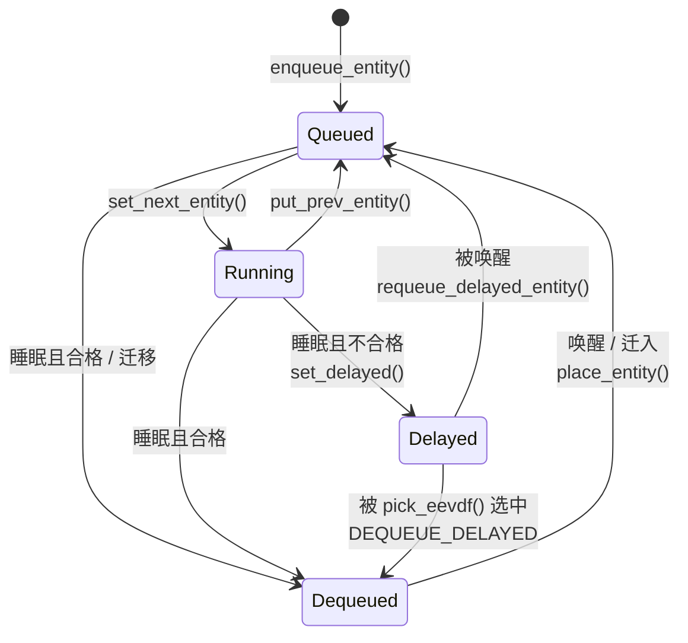

# 3.3 EEVDF 公平调度算法

> **本节源码**：[`kernel/sched/fair.c`](../../linux/kernel/sched/fair.c)、[`kernel/sched/features.h`](../../linux/kernel/sched/features.h)、[`kernel/sched/sched.h`](../../linux/kernel/sched/sched.h)、[`include/linux/sched.h`](../../linux/include/linux/sched.h)
> **关键函数**：`update_curr()`、`update_deadline()`、`avg_vruntime()`、`vruntime_eligible()`、`pick_eevdf()`、`place_entity()`、`dequeue_entity()`、`check_preempt_wakeup_fair()`、`pick_task_fair()`
> **前置知识**：3.1 调度器框架（权重与调度实体）、3.2 主调度函数

## 概述

公平调度类（`fair_sched_class`）服务 `SCHED_NORMAL`、`SCHED_BATCH` 和 `SCHED_IDLE` 任务，是系统中绝大多数任务所在的调度类。它要解决两个问题：一是让各任务按权重**公平**地分享 CPU，二是让对延迟敏感的任务能**更快**地得到 CPU。

从 v2.6.23 到 v6.5，公平调度类采用完全公平调度器（Completely Fair Scheduler，CFS）：总是挑选虚拟运行时间最小的任务。CFS 能很好地保证长期公平，却无法表达"我每次只需要运行很短时间，但希望尽快被调度"这样的延迟诉求。v6.6 起，内核改用**最早合格虚拟截止时间优先**（Earliest Eligible Virtual Deadline First，EEVDF）算法，它在公平性之外引入了"虚拟截止时间"来刻画延迟需求；v6.12 又补齐了延迟出队和自定义时间片，完成了 CFS 到 EEVDF 的过渡。

EEVDF 的核心规则只有一句话：**在所有"没有多占 CPU"的任务（合格任务）中，选虚拟截止时间最早的那个**。本节围绕这句话，依次分析虚拟时间、lag、合格性、截止时间的计算，以及它们在入队、出队、选取和抢占中的维护方式。

## 核心概念

### 虚拟运行时间

每个调度实体的 `vruntime` 记录它"按权重折算后"运行了多久。实际运行 `delta` 纳秒，`vruntime` 增加：

```
Δvruntime = delta × NICE_0_LOAD / weight
```

权重越大，`vruntime` 增长越慢。nice 0 任务的 `vruntime` 与真实时间同速增长，nice -5（权重 3121）的任务约为真实时间的 1/3。对应的代码是：

[`kernel/sched/fair.c:290-296`](../../linux/kernel/sched/fair.c#L290-L296)（v6.18.60）

```c
static inline u64 calc_delta_fair(u64 delta, struct sched_entity *se)
{
	if (unlikely(se->load.weight != NICE_0_LOAD))
		delta = __calc_delta(delta, NICE_0_LOAD, &se->load);

	return delta;
}
```

`__calc_delta()`（[`kernel/sched/fair.c:260-285`](../../linux/kernel/sched/fair.c#L260-L285)）利用 3.1 节提到的 `inv_weight`（≈ 2^32 / weight）把除法换成"乘法 + 移位"，并在中间结果溢出 32 位时动态调整移位量。

### 虚拟时间 V

如果有一个理想的处理器，能把 CPU 按权重同时分给所有可运行任务，那么每个任务在任一时刻都恰好得到应得的份额。EEVDF 用**虚拟时间** `V` 描述这台理想处理器的进度，它等于所有可运行实体 `vruntime` 的**加权平均**：

```
        Σ wᵢ·vᵢ
  V  =  ────────
         Σ wᵢ
```

源码注释（[`kernel/sched/fair.c:616-662`](../../linux/kernel/sched/fair.c#L616-L662)）给出了推导：公平调度器满足"所有任务 lag 之和为 0"，由此即可解出 `V`。

### lag 与合格性

任务 i 的 **lag** 是它"应得服务"与"实际服务"之差：

```
  lagᵢ = wᵢ × (V − vᵢ)
```

- `lag > 0`：任务少拿了 CPU，系统欠它的；
- `lag < 0`：任务多拿了 CPU，它欠系统的。

**合格**（eligible）定义为 `lag ≥ 0`，即 `vᵢ ≤ V`。只有合格任务才能被选中运行，这保证了任何任务都不能在多拿 CPU 之后继续抢先。

### 虚拟截止时间

每个任务还声明一个**请求长度**（时间片，`se->slice`），表示它每次希望连续运行多久。虚拟截止时间为：

```
  deadlineᵢ = vᵢ + slice / wᵢ        （以虚拟时间计）
```

时间片越短，截止时间越早，任务越容易在合格者中胜出——但它每次也只能运行较短的时间。这样，**权重决定长期份额，时间片决定响应延迟**，两者被解耦。

### 一个例子

假设 3 个 nice 0 任务同在一个 CPU 上（权重相同，虚拟时间单位为 ms）：

| 任务 | vruntime | slice | deadline | 合格？（V ≈ 11.67） |
|---|---|---|---|---|
| A | 16 | 0.3 | 16.3 | 否（16 > V） |
| B | 8 | 10 | 18 | 是 |
| C | 11 | 6 | 17 | 是 |

`V = (16 + 8 + 11) / 3 ≈ 11.67`。按截止时间排序为 A < C < B，但 A 已经多拿了 CPU，不合格；合格的 B、C 中 C 的截止时间更早，所以 EEVDF 选 **C**。作为对比，CFS 会选 `vruntime` 最小的 B。

## 核心数据结构

### cfs_rq 中的 EEVDF 字段

[`kernel/sched/sched.h:676-699`](../../linux/kernel/sched/sched.h#L676-L699)（v6.18.60）

```c
struct cfs_rq {
	struct load_weight	load;		// [注] 队列上所有实体权重之和
	unsigned int		nr_queued;	// [注] 本层直接排队的实体数
	unsigned int		h_nr_queued;       /* SCHED_{NORMAL,BATCH,IDLE} */
	unsigned int		h_nr_runnable;     /* SCHED_{NORMAL,BATCH,IDLE} */
	unsigned int		h_nr_idle; /* SCHED_IDLE */

	s64			sum_w_vruntime;	// [注] Σ (vᵢ − zero_vruntime) × wᵢ，不含 curr
	u64			sum_weight;	// [注] Σ wᵢ，不含 curr

	u64			zero_vruntime;	// [注] 计算 V 的参考原点 v0
#ifdef CONFIG_SCHED_CORE
	unsigned int		forceidle_seq;
	u64			zero_vruntime_fi;
#endif

	struct rb_root_cached	tasks_timeline;	// [注] 按 deadline 排序的增强红黑树

	/*
	 * 'curr' points to currently running entity on this cfs_rq.
	 * It is set to NULL otherwise (i.e when none are currently running).
	 */
	struct sched_entity	*curr;
	struct sched_entity	*next;		// [注] "next buddy"，优先被选中的实体
```

- `h_nr_*` 前缀的 `h` 表示 hierarchical：统计本 `cfs_rq` 及其所有子组中的任务数。3.2 节的快速路径判断 `rq->nr_running == rq->cfs.h_nr_queued` 用的就是它。`h_nr_runnable` 不计入处于延迟出队状态的任务。
- **正在运行的实体 `curr` 不在红黑树里**，也不计入 `sum_w_vruntime` / `sum_weight`（见 `set_next_entity()` 中的 `__dequeue_entity()`）。所有需要"全体实体"的计算都要单独把 `curr` 加回去。

### 增强红黑树

`tasks_timeline` 中的实体按 `deadline` 排序：

[`kernel/sched/fair.c:582-590`](../../linux/kernel/sched/fair.c#L582-L590)（v6.18.60）

```c
static inline bool entity_before(const struct sched_entity *a,
				 const struct sched_entity *b)
{
	/*
	 * Tiebreak on vruntime seems unnecessary since it can
	 * hardly happen.
	 */
	return vruntime_cmp(a->deadline, "<", b->deadline);
}
```

但"合格"是按 `vruntime` 判断的。为了在按截止时间排序的树上快速找到合格者，每个节点额外维护其子树中 `vruntime` 的最小值 `se->min_vruntime`（同时维护 `min_slice` / `max_slice`），这就是增强红黑树（Augmented RB-tree）：

[`kernel/sched/fair.c:893-905`](../../linux/kernel/sched/fair.c#L893-L905)（v6.18.60，节选）

```c
/*
 * se->min_vruntime = min(se->vruntime, {left,right}->min_vruntime)
 */
static inline bool min_vruntime_update(struct sched_entity *se, bool exit)
{
	...
	se->min_vruntime = se->vruntime;
	__min_vruntime_update(se, node->rb_right);
	__min_vruntime_update(se, node->rb_left);
```

[`kernel/sched/fair.c:927-936`](../../linux/kernel/sched/fair.c#L927-L936)（v6.18.60）

```c
static void __enqueue_entity(struct cfs_rq *cfs_rq, struct sched_entity *se)
{
	sum_w_vruntime_add(cfs_rq, se);
	se->min_vruntime = se->vruntime;
	se->min_slice = se->slice;
	se->max_slice = se->slice;

	rb_add_augmented_cached(&se->run_node, &cfs_rq->tasks_timeline,
				__entity_less, &min_vruntime_cb);
}
```

于是这棵树既是按 `deadline` 排序的二叉搜索树，又是按 `vruntime` 的最小堆：若某个子树的 `min_vruntime` 都不合格，整棵子树可以直接剪掉。

```
                       ┌───────────────────────┐
                       │ C  d=17   v=11        │
                       │ min_vruntime = 8      │
                       └──────────┬────────────┘
                ┌─────────────────┴──────────────────┐
     ┌──────────┴───────────┐             ┌──────────┴───────────┐
     │ A  d=16.3   v=16     │             │ B  d=18    v=8       │
     │ min_vruntime = 16    │             │ min_vruntime = 8     │
     └──────────────────────┘             └──────────────────────┘
       左子树 deadline 更早                     右子树 deadline 更晚
```

*图 3-6：按 deadline 排序、维护子树 min_vruntime 的增强红黑树（对应上文例子）*

## 主流程分析

### 调用链总览

```
记账（时钟中断 / 出入队 / 切换时）
update_curr()                          kernel/sched/fair.c
├── update_se()                        // 累加 sum_exec_runtime
├── curr->vruntime += calc_delta_fair()
├── update_deadline()                  // 时间片用完：设新 deadline
└── resched_curr_lazy()                // 用完或超出保护期：请求重调度

选取（__schedule() 中）
pick_next_task_fair()
└── pick_task_fair()                   // 自顶向下逐层选取
    └── pick_next_entity()
        ├── pick_eevdf()               // EEVDF 选择
        └── dequeue_entities()         // 选中延迟出队实体：真正出队

入队 / 出队
enqueue_task_fair() → enqueue_entity() → place_entity()
dequeue_task_fair() → dequeue_entities() → dequeue_entity()
                                           └── set_delayed()   // 延迟出队

唤醒抢占
check_preempt_wakeup_fair() → pick_next_entity() → resched_curr_lazy()
```

### 运行时间记账：update_curr()

[`kernel/sched/fair.c:1294-1341`](../../linux/kernel/sched/fair.c#L1294-L1341)（v6.18.60，节选）

```c
static void update_curr(struct cfs_rq *cfs_rq)
{
	...
	struct sched_entity *curr = cfs_rq->curr;
	struct rq *rq = rq_of(cfs_rq);
	s64 delta_exec;
	bool resched;

	if (unlikely(!curr))
		return;

	delta_exec = update_se(rq, curr);
	if (unlikely(delta_exec <= 0))
		return;

	curr->vruntime += calc_delta_fair(delta_exec, curr);
	resched = update_deadline(cfs_rq, curr);

	if (entity_is_task(curr)) {
		...
		if (dl_server_active(&rq->fair_server))
			dl_server_update(&rq->fair_server, delta_exec);
	}

	account_cfs_rq_runtime(cfs_rq, delta_exec);

	if (cfs_rq->nr_queued == 1)
		return;

	if (resched || !protect_slice(curr)) {
		resched_curr_lazy(rq);
		clear_buddies(cfs_rq, curr);
	}
}
```

`update_curr()` 是公平类中被调用最频繁的函数：时钟中断、入队、出队、唤醒抢占判断之前都要先调用它，把 `curr` 自上次记账以来的运行时间"结算"掉：

1. `update_se()`（[`kernel/sched/fair.c:1242-1279`](../../linux/kernel/sched/fair.c#L1242-L1279)）以 `rq_clock_task()` 为准计算 `delta_exec`，累加到 `sum_exec_runtime`，并更新 cgroup 的 CPU 时间统计。
2. 按权重折算后累加到 `vruntime`。
3. `update_deadline()` 检查时间片是否用完。
4. 若该 CPU 上的 `fair_server` 处于活动状态，同步扣减其预算（3.7 节）。
5. `account_cfs_rq_runtime()` 扣减 CPU 带宽配额（依赖 `CONFIG_CFS_BANDWIDTH`，见 3.10 节）。
6. 如果时间片用完，或者已经超出"保护期"（见下文 `protect_slice()`），就调用 `resched_curr_lazy()` 请求重新调度。注意这里用的是**惰性**版本：对公平任务的时间片抢占，在 `CONFIG_PREEMPT_LAZY` 模型下会推迟到返回用户态或下一个 tick。

[`kernel/sched/fair.c:1127-1150`](../../linux/kernel/sched/fair.c#L1127-L1150)（v6.18.60）

```c
static bool update_deadline(struct cfs_rq *cfs_rq, struct sched_entity *se)
{
	if (vruntime_cmp(se->vruntime, "<", se->deadline))
		return false;

	/*
	 * For EEVDF the virtual time slope is determined by w_i (iow.
	 * nice) while the request time r_i is determined by
	 * sysctl_sched_base_slice.
	 */
	if (!se->custom_slice)
		se->slice = sysctl_sched_base_slice;

	/*
	 * EEVDF: vd_i = ve_i + r_i / w_i
	 */
	se->deadline = se->vruntime + calc_delta_fair(se->slice, se);
	avg_vruntime(cfs_rq);

	/*
	 * The task has consumed its request, reschedule.
	 */
	return true;
}
```

`vruntime` 追上 `deadline` 就意味着本次请求（一个 slice）已经完成，于是发起下一个请求：截止时间向后推一个 `slice / w`。

### 维护虚拟时间：avg_vruntime()

直接计算 `Σ wᵢ·vᵢ` 会溢出 64 位，因此内核选一个参考原点 `v0 = zero_vruntime`，只累加相对值：

```
       Σ (vᵢ − v0)·wᵢ
  V = ──────────────── + v0  =  sum_w_vruntime / sum_weight + zero_vruntime
           Σ wᵢ
```

`__enqueue_entity()` / `__dequeue_entity()` 通过 `sum_w_vruntime_add()` / `sum_w_vruntime_sub()`（[`kernel/sched/fair.c:673-691`](../../linux/kernel/sched/fair.c#L673-L691)）增量维护这两个累加和，权重先经 `scale_load_down()` 缩回 10 位精度以减小乘积。

[`kernel/sched/fair.c:715-749`](../../linux/kernel/sched/fair.c#L715-L749)（v6.18.60）

```c
u64 avg_vruntime(struct cfs_rq *cfs_rq)
{
	struct sched_entity *curr = cfs_rq->curr;
	long weight = cfs_rq->sum_weight;
	s64 delta = 0;

	if (curr && !curr->on_rq)
		curr = NULL;

	if (weight) {
		s64 runtime = cfs_rq->sum_w_vruntime;

		if (curr) {
			unsigned long w = scale_load_down(curr->load.weight);

			runtime += entity_key(cfs_rq, curr) * w;
			weight += w;
		}

		/* sign flips effective floor / ceiling */
		if (runtime < 0)
			runtime -= (weight - 1);

		delta = div_s64(runtime, weight);
	} else if (curr) {
		/*
		 * When there is but one element, it is the average.
		 */
		delta = curr->vruntime - cfs_rq->zero_vruntime;
	}

	update_zero_vruntime(cfs_rq, delta);

	return cfs_rq->zero_vruntime;
}
```

- 把 `curr` 的贡献临时加回，得到全体实体的加权平均。
- 对负数做向下取整（`runtime -= weight - 1`），使结果略微偏小。函数前的注释（[`kernel/sched/fair.c:703-714`](../../linux/kernel/sched/fair.c#L703-L714)）说明了原因：必须保证 `avg_vruntime()` 返回值处的实体被判为合格。
- 计算完后调用 `update_zero_vruntime()`（[`kernel/sched/fair.c:693-701`](../../linux/kernel/sched/fair.c#L693-L701)）把原点**移动到 V**，同时相应调整 `sum_w_vruntime`。这样 `vᵢ − v0` 始终是 lag 量级的小数值，乘以权重也不会溢出。

> 版本差异：较早版本的 EEVDF 实现（如 v6.6）以 `cfs_rq->min_vruntime` 为原点，并用 `avg_vruntime` / `avg_load` 字段保存累加和。v6.18.60 中这些字段已改为 `zero_vruntime`、`sum_w_vruntime`、`sum_weight`，原点直接跟踪 V（即 lag 为零的点），阅读其他版本的资料时需注意这一差别。

`vruntime` 是会回绕的 `u64`，所有比较都通过 `vruntime_cmp()`（[`kernel/sched/fair.c:531-548`](../../linux/kernel/sched/fair.c#L531-L548)）转换成有符号差值进行。`init_cfs_rq()` 甚至故意把 `zero_vruntime` 初始化为 `-(1LL << 20)`（[`kernel/sched/fair.c:13813`](../../linux/kernel/sched/fair.c#L13813)），让回绕在系统启动后很快发生，以便尽早暴露比较错误。

### 合格性判断：vruntime_eligible()

[`kernel/sched/fair.c:802-821`](../../linux/kernel/sched/fair.c#L802-L821)（v6.18.60）

```c
static int vruntime_eligible(struct cfs_rq *cfs_rq, u64 vruntime)
{
	struct sched_entity *curr = cfs_rq->curr;
	s64 avg = cfs_rq->sum_w_vruntime;
	long load = cfs_rq->sum_weight;

	if (curr && curr->on_rq) {
		unsigned long weight = scale_load_down(curr->load.weight);

		avg += entity_key(cfs_rq, curr) * weight;
		load += weight;
	}

	return avg >= vruntime_op(vruntime, "-", cfs_rq->zero_vruntime) * load;
}

int entity_eligible(struct cfs_rq *cfs_rq, struct sched_entity *se)
{
	return vruntime_eligible(cfs_rq, se->vruntime);
}
```

`vᵢ ≤ V` 等价于 `(vᵢ − v0) × Σw ≤ Σ(vⱼ − v0)·wⱼ`。把除法移到不等式另一侧变成乘法，既避免了除法开销，也避免了整数除法截断带来的误判（注释 [`kernel/sched/fair.c:798-800`](../../linux/kernel/sched/fair.c#L798-L800) 特意指出了这一点）。

### 选取：pick_eevdf()

[`kernel/sched/fair.c:1025-1053`](../../linux/kernel/sched/fair.c#L1025-L1053)（v6.18.60）

```c
static struct sched_entity *pick_eevdf(struct cfs_rq *cfs_rq, bool protect)
{
	struct rb_node *node = cfs_rq->tasks_timeline.rb_root.rb_node;
	struct sched_entity *se = __pick_first_entity(cfs_rq);
	struct sched_entity *curr = cfs_rq->curr;
	struct sched_entity *best = NULL;

	/*
	 * We can safely skip eligibility check if there is only one entity
	 * in this cfs_rq, saving some cycles.
	 */
	if (cfs_rq->nr_queued == 1)
		return curr && curr->on_rq ? curr : se;

	/*
	 * Picking the ->next buddy will affect latency but not fairness.
	 */
	if (sched_feat(PICK_BUDDY) &&
	    cfs_rq->next && entity_eligible(cfs_rq, cfs_rq->next)) {
		/* ->next will never be delayed */
		WARN_ON_ONCE(cfs_rq->next->sched_delayed);
		return cfs_rq->next;
	}

	if (curr && (!curr->on_rq || !entity_eligible(cfs_rq, curr)))
		curr = NULL;

	if (curr && protect && protect_slice(curr))
		return curr;
```

前半部分处理几种捷径：

1. 只有一个实体时无需判断。
2. 若设置了 `next` buddy 且它合格，直接选它。buddy 只影响延迟而不破坏公平，因为它必须先合格。
3. `curr` 若不合格就排除在候选之外；若合格且仍在**时间片保护期**内，继续运行 `curr`，避免过于频繁的切换。

[`kernel/sched/fair.c:1055-1094`](../../linux/kernel/sched/fair.c#L1055-L1094)（v6.18.60）

```c
	/* Pick the leftmost entity if it's eligible */
	if (se && entity_eligible(cfs_rq, se)) {
		best = se;
		goto found;
	}

	/* Heap search for the EEVD entity */
	while (node) {
		struct rb_node *left = node->rb_left;

		/*
		 * Eligible entities in left subtree are always better
		 * choices, since they have earlier deadlines.
		 */
		if (left && vruntime_eligible(cfs_rq,
					__node_2_se(left)->min_vruntime)) {
			node = left;
			continue;
		}

		se = __node_2_se(node);

		/*
		 * The left subtree either is empty or has no eligible
		 * entity, so check the current node since it is the one
		 * with earliest deadline that might be eligible.
		 */
		if (entity_eligible(cfs_rq, se)) {
			best = se;
			break;
		}

		node = node->rb_right;
	}
found:
	if (!best || (curr && entity_before(curr, best)))
		best = curr;

	return best;
}
```

后半部分是 EEVDF 的核心搜索，时间复杂度 O(log n)：

1. 最左节点截止时间最早，若它合格就是答案（最常见的情况）。
2. 否则从根开始：如果左子树中存在合格实体（左孩子的 `min_vruntime` 合格），往左走——左子树里的截止时间都更早；否则检查当前节点；再不合格就往右走。
3. 最后把不在树中的 `curr` 也纳入比较。

以图 3-6 为例：最左节点 A 不合格；从根 C 出发，左孩子 A 的 `min_vruntime = 16` 不合格，于是检查 C 本身，`11 ≤ 11.67` 合格，选中 C。

### 时间片保护：RUN_TO_PARITY

如果严格执行 EEVDF，`curr` 一旦因为运行而变得不合格，或者有截止时间更早的任务被唤醒，就应立即切换，这会导致切换过于频繁。`RUN_TO_PARITY` 特性（[`kernel/sched/features.h:20`](../../linux/kernel/sched/features.h#L20)，默认开启）给 `curr` 一个"保护期" `vprot`：

[`kernel/sched/fair.c:973-998`](../../linux/kernel/sched/fair.c#L973-L998)（v6.18.60）

```c
static inline void set_protect_slice(struct cfs_rq *cfs_rq, struct sched_entity *se)
{
	u64 slice = normalized_sysctl_sched_base_slice;
	u64 vprot = se->deadline;

	if (sched_feat(RUN_TO_PARITY))
		slice = cfs_rq_min_slice(cfs_rq);

	slice = min(slice, se->slice);
	if (slice != se->slice)
		vprot = min_vruntime(vprot, se->vruntime + calc_delta_fair(slice, se));

	se->vprot = vprot;
}

static inline void update_protect_slice(struct cfs_rq *cfs_rq, struct sched_entity *se)
{
	u64 slice = cfs_rq_min_slice(cfs_rq);

	se->vprot = min_vruntime(se->vprot, se->vruntime + calc_delta_fair(slice, se));
}

static inline bool protect_slice(struct sched_entity *se)
{
	return vruntime_cmp(se->vruntime, "<", se->vprot);
}
```

`set_next_entity()` 在任务被选中时调用 `set_protect_slice()`（[`kernel/sched/fair.c:5655-5656`](../../linux/kernel/sched/fair.c#L5655-L5656)）：保护期默认到本次 `deadline` 为止，但不超过队列中**最短时间片**。这样既避免了频繁切换，又保证短时间片任务不会被长时间片任务的保护期拖累。在 `vruntime < vprot` 期间，`update_curr()` 不会因为 `curr` 失去合格性而请求重调度，`pick_eevdf(protect=true)` 也会继续返回 `curr`。

### 入队与放置：place_entity()

任务被唤醒或新建时，应该以什么 `vruntime` 加入竞争？CFS 的做法是"放到 `min_vruntime` 附近"，这会让短暂睡眠的任务"洗掉"自己的负 lag。EEVDF 的策略是**保持 lag**：任务出队时记下 `vlag = V − v`，入队时恢复为 `v = V − vlag`。

[`kernel/sched/fair.c:5312-5418`](../../linux/kernel/sched/fair.c#L5312-L5418)（v6.18.60，节选）

```c
static void
place_entity(struct cfs_rq *cfs_rq, struct sched_entity *se, int flags)
{
	u64 vslice, vruntime = avg_vruntime(cfs_rq);
	s64 lag = 0;

	if (!se->custom_slice)
		se->slice = sysctl_sched_base_slice;
	vslice = calc_delta_fair(se->slice, se);
	...
	if (sched_feat(PLACE_LAG) && cfs_rq->nr_queued && se->vlag) {
		struct sched_entity *curr = cfs_rq->curr;
		unsigned long load;

		lag = se->vlag;
		...
		load = cfs_rq->sum_weight;
		if (curr && curr->on_rq)
			load += scale_load_down(curr->load.weight);

		lag *= load + scale_load_down(se->load.weight);
		if (WARN_ON_ONCE(!load))
			load = 1;
		lag = div_s64(lag, load);
	}

	se->vruntime = vruntime - lag;

	if (sched_feat(PLACE_REL_DEADLINE) && se->rel_deadline) {
		se->deadline += se->vruntime;
		se->rel_deadline = 0;
		return;
	}
	...
	if (sched_feat(PLACE_DEADLINE_INITIAL) && (flags & ENQUEUE_INITIAL))
		vslice /= 2;

	/*
	 * EEVDF: vd_i = ve_i + r_i/w_i
	 */
	se->deadline = se->vruntime + vslice;
}
```

- **lag 膨胀**。新实体加入后加权平均 `V` 本身会移动，直接用 `V − vlag` 放置会使实际 lag 偏小。注释（[`kernel/sched/fair.c:5336-5387`](../../linux/kernel/sched/fair.c#L5336-L5387)）推导出修正公式：`vl_i = (W + w_i) × vl'_i / W`，代码中的 `lag *= load + w; lag /= load` 正是这一步。
- **相对截止时间**。任务迁移（非睡眠出队）时 `dequeue_entity()` 把 `deadline` 转为相对值（`rel_deadline = 1`），入队时再加回 `vruntime`，从而在两个 CPU 之间保留剩余的请求量。
- **新任务半个时间片**。`wake_up_new_task()` 以 `ENQUEUE_INITIAL` 入队（[`kernel/sched/core.c:4854`](../../linux/kernel/sched/core.c#L4854)），新任务的首个截止时间只给半个 slice——注释的解释是：已在竞争中的任务平均已用掉半个时间片。
- 新 fork 的任务 `vlag` 为 0，因此以 `V` 加入，lag 为零，不会因为 fork 而获得或失去份额。

`enqueue_entity()`（[`kernel/sched/fair.c:5426-5490`](../../linux/kernel/sched/fair.c#L5426-L5490)）在调用 `place_entity()` 前后完成 PELT 负载更新、组权重调整、`account_entity_enqueue()`（累加 `load` 与 `nr_queued`）和 `__enqueue_entity()` 插入红黑树。

### 出队与延迟出队

`lag` 的保持带来两个问题：其一，负 lag 任务睡眠时会把"欠债"原样带走，无论睡多久，醒来都要从头还起；而且它在出队那一刻离开加权平均，会使 `V` 发生跳变，影响其他任务的 lag。其二，若任务带着很大的**正** lag（系统欠它的份额）睡眠，醒来后就能凭这笔"债权"抢占他人。

v6.12 引入的**延迟出队**（Delayed Dequeue）针对第一个问题：负 lag（不合格）任务睡眠时，**不立即离开红黑树**，而是标记 `sched_delayed` 继续参与竞争。随着其他任务运行，`V` 逐渐增大，它的 lag 自然地回到 0；等到它被 `pick_eevdf()` 选中时——此时按定义已经合格——才真正出队（[`kernel/sched/features.h:49-57`](../../linux/kernel/sched/features.h#L49-L57)）。第二个问题由 `DELAY_ZERO` 特性处理：在出队或唤醒时把正 lag 截断为 0（见下文）。

[`kernel/sched/fair.c:5557-5585`](../../linux/kernel/sched/fair.c#L5557-L5585)（v6.18.60）

```c
static bool
dequeue_entity(struct cfs_rq *cfs_rq, struct sched_entity *se, int flags)
{
	bool sleep = flags & DEQUEUE_SLEEP;
	int action = UPDATE_TG;

	update_curr(cfs_rq);
	clear_buddies(cfs_rq, se);

	if (flags & DEQUEUE_DELAYED) {
		WARN_ON_ONCE(!se->sched_delayed);
	} else {
		bool delay = sleep;
		/*
		 * DELAY_DEQUEUE relies on spurious wakeups, special task
		 * states must not suffer spurious wakeups, excempt them.
		 */
		if (flags & (DEQUEUE_SPECIAL | DEQUEUE_THROTTLE))
			delay = false;

		WARN_ON_ONCE(delay && se->sched_delayed);

		if (sched_feat(DELAY_DEQUEUE) && delay &&
		    !entity_eligible(cfs_rq, se)) {
			update_load_avg(cfs_rq, se, 0);
			set_delayed(se);
			return false;
		}
	}
```

不合格的睡眠任务在这里 `return false`，这正是 3.1 节提到的"`dequeue_task()` 可能失败"，也是 3.2 节 `block_task()` 只在返回 true 时才清 `on_rq` 的原因。`set_delayed()`（[`kernel/sched/fair.c:5511-5528`](../../linux/kernel/sched/fair.c#L5511-L5528)）把各层 `h_nr_runnable` 减一，使延迟实体不被统计为"可运行"。

真正出队时，`dequeue_entity()` 记录 lag 并处理迁移时的相对截止时间：

[`kernel/sched/fair.c:5604-5613`](../../linux/kernel/sched/fair.c#L5604-L5613)（v6.18.60）

```c
	update_entity_lag(cfs_rq, se);
	if (sched_feat(PLACE_REL_DEADLINE) && !sleep) {
		se->deadline -= se->vruntime;
		se->rel_deadline = 1;
	}

	if (se != cfs_rq->curr)
		__dequeue_entity(cfs_rq, se);
	se->on_rq = 0;
	account_entity_dequeue(cfs_rq, se);
```

`update_entity_lag()`（[`kernel/sched/fair.c:778-783`](../../linux/kernel/sched/fair.c#L778-L783)）调用 `entity_lag()`，把 lag 限制在 `±(max_slice + TICK_NSEC)` 折算后的范围内（[`kernel/sched/fair.c:767-776`](../../linux/kernel/sched/fair.c#L767-L776)），防止加权平均的跳动累积出过大的 lag。

延迟实体的结局有两种：

1. **被选中**：`pick_next_entity()` 发现选出的是延迟实体，就以 `DEQUEUE_DELAYED` 真正把它出队，然后返回 NULL 让调用者重选：

   [`kernel/sched/fair.c:5690-5704`](../../linux/kernel/sched/fair.c#L5690-L5704)（v6.18.60）

   ```c
   static struct sched_entity *
   pick_next_entity(struct rq *rq, struct cfs_rq *cfs_rq, bool protect)
   {
   	struct sched_entity *se;

   	se = pick_eevdf(cfs_rq, protect);
   	if (se->sched_delayed) {
   		dequeue_entities(rq, se, DEQUEUE_SLEEP | DEQUEUE_DELAYED);
   		/*
   		 * Must not reference @se again, see __block_task().
   		 */
   		return NULL;
   	}
   	return se;
   }
   ```

2. **在出队前被唤醒**：任务仍 `on_rq`，`ttwu_runnable()` 以 `ENQUEUE_DELAYED` 调用 `enqueue_task()`（[`kernel/sched/core.c:3784-3785`](../../linux/kernel/sched/core.c#L3784-L3785)），公平类执行 `requeue_delayed_entity()`：

   [`kernel/sched/fair.c:7064-7079`](../../linux/kernel/sched/fair.c#L7064-L7079)（v6.18.60）

   ```c
   	if (sched_feat(DELAY_ZERO)) {
   		update_entity_lag(cfs_rq, se);
   		if (se->vlag > 0) {
   			cfs_rq->nr_queued--;
   			if (se != cfs_rq->curr)
   				__dequeue_entity(cfs_rq, se);
   			se->vlag = 0;
   			place_entity(cfs_rq, se, 0);
   			if (se != cfs_rq->curr)
   				__enqueue_entity(cfs_rq, se);
   			cfs_rq->nr_queued++;
   		}
   	}

   	update_load_avg(cfs_rq, se, 0);
   	clear_delayed(se);
   ```

   `DELAY_ZERO` 特性把醒来时已变为正的 lag 截断为 0 后重新放置，使"睡眠"本身不能换来额外的 CPU 份额。被选中出队的路径同样会经 `finish_delayed_dequeue_entity()` 把正 lag 清零（[`kernel/sched/fair.c:5550-5555`](../../linux/kernel/sched/fair.c#L5550-L5555)）。



*图 3-7：公平调度实体的状态转换（含延迟出队）*

### 唤醒抢占：check_preempt_wakeup_fair()

被唤醒的公平任务是否应抢占当前公平任务，由 `check_preempt_wakeup_fair()` 判断：

[`kernel/sched/fair.c:9036-9110`](../../linux/kernel/sched/fair.c#L9036-L9110)（v6.18.60，节选）

```c
	/*
	 * BATCH and IDLE tasks do not preempt others.
	 */
	if (unlikely(!normal_policy(p->policy)))
		return;

	cfs_rq = cfs_rq_of(se);
	update_curr(cfs_rq);
	/*
	 * If @p has a shorter slice than current and @p is eligible, override
	 * current's slice protection in order to allow preemption.
	 */
	if (sched_feat(PREEMPT_SHORT) && (pse->slice < se->slice)) {
		preempt_action = PREEMPT_WAKEUP_SHORT;
		goto pick;
	}
	...
	if ((wake_flags & WF_FORK) || pse->sched_delayed)
		return;
	...
pick:
	nse = pick_next_entity(rq, cfs_rq, preempt_action != PREEMPT_WAKEUP_SHORT);
	/* If @p has become the most eligible task, force preemption */
	if (nse == pse)
		goto preempt;
	...
	if (sched_feat(RUN_TO_PARITY))
		update_protect_slice(cfs_rq, se);

	return;

preempt:
	if (preempt_action == PREEMPT_WAKEUP_SHORT)
		cancel_protect_slice(se);

	resched_curr_lazy(rq);
}
```

它的思路非常直接：**假装现在做一次选取**，如果 `pick_next_entity()` 选出的正是被唤醒的任务，就抢占。几个要点：

- `SCHED_BATCH` 和 `SCHED_IDLE` 任务被唤醒时不抢占他人；反过来，非 `SCHED_IDLE` 实体被唤醒时总是抢占 `SCHED_IDLE` 实体，并且不给后者保护期（[`kernel/sched/fair.c:9020-9034`](../../linux/kernel/sched/fair.c#L9020-L9034)）。
- `PREEMPT_SHORT`：被唤醒者的时间片比 `curr` 短时，选取时不考虑 `curr` 的保护期（`protect=false`），抢占成功后还会 `cancel_protect_slice()`。这正是"短时间片换低延迟"的体现。
- fork 唤醒（`WF_FORK`）不抢占（但 `PREEMPT_SHORT` 的检查在此之前，时间片更短的新任务仍可能抢占）：源码注释的理由是 fork 之后往往紧跟 `exec`，父子进程共享数据的可能性小，抢占没有缓存收益；处于延迟出队状态的任务也不抢占，因为强行让一个不合格任务运行违背 EEVDF 的原则。
- 没有抢占时，`update_protect_slice()` 根据新的最短时间片收紧 `curr` 的保护期。

### 逐层选取：pick_task_fair()

开启 `CONFIG_FAIR_GROUP_SCHED` 后，`cfs_rq` 构成一棵树：组实体的 `my_q` 指向它自己的子 `cfs_rq`。选取需要自顶向下，在每一层都做一次 EEVDF 选择：

[`kernel/sched/fair.c:9112-9143`](../../linux/kernel/sched/fair.c#L9112-L9143)（v6.18.60）

```c
static struct task_struct *pick_task_fair(struct rq *rq)
{
	struct sched_entity *se;
	struct cfs_rq *cfs_rq;
	struct task_struct *p;
	bool throttled;

again:
	cfs_rq = &rq->cfs;
	if (!cfs_rq->nr_queued)
		return NULL;

	throttled = false;

	do {
		/* Might not have done put_prev_entity() */
		if (cfs_rq->curr && cfs_rq->curr->on_rq)
			update_curr(cfs_rq);

		throttled |= check_cfs_rq_runtime(cfs_rq);

		se = pick_next_entity(rq, cfs_rq, true);
		if (!se)
			goto again;
		cfs_rq = group_cfs_rq(se);
	} while (cfs_rq);

	p = task_of(se);
	if (unlikely(throttled))
		task_throttle_setup_work(p);
	return p;
}
```

`group_cfs_rq(se)` 对任务实体返回 NULL、对组实体返回 `se->my_q`，循环直到选到一个任务为止。`pick_next_entity()` 返回 NULL 意味着刚刚处理掉一个延迟实体，队列结构可能已经变化，于是从根重来。

`pick_next_task_fair()`（[`kernel/sched/fair.c:9148-9229`](../../linux/kernel/sched/fair.c#L9148-L9229)）在此基础上完成 `put_prev` / `set_next`：若 `prev` 也是公平任务，它只沿 `prev` 与 `next` 的层级向上走到共同祖先，避免对整条路径做无谓的出入树操作；若本 CPU 没有公平任务可选，它会调用 `sched_balance_newidle()` 尝试从其他 CPU 拉任务（3.9 节）。

### 时钟中断

[`kernel/sched/fair.c:13605-13613`](../../linux/kernel/sched/fair.c#L13605-L13613)（v6.18.60）

```c
static void task_tick_fair(struct rq *rq, struct task_struct *curr, int queued)
{
	struct cfs_rq *cfs_rq;
	struct sched_entity *se = &curr->se;

	for_each_sched_entity(se) {
		cfs_rq = cfs_rq_of(se);
		entity_tick(cfs_rq, se, queued);
	}
```

`entity_tick()`（[`kernel/sched/fair.c:5731-5755`](../../linux/kernel/sched/fair.c#L5731-L5755)）对每一层调用 `update_curr()` 和 PELT 更新。时间片用完后的重调度请求就是在这里经 `update_curr()` → `resched_curr_lazy()` 发出的。tick 与抢占模型的完整交互留到 3.5 节。

## 关键细节 / 设计考量

### 基础时间片

默认时间片为 `sysctl_sched_base_slice`，基准值 0.7 ms（[`kernel/sched/fair.c:79`](../../linux/kernel/sched/fair.c#L79)），并按 CPU 数做对数缩放（`SCHED_TUNABLESCALING_LOG`）：

[`kernel/sched/fair.c:192-211`](../../linux/kernel/sched/fair.c#L192-L211)（v6.18.60）

```c
static unsigned int get_update_sysctl_factor(void)
{
	unsigned int cpus = min_t(unsigned int, num_online_cpus(), 8);
	unsigned int factor;

	switch (sysctl_sched_tunable_scaling) {
	case SCHED_TUNABLESCALING_NONE:
		factor = 1;
		break;
	case SCHED_TUNABLESCALING_LINEAR:
		factor = cpus;
		break;
	case SCHED_TUNABLESCALING_LOG:
	default:
		factor = 1 + ilog2(cpus);
		break;
	}

	return factor;
}
```

因此 1 个 CPU 时为 0.7 ms，4 个 CPU 时为 2.1 ms，8 个及以上 CPU 时为 2.8 ms。该值可通过 debugfs 的 `/sys/kernel/debug/sched/base_slice_ns` 读写（[`kernel/sched/debug.c:507`](../../linux/kernel/sched/debug.c#L507)）。

### 自定义时间片

v6.12 起，用户可以通过 `sched_setattr(2)` 的 `sched_runtime` 字段为公平任务指定时间片：

[`kernel/sched/fair.c:5296-5310`](../../linux/kernel/sched/fair.c#L5296-L5310)（v6.18.60）

```c
void __setparam_fair(struct task_struct *p, const struct sched_attr *attr)
{
	struct sched_entity *se = &p->se;

	p->static_prio = NICE_TO_PRIO(attr->sched_nice);
	if (attr->sched_runtime) {
		se->custom_slice = 1;
		se->slice = clamp_t(u64, attr->sched_runtime,
				      NSEC_PER_MSEC/10,   /* HZ=1000 * 10 */
				      NSEC_PER_MSEC*100); /* HZ=100  / 10 */
	} else {
		se->custom_slice = 0;
		se->slice = sysctl_sched_base_slice;
	}
}
```

时间片被限制在 0.1 ms～100 ms 之间。更短的时间片带来更早的截止时间和更低的调度延迟，但**不会增加**长期 CPU 份额——那仍由权重决定。

### 调整权重时保持 lag

`renice` 等操作改变权重时，`reweight_entity()`（[`kernel/sched/fair.c:3957-4005`](../../linux/kernel/sched/fair.c#L3957-L4005)）先把 `vlag` 和相对截止时间取出，按 `old_weight / new_weight` 缩放（`rescale_entity()`），再以新权重重新放置。这样权重变化不会让任务凭空获得或失去已累积的服务。

### sched_yield()

`yield_task_fair()` 的实现非常简洁：若当前任务合格，就把 `vruntime` 直接推到 `deadline`，相当于放弃本次请求剩余的部分（[`kernel/sched/fair.c:9301-9304`](../../linux/kernel/sched/fair.c#L9301-L9304)）。限定"合格"是为了避免在核心调度下反复选中正在 yield 的不合格任务，导致 `vruntime` 失控增长。

### 特性开关

EEVDF 的多项行为由 `kernel/sched/features.h` 中的特性位控制，可在运行时通过 `/sys/kernel/debug/sched/features` 切换（写入 `NO_<名字>` 关闭）：

| 特性 | 默认 | 作用 |
|---|---|---|
| `PLACE_LAG` | 开 | 睡眠/唤醒时保持 lag |
| `PLACE_DEADLINE_INITIAL` | 开 | 新任务首个截止时间只给半个时间片 |
| `PLACE_REL_DEADLINE` | 开 | 迁移时保留相对截止时间 |
| `RUN_TO_PARITY` | 开 | 时间片保护期 |
| `PREEMPT_SHORT` | 开 | 短时间片任务唤醒时可打破保护期 |
| `NEXT_BUDDY` | 关 | 唤醒时把被唤醒者设为 next buddy |
| `PICK_BUDDY` | 开 | 选取时优先考虑合格的 next buddy |
| `DELAY_DEQUEUE` | 开 | 不合格任务延迟出队 |
| `DELAY_ZERO` | 开 | 延迟出队结束时把正 lag 清零 |
| `WAKEUP_PREEMPTION` | 开 | 允许唤醒抢占 |

## 动手实验

以下实验在 **dev 虚拟机** 中进行，访问 debugfs 需要 **root 权限**。

1. 查看基础时间片和 EEVDF 特性：

   ```bash
   # 虚拟机，root
   cat /sys/kernel/debug/sched/base_slice_ns
   cat /sys/kernel/debug/sched/features
   nproc
   ```

   按上文公式，`base_slice_ns` 应为 `700000 × (1 + ilog2(min(nproc, 8)))`。

2. 验证权重与 CPU 份额的关系：把两个死循环绑到同一个 CPU，一个 nice 0，一个 nice 5，10 秒后比较 `se.sum_exec_runtime`：

   ```bash
   # 虚拟机，普通用户
   taskset -c 0 sh -c 'while :; do :; done' & a=$!
   taskset -c 0 nice -n 5 sh -c 'while :; do :; done' & b=$!
   sleep 10
   grep sum_exec_runtime /proc/$a/sched /proc/$b/sched
   kill $a $b
   ```

   理论比例为 `1024 : 335`，即约 75.3% 与 24.7%。

3. 观察 `vruntime`、`deadline`、合格性与时间片。`/proc/<pid>/sched` 输出 `se.vruntime`、`se.sum_exec_runtime` 和 `se.slice`（[`kernel/sched/debug.c:1166-1168`](../../linux/kernel/sched/debug.c#L1166-L1168)、`1253`）；debugfs 的运行队列转储则对每个任务给出 vruntime、合格标记（`E` 合格 / `N` 不合格）、deadline 和 slice（`print_task()`，[`kernel/sched/debug.c:731-747`](../../linux/kernel/sched/debug.c#L731-L747)）：

   ```bash
   # 虚拟机，root
   grep -E 'se\.(vruntime|slice|sum_exec_runtime)' /proc/$$/sched
   taskset -c 0 sh -c 'while :; do :; done' & a=$!
   taskset -c 0 sh -c 'while :; do :; done' & b=$!
   sleep 1
   awk '/^cpu#0/,/^cpu#1/' /sys/kernel/debug/sched/debug | grep -A12 'runnable tasks'
   kill $a $b
   ```

4. 关闭延迟出队后对比调度行为（仅用于实验，完成后恢复）：

   ```bash
   # 虚拟机，root
   echo NO_DELAY_DEQUEUE > /sys/kernel/debug/sched/features
   # ... 运行负载并观察 ...
   echo DELAY_DEQUEUE > /sys/kernel/debug/sched/features
   ```

## 小结

- EEVDF 自 v6.6 起取代 CFS：在合格（`lag ≥ 0`，即 `vruntime ≤ V`）的实体中选择虚拟截止时间最早者；权重决定长期份额，时间片决定响应延迟。
- 虚拟时间 `V` 是全体实体 `vruntime` 的加权平均，内核以 `zero_vruntime` 为原点、用 `sum_w_vruntime` / `sum_weight` 增量维护，并通过乘法比较避免除法误差。
- `tasks_timeline` 是按 `deadline` 排序、维护子树 `min_vruntime` 的增强红黑树，`pick_eevdf()` 借此在 O(log n) 内找到最早合格截止时间的实体；`curr` 不在树中，需要单独考虑。
- `update_curr()` 是记账核心：累加 `vruntime`，时间片用完时由 `update_deadline()` 推进截止时间，并通过 `resched_curr_lazy()` 惰性地请求重调度；`RUN_TO_PARITY` 保护期抑制过于频繁的切换。
- `place_entity()` 在入队时恢复出队时保存的 lag（并做膨胀修正），使睡眠无法"洗掉"负 lag；新任务以 lag 0、半个时间片加入。
- 延迟出队让不合格的睡眠任务留在队列中直到 lag 还清，结合 `DELAY_ZERO` 截断正 lag，使睡眠既不能逃债，也不能攒出额外份额。
- 唤醒抢占的判断方式是"模拟一次选取"：若被唤醒者会被选中则抢占；更短的时间片可以打破当前任务的保护期。

## 参考

- `linux/Documentation/scheduler/sched-eevdf.rst`：EEVDF 调度器简介。
- `linux/Documentation/scheduler/sched-design-CFS.rst`：CFS 设计文档，可与本节对照理解演进过程。
- Ion Stoica, Hussein Abdel-Wahab. *Earliest Eligible Virtual Deadline First: A Flexible and Accurate Mechanism for Proportional Share Resource Allocation*, 1995（`sched-eevdf.rst` 参考文献 [1]）。
- LWN: *An EEVDF CPU scheduler for Linux*（2023）：<https://lwn.net/Articles/925371/>。
- LWN: *Completing the EEVDF scheduler*（2024）：<https://lwn.net/Articles/969062/>。
