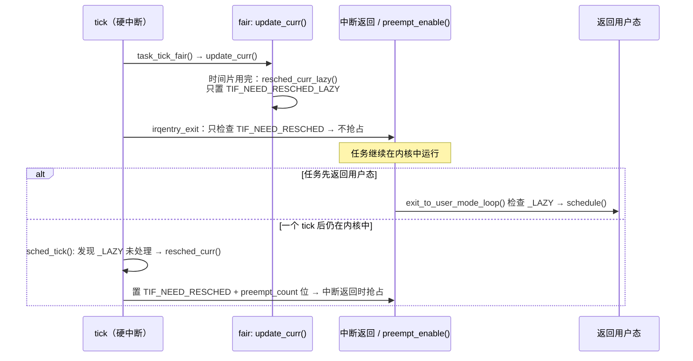

# 3.5 调度时钟与抢占模型

> **本节源码**：[`kernel/sched/core.c`](../../linux/kernel/sched/core.c)、[`kernel/sched/fair.c`](../../linux/kernel/sched/fair.c)、[`kernel/time/timer.c`](../../linux/kernel/time/timer.c)、[`kernel/time/tick-sched.c`](../../linux/kernel/time/tick-sched.c)、[`include/linux/sched.h`](../../linux/include/linux/sched.h)、[`kernel/Kconfig.preempt`](../../linux/kernel/Kconfig.preempt)
> **关键函数**：`update_rq_clock()`、`update_rq_clock_task()`、`sched_tick()`、`hrtick()`、`hrtick_start_fair()`、`sched_can_stop_tick()`、`sched_tick_remote()`、`__cond_resched()`、`__sched_dynamic_update()`
> **前置知识**：3.2 主调度函数（`resched_curr()` 与抢占点）、3.3 EEVDF（`update_curr()`）

## 概述

调度器需要两样与时间有关的东西：一是**测量**——每个任务到底运行了多久，这由 rq 时钟提供；二是**驱动**——即使没有任何任务主动让出 CPU，也要定期检查当前任务是否该被换下，这由周期性的调度时钟中断（tick）提供。

检查出"该换了"之后，什么时候真正切换，取决于内核的**抢占模型**（Preemption Model）。v6.18 提供 none、voluntary、full、lazy 四种模型；开启 `CONFIG_PREEMPT_DYNAMIC` 后，可以在启动参数甚至运行时切换，而无需重新编译内核。本书配置默认使用 lazy 模型。

本节依次分析 rq 时钟、`sched_tick()`、高精度 tick（hrtick）、无 tick 运行（`NO_HZ_FULL`）时的调度器行为，以及四种抢占模型的实现方式。

## rq 时钟

### 两个时钟

`struct rq` 中有两个最常用的时钟（3.1 节）：

- `rq->clock`：基于 `sched_clock_cpu()` 的单调时钟，纳秒精度；
- `rq->clock_task`：在 `clock` 的基础上**扣除**中断处理时间与虚拟化 steal 时间，表示真正可供任务使用的时间。

公平类的 `update_se()` 用 `rq_clock_task()` 计算 `delta_exec`（3.3 节），这样硬中断与软中断消耗的时间不会被算到恰好正在运行的任务头上。

[`kernel/sched/core.c:846-869`](../../linux/kernel/sched/core.c#L846-L869)（v6.18.60）

```c
void update_rq_clock(struct rq *rq)
{
	s64 delta;
	u64 clock;

	lockdep_assert_rq_held(rq);

	if (rq->clock_update_flags & RQCF_ACT_SKIP)
		return;

	if (sched_feat(WARN_DOUBLE_CLOCK))
		WARN_ON_ONCE(rq->clock_update_flags & RQCF_UPDATED);
	rq->clock_update_flags |= RQCF_UPDATED;

	clock = sched_clock_cpu(cpu_of(rq));
	scx_rq_clock_update(rq, clock);

	delta = clock - rq->clock;
	if (delta < 0)
		return;
	rq->clock += delta;

	update_rq_clock_task(rq, delta);
}
```

- 必须持有 rq 锁才能更新。
- `RQCF_ACT_SKIP` 用于跳过不必要的重复更新：例如 3.1 节的 `wakeup_preempt()` 在已经决定要调度时调用 `rq_clock_skip_update()`，随后 `__schedule()` 中的那次更新就可以省掉（3.2 节 `__schedule()` 中 `clock_update_flags <<= 1` 正是把"请求跳过"提升为"执行跳过"）。

### 扣除非任务时间

[`kernel/sched/core.c:787-844`](../../linux/kernel/sched/core.c#L787-L844)（v6.18.60，节选）

```c
static void update_rq_clock_task(struct rq *rq, s64 delta)
{
	...
	s64 __maybe_unused steal = 0, irq_delta = 0;

#ifdef CONFIG_IRQ_TIME_ACCOUNTING
	if (irqtime_enabled()) {
		irq_delta = irq_time_read(cpu_of(rq)) - rq->prev_irq_time;
		...
		if (irq_delta > delta)
			irq_delta = delta;

		rq->prev_irq_time += irq_delta;
		delta -= irq_delta;
		delayacct_irq(rq->curr, irq_delta);
	}
#endif
#ifdef CONFIG_PARAVIRT_TIME_ACCOUNTING
	...
#endif

	rq->clock_task += delta;

#ifdef CONFIG_HAVE_SCHED_AVG_IRQ
	if ((irq_delta + steal) && sched_feat(NONTASK_CAPACITY))
		update_irq_load_avg(rq, irq_delta + steal);
#endif
	update_rq_clock_pelt(rq, delta);
}
```

扣除中断时间依赖 `CONFIG_IRQ_TIME_ACCOUNTING`，扣除 steal 时间依赖 `CONFIG_PARAVIRT_TIME_ACCOUNTING`。**本书配置中这两项均未开启**（`.config` 选择了 `CONFIG_VIRT_CPU_ACCOUNTING_GEN`），因此 `clock_task` 与 `clock` 同步前进。函数最后调用 `update_rq_clock_pelt()`，为 PELT 维护按 CPU 频率与算力缩放的 `clock_pelt`（3.8 节）。

## 周期性调度时钟：sched_tick()

### 调用路径

```
tick_nohz_handler()                            kernel/time/tick-sched.c:284  // hrtimer 模拟的 tick（NO_HZ / 高精度模式）
└── tick_sched_handle()                        kernel/time/tick-sched.c:253
    └── update_process_times()                 kernel/time/timer.c:2467
        // 周期模式下则为 tick_handle_periodic() → tick_periodic()（kernel/time/tick-common.c:86）直接调用
        ├── account_process_tick()             // 进程 CPU 时间统计（用户/系统）
        ├── run_local_timers()
        ├── rcu_sched_clock_irq()
        └── sched_tick()                       kernel/sched/core.c:5597
```

本书配置 `CONFIG_HZ=1000`，tick 周期为 1 ms。

### sched_tick()

[`kernel/sched/core.c:5597-5647`](../../linux/kernel/sched/core.c#L5597-L5647)（v6.18.60）

```c
void sched_tick(void)
{
	int cpu = smp_processor_id();
	struct rq *rq = cpu_rq(cpu);
	/* scheduler accounting goes to the donor task */
	struct task_struct *curr, *donor;
	struct rq_flags rf;
	unsigned long hw_pressure;
	u64 resched_latency;

	if (housekeeping_cpu(cpu, HK_TYPE_KERNEL_NOISE))
		arch_scale_freq_tick();

	sched_clock_tick();

	rq_lock(rq, &rf);
	curr = rq->curr;
	donor = rq->donor;

	psi_account_irqtime(rq, curr, NULL);

	update_rq_clock(rq);
	hw_pressure = arch_scale_hw_pressure(cpu_of(rq));
	update_hw_load_avg(rq_clock_task(rq), rq, hw_pressure);

	if (dynamic_preempt_lazy() && tif_test_bit(TIF_NEED_RESCHED_LAZY))
		resched_curr(rq);

	donor->sched_class->task_tick(rq, donor, 0);
	if (sched_feat(LATENCY_WARN))
		resched_latency = cpu_resched_latency(rq);
	calc_global_load_tick(rq);
	sched_core_tick(rq);
	task_tick_mm_cid(rq, donor);
	scx_tick(rq);

	rq_unlock(rq, &rf);

	if (sched_feat(LATENCY_WARN) && resched_latency)
		resched_latency_warn(cpu, resched_latency);

	perf_event_task_tick();

	if (curr->flags & PF_WQ_WORKER)
		wq_worker_tick(curr);

	if (!scx_switched_all()) {
		rq->idle_balance = idle_cpu(cpu);
		sched_balance_trigger(rq);
	}
}
```

`sched_tick()` 在关中断的硬中断上下文中运行，按顺序完成：

1. `arch_scale_freq_tick()`：x86 上读取 APERF/MPERF 计数器，估算当前实际频率，供 PELT 做频率不变性缩放（3.8 节）。
2. 获取 rq 锁，更新 rq 时钟。
3. **惰性抢占升级**：如果当前处于 lazy 模型，且当前任务上一个 tick 起已被打上 `TIF_NEED_RESCHED_LAZY` 却还没让出 CPU，就把它升级为真正的 `TIF_NEED_RESCHED`（`resched_curr()`）。这保证了惰性抢占的延迟上限约为一个 tick。
4. 调用当前调度类的 `task_tick()`：公平类在这里经 `update_curr()` 检查时间片（3.3 节），RT 类检查 `SCHED_RR` 时间片（3.6 节），Deadline 类扣减运行时预算（3.7 节）。
5. `calc_global_load_tick()`：为 `/proc/loadavg` 采样（每 `LOAD_FREQ` 约 5 秒折算一次）。
6. 释放锁后，`sched_balance_trigger()` 检查是否到了周期性负载均衡的时间，必要时触发 `SCHED_SOFTIRQ`（3.9 节）。

### 惰性抢占的完整路径

结合 3.2、3.3 节，可以完整描述 lazy 模型下公平任务时间片用完时发生的事：



*图 3-8：lazy 模型下公平任务时间片到期后的抢占路径*

需要强调，惰性只针对**公平类**的抢占请求：只有 `fair.c` 调用 `resched_curr_lazy()`；RT、Deadline 任务唤醒导致的抢占走 `resched_curr()`（3.1 节 `wakeup_preempt()` 的跨类分支），在 lazy 模型下仍然是立即的。此外，`__resched_curr()` 对 idle 任务总是把 lazy 请求升级为立即请求（3.2 节）。

## 高精度 tick：hrtick

tick 精度为 1 ms，而 EEVDF 的时间片可以短至 0.1 ms（3.3 节）。`CONFIG_SCHED_HRTICK`（本书配置开启）允许调度器用高精度定时器在时间片恰好到期时触发一次额外的"tick"：

[`kernel/sched/fair.c:6952-6970`](../../linux/kernel/sched/fair.c#L6952-L6970)（v6.18.60）

```c
static void hrtick_start_fair(struct rq *rq, struct task_struct *p)
{
	struct sched_entity *se = &p->se;

	WARN_ON_ONCE(task_rq(p) != rq);

	if (rq->cfs.h_nr_queued > 1) {
		u64 ran = se->sum_exec_runtime - se->prev_sum_exec_runtime;
		u64 slice = se->slice;
		s64 delta = slice - ran;

		if (delta < 0) {
			if (task_current_donor(rq, p))
				resched_curr(rq);
			return;
		}
		hrtick_start(rq, delta);
	}
}
```

[`kernel/sched/core.c:886-899`](../../linux/kernel/sched/core.c#L886-L899)（v6.18.60）

```c
static enum hrtimer_restart hrtick(struct hrtimer *timer)
{
	struct rq *rq = container_of(timer, struct rq, hrtick_timer);
	struct rq_flags rf;

	WARN_ON_ONCE(cpu_of(rq) != smp_processor_id());

	rq_lock(rq, &rf);
	update_rq_clock(rq);
	rq->donor->sched_class->task_tick(rq, rq->curr, 1);
	rq_unlock(rq, &rf);

	return HRTIMER_NORESTART;
}
```

hrtick 调用 `task_tick()` 时传入 `queued = 1`，公平类的 `entity_tick()` 看到这个标志后直接 `resched_curr_lazy()`（3.3 节 `entity_tick()`）。`hrtick_start()` 规定定时间隔不少于 10 μs（[`kernel/sched/core.c:932-936`](../../linux/kernel/sched/core.c#L932-L936)），防止定时器风暴。

但 hrtick 默认**不生效**：它受特性位 `HRTICK` / `HRTICK_DL` 控制，两者默认均为 false（[`kernel/sched/features.h:66-67`](../../linux/kernel/sched/features.h#L66-L67)）。原因是每次切换都要重新编程高精度定时器，开销不小。需要时可通过 `/sys/kernel/debug/sched/features` 写入 `HRTICK` 开启。`__schedule()` 开头的 `hrtick_clear()`（3.2 节）负责在切换前取消旧的定时器。

## 无 tick 运行：NO_HZ_FULL

本书配置开启了 `CONFIG_NO_HZ_FULL`。在通过启动参数 `nohz_full=` 指定的 CPU 上，如果只有一个可运行任务，内核可以完全停掉周期性 tick，让该任务不受打扰地运行（常用于 HPC、低延迟交易等场景）。是否能停 tick，由调度器给出判断：

[`kernel/sched/core.c:1350-1386`](../../linux/kernel/sched/core.c#L1350-L1386)（v6.18.60，节选）

```c
bool sched_can_stop_tick(struct rq *rq)
{
	int fifo_nr_running;

	/* Deadline tasks, even if single, need the tick */
	if (rq->dl.dl_nr_running)
		return false;

	/*
	 * If there are more than one RR tasks, we need the tick to affect the
	 * actual RR behaviour.
	 */
	if (rq->rt.rr_nr_running) {
		if (rq->rt.rr_nr_running == 1)
			return true;
		else
			return false;
	}

	/*
	 * If there's no RR tasks, but FIFO tasks, we can skip the tick, no
	 * forced preemption between FIFO tasks.
	 */
	fifo_nr_running = rq->rt.rt_nr_running - rq->rt.rr_nr_running;
	if (fifo_nr_running)
		return true;
	...
	if (rq->cfs.h_nr_queued > 1)
		return false;
```

规则与各调度类"依赖 tick 做什么"一一对应：

| 情形 | 能否停 tick | 原因 |
|---|---|---|
| 有 Deadline 任务 | 否 | 需要 tick 扣减运行时预算 |
| 多个 `SCHED_RR` 任务 | 否 | 需要 tick 做时间片轮转 |
| 只有 `SCHED_FIFO` 任务 | 是 | FIFO 之间没有强制抢占 |
| 多个公平任务 | 否 | 需要 tick 检查时间片 |
| 单个公平任务 | 通常可以 | 除非受 CFS 带宽限制（`__need_bw_check()`） |

tick 停掉后，调度器的统计（`vruntime`、PELT、负载均值）仍需偶尔更新。`sched_tick_remote()`（[`kernel/sched/core.c:5686-5738`](../../linux/kernel/sched/core.c#L5686-L5738)）由一个 housekeeping CPU 上的工作项**每秒一次**远程地为 nohz_full CPU 执行 `task_tick()`；注释说明这个频率"足以保持调度器内部统计大致及时，又不至于造成负担"。

## 抢占模型

### 四种模型

| 模型 | 内核态抢占 | `cond_resched()` | 公平类抢占请求 | 典型场景 |
|---|---|---|---|---|
| none | 否 | 有效 | 立即标记，等返回用户态 / `cond_resched()` | 服务器吞吐优先 |
| voluntary | 否 | 有效，且 `might_sleep()` 处也是抢占点 | 同上 | 传统桌面 |
| full | 是 | 空操作 | 立即抢占 | 低延迟桌面、音频 |
| lazy | 是 | 空操作 | 延迟到返回用户态或下一个 tick | 兼顾吞吐与延迟 |

- **none / voluntary**：内核态代码只在显式调用 `schedule()`、`cond_resched()`（voluntary 还包括 `might_resched()`）时才会让出 CPU。长时间运行的内核循环必须自己插入 `cond_resched()`。
- **full**：`preempt_enable()` 和中断返回内核态时只要 `preempt_count` 为 0 就可以抢占（3.2 节），`cond_resched()` 退化为空操作。
- **lazy**（v6.13 引入）：内核态仍然可抢占，对 RT / DL 而言与 full 相同；但对公平类发起的抢占请求，先只设置 `TIF_NEED_RESCHED_LAZY`，给正在内核中执行的任务（可能持有锁）一个 tick 的宽限期。长期目标是用 lazy 取代 none / voluntary，最终移除遍布内核的 `cond_resched()` 调用。

[`kernel/Kconfig.preempt:75-85`](../../linux/kernel/Kconfig.preempt#L75-L85) 对 `CONFIG_PREEMPT_LAZY` 的描述是："本质上与完全抢占类似，但不那么急于抢占 `SCHED_NORMAL` 任务，以减少锁持有者被抢占，并找回自愿抢占的部分性能收益"。

### PREEMPT_DYNAMIC：用 static call 切换模型

开启 `CONFIG_PREEMPT_DYNAMIC` 后，内核按 full 抢占编译（`CONFIG_PREEMPTION=y`），再用 static call / static key 把几个关键入口在运行时"打补丁"成不同实现。`core.c` 中的注释给出了完整映射：

[`kernel/sched/core.c:7597-7636`](../../linux/kernel/sched/core.c#L7597-L7636)（v6.18.60，节选）

```c
/*
 * SC:cond_resched
 * SC:might_resched
 * SC:preempt_schedule
 * SC:preempt_schedule_notrace
 * SC:irqentry_exit_cond_resched
 *
 *
 * NONE:
 *   cond_resched               <- __cond_resched
 *   might_resched              <- RET0
 *   preempt_schedule           <- NOP
 *   preempt_schedule_notrace   <- NOP
 *   irqentry_exit_cond_resched <- NOP
 *   dynamic_preempt_lazy       <- false
 *
 ...
 * LAZY:
 *   cond_resched               <- RET0
 *   might_resched              <- RET0
 *   preempt_schedule           <- preempt_schedule
 *   preempt_schedule_notrace   <- preempt_schedule_notrace
 *   irqentry_exit_cond_resched <- irqentry_exit_cond_resched
 *   dynamic_preempt_lazy       <- true
 */
```

x86_64 支持 `CONFIG_HAVE_PREEMPT_DYNAMIC_CALL`，即用 static call 实现：调用点是一条直接 `call` 指令，切换模型时修改的是跳板（trampoline）目标；`NOP` 表示调用点被改写为空操作，`RET0` 表示直接返回 0。因此在 none 模型下，`preempt_enable()` 里那次 `__preempt_schedule()` 调用几乎没有开销。

切换由 `__sched_dynamic_update()` 完成，以 lazy 分支为例：

[`kernel/sched/core.c:7731-7740`](../../linux/kernel/sched/core.c#L7731-L7740)（v6.18.60）

```c
	case preempt_dynamic_lazy:
		preempt_dynamic_disable(cond_resched);
		preempt_dynamic_disable(might_resched);
		preempt_dynamic_enable(preempt_schedule);
		preempt_dynamic_enable(preempt_schedule_notrace);
		preempt_dynamic_enable(irqentry_exit_cond_resched);
		preempt_dynamic_key_enable(preempt_lazy);
		if (mode != preempt_dynamic_mode)
			pr_info("Dynamic Preempt: lazy\n");
		break;
```

`preempt_lazy` static key（即 `sk_dynamic_preempt_lazy`）正是 `dynamic_preempt_lazy()` 所读取的开关：3.2 节 `resched_curr_lazy()` 经 `get_lazy_tif_bit()` 据此决定设置哪个 TIF 位（[`kernel/sched/core.c:1159-1184`](../../linux/kernel/sched/core.c#L1159-L1184)），本节 `sched_tick()` 也据此判断是否需要升级惰性请求。

### 选择模型

[`kernel/sched/core.c:7766-7782`](../../linux/kernel/sched/core.c#L7766-L7782)（v6.18.60）

```c
static void __init preempt_dynamic_init(void)
{
	if (preempt_dynamic_mode == preempt_dynamic_undefined) {
		if (IS_ENABLED(CONFIG_PREEMPT_NONE)) {
			sched_dynamic_update(preempt_dynamic_none);
		} else if (IS_ENABLED(CONFIG_PREEMPT_VOLUNTARY)) {
			sched_dynamic_update(preempt_dynamic_voluntary);
		} else if (IS_ENABLED(CONFIG_PREEMPT_LAZY)) {
			sched_dynamic_update(preempt_dynamic_lazy);
		} else {
			/* Default static call setting, nothing to do */
			WARN_ON_ONCE(!IS_ENABLED(CONFIG_PREEMPT));
			preempt_dynamic_mode = preempt_dynamic_full;
			pr_info("Dynamic Preempt: full\n");
		}
	}
}
```

- Kconfig 中的抢占模型选项（本书配置为 `CONFIG_PREEMPT_LAZY=y`）决定默认模式；
- 启动参数 `preempt=none|voluntary|full|lazy` 会在更早的 `setup_preempt_mode()`（[`kernel/sched/core.c:7753-7764`](../../linux/kernel/sched/core.c#L7753-L7764)）中设置模式，此时 `preempt_dynamic_init()` 不再覆盖；
- 运行时可通过 debugfs 的 `/sys/kernel/debug/sched/preempt` 读写（[`kernel/sched/debug.c:504`](../../linux/kernel/sched/debug.c#L504)）。

### cond_resched()

[`kernel/sched/core.c:7470-7493`](../../linux/kernel/sched/core.c#L7470-L7493)（v6.18.60，节选）

```c
int __sched __cond_resched(void)
{
	if (should_resched(0) && !irqs_disabled()) {
		preempt_schedule_common();
		return 1;
	}
	...
#ifndef CONFIG_PREEMPT_RCU
	rcu_all_qs();
#endif
	return 0;
}
```

`should_resched(0)` 在 x86 上判断 `__preempt_count == 0`——由于 `PREEMPT_NEED_RESCHED` 位取反存放（3.2 节），这一次比较同时检查了"可抢占"与"需要重调度"。在 full / lazy 模型下，`cond_resched` 的 static call 被设为 `RET0`，直接返回 0。

## 关键细节 / 设计考量

- **tick 只是兜底**。EEVDF 下大多数切换来自唤醒抢占和任务主动睡眠；tick 负责处理"没人睡、没人醒"的纯计算负载。这也是 `NO_HZ_FULL` 能在单任务时停掉 tick 的前提。
- **lazy 抢占为何能提升吞吐**。在 full 模型下，持有自旋锁之外的普通睡眠锁（mutex、rwsem）的任务也可能被公平任务抢占，等待者随之空转或睡眠，形成"锁持有者抢占"问题。lazy 模型把这类抢占推迟到返回用户态（此时通常已释放锁）或一个 tick 之后，代价是公平任务之间的抢占延迟最多增加一个 tick。
- **为什么 RT 不惰性**。实时任务的语义就是"就绪即运行"，lazy 模型只改变同为公平任务之间的抢占时机，不影响 RT / DL 的响应性。
- **时钟与 PELT**。`clock_task` 扣除中断时间后，中断负载另由 `avg_irq` 跟踪，从 CPU 算力中扣除（`NONTASK_CAPACITY` 特性），使负载均衡能识别"被中断吃掉的 CPU"（3.8、3.9 节）。这一机制依赖 `CONFIG_HAVE_SCHED_AVG_IRQ`（由 `IRQ_TIME_ACCOUNTING` 或 `PARAVIRT_TIME_ACCOUNTING` 引入），本书配置中未开启。

## 动手实验

以下实验在 **dev 虚拟机** 中进行，需要 **root 权限**。

1. 查看并切换抢占模型：

   ```bash
   # 虚拟机，root
   cat /sys/kernel/debug/sched/preempt      # 当前模式以括号标出
   dmesg | grep 'Dynamic Preempt'
   echo full > /sys/kernel/debug/sched/preempt
   cat /sys/kernel/debug/sched/preempt
   echo lazy > /sys/kernel/debug/sched/preempt
   ```

2. 统计调度器设置的惰性/立即重调度请求（来自 tick、唤醒抢占等所有 `__resched_curr()` 调用）：`sched_set_need_resched_tp` 是裸跟踪点（无 tracefs 事件），可用 bpftrace 的 `rawtracepoint` 观察，第三个参数为 TIF 位号（4 为 `TIF_NEED_RESCHED`，5 为 `TIF_NEED_RESCHED_LAZY`，见 [`include/asm-generic/thread_info_tif.h:21-25`](../../linux/include/asm-generic/thread_info_tif.h#L21-L25)）：

   ```bash
   # 虚拟机，root
   bpftrace -e 'rawtracepoint:sched_set_need_resched_tp { @[arg2] = count(); }'
   ```

   在两个绑定到同一 CPU 的死循环运行时，分别在 lazy 与 full 模型下观察计数分布。

3. 观察 tick 的频率与 nohz：

   ```bash
   # 虚拟机，普通用户
   grep -E 'LOC|RES|CAL' /proc/interrupts      # 本地定时器、重调度 IPI、函数调用 IPI
   sleep 5; grep -E 'LOC|RES|CAL' /proc/interrupts
   ```

   `CONFIG_NO_HZ_FULL` 需要启动参数 `nohz_full=<cpulist>` 才会对指定 CPU 生效；默认启动时 idle CPU 仍会停 tick（`NO_HZ_COMMON`）。

## 小结

- `rq->clock` 是调度器的基准时钟，`rq->clock_task` 在其基础上扣除中断与 steal 时间（本书配置未开启这两项扣除）；更新必须持 rq 锁，且借助 `clock_update_flags` 避免重复更新。
- `sched_tick()` 以 `HZ` 频率运行：更新时钟、调用当前调度类的 `task_tick()`、采样全局负载、触发周期性负载均衡，并在 lazy 模型下把未处理的惰性重调度请求升级为立即请求。
- hrtick 能在时间片精确到期时触发额外的 tick，但默认被 `HRTICK` 特性位关闭。
- `sched_can_stop_tick()` 根据各调度类对 tick 的依赖决定 `NO_HZ_FULL` CPU 能否停 tick；停掉后由 `sched_tick_remote()` 每秒远程补一次。
- v6.18 支持 none、voluntary、full、lazy 四种抢占模型；`PREEMPT_DYNAMIC` 在 x86_64 上用 static call 改写 `cond_resched`、`preempt_schedule`、`irqentry_exit_cond_resched` 等入口，实现启动参数与运行时切换。
- lazy 模型只延迟公平类发起的抢占（最多一个 tick），RT / DL 抢占和对 idle 的抢占仍是立即的。

## 参考

- `linux/kernel/Kconfig.preempt`：各抢占模型的 Kconfig 说明。
- `linux/Documentation/timers/no_hz.rst`：`NO_HZ_IDLE` 与 `NO_HZ_FULL`。
- `linux/Documentation/admin-guide/kernel-parameters.txt`：`preempt=`、`nohz_full=` 启动参数。
- `linux/Documentation/scheduler/sched-design-CFS.rst`：tick 在公平调度中的作用（CFS 时代的描述，可与本节对照）。
