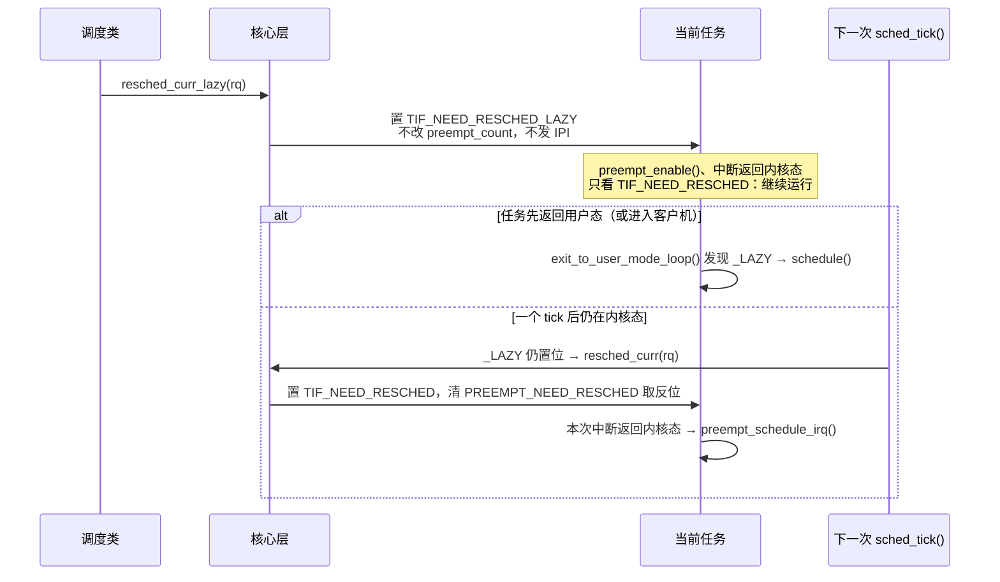

# 3.5 调度时钟与抢占模型

> **本节源码**：[`kernel/sched/core.c`](../../linux/kernel/sched/core.c)、[`kernel/sched/sched.h`](../../linux/kernel/sched/sched.h)、[`kernel/sched/clock.c`](../../linux/kernel/sched/clock.c)、[`kernel/time/timer.c`](../../linux/kernel/time/timer.c)、[`kernel/time/tick-sched.c`](../../linux/kernel/time/tick-sched.c)、[`kernel/entry/common.c`](../../linux/kernel/entry/common.c)、[`include/linux/sched.h`](../../linux/include/linux/sched.h)、[`include/linux/kernel.h`](../../linux/include/linux/kernel.h)、[`kernel/Kconfig.preempt`](../../linux/kernel/Kconfig.preempt)、[`arch/x86/include/asm/preempt.h`](../../linux/arch/x86/include/asm/preempt.h)、[`arch/x86/kernel/static_call.c`](../../linux/arch/x86/kernel/static_call.c)
> **关键函数**：`sched_clock_cpu()`、`update_rq_clock()`、`update_rq_clock_task()`、`sched_tick()`、`hrtick_start()`、`hrtick()`、`sched_update_tick_dependency()`、`sched_tick_remote()`、`resched_curr_lazy()`、`__cond_resched()`、`__sched_dynamic_update()`、`preempt_dynamic_init()`
> **前置知识**：3.1 调度器框架（`struct rq`、`struct sched_class` 的 `task_tick()`）、3.2 主调度函数（`resched_curr()`、抢占点、x86 的 `preempt_count`）

## 概述

调度器与时间打交道，要做三件事。一是**计量**：任务运行了多久、负载有多重，都需要一个廉价、单调、高分辨率的时间基准，这就是每个运行队列上的 rq 时钟。二是**驱动**：即使没有任务睡眠或被唤醒，调度器也要定期复查当前任务是否该让出 CPU，这由周期性的调度时钟中断（Scheduler Tick，下文简称 tick）完成。三是**响应**：复查的结论只是一个"请重新调度"的请求，它在哪些位置、多快被执行，由内核的抢占模型（Preemption Model）决定。

本节只讨论这三件事中与调度类无关的核心层机制：rq 时钟如何读取、更新与校验；`sched_tick()` 做了哪些事，又怎样经 `task_tick()` 回调把控制权交给调度类；高精度 tick（hrtick）与无 tick 模式（`NO_HZ`）如何让 tick 按需出现或消失；以及 none、voluntary、full、lazy 四种抢占模型和 `PREEMPT_DYNAMIC` 的实现。各调度类在 `task_tick()` 中如何记账、何时发起重调度请求、在什么情况下离不开 tick，分别在 3.3、3.6、3.7、3.10、3.11 节分析。

与本节相关的配置如下（以 `linux/.config` 为准）：

| 配置项 | 取值 | 影响 |
|---|---|---|
| `CONFIG_HZ` | 1000 | tick 周期 1 ms |
| `CONFIG_HIGH_RES_TIMERS` / `CONFIG_SCHED_HRTICK` | y / y | tick 由高精度定时器模拟；可使用 hrtick |
| `CONFIG_NO_HZ_FULL` | y | 支持全无 tick 模式，需启动参数 `nohz_full=` 指定 CPU |
| `CONFIG_PREEMPT` / `CONFIG_PREEMPT_DYNAMIC` | y / y | 默认 full 模型，可在启动参数或运行时切换 |
| `CONFIG_PREEMPT_RT` | y | 实时内核，none / voluntary 模型不可选 |
| `CONFIG_PREEMPT_LAZY` | n | lazy 不是默认模型，但 `PREEMPT_DYNAMIC` 下仍可切换到 lazy |
| `CONFIG_IRQ_TIME_ACCOUNTING` / `CONFIG_PARAVIRT_TIME_ACCOUNTING` | n / n | `clock_task` 不扣除中断时间与 steal 时间 |

## 核心数据结构

### rq 中的时间字段

[`kernel/sched/sched.h:1185-1201`](../../linux/kernel/sched/sched.h#L1185-L1201)（v6.18.60）

```c
	unsigned int		clock_update_flags;	// [注] 时钟更新状态位，见下文
	u64			clock;			// [注] rq 时钟（ns），由 update_rq_clock() 推进
	/* Ensure that all clocks are in the same cache line */
	u64			clock_task ____cacheline_aligned;	// [注] 可扣除中断 / steal 时间的任务时钟
	u64			clock_pelt;		// [注] 按频率与算力缩放的 PELT 时钟（3.8 节）
	unsigned long		lost_idle_time;
	u64			clock_pelt_idle;
	u64			clock_idle;
#ifndef CONFIG_64BIT
	u64			clock_pelt_idle_copy;
	u64			clock_idle_copy;
#endif

	atomic_t		nr_iowait;

	u64 last_seen_need_resched_ns;		// [注] LATENCY_WARN：首次看到 need_resched 的时刻
	int ticks_without_resched;		// [注] 此后又经过了多少个 tick
```

- `clock`、`clock_task`、`clock_pelt` 由同一次 `update_rq_clock()` 推进；源码用 `____cacheline_aligned` 让几个时钟落在同一缓存行（3.1 节）。
- `clock_pelt_idle`、`clock_idle`、`lost_idle_time` 供 PELT 在 CPU 空闲前后同步时钟（3.8 节）。
- 其余与本节有关的字段：`prev_irq_time` / `prev_steal_time_rq` 记录上次已扣除的中断时间与 steal 时间（分别依赖 `CONFIG_IRQ_TIME_ACCOUNTING` 与 `CONFIG_PARAVIRT_TIME_ACCOUNTING`，[`kernel/sched/sched.h:1248-1257`](../../linux/kernel/sched/sched.h#L1248-L1257)）；`calc_load_update` 是下一次为 `/proc/loadavg` 采样的 jiffies（[`kernel/sched/sched.h:1259-1261`](../../linux/kernel/sched/sched.h#L1259-L1261)）；`hrtick_csd`、`hrtick_timer`、`hrtick_time` 实现 hrtick（[`kernel/sched/sched.h:1263-1267`](../../linux/kernel/sched/sched.h#L1263-L1267)）。

### clock_update_flags

[`kernel/sched/sched.h:1678-1680`](../../linux/kernel/sched/sched.h#L1678-L1680)（v6.18.60）

```c
#define RQCF_REQ_SKIP		0x01
#define RQCF_ACT_SKIP		0x02
#define RQCF_UPDATED		0x04
```

| 位 | 由谁设置 | 含义 |
|---|---|---|
| `RQCF_REQ_SKIP` | `rq_clock_skip_update()` | 请求下一次 `__schedule()` 跳过时钟更新 |
| `RQCF_ACT_SKIP` | `__schedule()` 把 `REQ_SKIP` 左移一位得到；或 `rq_clock_start_loop_update()` | 跳过正在生效，`update_rq_clock()` 直接返回 |
| `RQCF_UPDATED` | `update_rq_clock()` | 自本次加锁（pin）以来时钟已经更新过 |

源码注释（[`kernel/sched/sched.h:1655-1677`](../../linux/kernel/sched/sched.h#L1655-L1677)）特别提醒：`__schedule()` 中这组位被整体左移过一次，所以判断 `UPDATED` 要写成 `flags >= RQCF_UPDATED`，而不是按位与。

### 重调度标志

[`include/asm-generic/thread_info_tif.h:21-27`](../../linux/include/asm-generic/thread_info_tif.h#L21-L27)（v6.18.60）

```c
#define TIF_NEED_RESCHED	4	// rescheduling necessary
#define _TIF_NEED_RESCHED	BIT(TIF_NEED_RESCHED)

#ifdef HAVE_TIF_NEED_RESCHED_LAZY
# define TIF_NEED_RESCHED_LAZY	5	// Lazy rescheduling needed
# define _TIF_NEED_RESCHED_LAZY	BIT(TIF_NEED_RESCHED_LAZY)
#endif
```

x86 定义了 `HAVE_TIF_NEED_RESCHED_LAZY`（[`arch/x86/include/asm/thread_info.h:85`](../../linux/arch/x86/include/asm/thread_info.h#L85)）。3.2 节已经介绍过两者在设置方式上的差别：`TIF_NEED_RESCHED` 在本 CPU 设置时会同步清除 `__preempt_count` 中的取反位，远程设置时（目标 CPU 没有在轮询）会发 IPI；`TIF_NEED_RESCHED_LAZY` 两件事都不做。`__schedule()` 选出下一个任务后，`clear_tsk_need_resched()` 一并清除这两个位（[`include/linux/sched.h:2066-2070`](../../linux/include/linux/sched.h#L2066-L2070)）。本节后半部分说明惰性位在哪些抢占点被响应、何时被升级。

### 抢占模型的状态

[`kernel/sched/core.c:7638-7646`](../../linux/kernel/sched/core.c#L7638-L7646)（v6.18.60）

```c
enum {
	preempt_dynamic_undefined = -1,
	preempt_dynamic_none,
	preempt_dynamic_voluntary,
	preempt_dynamic_full,
	preempt_dynamic_lazy,
};

int preempt_dynamic_mode = preempt_dynamic_undefined;
```

`preempt_dynamic_mode` 只是记录当前模型的变量，真正改变行为的是五个 static call 和一个 static key（见下文"PREEMPT_DYNAMIC"）。`preempt_model_none()`、`preempt_model_full()` 等访问函数读取这个变量（[`kernel/sched/core.c:7784-7795`](../../linux/kernel/sched/core.c#L7784-L7795)），供 `spin_needbreak()` 等需要感知抢占模型的代码使用。

## 主流程分析

### 调用链总览

时钟中断一侧：

```
sysvec_apic_timer_interrupt()                   arch/x86/kernel/apic/apic.c
└── local_apic_timer_interrupt()
    └── hrtimer_interrupt()                     kernel/time/hrtimer.c    // 高精度模式下的时钟事件回调
        └── __hrtimer_run_queues()                                        // 执行到期的 hardirq 定时器
            ├── tick_nohz_handler()             kernel/time/tick-sched.c // 模拟周期 tick 的 per-CPU 定时器
            │   ├── tick_sched_do_timer()                                 // 负责计时的 CPU 推进 jiffies
            │   └── tick_sched_handle()
            │       └── update_process_times()  kernel/time/timer.c
            │           ├── account_process_tick()                        // 用户态 / 内核态时间采样
            │           ├── run_local_timers()
            │           ├── rcu_sched_clock_irq()
            │           └── sched_tick()        kernel/sched/core.c
            │               ├── update_rq_clock()
            │               ├── resched_curr()                            // lazy 模型：升级未处理的惰性请求
            │               ├── donor->sched_class->task_tick(rq, donor, 0)
            │               ├── calc_global_load_tick()   kernel/sched/loadavg.c
            │               └── sched_balance_trigger()   kernel/sched/fair.c   // 3.9 节
            └── hrtick()                        kernel/sched/core.c      // 可选：调度类预约的精确 tick
                └── donor->sched_class->task_tick(rq, curr, 1)

sched_tick_remote()                             kernel/sched/core.c      // NO_HZ_FULL：housekeeping CPU 上每秒一次
└── curr->sched_class->task_tick(rq, curr, 0)
```

请求被响应的一侧（中断出口，5.2 节）：

```
irqentry_exit()                                 kernel/entry/common.c
├── irqentry_exit_to_user_mode()                // 返回用户态
│   └── exit_to_user_mode_prepare()
│       └── exit_to_user_mode_loop()            // NEED_RESCHED 或 NEED_RESCHED_LAZY → schedule()
└── irqentry_exit_cond_resched()                // 返回内核态：static call，none / voluntary 下为空
    └── raw_irqentry_exit_cond_resched()        // need_resched() → preempt_schedule_irq()
```

### rq 时钟

#### 时钟源：sched_clock_cpu()

[`kernel/sched/clock.c:391-412`](../../linux/kernel/sched/clock.c#L391-L412)（v6.18.60）

```c
notrace u64 sched_clock_cpu(int cpu)
{
	struct sched_clock_data *scd;
	u64 clock;

	if (sched_clock_stable())
		return sched_clock() + __sched_clock_offset;

	if (!static_branch_likely(&sched_clock_running))
		return sched_clock();

	preempt_disable_notrace();
	scd = cpu_sdc(cpu);

	if (cpu != smp_processor_id())
		clock = sched_clock_remote(scd);
	else
		clock = sched_clock_local(scd);
	preempt_enable_notrace();

	return clock;
}
```

x86 选择了 `CONFIG_HAVE_UNSTABLE_SCHED_CLOCK`（[`arch/x86/Kconfig:300`](../../linux/arch/x86/Kconfig#L300)）：底层的 `sched_clock()` 通常读 TSC 并换算为纳秒（KVM 客户机中可能被替换为 kvm-clock，[`arch/x86/kernel/kvmclock.c:99`](../../linux/arch/x86/kernel/kvmclock.c#L99)），而 TSC 未必在所有 CPU 间同步、也未必恒速。因此分两种情况：

- **稳定**（`sched_clock_stable()` 为真）：直接返回 `sched_clock()` 加一个全局偏移，这是常见情况。
- **不稳定**（例如 TSC 被判定不可靠后调用了 `clear_sched_clock_stable()`，[`arch/x86/kernel/tsc.c:1144`](../../linux/arch/x86/kernel/tsc.c#L1144)）：每个 CPU 维护一份 `sched_clock_data`，以上一次 tick 时记录的 GTOD 时间为基准、加上 `sched_clock()` 的增量，再把结果钳制在"不小于基准与上次读数、不大于基准加一个 `TICK_NSEC`"的窗口内（`sched_clock_local()`，[`kernel/sched/clock.c:266-297`](../../linux/kernel/sched/clock.c#L266-L297)），既保证单调，又过滤掉离谱的 TSC 跳变。`sched_tick()` 开头调用的 `sched_clock_tick()`（[`kernel/sched/clock.c:415-430`](../../linux/kernel/sched/clock.c#L415-L430)）就是在刷新这个基准。

文件开头的注释明确警告：对不同 CPU 的读数相互比较时，"时间可能倒流"（[`kernel/sched/clock.c:21-24`](../../linux/kernel/sched/clock.c#L21-L24)）。rq 时钟只保证在同一个 rq 上单调。

#### update_rq_clock()

[`kernel/sched/core.c:846-869`](../../linux/kernel/sched/core.c#L846-L869)（v6.18.60）

```c
void update_rq_clock(struct rq *rq)
{
	s64 delta;
	u64 clock;

	lockdep_assert_rq_held(rq);

	if (rq->clock_update_flags & RQCF_ACT_SKIP)
		return;

	if (sched_feat(WARN_DOUBLE_CLOCK))
		WARN_ON_ONCE(rq->clock_update_flags & RQCF_UPDATED);
	rq->clock_update_flags |= RQCF_UPDATED;

	clock = sched_clock_cpu(cpu_of(rq));
	scx_rq_clock_update(rq, clock);		// [注] 仅在加载了 sched_ext 调度器时缓存时钟（3.11 节）

	delta = clock - rq->clock;
	if (delta < 0)
		return;
	rq->clock += delta;

	update_rq_clock_task(rq, delta);
}
```

- 调用者必须持有 rq 锁；跳过生效时直接返回。
- 每次更新都打上 `RQCF_UPDATED`。开启调试特性 `WARN_DOUBLE_CLOCK`（默认关闭，[`kernel/sched/features.h:95`](../../linux/kernel/sched/features.h#L95)）后，同一次加锁内重复更新会触发告警，用于发现多余的更新。
- 读数比上次小（`delta < 0`）时放弃本次更新，保证 `rq->clock` 单调不减。

#### update_rq_clock_task()

[`kernel/sched/core.c:787-844`](../../linux/kernel/sched/core.c#L787-L844)（v6.18.60，节选）

```c
static void update_rq_clock_task(struct rq *rq, s64 delta)
{
	...
	s64 __maybe_unused steal = 0, irq_delta = 0;

#ifdef CONFIG_IRQ_TIME_ACCOUNTING
	if (irqtime_enabled()) {
		irq_delta = irq_time_read(cpu_of(rq)) - rq->prev_irq_time;
		...
		if (irq_delta > delta)
			irq_delta = delta;

		rq->prev_irq_time += irq_delta;
		delta -= irq_delta;
		delayacct_irq(rq->curr, irq_delta);
	}
#endif
#ifdef CONFIG_PARAVIRT_TIME_ACCOUNTING
	...	/* [注] 同理扣除 paravirt_steal_clock() 报告的 steal 时间 */
#endif

	rq->clock_task += delta;

#ifdef CONFIG_HAVE_SCHED_AVG_IRQ
	if ((irq_delta + steal) && sched_feat(NONTASK_CAPACITY))
		update_irq_load_avg(rq, irq_delta + steal);
#endif
	update_rq_clock_pelt(rq, delta);
}
```

`clock_task` 的设计目的是把"不属于任何任务"的时间剔除出去：硬中断与软中断处理时间（`CONFIG_IRQ_TIME_ACCOUNTING`），以及虚拟机中 vCPU 可运行却被宿主机调度走的 steal 时间（`CONFIG_PARAVIRT_TIME_ACCOUNTING`）。中断时间只在中断退出时累计，若上一次时钟更新恰好发生在中断内部，`irq_delta` 可能大于本次 `delta`，源码把它截断到 `delta`，以保证 `clock_task` 单调（注释见 [`kernel/sched/core.c:799-813`](../../linux/kernel/sched/core.c#L799-L813)）。

**本书配置中这两项扣除都未开启**，`clock_task` 与 `clock` 同步前进，中断处理时间会算到被打断的任务头上；`CONFIG_HAVE_SCHED_AVG_IRQ` 依赖这两项之一（[`init/Kconfig:603-606`](../../linux/init/Kconfig#L603-L606)），同样未开启。函数最后调用 `update_rq_clock_pelt()` 推进 `clock_pelt`（3.8 节）。

#### 更新纪律：先更新、再读取

rq 时钟遵循一个约定：**每次持有 rq 锁期间，先调用一次 `update_rq_clock()`，之后的读取都使用这个值**。约定靠下面几处代码维持。

[`kernel/sched/sched.h:1682-1697`](../../linux/kernel/sched/sched.h#L1682-L1697)（v6.18.60）

```c
static inline void assert_clock_updated(struct rq *rq)
{
	/*
	 * The only reason for not seeing a clock update since the
	 * last rq_pin_lock() is if we're currently skipping updates.
	 */
	WARN_ON_ONCE(rq->clock_update_flags < RQCF_ACT_SKIP);
}

static inline u64 rq_clock(struct rq *rq)
{
	lockdep_assert_rq_held(rq);
	assert_clock_updated(rq);

	return rq->clock;
}
```

1. **加锁时清除 `UPDATED`**。`rq_lock()` 等加锁函数都会调用 `rq_pin_lock()`，它只保留两个 SKIP 位、清掉 `UPDATED`（[`kernel/sched/sched.h:1807-1814`](../../linux/kernel/sched/sched.h#L1807-L1814)）。临时放锁再重新加锁时，`rq_unpin_lock()` / `rq_repin_lock()` 负责暂存并恢复 `UPDATED`（[`kernel/sched/sched.h:1816-1833`](../../linux/kernel/sched/sched.h#L1816-L1833)）。
2. **读取时断言**。`rq_clock()` 与 `rq_clock_task()` 要求 flags 至少为 `RQCF_ACT_SKIP`：要么本次加锁后已经更新过，要么正处于跳过状态，否则告警。
3. **避免重复更新**。已经更新过时钟的调用者向 `enqueue_task()` / `dequeue_task()` 传入 `ENQUEUE_NOCLOCK` / `DEQUEUE_NOCLOCK`（3.1 节）。
4. **跳过紧邻的更新**。`wakeup_preempt()` 在决定要重新调度后调用 `rq_clock_skip_update()`（[`kernel/sched/core.c:2228-2233`](../../linux/kernel/sched/core.c#L2228-L2233)）：唤醒路径刚更新过时钟，紧随其后的 `__schedule()` 不必再读一次。`__schedule()` 把 flags 左移一位，`REQ_SKIP` 变成 `ACT_SKIP`，`update_rq_clock()` 随即返回，之后再把 flags 置为 `RQCF_UPDATED`（3.2 节）。
5. **批量操作只更新一次**。CPU 下线、批量解除节流等场景要对多个子队列逐个操作，可先更新一次时钟，再用 `rq_clock_start_loop_update()` / `rq_clock_stop_loop_update()` 包住循环，期间的 `update_rq_clock()` 都被跳过（[`kernel/sched/sched.h:1723-1743`](../../linux/kernel/sched/sched.h#L1723-L1743)）。

### 周期性 tick

#### 从时钟中断到 sched_tick()

`CONFIG_HIGH_RES_TIMERS` 下，系统切换到高精度模式后，本地 APIC 定时器（5.5 节）以单次触发方式工作，每次中断都交给 `hrtimer_interrupt()`。周期 tick 由此变成一个 per-CPU 高精度定时器 `tick_cpu_sched.sched_timer`，其回调 `tick_nohz_handler()` 每次执行后把到期时间推后一个 `TICK_NSEC` 并重新启动（[`kernel/time/tick-sched.c:284-312`](../../linux/kernel/time/tick-sched.c#L284-L312)）。启动早期或无法使用高精度模式时，tick 由周期模式的 `tick_periodic()`（[`kernel/time/tick-common.c:86-103`](../../linux/kernel/time/tick-common.c#L86-L103)）或低精度 NO_HZ 模式的 `tick_nohz_lowres_handler()`（[`kernel/time/tick-sched.c:1481-1489`](../../linux/kernel/time/tick-sched.c#L1481-L1489)）处理。几条路径汇合于 `update_process_times()`：

[`kernel/time/timer.c:2467-2482`](../../linux/kernel/time/timer.c#L2467-L2482)（v6.18.60）

```c
void update_process_times(int user_tick)
{
	struct task_struct *p = current;

	/* Note: this timer irq context must be accounted for as well. */
	account_process_tick(p, user_tick);
	run_local_timers();
	rcu_sched_clock_irq(user_tick);
#ifdef CONFIG_IRQ_WORK
	if (in_irq())
		irq_work_tick();
#endif
	sched_tick();
	if (IS_ENABLED(CONFIG_POSIX_TIMERS))
		run_posix_cpu_timers();
}
```

时钟事件设备、jiffies 与时间轮的细节见 8.6、8.7、8.10 节，这里只需记住：`sched_tick()` 以 `HZ` 频率、在硬中断上下文中、关中断执行。

这一点在 `PREEMPT_RT` 下同样成立。实时内核把未显式标记 `HRTIMER_MODE_HARD` 的高精度定时器一律推迟到软中断上下文执行（[`kernel/time/hrtimer.c:1620-1627`](../../linux/kernel/time/hrtimer.c#L1620-L1627)），而模拟 tick 的定时器以 `HRTIMER_MODE_ABS_HARD` 创建（[`kernel/time/tick-sched.c:1576`](../../linux/kernel/time/tick-sched.c#L1576)），下文的 hrtick 也使用 `_HARD` 模式。

#### sched_tick()：更新时钟并交给调度类

[`kernel/sched/core.c:5597-5625`](../../linux/kernel/sched/core.c#L5597-L5625)（v6.18.60）

```c
void sched_tick(void)
{
	int cpu = smp_processor_id();
	struct rq *rq = cpu_rq(cpu);
	/* scheduler accounting goes to the donor task */
	struct task_struct *curr, *donor;
	struct rq_flags rf;
	unsigned long hw_pressure;
	u64 resched_latency;

	if (housekeeping_cpu(cpu, HK_TYPE_KERNEL_NOISE))
		arch_scale_freq_tick();

	sched_clock_tick();

	rq_lock(rq, &rf);
	curr = rq->curr;
	donor = rq->donor;

	psi_account_irqtime(rq, curr, NULL);

	update_rq_clock(rq);
	hw_pressure = arch_scale_hw_pressure(cpu_of(rq));
	update_hw_load_avg(rq_clock_task(rq), rq, hw_pressure);

	if (dynamic_preempt_lazy() && tif_test_bit(TIF_NEED_RESCHED_LAZY))
		resched_curr(rq);

	donor->sched_class->task_tick(rq, donor, 0);
```

1. **频率采样**。x86 的 `arch_scale_freq_tick()` 读取 `APERF` / `MPERF` 两个 MSR，计算自上次 tick 以来的实际频率比例（[`arch/x86/kernel/cpu/aperfmperf.c:474-497`](../../linux/arch/x86/kernel/cpu/aperfmperf.c#L474-L497)），供 PELT 做频率不变性缩放（3.8 节）。它只在 housekeeping CPU 上执行，`nohz_full=` 指定的 CPU 不属于 `HK_TYPE_KERNEL_NOISE`，因此被跳过。
2. **刷新 sched_clock 基准**，见上文。
3. **加锁并更新 rq 时钟**。此时已处于关中断的硬中断上下文，用 `rq_lock()` 即可。`psi_account_irqtime()` 依赖 `CONFIG_IRQ_TIME_ACCOUNTING`，本书配置下为空函数（[`kernel/sched/stats.h:113-118`](../../linux/kernel/sched/stats.h#L113-L118)）；`update_hw_load_avg()` 依赖 `CONFIG_SCHED_HW_PRESSURE`，x86 不选择该项（[`init/Kconfig:608-613`](../../linux/init/Kconfig#L608-L613)），同样为空。
4. **升级惰性请求**（仅 lazy 模型），见下文"惰性抢占"。
5. **调用 `task_tick()`**。记账对象是 `donor`，即提供调度上下文的任务；本书配置未开启 `CONFIG_SCHED_PROXY_EXEC`，它与 `curr` 相同（3.2 节）。第三个参数 `queued` 为 0，表示这是周期 tick。核心层到此为止，时间片检查、预算扣减等决策都由调度类完成。

`task_tick()` 一共有三个调用者，核心层只负责在合适的时机、持锁并更新好时钟之后调用它：

| 调用者 | 执行位置 | 传入的任务 | `queued` |
|---|---|---|---|
| `sched_tick()` | 本 CPU，每个 tick 的硬中断 | `rq->donor` | 0 |
| `hrtick()` | 本 CPU，hrtick 到期的硬中断 | `rq->curr`（按 `rq->donor` 的调度类分派） | 1 |
| `sched_tick_remote()` | housekeeping CPU 上的工作项，每秒一次 | `rq->curr` | 0 |

`queued` 为 1 表示这次调用来自调度类自己预约的 hrtick，如何解释它由调度类决定。

#### sched_tick()：其余周期性工作

[`kernel/sched/core.c:5626-5647`](../../linux/kernel/sched/core.c#L5626-L5647)（v6.18.60）

```c
	if (sched_feat(LATENCY_WARN))
		resched_latency = cpu_resched_latency(rq);
	calc_global_load_tick(rq);
	sched_core_tick(rq);
	task_tick_mm_cid(rq, donor);
	scx_tick(rq);			// [注] sched_ext 专用（3.11 节）

	rq_unlock(rq, &rf);

	if (sched_feat(LATENCY_WARN) && resched_latency)
		resched_latency_warn(cpu, resched_latency);

	perf_event_task_tick();

	if (curr->flags & PF_WQ_WORKER)
		wq_worker_tick(curr);

	if (!scx_switched_all()) {
		rq->idle_balance = idle_cpu(cpu);
		sched_balance_trigger(rq);
	}
}
```

- **重调度延迟检测**。调试特性 `LATENCY_WARN` 默认关闭（[`kernel/sched/features.h:131`](../../linux/kernel/sched/features.h#L131)）。开启后，`cpu_resched_latency()`（[`kernel/sched/core.c:5548-5577`](../../linux/kernel/sched/core.c#L5548-L5577)）在第一次看到 `need_resched()` 为真时记下时间，此后每个 tick 累加 `ticks_without_resched`；如果超过 `latency_warn_ms`（默认 100 ms，[`kernel/sched/core.c:179`](../../linux/kernel/sched/core.c#L179)）仍未调度，就在放锁后打印 "need_resched set for > ... without schedule" 并输出调用栈（[`kernel/sched/debug.c:1280-1290`](../../linux/kernel/sched/debug.c#L1280-L1290)）。`__schedule()` 选出下一个任务后把记录清零（[`kernel/sched/core.c:6901`](../../linux/kernel/sched/core.c#L6901)）。它用来定位长时间没有经过抢占点的内核路径。
- **全局负载采样**。`calc_global_load_tick()` 每隔 `LOAD_FREQ`（5 秒加 1 个 tick，[`include/linux/sched/loadavg.h:20`](../../linux/include/linux/sched/loadavg.h#L20)）把本 CPU"可运行数 + 不可中断睡眠数"的变化量累加到全局计数（[`kernel/sched/loadavg.c:387-399`](../../linux/kernel/sched/loadavg.c#L387-L399)），这就是 `/proc/loadavg` 中负载均值（Load Average）的原始数据。
- **核心调度强制空闲统计**。`sched_core_tick()` 在开启核心调度且启用 schedstats 时，统计 SMT 兄弟线程被迫空闲的时间（[`kernel/sched/sched.h:3165-3169`](../../linux/kernel/sched/sched.h#L3165-L3169)，`CONFIG_SCHED_CORE`）。
- **mm CID 压缩**。`task_tick_mm_cid()` 按 `mm_cid_next_scan` 周期，给当前用户任务挂一个在返回用户态时执行的 task_work，用来回收进程内空闲的并发 ID；源码注释说明不在 rq 锁下分配内存是推迟执行的原因（[`kernel/sched/core.c:10798-10811`](../../linux/kernel/sched/core.c#L10798-L10811)，`CONFIG_SCHED_MM_CID`）。
- **perf**。`perf_event_task_tick()` 调整按频率采样的事件周期，并解除被限流的事件（[`kernel/events/core.c:4517-4536`](../../linux/kernel/events/core.c#L4517-L4536)）。
- **工作队列**。当前任务是 kworker 时，`wq_worker_tick()` 检查它是否连续占用 CPU 超过 `wq_cpu_intensive_thresh_us`，是则标记为 CPU 密集型，让同一 worker 池能唤醒其他 worker（[`kernel/workqueue.c:1491`](../../linux/kernel/workqueue.c#L1491) 起，5.12 节）。
- **负载均衡**。最后由 `sched_balance_trigger()` 判断是否到了周期性负载均衡的时间，必要时触发 `SCHED_SOFTIRQ`（3.9 节）；sched_ext 接管全部任务时跳过。

### hrtick：调度类预约的精确 tick

tick 的粒度是 1 ms，而调度类管理的时间片或运行预算可能在两次 tick 之间到期，最晚要等到下一个 tick 才被发现。`CONFIG_SCHED_HRTICK` 为此提供了一个每 rq 一个的单次高精度定时器：调度类算出"还剩多久到期"，调用 `hrtick_start()` 预约，到期时得到一次额外的 `task_tick()` 调用。

[`kernel/sched/core.c:927-943`](../../linux/kernel/sched/core.c#L927-L943)（v6.18.60）

```c
void hrtick_start(struct rq *rq, u64 delay)
{
	struct hrtimer *timer = &rq->hrtick_timer;
	s64 delta;

	/*
	 * Don't schedule slices shorter than 10000ns, that just
	 * doesn't make sense and can cause timer DoS.
	 */
	delta = max_t(s64, delay, 10000LL);
	rq->hrtick_time = ktime_add_ns(hrtimer_cb_get_time(timer), delta);

	if (rq == this_rq())
		__hrtick_restart(rq);
	else
		smp_call_function_single_async(cpu_of(rq), &rq->hrtick_csd);
}
```

- 调用者持有 rq 锁且已关中断。
- 定时间隔不少于 10 μs，防止定时器风暴。
- 定时器是 per-CPU 的，并以 `HRTIMER_MODE_ABS_PINNED_HARD` 启动（[`kernel/sched/core.c:901-907`](../../linux/kernel/sched/core.c#L901-L907)），既不会迁移到其他 CPU，也保证在硬中断中到期。为远程 rq 预约时，只记下到期时刻，再经 `hrtick_csd` 发一个 IPI，由目标 CPU 在 `__hrtick_start()` 中自己启动定时器（[`kernel/sched/core.c:912-920`](../../linux/kernel/sched/core.c#L912-L920)）。

[`kernel/sched/core.c:886-899`](../../linux/kernel/sched/core.c#L886-L899)（v6.18.60）

```c
static enum hrtimer_restart hrtick(struct hrtimer *timer)
{
	struct rq *rq = container_of(timer, struct rq, hrtick_timer);
	struct rq_flags rf;

	WARN_ON_ONCE(cpu_of(rq) != smp_processor_id());

	rq_lock(rq, &rf);
	update_rq_clock(rq);
	rq->donor->sched_class->task_tick(rq, rq->curr, 1);
	rq_unlock(rq, &rf);

	return HRTIMER_NORESTART;
}
```

回调与 `sched_tick()` 的核心部分相同：加锁、更新时钟、调用 `task_tick()`，只是 `queued` 为 1。返回 `HRTIMER_NORESTART` 说明它是一次性的，是否再次预约由调度类决定。

hrtick 有三道开关：

- 编译选项 `CONFIG_SCHED_HRTICK`（本书配置开启）；
- 运行条件 `hrtick_enabled()`：CPU 处于 active 状态，且高精度定时器确实工作在高精度模式（[`kernel/sched/sched.h:2846-2851`](../../linux/kernel/sched/sched.h#L2846-L2851)）；
- 调度特性位 `HRTICK` 与 `HRTICK_DL`，各自控制一类调度类能否使用 hrtick，**两者默认都为 false**（[`kernel/sched/features.h:66-67`](../../linux/kernel/sched/features.h#L66-L67)）。

因此默认情况下没有任何调度类会预约 hrtick。打开特性位后，`__schedule()` 每次切换前都要用 `hrtick_clear()` 取消尚未到期的定时器（[`kernel/sched/core.c:6825-6826`](../../linux/kernel/sched/core.c#L6825-L6826)，3.2 节），CPU 下线时 `sched_cpu_dying()` 也会取消它（[`kernel/sched/core.c:8582`](../../linux/kernel/sched/core.c#L8582)）。精度的代价是调度路径上频繁地启动、取消高精度定时器。

### 停止 tick：NO_HZ

tick 是周期性的兜底检查，当它无事可做时就是纯开销：空闲 CPU 被白白唤醒、耗电；运行单个计算任务的 CPU 每毫秒被打断一次。无 tick 模式（Dynticks，`NO_HZ`）在这两种情况下停掉 tick。

#### 空闲时停 tick

`CONFIG_NO_HZ_COMMON`（由 `CONFIG_NO_HZ_FULL` 选中）下，idle 循环 `do_idle()` 进入时调用 `tick_nohz_idle_enter()`（[`kernel/sched/idle.c:296`](../../linux/kernel/sched/idle.c#L296)），随后根据 cpuidle 的判断调用 `tick_nohz_idle_stop_tick()`（[`kernel/sched/idle.c:163-169`](../../linux/kernel/sched/idle.c#L163-L169)）。后者在 `need_resched()` 为假等条件满足时，把下一次 tick 推迟到下一个定时器事件；第一次停 tick 时还调用 `nohz_balance_enter_idle()`，把本 CPU 登记为 nohz 空闲 CPU（[`kernel/time/tick-sched.c:1205-1239`](../../linux/kernel/time/tick-sched.c#L1205-L1239)）。退出 idle 循环时，`tick_nohz_idle_exit()` 恢复 tick（[`kernel/sched/idle.c:364`](../../linux/kernel/sched/idle.c#L364)）。

对调度器来说，空闲 CPU 本就没有任务需要复查。但 `sched_tick()` 的两项副作用不能丢：一是周期性负载均衡，二是衰减 blocked 负载。它们都由忙碌 CPU 发起的 nohz idle 均衡代为完成（3.8、3.9 节）。

#### 运行时停 tick：NO_HZ_FULL

启动参数 `nohz_full=<cpulist>` 指定的 CPU 即使有任务在运行，也可以停掉 tick（这些 CPU 同时被移出 housekeeping 集合，RCU 回调也被卸载到其他 CPU，见 [`Documentation/admin-guide/kernel-parameters.txt:4316-4327`](../../linux/Documentation/admin-guide/kernel-parameters.txt#L4316-L4327)）。能否停由 tick 子系统的 `can_stop_full_tick()` 决定，它依次检查全局、本 CPU、当前任务、当前进程四个**tick 依赖**（Tick Dependency）掩码，任何一个非零都不能停（[`kernel/time/tick-sched.c:358-378`](../../linux/kernel/time/tick-sched.c#L358-L378)）。每一位代表一个需要 tick 的子系统：

[`include/linux/tick.h:109-116`](../../linux/include/linux/tick.h#L109-L116)（v6.18.60）

```c
enum tick_dep_bits {
	TICK_DEP_BIT_POSIX_TIMER	= 0,
	TICK_DEP_BIT_PERF_EVENTS	= 1,
	TICK_DEP_BIT_SCHED		= 2,
	TICK_DEP_BIT_CLOCK_UNSTABLE	= 3,
	TICK_DEP_BIT_RCU		= 4,
	TICK_DEP_BIT_RCU_EXP		= 5
};
```

调度器负责维护本 CPU 掩码中的 `TICK_DEP_BIT_SCHED`：

[`kernel/sched/sched.h:2726-2737`](../../linux/kernel/sched/sched.h#L2726-L2737)（v6.18.60）

```c
static inline void sched_update_tick_dependency(struct rq *rq)
{
	int cpu = cpu_of(rq);

	if (!tick_nohz_full_cpu(cpu))
		return;

	if (sched_can_stop_tick(rq))
		tick_nohz_dep_clear_cpu(cpu, TICK_DEP_BIT_SCHED);
	else
		tick_nohz_dep_set_cpu(cpu, TICK_DEP_BIT_SCHED);
}
```

它在 `add_nr_running()` 与 `sub_nr_running()` 末尾被调用（[`kernel/sched/sched.h:2743-2767`](../../linux/kernel/sched/sched.h#L2743-L2767)）。各调度类入队、出队时都通过这两个函数修改 `rq->nr_running`，所以运行队列的构成一变，调度器就重新评估一次 tick 依赖。非 `nohz_full` CPU 上它在第一个判断处就返回。

判断交给 `sched_can_stop_tick()`（[`kernel/sched/core.c:1350-1401`](../../linux/kernel/sched/core.c#L1350-L1401)）。它回答的问题是：运行队列上是否还有任务要靠 tick 实施强制抢占或预算控制。例如同一 CPU 上有多个需要轮转时间片的任务时，就必须保留 tick。具体判据由各调度类的策略决定，在 3.6、3.7、3.10、3.11 节分别说明。

设置依赖位后，tick 怎样重新启动：

```
add_nr_running()                                kernel/sched/sched.h     // 任一调度类入队
└── sched_update_tick_dependency()
    ├── sched_can_stop_tick()                   kernel/sched/core.c
    └── tick_nohz_dep_set_cpu(cpu, TICK_DEP_BIT_SCHED)   kernel/time/tick-sched.c
        └── tick_nohz_full_kick_cpu()                    // 掩码原为 0 时：irq_work，远程经 IPI
            ...（目标 CPU 处理完该中断）...
            irq_exit_rcu() → tick_irq_exit()             kernel/softirq.c
            └── tick_nohz_irq_exit()                     kernel/time/tick-sched.c
                └── __tick_nohz_full_update_tick()
                    ├── can_stop_full_tick()             // 检查四个依赖掩码
                    └── tick_nohz_restart_sched_tick()   // 有依赖：恢复 tick
```

- `tick_nohz_dep_set_cpu()` 用 `atomic_fetch_or()` 置位，只有掩码原本为 0 时才需要"踢"目标 CPU（[`kernel/time/tick-sched.c:505-525`](../../linux/kernel/time/tick-sched.c#L505-L525)）：本 CPU 用 NMI 安全的 irq_work，远程 CPU 用 `irq_work_queue_on()` 发 IPI。被踢的 CPU 在中断退出时重新评估，发现有依赖就恢复 tick（[`kernel/time/tick-sched.c:1107-1118`](../../linux/kernel/time/tick-sched.c#L1107-L1118)）。
- 清除依赖则不需要通知：`tick_nohz_dep_clear_cpu()` 只清位（[`kernel/time/tick-sched.c:528-533`](../../linux/kernel/time/tick-sched.c#L528-L533)），等下一次中断退出时 `can_stop_full_tick()` 返回真，tick 才停下。
- 任务切换时，`finish_task_switch()` 调用 `tick_nohz_task_switch()`（[`kernel/sched/core.c:5208`](../../linux/kernel/sched/core.c#L5208)）：如果 tick 已停，而新任务自身或其进程带有依赖（POSIX CPU 定时器、perf 事件），就踢一下本 CPU（[`kernel/time/tick-sched.c:583-597`](../../linux/kernel/time/tick-sched.c#L583-L597)）。

#### 远程 tick：sched_tick_remote()

tick 停掉后，当前任务的运行时间、PELT 负载、全局负载均值都不再更新，长期不更新会让这些统计严重失真。内核的折中是让 housekeeping CPU 每秒代为执行一次 tick：

[`kernel/sched/core.c:5686-5738`](../../linux/kernel/sched/core.c#L5686-L5738)（v6.18.60，节选）

```c
static void sched_tick_remote(struct work_struct *work)
{
	struct delayed_work *dwork = to_delayed_work(work);
	struct tick_work *twork = container_of(dwork, struct tick_work, work);
	int cpu = twork->cpu;
	struct rq *rq = cpu_rq(cpu);
	int os;
	...
	if (tick_nohz_tick_stopped_cpu(cpu)) {
		guard(rq_lock_irq)(rq);
		struct task_struct *curr = rq->curr;

		if (cpu_online(cpu)) {
			...
			WARN_ON_ONCE(rq->curr != rq->donor);
			update_rq_clock(rq);

			if (!is_idle_task(curr)) {
				...
				u64 delta = rq_clock_task(rq) - curr->se.exec_start;
				WARN_ON_ONCE(delta > (u64)NSEC_PER_SEC * 3);
			}
			curr->sched_class->task_tick(rq, curr, 0);

			calc_load_nohz_remote(rq);
		}
	}
	...
	os = atomic_fetch_add_unless(&twork->state, -1, TICK_SCHED_REMOTE_RUNNING);
	WARN_ON_ONCE(os == TICK_SCHED_REMOTE_OFFLINE);
	if (os == TICK_SCHED_REMOTE_RUNNING)
		queue_delayed_work(system_unbound_wq, dwork, HZ);
}
```

- 每个 `nohz_full` CPU 对应一个 `struct tick_work`，它的延迟工作项挂在 `system_unbound_wq` 上，间隔为 `HZ` 个 jiffies，即 1 秒。unbound 工作队列的 worker 默认被限制在 housekeeping CPU 上（[`kernel/workqueue.c:7885`](../../linux/kernel/workqueue.c#L7885)），所以代执行的 tick 不会再打扰隔离 CPU。
- 只有目标 CPU 的 tick 确实已停时才代为执行。取远程 rq 的锁、更新时钟、调用 `task_tick()`，再更新全局负载。`se.exec_start` 是当前任务本次开始计时的时刻，各调度类共用；距今超过 3 秒说明记账长期停滞，于是告警。
- 源码注释说明了两点取舍（[`kernel/sched/core.c:5694-5700`](../../linux/kernel/sched/core.c#L5694-L5700)、[`kernel/sched/core.c:5728-5733`](../../linux/kernel/sched/core.c#L5728-L5733)）：判断 tick 是否已停本身存在竞争，但少一次或多一次 tick 无关紧要，因为 tick 更新统计、检查时间片的方式与它何时运行无关；1 Hz 的频率足够低，不会造成负担，又足以让调度器内部统计大致保持最新。
- `state` 字段配合 CPU 热插拔：`sched_cpu_starting()` 中的 `sched_tick_start()` 把它置为 RUNNING 并首次排队（[`kernel/sched/core.c:5740-5758`](../../linux/kernel/sched/core.c#L5740-L5758)），`sched_cpu_dying()` 中的 `sched_tick_stop()` 只把它改为 OFFLINING 而不取消工作项（[`kernel/sched/core.c:5761-5776`](../../linux/kernel/sched/core.c#L5761-L5776)），由工作项自己把状态减到 OFFLINE 并停止重新排队。状态图见 [`kernel/sched/core.c:5661-5682`](../../linux/kernel/sched/core.c#L5661-L5682)。

### 抢占模型

3.2 节把抢占拆成两步：`resched_curr()` 发起请求，当前任务到达抢占点时响应请求。抢占模型决定的就是两件事：**哪些抢占点生效**，以及**惰性请求设置哪个标志位**。

#### 四种模型

| 模型 | `preempt_enable()` 与中断返回内核态 | `cond_resched()` | `might_resched()` | `resched_curr_lazy()` 设置 | 本书配置 |
|---|---|---|---|---|---|
| none | 不抢占 | 有效 | 空 | `TIF_NEED_RESCHED` | 不可选 |
| voluntary | 不抢占 | 有效 | 有效 | `TIF_NEED_RESCHED` | 不可选 |
| full | 抢占 | 空 | 空 | `TIF_NEED_RESCHED` | 默认 |
| lazy | 抢占 | 空 | 空 | `TIF_NEED_RESCHED_LAZY` | 可选 |

- **返回用户态**（以及 KVM 进入客户机前的 `xfer_to_guest_mode_work()`，[`kernel/entry/virt.c:13-14`](../../linux/kernel/entry/virt.c#L13-L14)）在所有模型下都检查两个重调度位。用户态代码在任何模型下都能被抢占，模型只影响**内核态**代码何时让出 CPU。
- **none**：内核态只在显式调用 `schedule()` 或 `cond_resched()` 时让出 CPU，长时间运行的内核循环必须自己插入 `cond_resched()`。
- **voluntary**：在 none 的基础上，`might_sleep()` 中的 `might_resched()` 也成为抢占点（[`include/linux/kernel.h:136`](../../linux/include/linux/kernel.h#L136)）。内核中可能睡眠的函数大多带有 `might_sleep()` 注解，这些位置因此变成了额外的"自愿"抢占点。
- **full**：只要 `preempt_count` 为 0 且中断开启，`preempt_enable()` 与中断返回内核态都可以立即抢占（3.2 节）。`cond_resched()` 失去意义，退化为直接返回 0。
- **lazy**：对 `TIF_NEED_RESCHED` 的处理与 full 完全相同；不同之处在于，经 `resched_curr_lazy()` 发出的请求只设置 `TIF_NEED_RESCHED_LAZY`，给内核态代码最多一个 tick 的宽限期（见下文"惰性抢占"）。

在 Kconfig 中，前四项是一个单选组（[`kernel/Kconfig.preempt:17-87`](../../linux/kernel/Kconfig.preempt#L17-L87)），默认是 `PREEMPT_NONE`；`PREEMPT_LAZY` 要求架构选择 `ARCH_HAS_PREEMPT_LAZY`，x86 满足（[`arch/x86/Kconfig:99`](../../linux/arch/x86/Kconfig#L99)）。`PREEMPT_RT` 不在单选组内，是一个独立选项（[`kernel/Kconfig.preempt:89-103`](../../linux/kernel/Kconfig.preempt#L89-L103)），而 `PREEMPT_NONE` 与 `PREEMPT_VOLUNTARY` 都 `depends on !PREEMPT_RT`（[`kernel/Kconfig.preempt:23`](../../linux/kernel/Kconfig.preempt#L23)、[`kernel/Kconfig.preempt:39`](../../linux/kernel/Kconfig.preempt#L39)）。本书配置选择了 `CONFIG_PREEMPT`，并同时开启 `CONFIG_PREEMPT_RT` 与 `CONFIG_PREEMPT_DYNAMIC`。

#### PREEMPT_RT 与抢占模型

抢占模型与 `PREEMPT_RT` 回答的是两个不同的问题。抢占模型规定**重调度请求在哪些位置被响应**；`PREEMPT_RT` 则大幅缩小**不可抢占区间**的范围。按照 Kconfig 的说明，后者把自旋锁、读写锁等替换为可抢占、支持优先级继承的版本，强制中断线程化，并拆分过长的不可抢占区间，使内核除入口代码、调度器、底层中断处理等少数关键路径外都可以被抢占（[`kernel/Kconfig.preempt:94-101`](../../linux/kernel/Kconfig.preempt#L94-L101)）。例如，RT 内核中获取 `spinlock_t` 只是在 rt_mutex 上加锁，再调用 `rcu_read_lock()` 和 `migrate_disable()`，并不关抢占：

[`kernel/locking/spinlock_rt.c:46-52`](../../linux/kernel/locking/spinlock_rt.c#L46-L52)（v6.18.60）

```c
static __always_inline void __rt_spin_lock(spinlock_t *lock)
{
	rtlock_might_resched();
	rtlock_lock(&lock->lock);
	rcu_read_lock();
	migrate_disable();
}
```

于是获取 `spinlock_t` 不会增加 `preempt_count`，持锁代码只要遇到生效的抢占点就可能被抢占（锁的语义见 7.4、7.8 节）。none / voluntary 让内核态代码基本不可抢占，与 RT 的低延迟目标相悖，所以在 RT 内核中，`sched_dynamic_mode()` 拒绝这两个模式：

[`kernel/sched/core.c:7648-7667`](../../linux/kernel/sched/core.c#L7648-L7667)（v6.18.60）

```c
int sched_dynamic_mode(const char *str)
{
# ifndef CONFIG_PREEMPT_RT
	if (!strcmp(str, "none"))
		return preempt_dynamic_none;

	if (!strcmp(str, "voluntary"))
		return preempt_dynamic_voluntary;
# endif

	if (!strcmp(str, "full"))
		return preempt_dynamic_full;

# ifdef CONFIG_ARCH_HAS_PREEMPT_LAZY
	if (!strcmp(str, "lazy"))
		return preempt_dynamic_lazy;
# endif

	return -EINVAL;
}
```

debugfs 文件 `/sys/kernel/debug/sched/preempt` 在 RT 内核中也只列出 full 和 lazy（`sched_dynamic_show()` 从下标 2 开始输出，[`kernel/sched/debug.c:244-266`](../../linux/kernel/sched/debug.c#L244-L266)）。

#### PREEMPT_DYNAMIC：用 static call 切换模型

开启 `CONFIG_PREEMPT_DYNAMIC` 后，内核总是按可抢占内核编译：该选项选中 `PREEMPT_BUILD`，进而选中 `PREEMPTION`（[`kernel/Kconfig.preempt:9-12`](../../linux/kernel/Kconfig.preempt#L9-L12)、[`kernel/Kconfig.preempt:126-131`](../../linux/kernel/Kconfig.preempt#L126-L131)）。所有抢占点的代码都编译进内核，选择模型就是在运行时打开或关闭其中一部分。源码注释给出了完整的映射：

[`kernel/sched/core.c:7597-7636`](../../linux/kernel/sched/core.c#L7597-L7636)（v6.18.60，节选）

```c
/*
 * SC:cond_resched
 * SC:might_resched
 * SC:preempt_schedule
 * SC:preempt_schedule_notrace
 * SC:irqentry_exit_cond_resched
 *
 ...
 * FULL:
 *   cond_resched               <- RET0
 *   might_resched              <- RET0
 *   preempt_schedule           <- preempt_schedule
 *   preempt_schedule_notrace   <- preempt_schedule_notrace
 *   irqentry_exit_cond_resched <- irqentry_exit_cond_resched
 *   dynamic_preempt_lazy       <- false
 *
 * LAZY:
 *   cond_resched               <- RET0
 *   might_resched              <- RET0
 *   preempt_schedule           <- preempt_schedule
 *   preempt_schedule_notrace   <- preempt_schedule_notrace
 *   irqentry_exit_cond_resched <- irqentry_exit_cond_resched
 *   dynamic_preempt_lazy       <- true
 */
```

`SC:` 标出的五项是 static call，`dynamic_preempt_lazy` 是一个 static key（`sk_dynamic_preempt_lazy`，[`kernel/sched/core.c:1160-1165`](../../linux/kernel/sched/core.c#L1160-L1165)）。上文"四种模型"表格中的"空""不抢占"对应这里的 `RET0` 与 `NOP`。以 `preempt_enable()` 中的抢占调用为例，x86 把它写成一条直接调用 static call 跳板的指令：

[`arch/x86/include/asm/preempt.h:121-129`](../../linux/arch/x86/include/asm/preempt.h#L121-L129)（v6.18.60）

```c
#ifdef CONFIG_PREEMPT_DYNAMIC

DECLARE_STATIC_CALL(preempt_schedule, preempt_schedule_dynamic_enabled);

#define __preempt_schedule() \
do { \
	__STATIC_CALL_MOD_ADDRESSABLE(preempt_schedule); \
	asm volatile ("call " STATIC_CALL_TRAMP_STR(preempt_schedule) : ASM_CALL_CONSTRAINT); \
} while (0)
```

x86 选择了 `HAVE_PREEMPT_DYNAMIC_CALL` 与 `HAVE_STATIC_CALL_INLINE`（[`arch/x86/Kconfig:293-295`](../../linux/arch/x86/Kconfig#L293-L295)）。编译时 objtool 记录所有调用 `__SCT__` 前缀跳板的指令位置（[`scripts/Makefile.lib:190`](../../linux/scripts/Makefile.lib#L190)、[`tools/objtool/check.c:2483-2485`](../../linux/tools/objtool/check.c#L2483-L2485)），`static_call_update()` 则直接改写每一个调用点，而不只是改写跳板（[`arch/Kconfig:1692-1693`](../../linux/arch/Kconfig#L1692-L1693)）。改写规则如下：

[`arch/x86/kernel/static_call.c:64-77`](../../linux/arch/x86/kernel/static_call.c#L64-L77)（v6.18.60）

```c
	switch (type) {
	case CALL:
		func = callthunks_translate_call_dest(func);
		code = text_gen_insn(CALL_INSN_OPCODE, insn, func);
		if (func == &__static_call_return0) {
			emulate = code;
			code = &xor5rax;	// [注] cs cs cs xorl %eax, %eax，5 字节
		}

		break;

	case NOP:
		code = x86_nops[5];
		break;
```

目标是普通函数时，调用点被改写为 `call func`；目标是 `NULL` 时，改写为 5 字节 NOP（注释中的 `NOP`）；目标是 `__static_call_return0` 时，改写为一条同样长 5 字节的清零指令（注释中的 `RET0`，[`arch/x86/kernel/static_call.c:22-25`](../../linux/arch/x86/kernel/static_call.c#L22-L25)）。所以在 none / voluntary 模型下，`preempt_enable()` 仍执行 `decl` 与条件跳转，但计数减到 0 时要执行的那条 `call` 已被改写为 NOP；在 full / lazy 模型下，`cond_resched()` 变成一条 `xorl`。

切换由 `__sched_dynamic_update()` 完成：

[`kernel/sched/core.c:7684-7744`](../../linux/kernel/sched/core.c#L7684-L7744)（v6.18.60，节选）

```c
static void __sched_dynamic_update(int mode)
{
	/*
	 * Avoid {NONE,VOLUNTARY} -> FULL transitions from ever ending up in
	 * the ZERO state, which is invalid.
	 */
	preempt_dynamic_enable(cond_resched);
	preempt_dynamic_enable(might_resched);
	preempt_dynamic_enable(preempt_schedule);
	preempt_dynamic_enable(preempt_schedule_notrace);
	preempt_dynamic_enable(irqentry_exit_cond_resched);
	preempt_dynamic_key_disable(preempt_lazy);

	switch (mode) {
	...
	case preempt_dynamic_full:
		preempt_dynamic_disable(cond_resched);
		preempt_dynamic_disable(might_resched);
		preempt_dynamic_enable(preempt_schedule);
		preempt_dynamic_enable(preempt_schedule_notrace);
		preempt_dynamic_enable(irqentry_exit_cond_resched);
		preempt_dynamic_key_disable(preempt_lazy);
		if (mode != preempt_dynamic_mode)
			pr_info("Dynamic Preempt: full\n");
		break;
	...
	}

	preempt_dynamic_mode = mode;
}
```

`static_call_update()` 每次只改一项，运行时切换时其他 CPU 仍在执行代码。如果从 none 切到 full 时先关掉 `cond_resched` 再打开 `preempt_schedule`，中间就会出现一个所有抢占点都失效的状态，即注释所说的 "ZERO state"。所以函数先把五个 static call 全部打开，再按目标模式关闭不需要的部分。`preempt_dynamic_enable()` / `preempt_dynamic_disable()` 在 x86 上展开为 `static_call_update()`（[`kernel/sched/core.c:7672-7674`](../../linux/kernel/sched/core.c#L7672-L7674)），外层的 `sched_dynamic_update()` 用 `sched_dynamic_mutex` 串行化并发的切换（[`kernel/sched/core.c:7746-7751`](../../linux/kernel/sched/core.c#L7746-L7751)）。

#### 选择模型

模型有三个来源，按生效顺序如下。

1. **启动参数 `preempt=`**。`setup_preempt_mode()`（[`kernel/sched/core.c:7753-7764`](../../linux/kernel/sched/core.c#L7753-L7764)）在 `start_kernel()` 解析参数时执行（[`init/main.c:908`](../../linux/init/main.c#L908)），早于 `sched_init()`（[`init/main.c:944`](../../linux/init/main.c#L944)）。参数取值的说明见 [`Documentation/admin-guide/kernel-parameters.txt:5200-5212`](../../linux/Documentation/admin-guide/kernel-parameters.txt#L5200-L5212)。
2. **Kconfig 默认值**。`sched_init()` 末尾调用 `preempt_dynamic_init()`（[`kernel/sched/core.c:8836`](../../linux/kernel/sched/core.c#L8836)），只在模式尚未确定时生效：

   [`kernel/sched/core.c:7766-7782`](../../linux/kernel/sched/core.c#L7766-L7782)（v6.18.60）

   ```c
   static void __init preempt_dynamic_init(void)
   {
   	if (preempt_dynamic_mode == preempt_dynamic_undefined) {
   		if (IS_ENABLED(CONFIG_PREEMPT_NONE)) {
   			sched_dynamic_update(preempt_dynamic_none);
   		} else if (IS_ENABLED(CONFIG_PREEMPT_VOLUNTARY)) {
   			sched_dynamic_update(preempt_dynamic_voluntary);
   		} else if (IS_ENABLED(CONFIG_PREEMPT_LAZY)) {
   			sched_dynamic_update(preempt_dynamic_lazy);
   		} else {
   			/* Default static call setting, nothing to do */
   			WARN_ON_ONCE(!IS_ENABLED(CONFIG_PREEMPT));
   			preempt_dynamic_mode = preempt_dynamic_full;
   			pr_info("Dynamic Preempt: full\n");
   		}
   	}
   }
   ```

   本书配置走最后一个分支。编译时的初值本来就是 full 状态：`preempt_schedule` 等定义时指向真实函数（如 [`kernel/sched/core.c:7157`](../../linux/kernel/sched/core.c#L7157)），`cond_resched` 与 `might_resched` 用 `DEFINE_STATIC_CALL_RET0` 定义（[`kernel/sched/core.c:7501`](../../linux/kernel/sched/core.c#L7501)、[`kernel/sched/core.c:7506`](../../linux/kernel/sched/core.c#L7506)），`sk_dynamic_preempt_lazy` 初值为假。因此这里只需记下模式、打印一行日志。
3. **运行时修改**。写 debugfs 文件 `/sys/kernel/debug/sched/preempt` 会调用 `sched_dynamic_update()`（[`kernel/sched/debug.c:220-242`](../../linux/kernel/sched/debug.c#L220-L242)）。

当前模型可以从几处看到：`preempt_model_str()`（[`kernel/sched/core.c:7809-7848`](../../linux/kernel/sched/core.c#L7809-L7848)）生成诸如 `PREEMPT_{RT,(full)}` 的字符串，出现在 oops 与 `dump_stack()` 的标题行（[`lib/dump_stack.c:65`](../../linux/lib/dump_stack.c#L65)）和 ftrace 延迟跟踪输出的头部（[`kernel/trace/trace.c:4167`](../../linux/kernel/trace/trace.c#L4167)）；`uname -v` 中的 `PREEMPT_RT` 等字样则是构建时由 [`init/Makefile:28-30`](../../linux/init/Makefile#L28-L30) 写入的，不反映运行时切换。

#### cond_resched() 与 might_resched()

[`include/linux/sched.h:2122-2125`](../../linux/include/linux/sched.h#L2122-L2125)（v6.18.60）

```c
#define cond_resched() ({			\
	__might_resched(__FILE__, __LINE__, 0);	\
	_cond_resched();			\
})
```

`__might_resched()` 是调试检查，只在开启 `CONFIG_DEBUG_ATOMIC_SLEEP` 时有内容（本书配置未开启，[`include/linux/kernel.h:133-134`](../../linux/include/linux/kernel.h#L133-L134)）。`_cond_resched()` 经 static call 调用 `__cond_resched()` 或直接返回 0（[`include/linux/sched.h:2086-2093`](../../linux/include/linux/sched.h#L2086-L2093)）：

[`kernel/sched/core.c:7470-7493`](../../linux/kernel/sched/core.c#L7470-L7493)（v6.18.60，节选）

```c
int __sched __cond_resched(void)
{
	if (should_resched(0) && !irqs_disabled()) {
		preempt_schedule_common();
		return 1;
	}
	...
#ifndef CONFIG_PREEMPT_RCU
	rcu_all_qs();
#endif
	return 0;
}
```

- `should_resched(0)` 在 x86 上判断 `__preempt_count == 0`（[`arch/x86/include/asm/preempt.h:102-105`](../../linux/arch/x86/include/asm/preempt.h#L102-L105)）。`PREEMPT_NEED_RESCHED` 位取反存放（3.2 节），一次比较就同时检查了"抢占计数为 0"和"需要重调度"。只有 `TIF_NEED_RESCHED` 会被折叠进这一位，所以 `cond_resched()` 同样不响应惰性请求。
- `preempt_schedule_common()` 以 `SM_PREEMPT` 调用 `__schedule()`，这种切换计入非自愿切换（3.2 节）。
- 被省略的注释解释了 `rcu_all_qs()` 的用途：不可抢占的 RCU 读者在内存中不留痕迹，在内核态长时间循环的 CPU 可能一直不报告 RCU 静止状态，于是借 `cond_resched()` 在 RCU 急需时补报。本书配置开启了 `CONFIG_PREEMPT_RCU`（由 `PREEMPTION` 引入），这段代码不参与编译（7.9 节）。

`might_resched()` 是 voluntary 模型额外的抢占点，同样是 static call，只在 voluntary 模型下指向 `__cond_resched()`（[`include/linux/kernel.h:53-62`](../../linux/include/linux/kernel.h#L53-L62)）；未开启 `CONFIG_DEBUG_ATOMIC_SLEEP` 时，`might_sleep()` 就是 `might_resched()`（[`include/linux/kernel.h:136`](../../linux/include/linux/kernel.h#L136)）。

持锁循环使用 `cond_resched_lock()`。如果需要重调度，或者在可抢占模型下锁正被争用（`spin_needbreak()`，[`include/linux/spinlock.h:463-469`](../../linux/include/linux/spinlock.h#L463-L469)），它就先放锁、尝试调度、再重新加锁（[`kernel/sched/core.c:7537-7552`](../../linux/kernel/sched/core.c#L7537-L7552)）。RT 内核中 `spin_lock()` 隐含 `rcu_read_lock()`，所以它的调试检查允许额外的一层 RCU 嵌套（[`include/linux/sched.h:2134-2148`](../../linux/include/linux/sched.h#L2134-L2148)）。

### 惰性抢占

full 模型下，被打断的内核代码可能正持有睡眠锁（在 RT 内核中还包括 `spinlock_t`），抢占它会让所有等待者跟着等待。voluntary 模型下内核态代码只在显式抢占点让出 CPU，基本避开了这个问题，代价是要在内核各处插入 `cond_resched()`，而且延迟取决于下一个显式抢占点何时到来，没有由内核保证的上界。Kconfig 对 lazy 模型的定位是：本质上与完全抢占相同，但不那么急于抢占，以减少持锁者被抢占，并找回自愿抢占模型的部分性能（[`kernel/Kconfig.preempt:80-85`](../../linux/kernel/Kconfig.preempt#L80-L85)）。惰性抢占（Lazy Preemption）的实现分四步。

**发起**。核心层提供两个接口。`resched_curr()` 总是设置 `TIF_NEED_RESCHED`；`resched_curr_lazy()` 设置哪一位由当前模型决定：

[`kernel/sched/core.c:1173-1184`](../../linux/kernel/sched/core.c#L1173-L1184)（v6.18.60）

```c
static __always_inline int get_lazy_tif_bit(void)
{
	if (dynamic_preempt_lazy())
		return TIF_NEED_RESCHED_LAZY;

	return TIF_NEED_RESCHED;
}

void resched_curr_lazy(struct rq *rq)
{
	__resched_curr(rq, get_lazy_tif_bit());
}
```

哪些请求可以等，由发起请求的调度类决定，v6.18.60 中只有公平调度类调用 `resched_curr_lazy()`（3.3 节）。不在 lazy 模型时，`dynamic_preempt_lazy()` 为假，两个接口效果相同。

**传递**。`__resched_curr()` 处理惰性位时既不清除 `__preempt_count` 的取反位，也不向远程 CPU 发 IPI；只有一个例外：当前任务是 idle 时总是升级为 `TIF_NEED_RESCHED`，因为 idle 没有需要保护的工作（3.2 节）。

**响应**。各抢占点对两个标志位的态度如下：

| 抢占点 | 检查条件 | 响应惰性请求 |
|---|---|---|
| `preempt_enable()` | `__preempt_count` 减到 0（含取反位） | 否 |
| 中断返回内核态 `raw_irqentry_exit_cond_resched()` | `need_resched()`，只测 `TIF_NEED_RESCHED` | 否 |
| `cond_resched()` | `should_resched(0)` | 否（lazy 模型下本身也是空操作） |
| 返回用户态 `exit_to_user_mode_loop()` | `_TIF_NEED_RESCHED \| _TIF_NEED_RESCHED_LAZY`（[`kernel/entry/common.c:30`](../../linux/kernel/entry/common.c#L30)） | 是 |
| 进入 KVM 客户机 `xfer_to_guest_mode_work()` | 同上 | 是 |

**升级**。如果任务一直停留在内核态，惰性请求由下一个 tick 兜底：`sched_tick()` 发现 `TIF_NEED_RESCHED_LAZY` 仍然置位，就调用 `resched_curr()` 补上 `TIF_NEED_RESCHED`（[`kernel/sched/core.c:5622-5623`](../../linux/kernel/sched/core.c#L5622-L5623)）。`__resched_curr()` 只在目标位或 `TIF_NEED_RESCHED` 已经置位时才提前返回（判断条件为 `(1 << tif) | _TIF_NEED_RESCHED`），此时只有惰性位，所以这次调用会真正设置 `TIF_NEED_RESCHED` 并清除取反位，本次 tick 中断返回内核态时就会经 `preempt_schedule_irq()` 完成抢占。



*图 3-8：lazy 模型下惰性重调度请求的两条响应路径*

升级检查位于 `task_tick()` 之前，所以在某个 tick 的 `task_tick()` 中发出的惰性请求，要到下一个 tick 才会被升级。从发出请求到被强制执行，宽限期不超过一个 tick；`preempt=` 参数说明中的描述是"给任务一个 HZ tick 的时间自行让出 CPU"（[`Documentation/admin-guide/kernel-parameters.txt:5208-5212`](../../linux/Documentation/admin-guide/kernel-parameters.txt#L5208-L5212)）。

## 关键细节 / 设计考量

### tick 是兜底，不是主要驱动

大多数重调度请求来自事件：唤醒、睡眠、调度属性修改、任务迁移。tick 只负责"没人睡、也没人醒"的情况，比如一个纯计算任务和另一个就绪任务共享 CPU。正因为如此，空闲 CPU 和只有一个任务的 `nohz_full` CPU 才可以停掉 tick，停掉后的副作用（负载均衡、统计更新）分别由 nohz idle 均衡和 1 Hz 的远程 tick 补上。

### 宽限期随 HZ 变化

惰性请求的宽限期上限是一个 tick，`CONFIG_HZ=1000` 时为 1 ms，`HZ=100` 时为 10 ms。因此在 lazy 模型下，惰性请求从发出到完成切换的延迟与 `HZ` 直接相关；而 `TIF_NEED_RESCHED` 请求（以及 full 模型下的所有请求）的这段延迟只取决于当前不可抢占区间还剩多长，与 `HZ` 无关。

### 中断时间计入谁

本书配置未开启 `CONFIG_IRQ_TIME_ACCOUNTING`，`clock_task` 不扣除中断时间，中断处理耗时会被计入恰好在运行的任务，并参与它的时间片与负载计算。中断负载高的系统可开启该选项：任务时钟变得更准确，中断负载另由 `avg_irq` 跟踪并从 CPU 算力中扣除（`NONTASK_CAPACITY` 特性，3.8、3.9 节），代价是每次中断进出都要多读一次时钟。

### 模型的切换是全局的

`PREEMPT_DYNAMIC` 改写的是全内核的调用点与 static key，模型对所有 CPU、所有任务同时生效，不能按 CPU 或按 cgroup 设置。运行时切换会经过 `text_poke` 一类的代码改写流程（5.3 节），属于重量级操作，适合在启动时或运维时设置，不适合频繁切换。

### 停 tick 不等于"零打扰"

`nohz_full` CPU 停掉 tick 的前提是四个依赖掩码全为 0。除调度器外，POSIX CPU 定时器、perf 事件、RCU、不稳定的时钟源都可能让 tick 继续存在；任务自己发起的系统调用、缺页，以及其他 CPU 发来的 IPI，也仍会让它进入内核。远程 tick 把调度器自己的周期性开销移到 housekeeping CPU 上，但 `sched_tick_remote()` 需要获取隔离 CPU 的 rq 锁，仍会与该 CPU 发生少量缓存行交互。

## 动手实验

以下实验在 **dev 虚拟机** 中进行，标注了所需权限。输出取决于虚拟机实际运行的内核及其配置，先用 `uname -v` 确认。

1. **查看与切换抢占模型**：

   ```bash
   # 虚拟机，普通用户
   uname -v                                   # 构建时标志，如 "... SMP PREEMPT_RT ..."
   # 虚拟机，root
   cat /sys/kernel/debug/sched/preempt        # 当前模型带括号；本书配置下为 "(full) lazy"
   dmesg | grep 'Dynamic Preempt'
   echo lazy > /sys/kernel/debug/sched/preempt && cat /sys/kernel/debug/sched/preempt
   echo none > /sys/kernel/debug/sched/preempt   # RT 内核返回 "Invalid argument"
   echo full > /sys/kernel/debug/sched/preempt
   ```

   在非 RT 内核中，`preempt` 文件会列出全部四个模式。

2. **观察惰性请求与 tick 升级**：`sched_set_need_resched_tp` 是没有 tracefs 事件的裸跟踪点，参数依次为任务、CPU、TIF 位号（4 为 `TIF_NEED_RESCHED`，5 为 `TIF_NEED_RESCHED_LAZY`）。

   ```bash
   # 虚拟机，root
   taskset -c 1 sh -c 'while :; do :; done' &              # 纯用户态循环
   taskset -c 1 dd if=/dev/zero of=/dev/null bs=64M &      # 每次 read() 在内核中清零 64 MB
   bpftrace -e 'rawtracepoint:sched_set_need_resched_tp /arg1 == 1/ { @[arg2, kstack(3)] = count(); }'
   # 分别在 full 与 lazy 模型下运行十几秒后 Ctrl-C，最后 kill %1 %2
   ```

   full 模型下应只出现位号 4。lazy 模型下，调度类发出的请求以位号 5 出现；当 `dd` 停留在 `read_zero()` 中超过一个 tick 时，还会出现调用栈含 `sched_tick` 的位号 4，这就是 tick 升级。`read_zero()` 每清零一页调用一次 `cond_resched()`（[`drivers/char/mem.c:477-502`](../../linux/drivers/char/mem.c#L477-L502)），但在 full / lazy 模型下它是空操作。

3. **观察 tick 频率与空闲停 tick**：

   ```bash
   # 虚拟机，普通用户
   grep LOC /proc/interrupts; sleep 10; grep LOC /proc/interrupts
   taskset -c 1 sh -c 'while :; do :; done' & pid=$!
   grep LOC /proc/interrupts; sleep 10; grep LOC /proc/interrupts; kill $pid
   ```

   `LOC` 是本地 APIC 定时器中断计数。运行计算循环的 CPU 1 在 10 秒内大约增加 `10 × HZ` 次，再加上其他高精度定时器；空闲 CPU 的增量明显更少，这就是空闲停 tick 的效果。

4. **观察 NO_HZ_FULL 的调度器依赖**（需要在虚拟机内核命令行中加入 `nohz_full=3` 并重启）：

   ```bash
   # 虚拟机，root
   cat /sys/devices/system/cpu/nohz_full                   # 应输出 3
   cd /sys/kernel/tracing
   echo > trace; echo 1 > events/timer/tick_stop/enable
   taskset -c 3 sh -c 'while :; do :; done' &              # 单个任务
   sleep 3; grep -E 'success=1|dependency' per_cpu/cpu3/trace | tail -3
   taskset -c 3 sh -c 'while :; do :; done' &              # 第二个任务
   sleep 3; grep 'dependency=SCHED' per_cpu/cpu3/trace | tail -3
   kill %1 %2; echo 0 > events/timer/tick_stop/enable
   ```

   `tick_stop` 事件在停 tick 成功时输出 `success=1`，被某个依赖阻止时输出 `success=0` 和该依赖的名字（[`include/trace/events/timer.h:429-447`](../../linux/include/trace/events/timer.h#L429-L447)）。第二个任务入队后，调度器设置 `TICK_DEP_BIT_SCHED`，就能看到 `dependency=SCHED`。如果只有一个任务时也一直出现其他依赖（例如虚拟机中 TSC 被判定不稳定时的 `CLOCK_UNSTABLE`），tick 就始终停不下来。同时观察 `/proc/interrupts` 中 CPU 3 的 `LOC` 增速，可以对比 tick 停止与恢复时的差别。

5. **开启重调度延迟告警**：

   ```bash
   # 虚拟机，root
   echo LATENCY_WARN > /sys/kernel/debug/sched/features
   cat /sys/kernel/debug/sched/latency_warn_ms              # 默认 100
   dmesg -w | grep 'need_resched set'                       # 出现告警时附带调用栈
   echo NO_LATENCY_WARN > /sys/kernel/debug/sched/features
   ```

   在可抢占模型下很难触发这个告警；它更适合在 none / voluntary 内核中定位缺少 `cond_resched()` 的长循环。`latency_warn_once`（默认 1）控制每次启动只告警一次。

## 小结

- rq 时钟以 `sched_clock_cpu()` 为源，在同一个 rq 上单调。`update_rq_clock()` 同时推进 `clock`、`clock_task`、`clock_pelt`；`clock_update_flags` 配合加锁时的 pin 操作，保证"每次持锁先更新、再读取"，并能跳过紧邻的重复更新。本书配置中 `clock_task` 不扣除中断与 steal 时间。
- `sched_tick()` 在硬中断中以 `HZ` 频率运行（RT 内核亦然）：采样频率、更新时钟、在 lazy 模型下升级惰性请求、调用调度类的 `task_tick()`，并顺带完成负载均值采样、perf 与工作队列检查、周期性负载均衡触发。
- hrtick 让调度类用单次高精度定时器预约精确的 `task_tick()`（`queued = 1`），间隔不少于 10 μs；`HRTICK` / `HRTICK_DL` 特性位默认关闭，默认情况下不生效。
- 空闲 CPU 停 tick 后，负载均衡与 blocked 负载衰减交给 nohz idle 均衡。`nohz_full` CPU 停 tick 要求四个依赖掩码全为 0：调度器在 `nr_running` 变化时经 `sched_can_stop_tick()` 维护 `TICK_DEP_BIT_SCHED`，tick 停止期间由 housekeeping CPU 每秒执行一次 `sched_tick_remote()`。
- 抢占模型决定哪些抢占点生效、惰性请求设置哪一位。`PREEMPT_DYNAMIC` 在 x86 上用内联 static call 直接改写 `preempt_schedule`、`irqentry_exit_cond_resched`、`cond_resched` 等调用点（`call`、NOP 或 `xorl`），切换时先全部打开再按需关闭，以避开所有抢占点同时失效的中间状态。
- `PREEMPT_RT` 缩小的是不可抢占区间，与抢占模型正交；RT 内核只允许 full 与 lazy。本书配置默认为 full，可切换为 lazy。
- 惰性请求只在返回用户态（或进入客户机）时被响应，否则由下一个 tick 升级为立即请求，宽限期不超过一个 tick。

## 参考

- [`Documentation/timers/no_hz.rst`](../../linux/Documentation/timers/no_hz.rst)：`NO_HZ_IDLE` 与 `NO_HZ_FULL` 的使用方法与限制。
- [`Documentation/timers/highres.rst`](../../linux/Documentation/timers/highres.rst)：高精度定时器与 tick 模拟。
- [`Documentation/admin-guide/kernel-parameters.txt`](../../linux/Documentation/admin-guide/kernel-parameters.txt)：`preempt=`（第 5200 行起）、`nohz_full=`（第 4316 行起）启动参数。
- [`Documentation/locking/preempt-locking.rst`](../../linux/Documentation/locking/preempt-locking.rst)：可抢占内核中的加锁规则。
- [`Documentation/locking/locktypes.rst`](../../linux/Documentation/locking/locktypes.rst)：各类锁在 `PREEMPT_RT` 下的语义变化。
- [`kernel/Kconfig.preempt`](../../linux/kernel/Kconfig.preempt)：各抢占模型、`PREEMPT_RT` 与 `PREEMPT_DYNAMIC` 的 Kconfig 说明。
