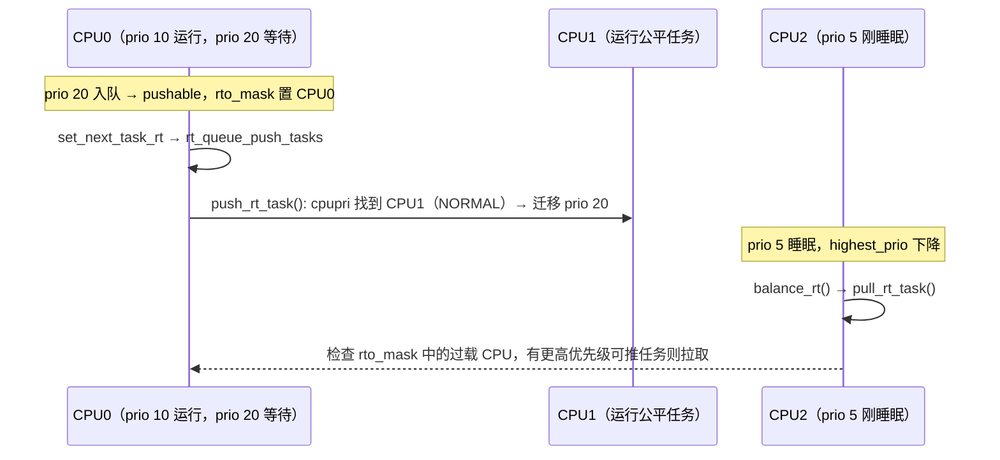

# 3.6 实时调度类

> **本节源码**：`kernel/sched/rt.c`、`kernel/sched/cpupri.c`、`kernel/sched/cpupri.h`、`kernel/sched/sched.h`、`kernel/sched/features.h`
> **关键函数**：`enqueue_task_rt()`、`__enqueue_rt_entity()`、`pick_task_rt()`、`wakeup_preempt_rt()`、`task_tick_rt()`、`select_task_rq_rt()`、`find_lowest_rq()`、`cpupri_find()`、`push_rt_task()`、`pull_rt_task()`
> **前置知识**：3.1 调度器框架（优先级与调度类顺序）、3.4 任务创建与唤醒

## 概述

实时调度类（`rt_sched_class`）实现 POSIX 规定的 `SCHED_FIFO` 与 `SCHED_RR` 策略。与公平类追求"按权重分享"不同，实时类的语义是**严格优先级**：只要有更高优先级的实时任务就绪，它就必须立即运行；同优先级的 `SCHED_FIFO` 任务一直运行到主动让出，`SCHED_RR` 任务则按时间片轮转。

在单个 CPU 上，这个语义很容易用"位图 + 每优先级一个链表"在 O(1) 时间内实现。真正的难点在多核：要保证"系统中优先级最高的 N 个实时任务正运行在 N 个 CPU 上"，实时类不依赖周期性负载均衡，而是在每次调度事件发生时主动地**推**（push）走多余的任务、**拉**（pull）来更高优先级的任务，并借助 `cpupri` 结构快速找到"正在运行最低优先级任务的 CPU"。

## 核心数据结构

### 优先级数组

```c
// kernel/sched/sched.h:309-312（v6.18.60）
struct rt_prio_array {
	DECLARE_BITMAP(bitmap, MAX_RT_PRIO+1); /* include 1 bit for delimiter */
	struct list_head queue[MAX_RT_PRIO];
};
```

100 个优先级各有一个 FIFO 链表，位图中第 i 位表示 `queue[i]` 非空。多出的第 100 位在 `init_rt_rq()` 中被永久置位（`rt.c:78-79`），作为位图搜索的"哨兵"。选取最高优先级任务只需 `sched_find_first_bit()` 找到最低的置位，再取对应链表头。

```
  bitmap:  bit0  bit1 ... bit49 ... bit98 bit99 │ bit100（哨兵，恒为 1）
            1     0        1          0     0   │   1
            │              │
  queue[0]  ──► [T1]              （rt_priority 99）
  queue[49] ──► [T3] ──► [T7]       （rt_priority 50，同优先级按 FIFO 排列）
```

*图 3-9：实时优先级数组（位图下标即内核 `prio`，越小越高）*

注意下标是内核内部的 `prio`（`0..99`），与用户态 `rt_priority` 方向相反：`prio = 99 − rt_priority`（3.1 节 `__normal_prio()`）。用户态可设置的 `rt_priority` 范围是 1～99，对应 `prio` 98～0。

### rt_rq

```c
// kernel/sched/sched.h:826-853（v6.18.60，节选）
struct rt_rq {
	struct rt_prio_array	active;		// [注] 优先级数组
	unsigned int		rt_nr_running;	// [注] 可运行实时任务数
	unsigned int		rr_nr_running;	// [注] 其中 SCHED_RR 任务数
	struct {
		int		curr; /* highest queued rt task prio */
		int		next; /* next highest */
	} highest_prio;
	bool			overloaded;	// [注] 本 CPU 是否有可推走的任务
	struct plist_head	pushable_tasks;	// [注] 可迁移、未在运行的实时任务，按优先级排序

	int			rt_queued;
	/* 省略 CONFIG_RT_GROUP_SCHED 相关代码 */
#ifdef CONFIG_CGROUP_SCHED
	struct task_group	*tg; /* this tg has "this" rt_rq on given CPU for runnable entities */
#endif
};
```

- `highest_prio.curr`：本队列最高优先级，`pull` 时用来判断"对方是否有比我高的任务"；`next`：可推走任务中的最高优先级（`enqueue_pushable_task()` 中维护，`rt.c:403-405`）。
- `pushable_tasks`：一个优先级链表（plist），只包含**可迁移**（`nr_cpus_allowed > 1`）且**不在运行**的实时任务。正在运行的任务在 `set_next_task_rt()` 中被移出（`rt.c:1654-1655`），被换下时在 `put_prev_task_rt()` 中重新加入（`rt.c:1734-1735`）。
- `overloaded`：`pushable_tasks` 非空时为真，同时在 root domain 的 `rto_mask`（RT overload mask）中登记本 CPU，其他 CPU 据此知道"去哪儿拉任务"。

本书配置未开启 `CONFIG_RT_GROUP_SCHED`，实时任务直接挂在 `rq->rt` 上，不存在实时任务组的层级。

## 主流程分析

### 入队与出队

```c
// kernel/sched/rt.c:1431-1448（v6.18.60）
enqueue_task_rt(struct rq *rq, struct task_struct *p, int flags)
{
	struct sched_rt_entity *rt_se = &p->rt;

	if (flags & ENQUEUE_WAKEUP)
		rt_se->timeout = 0;

	check_schedstat_required();
	update_stats_wait_start_rt(rt_rq_of_se(rt_se), rt_se);

	enqueue_rt_entity(rt_se, flags);

	if (task_is_blocked(p))
		return;

	if (!task_current(rq, p) && p->nr_cpus_allowed > 1)
		enqueue_pushable_task(rq, p);
}
```

核心工作在 `__enqueue_rt_entity()`：

```c
// kernel/sched/rt.c:1345-1357（v6.18.60）
	if (move_entity(flags)) {
		WARN_ON_ONCE(rt_se->on_list);
		if (flags & ENQUEUE_HEAD)
			list_add(&rt_se->run_list, queue);
		else
			list_add_tail(&rt_se->run_list, queue);

		__set_bit(rt_se_prio(rt_se), array->bitmap);
		rt_se->on_list = 1;
	}
	rt_se->on_rq = 1;

	inc_rt_tasks(rt_se, rt_rq);
```

任务默认插入同优先级链表的**尾部**，这正是 FIFO 语义；`ENQUEUE_HEAD` 用于任务优先级被**降低**的场景（`sched_setscheduler()` 或优先级继承结束，见 `syscalls.c:730-737`、`core.c:7441-7442`），让它排在新优先级链表的队首。被抢占的实时任务则不需要重新入队：它始终留在原链表中的原位置。`inc_rt_tasks()`（`rt.c:1175-1185`）更新计数并调用 `inc_rt_prio()`，后者在最高优先级发生变化时通过 `inc_rt_prio_smp()` 更新 `cpupri`：

```c
// kernel/sched/rt.c:1050-1062（v6.18.60）
inc_rt_prio_smp(struct rt_rq *rt_rq, int prio, int prev_prio)
{
	struct rq *rq = rq_of_rt_rq(rt_rq);

	/*
	 * Change rq's cpupri only if rt_rq is the top queue.
	 */
	if (IS_ENABLED(CONFIG_RT_GROUP_SCHED) && &rq->rt != rt_rq)
		return;

	if (rq->online && prio < prev_prio)
		cpupri_set(&rq->rd->cpupri, rq->cpu, prio);
}
```

### 选取

```c
// kernel/sched/rt.c:1671-1714（v6.18.60）
static struct sched_rt_entity *pick_next_rt_entity(struct rt_rq *rt_rq)
{
	struct rt_prio_array *array = &rt_rq->active;
	struct sched_rt_entity *next = NULL;
	struct list_head *queue;
	int idx;

	idx = sched_find_first_bit(array->bitmap);
	BUG_ON(idx >= MAX_RT_PRIO);

	queue = array->queue + idx;
	if (WARN_ON_ONCE(list_empty(queue)))
		return NULL;
	next = list_entry(queue->next, struct sched_rt_entity, run_list);

	return next;
}

static struct task_struct *_pick_next_task_rt(struct rq *rq)
{
	struct sched_rt_entity *rt_se;
	struct rt_rq *rt_rq  = &rq->rt;

	do {
		rt_se = pick_next_rt_entity(rt_rq);
		if (unlikely(!rt_se))
			return NULL;
		rt_rq = group_rt_rq(rt_se);
	} while (rt_rq);

	return rt_task_of(rt_se);
}

static struct task_struct *pick_task_rt(struct rq *rq)
{
	struct task_struct *p;

	if (!sched_rt_runnable(rq))
		return NULL;

	p = _pick_next_task_rt(rq);

	return p;
}
```

与 EEVDF 不同，**正在运行的实时任务仍留在链表中**（只是从 `pushable_tasks` 移出），所以选取就是"最高优先级链表的队首"。`sched_find_first_bit()` 在 x86_64 上是对两个 64 位字做 `__ffs`，严格 O(1)。

### 唤醒抢占

```c
// kernel/sched/rt.c:1620-1643（v6.18.60）
static void wakeup_preempt_rt(struct rq *rq, struct task_struct *p, int flags)
{
	struct task_struct *donor = rq->donor;

	if (p->prio < donor->prio) {
		resched_curr(rq);
		return;
	}

	/*
	 * If:
	 *
	 * - the newly woken task is of equal priority to the current task
	 * - the newly woken task is non-migratable while current is migratable
	 * - current will be preempted on the next reschedule
	 *
	 * we should check to see if current can readily move to a different
	 * cpu.  If so, we will reschedule to allow the push logic to try
	 * to move current somewhere else, making room for our non-migratable
	 * task.
	 */
	if (p->prio == donor->prio && !test_tsk_need_resched(rq->curr))
		check_preempt_equal_prio(rq, p);
}
```

优先级严格更高就立即抢占——注意用的是 `resched_curr()` 而不是 `resched_curr_lazy()`，在任何抢占模型下都不延迟（3.5 节）。同优先级时一般不抢占，但有一个特例：被唤醒任务只能在本 CPU 运行而当前任务可以迁走时，`check_preempt_equal_prio()`（`rt.c:1571-1592`）会把被唤醒者放到队首并触发重调度，让当前任务被推到别处，从而两者都能运行。

### 时钟中断与 SCHED_RR

```c
// kernel/sched/rt.c:2526-2558（v6.18.60）
static void task_tick_rt(struct rq *rq, struct task_struct *p, int queued)
{
	struct sched_rt_entity *rt_se = &p->rt;

	update_curr_rt(rq);
	update_rt_rq_load_avg(rq_clock_pelt(rq), rq, 1);

	watchdog(rq, p);

	/*
	 * RR tasks need a special form of time-slice management.
	 * FIFO tasks have no timeslices.
	 */
	if (p->policy != SCHED_RR)
		return;

	if (--p->rt.time_slice)
		return;

	p->rt.time_slice = sched_rr_timeslice;

	/*
	 * Requeue to the end of queue if we (and all of our ancestors) are not
	 * the only element on the queue
	 */
	for_each_sched_rt_entity(rt_se) {
		if (rt_se->run_list.prev != rt_se->run_list.next) {
			requeue_task_rt(rq, p, 0);
			resched_curr(rq);
			return;
		}
	}
}
```

- `SCHED_RR` 的时间片以 **tick 数**计，默认 `RR_TIMESLICE = 100 * HZ / 1000`（`include/linux/sched/rt.h:84`），即 100 ms；可通过 `/proc/sys/kernel/sched_rr_timeslice_ms` 调整。时间片用完且同优先级还有其他任务时，移到链表尾部并重调度。
- `SCHED_FIFO` 没有时间片，tick 对它只做统计。
- `watchdog()`（`rt.c:2491-2513`）实现 `RLIMIT_RTTIME`：实时任务不睡眠地连续运行超过该限制时，会收到 `SIGXCPU` / `SIGKILL`，防止失控的实时任务锁死系统。
- `update_curr_rt()`（`rt.c:974-1008`）借助 `update_curr_common()` 累加运行时间；RT 带宽统计只在 `CONFIG_RT_GROUP_SCHED` 下进行。

`sched_yield()` 对实时任务的效果是 `yield_task_rt()`：把自己移到同优先级链表尾部（`rt.c:1491-1494`）。

## 多核：push 与 pull

### 目标

设系统有 N 个 CPU。实时类希望在任意时刻，**全局优先级最高的 N 个可运行实时任务**都在运行。单靠每个 CPU 各自选取无法做到：例如 CPU0 上有两个实时任务（优先级 10 和 20），CPU1 只在运行一个公平任务，此时优先级 20 的任务应该被迁到 CPU1。

实时类用两种互补的操作维持这一不变量：

| 操作 | 时机 | 动作 |
|---|---|---|
| push | 本 CPU 多了一个"运行不了的"实时任务：唤醒、被抢占后 | 把它推到一个正在运行更低优先级任务的 CPU |
| pull | 本 CPU 的优先级降低：实时任务睡眠、退出、降级 | 从过载 CPU 上拉一个比自己当前优先级高的任务 |

### cpupri：快速找到"最低优先级的 CPU"

```c
// kernel/sched/cpupri.h:13-21（v6.18.60）
struct cpupri_vec {
	atomic_t		count;
	cpumask_var_t		mask;
};

struct cpupri {
	struct cpupri_vec	pri_to_cpu[CPUPRI_NR_PRIORITIES];
	int			*cpu_to_pri;
};
```

`cpupri` 是每个 root domain 一份的二维结构：`pri_to_cpu[i].mask` 记录"当前最高优先级为 i 的 CPU 集合"，`cpu_to_pri[cpu]` 是反向映射。优先级经 `convert_prio()` 换算（`cpupri.c:27-66`）：

```
  内核 prio:   (无 RT 任务)99   98  ...  0     │  100(MAX_RT_PRIO)
  cpupri:        0(NORMAL)       1  ...  99    │  100(HIGHER，DL/stop)
                 ↑ 运行公平任务或空闲的 CPU
```

查找时从 `CPUPRI_NORMAL` 往高处扫，直到任务自身优先级为止，第一个与任务亲和性相交的非空集合就是"运行最低优先级任务的 CPU 集合"（`__cpupri_find()`，`cpupri.c:68` 起）。源码头部注释称：对无亲和性限制的任务，这是 O(1) 的两次位图搜索。

### 唤醒时的选核

```c
// kernel/sched/rt.c:1541-1562（v6.18.60）
	test = curr &&
	       unlikely(rt_task(donor)) &&
	       (curr->nr_cpus_allowed < 2 || donor->prio <= p->prio);

	if (test || !rt_task_fits_capacity(p, cpu)) {
		int target = find_lowest_rq(p);

		/*
		 * Bail out if we were forcing a migration to find a better
		 * fitting CPU but our search failed.
		 */
		if (!test && target != -1 && !rt_task_fits_capacity(p, target))
			goto out_unlock;

		/*
		 * Don't bother moving it if the destination CPU is
		 * not running a lower priority task.
		 */
		if (target != -1 &&
		    p->prio < cpu_rq(target)->rt.highest_prio.curr)
			cpu = target;
	}
```

`select_task_rq_rt()` 的策略很直接：如果原 CPU 上正在运行的实时任务优先级**不低于**被唤醒者（或当前任务被绑核、无法让位），就用 `find_lowest_rq()` 找一个运行更低优先级任务的 CPU；否则留在原 CPU，由唤醒抢占把当前任务换下，被换下的任务随后再被 push 走。源码注释（`rt.c:1515-1540`）解释了偏向"移动低优先级任务"的理由：不应让高优先级任务仅因短暂让出 CPU 就被迁来迁去。

`find_lowest_rq()`（`rt.c:1763` 起）先用 `cpupri_find()` 得到候选集合，再按拓扑偏好排序：优先选任务上次运行的 CPU，其次选与之共享调度域的 CPU，最后才是任意候选。

### push_rt_task()

```c
// kernel/sched/rt.c:1948-1970（v6.18.60）
static int push_rt_task(struct rq *rq, bool pull)
{
	struct task_struct *next_task;
	struct rq *lowest_rq;
	int ret = 0;

	if (!rq->rt.overloaded)
		return 0;

	next_task = pick_next_pushable_task(rq);
	if (!next_task)
		return 0;

retry:
	/*
	 * It's possible that the next_task slipped in of
	 * higher priority than current. If that's the case
	 * just reschedule current.
	 */
	if (unlikely(next_task->prio < rq->donor->prio)) {
		resched_curr(rq);
		return 0;
	}
```

```c
// kernel/sched/rt.c:2017-2064（v6.18.60，节选）
	/* We might release rq lock */
	get_task_struct(next_task);

	/* find_lock_lowest_rq locks the rq if found */
	lowest_rq = find_lock_lowest_rq(next_task, rq);
	if (!lowest_rq) {
		...
	}

	move_queued_task_locked(rq, lowest_rq, next_task);
	resched_curr(lowest_rq);
	ret = 1;

	double_unlock_balance(rq, lowest_rq);
out:
	put_task_struct(next_task);

	return ret;
}
```

1. 取 `pushable_tasks` 中优先级最高的任务。
2. 若它比当前任务还高，说明应该在本 CPU 抢占，而不是推走。
3. `find_lock_lowest_rq()`（`rt.c:1885` 起）找到目标 CPU 并**同时锁住两个 rq**。加锁过程可能释放本 rq 锁，因此要重试最多 `RT_MAX_TRIES`（3）次，并在每次重试后检查任务是否已被别人迁走。
4. 在双锁保护下把任务从本 rq 移到目标 rq，并在目标 CPU 上触发重调度。

`push_rt_tasks()` 循环调用 `push_rt_task()` 直到推不动为止。push 的触发点包括：

- `set_next_task_rt()` 中的 `rt_queue_push_tasks()`：一个实时任务被选中运行后，其他可推任务注册为 balance 回调，在 `__schedule()` 解锁前执行（3.2 节"balance 回调"）；
- `task_woken_rt()`（`rt.c:2362-2373`）：被唤醒的任务无法立即在本 CPU 运行时；
- 优先级或亲和性变化时（`switched_to_rt()`、`prio_changed_rt()`、`set_cpus_allowed`）。

### pull_rt_task()

```c
// kernel/sched/rt.c:2249-2293（v6.18.60，节选）
static void pull_rt_task(struct rq *this_rq)
{
	int this_cpu = this_rq->cpu, cpu;
	bool resched = false;
	struct task_struct *p, *push_task;
	struct rq *src_rq;
	int rt_overload_count = rt_overloaded(this_rq);

	if (likely(!rt_overload_count))
		return;
	...
	smp_rmb();

	/* If we are the only overloaded CPU do nothing */
	if (rt_overload_count == 1 &&
	    cpumask_test_cpu(this_rq->cpu, this_rq->rd->rto_mask))
		return;

#ifdef HAVE_RT_PUSH_IPI
	if (sched_feat(RT_PUSH_IPI)) {
		tell_cpu_to_push(this_rq);
		return;
	}
#endif

	for_each_cpu(cpu, this_rq->rd->rto_mask) {
		if (this_cpu == cpu)
			continue;

		src_rq = cpu_rq(cpu);
		...
		if (src_rq->rt.highest_prio.next >=
		    this_rq->rt.highest_prio.curr)
			continue;
```

pull 遍历 `rto_mask` 中的所有过载 CPU，跳过"可推任务不比我高"的 CPU（无锁预判），对剩下的 CPU 加双锁，从中拉一个优先级高于本 CPU 当前最高优先级的可推任务过来。

pull 的触发点是 `balance_rt()`：

```c
// kernel/sched/rt.c:1594-1615（v6.18.60）
static int balance_rt(struct rq *rq, struct rq_flags *rf)
{
	/*
	 * Note, rq->donor may change during rq lock drops,
	 * so don't re-use p across lock drops
	 */
	struct task_struct *p = rq->donor;

	if (!on_rt_rq(&p->rt) && need_pull_rt_task(rq, p)) {
		/*
		 * This is OK, because current is on_cpu, which avoids it being
		 * picked for load-balance and preemption/IRQs are still
		 * disabled avoiding further scheduler activity on it and we've
		 * not yet started the picking loop.
		 */
		rq_unpin_lock(rq, rf);
		pull_rt_task(rq);
		rq_repin_lock(rq, rf);
	}

	return sched_stop_runnable(rq) || sched_dl_runnable(rq) || sched_rt_runnable(rq);
}
```

这就是 3.2 节 `prev_balance()` 在选取前调用各调度类 `balance()` 的用途：当一个实时任务睡眠（`!on_rt_rq`）导致本 CPU 优先级下降时，在选下一个任务之前先尝试拉一个实时任务过来。另外，实时任务降级或切换到其他调度类时，`switched_from_rt()` 也会排队一次 pull。

### RT_PUSH_IPI：避免"惊群"

如果一个 CPU 上有可推的实时任务，而很多 CPU 同时降低了优先级，它们会同时尝试获取那一个 rq 锁去 pull，造成严重竞争。`RT_PUSH_IPI` 特性改为由降级的 CPU 通过 `irq_work` 通知过载 CPU "请你自己 push"（`tell_cpu_to_push()`，`rt.c:2178-2209`），并以环形方式在过载 CPU 间传递。

```c
// kernel/sched/features.h:97-116（v6.18.60，节选）
#ifdef HAVE_RT_PUSH_IPI
/*
 * In order to avoid a thundering herd attack of CPUs that are
 * lowering their priorities at the same time, and there being
 * a single CPU that has an RT task that can migrate and is waiting
 * to run, where the other CPUs will try to take that CPUs
 * rq lock and possibly create a large contention, sending an
 * IPI to that CPU and let that CPU push the RT task to where
 * it should go may be a better scenario.
 *
 * This is best for PREEMPT_RT, but for non-RT it can cause issues
 * when preemption is disabled for long periods of time. Have
 * it only default enabled for PREEMPT_RT.
 */
# ifdef CONFIG_PREEMPT_RT
SCHED_FEAT(RT_PUSH_IPI, true)
# else
SCHED_FEAT(RT_PUSH_IPI, false)
# endif
#endif
```

本书配置未开启 `CONFIG_PREEMPT_RT`，因此默认使用直接 pull。



*图 3-10：实时任务的 push / pull 示意*

## 关键细节 / 设计考量

### 实时任务饿死公平任务的问题

一个失控的 `SCHED_FIFO` 死循环会让同 CPU 上的公平任务永远得不到运行。历史上内核用 **RT throttling**（`sched_rt_runtime_us` / `sched_rt_period_us`，默认每 1 s 中实时任务最多运行 0.95 s）来防止这种情况。

v6.18.60 中这套机制发生了变化：

- 在**未开启** `CONFIG_RT_GROUP_SCHED` 时（本书配置），`rt.c` 中不再对实时任务做运行时节流——`update_curr_rt()` 里的带宽统计整段位于 `#ifdef CONFIG_RT_GROUP_SCHED` 内（`rt.c:986-1007`）。
- 取而代之的是每个 CPU 上的 **fair_server**：一个 Deadline 调度实体，默认每 1000 ms 保证公平任务至少 50 ms（`kernel/sched/deadline.c:1825-1826`）。由于 Deadline 类高于实时类，当公平任务被实时任务饿着时，fair_server 会以 Deadline 优先级"代表"公平任务运行（3.7 节）。
- `sysctl_sched_rt_runtime`（默认 950000 μs，`rt.c:24`）仍然存在，但在这一配置下它限定的是 Deadline 类的全局可用带宽上限（`global_rt_runtime()` 被 `deadline.c` 的准入控制使用），而非实时任务的运行时间。

### 优先级继承

实时系统中经典的**优先级反转**（Priority Inversion）问题：低优先级任务持有锁，高优先级任务等待该锁，而中优先级任务抢占了低优先级任务，导致高优先级任务被无限期推迟。内核的 `rt_mutex`（以及 PREEMPT_RT 下的 spinlock / mutex）通过**优先级继承**解决：`rt_mutex_setprio()`（`core.c:7342` 起）把持锁者的 `prio` 临时提升到等待者的优先级，必要时把它从公平类移入实时类（3.1 节"任务所属调度类由 `prio` 决定"），释放锁后恢复。

### stopper 线程伪装成 FIFO

`sched_set_stop_task()`（`core.c:3610` 起）把每 CPU 的 stopper 线程设为 `SCHED_FIFO` 99，再把它的 `sched_class` 改为 `stop_sched_class`。这样用户态工具看到的是一个熟悉的实时线程，而调度器把它放在比 Deadline 还高的调度类。`push_rt_task()` 中的注释（`rt.c:1985-1986`）特意提醒了这一点。

## 动手实验

以下实验在 **dev 虚拟机** 中进行，需要 **root 权限**。

1. 查看实时相关参数：

   ```bash
   # 虚拟机，普通用户
   cat /proc/sys/kernel/sched_rr_timeslice_ms
   cat /proc/sys/kernel/sched_rt_runtime_us /proc/sys/kernel/sched_rt_period_us
   chrt -m      # 各策略的优先级范围
   ```

2. 观察 fair_server 对公平任务的保护：在同一 CPU 上运行一个 `SCHED_FIFO` 死循环和一个公平任务死循环，比较后者获得的 CPU 时间：

   ```bash
   # 虚拟机，root
   taskset -c 1 chrt -f 50 sh -c 'while :; do :; done' & rt=$!
   taskset -c 1 sh -c 'while :; do :; done' & cfs=$!
   sleep 10
   grep sum_exec_runtime /proc/$rt/sched /proc/$cfs/sched
   kill $rt $cfs
   ```

   按 fair_server 的默认参数，公平任务应获得约 5% 的 CPU 时间。

3. 观察 push/pull 迁移：用 `sched_migrate_task` 跟踪点统计实时任务的迁移：

   ```bash
   # 虚拟机，root
   bpftrace -e 'tracepoint:sched:sched_migrate_task /args.prio < 100/ { @[str(args.comm), args.orig_cpu, args.dest_cpu] = count(); }'
   ```

## 小结

- 实时类实现 `SCHED_FIFO` / `SCHED_RR`：严格优先级，更高优先级就绪即立即抢占（不受惰性抢占影响）。
- 单 CPU 上用 100 个链表加一个带哨兵的位图组织任务，选取为 O(1)；正在运行的任务仍留在链表中。
- `SCHED_RR` 的时间片默认 100 ms，以 tick 计数；`SCHED_FIFO` 没有时间片；`RLIMIT_RTTIME` 由 tick 中的 `watchdog()` 检查。
- 多核上依靠 push / pull 维持"全局最高优先级的 N 个任务在运行"：有多余任务时主动推走，优先级下降时在 `balance_rt()` 中拉取；`cpupri` 让"找运行最低优先级任务的 CPU"接近 O(1)。
- `pushable_tasks`、`overloaded` 与 root domain 的 `rto_mask` 共同记录"谁有可推的任务"；`RT_PUSH_IPI` 在 PREEMPT_RT 下用 IPI 推送代替并发 pull，避免锁争用。
- 本书配置下实时任务不再由 RT throttling 节流，而是由每 CPU 的 fair_server（默认 50 ms / 1 s）为公平任务保底。

## 参考

- `linux/Documentation/scheduler/sched-rt-group.rst`：实时带宽与实时组调度。
- `linux/kernel/sched/cpupri.c` 文件头注释：cpupri 的设计说明。
- `linux/Documentation/locking/rt-mutex-design.rst`：优先级继承的实现。
- `man 7 sched`：`SCHED_FIFO` / `SCHED_RR` 的 POSIX 语义。
