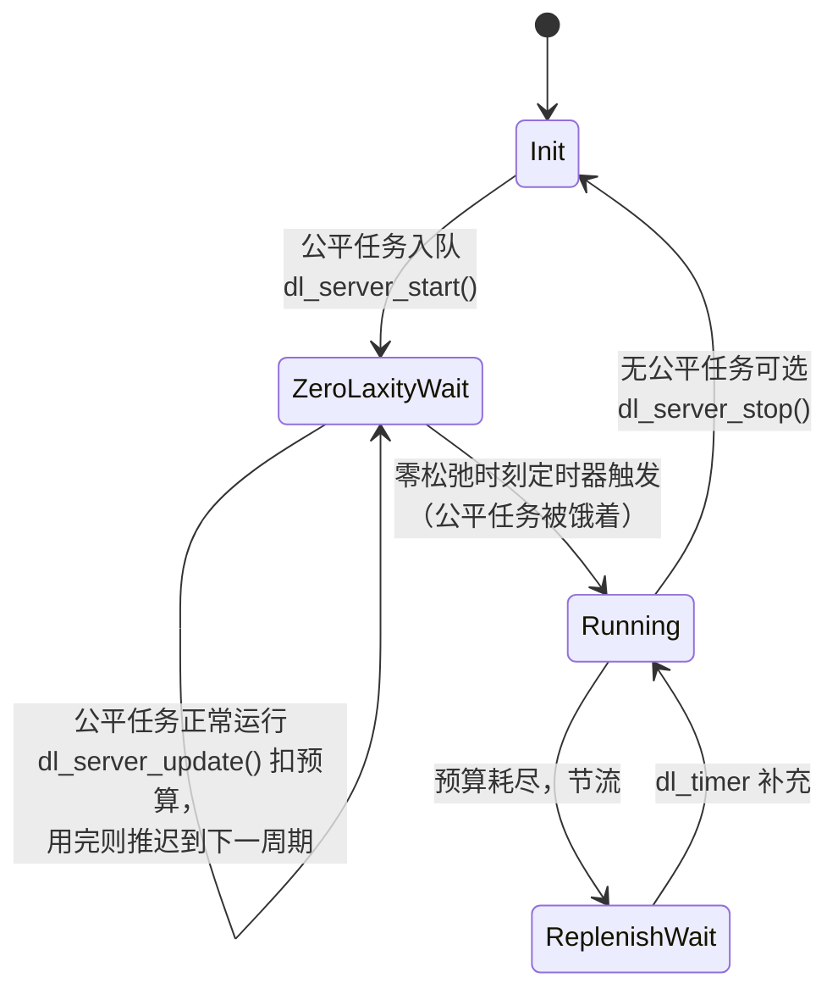

# 3.7 Deadline 调度类与 dl_server

> **本节源码**：`kernel/sched/deadline.c`、`kernel/sched/sched.h`、`include/linux/sched.h`、`kernel/sched/fair.c`
> **关键函数**：`enqueue_dl_entity()`、`update_dl_entity()`、`dl_entity_overflow()`、`replenish_dl_entity()`、`update_curr_dl_se()`、`start_dl_timer()`、`dl_task_timer()`、`__pick_task_dl()`、`sched_dl_overflow()`、`dl_server_start()`、`dl_server_update()`
> **前置知识**：3.1 调度器框架、3.5 调度时钟、3.6 实时调度类（push / pull）

## 概述

实时类的严格优先级只回答"谁更重要"，不回答"需要多少 CPU、什么时候要"。工业控制、多媒体等周期性任务的需求通常是"每 P 毫秒内需要 R 毫秒 CPU，并在 D 毫秒内完成"。`SCHED_DEADLINE`（v3.14 引入）直接表达这种需求：用户通过 `sched_setattr(2)` 为任务指定三元组 `(runtime, deadline, period)`，内核以**最早截止时间优先**（Earliest Deadline First，EDF）调度这些任务，并用**恒定带宽服务器**（Constant Bandwidth Server，CBS）保证每个任务不会超出自己声明的带宽，从而不影响其他任务。

Deadline 类在调度类顺序中仅次于 stop 类，高于实时类。v6.12 起，它还多了一个重要用户：**dl_server**——内核用一个"不属于任何任务"的 Deadline 实体为公平任务预留带宽，防止实时任务把公平任务饿死（3.6 节）。

## 核心概念

```
       ◄────────────────── period P ──────────────────►
       ◄─────── deadline D ───────►
       ┌──────────┐
       │ runtime R│
  ─────┴──────────┴───────────────┴──────────────────┴────► 时间
     到达（激活）               绝对截止时间        下一周期
```

*图 3-11：Deadline 任务的参数（要求 R ≤ D ≤ P）*

- **带宽** `dl_bw = R / P`，**密度** `dl_density = R / D`。
- **EDF**：绝对截止时间最早的任务先运行。在单处理器上，只要所有任务的总带宽不超过 1，EDF 就能保证所有截止时间都被满足。
- **CBS**：每个任务有一个预算 `runtime`，运行时扣减；预算耗尽就被**节流**（throttled），直到下一周期补充预算并推迟截止时间。任务唤醒时，如果用旧的剩余预算和旧截止时间会超出声明的带宽，就重新开始一个周期。这样，即便某个任务的实际执行时间超出声明（或恶意空转），它对其他任务的影响也被限制在自己的带宽内。
- **准入控制**（Admission Control）：`sched_setattr()` 时检查加入新任务后总带宽是否超过上限，超过则拒绝。这是 EDF 可调度性保证的前提。

## 核心数据结构

```c
// include/linux/sched.h:639-660（v6.18.60）
struct sched_dl_entity {
	struct rb_node			rb_node;

	/*
	 * Original scheduling parameters. Copied here from sched_attr
	 * during sched_setattr(), they will remain the same until
	 * the next sched_setattr().
	 */
	u64				dl_runtime;	/* Maximum runtime for each instance	*/
	u64				dl_deadline;	/* Relative deadline of each instance	*/
	u64				dl_period;	/* Separation of two instances (period) */
	u64				dl_bw;		/* dl_runtime / dl_period		*/
	u64				dl_density;	/* dl_runtime / dl_deadline		*/

	/*
	 * Actual scheduling parameters. Initialized with the values above,
	 * they are continuously updated during task execution. Note that
	 * the remaining runtime could be < 0 in case we are in overrun.
	 */
	s64				runtime;	/* Remaining runtime for this instance	*/
	u64				deadline;	/* Absolute deadline for this instance	*/
	unsigned int			flags;		/* Specifying the scheduler behaviour	*/
```

`dl_*` 前缀的是用户设置的静态参数，`runtime` / `deadline` 是运行时状态。其余字段（`include/linux/sched.h:699-743`）包括：

- 一组位标志：`dl_throttled`（预算耗尽、等待补充）、`dl_yielded`、`dl_non_contending`（GRUB 用）、`dl_server`、`dl_server_active`、`dl_defer`、`dl_defer_armed`、`dl_defer_running`（后几个服务于 dl_server）；
- `dl_timer`：每个实体一个的高精度定时器，用于在补充时刻解除节流；
- `inactive_timer`：任务睡眠后在"0-lag 时刻"减少活跃带宽（GRUB 用）；
- `rq` 与 `server_pick_task`：dl_server 所服务的 rq 以及从中选任务的回调；
- `pi_se`：优先级继承时指向提供参数的实体。

运行队列：

```c
// kernel/sched/sched.h:861-904（v6.18.60，节选）
struct dl_rq {
	/* runqueue is an rbtree, ordered by deadline */
	struct rb_root_cached	root;

	unsigned int		dl_nr_running;
	...
	struct {
		u64		curr;
		u64		next;
	} earliest_dl;

	bool			overloaded;
	...
	struct rb_root_cached	pushable_dl_tasks_root;
	...
	u64			running_bw;
	...
	u64			this_bw;
	u64			extra_bw;
```

- `root`：按绝对截止时间排序的红黑树，最左节点即 EDF 下一个要运行的实体。
- `earliest_dl` / `overloaded` / `pushable_dl_tasks_root`：与实时类的 `highest_prio` / `overloaded` / `pushable_tasks` 一一对应，用于多核 push / pull。
- `running_bw` / `this_bw`：活跃带宽与本 rq 全部带宽，服务于 GRUB 回收算法。

## 主流程分析

### 选取与抢占

```c
// kernel/sched/deadline.c:2570-2595（v6.18.60）
static struct task_struct *__pick_task_dl(struct rq *rq)
{
	struct sched_dl_entity *dl_se;
	struct dl_rq *dl_rq = &rq->dl;
	struct task_struct *p;

again:
	if (!sched_dl_runnable(rq))
		return NULL;

	dl_se = pick_next_dl_entity(dl_rq);
	WARN_ON_ONCE(!dl_se);

	if (dl_server(dl_se)) {
		p = dl_se->server_pick_task(dl_se);
		if (!p) {
			dl_server_stop(dl_se);
			goto again;
		}
		rq->dl_server = dl_se;
	} else {
		p = dl_task_of(dl_se);
	}

	return p;
}
```

选取就是取红黑树最左节点。如果最左的是 dl_server，就调用它的 `server_pick_task()`——对 fair_server 而言是 `fair_server_pick_task()` → `pick_task_fair()`（`fair.c:9236-9239`）——选出一个公平任务，并在 `rq->dl_server` 中记下"这个公平任务是代表 dl_server 在运行的"。这正是 3.2 节 `__put_prev_set_next_dl_server()` 中交接 `dl_server` 指针的原因。

唤醒抢占同样简单：被唤醒者截止时间更早就抢占（`dl_entity_preempt()`，`sched.h:299-304`；`wakeup_preempt_dl()`，`deadline.c:2504-2519`）。

### 入队与 CBS 唤醒规则

```c
// kernel/sched/deadline.c:2191-2234（v6.18.60，节选）
	if (!dl_se->dl_defer && dl_se->dl_throttled && !(flags & ENQUEUE_REPLENISH)) {
		if (flags & ENQUEUE_WAKEUP)
			task_contending(dl_se, flags);

		return;
	}

	/*
	 * If this is a wakeup or a new instance, the scheduling
	 * parameters of the task might need updating. Otherwise,
	 * we want a replenishment of its runtime.
	 */
	if (flags & ENQUEUE_WAKEUP) {
		task_contending(dl_se, flags);
		update_dl_entity(dl_se);
	} else if (flags & ENQUEUE_REPLENISH) {
		replenish_dl_entity(dl_se);
	} else if ((flags & ENQUEUE_RESTORE) &&
		   !is_dl_boosted(dl_se) &&
		   dl_time_before(dl_se->deadline, rq_clock(rq_of_dl_se(dl_se)))) {
		setup_new_dl_entity(dl_se);
	}
	...
	__enqueue_dl_entity(dl_se);
}
```

被节流的任务即使醒来也不入队，等 `dl_timer` 补充预算后再入队。唤醒时调用 `update_dl_entity()` 应用 CBS 规则：

```c
// kernel/sched/deadline.c:1032-1053（v6.18.60，节选）
static void update_dl_entity(struct sched_dl_entity *dl_se)
{
	struct rq *rq = rq_of_dl_se(dl_se);

	if (dl_time_before(dl_se->deadline, rq_clock(rq)) ||
	    dl_entity_overflow(dl_se, rq_clock(rq))) {

		if (unlikely((!dl_is_implicit(dl_se) ||
			      (dl_se->dl_defer && dl_se->dl_defer_running)) &&
			     !dl_time_before(dl_se->deadline, rq_clock(rq)) &&
			     !is_dl_boosted(dl_se))) {
			update_dl_revised_wakeup(dl_se, rq);
			return;
		}
		...
		dl_se->dl_defer_running = 0;
		replenish_dl_new_period(dl_se, rq);
```

如果旧截止时间已过，或者"剩余预算 / 剩余时间"超过了声明的密度，就重新开始一个周期：`deadline = now + dl_deadline`，`runtime = dl_runtime`（`replenish_dl_new_period()`，`deadline.c:730-745`）。判断由 `dl_entity_overflow()` 完成：

```c
// kernel/sched/deadline.c:923-950（v6.18.60，节选）
static bool dl_entity_overflow(struct sched_dl_entity *dl_se, u64 t)
{
	u64 left, right;
	...
	left = (pi_of(dl_se)->dl_deadline >> DL_SCALE) * (dl_se->runtime >> DL_SCALE);
	right = ((dl_se->deadline - t) >> DL_SCALE) *
		(pi_of(dl_se)->dl_runtime >> DL_SCALE);

	return dl_time_before(right, left);
}
```

即判断 `runtime / (deadline − t) > dl_runtime / dl_deadline`，交叉相乘避免除法，并右移 `DL_SCALE`（10）位防止溢出——注释（`deadline.c:932-943`）说明这把精度降到约 1 μs，对 true/false 判断已经足够。

对于截止时间小于周期的"受约束"任务（`dl_deadline < dl_period`），直接重开周期会过于悲观，内核改用**修正唤醒规则**（Revised Wakeup Rule）`update_dl_revised_wakeup()`：保留截止时间，把预算削减到恰好不超过密度（注释引用了 Abeni、Lipari、Lelli 2015 年的论文，`deadline.c:952-969`）。

### 运行时扣减与节流

```c
// kernel/sched/deadline.c:1442-1506（v6.18.60，节选）
	scaled_delta_exec = delta_exec;
	if (!dl_server(dl_se))
		scaled_delta_exec = dl_scaled_delta_exec(rq, dl_se, delta_exec);

	dl_se->runtime -= scaled_delta_exec;
	...
throttle:
	if (dl_runtime_exceeded(dl_se) || dl_se->dl_yielded) {
		dl_se->dl_throttled = 1;

		/* If requested, inform the user about runtime overruns. */
		if (dl_runtime_exceeded(dl_se) &&
		    (dl_se->flags & SCHED_FLAG_DL_OVERRUN))
			dl_se->dl_overrun = 1;

		dequeue_dl_entity(dl_se, 0);
		if (!dl_server(dl_se)) {
			update_stats_dequeue_dl(&rq->dl, dl_se, 0);
			dequeue_pushable_dl_task(rq, dl_task_of(dl_se));
		}

		if (unlikely(is_dl_boosted(dl_se) || !start_dl_timer(dl_se))) {
			if (dl_server(dl_se)) {
				replenish_dl_new_period(dl_se, rq);
				start_dl_timer(dl_se);
			} else {
				enqueue_task_dl(rq, dl_task_of(dl_se), ENQUEUE_REPLENISH);
			}
		}

		if (!is_leftmost(dl_se, &rq->dl))
			resched_curr(rq);
	}
```

`update_curr_dl_se()` 由 `update_curr_dl()`（tick、出队、切换时）调用：

1. `dl_scaled_delta_exec()`（`deadline.c:1398` 起）按 CPU 频率与算力缩放执行时间；若任务设置了 `SCHED_FLAG_RECLAIM`，还会应用 **GRUB**（Greedy Reclamation of Unused Bandwidth）规则，让任务回收其他睡眠任务未用的带宽（`grub_reclaim()`，`deadline.c:1378-1396`）。
2. 预算耗尽（`runtime <= 0`）或任务调用了 `sched_yield()`，就置 `dl_throttled`、出队，并用 `start_dl_timer()` 把 `dl_timer` 设在**下一个周期的起点** `dl_next_period()`（即 `deadline − dl_deadline + dl_period`，`deadline.c:1102-1108`）；对截止时间等于周期的任务，这恰好就是当前截止时间。延迟服务器（`dl_defer_armed`）则设在 `deadline − runtime`，见下文 dl_server。如果任务请求了 `SCHED_FLAG_DL_OVERRUN`，`dl_overrun` 被置位，随后在 tick 的 POSIX CPU 定时器检查中向任务发送 `SIGXCPU`（`check_dl_overrun()`，`kernel/time/posix-cpu-timers.c:906-911`）。
3. 定时器到期时，`dl_task_timer()`（`deadline.c:1221` 起）以 `ENQUEUE_REPLENISH` 重新入队，`replenish_dl_entity()` 不断把截止时间推后一个周期、预算加一个 `dl_runtime`，直到预算为正（`deadline.c:836-839`）——即便任务大幅超支，也只是把它推到更远的未来。

由于 tick 精度只有 1 ms，任务可能超支至多一个 tick。开启 `HRTICK_DL` 特性后，`task_tick_dl()` 会用 hrtick 在预算恰好耗尽时触发检查（`deadline.c:2629-2642`），但该特性默认关闭（3.5 节）。

### 准入控制

```c
// kernel/sched/deadline.c:212-217（v6.18.60）
static inline bool
__dl_overflow(struct dl_bw *dl_b, unsigned long cap, u64 old_bw, u64 new_bw)
{
	return dl_b->bw != -1 &&
	       cap_scale(dl_b->bw, cap) < dl_b->total_bw - old_bw + new_bw;
}
```

`dl_b` 是每个 root domain 的带宽账本：`bw` 为单 CPU 允许的最大带宽，`total_bw` 为已分配的总带宽，`cap` 为 root domain 内 CPU 算力之和。`bw` 由 `sched_rt_runtime_us / sched_rt_period_us` 换算（默认 0.95，`deadline.c:515-523`）；写入 `-1` 表示不限制。

`sched_dl_overflow()`（`deadline.c:3453-3509`）在 `sched_setattr()` 中调用，按"成为 / 保持 / 离开 Deadline 任务"三种情形增减 `total_bw`，超限则返回错误，用户看到 `EBUSY`。此外 `__checkparam_dl()`（`deadline.c:3553-3596`）检查参数合法性：`runtime ≤ deadline ≤ period`，`runtime` 至少 1024 ns，周期在 `sched_deadline_period_min_us`（默认 100 μs）与 `sched_deadline_period_max_us`（默认约 4 s）之间。

需要注意，这里的准入控制保证的是**全局 EDF 的有界拖延**（bounded tardiness），而不是多核上所有截止时间都一定满足；`Documentation/scheduler/sched-deadline.rst` 对此有详细讨论。

### 多核

Deadline 类的多核策略与实时类同构：

| 实时类 | Deadline 类 |
|---|---|
| `cpupri`：按优先级找最低优先级 CPU | `cpudl`（`kernel/sched/cpudeadline.c`）：按最晚截止时间组织的最大堆 |
| `find_lowest_rq()` | `find_later_rq()`（`deadline.c:2682` 起） |
| `push_rt_task()` / `pull_rt_task()` | `push_dl_task()` / `pull_dl_task()`（`deadline.c:2887`、`2967` 起） |
| `highest_prio` | `earliest_dl` |

push 的目标是"当前运行任务截止时间最晚的 CPU"，pull 则从过载 CPU 拉截止时间早于本地的任务，以近似全局 EDF。

## dl_server

### 动机

3.6 节提到，本书配置下实时任务不再被 RT throttling 限流。为了防止公平任务被饿死，每个 CPU 的 `rq->fair_server` 是一个 Deadline 实体，代表该 CPU 上的公平任务参与 EDF 竞争。由于 Deadline 类高于实时类，只要 fair_server 有预算且被选中，就能抢占实时任务，让一个公平任务运行。

```c
// kernel/sched/deadline.c:1818-1843（v6.18.60）
void sched_init_dl_servers(void)
{
	int cpu;
	struct rq *rq;
	struct sched_dl_entity *dl_se;

	for_each_online_cpu(cpu) {
		u64 runtime =  50 * NSEC_PER_MSEC;
		u64 period = 1000 * NSEC_PER_MSEC;

		rq = cpu_rq(cpu);

		guard(rq_lock_irq)(rq);
		update_rq_clock(rq);

		dl_se = &rq->fair_server;

		WARN_ON(dl_server(dl_se));

		dl_server_apply_params(dl_se, runtime, period, 1);

		dl_se->dl_server = 1;
		dl_se->dl_defer = 1;
		setup_new_dl_entity(dl_se);
	}
}
```

默认参数为每 1000 ms 50 ms，即 5% 的带宽。可以通过 debugfs 的 `/sys/kernel/debug/sched/fair_server/cpuN/{runtime,period}` 按 CPU 调整（`kernel/sched/debug.c:479-491`），`runtime` 写 0 即关闭。

### 延迟服务器

如果 fair_server 像普通 Deadline 任务一样一有公平任务就运行，那么每秒前 50 ms 实时任务都会被打断，即使公平任务并没有被饿着——这会无谓地破坏实时任务的响应性。因此 fair_server 被设为**延迟**（`dl_defer = 1`）服务器：

- 公平任务入队时 `dl_server_start()` 启动服务器（`fair.c:7176-7181`），但 `replenish_dl_new_period()` 会把它置为节流状态，并把定时器设在 `deadline − runtime`，即"零松弛"（zero-laxity）时刻（`deadline.c:737-744`、`1096-1100`）。
- 在此之前，公平任务若能以普通方式运行，它们消耗的时间会通过 `update_curr()` → `dl_server_update()` 计入 fair_server 的预算（3.3 节 `update_curr()`）；如果预算在零松弛时刻前就被"后台"用完，说明公平任务没有被饿着，服务器直接推迟到下一个周期（`deadline.c:1456-1478`）。idle 时间同样计入（`dl_server_update_idle_time()`，`deadline.c:1551-1574`）。
- 只有当零松弛时刻到来时预算仍有剩余——意味着公平任务确实被实时任务挡住了——定时器才会让 fair_server 真正入队运行，此后它像普通 Deadline 实体一样消耗、节流、补充，直到公平任务不再饥饿。

源码在 `dl_server_update()` 之后用一张状态图（`deadline.c:1583-1782`）详细描述了 A:init、B:zero_laxity-wait、C:idle-wait、D:running、E:replenish-wait 五个状态及转换。注释末尾总结：有公平任务正常运行时，最常见的循环是"[2]→[2]"，即服务器从未真正运行、定时器也从未触发。需要说明的是，该注释中列出的 `dl_defer_idle` 标志在 v6.18.60 的 `struct sched_dl_entity` 中并不存在（结构体中只有 `dl_defer`、`dl_defer_armed`、`dl_defer_running`），注释与代码并不完全同步，阅读时应以代码为准。



*图 3-12：fair_server 的简化状态转换（据 `deadline.c:1583-1782` 注释归纳）*

## 关键细节 / 设计考量

- **为什么 Deadline 任务不能 fork**：子进程无法自动获得准入控制批准的带宽（3.4 节 `sched_fork()` 对 `dl_prio` 返回 `-EAGAIN`）。若需要多线程，应分别为每个线程设置参数。
- **优先级继承**：被 Deadline 任务等待的 rt_mutex 持有者会继承等待者的 Deadline 参数（`pi_se`），`pi_of(dl_se)` 在计算中统一使用"提供参数的那个实体"。
- **`SCHED_FLAG_SUGOV`**：schedutil 调频的工作线程以特殊 Deadline 实体运行，不参与带宽计算（`sched_dl_overflow()` 中直接返回 0）。
- **与 `NO_HZ_FULL` 的关系**：有 Deadline 任务的 CPU 不能停 tick（3.5 节 `sched_can_stop_tick()`），因为需要 tick 扣减预算。

## 动手实验

以下实验在 **dev 虚拟机** 中进行，需要 **root 权限**。

1. 创建一个 Deadline 任务（runtime 10 ms、deadline = period 100 ms），观察其参数与运行比例：

   ```bash
   # 虚拟机，root
   chrt -d --sched-runtime 10000000 --sched-deadline 100000000 \
        --sched-period 100000000 0 sh -c 'while :; do :; done' & pid=$!
   chrt -p $pid
   sleep 5; grep -E 'policy|dl\.|sum_exec_runtime' /proc/$pid/sched
   kill $pid
   ```

   `sum_exec_runtime` 应约为墙钟时间的 10%（CBS 节流）。

2. 验证准入控制。`__dl_overflow()` 比较的是整个 root domain 的算力之和，因此在 N 个 CPU 的虚拟机上，总 Deadline 带宽上限约为 `0.95 × N`，其中每个 CPU 的 fair_server 已占用 0.05（`dl_server_apply_params()` 同样通过 `__dl_add()` 计入账本，`deadline.c:1877-1885`），留给任务的约为 `0.9 × N`。每次启动一个带宽为 0.5 的睡眠任务，直到 `chrt` 因 `EBUSY` 失败：

   ```bash
   # 虚拟机，root
   cat /proc/sys/kernel/sched_rt_runtime_us /proc/sys/kernel/sched_rt_period_us
   nproc
   for i in $(seq 1 64); do
       chrt -d --sched-runtime 50000000 --sched-deadline 100000000 \
            --sched-period 100000000 0 sleep 60 & sleep 0.1
       kill -0 $! 2>/dev/null || { echo "第 $i 个任务被拒绝"; break; }
   done
   pkill -f 'sleep 60'
   ```

3. 查看与调整 fair_server：

   ```bash
   # 虚拟机，root
   cat /sys/kernel/debug/sched/fair_server/cpu0/runtime
   cat /sys/kernel/debug/sched/fair_server/cpu0/period
   ```

   结合 3.6 节实验 2，把 `runtime` 改为 `100000000`（100 ms）后，被实时任务挤压的公平任务应获得约 10% 的 CPU。

## 小结

- `SCHED_DEADLINE` 以 `(runtime, deadline, period)` 描述任务需求，以 EDF 选取（红黑树最左节点），以 CBS 限制每个任务的带宽。
- 唤醒时若剩余预算 / 剩余时间超过声明密度就重开周期（`dl_entity_overflow()`），受约束任务使用修正唤醒规则；运行时预算耗尽即节流，由 `dl_timer` 在截止时间补充。
- 准入控制以 root domain 为单位，默认允许每 CPU 0.95 的 Deadline 带宽（由 `sched_rt_runtime_us / sched_rt_period_us` 决定）。
- 多核上用 `cpudl` 与 push / pull 近似全局 EDF，结构与实时类对称。
- `fair_server` 是每 CPU 一个的延迟 dl_server，默认 50 ms / 1 s：公平任务正常运行时它从不真正运行；只有在零松弛时刻公平任务仍被饿着时，它才以 Deadline 优先级代表公平任务运行。

## 参考

- `linux/Documentation/scheduler/sched-deadline.rst`：Deadline 调度的完整说明，包括 CBS、GRUB 与准入控制。
- `linux/kernel/sched/deadline.c:1583-1782`：dl_server 延迟模式的状态图注释。
- L. Abeni, G. Lipari, J. Lelli. *Constant bandwidth server revisited*. SIGBED Review 11(4), 2015（修正唤醒规则，源码注释引用）。
- `man 7 sched`：`SCHED_DEADLINE` 的用户态接口。
