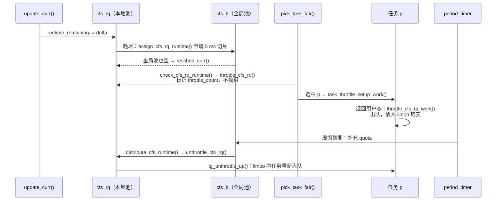

# 3.10 组调度与 CPU 带宽控制

> **本节源码**：[`kernel/sched/fair.c`](../../linux/kernel/sched/fair.c)、[`kernel/sched/core.c`](../../linux/kernel/sched/core.c)、[`kernel/sched/sched.h`](../../linux/kernel/sched/sched.h)、[`kernel/sched/autogroup.c`](../../linux/kernel/sched/autogroup.c)、[`kernel/sched/autogroup.h`](../../linux/kernel/sched/autogroup.h)
> **关键函数**：`calc_group_shares()`、`update_cfs_group()`、`sched_group_set_shares()`、`account_cfs_rq_runtime()`、`assign_cfs_rq_runtime()`、`check_cfs_rq_runtime()`、`throttle_cfs_rq()`、`throttle_cfs_rq_work()`、`tg_unthrottle_up()`、`do_sched_cfs_period_timer()`、`autogroup_task_group()`
> **前置知识**：3.3 EEVDF（层级选取 `pick_task_fair()`）、3.8 PELT 负载跟踪

## 概述

到目前为止，公平调度都是在**任务**之间分配 CPU。但在多用户系统或容器环境中，公平的单位往往应该是**一组任务**：用户 A 运行 100 个进程、用户 B 运行 1 个进程时，我们可能希望两人各得 50%，而不是 A 得 99%。

**组调度**（Group Scheduling，依赖 `CONFIG_FAIR_GROUP_SCHED`）通过 cgroup 的 `cpu` 控制器实现这一点：每个任务组在每个 CPU 上拥有一个自己的 `cfs_rq`，并以一个**组调度实体**的身份挂到父组的 `cfs_rq` 上，形成一棵树。EEVDF 在树的每一层分别选择，从而按组的权重分配 CPU。

在"按比例分享"之外，**CPU 带宽控制**（CFS Bandwidth Control，依赖 `CONFIG_CFS_BANDWIDTH`）还可以为组设置**硬上限**：每个周期内最多运行多少时间，用完即被节流（throttle）。与较早版本（如 v6.6）相比，v6.18.60 的节流机制有重要变化：从"整组出队"改为**基于任务的节流**，被节流的任务在返回用户态时才离开运行队列。

本书配置开启了 `CONFIG_CGROUP_SCHED`、`CONFIG_FAIR_GROUP_SCHED`、`CONFIG_CFS_BANDWIDTH` 与 `CONFIG_SCHED_AUTOGROUP`，未开启 `CONFIG_RT_GROUP_SCHED`。

## 核心数据结构

### task_group

[`kernel/sched/sched.h:472-514`](../../linux/kernel/sched/sched.h#L472-L514)（v6.18.60，节选）

```c
struct task_group {
	struct cgroup_subsys_state css;

#ifdef CONFIG_GROUP_SCHED_WEIGHT
	/* A positive value indicates that this is a SCHED_IDLE group. */
	int			idle;
#endif

#ifdef CONFIG_FAIR_GROUP_SCHED
	/* schedulable entities of this group on each CPU */
	struct sched_entity	**se;
	/* runqueue "owned" by this group on each CPU */
	struct cfs_rq		**cfs_rq;
	unsigned long		shares;
	/*
	 * load_avg can be heavily contended at clock tick time, so put
	 * it in its own cache-line separated from the fields above which
	 * will also be accessed at each tick.
	 */
	atomic_long_t		load_avg ____cacheline_aligned;
#endif /* CONFIG_FAIR_GROUP_SCHED */
	/* 省略 CONFIG_RT_GROUP_SCHED 相关代码 */
	struct scx_task_group	scx;

	struct rcu_head		rcu;
	struct list_head	list;

	struct task_group	*parent;
	struct list_head	siblings;
	struct list_head	children;

#ifdef CONFIG_SCHED_AUTOGROUP
	struct autogroup	*autogroup;
#endif

	struct cfs_bandwidth	cfs_bandwidth;
```

- `se[cpu]` / `cfs_rq[cpu]`：组在每个 CPU 上的调度实体与运行队列，是 per-CPU 数组。`se[cpu]->my_q == cfs_rq[cpu]`，`se[cpu]->cfs_rq` 指向父组在该 CPU 上的 `cfs_rq`（3.1 节 `struct sched_entity` 中 `CONFIG_FAIR_GROUP_SCHED` 字段）。
- `shares`：组的权重（用户态 `cpu.weight` 换算后的值），对应于单个任务的 `load.weight`。
- `load_avg`：组在所有 CPU 上 `cfs_rq->avg.load_avg` 之和的近似值，用于在各 CPU 间分配 `shares`。
- 根组 `root_task_group` 比较特殊：它的任务直接挂在 `rq->cfs` 上，没有组实体（`sched_init()` 中 `init_tg_cfs_entry(&root_task_group, &rq->cfs, NULL, i, NULL)` 及其前的注释，[`kernel/sched/core.c:8722-8741`](../../linux/kernel/sched/core.c#L8722-L8741)）。

### 层级关系

```
                rq->cfs（root_task_group）
               ┌───────────┼──────────────┐
            task A     se(tg1, cpu0)    se(tg2, cpu0)          ← 同一层参与 EEVDF 竞争
                           │ my_q           │ my_q
                     tg1->cfs_rq[0]   tg2->cfs_rq[0]
                      ┌────┴────┐         │
                   task B    task C    se(tg3, cpu0)
                                         │ my_q
                                   tg3->cfs_rq[0]
                                         │
                                      task D
```

*图 3-15：CPU 0 上的公平调度层级（每个 CPU 各有一棵同构的树）*

3.3 节的 `pick_task_fair()` 正是在这棵树上自顶向下逐层调用 `pick_next_entity()`，直到选出一个任务；`for_each_sched_entity(se)` 则沿 `se->parent` 自底向上遍历，入队、出队、`task_tick_fair()` 都要在每一层执行。

## 组权重的分配

### 问题

假设 `tg1` 的 `shares` 为 1024（`cpu.weight` 默认 100），它的任务分布在 4 个 CPU 上。在每个 CPU 上，`tg1` 的组实体应该有多大权重？如果每个都是 1024，`tg1` 在全系统得到的就是 4 倍于一个 nice 0 任务的份额，而用户只想给它"一份"。

理想的公式是按各 CPU 上组队列的权重比例分摊：

```
                        tg->shares × grq->load.weight
  ge->load.weight = ───────────────────────────────────
                       Σ(所有 CPU) grq->load.weight
```

但跨 CPU 求和代价太高。源码注释（[`kernel/sched/fair.c:4021-4093`](../../linux/kernel/sched/fair.c#L4021-L4093)）详细推导了内核采用的近似：用 PELT 的 `load_avg` 代替瞬时权重，并用 `tg->load_avg` 作为全局和的缓存。

### calc_group_shares()

[`kernel/sched/fair.c:4094-4126`](../../linux/kernel/sched/fair.c#L4094-L4126)（v6.18.60，节选）

```c
static long calc_group_shares(struct cfs_rq *cfs_rq)
{
	long tg_weight, tg_shares, load, shares;
	struct task_group *tg = cfs_rq->tg;

	tg_shares = READ_ONCE(tg->shares);

	load = max(scale_load_down(cfs_rq->load.weight), cfs_rq->avg.load_avg);

	tg_weight = atomic_long_read(&tg->load_avg);

	/* Ensure tg_weight >= load */
	tg_weight -= cfs_rq->tg_load_avg_contrib;
	tg_weight += load;

	shares = (tg_shares * load);
	if (tg_weight)
		shares /= tg_weight;
	...
	return clamp_t(long, shares, MIN_SHARES, tg_shares);
}
```

- 本 CPU 的贡献取瞬时权重与 PELT 平均值的较大值：组在本 CPU 刚有任务时，`load_avg` 还没积累起来，用瞬时权重避免启动延迟（注释中的公式 (4)～(6)）。
- 全局和用 `tg->load_avg`，但把本 CPU 的旧贡献 `tg_load_avg_contrib` 替换成当前值，保证分母不小于分子。
- 结果限制在 `[MIN_SHARES, tg_shares]`。注释坦言这个近似"始终略微高估"，各 CPU 上组实体权重之和会不小于 `tg->shares`。

`update_cfs_group()`（[`kernel/sched/fair.c:4132-4147`](../../linux/kernel/sched/fair.c#L4132-L4147)）调用它并在权重变化时 `reweight_entity()`（3.3 节"调整权重时保持 lag"）。3.3 节 `enqueue_entity()`、`dequeue_entity()`、`entity_tick()` 中的 `update_cfs_group(se)` 调用即是为此。`tg->load_avg` 本身由 3.8 节 `update_load_avg()` 中的 `update_tg_load_avg()` 维护，为减少原子操作争用，只有距上次更新至少 1 ms、且本 CPU 贡献变化超过 1/64 时才更新（[`kernel/sched/fair.c:4285-4294`](../../linux/kernel/sched/fair.c#L4285-L4294)）。

### 用户接口

cgroup v2 的 `cpu.weight` 取值 1～10000，默认 100，换算为内核权重：

[`kernel/sched/sched.h:259-262`](../../linux/kernel/sched/sched.h#L259-L262)（v6.18.60）

```c
static inline unsigned long sched_weight_from_cgroup(unsigned long cgrp_weight)
{
	return DIV_ROUND_CLOSEST_ULL(cgrp_weight * 1024, CGROUP_WEIGHT_DFL);
}
```

即 `cpu.weight = 100` 对应 1024（一个 nice 0 任务的权重）。`cpu_weight_write_u64()`（[`kernel/sched/core.c:10117`](../../linux/kernel/sched/core.c#L10117) 起）再经 `sched_group_set_shares()` 写入 `tg->shares`。此外还有 `cpu.weight.nice`（按 nice 值设置）和 `cpu.idle`（把整个组当作 `SCHED_IDLE` 对待，`tg->idle`），见 [`kernel/sched/core.c:10229-10248`](../../linux/kernel/sched/core.c#L10229-L10248) 的 `cpu_files[]`。

### 组实体的时间片

组实体本身也参与 EEVDF 竞争，它的 `slice` 取其子队列中最小的时间片（`enqueue_task_fair()` 中设置，[`kernel/sched/fair.c:7134`](../../linux/kernel/sched/fair.c#L7134) 起），以保证组内短时间片任务的延迟需求能"传递"到上层。

## autogroup

桌面环境中，用户通常不会手动配置 cgroup。`CONFIG_SCHED_AUTOGROUP` 提供了一个自动方案：**每个会话（session）自动成为一个任务组**。`setsid()` 创建新会话时调用 `sched_autogroup_create_attach()`（[`kernel/sys.c:1298`](../../linux/kernel/sys.c#L1298)），fork 时由 `sched_cgroup_fork()` 通过 `autogroup_task_group()` 选组（3.4 节）：

[`kernel/sched/autogroup.h:32-42`](../../linux/kernel/sched/autogroup.h#L32-L42)（v6.18.60）

```c
static inline struct task_group *
autogroup_task_group(struct task_struct *p, struct task_group *tg)
{
	extern unsigned int sysctl_sched_autogroup_enabled;
	int enabled = READ_ONCE(sysctl_sched_autogroup_enabled);

	if (enabled && task_wants_autogroup(p, tg))
		return p->signal->autogroup->tg;

	return tg;
}
```

`task_wants_autogroup()`（[`kernel/sched/autogroup.c:131-147`](../../linux/kernel/sched/autogroup.c#L131-L147)）只在任务位于根 cgroup 时返回真——一旦任务被放入显式配置的 cgroup，autogroup 就不再生效。效果是：在一个终端里 `make -j64`，另一个终端里的交互程序仍能获得约一半 CPU。可以通过 `/proc/sys/kernel/sched_autogroup_enabled` 关闭，或通过 `/proc/<pid>/autogroup` 调整组的 nice 值（`proc_sched_autogroup_set_nice()`，[`kernel/sched/autogroup.c:233`](../../linux/kernel/sched/autogroup.c#L233)）。

## CPU 带宽控制

### 模型

带宽控制为任务组设置**配额**（quota）与**周期**（period）：每个周期内组中所有任务在所有 CPU 上的运行时间之和不超过配额。cgroup v2 接口为 `cpu.max`，格式 `"$QUOTA $PERIOD"`，默认 `max 100000`（无限制，周期 100 ms，`default_bw_period_us()`，[`kernel/sched/sched.h:439-442`](../../linux/kernel/sched/sched.h#L439-L442)）。周期允许范围为 1 ms～1 s（[`kernel/sched/core.c:9778-9779`](../../linux/kernel/sched/core.c#L9778-L9779)）。`cpu.max.burst` 允许把前几个周期未用完的配额积攒起来，在突发时使用。

[`kernel/sched/sched.h:445-469`](../../linux/kernel/sched/sched.h#L445-L469)（v6.18.60）

```c
struct cfs_bandwidth {
#ifdef CONFIG_CFS_BANDWIDTH
	raw_spinlock_t		lock;
	ktime_t			period;
	u64			quota;
	u64			runtime;
	u64			burst;
	u64			runtime_snap;
	s64			hierarchical_quota;

	u8			idle;
	u8			period_active;
	u8			slack_started;
	struct hrtimer		period_timer;
	struct hrtimer		slack_timer;
	struct list_head	throttled_cfs_rq;

	/* Statistics: */
	int			nr_periods;
	int			nr_throttled;
	int			nr_burst;
	u64			throttled_time;
	u64			burst_time;
#endif /* CONFIG_CFS_BANDWIDTH */
};
```

### 两级运行时池

配额是全局的，而任务在各个 CPU 上运行。如果每次记账都去全局池扣减，`cfs_b->lock` 会成为热点。内核采用两级结构：

- **全局池** `cfs_b->runtime`：每个周期由 `period_timer` 补充到 `quota`（加上 burst）；
- **本地池** `cfs_rq->runtime_remaining`：每个 CPU 上的组队列一次从全局池"批发"一个**切片**（`sched_cfs_bandwidth_slice()`，默认 5 ms，[`kernel/sched/fair.c:125`](../../linux/kernel/sched/fair.c#L125)，可通过 `/proc/sys/kernel/sched_cfs_bandwidth_slice_us` 调整），在本地扣减。

[`kernel/sched/fair.c:5867-5883`](../../linux/kernel/sched/fair.c#L5867-L5883)（v6.18.60）

```c
static void __account_cfs_rq_runtime(struct cfs_rq *cfs_rq, u64 delta_exec)
{
	/* dock delta_exec before expiring quota (as it could span periods) */
	cfs_rq->runtime_remaining -= delta_exec;

	if (likely(cfs_rq->runtime_remaining > 0))
		return;

	if (cfs_rq->throttled)
		return;
	/*
	 * if we're unable to extend our runtime we resched so that the active
	 * hierarchy can be throttled
	 */
	if (!assign_cfs_rq_runtime(cfs_rq) && likely(cfs_rq->curr))
		resched_curr(rq_of(cfs_rq));
}
```

3.3 节 `update_curr()` 中的 `account_cfs_rq_runtime()` 就是这个函数的入口。本地池耗尽时向全局池申请（`__assign_cfs_rq_runtime()`，[`kernel/sched/fair.c:5827-5852`](../../linux/kernel/sched/fair.c#L5827-L5852)）；申请不到就 `resched_curr()`，让 `__schedule()` 在选取时完成节流。

### 节流：标记组，任务在返回用户态时离开

[`kernel/sched/fair.c:6620-6636`](../../linux/kernel/sched/fair.c#L6620-L6636)（v6.18.60）

```c
static bool check_cfs_rq_runtime(struct cfs_rq *cfs_rq)
{
	if (!cfs_bandwidth_used())
		return false;

	if (likely(!cfs_rq->runtime_enabled || cfs_rq->runtime_remaining > 0))
		return false;

	/*
	 * it's possible for a throttled entity to be forced into a running
	 * state (e.g. set_curr_task), in this case we're finished.
	 */
	if (cfs_rq_throttled(cfs_rq))
		return true;

	return throttle_cfs_rq(cfs_rq);
}
```

3.3 节 `pick_task_fair()` 与 `put_prev_entity()` 在每一层调用 `check_cfs_rq_runtime()`。`throttle_cfs_rq()`（[`kernel/sched/fair.c:6149-6188`](../../linux/kernel/sched/fair.c#L6149-L6188)）最后一次尝试申请 1 ns 运行时，失败则把 `cfs_rq` 挂到 `cfs_b->throttled_cfs_rq`，并用 `walk_tg_tree_from()` 对整棵子树执行 `tg_throttle_down()`：递增各层的 `throttle_count`，冻结 PELT 时钟。

**关键变化在于：v6.18.60 中 `throttle_cfs_rq()` 不再把组实体从父队列中摘下**。组仍留在树中，选取可以照常进入；`pick_task_fair()` 在路径上遇到过节流的层级时，对选中的任务调用 `task_throttle_setup_work()`：

[`kernel/sched/fair.c:6100-6113`](../../linux/kernel/sched/fair.c#L6100-L6113)（v6.18.60）

```c
static inline void task_throttle_setup_work(struct task_struct *p)
{
	if (task_has_throttle_work(p))
		return;

	/*
	 * Kthreads and exiting tasks don't return to userspace, so adding the
	 * work is pointless
	 */
	if ((p->flags & (PF_EXITING | PF_KTHREAD)))
		return;

	task_work_add(p, &p->sched_throttle_work, TWA_RESUME);
}
```

任务继续运行，直到**返回用户态**时执行 task work `throttle_cfs_rq_work()`：

[`kernel/sched/fair.c:5938-5963`](../../linux/kernel/sched/fair.c#L5938-L5963)（v6.18.60）

```c
	scoped_guard(task_rq_lock, p) {
		se = &p->se;
		cfs_rq = cfs_rq_of(se);

		/* Raced, forget */
		if (p->sched_class != &fair_sched_class)
			return;

		/*
		 * If not in limbo, then either replenish has happened or this
		 * task got migrated out of the throttled cfs_rq, move along.
		 */
		if (!cfs_rq->throttle_count)
			return;
		rq = scope.rq;
		update_rq_clock(rq);
		WARN_ON_ONCE(p->throttled || !list_empty(&p->throttle_node));
		dequeue_task_fair(rq, p, DEQUEUE_SLEEP | DEQUEUE_THROTTLE);
		list_add(&p->throttle_node, &cfs_rq->throttled_limbo_list);
		/*
		 * Must not set throttled before dequeue or dequeue will
		 * mistakenly regard this task as an already throttled one.
		 */
		p->throttled = true;
		resched_curr(rq);
	}
```

任务被出队并放入所在 `cfs_rq` 的 `throttled_limbo_list`，设置 `p->throttled`，然后让出 CPU。`DEQUEUE_THROTTLE` 使它不走延迟出队（3.3 节 `dequeue_entity()` 中 `DEQUEUE_SPECIAL | DEQUEUE_THROTTLE` 的判断）。

**为什么要等到返回用户态**？旧方案（如 v6.6）在节流时立即把整个组实体出队，组内正在内核态执行、可能持有锁的任务也随之停下，直到下一个周期——这会导致其他组的任务在锁上长时间等待，甚至在 PREEMPT_RT 下造成严重的优先级反转。新方案让任务在内核态继续运行，直到安全点（返回用户态，此时不持有内核锁）才停下。`task_struct` 中为此新增了 `sched_throttle_work`、`throttle_node`、`throttled` 三个字段（[`include/linux/sched.h:883-887`](../../linux/include/linux/sched.h#L883-L887)，依赖 `CONFIG_CFS_BANDWIDTH`）。

### 补充与解除节流

[`kernel/sched/fair.c:6401-6439`](../../linux/kernel/sched/fair.c#L6401-L6439)（v6.18.60，节选）

```c
static int do_sched_cfs_period_timer(struct cfs_bandwidth *cfs_b, int overrun, unsigned long flags)
{
	int throttled;

	/* no need to continue the timer with no bandwidth constraint */
	if (cfs_b->quota == RUNTIME_INF)
		goto out_deactivate;

	throttled = !list_empty(&cfs_b->throttled_cfs_rq);
	cfs_b->nr_periods += overrun;

	/* Refill extra burst quota even if cfs_b->idle */
	__refill_cfs_bandwidth_runtime(cfs_b);
	...
	/* account preceding periods in which throttling occurred */
	cfs_b->nr_throttled += overrun;

	/*
	 * This check is repeated as we release cfs_b->lock while we unthrottle.
	 */
	while (throttled && cfs_b->runtime > 0) {
		raw_spin_unlock_irqrestore(&cfs_b->lock, flags);
		/* we can't nest cfs_b->lock while distributing bandwidth */
		throttled = distribute_cfs_runtime(cfs_b);
		raw_spin_lock_irqsave(&cfs_b->lock, flags);
	}
```

每个周期到期时，`__refill_cfs_bandwidth_runtime()`（[`kernel/sched/fair.c:5803-5819`](../../linux/kernel/sched/fair.c#L5803-L5819)）把全局池补充 `quota`，并以 `quota + burst` 为上限；然后 `distribute_cfs_runtime()` 把运行时分给被节流的 `cfs_rq`，对它们调用 `unthrottle_cfs_rq()`。后者通过 `tg_unthrottle_up()` 自下而上递减 `throttle_count`，并把 limbo 链表上的任务重新入队：

[`kernel/sched/fair.c:6081-6086`](../../linux/kernel/sched/fair.c#L6081-L6086)（v6.18.60）

```c
	/* Re-enqueue the tasks that have been throttled at this level. */
	list_for_each_entry_safe(p, tmp, &cfs_rq->throttled_limbo_list, throttle_node) {
		list_del_init(&p->throttle_node);
		p->throttled = false;
		enqueue_task_fair(rq_of(cfs_rq), p, ENQUEUE_WAKEUP);
	}
```

此外还有 `slack_timer`：任务睡眠导致本地池有剩余时，`return_cfs_rq_runtime()` 把多余部分还给全局池，并在必要时启动一个短定时器，把归还的运行时尽快分给其他被节流的 CPU。



*图 3-16：v6.18.60 基于任务的 CFS 带宽节流流程*

## 关键细节 / 设计考量

- **权重只在同层比较**。组的 `cpu.weight` 决定它与**兄弟**（同一父组下的其他组和任务）之间的比例，组内任务再分这一份。例如根组下有 10 个 nice 0 任务和两个权重 100 的子组，每个子组得到 `1024 / (10×1024 + 2×1024) ≈ 8.3%`——这正是 `sched_init()` 注释（[`kernel/sched/core.c:8723-8736`](../../linux/kernel/sched/core.c#L8723-L8736)）中的例子。
- **带宽与权重的关系**。权重是"软"的比例保证，只在争用时生效；带宽是"硬"上限，即使系统空闲也会节流。容器平台常用后者实现 CPU 限额（如 Kubernetes 的 CPU limit），但配额过小、周期过长会导致明显的尾延迟，`cpu.max.burst` 正是为缓解这一问题而引入。
- **NO_HZ_FULL 与带宽**。CPU 上只有一个受带宽限制的任务时不能停 tick（3.5 节 `sched_can_stop_tick()` 中的 `__need_bw_check()`），否则无法及时扣减配额。
- **负载均衡与节流**。3.9 节的 `can_migrate_task()` 不会把任务迁到目标 CPU 上处于节流层级的组中（`lb_throttled_hierarchy()`）。

## 动手实验

以下实验在 **dev 虚拟机** 中进行，需要 **root 权限**，并假定使用 cgroup v2（挂载在 `/sys/fs/cgroup`）。

1. 组权重：创建两个 cgroup，分别放入 1 个和 4 个绑在同一 CPU 的死循环，比较两组的 CPU 时间：

   ```bash
   # 虚拟机，root
   cd /sys/fs/cgroup
   echo +cpu > cgroup.subtree_control
   mkdir -p g1 g2
   taskset -c 0 sh -c 'echo $$ > /sys/fs/cgroup/g1/cgroup.procs; while :; do :; done' &
   for i in 1 2 3 4; do
       taskset -c 0 sh -c 'echo $$ > /sys/fs/cgroup/g2/cgroup.procs; while :; do :; done' &
   done
   sleep 10
   grep usage_usec g1/cpu.stat g2/cpu.stat        # 应接近 1:1
   echo 300 > g1/cpu.weight; sleep 10
   grep usage_usec g1/cpu.stat g2/cpu.stat        # 增量应接近 3:1
   ```

2. 带宽限制：把 `g1` 限制为每 100 ms 运行 20 ms，观察节流统计：

   ```bash
   # 虚拟机，root
   echo "20000 100000" > /sys/fs/cgroup/g1/cpu.max
   sleep 5; cat /sys/fs/cgroup/g1/cpu.stat        # nr_throttled、throttled_usec 增长
   pkill -f 'while :'; sleep 1; rmdir /sys/fs/cgroup/g1 /sys/fs/cgroup/g2
   ```

3. 查看 autogroup：

   ```bash
   # 虚拟机，普通用户
   cat /proc/sys/kernel/sched_autogroup_enabled
   cat /proc/self/autogroup
   ```

## 小结

- 组调度为每个任务组在每个 CPU 上建立一个 `cfs_rq` 与一个组调度实体，形成层级树；EEVDF 在每一层分别选取，任务组之间按 `shares`（`cpu.weight` × 1024 / 100）分享 CPU。
- 组在各 CPU 上的实体权重由 `calc_group_shares()` 按本 CPU 负载占全组负载的比例分摊，用 PELT `load_avg` 和缓存的 `tg->load_avg` 近似，避免跨 CPU 求和。
- autogroup 让位于根 cgroup 的任务按会话自动分组，改善桌面交互性。
- CPU 带宽控制以 `quota / period`（`cpu.max`）设置硬上限：全局池每周期补充，各 CPU 按 5 ms 切片批发到本地池扣减。
- v6.18.60 采用基于任务的节流：耗尽配额时只标记组的 `throttle_count`，被选中的任务在返回用户态时由 task work 出队到 limbo 链表，避免在内核态持锁时被节流；周期补充后由 `tg_unthrottle_up()` 重新入队。

## 参考

- `linux/Documentation/scheduler/sched-bwc.rst`：CFS 带宽控制的说明（含 burst）。
- `linux/Documentation/admin-guide/cgroup-v2.rst`："CPU" 一节，`cpu.weight`、`cpu.max`、`cpu.stat` 等接口。
- `linux/Documentation/scheduler/sched-design-CFS.rst`："Group scheduler extensions to CFS" 一节。
- [`kernel/sched/fair.c:4021-4093`](../../linux/kernel/sched/fair.c#L4021-L4093)：组权重近似公式的推导注释。
