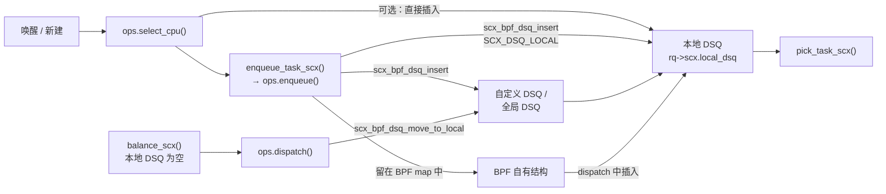

# 3.11 sched_ext 可扩展调度器

> **本节源码**：[`kernel/sched/ext.c`](../../linux/kernel/sched/ext.c)、[`kernel/sched/ext_internal.h`](../../linux/kernel/sched/ext_internal.h)、[`include/linux/sched/ext.h`](../../linux/include/linux/sched/ext.h)、[`kernel/sched/sched.h`](../../linux/kernel/sched/sched.h)、[`kernel/Kconfig.preempt`](../../linux/kernel/Kconfig.preempt)、[`tools/sched_ext/scx_simple.bpf.c`](../../linux/tools/sched_ext/scx_simple.bpf.c)
> **关键函数**：`task_should_scx()`、`enqueue_task_scx()`、`do_enqueue_task()`、`balance_one()`、`pick_task_scx()`、`scx_bpf_dsq_insert()`、`scx_bpf_dsq_move_to_local()`、`check_rq_for_timeouts()`
> **前置知识**：3.1 调度器框架、3.2 主调度函数（`prev_balance()`）

> **配置说明**：本书使用的 `linux/.config` **未开启** `CONFIG_SCHED_CLASS_EXT`。该选项依赖 `BPF_SYSCALL`、`BPF_JIT` 与 `DEBUG_INFO_BTF`（[`kernel/Kconfig.preempt:166-168`](../../linux/kernel/Kconfig.preempt#L166-L168)），而本配置中 `CONFIG_DEBUG_INFO_BTF` 未开启。因此 `kernel/sched/ext.c` 不参与编译，clangd 中没有它的索引，本节的源码引用均经 `rg` 检索并人工核对。前面各节中出现的 `scx_enabled()` 等判断在本配置下恒为 false（[`kernel/sched/sched.h:1782-1784`](../../linux/kernel/sched/sched.h#L1782-L1784)）。

## 概述

前面各节分析的调度类都是编译进内核的固定策略。想要尝试一种新的调度算法，传统做法是修改 `kernel/sched/` 并重新编译、重启内核，迭代成本很高，在生产环境中几乎不可行。

**sched_ext**（v6.12 合入主线）提供了一个新的调度类 `ext_sched_class`，它本身不实现任何策略，而是把调度决策通过 BPF struct_ops 交给用户加载的 **BPF 调度器**。BPF 程序可以在运行时加载和卸载；如果它出错或导致任务饥饿，内核会自动把所有任务切回公平调度类。Kconfig 帮助文本（[`kernel/Kconfig.preempt:171-187`](../../linux/kernel/Kconfig.preempt#L171-L187)）列出了三个目标：便于实验新策略、为特定应用定制调度器、在生产环境中不停机地替换调度策略。

## 在调度类层级中的位置

3.1 节的链接脚本把 `ext_sched_class` 放在 `fair_sched_class` 与 `idle_sched_class` 之间（[`include/asm-generic/vmlinux.lds.h:143`](../../linux/include/asm-generic/vmlinux.lds.h#L143)）。哪些任务交给 sched_ext 由 `task_should_scx()` 决定：

[`kernel/sched/ext.c:3728-3735`](../../linux/kernel/sched/ext.c#L3728-L3735)（v6.18.60）

```c
bool task_should_scx(int policy)
{
	if (!scx_enabled() || unlikely(scx_enable_state() == SCX_DISABLING))
		return false;
	if (READ_ONCE(scx_switching_all))
		return true;
	return policy == SCHED_EXT;
}
```

它被 3.1 节的 `__setscheduler_class()` 和 3.4 节的 `sched_fork()` 调用。两种模式：

- **全部接管**（默认）：BPF 调度器加载后，所有 `SCHED_NORMAL` / `SCHED_BATCH` / `SCHED_IDLE` 任务都移入 sched_ext，公平类在遍历时被跳过（3.1 节 `next_active_class()` 中的 `scx_switched_all()` 判断）；
- **部分接管**（BPF 调度器设置 `SCX_OPS_SWITCH_PARTIAL`）：只有策略为 `SCHED_EXT` 的任务进入 sched_ext，其余仍由公平类调度（[`kernel/sched/ext.c:4935-4936`](../../linux/kernel/sched/ext.c#L4935-L4936)）。

实时、Deadline 与 stop 任务始终不受影响——它们的调度类都在 ext 之上。

## 核心概念

### 调度队列（DSQ）

sched_ext 的核心抽象是**调度队列**（Dispatch Queue，DSQ）：

[`include/linux/sched/ext.h:59-69`](../../linux/include/linux/sched/ext.h#L59-L69)（v6.18.60）

```c
struct scx_dispatch_q {
	raw_spinlock_t		lock;
	struct list_head	list;	/* tasks in dispatch order */
	struct rb_root		priq;	/* used to order by p->scx.dsq_vtime */
	u32			nr;
	u32			seq;	/* used by BPF iter */
	u64			id;
	struct rhash_head	hash_node;
	struct llist_node	free_node;
	struct rcu_head		rcu;
};
```

DSQ 可以按插入顺序（FIFO，`list`）或按虚拟时间（`priq`，键为 `p->scx.dsq_vtime`）组织任务。内置的特殊 DSQ 有：

[`include/linux/sched/ext.h:42-51`](../../linux/include/linux/sched/ext.h#L42-L51)（v6.18.60）

```c
enum scx_dsq_id_flags {
	SCX_DSQ_FLAG_BUILTIN	= 1LLU << 63,
	SCX_DSQ_FLAG_LOCAL_ON	= 1LLU << 62,

	SCX_DSQ_INVALID		= SCX_DSQ_FLAG_BUILTIN | 0,
	SCX_DSQ_GLOBAL		= SCX_DSQ_FLAG_BUILTIN | 1,
	SCX_DSQ_LOCAL		= SCX_DSQ_FLAG_BUILTIN | 2,
	SCX_DSQ_LOCAL_ON	= SCX_DSQ_FLAG_BUILTIN | SCX_DSQ_FLAG_LOCAL_ON,
	SCX_DSQ_LOCAL_CPU_MASK	= 0xffffffffLLU,
};
```

- **本地 DSQ**（`SCX_DSQ_LOCAL`，每 CPU 一个，即 `rq->scx.local_dsq`）：**CPU 只从自己的本地 DSQ 中取任务运行**。`SCX_DSQ_LOCAL_ON | cpu` 表示指定 CPU 的本地 DSQ。
- **全局 DSQ**（`SCX_DSQ_GLOBAL`）：内置的共享 FIFO 队列，本地 DSQ 为空时会从中取任务。
- **自定义 DSQ**：BPF 程序用 `scx_bpf_create_dsq()` 创建，用任意 64 位 ID 标识，可以按 FIFO 或 vtime 排序。

### 回调接口

BPF 调度器实现 `struct sched_ext_ops`（[`kernel/sched/ext_internal.h:267`](../../linux/kernel/sched/ext_internal.h#L267) 起），它在概念上对应 `struct sched_class`。最核心的三个回调：

[`kernel/sched/ext_internal.h:293-347`](../../linux/kernel/sched/ext_internal.h#L293-L347)（v6.18.60，节选）

```c
	s32 (*select_cpu)(struct task_struct *p, s32 prev_cpu, u64 wake_flags);
	...
	void (*enqueue)(struct task_struct *p, u64 enq_flags);
	...
	void (*dequeue)(struct task_struct *p, u64 deq_flags);
	...
	void (*dispatch)(s32 cpu, struct task_struct *prev);
```

| 回调 | 调用时机 | 典型动作 |
|---|---|---|
| `select_cpu` | 唤醒时选核（`select_task_rq_scx()`） | 返回目标 CPU；可直接把任务插入某个 DSQ |
| `enqueue` | 任务变为可运行 | 把任务插入某个 DSQ，或留在 BPF 自己的数据结构中 |
| `dispatch` | 某 CPU 的本地 DSQ 为空、需要任务时 | 把任务从自定义 DSQ 或 BPF 数据结构移入本地 DSQ |

此外还有 `runnable` / `running` / `stopping` / `quiescent`（任务状态变化通知）、`tick`、`set_weight`、`set_cpumask`、`update_idle`、`init_task` / `exit_task`、`cgroup_*` 等可选回调，以及 `timeout_ms`、`flags`、`name` 等字段。BPF 程序通过 kfunc 与内核交互，最常用的是 `scx_bpf_dsq_insert()`（[`kernel/sched/ext.c:5631`](../../linux/kernel/sched/ext.c#L5631) 起）和 `scx_bpf_dsq_move_to_local()`（[`kernel/sched/ext.c:5866`](../../linux/kernel/sched/ext.c#L5866) 起）。

## 主流程分析

### 调度流程总览



*图 3-17：sched_ext 中任务从唤醒到被选中的路径*

### 入队：do_enqueue_task()

`enqueue_task_scx()`（[`kernel/sched/ext.c:1385`](../../linux/kernel/sched/ext.c#L1385) 起）完成计数与 `SCX_TASK_QUEUED` 标记后，调用 `do_enqueue_task()` 决定任务去向：

[`kernel/sched/ext.c:1275-1355`](../../linux/kernel/sched/ext.c#L1275-L1355)（v6.18.60，节选）

```c
	if (!scx_rq_online(rq))
		goto local;

	if (scx_rq_bypassing(rq)) {
		__scx_add_event(sch, SCX_EV_BYPASS_DISPATCH, 1);
		goto global;
	}

	if (p->scx.ddsp_dsq_id != SCX_DSQ_INVALID)
		goto direct;
	...
	if (unlikely(!SCX_HAS_OP(sch, enqueue)))
		goto global;
	...
	SCX_CALL_OP_TASK(sch, SCX_KF_ENQUEUE, enqueue, rq, p, enq_flags);
	...
	if (p->scx.ddsp_dsq_id != SCX_DSQ_INVALID)
		goto direct;
	...
	atomic_long_set_release(&p->scx.ops_state, SCX_OPSS_QUEUED | qseq);
	return;

direct:
	direct_dispatch(sch, p, enq_flags);
	return;
local_norefill:
	dispatch_enqueue(sch, &rq->scx.local_dsq, p, enq_flags);
	return;
local:
	dsq = &rq->scx.local_dsq;
	goto enqueue;
global:
	dsq = find_global_dsq(sch, p);
	goto enqueue;

enqueue:
	...
	touch_core_sched(rq, p);
	refill_task_slice_dfl(sch, p);
	clear_direct_dispatch(p);
	dispatch_enqueue(sch, dsq, p, enq_flags);
}
```

- 若 `select_cpu` 阶段已"直接派发"（`ddsp_dsq_id` 有效），跳过 `ops.enqueue()`；
- 若 BPF 调度器未实现 `enqueue`，任务进入全局 DSQ；
- 处于 **bypass** 模式（调度器正在加载 / 卸载或出错）时，也一律进入全局 DSQ，由内核以简单 FIFO 方式保证系统继续运转；
- 否则调用 `ops.enqueue()`。BPF 程序可以立即插入某个 DSQ（变为直接派发），也可以只把任务记在自己的数据结构里，之后在 `dispatch` 中再处理。`ops_state` 与序号 `qseq` 用于检测"任务已在别处出队"的竞态。

### 选取：balance 与 dispatch

[`kernel/sched/ext.c:2143-2199`](../../linux/kernel/sched/ext.c#L2143-L2199)（v6.18.60，节选）

```c
	/* if there already are tasks to run, nothing to do */
	if (rq->scx.local_dsq.nr)
		goto has_tasks;

	if (consume_global_dsq(sch, rq))
		goto has_tasks;
	...
	if (unlikely(!SCX_HAS_OP(sch, dispatch)) ||
	    scx_rq_bypassing(rq) || !(rq->scx.flags & SCX_RQ_ONLINE))
		goto no_tasks;

	dspc->rq = rq;
	...
	do {
		dspc->nr_tasks = 0;

		SCX_CALL_OP(sch, SCX_KF_DISPATCH, dispatch, rq,
			    cpu_of(rq), prev_on_scx ? prev : NULL);

		flush_dispatch_buf(sch, rq);

		if (prev_on_rq && prev->scx.slice) {
			rq->scx.flags |= SCX_RQ_BAL_KEEP;
			goto has_tasks;
		}
		if (rq->scx.local_dsq.nr)
			goto has_tasks;
		if (consume_global_dsq(sch, rq))
			goto has_tasks;
		...
		if (unlikely(!--nr_loops)) {
			scx_kick_cpu(sch, cpu_of(rq), 0);
			break;
		}
	} while (dspc->nr_tasks);
```

sched_ext 要求每次 `pick_task()` 之前都先调用 `balance()`。3.2 节的 `prev_balance()` 中有专门处理：`scx_enabled()` 时把起始类调整为不低于 `ext_sched_class`，并设置 `SCX_RQ_BAL_PENDING` 以检测遗漏的 balance 调用（[`kernel/sched/core.c:5943-5954`](../../linux/kernel/sched/core.c#L5943-L5954)）；`__pick_next_task()` 在 `scx_enabled()` 时也会跳过公平类快速路径。

`balance_one()`（[`kernel/sched/ext.c:2098-2218`](../../linux/kernel/sched/ext.c#L2098-L2218)）的逻辑是：

1. 若 `prev` 是 sched_ext 任务、仍可运行且时间片未用完，继续运行它；
2. 本地 DSQ 非空，直接返回；
3. 尝试从全局 DSQ 取任务；
4. 循环调用 `ops.dispatch()`，让 BPF 调度器把任务移入本地 DSQ；每轮后再检查本地 / 全局 DSQ。循环次数受 `SCX_DSP_MAX_LOOPS` 限制，超过则踢一下本 CPU 稍后重试，防止 BPF 程序在此空转。

随后 `pick_task_scx()`（[`kernel/sched/ext.c:2448`](../../linux/kernel/sched/ext.c#L2448) 起）从本地 DSQ 头部取出任务。

### 时间片

sched_ext 任务有一个由 BPF 调度器设置的时间片 `p->scx.slice`，默认 `SCX_SLICE_DFL` 为 20 ms（[`include/linux/sched/ext.h:20`](../../linux/include/linux/sched/ext.h#L20)）。`task_tick_scx()`（[`kernel/sched/ext.c:2788`](../../linux/kernel/sched/ext.c#L2788) 起）扣减时间片，耗尽时触发重调度，`ops.stopping()` 被调用后任务重新入队。`SCX_SLICE_INF` 表示无限时间片，此时可以配合 `NO_HZ_FULL` 停 tick。

## 一个最小的 BPF 调度器

内核源码树中的 `tools/sched_ext/scx_simple.bpf.c` 实现了一个全局加权 vtime 调度器，核心只有几十行：

[`tools/sched_ext/scx_simple.bpf.c:69-93`](../../linux/tools/sched_ext/scx_simple.bpf.c#L69-L93)（v6.18.60）

```c
void BPF_STRUCT_OPS(simple_enqueue, struct task_struct *p, u64 enq_flags)
{
	stat_inc(1);	/* count global queueing */

	if (fifo_sched) {
		scx_bpf_dsq_insert(p, SHARED_DSQ, SCX_SLICE_DFL, enq_flags);
	} else {
		u64 vtime = p->scx.dsq_vtime;

		/*
		 * Limit the amount of budget that an idling task can accumulate
		 * to one slice.
		 */
		if (time_before(vtime, vtime_now - SCX_SLICE_DFL))
			vtime = vtime_now - SCX_SLICE_DFL;

		scx_bpf_dsq_insert_vtime(p, SHARED_DSQ, SCX_SLICE_DFL, vtime,
					 enq_flags);
	}
}

void BPF_STRUCT_OPS(simple_dispatch, s32 cpu, struct task_struct *prev)
{
	scx_bpf_dsq_move_to_local(SHARED_DSQ);
}
```

- `enqueue` 把任务按 `dsq_vtime` 插入一个共享 DSQ（在 `simple_init` 中由 `scx_bpf_create_dsq(SHARED_DSQ, -1)` 创建），并把长时间睡眠任务的 vtime 限制在"当前 vtime 减一个时间片"以内——这与 CFS 早期的 `min_vruntime` 放置思路相同；
- `dispatch` 从共享 DSQ 中取出 vtime 最小的任务放入本 CPU 的本地 DSQ；
- `stopping` 回调（[`tools/sched_ext/scx_simple.bpf.c:110-127`](../../linux/tools/sched_ext/scx_simple.bpf.c#L110-L127)）按权重的倒数把实际用掉的时间片累加到 `dsq_vtime`，实现按权重公平。

对照 3.3 节可以看到，这几十行 BPF 代码实现了一个"简化版 CFS"：没有 lag、没有截止时间、没有负载均衡（单个共享队列天然均衡），但对 L3 拓扑统一的机器已经可以工作（文件头注释）。

## 安全机制

BPF 调度器运行在内核中，它的错误不能让系统挂死。sched_ext 提供了多重保护：

- **BPF 验证器**：确保程序不会访问非法内存、一定会终止；kfunc 的调用上下文由 `scx_kf_mask`（[`include/linux/sched/ext.h:107-119`](../../linux/include/linux/sched/ext.h#L107-L119)）检查，例如只能在 `dispatch` 中调用 `scx_bpf_dsq_move_to_local()`。
- **看门狗**：每个可运行任务记录 `runnable_at`，`check_rq_for_timeouts()` 定期检查是否有任务等待超过 `scx_watchdog_timeout`；超时就以 `SCX_EXIT_ERROR_STALL` 退出 BPF 调度器：

  [`kernel/sched/ext.c:2728-2741`](../../linux/kernel/sched/ext.c#L2728-L2741)（v6.18.60）

  ```c
  	list_for_each_entry(p, &rq->scx.runnable_list, scx.runnable_node) {
  		unsigned long last_runnable = p->scx.runnable_at;

  		if (unlikely(time_after(jiffies,
  					last_runnable + scx_watchdog_timeout))) {
  			u32 dur_ms = jiffies_to_msecs(jiffies - last_runnable);

  			scx_exit(sch, SCX_EXIT_ERROR_STALL, 0,
  				 "%s[%d] failed to run for %u.%03us",
  				 p->comm, p->pid, dur_ms / 1000, dur_ms % 1000);
  			timed_out = true;
  			break;
  		}
  	}
  ```

  超时上限默认且最大为 30 秒（`SCX_WATCHDOG_MAX_TIMEOUT`，[`kernel/sched/ext_internal.h:13`](../../linux/kernel/sched/ext_internal.h#L13)；`timeout_ms` 字段说明见 [`kernel/sched/ext_internal.h:770-777`](../../linux/kernel/sched/ext_internal.h#L770-L777)），BPF 调度器可以设置更短的值。
- **SysRq**：`SysRq-S` 立即禁用 sched_ext，把所有任务切回公平类（`sysrq_sched_ext_reset_op`，[`kernel/sched/ext.c:5283-5288`](../../linux/kernel/sched/ext.c#L5283-L5288)）。
- **bypass 模式**：加载、卸载或出错期间，所有入队绕过 BPF 直接进入全局 DSQ，保证切换过程本身不会卡住。
- **退出通知**：BPF 调度器退出时，内核通过 `ops.exit()` 传回原因，用户态加载程序可以据此打印错误信息。

这些机制保证了最坏情况下系统只是退回到默认的公平调度，而不会崩溃。

## 关键细节 / 设计考量

- **为什么只能从本地 DSQ 运行**。本地 DSQ 受本 CPU rq 锁保护，`pick_task_scx()` 可以像其他调度类一样在 rq 锁下完成选取；跨 CPU 的复杂策略放在 `dispatch` 与自定义 DSQ 中实现，核心层的锁约定保持不变。
- **与公平类共存**。部分接管模式下，sched_ext 任务低于公平任务（ext 类在 fair 类之下），只有公平类无任务时才会运行；`scx_switched_all()` 时公平类整体被跳过。
- **与 fair_server 的关系**。实时任务饿死 sched_ext 任务的问题与公平任务相同；本书版本的 `struct rq` 中仅有 `fair_server` 一个 dl_server（3.1 节），对 sched_ext 的保护以源码为准，本书不展开。
- **生态**。内核树只附带少量示例（`tools/sched_ext/` 下的 `scx_simple`、`scx_qmap`、`scx_central`、`scx_flatcg`），更完整的调度器（如面向游戏、面向延迟的各类调度器）在外部项目 <https://github.com/sched-ext/scx> 中维护（Kconfig 帮助文本给出的链接）。

## 动手实验

本节实验需要一个开启了 `CONFIG_SCHED_CLASS_EXT`（及其依赖 `CONFIG_DEBUG_INFO_BTF`）的内核。本书默认配置无法直接进行，需要在 **dev 虚拟机** 中另行编译内核，或使用已开启该选项的发行版内核。

1. 检查内核是否支持 sched_ext：

   ```bash
   # 虚拟机，普通用户
   ls /sys/kernel/sched_ext/ && cat /sys/kernel/sched_ext/state
   ```

   `/sys/kernel/sched_ext` 由 [`kernel/sched/ext.c:7040`](../../linux/kernel/sched/ext.c#L7040) 的 `kset_create_and_add("sched_ext", ...)` 创建。

2. 编译并运行内核树中的示例调度器（需要 clang 与 bpftool，见 `tools/sched_ext/README.md`）：

   ```bash
   # 虚拟机，root
   cd /root/linux/linux/tools/sched_ext
   make -j$(nproc)
   ./build/bin/scx_simple &           # 加载后，dmesg 中应出现 "sched_ext: BPF scheduler \"simple\" enabled"
   cat /sys/kernel/sched_ext/state
   kill %1                            # 卸载，任务回到公平类
   ```

   `dmesg` 中的提示来自 [`kernel/sched/ext.c:4938-4939`](../../linux/kernel/sched/ext.c#L4938-L4939) 的 `pr_info()`。

## 小结

- sched_ext（v6.12 合入）提供 `ext_sched_class`，把调度策略交给通过 BPF struct_ops 加载的 BPF 调度器，可在运行时加载 / 卸载；本书配置因缺少 `CONFIG_DEBUG_INFO_BTF` 而未开启它。
- ext 类位于 fair 与 idle 之间；默认接管全部公平任务，设置 `SCX_OPS_SWITCH_PARTIAL` 时只接管 `SCHED_EXT` 策略的任务。
- 任务经 DSQ 流转：`select_cpu` / `enqueue` 把任务插入自定义、全局或本地 DSQ，`dispatch` 在本地 DSQ 为空时补充任务；CPU 只从自己的本地 DSQ 取任务运行。
- 核心层为 sched_ext 做了少量适配：选取前必须调用 `balance()`，启用时跳过公平类快速路径与 `next_active_class()` 中的类跳转。
- BPF 验证器、看门狗（默认最长 30 秒）、SysRq-S、bypass 模式共同保证 BPF 调度器出错时系统退回公平调度而不崩溃。

## 参考

- `linux/Documentation/scheduler/sched-ext.rst`：sched_ext 的设计与使用说明。
- `linux/tools/sched_ext/README.md`：示例调度器的编译与运行。
- [`kernel/sched/ext_internal.h:267`](../../linux/kernel/sched/ext_internal.h#L267) 起：`struct sched_ext_ops` 各回调的详细注释。
- sched-ext 项目：<https://github.com/sched-ext/scx>（[`kernel/Kconfig.preempt:191`](../../linux/kernel/Kconfig.preempt#L191) 中给出）。
