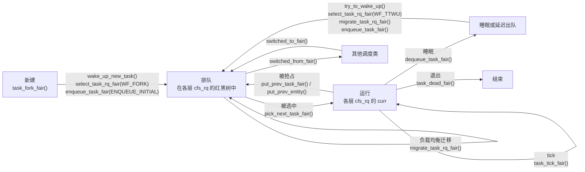
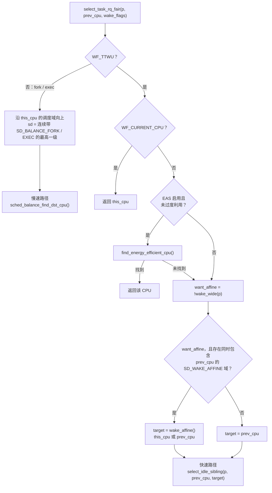

# 3.12 公平调度类：回调实现与唤醒选核

> **本节源码**：[`kernel/sched/fair.c`](../../linux/kernel/sched/fair.c)、[`kernel/sched/sched.h`](../../linux/kernel/sched/sched.h)、[`kernel/sched/core.c`](../../linux/kernel/sched/core.c)、[`kernel/sched/syscalls.c`](../../linux/kernel/sched/syscalls.c)、[`kernel/sched/topology.c`](../../linux/kernel/sched/topology.c)、[`kernel/sched/features.h`](../../linux/kernel/sched/features.h)、[`include/linux/sched/topology.h`](../../linux/include/linux/sched/topology.h)
> **关键函数**：`enqueue_task_fair()`、`dequeue_task_fair()`、`dequeue_entities()`、`set_next_task_fair()`、`select_task_rq_fair()`、`wake_wide()`、`wake_affine()`、`select_idle_sibling()`、`select_idle_cpu()`、`sched_balance_find_dst_cpu()`、`find_energy_efficient_cpu()`、`migrate_task_rq_fair()`、`switched_to_fair()`、`task_change_group_fair()`
> **前置知识**：3.1 调度器框架（`struct sched_class`）、3.3 EEVDF 公平调度算法、3.4 任务创建与唤醒（`select_task_rq()`、`set_task_cpu()`）、3.8 PELT 负载跟踪、3.9 调度域与负载均衡、3.10 组调度与 CPU 带宽控制

## 概述

公平调度类 `fair_sched_class` 服务 `SCHED_NORMAL`、`SCHED_BATCH`、`SCHED_IDLE` 三种策略，系统中绝大多数任务都由它调度。它的实现集中在 `kernel/sched/fair.c`，v6.18.60 中这个文件超过 14000 行，是调度器里最大的源文件。

前面几节已经从不同侧面拆解过这个调度类：3.3 节分析单个 `cfs_rq` 内部的 EEVDF 选择规则，3.8 节分析负载跟踪，3.9 节分析 CPU 之间的负载均衡，3.10 节分析任务组与带宽控制。这些机制最终都要经由 `struct sched_class` 的回调接入核心层。本节以回调为线索把它们串起来，回答三个问题：

1. 核心层在任务生命周期的哪些节点调用公平类，公平类在每个回调里做什么；
2. 在组调度层级上入队、出队时，各层的任务计数如何维护；
3. 任务被唤醒或新建时，公平类如何为它选择 CPU。3.4 节只分析了核心层的 `select_task_rq()` 包装，`select_task_rq_fair()` 中的唤醒亲和（Wake Affine）、空闲 CPU 搜索与能效选核是本节的重点。

本节涉及的主要配置如下（以 `linux/.config` 为准）：

| 配置项 | 取值 | 本节涉及的影响 |
|---|---|---|
| `CONFIG_FAIR_GROUP_SCHED` / `CONFIG_CFS_BANDWIDTH` | y / y | 入队、出队、选取都沿组层级逐层进行；节流任务走单独的路径 |
| `CONFIG_SCHED_SMT` / `CONFIG_SCHED_CLUSTER` / `CONFIG_SCHED_MC` | y / y / y | 选核时优先寻找整个物理核空闲的 CPU，有 cluster 时先在 cluster 内搜索 |
| `CONFIG_ENERGY_MODEL` / `CONFIG_CPU_FREQ_GOV_SCHEDUTIL` | y / y | 编译能效选核代码；运行时是否启用取决于硬件 |
| `CONFIG_NUMA_BALANCING` | n | 它依赖 `!PREEMPT_RT`（[`init/Kconfig:986`](../../linux/init/Kconfig#L986)），本书配置开启了 `CONFIG_PREEMPT_RT`，相关钩子为空函数 |
| `CONFIG_NO_HZ_COMMON` | y | 唤醒迁移时估算旧 CPU 上漏记的空闲时间 |
| `CONFIG_SCHEDSTATS` | y | 唤醒亲和等统计，运行时需打开 `kernel.sched_schedstats` 才计数 |

## 核心数据结构

### fair_sched_class：回调表

[`kernel/sched/fair.c:14112-14159`](../../linux/kernel/sched/fair.c#L14112-L14159)（v6.18.60，节选）

```c
DEFINE_SCHED_CLASS(fair) = {

	.enqueue_task		= enqueue_task_fair,
	.dequeue_task		= dequeue_task_fair,
	.yield_task		= yield_task_fair,
	.yield_to_task		= yield_to_task_fair,

	.wakeup_preempt		= check_preempt_wakeup_fair,

	.pick_task		= pick_task_fair,
	.pick_next_task		= __pick_next_task_fair,
	.put_prev_task		= put_prev_task_fair,
	.set_next_task          = set_next_task_fair,

	.balance		= balance_fair,
	.select_task_rq		= select_task_rq_fair,
	.migrate_task_rq	= migrate_task_rq_fair,

	.rq_online		= rq_online_fair,
	.rq_offline		= rq_offline_fair,

	.task_dead		= task_dead_fair,
	.set_cpus_allowed	= set_cpus_allowed_fair,

	.task_tick		= task_tick_fair,
	.task_fork		= task_fork_fair,

	.reweight_task		= reweight_task_fair,
	.prio_changed		= prio_changed_fair,
	.switched_from		= switched_from_fair,
	.switched_to		= switched_to_fair,

	.get_rr_interval	= get_rr_interval_fair,

	.update_curr		= update_curr_fair,
	...
};
```

`DEFINE_SCHED_CLASS(fair)` 把这张表放进名为 `__fair_sched_class` 的段（[`kernel/sched/sched.h:2531-2534`](../../linux/kernel/sched/sched.h#L2531-L2534)），链接脚本按段的顺序排列各调度类，由此确定公平类排在 dl、rt 之后（3.1 节）。被省略的三项分别是依赖 `CONFIG_FAIR_GROUP_SCHED` 的 `task_change_group`、依赖 `CONFIG_SCHED_CORE` 的 `task_is_throttled` 和依赖 `CONFIG_UCLAMP_TASK` 的 `uclamp_enabled = 1`。各回调的职责与分析位置如下：

| 回调 | 公平类实现 | 主要工作 | 详见 |
|---|---|---|---|
| `enqueue_task` | `enqueue_task_fair()` | 沿组层级自下而上入队，维护 `h_nr_*` 计数与 `util_est` | 本节 |
| `dequeue_task` | `dequeue_task_fair()` | 沿组层级出队；不合格的睡眠任务延迟出队并返回 false | 本节、3.3 节 |
| `yield_task` / `yield_to_task` | `yield_task_fair()` / `yield_to_task_fair()` | 放弃本次请求的剩余部分；后者还把目标任务设为 next buddy | 3.3 节 |
| `wakeup_preempt` | `check_preempt_wakeup_fair()` | 模拟一次 EEVDF 选取，决定是否抢占 | 3.3 节 |
| `pick_task` / `pick_next_task` | `pick_task_fair()` / `__pick_next_task_fair()` | 逐层选取；同组切换时只更新变化的层级 | 3.2 节、3.3 节 |
| `put_prev_task` / `set_next_task` | `put_prev_task_fair()` / `set_next_task_fair()` | 把各层 `curr` 放回红黑树 / 从树中取出并设为各层 `curr` | 本节 |
| `balance` | `balance_fair()` | 本 CPU 没有公平任务时做 newidle 均衡 | 3.9 节 |
| `select_task_rq` | `select_task_rq_fair()` | 唤醒、fork、exec 时选择 CPU | 本节 |
| `migrate_task_rq` | `migrate_task_rq_fair()` | 任务换 CPU 前从旧 `cfs_rq` 摘除 PELT 贡献 | 本节 |
| `rq_online` / `rq_offline` | `rq_online_fair()` / `rq_offline_fair()` | 按在线 CPU 数重算基础时间片，处理带宽节流 | 3.3 节、3.10 节 |
| `task_dead` | `task_dead_fair()` | 结束延迟出队，摘除 PELT 贡献 | 3.3 节 |
| `set_cpus_allowed` | `set_cpus_allowed_fair()` | 通用的亲和性设置，再更新 `max_allowed_capacity` | 本节 |
| `task_tick` | `task_tick_fair()` | 逐层 `entity_tick()`，检查 misfit 与过度利用（Overutilized） | 3.3 节、本节 |
| `task_fork` | `task_fork_fair()` | 只设置 `max_allowed_capacity` | 本节 |
| `reweight_task` | `reweight_task_fair()` | 保持 lag 不变地调整权重 | 3.3 节 |
| `prio_changed` | `prio_changed_fair()` | nice 值改变后检查是否需要重调度 | 本节 |
| `switched_from` / `switched_to` | `switched_from_fair()` / `switched_to_fair()` | 切换调度类时摘下 / 挂上 PELT 负载 | 本节 |
| `get_rr_interval` | `get_rr_interval_fair()` | 为 `sched_rr_get_interval(2)` 返回时间片 | 本节 |
| `update_curr` | `update_curr_fair()` | 为 `task_sched_runtime()` 结算当前任务的运行时间 | 本节 |
| `task_change_group` | `task_change_group_fair()` | 切换任务组时迁移 PELT 负载 | 本节 |
| `task_is_throttled` | `task_is_throttled_fair()` | 供核心调度判断任务所在层级是否被节流 | 3.10 节 |

公平类没有实现 `task_woken()` 和 `find_lock_rq()`。这两个回调服务于 RT 与 Deadline 类在唤醒后主动把任务推到其他 CPU（3.6 节）；公平类在唤醒时一次性选好 CPU，此后的跨 CPU 搬移交给周期性负载均衡。

### 运行队列中的公平类数据

[`kernel/sched/sched.h:1119-1239`](../../linux/kernel/sched/sched.h#L1119-L1239)（v6.18.60，节选）

```c
struct rq {
	...
	struct cfs_rq		cfs;	// [注] 根 cfs_rq
	struct rt_rq		rt;
	struct dl_rq		dl;
	/* 省略 CONFIG_SCHED_CLASS_EXT 相关代码 */

	struct sched_dl_entity	fair_server;	// [注] 防止公平任务饿死的 dl_server（3.7 节）

#ifdef CONFIG_FAIR_GROUP_SCHED
	/* list of leaf cfs_rq on this CPU: */
	struct list_head	leaf_cfs_rq_list;
	struct list_head	*tmp_alone_branch;
#endif /* CONFIG_FAIR_GROUP_SCHED */
	...
	unsigned long		misfit_task_load;	// [注] 非对称算力系统上当前任务"放不下"的负载
	...
	struct list_head cfs_tasks;	// [注] 本 CPU 上已入队的公平任务，按最近运行排序
	...
	u64			idle_stamp;
	u64			avg_idle;
	...
```

- `cfs` 是根 `cfs_rq`。根任务组的任务和各个一级任务组的组实体都排在它上面（3.10 节图 3-15）。
- `cfs_tasks` 链接本 CPU 上所有已入队的公平**任务**，不含组实体。`account_entity_enqueue()` 把新入队的任务加到链表头（[`kernel/sched/fair.c:3773`](../../linux/kernel/sched/fair.c#L3773)），`__set_next_task_fair()` 把刚被选中的任务移到链表头（[`kernel/sched/fair.c:13775`](../../linux/kernel/sched/fair.c#L13775)），因此链表大致按最近运行的时间排序。负载均衡的 `detach_tasks()` 从链表尾部取任务（[`kernel/sched/fair.c:9866`](../../linux/kernel/sched/fair.c#L9866)），优先迁走最久没有运行、缓存最冷的任务。
- `misfit_task_load` 只在非对称算力（Asymmetric CPU Capacity，如大小核）系统上使用：当前任务的利用率超出本 CPU 的算力时，记下它的负载，负载均衡据此把它迁到大核（3.9 节）。
- `idle_stamp` 在 CPU 即将进入空闲、做 newidle 均衡时记下当前时刻（[`kernel/sched/fair.c:13122`](../../linux/kernel/sched/fair.c#L13122)），有任务被唤醒到这个 CPU 时据此更新平均空闲时长 `avg_idle`；下文的慢速路径也用它挑选"最近才空闲、缓存可能还热"的 CPU。

### cfs_rq 中的任务计数

3.3 节介绍过 `cfs_rq` 中服务 EEVDF 的字段。从调度类的角度看，更需要弄清的是下面几个计数：

| 计数 | 统计对象 | 含延迟出队任务 | 维护位置 |
|---|---|---|---|
| `cfs_rq->nr_queued` | 本层直接排队的实体（任务或组实体），含 `curr` | 是 | `account_entity_enqueue()` / `account_entity_dequeue()` |
| `cfs_rq->h_nr_queued` | 本层及所有子组中的**任务** | 是 | `enqueue_task_fair()` / `dequeue_entities()` |
| `cfs_rq->h_nr_runnable` | 同上，但不含延迟出队的任务 | 否 | 同上，以及 `set_delayed()` / `clear_delayed()` |
| `cfs_rq->h_nr_idle` | 同 `h_nr_queued`，但只计 `SCHED_IDLE` 任务，以及（在 idle 组的祖先队列中）该组的全部任务 | 是 | `enqueue_task_fair()` / `dequeue_entities()` |
| `rq->nr_running` | 本 CPU 上所有调度类的任务 | 是 | `add_nr_running()` / `sub_nr_running()` |

几个计数之间的关系在后文会反复用到：

- `rq->nr_running == rq->cfs.h_nr_queued` 表示本 CPU 上的可运行任务全部属于公平类，这是 3.2 节 `__pick_next_task()` 快速路径的条件。
- 延迟出队的任务仍计入 `rq->nr_running`，所以凡是需要"真正可运行的任务数"的地方，都要减去 `cfs_h_nr_delayed()`，即 `h_nr_queued − h_nr_runnable`（[`kernel/sched/fair.c:7351-7354`](../../linux/kernel/sched/fair.c#L7351-L7354)）。
- `rq->nr_running == rq->cfs.h_nr_idle` 表示本 CPU 上只有 `SCHED_IDLE` 任务：

[`kernel/sched/fair.c:7039-7049`](../../linux/kernel/sched/fair.c#L7039-L7049)（v6.18.60）

```c
/* Runqueue only has SCHED_IDLE tasks enqueued */
static int sched_idle_rq(struct rq *rq)
{
	return unlikely(rq->nr_running == rq->cfs.h_nr_idle &&
			rq->nr_running);
}

static int sched_idle_cpu(int cpu)
{
	return sched_idle_rq(cpu_rq(cpu));
}
```

这样的 CPU 在选核时被视同空闲：把一个普通任务放上去，它入队时就会请求抢占那些 `SCHED_IDLE` 任务（见下文"三种调度策略"）。

### 在层级上行走

开启 `CONFIG_FAIR_GROUP_SCHED` 后，公平类的大部分回调都要在 3.10 节图 3-15 的树上逐层操作。以下辅助函数在本节代码中反复出现：

| 辅助函数 | 定义 | 含义 |
|---|---|---|
| `for_each_sched_entity(se)` | [`kernel/sched/fair.c:307-308`](../../linux/kernel/sched/fair.c#L307-L308) | 沿 `se->parent` 自下而上遍历，直到根 `cfs_rq` 上的实体（其 `parent` 为 NULL）；未开启组调度时只执行一次（[`kernel/sched/fair.c:474-475`](../../linux/kernel/sched/fair.c#L474-L475)） |
| `cfs_rq_of(se)` | [`kernel/sched/sched.h:1617-1620`](../../linux/kernel/sched/sched.h#L1617-L1620) | 实体排在哪个 `cfs_rq` 上，即 `se->cfs_rq` |
| `group_cfs_rq(se)` | [`kernel/sched/sched.h:1623-1626`](../../linux/kernel/sched/sched.h#L1623-L1626) | 组实体拥有的 `cfs_rq`，即 `se->my_q`；任务实体为 NULL |
| `entity_is_task(se)` | [`kernel/sched/sched.h:922`](../../linux/kernel/sched/sched.h#L922) | `!se->my_q`：不拥有队列的实体就是任务 |
| `is_same_group(se, pse)` | [`kernel/sched/fair.c:409-416`](../../linux/kernel/sched/fair.c#L409-L416) | 两个实体排在同一个 `cfs_rq` 上时返回该队列 |
| `se_is_idle(se)` | [`kernel/sched/fair.c:465-470`](../../linux/kernel/sched/fair.c#L465-L470) | 任务实体看是否为 `SCHED_IDLE`；组实体看所在组是否设置了 `cpu.idle` |

### 三种调度策略

三种策略共用同一套数据结构和算法，差别只体现在少数几处判断中：

| 方面 | `SCHED_NORMAL` | `SCHED_BATCH` | `SCHED_IDLE` |
|---|---|---|---|
| 权重 | 由 nice 值决定（15～88761） | 同左 | 固定为 `WEIGHT_IDLEPRIO`（3），忽略 nice 值（3.1 节） |
| 唤醒时抢占同层的非 idle 当前任务 | 按 EEVDF 模拟选取判断（3.3 节） | 从不 | 从不 |
| 唤醒时抢占同层的 idle 当前任务 | 直接请求重调度，并取消对方的保护期 | 同左 | 从不 |
| 计入 `h_nr_idle` | 否 | 否 | 是 |
| 负载均衡中的缓存热度 | 按 `migration_cost` 判断 | 同左 | 始终视为冷，可随意迁移（[`kernel/sched/fair.c:9541-9542`](../../linux/kernel/sched/fair.c#L9541-L9542)） |

- 唤醒抢占的两条规则都在 `check_preempt_wakeup_fair()` 中：先比较双方在共同层级上的祖先实体是否为 idle，非 idle 实体总是抢占 idle 实体，反之则从不抢占（[`kernel/sched/fair.c:9017-9034`](../../linux/kernel/sched/fair.c#L9017-L9034)）；随后 `normal_policy()` 把 `SCHED_BATCH` 与 `SCHED_IDLE` 的被唤醒者排除在抢占判断之外（[`kernel/sched/fair.c:9036-9040`](../../linux/kernel/sched/fair.c#L9036-L9040)）。因此 `SCHED_BATCH` 的含义是"按 nice 值分享 CPU，但被唤醒时不打断别人"，适合吞吐优先的批处理任务。
- "idle"不只来自任务策略。cgroup v2 的 `cpu.idle = 1` 把整个任务组标记为 idle（3.10 节），组实体在它的父队列中按 idle 实体对待；向上统计 `h_nr_idle` 时，这个组的全部任务都计为 idle（见下文入队）。
- 开启 `CONFIG_SCHED_CLASS_EXT` 时，在没有加载 BPF 调度器的情况下，`SCHED_EXT` 策略的任务也由公平类调度，`normal_policy()` 把它当作 `SCHED_NORMAL`（[`kernel/sched/sched.h:192-199`](../../linux/kernel/sched/sched.h#L192-L199)，3.11 节）。

## 主流程分析

### 回调在任务生命周期中的位置

```
fork
  sched_cgroup_fork()                           kernel/sched/core.c
  └── task_fork_fair()                          kernel/sched/fair.c
  wake_up_new_task()                            kernel/sched/core.c
  ├── select_task_rq_fair(WF_FORK)              // 慢速路径
  ├── post_init_entity_util_avg()
  ├── enqueue_task_fair(ENQUEUE_INITIAL)
  └── check_preempt_wakeup_fair()

唤醒
  try_to_wake_up()                              kernel/sched/core.c
  ├── select_task_rq_fair(WF_TTWU)              // 快速路径
  ├── set_task_cpu() → migrate_task_rq_fair()   // CPU 改变时
  └── ttwu_do_activate()
      ├── enqueue_task_fair(ENQUEUE_WAKEUP)
      └── check_preempt_wakeup_fair()

调度
  __schedule()                                  kernel/sched/core.c
  ├── try_to_block_task() → dequeue_task_fair(DEQUEUE_SLEEP)
  └── pick_next_task_fair()                     // 通用路径为 balance_fair() + pick_task_fair()
      ├── put_prev_entity() / set_next_entity()
      └── sched_balance_newidle()               // 没有任务可选时

时钟中断
  sched_tick() → task_tick_fair()

属性与归属改变
  sched_change_begin() / sched_change_end()     // dequeue + put_prev … enqueue + set_next
  check_class_changed() → switched_from_fair() / switched_to_fair() / prio_changed_fair()
  sched_move_task() → task_change_group_fair()

退出
  finish_task_switch() → task_dead_fair()
```



*图 3-18：公平类回调在任务生命周期中的位置*

### 入队：enqueue_task_fair()

核心层的 `enqueue_task()` 先更新 rq 时钟与 uclamp，再调用本函数，之后才处理 PSI 等统计（[`kernel/sched/core.c:2096-2117`](../../linux/kernel/sched/core.c#L2096-L2117)）。公平类要做的是把任务的调度实体，连同它所有尚未入队的祖先组实体，依次挂到各层 `cfs_rq` 上。函数的开头处理几种特殊情况：

[`kernel/sched/fair.c:7087-7124`](../../linux/kernel/sched/fair.c#L7087-L7124)（v6.18.60，节选）

```c
static void
enqueue_task_fair(struct rq *rq, struct task_struct *p, int flags)
{
	struct cfs_rq *cfs_rq;
	struct sched_entity *se = &p->se;
	int h_nr_idle = task_has_idle_policy(p);
	int h_nr_runnable = 1;
	int task_new = !(flags & ENQUEUE_WAKEUP);
	int rq_h_nr_queued = rq->cfs.h_nr_queued;
	u64 slice = 0;

	if (task_is_throttled(p) && enqueue_throttled_task(p))
		return;
	...
	if (!p->se.sched_delayed || (flags & ENQUEUE_DELAYED))
		util_est_enqueue(&rq->cfs, p);

	if (flags & ENQUEUE_DELAYED) {
		requeue_delayed_entity(se);
		return;
	}
	...
	if (p->in_iowait)
		cpufreq_update_util(rq, SCHED_CPUFREQ_IOWAIT);

	if (task_new && se->sched_delayed)
		h_nr_runnable = 0;
```

- **节流任务**。带宽控制下，已被节流的任务（`p->throttled`）停在所属 `cfs_rq` 的 limbo 链表上，并不在红黑树中（3.10 节）。若它重新入队的目标层级仍处于节流状态，`enqueue_throttled_task()` 直接把它放回 limbo 链表，不真正入队；否则清除节流标记，按普通任务处理（[`kernel/sched/fair.c:6002-6052`](../../linux/kernel/sched/fair.c#L6002-L6052)）。
- **先加 util_est**。后面的 PELT 更新可能间接触发 schedutil 调频，先把任务的预估利用率加到 `cfs_rq` 上，调频才能看到即将运行的任务（3.8 节）。延迟出队的任务在睡眠时已经减去过 `util_est`，只有当它真正被唤醒（`ENQUEUE_DELAYED`）时才加回。
- **唤醒延迟实体**。`ENQUEUE_DELAYED` 来自 `ttwu_runnable()`：任务仍在队列中，只需 `requeue_delayed_entity()` 清除延迟标记（3.3 节），不必逐层入队。
- **`task_new` 的真实含义**。这个变量名容易误解，它实际表示"不是唤醒"：新任务的 `ENQUEUE_INITIAL`、修改属性时的 `ENQUEUE_RESTORE`、负载均衡的迁入都属于这一类。一个处于延迟出队状态的任务若经非唤醒路径重新入队（例如 `sched_change` 先出队再入队），它仍保持延迟状态，不能计入 `h_nr_runnable`，所以此时把增量设为 0。

接下来是两个自下而上的循环。第一个循环：

[`kernel/sched/fair.c:7126-7154`](../../linux/kernel/sched/fair.c#L7126-L7154)（v6.18.60，节选）

```c
	for_each_sched_entity(se) {
		if (se->on_rq) {
			if (se->sched_delayed)
				requeue_delayed_entity(se);
			break;
		}
		cfs_rq = cfs_rq_of(se);

		...
		if (slice) {
			se->slice = slice;
			se->custom_slice = 1;
		}
		enqueue_entity(cfs_rq, se, flags);
		slice = cfs_rq_min_slice(cfs_rq);

		cfs_rq->h_nr_runnable += h_nr_runnable;
		cfs_rq->h_nr_queued++;
		cfs_rq->h_nr_idle += h_nr_idle;

		if (cfs_rq_is_idle(cfs_rq))
			h_nr_idle = 1;

		flags = ENQUEUE_WAKEUP;
	}
```

第二个循环：

[`kernel/sched/fair.c:7156-7174`](../../linux/kernel/sched/fair.c#L7156-L7174)（v6.18.60）

```c
	for_each_sched_entity(se) {
		cfs_rq = cfs_rq_of(se);

		update_load_avg(cfs_rq, se, UPDATE_TG);
		se_update_runnable(se);
		update_cfs_group(se);

		se->slice = slice;
		if (se != cfs_rq->curr)
			min_vruntime_cb_propagate(&se->run_node, NULL);
		slice = cfs_rq_min_slice(cfs_rq);

		cfs_rq->h_nr_runnable += h_nr_runnable;
		cfs_rq->h_nr_queued++;
		cfs_rq->h_nr_idle += h_nr_idle;

		if (cfs_rq_is_idle(cfs_rq))
			h_nr_idle = 1;
	}
```

- **第一个循环**对每个尚未入队（`!se->on_rq`）的实体调用 3.3 节的 `enqueue_entity()`：组从空变为非空，它的组实体也要入队。遇到已在队列中的祖先就停下；若这个祖先处于延迟出队状态（组内最后一个任务睡眠后，组实体可能被延迟，3.3 节），就借机把它唤醒。
- **只有最底层用调用者的标志**。循环末尾的 `flags = ENQUEUE_WAKEUP` 使上层组实体一律按唤醒入队：组从空变为非空，相当于组实体被唤醒。`ENQUEUE_INITIAL`、`ENQUEUE_MIGRATED` 等只作用于任务自身。
- **第二个循环**继续处理已在队列中的祖先。它们不必入队，但组内多了一个任务：PELT 负载、组权重（`update_cfs_group()`，3.10 节）和组实体的时间片都要更新。时间片改变后，`min_vruntime_cb_propagate()` 沿增强红黑树向上传播新的 `min_slice` / `max_slice`；`curr` 不在树中，因此跳过。
- **计数**。两个循环给路径上每一层的 `h_nr_queued` 与 `h_nr_runnable` 加上增量；`nr_queued` 只在真正有实体入队的那几层，由 `enqueue_entity()` 内的 `account_entity_enqueue()` 加一。
- **idle 组**。`h_nr_idle` 的增量起初是"任务是否为 `SCHED_IDLE`"；一旦向上越过一个设置了 `cpu.idle` 的组（`cfs_rq_is_idle()`），对更上层而言整个组都是 idle 的，增量改为 1。

以 3.10 节图 3-15 的层级为例，假设 `tg2` 中已有可运行的任务 E，此时任务 D 被唤醒：

```
  rq->cfs                    ◄── 第二个循环：se(tg2) 已在队列中，只更新负载、
    └─ se(tg2)   on_rq = 1        时间片；本层 h_nr_queued、h_nr_runnable 加一
         │ my_q
  tg2->cfs_rq[0]             ◄── 第一个循环：enqueue_entity(se(tg3))，
    ├─ task E                     本层 nr_queued 与 h_nr_* 加一
    └─ se(tg3)   on_rq 0→1
         │ my_q
  tg3->cfs_rq[0]             ◄── 第一个循环：enqueue_entity(D)，
    └─ task D    on_rq 0→1        本层 nr_queued 与 h_nr_* 加一
```

*图 3-19：在组调度层级上入队任务 D（自下而上执行；沿用图 3-15 的层级）*

函数最后完成 rq 级别的收尾：

[`kernel/sched/fair.c:7176-7206`](../../linux/kernel/sched/fair.c#L7176-L7206)（v6.18.60，节选）

```c
	if (!rq_h_nr_queued && rq->cfs.h_nr_queued) {
		/* Account for idle runtime */
		if (!rq->nr_running)
			dl_server_update_idle_time(rq, rq->curr);
		dl_server_start(&rq->fair_server);
	}

	/* At this point se is NULL and we are at root level*/
	add_nr_running(rq, 1);
	...
	if (!task_new)
		check_update_overutilized_status(rq);

	assert_list_leaf_cfs_rq(rq);

	hrtick_update(rq);
}
```

- **启动 fair_server**。rq 上的公平任务数从 0 变为非 0 时启动 `fair_server`，防止公平任务被实时任务长期饿死（3.7 节）；若入队前 CPU 处于空闲，先把空闲时间记到它上面。
- **`add_nr_running(rq, 1)`**。无论层级多深，每入队一个任务，`rq->nr_running` 只加一。
- **过度利用检测**。在启用能效感知调度（EAS）的平台上，某个 CPU 的利用率超出其算力时，root domain 被标记为过度利用，此后唤醒不再走能效选核，放置交还给负载均衡（见下文与 3.9 节）。新任务的第一次入队不参与检测：源码注释（[`kernel/sched/fair.c:7186-7199`](../../linux/kernel/sched/fair.c#L7186-L7199)）解释说，新任务的初始 `util_avg` 被设为剩余算力的一半（3.8 节），一个很小的任务也可能借此越过阈值，让负载均衡打乱 EAS 的放置。
- **`hrtick_update()`**。队列中任务数变化后，按当前任务剩余的时间片重设高精度 tick。它依赖 `CONFIG_SCHED_HRTICK` 并要求开启默认关闭的 `HRTICK` 特性（[`kernel/sched/features.h:66`](../../linux/kernel/sched/features.h#L66)，3.5 节）。

### 出队：dequeue_task_fair() 与 dequeue_entities()

[`kernel/sched/fair.c:7329-7349`](../../linux/kernel/sched/fair.c#L7329-L7349)（v6.18.60）

```c
static bool dequeue_task_fair(struct rq *rq, struct task_struct *p, int flags)
{
	if (task_is_throttled(p)) {
		dequeue_throttled_task(p, flags);
		return true;
	}

	if (!p->se.sched_delayed)
		util_est_dequeue(&rq->cfs, p);

	util_est_update(&rq->cfs, p, flags & DEQUEUE_SLEEP);
	if (dequeue_entities(rq, &p->se, flags) < 0)
		return false;

	/*
	 * Must not reference @p after dequeue_entities(DEQUEUE_DELAYED).
	 */

	hrtick_update(rq);
	return true;
}
```

- 已节流的任务只在 limbo 链表上，`dequeue_throttled_task()` 把它从链表摘下；若它是因迁移而离开，还要把它的 PELT 负载从旧 `cfs_rq` 摘除（[`kernel/sched/fair.c:5983-6000`](../../linux/kernel/sched/fair.c#L5983-L6000)）。
- `util_est_dequeue()` 与入队对称，已处于延迟状态的任务早已扣除过；`util_est_update()` 在任务睡眠时更新它自己的利用率估计（3.8 节）。
- `dequeue_entities()` 返回负数表示任务进入了延迟出队状态，此时返回 false，核心层的 `block_task()` 不会清除 `p->on_rq`（3.1 节、3.3 节）。

真正的工作在 `dequeue_entities()` 中。把它从 `dequeue_task_fair()` 中拆出来，是因为 3.3 节的 `pick_next_entity()`、`task_dead_fair()` 等还要直接调用它，以 `DEQUEUE_DELAYED` 完成延迟实体的最终出队，那时传入的可能是组实体。

[`kernel/sched/fair.c:7217-7236`](../../linux/kernel/sched/fair.c#L7217-L7236)（v6.18.60）

```c
static int dequeue_entities(struct rq *rq, struct sched_entity *se, int flags)
{
	bool was_sched_idle = sched_idle_rq(rq);
	bool task_sleep = flags & DEQUEUE_SLEEP;
	bool task_delayed = flags & DEQUEUE_DELAYED;
	bool task_throttled = flags & DEQUEUE_THROTTLE;
	struct task_struct *p = NULL;
	int h_nr_idle = 0;
	int h_nr_queued = 0;
	int h_nr_runnable = 0;
	struct cfs_rq *cfs_rq;
	u64 slice = 0;

	if (entity_is_task(se)) {
		p = task_of(se);
		h_nr_queued = 1;
		h_nr_idle = task_has_idle_policy(p);
		if (task_sleep || task_delayed || !se->sched_delayed)
			h_nr_runnable = 1;
	}
```

[`kernel/sched/fair.c:7238-7275`](../../linux/kernel/sched/fair.c#L7238-L7275)（v6.18.60）

```c
	for_each_sched_entity(se) {
		cfs_rq = cfs_rq_of(se);

		if (!dequeue_entity(cfs_rq, se, flags)) {
			if (p && &p->se == se)
				return -1;

			slice = cfs_rq_min_slice(cfs_rq);
			break;
		}

		cfs_rq->h_nr_runnable -= h_nr_runnable;
		cfs_rq->h_nr_queued -= h_nr_queued;
		cfs_rq->h_nr_idle -= h_nr_idle;

		if (cfs_rq_is_idle(cfs_rq))
			h_nr_idle = h_nr_queued;

		if (throttled_hierarchy(cfs_rq) && task_throttled)
			record_throttle_clock(cfs_rq);

		/* Don't dequeue parent if it has other entities besides us */
		if (cfs_rq->load.weight) {
			slice = cfs_rq_min_slice(cfs_rq);

			/* Avoid re-evaluating load for this entity: */
			se = parent_entity(se);
			/*
			 * Bias pick_next to pick a task from this cfs_rq, as
			 * p is sleeping when it is within its sched_slice.
			 */
			if (task_sleep && se)
				set_next_buddy(se);
			break;
		}
		flags |= DEQUEUE_SLEEP;
		flags &= ~(DEQUEUE_DELAYED | DEQUEUE_SPECIAL);
	}
```

- **起点可以是组实体**。只有 `se` 是任务时三个计数的增量才可能非 0；完成一个延迟组实体的出队时，组下面已经没有任务，增量全为 0。
- **`h_nr_runnable` 的增量**。睡眠出队、最终出队，或任务本来就不在延迟状态时为 1；对已处于延迟状态的任务做非睡眠出队（例如修改属性）时为 0，因为 `set_delayed()` 已经扣过一次。最终出队时 `dequeue_entity()` 内的 `clear_delayed()` 会先把各层 `h_nr_runnable` 加回 1，与这里的减一正好抵消。
- **在哪一层被延迟**。`dequeue_entity()` 返回 false 表示该实体进入延迟出队状态。若这是任务本身，整次出队"失败"，返回 -1；若是某个上层组实体被延迟（组里已经没有可运行的任务，但组实体不合格），任务已经离开，只是组实体暂留在父队列中，于是停止出队，由第二个循环更新从这一层往上的计数。
- **组非空就停止**。出队后本层 `cfs_rq->load.weight` 不为 0，说明组里还有其他实体（包括延迟实体），父组实体不能出队。若任务是去睡眠，还把父组实体设为 next buddy，让下一次选取倾向于留在同一个组里（3.3 节）。
- **睡眠向上传播**。组变空后，父组实体以 `DEQUEUE_SLEEP` 出队，因此它也可能被延迟；`DEQUEUE_DELAYED` 与 `DEQUEUE_SPECIAL` 只作用于最底层的实体，向上传播前清除。

[`kernel/sched/fair.c:7277-7322`](../../linux/kernel/sched/fair.c#L7277-L7322)（v6.18.60，节选）

```c
	for_each_sched_entity(se) {
		cfs_rq = cfs_rq_of(se);

		update_load_avg(cfs_rq, se, UPDATE_TG);
		se_update_runnable(se);
		update_cfs_group(se);

		se->slice = slice;
		if (se != cfs_rq->curr)
			min_vruntime_cb_propagate(&se->run_node, NULL);
		slice = cfs_rq_min_slice(cfs_rq);

		cfs_rq->h_nr_runnable -= h_nr_runnable;
		cfs_rq->h_nr_queued -= h_nr_queued;
		cfs_rq->h_nr_idle -= h_nr_idle;

		if (cfs_rq_is_idle(cfs_rq))
			h_nr_idle = h_nr_queued;

		...
	}

	sub_nr_running(rq, h_nr_queued);

	/* balance early to pull high priority tasks */
	if (unlikely(!was_sched_idle && sched_idle_rq(rq)))
		rq->next_balance = jiffies;

	if (p && task_delayed) {
		WARN_ON_ONCE(!task_sleep);
		WARN_ON_ONCE(p->on_rq != 1);

		/* Fix-up what dequeue_task_fair() skipped */
		hrtick_update(rq);
		...
		__block_task(rq, p);
	}

	return 1;
}
```

- 第二个循环与入队时对称，只是把计数减回去。
- `sub_nr_running(rq, h_nr_queued)` 对任务减一，对组实体减零。
- 若出队后本 CPU 从"有普通任务"变为"只剩 `SCHED_IDLE` 任务"，就把 `next_balance` 设为当前时刻，让下一个 tick 立即触发负载均衡，尽早从其他 CPU 拉来普通任务。
- 最终出队一个延迟任务时，补做 `dequeue_task_fair()` 与 `block_task()` 当初跳过的工作。`__block_task()` 之后任务可能被其他 CPU 唤醒甚至释放，所以必须放在最后。

### 上台与下台：put_prev_task_fair() 与 set_next_task_fair()

[`kernel/sched/fair.c:9250-9262`](../../linux/kernel/sched/fair.c#L9250-L9262)（v6.18.60）

```c
/*
 * Account for a descheduled task:
 */
static void put_prev_task_fair(struct rq *rq, struct task_struct *prev, struct task_struct *next)
{
	struct sched_entity *se = &prev->se;
	struct cfs_rq *cfs_rq;

	for_each_sched_entity(se) {
		cfs_rq = cfs_rq_of(se);
		put_prev_entity(cfs_rq, se);
	}
}
```

[`kernel/sched/fair.c:13789-13808`](../../linux/kernel/sched/fair.c#L13789-L13808)（v6.18.60）

```c
/*
 * Account for a task changing its policy or group.
 *
 * This routine is mostly called to set cfs_rq->curr field when a task
 * migrates between groups/classes.
 */
static void set_next_task_fair(struct rq *rq, struct task_struct *p, bool first)
{
	struct sched_entity *se = &p->se;

	for_each_sched_entity(se) {
		struct cfs_rq *cfs_rq = cfs_rq_of(se);

		set_next_entity(cfs_rq, se, first);
		/* ensure bandwidth has been allocated on our new cfs_rq */
		account_cfs_rq_runtime(cfs_rq, 0);
	}

	__set_next_task_fair(rq, p, first);
}
```

两者都沿层级逐层调用 3.3 节的 `put_prev_entity()` / `set_next_entity()`：下台时把各层的 `curr` 放回红黑树，上台时从树中取出并设为各层的 `curr`。所以一个公平任务运行时，从它所在的 `cfs_rq` 到根，每一层都有一个 `curr`。

prev 也是公平任务时，`pick_next_task_fair()` 并不调用这两个函数，而是只对 prev 与 next 路径上不同的部分调用 `put_prev_entity()` / `set_next_entity()`，再调用 `__set_next_task_fair()`（3.2 节）。这两个函数主要用于通用的 `put_prev_set_next_task()` 和 `sched_change` 模式。后者在 `sched_change_end()` 中调用的 `set_next_task()` 传入 `first = false`（[`kernel/sched/sched.h:2491-2494`](../../linux/kernel/sched/sched.h#L2491-L2494)），表示任务本来就在运行，只是被临时摘下修改属性，因此 `set_next_entity()` 不会重新设置时间片保护期。`account_cfs_rq_runtime(cfs_rq, 0)` 则针对任务刚被移入另一个任务组的情况，确保新组的 `cfs_rq` 已从全局池取得运行时间（3.10 节）。

[`kernel/sched/fair.c:13766-13787`](../../linux/kernel/sched/fair.c#L13766-L13787)（v6.18.60）

```c
static void __set_next_task_fair(struct rq *rq, struct task_struct *p, bool first)
{
	struct sched_entity *se = &p->se;

	if (task_on_rq_queued(p)) {
		/*
		 * Move the next running task to the front of the list, so our
		 * cfs_tasks list becomes MRU one.
		 */
		list_move(&se->group_node, &rq->cfs_tasks);
	}
	if (!first)
		return;

	WARN_ON_ONCE(se->sched_delayed);

	if (hrtick_enabled_fair(rq))
		hrtick_start_fair(rq, p);

	update_misfit_status(p, rq);
	sched_fair_update_stop_tick(rq, p);
}
```

除了维护 `cfs_tasks` 的顺序，任务被新选中（`first` 为真）时还要：按剩余时间片启动 hrtick；在非对称算力系统上检查它是否放得下（`update_misfit_status()`，[`kernel/sched/fair.c:5270-5294`](../../linux/kernel/sched/fair.c#L5270-L5294)）；在 `NO_HZ_FULL` CPU 上（依赖 `CONFIG_NO_HZ_FULL`），若只剩这一个任务且它受带宽控制，则设置 tick 依赖，保证节流能够及时发生（`sched_fair_update_stop_tick()`，[`kernel/sched/fair.c:6866-6887`](../../linux/kernel/sched/fair.c#L6866-L6887)，3.5 节）。

### 选核：select_task_rq_fair()

#### 问题与约束

被唤醒的任务应该放到哪个 CPU 上？需要同时权衡三件事：

- **缓存亲和**。任务上次运行的 CPU（`prev_cpu`）上可能还留着它的缓存；唤醒者所在的 CPU（下文记为 `this_cpu`）上则可能有唤醒者刚写入、被唤醒者马上要读的数据，管道、socket 两端的生产者与消费者就是典型。
- **尽快运行**。放到空闲 CPU 上，被唤醒者不必排队等待。
- **开销**。唤醒是最频繁的调度事件之一，选核必须足够快，不能每次遍历所有 CPU。

还有一个约束：选核时只持有 `p->pi_lock` 并关闭了中断，不持有任何 rq 锁（3.4 节）。读到的其他 CPU 的状态（是否空闲、负载多少）随时可能变化，所以选核只能是启发式的，选错了由后续的负载均衡纠正。

公平类的策略可以概括为：**先在 `this_cpu` 与 `prev_cpu` 中选一个目标（唤醒亲和），再在目标所在的末级缓存（LLC）范围内找一个空闲 CPU（快速路径）**。只有 fork 与 exec 会在整个调度域层级中寻找最空闲的 CPU（慢速路径）；在支持 EAS 的平台上，唤醒还会先尝试按能耗选核。

#### 决策框架

[`kernel/sched/fair.c:8740-8770`](../../linux/kernel/sched/fair.c#L8740-L8770)（v6.18.60）

```c
static int
select_task_rq_fair(struct task_struct *p, int prev_cpu, int wake_flags)
{
	int sync = (wake_flags & WF_SYNC) && !(current->flags & PF_EXITING);
	struct sched_domain *tmp, *sd = NULL;
	int cpu = smp_processor_id();
	int new_cpu = prev_cpu;
	int want_affine = 0;
	/* SD_flags and WF_flags share the first nibble */
	int sd_flag = wake_flags & 0xF;

	/*
	 * required for stable ->cpus_allowed
	 */
	lockdep_assert_held(&p->pi_lock);
	if (wake_flags & WF_TTWU) {
		record_wakee(p);

		if ((wake_flags & WF_CURRENT_CPU) &&
		    cpumask_test_cpu(cpu, p->cpus_ptr))
			return cpu;

		if (!is_rd_overutilized(this_rq()->rd)) {
			new_cpu = find_energy_efficient_cpu(p, prev_cpu);
			if (new_cpu >= 0)
				return new_cpu;
			new_cpu = prev_cpu;
		}

		want_affine = !wake_wide(p) && cpumask_test_cpu(cpu, p->cpus_ptr);
	}
```

- **`sd_flag`**。`WF_EXEC`、`WF_FORK`、`WF_TTWU` 的取值分别与 `SD_BALANCE_EXEC`、`SD_BALANCE_FORK`、`SD_BALANCE_WAKE` 相同，有 `static_assert` 保证（[`kernel/sched/sched.h:2328-2339`](../../linux/kernel/sched/sched.h#L2328-L2339)），所以取唤醒标志的低 4 位就得到要查找的调度域标志。
- **`sync`**。`WF_SYNC` 表示唤醒者即将睡眠（3.4 节），例如 `pipe_write()` 写完数据后以 `wake_up_interruptible_sync_poll()` 唤醒读者（[`fs/pipe.c:596`](../../linux/fs/pipe.c#L596)）。唤醒者正在退出时这个提示没有意义，予以忽略。
- **唤醒时的提前处理**。`record_wakee()` 更新唤醒关系统计（下文）。`WF_CURRENT_CPU` 要求把任务放到唤醒者所在的 CPU，目前只有 seccomp 用户态通知在设置了 `SECCOMP_USER_NOTIF_FD_SYNC_WAKE_UP` 标志时，经 `wake_up_poll_on_current_cpu()` 与 `complete_on_current_cpu()` 使用它（[`kernel/seccomp.c:1187-1188`](../../linux/kernel/seccomp.c#L1187-L1188)、[`kernel/seccomp.c:1663-1664`](../../linux/kernel/seccomp.c#L1663-L1664)）：被监控的任务与监督进程轮流等待对方，放在同一个 CPU 上可以省去跨核唤醒。root domain 未过度利用时尝试 EAS，失败则回到 `prev_cpu` 继续。
- **`want_affine`**。`wake_wide()` 判定唤醒关系不宜聚拢，或者 `this_cpu` 不在任务的亲和性掩码中时，不做唤醒亲和。

[`kernel/sched/fair.c:8772-8808`](../../linux/kernel/sched/fair.c#L8772-L8808)（v6.18.60）

```c
	rcu_read_lock();
	for_each_domain(cpu, tmp) {
		/*
		 * If both 'cpu' and 'prev_cpu' are part of this domain,
		 * cpu is a valid SD_WAKE_AFFINE target.
		 */
		if (want_affine && (tmp->flags & SD_WAKE_AFFINE) &&
		    cpumask_test_cpu(prev_cpu, sched_domain_span(tmp))) {
			if (cpu != prev_cpu)
				new_cpu = wake_affine(tmp, p, cpu, prev_cpu, sync);

			sd = NULL; /* Prefer wake_affine over balance flags */
			break;
		}

		/*
		 * Usually only true for WF_EXEC and WF_FORK, as sched_domains
		 * usually do not have SD_BALANCE_WAKE set. That means wakeup
		 * will usually go to the fast path.
		 */
		if (tmp->flags & sd_flag)
			sd = tmp;
		else if (!want_affine)
			break;
	}

	if (unlikely(sd)) {
		/* Slow path */
		new_cpu = sched_balance_find_dst_cpu(sd, p, cpu, prev_cpu, sd_flag);
	} else if (wake_flags & WF_TTWU) { /* XXX always ? */
		/* Fast path */
		new_cpu = select_idle_sibling(p, prev_cpu, new_cpu);
	}
	rcu_read_unlock();

	return new_cpu;
}
```

循环自下而上遍历 `this_cpu` 的各级调度域：

- 想要亲和，并找到了第一个同时包含 `prev_cpu`、带 `SD_WAKE_AFFINE` 标志的域：调用 `wake_affine()` 在两个 CPU 中选一个作为目标，然后跳出循环。`sd = NULL` 保证随后走快速路径。
- 否则记下带 `sd_flag` 的域。fork 与 exec 时 `want_affine` 为 0，循环在第一个不带该标志的域处停止，`sd` 就是自下而上连续带有该标志的最高一级域。`sd_init()` 默认给每一级域都设置 `SD_BALANCE_EXEC`、`SD_BALANCE_FORK` 与 `SD_WAKE_AFFINE`（[`kernel/sched/topology.c:1654-1665`](../../linux/kernel/sched/topology.c#L1654-L1665)），只在 NUMA 距离超过 `node_reclaim_distance` 的层级上清除（[`kernel/sched/topology.c:1705-1709`](../../linux/kernel/sched/topology.c#L1705-L1709)），所以子进程不会被 fork 均衡放到过远的节点上。
- **唤醒总是走快速路径**。`sd_init()` 把 `SD_BALANCE_WAKE` 置 0（[`kernel/sched/topology.c:1657`](../../linux/kernel/sched/topology.c#L1657)），v6.18.60 中也没有其他代码设置它，因此唤醒时 `sd` 恒为 NULL。慢速路径实际上只服务于 fork 与 exec。
- 快速路径的目标是 `new_cpu`：做了唤醒亲和时是 `wake_affine()` 的结果，否则保持为 `prev_cpu`。



*图 3-20：select_task_rq_fair() 的决策流程*

#### wake_wide()：识别一对多的唤醒关系

[`kernel/sched/fair.c:7438-7483`](../../linux/kernel/sched/fair.c#L7438-L7483)（v6.18.60，节选）

```c
static void record_wakee(struct task_struct *p)
{
	...
	if (time_after(jiffies, current->wakee_flip_decay_ts + HZ)) {
		current->wakee_flips >>= 1;
		current->wakee_flip_decay_ts = jiffies;
	}

	if (current->last_wakee != p) {
		current->last_wakee = p;
		current->wakee_flips++;
	}
}
...
static int wake_wide(struct task_struct *p)
{
	unsigned int master = current->wakee_flips;
	unsigned int slave = p->wakee_flips;
	int factor = __this_cpu_read(sd_llc_size);

	if (master < slave)
		swap(master, slave);
	if (slave < factor || master < slave * factor)
		return 0;
	return 1;
}
```

- **`wakee_flips`** 统计一个任务作为唤醒者时"换对象"的频率：每次唤醒的对象与上次不同就加一；每次唤醒时顺便检查，距上次衰减超过 1 秒就减半，并且只减半一次，所以很少唤醒的任务积累不了多少翻转次数。
- **`wake_wide()`** 比较唤醒者与被唤醒者的翻转次数。设较小者为 `slave`、较大者为 `master`，`factor` 为 `this_cpu` 所在 LLC 中的 CPU 数，只有 `slave ≥ factor` 且 `master ≥ slave × factor` 时才返回 1。源码注释（[`kernel/sched/fair.c:7455-7471`](../../linux/kernel/sched/fair.c#L7455-L7471)）的解释是：满足这两个条件，就可以比较确定双方是 M:N 的关系，伙伴数超过了一个 LLC 的规模，把被唤醒者拉到唤醒者身边只会让这个 LLC 过载，应该让它们分散。
- 一对一（如管道两端）或一对少数（一个线程轮流唤醒几个固定的工作线程）的关系里，至少一方的翻转次数很小，不会触发 `wake_wide()`，于是走唤醒亲和。

#### wake_affine()：this_cpu 还是 prev_cpu

[`kernel/sched/fair.c:7571-7589`](../../linux/kernel/sched/fair.c#L7571-L7589)（v6.18.60）

```c
static int wake_affine(struct sched_domain *sd, struct task_struct *p,
		       int this_cpu, int prev_cpu, int sync)
{
	int target = nr_cpumask_bits;

	if (sched_feat(WA_IDLE))
		target = wake_affine_idle(this_cpu, prev_cpu, sync);

	if (sched_feat(WA_WEIGHT) && target == nr_cpumask_bits)
		target = wake_affine_weight(sd, p, this_cpu, prev_cpu, sync);

	schedstat_inc(p->stats.nr_wakeups_affine_attempts);
	if (target != this_cpu)
		return prev_cpu;

	schedstat_inc(sd->ttwu_move_affine);
	schedstat_inc(p->stats.nr_wakeups_affine);
	return target;
}
```

`wake_affine()` 先用 `wake_affine_idle()` 看"此刻"的空闲状态，判断不了再用 `wake_affine_weight()` 比较负载，两者分别由默认开启的 `WA_IDLE`、`WA_WEIGHT` 特性控制（[`kernel/sched/features.h:122-124`](../../linux/kernel/sched/features.h#L122-L124)）。只有结果为 `this_cpu` 时才算一次成功的亲和唤醒，否则返回 `prev_cpu`。注意它只决定**从哪个 CPU 附近开始找**，最终的 CPU 由随后的 `select_idle_sibling()` 决定。

[`kernel/sched/fair.c:7497-7526`](../../linux/kernel/sched/fair.c#L7497-L7526)（v6.18.60，节选）

```c
static int
wake_affine_idle(int this_cpu, int prev_cpu, int sync)
{
	...
	if (available_idle_cpu(this_cpu) && cpus_share_cache(this_cpu, prev_cpu))
		return available_idle_cpu(prev_cpu) ? prev_cpu : this_cpu;

	if (sync) {
		struct rq *rq = cpu_rq(this_cpu);

		if ((rq->nr_running - cfs_h_nr_delayed(rq)) == 1)
			return this_cpu;
	}

	if (available_idle_cpu(prev_cpu))
		return prev_cpu;

	return nr_cpumask_bits;
}
```

1. `this_cpu` 空闲，说明唤醒来自中断处理（空闲 CPU 上没有任务能执行唤醒）。只有它与 `prev_cpu` 共享缓存时才考虑它：`prev_cpu` 也空闲就留在原处，否则选 `this_cpu`。被省略的注释（[`kernel/sched/fair.c:7500-7511`](../../linux/kernel/sched/fair.c#L7500-L7511)）指出，若不限制共享缓存，中断密集的负载会按设备拓扑或中断亲和性把所有任务拉到同一个节点上。
2. 同步唤醒，且 `this_cpu` 上扣除延迟出队任务后只剩唤醒者自己：唤醒者马上睡眠，被唤醒者正好接手这个 CPU。
3. `prev_cpu` 空闲则留在原处，避免一次迁移。
4. 都不满足时返回 `nr_cpumask_bits`，表示无法判断。

`wake_affine_weight()`（[`kernel/sched/fair.c:7528-7569`](../../linux/kernel/sched/fair.c#L7528-L7569)）比较"任务搬过来以后的 `this_cpu`"与"任务走了以后的 `prev_cpu`"。把源码中的运算整理成公式，按默认开启的 `WA_BIAS` 特性写出（`load()` 即 `cpu_load()`，取根 `cfs_rq` 的 PELT `load_avg`；任务负载用考虑了组层级的 `task_h_load()`，3.8 节）：

```
this_eff = (load(this_cpu) − [sync] task_h_load(current) + task_h_load(p)) × 100 × capacity(prev_cpu)
prev_eff = (load(prev_cpu) − task_h_load(p)) × (100 + (imbalance_pct − 100) / 2) × capacity(this_cpu) + [sync] 1

this_eff < prev_eff  ⇒  选 this_cpu
```

- 交叉乘上对方的算力，相当于比较"负载 / 算力"。任务睡眠后它的负载仍以衰减中的形式留在 `prev_cpu` 上（3.8 节），所以 `prev_cpu` 一侧要减去它。
- `WA_BIAS` 特性给 `prev_cpu` 一侧乘上一半的 `imbalance_pct` 余量。以常见的 `imbalance_pct = 117` 为例，系数为 108：两个 CPU 算力相同时，只要"任务搬过来以后"的 `this_cpu` 负载低于"任务走了以后"的 `prev_cpu` 负载的 1.08 倍，就选 `this_cpu`，即偏向唤醒亲和。
- 同步唤醒时先扣除唤醒者自己的负载，因为它马上要睡眠；若唤醒者的负载甚至超过了 `this_cpu` 的总负载，说明这个 CPU 上基本只有唤醒者，直接选 `this_cpu`。末尾的 `+1` 让两者相等时也选 `this_cpu`。

#### select_idle_sibling()：在 LLC 内找空闲 CPU

本函数中的"空闲"有两种：`available_idle_cpu()`，即 CPU 正在运行 idle 线程、队列为空、没有待处理的远程唤醒，并且（在虚拟机中）这个 vCPU 没有被宿主机抢占（[`kernel/sched/syscalls.c:191-222`](../../linux/kernel/sched/syscalls.c#L191-L222)）；或者 `sched_idle_cpu()`，即只运行着 `SCHED_IDLE` 任务。

[`kernel/sched/fair.c:7988-8043`](../../linux/kernel/sched/fair.c#L7988-L8043)（v6.18.60，节选）

```c
static int select_idle_sibling(struct task_struct *p, int prev, int target)
{
	bool has_idle_core = false;
	struct sched_domain *sd;
	unsigned long task_util, util_min, util_max;
	int i, recent_used_cpu, prev_aff = -1;

	/* 省略：非对称算力系统上先同步并读取任务利用率 */
	lockdep_assert_irqs_disabled();

	if ((available_idle_cpu(target) || sched_idle_cpu(target)) &&
	    asym_fits_cpu(task_util, util_min, util_max, target))
		return target;

	/*
	 * If the previous CPU is cache affine and idle, don't be stupid:
	 */
	if (prev != target && cpus_share_cache(prev, target) &&
	    (available_idle_cpu(prev) || sched_idle_cpu(prev)) &&
	    asym_fits_cpu(task_util, util_min, util_max, prev)) {

		if (!static_branch_unlikely(&sched_cluster_active) ||
		    cpus_share_resources(prev, target))
			return prev;

		prev_aff = prev;
	}

	...
	if (is_per_cpu_kthread(current) &&
	    in_task() &&
	    prev == smp_processor_id() &&
	    this_rq()->nr_running <= 1 &&
	    asym_fits_cpu(task_util, util_min, util_max, prev)) {
		return prev;
	}
```

[`kernel/sched/fair.c:8045-8061`](../../linux/kernel/sched/fair.c#L8045-L8061)（v6.18.60）

```c
	/* Check a recently used CPU as a potential idle candidate: */
	recent_used_cpu = p->recent_used_cpu;
	p->recent_used_cpu = prev;
	if (recent_used_cpu != prev &&
	    recent_used_cpu != target &&
	    cpus_share_cache(recent_used_cpu, target) &&
	    (available_idle_cpu(recent_used_cpu) || sched_idle_cpu(recent_used_cpu)) &&
	    cpumask_test_cpu(recent_used_cpu, p->cpus_ptr) &&
	    asym_fits_cpu(task_util, util_min, util_max, recent_used_cpu)) {

		if (!static_branch_unlikely(&sched_cluster_active) ||
		    cpus_share_resources(recent_used_cpu, target))
			return recent_used_cpu;

	} else {
		recent_used_cpu = -1;
	}
```

[`kernel/sched/fair.c:8083-8113`](../../linux/kernel/sched/fair.c#L8083-L8113)（v6.18.60，节选）

```c
	/* 省略：非对称算力系统改用 select_idle_capacity() 在 sd_asym_cpucapacity 中查找 */
	sd = rcu_dereference(per_cpu(sd_llc, target));
	if (!sd)
		return target;

	if (sched_smt_active()) {
		has_idle_core = test_idle_cores(target);

		if (!has_idle_core && cpus_share_cache(prev, target)) {
			i = select_idle_smt(p, sd, prev);
			if ((unsigned int)i < nr_cpumask_bits)
				return i;
		}
	}

	i = select_idle_cpu(p, sd, has_idle_core, target);
	if ((unsigned)i < nr_cpumask_bits)
		return i;
	...
	if ((unsigned int)prev_aff < nr_cpumask_bits)
		return prev_aff;
	if ((unsigned int)recent_used_cpu < nr_cpumask_bits)
		return recent_used_cpu;

	return target;
}
```

按检查顺序，候选 CPU 依次是：

1. **`target` 本身空闲**：直接返回。
2. **`prev_cpu` 空闲且与 `target` 共享 LLC**（`cpus_share_cache()` 比较两者的 `sd_llc_id`，[`kernel/sched/core.c:3895-3901`](../../linux/kernel/sched/core.c#L3895-L3901)）：留在原处既空闲又缓存热。有 cluster 的机器（多个核共享一个 L2）上，还要求它与 `target` 共享 cluster（`cpus_share_resources()`），否则只记作后备 `prev_aff`。
3. **唤醒者是 `prev_cpu` 上的 per-CPU 内核线程**，在进程上下文中执行，且这个 CPU 上只有它自己：典型场景是 I/O 完成。任务提交 I/O 后睡眠，绑定在同一 CPU 的 kworker 完成后唤醒它，这实际上相当于一次同步唤醒，让任务回到原 CPU 即可。
4. **`recent_used_cpu` 空闲且与 `target` 共享 LLC**：它是任务在上一次唤醒前所在的 CPU，每次进入本函数都更新为 `prev`。`task_struct` 中的注释说明，唤醒者与被唤醒者之间来回唤醒时，任务可能在几个 CPU 之间轮换，记住最近用过的 CPU 有助于快速找到一个空闲的（[`include/linux/sched.h:850-857`](../../linux/include/linux/sched.h#L850-L857)）。
5. **非对称算力系统**改在 `sd_asym_cpucapacity` 域中找第一个空闲且能容纳任务的 CPU（`select_idle_capacity()`），找不到能容纳的就选算力最大的空闲 CPU。
6. **SMT 兄弟**：若 LLC 内没有空闲核（Idle Core，即所有 SMT 兄弟都空闲的物理核），且 `prev_cpu` 与 `target` 共享 LLC，先看 `prev_cpu` 的超线程兄弟（`select_idle_smt()`），它们与 `prev_cpu` 共享 L1/L2，检查代价也最小。
7. **扫描 LLC**：`select_idle_cpu()`，见下文。
8. 都找不到时依次退回 `prev_aff`、`recent_used_cpu`，最后是 `target`。

前 4 步各只检查一个 CPU，开销固定；只有第 7 步可能扫描多个 CPU，因而受到限制。

#### select_idle_cpu()：限量扫描

[`kernel/sched/fair.c:7853-7915`](../../linux/kernel/sched/fair.c#L7853-L7915)（v6.18.60，节选）

```c
static int select_idle_cpu(struct task_struct *p, struct sched_domain *sd, bool has_idle_core, int target)
{
	struct cpumask *cpus = this_cpu_cpumask_var_ptr(select_rq_mask);
	int i, cpu, idle_cpu = -1, nr = INT_MAX;
	struct sched_domain_shared *sd_share;

	cpumask_and(cpus, sched_domain_span(sd), p->cpus_ptr);

	if (sched_feat(SIS_UTIL)) {
		sd_share = rcu_dereference(per_cpu(sd_llc_shared, target));
		if (sd_share) {
			/* because !--nr is the condition to stop scan */
			nr = READ_ONCE(sd_share->nr_idle_scan) + 1;
			/* overloaded LLC is unlikely to have idle cpu/core */
			if (nr == 1)
				return -1;
		}
	}

	/* 省略 sched_cluster_active：先在 target 所在的 cluster 内扫描一遍 */
	for_each_cpu_wrap(cpu, cpus, target + 1) {
		if (has_idle_core) {
			i = select_idle_core(p, cpu, cpus, &idle_cpu);
			if ((unsigned int)i < nr_cpumask_bits)
				return i;

		} else {
			if (--nr <= 0)
				return -1;
			idle_cpu = __select_idle_cpu(cpu, p);
			if ((unsigned int)idle_cpu < nr_cpumask_bits)
				break;
		}
	}

	if (has_idle_core)
		set_idle_cores(target, false);

	return idle_cpu;
}
```

- **扫描范围**是 LLC 域与任务亲和性掩码的交集，从 `target` 的下一个 CPU 开始环绕，因此目标不同的唤醒，扫描起点也各不相同。
- **有空闲核时找整核空闲**。`select_idle_core()`（[`kernel/sched/fair.c:7774-7800`](../../linux/kernel/sched/fair.c#L7774-L7800)）检查一个物理核的所有 SMT 兄弟，全部空闲才返回；顺带记下遇到的第一个空闲线程作为后备，并把这个核的兄弟从掩码中去掉，避免重复检查。扫完整个 LLC 仍找不到空闲核，说明提示已过时，清除 `has_idle_cores`。
- **没有空闲核时限量扫描**。`SIS_UTIL` 特性（默认开启，[`kernel/sched/features.h:88`](../../linux/kernel/sched/features.h#L88)）把扫描的 CPU 数限制为 `nr_idle_scan`，为 0 时直接放弃。

`has_idle_cores` 与 `nr_idle_scan` 都保存在 LLC 内所有 CPU 共享的 `struct sched_domain_shared` 中（[`include/linux/sched/topology.h:66-71`](../../linux/include/linux/sched/topology.h#L66-L71)）：

- `has_idle_cores` 在 CPU 进入空闲时设置：`set_next_task_idle()` 调用 `update_idle_core()`（[`kernel/sched/idle.c:482-484`](../../linux/kernel/sched/idle.c#L482-L484)），若本核的所有 SMT 兄弟都空闲，就置位（`__update_idle_core()`，[`kernel/sched/fair.c:7747-7767`](../../linux/kernel/sched/fair.c#L7747-L7767)）。置位只需查看本核的兄弟，开销很小；清除则发生在一次失败的完整扫描之后。它是一个允许过时的提示。
- `nr_idle_scan` 由周期性负载均衡在 LLC 这一级计算（`update_idle_cpu_scan()`，[`kernel/sched/fair.c:11244-11313`](../../linux/kernel/sched/fair.c#L11244-L11313)）。按源码注释中的推导，设 LLC 中有 `llc_weight` 个 CPU、利用率之和为 `sum_util`，`pct` 为该域的 `imbalance_pct`：

```
x       = sum_util / llc_weight                                 （每个 CPU 的平均利用率，满载为 1024）
nr_scan = llc_weight × (1024 − x² × pct² / (10000 × 1024)) / 1024
```

利用率越高，扫描的 CPU 越少。`pct = 117` 时，`x` 达到 `1024 × 100 / 117 ≈ 875`（约 85%）后 `nr_scan` 降为 0：注释的理由是，LLC 平均利用率超过这个比例时，该调度组在负载均衡看来已经过载，几乎不可能找到空闲 CPU。例如 16 个 CPU 的 LLC 平均利用率为 50%（`x = 512`）时，按整数运算 `nr_scan = 10`。这个值只在周期性均衡中更新、写入一个共享的缓存行，而不在频率高得多的 newidle 均衡中更新，以减少缓存行争用。

下图是一个 4 核 8 线程的 LLC 中两种扫描方式的对比：

```
              LLC：4 个物理核 × 2 个 SMT 线程（cpuN 与 cpuN+4 互为兄弟）

                  core0      core1      core2      core3
      线程 0      cpu0 □     cpu1 ■     cpu2 □     cpu3 ■
      线程 1      cpu4 □     cpu5 ■     cpu6 ■     cpu7 ■

      ■ 忙   □ 空闲      target = cpu1（唤醒者），prev = cpu5
      扫描从 target + 1 开始环绕：cpu2 → cpu3 → cpu4 → …

  has_idle_cores = 1：core2 半忙（记 cpu2 为后备）→ core3 全忙 → core0 整核空闲，返回 cpu4
  has_idle_cores = 0：cpu2 空闲，立即返回 cpu2（与忙碌的 cpu6 共享执行单元）
```

*图 3-21：select_idle_cpu() 在 SMT 系统上的两种扫描方式（假设 select_idle_sibling() 的前几步均未命中）*

#### 慢速路径：sched_balance_find_dst_cpu()

fork 出的新任务还没有运行历史，exec 则刚刚丢弃了旧的地址空间，此时迁移的缓存代价都很小，是在全系统范围内均衡负载的好时机（3.4 节"三个放置时机"）。慢速路径 `sched_balance_find_dst_cpu()`（[`kernel/sched/fair.c:7654-7705`](../../linux/kernel/sched/fair.c#L7654-L7705)）因此自上而下地在调度域层级中找最空闲的 CPU。它先确认任务能在 `sd` 中运行、并在非 fork 时同步任务的 PELT 值，然后进入主循环：

[`kernel/sched/fair.c:7669-7705`](../../linux/kernel/sched/fair.c#L7669-L7705)（v6.18.60）

```c
	while (sd) {
		struct sched_group *group;
		struct sched_domain *tmp;
		int weight;

		if (!(sd->flags & sd_flag)) {
			sd = sd->child;
			continue;
		}

		group = sched_balance_find_dst_group(sd, p, cpu);
		if (!group) {
			sd = sd->child;
			continue;
		}

		new_cpu = sched_balance_find_dst_group_cpu(group, p, cpu);
		if (new_cpu == cpu) {
			/* Now try balancing at a lower domain level of 'cpu': */
			sd = sd->child;
			continue;
		}

		/* Now try balancing at a lower domain level of 'new_cpu': */
		cpu = new_cpu;
		weight = sd->span_weight;
		sd = NULL;
		for_each_domain(cpu, tmp) {
			if (weight <= tmp->span_weight)
				break;
			if (tmp->flags & sd_flag)
				sd = tmp;
		}
	}

	return new_cpu;
}
```

- `sched_balance_find_dst_group()`（[`kernel/sched/fair.c:11078-11242`](../../linux/kernel/sched/fair.c#L11078-L11242)）用 `update_sg_wakeup_stats()` 统计域内各调度组的负载、利用率和空闲 CPU 数（扣除任务 p 自身的贡献），按 3.9 节的 `group_type` 分类后挑出最空闲的组。若本地组不比它差，返回 NULL，表示留在本地，进入下一级子域继续比较。
- `sched_balance_find_dst_group_cpu()`（[`kernel/sched/fair.c:7597-7652`](../../linux/kernel/sched/fair.c#L7597-L7652)）在选中的组内挑 CPU：只运行 `SCHED_IDLE` 任务的 CPU 立即返回；空闲 CPU 中优先选空闲状态最浅（退出延迟最小）的，同样深度的选最近才进入空闲的（缓存可能还热）；没有空闲 CPU 时选负载最小的。
- 选出新 CPU 后，改为在**新 CPU** 的调度域中、比当前层级更低的带标志域上继续下探，直到最底层。
- fork 时不调用 `sync_entity_load_avg()`：新任务没有负载历史，它的 `load_avg` 初值为满权重（3.8 节），在比较中被当作一个重任务。

#### 能效选核：find_energy_efficient_cpu()

能效感知调度（EAS）面向大小核等非对称算力平台：在多个 CPU 都能满足任务算力需求时，选一个让系统总能耗增加最少的。它在运行时由 static key `sched_energy_present` 控制（[`kernel/sched/sched.h:3479-3496`](../../linux/kernel/sched/sched.h#L3479-L3496)）。构建调度域时，`build_perf_domains()`（[`kernel/sched/topology.c:409-453`](../../linux/kernel/sched/topology.c#L409-L453)）要求 `kernel.sched_energy_aware` 为 1（默认值）、`sched_is_eas_possible()`（[`kernel/sched/topology.c:214-260`](../../linux/kernel/sched/topology.c#L214-L260)）的全部条件成立——存在非对称算力的调度域、SMT 未启用、支持频率不变的负载跟踪、各 CPU 的调频策略都是 schedutil——并且每个 CPU 都注册了能耗模型，才会为 root domain 建立性能域（Performance Domain，共享同一频率的一组 CPU）并打开 EAS。

在 v6.18.60 的 x86 代码中，只有 `intel_pstate` 驱动会在混合架构处理器上、且 SMT 不可能启用（处理器不支持或以 `nosmt=force` 强制关闭）时，启用非对称算力并注册能耗模型（[`drivers/cpufreq/intel_pstate.c:1157-1169`](../../linux/drivers/cpufreq/intel_pstate.c#L1157-L1169)）。普通服务器、开启超线程的台式机和虚拟机都不满足条件，此时 `is_rd_overutilized()` 恒为真（[`kernel/sched/fair.c:7014-7017`](../../linux/kernel/sched/fair.c#L7014-L7017)），`select_task_rq_fair()` 跳过整个 EAS 分支。

`find_energy_efficient_cpu()`（[`kernel/sched/fair.c:8543-8728`](../../linux/kernel/sched/fair.c#L8543-L8728)）的算法要点：

- 以**性能域**为单位。在每个性能域中，找出能容纳任务（`util_fits_cpu()`，考虑 uclamp）且剩余算力最大的 CPU 作为候选，`prev_cpu` 则总是候选。
- 用能耗模型估算"不放任务"与"把任务放到候选 CPU 上"时该性能域的能耗之差（`compute_energy()`），取增量最小者；只有比 `prev_cpu` 更合适（能耗增量更小，或更能满足 uclamp 的性能要求）时才换。
- 注释（[`kernel/sched/fair.c:8504-8531`](../../linux/kernel/sched/fair.c#L8504-L8531)）解释了为什么选剩余算力最大的 CPU：频率跟随利用率时，它请求的频率最低，必定在本性能域的最优候选之中。其效果是"在 cluster 之间打包、在 cluster 内部分散"。
- 新建任务不走 EAS（注释 [`kernel/sched/fair.c:8533-8541`](../../linux/kernel/sched/fair.c#L8533-L8541)）：它还没有可用的利用率数据，无法预测能耗，交给慢速路径放到负载最小的 CPU。
- 一旦有 CPU 过度利用，root domain 被标记为 overutilized，唤醒退回唤醒亲和与快速路径，由负载均衡按负载分散任务；最顶层的周期性均衡发现所有 CPU 都不再过度利用时清除标记（[`kernel/sched/fair.c:11372-11380`](../../linux/kernel/sched/fair.c#L11372-L11380)）。

### 迁移：migrate_task_rq_fair()

`set_task_cpu()` 在任务所在 CPU 真正改变前调用本回调（3.4 节）：

[`kernel/sched/fair.c:8810-8839`](../../linux/kernel/sched/fair.c#L8810-L8839)（v6.18.60）

```c
/*
 * Called immediately before a task is migrated to a new CPU; task_cpu(p) and
 * cfs_rq_of(p) references at time of call are still valid and identify the
 * previous CPU. The caller guarantees p->pi_lock or task_rq(p)->lock is held.
 */
static void migrate_task_rq_fair(struct task_struct *p, int new_cpu)
{
	struct sched_entity *se = &p->se;

	if (!task_on_rq_migrating(p)) {
		remove_entity_load_avg(se);

		/*
		 * Here, the task's PELT values have been updated according to
		 * the current rq's clock. But if that clock hasn't been
		 * updated in a while, a substantial idle time will be missed,
		 * leading to an inflation after wake-up on the new rq.
		 *
		 * Estimate the missing time from the cfs_rq last_update_time
		 * and update sched_avg to improve the PELT continuity after
		 * migration.
		 */
		migrate_se_pelt_lag(se);
	}

	/* Tell new CPU we are migrated */
	se->avg.last_update_time = 0;

	update_scan_period(p, new_cpu);
}
```

任务换 CPU 有两种情形，PELT 负载的交接方式不同：

| 情形 | `p->on_rq` | 是否持有旧 rq 锁 | 从旧 `cfs_rq` 摘除负载 | 挂到新 `cfs_rq` |
|---|---|---|---|---|
| 唤醒时迁移 | 0（`TASK_WAKING`） | 否，只持有 `pi_lock` | `remove_entity_load_avg()` 记入旧队列的 `removed`，由旧 CPU 下次更新时扣除 | 入队时 `update_load_avg(DO_ATTACH)` |
| 负载均衡、亲和性修改等 | `TASK_ON_RQ_MIGRATING` | 是 | 出队时 `dequeue_entity()` 带 `DO_DETACH` 直接扣除（[`kernel/sched/fair.c:5587-5588`](../../linux/kernel/sched/fair.c#L5587-L5588)） | 同左 |

- 唤醒迁移不能直接修改旧 `cfs_rq->avg`，于是 `remove_entity_load_avg()`（[`kernel/sched/fair.c:4963-4982`](../../linux/kernel/sched/fair.c#L4963-L4982)）先把任务的 PELT 值同步到旧队列的最后更新时刻，再在 `removed` 自旋锁的保护下累加待扣除量（3.8 节"迁移的异步移除"）。
- 旧 CPU 若长时间空闲、没有更新时钟，同步出来的值会漏掉这段空闲时间，任务在新 CPU 上显得比实际更忙。`migrate_se_pelt_lag()`（依赖 `CONFIG_NO_HZ_COMMON`，[`kernel/sched/fair.c:4649-4726`](../../linux/kernel/sched/fair.c#L4649-L4726)）估算漏掉的时间并补做衰减。
- 两种情形最后都把 `last_update_time` 清零，作为"刚迁移过来"的标记，新 CPU 入队时据此把负载挂上去。
- `update_scan_period()` 服务于 NUMA 平衡，本书配置下为空函数。

EEVDF 的状态则不需要在这里处理。出队时 `dequeue_entity()` 已把 `vlag` 保存在实体中，迁移等非睡眠出队还会把截止时间转为相对值；新 CPU 入队时 `place_entity()` 以新队列的虚拟时间 `V` 为基准还原它们（3.3 节）。这与 v6.5 及以前的 CFS 不同：那时任务在队列之间移动，要先减去旧队列的 `min_vruntime`、入队时再加上新队列的 `min_vruntime`，对 `vruntime` 做归一化。

入队时还有一处与迁移有关：带 `ENQUEUE_MIGRATED` 时，`enqueue_entity()` 把 `se->exec_start` 清零（[`kernel/sched/fair.c:5467-5469`](../../linux/kernel/sched/fair.c#L5467-L5469)）。负载均衡的 `task_hot()` 以"当前时刻减 `exec_start`"判断任务的缓存是否还热（[`kernel/sched/fair.c:9568-9570`](../../linux/kernel/sched/fair.c#L9568-L9570)），清零后，刚迁移过的任务在新 CPU 上一律被视为缓存已冷。

### 进入与离开公平类

#### fork

[`kernel/sched/fair.c:13624-13632`](../../linux/kernel/sched/fair.c#L13624-L13632)（v6.18.60）

```c
/*
 * called on fork with the child task as argument from the parent's context
 *  - child not yet on the tasklist
 *  - preemption disabled
 */
static void task_fork_fair(struct task_struct *p)
{
	set_task_max_allowed_capacity(p);
}
```

`task_fork_fair()` 由 `sched_cgroup_fork()` 在父进程上下文中调用（[`kernel/sched/core.c:4791`](../../linux/kernel/sched/core.c#L4791)），只设置用于 misfit 检测的 `max_allowed_capacity`。新任务的调度状态在别处完成初始化（3.4 节）：

- `__sched_fork()` 清零 `vruntime`、`vlag` 等字段（[`kernel/sched/core.c:4456-4468`](../../linux/kernel/sched/core.c#L4456-L4468)），`sched_fork()` 选定调度类并调用 `init_entity_runnable_average()` 把 `load_avg` 设为满权重（[`kernel/sched/core.c:4751`](../../linux/kernel/sched/core.c#L4751)）；
- `wake_up_new_task()` 以 `WF_FORK` 选核（慢速路径），用 `post_init_entity_util_avg()` 外推 `util_avg`（3.8 节），再以 `ENQUEUE_INITIAL` 第一次入队，由 `place_entity()` 以 lag 0、半个时间片放置（3.3 节）。

在 v6.5 及以前的 CFS 中，`task_fork_fair()` 负责为子进程计算初始 `vruntime`，并按 `sched_child_runs_first` 决定父子进程谁先运行；EEVDF 把放置统一交给第一次入队时的 `place_entity()`，v6.18.60 的 `task_fork_fair()` 因而只剩下这一行。

#### 切换调度类

最常见的场景是优先级继承：持有 rt_mutex 的公平任务被实时等待者提升到实时类，释放锁后又回到公平类（`rt_mutex_setprio()`，[`kernel/sched/core.c:7352`](../../linux/kernel/sched/core.c#L7352)，3.6 节）；`sched_setscheduler(2)` 修改策略也会切换调度类。核心层在 `sched_change` 区间之后调用 `check_class_changed()`（3.1 节），公平类的处理如下：

[`kernel/sched/fair.c:13740-13764`](../../linux/kernel/sched/fair.c#L13740-L13764)（v6.18.60）

```c
static void switched_from_fair(struct rq *rq, struct task_struct *p)
{
	detach_task_cfs_rq(p);
}

static void switched_to_fair(struct rq *rq, struct task_struct *p)
{
	WARN_ON_ONCE(p->se.sched_delayed);

	attach_task_cfs_rq(p);

	set_task_max_allowed_capacity(p);

	if (task_on_rq_queued(p)) {
		/*
		 * We were most likely switched from sched_rt, so
		 * kick off the schedule if running, otherwise just see
		 * if we can still preempt the current task.
		 */
		if (task_current_donor(rq, p))
			resched_curr(rq);
		else
			wakeup_preempt(rq, p, 0);
	}
}
```

[`kernel/sched/fair.c:13695-13724`](../../linux/kernel/sched/fair.c#L13695-L13724)（v6.18.60，节选）

```c
static void detach_entity_cfs_rq(struct sched_entity *se)
{
	struct cfs_rq *cfs_rq = cfs_rq_of(se);

	...
	if (!se->avg.last_update_time)
		return;

	/* Catch up with the cfs_rq and remove our load when we leave */
	update_load_avg(cfs_rq, se, 0);
	detach_entity_load_avg(cfs_rq, se);
	update_tg_load_avg(cfs_rq);
	propagate_entity_cfs_rq(se);
}

static void attach_entity_cfs_rq(struct sched_entity *se)
{
	struct cfs_rq *cfs_rq = cfs_rq_of(se);

	/* Synchronize entity with its cfs_rq */
	update_load_avg(cfs_rq, se, sched_feat(ATTACH_AGE_LOAD) ? 0 : SKIP_AGE_LOAD);
	attach_entity_load_avg(cfs_rq, se);
	update_tg_load_avg(cfs_rq);
	propagate_entity_cfs_rq(se);
}
```

- **离开时摘下负载**。任务在其他调度类中运行期间，公平类不再更新它的 PELT 信号；若不摘下，它最后的负载会一直作为"阻塞负载"留在 `cfs_rq` 中慢慢衰减，影响负载均衡与调频。`detach_entity_cfs_rq()` 先把实体与队列同步到当前时刻，再减去它的贡献，并通过 `propagate_entity_cfs_rq()` 把变化沿组层级向上传播。被省略的注释解释了 `last_update_time` 为 0 时直接返回的原因：尚未被 `wake_up_new_task()` 挂上负载的新任务，以及唤醒时已迁移、还在等待目标 CPU 处理唤醒队列的任务，都没有贡献可摘。
- **回来时挂上负载**。`ATTACH_AGE_LOAD` 特性（默认开启，[`kernel/sched/features.h:120`](../../linux/kernel/sched/features.h#L120)）使 `update_load_avg()` 先把任务的负载按离开的时长衰减，再挂到队列上。
- **`switched_to_fair()` 的抢占检查**。任务若仍在队列中，且正是当前任务（例如刚从实时类降回来），它的优先级刚刚降低，直接请求重调度；否则按普通唤醒判断能否抢占当前任务。开头的 `WARN_ON_ONCE()` 对应 3.3 节提到的约定：改变调度类之前，核心层先结束任务的延迟出队状态（[`kernel/sched/syscalls.c:716-717`](../../linux/kernel/sched/syscalls.c#L716-L717)、[`kernel/sched/core.c:7416-7417`](../../linux/kernel/sched/core.c#L7416-L7417)）。
- 对于一开始就不属于公平类的新任务，`post_init_entity_util_avg()` 只设置 `last_update_time`，使它日后切换到公平类时 `switched_to_fair()` 能正常挂接（[`kernel/sched/fair.c:1212-1225`](../../linux/kernel/sched/fair.c#L1212-L1225)）。

#### 修改 nice 值

`set_user_nice()` 在 `sched_change` 区间内调用 `set_load_weight()` 修改权重（经 `reweight_task_fair()` 保持 lag，3.3 节），之后调用调度类的 `prio_changed()`（[`kernel/sched/syscalls.c:92-103`](../../linux/kernel/sched/syscalls.c#L92-L103)）：

[`kernel/sched/fair.c:13634-13657`](../../linux/kernel/sched/fair.c#L13634-L13657)（v6.18.60，节选）

```c
/*
 * Priority of the task has changed. Check to see if we preempt
 * the current task.
 */
static void
prio_changed_fair(struct rq *rq, struct task_struct *p, int oldprio)
{
	if (!task_on_rq_queued(p))
		return;

	if (rq->cfs.nr_queued == 1)
		return;

	...
	if (task_current_donor(rq, p)) {
		if (p->prio > oldprio)
			resched_curr(rq);
	} else
		wakeup_preempt(rq, p, 0);
}
```

数值上 `p->prio` 越大优先级越低。正在运行的任务被调低了优先级（nice 值变大）时请求重调度；不在运行的任务则按唤醒抢占的规则判断它能否抢占当前任务。注意 `wakeup_preempt()` 在双方同属公平类时只会进入 `check_preempt_wakeup_fair()`，最终仍由 EEVDF 的规则裁决，nice 值本身并不直接决定抢占。

#### 切换任务组

任务被移到另一个 cgroup，或因 `setsid()` 进入新的 autogroup 时，核心层的 `sched_move_task()` 在 `sched_change` 区间内调用 `sched_change_group()`（[`kernel/sched/core.c:9180-9200`](../../linux/kernel/sched/core.c#L9180-L9200)），后者转调公平类：

[`kernel/sched/fair.c:13818-13833`](../../linux/kernel/sched/fair.c#L13818-L13833)（v6.18.60）

```c
static void task_change_group_fair(struct task_struct *p)
{
	/*
	 * We couldn't detach or attach a forked task which
	 * hasn't been woken up by wake_up_new_task().
	 */
	if (READ_ONCE(p->__state) == TASK_NEW)
		return;

	detach_task_cfs_rq(p);

	/* Tell se's cfs_rq has been changed -- migrated */
	p->se.avg.last_update_time = 0;
	set_task_rq(p, task_cpu(p));
	attach_task_cfs_rq(p);
}
```

过程与跨 CPU 迁移相似：先从旧组的 `cfs_rq` 摘下负载；清零 `last_update_time`，防止 `set_task_rq()` 中的 `set_task_rq_fair()` 再按旧队列的时钟调整它（[`kernel/sched/fair.c:4345-4369`](../../linux/kernel/sched/fair.c#L4345-L4369)）；`set_task_rq()` 把 `se.cfs_rq`、`se.parent`、`se.depth` 改为新组在本 CPU 上的值（[`kernel/sched/sched.h:2177-2188`](../../linux/kernel/sched/sched.h#L2177-L2188)）；最后挂到新组的 `cfs_rq` 上。因为整个过程处于 `sched_change` 区间内，任务此时已经出队，区间结束时会按新的层级重新入队。`TASK_NEW` 的任务还没有挂上任何负载，直接跳过。

### 其他回调

[`kernel/sched/fair.c:13605-13622`](../../linux/kernel/sched/fair.c#L13605-L13622)（v6.18.60）

```c
static void task_tick_fair(struct rq *rq, struct task_struct *curr, int queued)
{
	struct cfs_rq *cfs_rq;
	struct sched_entity *se = &curr->se;

	for_each_sched_entity(se) {
		cfs_rq = cfs_rq_of(se);
		entity_tick(cfs_rq, se, queued);
	}

	if (static_branch_unlikely(&sched_numa_balancing))
		task_tick_numa(rq, curr);

	update_misfit_status(curr, rq);
	check_update_overutilized_status(task_rq(curr));

	task_tick_core(rq, curr);
}
```

`task_tick_fair()` 中逐层的 `entity_tick()` 已在 3.3 节分析。其余几项：NUMA 平衡的 `task_tick_numa()` 受 static key 控制，本书配置未编译 NUMA 平衡；`update_misfit_status()` 周期性地重新检查当前任务是否放得下；`check_update_overutilized_status()` 检查本 CPU 是否过度利用；`task_tick_core()` 在核心调度开启、且有 SMT 兄弟因 cookie 不匹配被强制空闲时，若本 CPU 只有一个任务并已用掉半个时间片，就请求重调度，让被强制空闲的兄弟也有机会运行（依赖 `CONFIG_SCHED_CORE`，[`kernel/sched/fair.c:13318-13340`](../../linux/kernel/sched/fair.c#L13318-L13340)）。

[`kernel/sched/fair.c:14094-14107`](../../linux/kernel/sched/fair.c#L14094-L14107)（v6.18.60）

```c
static unsigned int get_rr_interval_fair(struct rq *rq, struct task_struct *task)
{
	struct sched_entity *se = &task->se;
	unsigned int rr_interval = 0;

	/*
	 * Time slice is 0 for SCHED_OTHER tasks that are on an otherwise
	 * idle runqueue:
	 */
	if (rq->cfs.load.weight)
		rr_interval = NS_TO_JIFFIES(se->slice);

	return rr_interval;
}
```

`sched_rr_get_interval(2)` 本来是为 `SCHED_RR` 设计的接口，公平类借它报告任务的时间片。注意两点：结果被 `NS_TO_JIFFIES()` 截断为整数个 jiffy（[`kernel/sched/sched.h:131`](../../linux/kernel/sched/sched.h#L131)），例如 2.1 ms 的时间片在 `CONFIG_HZ=1000` 时报告为 2 ms；任务所在 CPU 的根 `cfs_rq` 没有任何权重时报告 0。

其余回调都很简短：

- `update_curr_fair()`（[`kernel/sched/fair.c:1343-1346`](../../linux/kernel/sched/fair.c#L1343-L1346)）对 `rq->donor` 所在的 `cfs_rq` 调用 `update_curr()`。`task_sched_runtime()` 读取正在运行的任务的累计运行时间前调用它（[`kernel/sched/core.c:5537-5541`](../../linux/kernel/sched/core.c#L5537-L5541)），线程 CPU 时钟由此得到精确到纳秒、包含尚未结算部分的值。
- `set_cpus_allowed_fair()`（[`kernel/sched/fair.c:8884-8888`](../../linux/kernel/sched/fair.c#L8884-L8888)）在通用处理之后更新 `max_allowed_capacity`：亲和性掩码限制了任务能去的最大核，misfit 检测不应要求它迁往去不了的 CPU。
- `rq_online_fair()` / `rq_offline_fair()`（[`kernel/sched/fair.c:13289-13305`](../../linux/kernel/sched/fair.c#L13289-L13305)）在 CPU 上下线时按在线 CPU 数重新缩放基础时间片（3.3 节"基础时间片"），下线时还解除本 CPU 上的带宽节流，并清除本 CPU 对组份额的贡献。
- `balance_fair()`（[`kernel/sched/fair.c:8890-8897`](../../linux/kernel/sched/fair.c#L8890-L8897)）在本 CPU 仍有公平任务时直接返回，否则做 newidle 均衡（3.9 节）。

## 关键细节 / 设计考量

### 两级选核

唤醒选核分两步：唤醒亲和只在 `this_cpu` 与 `prev_cpu` 两个 CPU 之间选择**区域**，`select_idle_sibling()` 再在这个区域的 LLC 内找**空闲 CPU**。这样做的依据是：同一 LLC 内的 CPU 共享末级缓存，在它们之间迁移的缓存代价较小，只要找到空闲 CPU，放在哪个都差不多；而跨 LLC 的迁移代价大，交给掌握更多信息的负载均衡决定。`wake_wide()` 则是对第一步的修正：唤醒关系的扇出超过 LLC 规模时，不把任务聚到唤醒者身边。

快速路径因此**只在目标所在的 LLC 中寻找**，不考虑其他 LLC。即使另一个 LLC 完全空闲，被唤醒的任务也可能被放到目标 LLC 中一个已经很忙的 CPU 上，等待下一次负载均衡（或 newidle 均衡）把它拉走。这是有意的取舍：唤醒的频率比均衡高得多，必须保持廉价。

### 空闲的判断

- `SCHED_IDLE` 任务被视为"可以随时让出 CPU 的填充物"：只运行它们的 CPU 在快速路径、慢速路径中都被当作空闲，普通任务放上去后会直接请求抢占它们。这样，后台批量任务不会影响普通任务的放置。
- 虚拟机中，`available_idle_cpu()` 还要求 `vcpu_is_preempted()` 为假：若宿主机已把这个 vCPU 调度走，客户机看到的"空闲"并不能让任务马上运行。这需要宿主机通过半虚拟化接口（如 KVM 的 steal time）提供 vCPU 是否被抢占的信息。

### 计数与延迟出队

延迟出队（3.3 节）让"在队列中"与"可运行"成为两回事，公平类必须在每个用到任务数的地方区分二者：`rq->nr_running` 与 `h_nr_queued` 含延迟任务，`h_nr_runnable` 不含；`wake_affine_idle()` 判断"本 CPU 上只剩唤醒者"时要扣除延迟任务。入队、出队的增量计算（`task_new && se->sched_delayed`、`task_sleep || task_delayed || !se->sched_delayed`）都是为了让各层计数在任务进出延迟状态的所有路径上保持一致。

### 注释与代码不一致之处

阅读 v6.18.60 的 `fair.c` 时会遇到几处与代码不符的注释，应以代码为准：

- `select_idle_cpu()` 上方的注释（[`kernel/sched/fair.c:7848-7852`](../../linux/kernel/sched/fair.c#L7848-L7852)）说扫描量由 `sd->avg_scan_cost` 与 `rq->avg_idle` 的比较动态调节，但 v6.18.60 中已没有 `avg_scan_cost` 字段，扫描量完全由 `SIS_UTIL` 的 `nr_idle_scan` 决定。
- `dequeue_entities()` 的注释（[`kernel/sched/fair.c:7208-7216`](../../linux/kernel/sched/fair.c#L7208-L7216)）列出返回值 0 表示"dequeue throttled"，但函数体只会返回 -1 与 1：改为基于任务的节流（3.10 节）后，出队过程不会再因层级被节流而中途停止。
- 文件开头仍写着 "Completely Fair Scheduling (CFS) Class (SCHED_NORMAL/SCHED_BATCH)"（[`kernel/sched/fair.c:3`](../../linux/kernel/sched/fair.c#L3)）。v6.6 改用 EEVDF 后，`cfs_rq`、`CONFIG_CFS_BANDWIDTH` 等标识符沿用了 CFS 的名字，"CFS"在今天的源码中基本等同于"公平调度类"。

## 动手实验

以下实验在 dev 虚拟机中进行，需要 root 权限。虚拟机呈现的 CPU 拓扑取决于虚拟化软件的配置，调度域层级可能比物理机简单。

### 实验 1：查看 LLC、SMT 兄弟与调度域

```bash
# 虚拟机，root
cat /sys/devices/system/cpu/cpu0/cache/index3/shared_cpu_list    # 与 cpu0 共享 LLC 的 CPU（若存在 L3）
cat /sys/devices/system/cpu/cpu0/topology/thread_siblings_list   # cpu0 的 SMT 兄弟
echo 1 > /sys/kernel/debug/sched/verbose                         # 打开后才会生成 domains 目录
for d in /sys/kernel/debug/sched/domains/cpu0/domain*; do
	echo "$(cat $d/name): imbalance_pct=$(cat $d/imbalance_pct) flags=$(cat $d/flags)"
done
cat /proc/sys/kernel/sched_energy_aware                          # 不满足 EAS 条件时读不到内容
```

`debugfs` 中的调度域目录只在 `sched_verbose` 打开时创建（[`kernel/sched/debug.c:601-602`](../../linux/kernel/sched/debug.c#L601-L602)）。各级域的 `flags` 中应能看到 `SD_BALANCE_EXEC`、`SD_BALANCE_FORK`、`SD_WAKE_AFFINE`，而看不到 `SD_BALANCE_WAKE`；带 `SD_SHARE_LLC` 的最高一级就是 `sd_llc`。`sched_energy_aware` 在 EAS 不可能启用的平台上读出为空（[`kernel/sched/topology.c:280-287`](../../linux/kernel/sched/topology.c#L280-L287)）。

### 实验 2：选核结果统计

用 bpftrace 统计 `select_task_rq_fair()` 的返回值是否等于传入的 `prev_cpu`，按唤醒类型分组。它经函数指针调用，不会被内联，可以直接探测：

```bash
# 虚拟机，root；另开一个终端运行 perf bench sched pipe -l 1000000，或编译内核等负载
bpftrace -e '
kprobe:select_task_rq_fair {
	@prev[tid] = arg1 + 1;
	@type[tid] = arg2 & 0xe;
}
kretprobe:select_task_rq_fair /@prev[tid]/ {
	@same_cpu[@type[tid], (int32)retval == @prev[tid] - 1] = count();
	delete(@prev[tid]);
	delete(@type[tid]);
}
interval:s:10 { exit(); }'
```

输出的第一个键是 `arg2 & 0xe` 取出的唤醒类型：`WF_EXEC`（2）、`WF_FORK`（4）、`WF_TTWU`（8）；第二个键为 1 表示结果就是 `prev_cpu`。可以比较不同负载下两类结果的比例，例如 `perf bench sched pipe` 这样的一对一同步唤醒与 `make -j` 这样大量 fork 的负载。再用 `taskset -c 0` 把负载限定在一个 CPU 上重复：`select_task_rq()` 不再询问调度类（3.4 节），这个负载不再贡献计数，剩下的只是系统中其他任务的唤醒。

### 实验 3：唤醒亲和统计

```bash
# 虚拟机，root
sysctl kernel.sched_schedstats=1
perf bench sched pipe -l 2000000 &
sleep 3
for p in $(pgrep -f 'sched pipe'); do
	echo "== $p"
	grep -E '^nr_wakeups(_sync|_affine|_affine_attempts|_local|_remote|_migrate)?\s' /proc/$p/sched
done
wait
sysctl kernel.sched_schedstats=0
```

`nr_wakeups_affine_attempts` 在每次调用 `wake_affine()` 时加一，`nr_wakeups_affine` 只在选中 `this_cpu` 时加一（[`kernel/sched/fair.c:7582-7587`](../../linux/kernel/sched/fair.c#L7582-L7587)）。管道的唤醒都带 `WF_SYNC`，`nr_wakeups_sync` 应与 `nr_wakeups` 接近。注意唤醒者所在的 CPU 恰好就是被唤醒者上次运行的 CPU 时（`this_cpu == prev_cpu`），`select_task_rq_fair()` 不调用 `wake_affine()`，这类唤醒不计入 `affine_attempts`。

### 实验 4：SCHED_IDLE 与 h_nr_idle

```bash
# 虚拟机，root
taskset -c 1 sh -c 'while :; do :; done' & a=$!
taskset -c 1 chrt -i 0 sh -c 'while :; do :; done' & b=$!
sleep 10
grep -E '^(policy|se\.load\.weight|se\.sum_exec_runtime)\s' /proc/$a/sched /proc/$b/sched
awk '/^cpu#1/,/^cpu#2/' /sys/kernel/debug/sched/debug | grep -E '^cfs_rq|h_nr_(queued|runnable|idle)'
kill $a $b
```

`SCHED_IDLE` 任务的 `policy` 为 5，`se.load.weight` 为 3072（`WEIGHT_IDLEPRIO` 左移 10 位），普通任务为 1048576；按权重计算，前者只能得到约 0.3% 的 CPU 时间。在 debugfs 的输出中，从任务所在 cgroup 的 `cfs_rq` 到 CPU 1 的根 `cfs_rq`，路径上每一层的 `h_nr_idle` 都应为 1。另外可以看到，`/proc/<pid>/sched` 只为 `fair_policy()` 为真的任务打印 `se.slice`，`SCHED_IDLE` 任务不打印（[`kernel/sched/debug.c:1249-1254`](../../linux/kernel/sched/debug.c#L1249-L1254)）。

### 实验 5：公平任务的 sched_rr_get_interval()

```bash
# 虚拟机，普通用户
nproc
python3 -c 'import os; print(os.sched_rr_get_interval(0))'
```

调用者自己正在运行，所在 CPU 的根 `cfs_rq` 权重不为 0，于是报告自己的时间片。4 个 vCPU 时基础时间片为 `0.7 ms × (1 + ilog2(4)) = 2.1 ms`（3.3 节），截断后应输出 `0.002`。

## 小结

- `fair_sched_class` 实现了 `struct sched_class` 的大部分回调。EEVDF 选择、PELT、负载均衡、组调度与带宽控制都在这些回调中接入核心层；公平类不实现 `task_woken()`，唤醒时一次性选好 CPU，其后的搬移交给负载均衡。
- 入队与出队都是两段式的自下而上遍历：第一段处理需要入队 / 出队的实体，组从空变为非空（或相反）时组实体随之进出；第二段只更新其余祖先的负载、组权重与时间片。`h_nr_queued`、`h_nr_runnable`、`h_nr_idle` 沿路径逐层维护，并与延迟出队的各条路径保持一致。
- `select_task_rq_fair()` 的唤醒路径是"唤醒亲和 + LLC 内找空闲 CPU"：`wake_wide()` 排除 M:N 的唤醒关系，`wake_affine()` 在 `this_cpu` 与 `prev_cpu` 中选目标，`select_idle_sibling()` 依次检查目标、原 CPU、最近用过的 CPU、SMT 兄弟，最后在 LLC 内限量扫描。由于 `SD_BALANCE_WAKE` 从不被设置，唤醒总是走快速路径。
- `select_idle_cpu()` 以 `has_idle_cores` 提示优先寻找整核空闲的物理核，并以 `SIS_UTIL` 按 LLC 利用率限制扫描数量，利用率约达 85% 时完全停止扫描。
- fork 与 exec 走慢速路径 `sched_balance_find_dst_cpu()`，自上而下逐级找最空闲的调度组与 CPU；EAS 只在非对称算力且未过度利用的平台上接管唤醒选核，x86 上仅适用于没有 SMT（或 SMT 被强制关闭）的混合架构处理器。
- 跨 CPU 迁移、切换调度类、切换任务组都要交接 PELT 负载：无法持有旧 rq 锁时记入 `removed` 异步扣除，否则直接摘下；EEVDF 状态依靠出队时保存的 lag 与相对截止时间，不需要额外处理。

## 参考

- [`Documentation/scheduler/sched-design-CFS.rst`](../../linux/Documentation/scheduler/sched-design-CFS.rst)：公平调度类的设计说明，包括 `SCHED_BATCH`、`SCHED_IDLE` 的语义与组调度。
- [`Documentation/scheduler/sched-domains.rst`](../../linux/Documentation/scheduler/sched-domains.rst)：调度域及 `SD_BALANCE_*`、`SD_WAKE_AFFINE` 标志。
- [`Documentation/scheduler/sched-energy.rst`](../../linux/Documentation/scheduler/sched-energy.rst)：能效感知调度的原理与启用条件。
- [`Documentation/scheduler/sched-capacity.rst`](../../linux/Documentation/scheduler/sched-capacity.rst)：CPU 算力与非对称算力系统上的任务放置。
- [`Documentation/scheduler/sched-stats.rst`](../../linux/Documentation/scheduler/sched-stats.rst)：schedstats 各字段的含义。
- [`kernel/sched/fair.c:11244-11313`](../../linux/kernel/sched/fair.c#L11244-L11313)：`SIS_UTIL` 扫描数量公式的推导注释。
- [`kernel/sched/fair.c:8504-8542`](../../linux/kernel/sched/fair.c#L8504-L8542)：`find_energy_efficient_cpu()` 设计取舍的注释。
