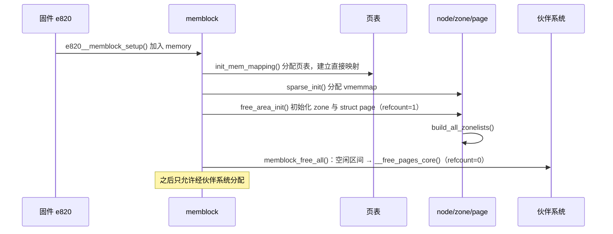

# 4.2 内存初始化：从 memblock 到伙伴系统

> **本节源码**：[`arch/x86/kernel/setup.c`](../../linux/arch/x86/kernel/setup.c)、[`arch/x86/kernel/e820.c`](../../linux/arch/x86/kernel/e820.c)、[`arch/x86/mm/init.c`](../../linux/arch/x86/mm/init.c)、[`arch/x86/mm/init_64.c`](../../linux/arch/x86/mm/init_64.c)、[`mm/memblock.c`](../../linux/mm/memblock.c)、[`mm/sparse.c`](../../linux/mm/sparse.c)、[`mm/mm_init.c`](../../linux/mm/mm_init.c)、[`mm/page_alloc.c`](../../linux/mm/page_alloc.c)
> **关键函数**：`e820__memblock_setup()`、`memblock_alloc_range_nid()`、`init_mem_mapping()`、`sparse_init()`、`free_area_init()`、`build_zonelists()`、`memblock_free_all()`、`__free_pages_core()`
> **前置知识**：4.1 物理内存模型

## 概述

伙伴系统需要 `struct page` 数组、zone 描述符和 per-CPU 结构才能工作，而这些数据结构本身又要占用内存。内核用一个更简单的**启动期分配器 memblock** 打破这个"先有鸡还是先有蛋"的循环：memblock 只用两个静态数组记录"有哪些内存"和"哪些已被占用"，在伙伴系统就绪之前承担所有物理内存分配。

整个过程可以概括为四步：从固件（e820）得到物理内存布局并交给 memblock；建立直接映射页表；用 memblock 分配并初始化 `struct page`、zone、node；最后把 memblock 中所有未被占用的内存"释放"给伙伴系统，memblock 随之退役。

## 调用链总览

```
start_kernel()                                    init/main.c:870
├── setup_arch()                                  arch/x86/kernel/setup.c
│   ├── e820__memory_setup()                      arch/x86/kernel/e820.c       // 读取固件内存表
│   ├── max_pfn = e820__end_of_ram_pfn()
│   ├── kernel_randomize_memory()                 arch/x86/mm/kaslr.c          // 随机化直接映射等基址
│   ├── e820__memblock_setup()                    arch/x86/kernel/e820.c       // e820 → memblock.memory
│   ├── init_mem_mapping()                        arch/x86/mm/init.c           // 建立直接映射
│   ├── initmem_init()                            arch/x86/mm/init_64.c        // 解析 NUMA（SRAT），分配 pg_data_t
│   └── x86_init.paging.pagetable_init()          == paging_init()
│       ├── sparse_init()                         mm/sparse.c                  // 分配 vmemmap 中的 struct page
│       └── zone_sizes_init()                     arch/x86/mm/init.c
│           └── free_area_init()                  mm/mm_init.c                 // 初始化 node/zone/page
├── setup_per_cpu_areas()
└── mm_core_init()                                mm/mm_init.c:2708
    ├── build_all_zonelists()                     mm/page_alloc.c              // 生成 zonelist
    ├── memblock_free_all()                       mm/memblock.c                // 空闲内存交给伙伴系统
    │   └── __free_pages_core()                   mm/page_alloc.c
    ├── mem_init()                                arch/x86/mm/init_64.c
    ├── kmem_cache_init()                         mm/slub.c                    // 4.5
    └── vmalloc_init()                            mm/vmalloc.c                 // 4.6
```

## memblock：启动期分配器

### 数据结构

memblock 把物理内存描述为两组区间：`memory`（所有可用内存）与 `reserved`（已被占用的部分）。空闲内存即 `memory − reserved`。

[`include/linux/memblock.h:73-110`](../../linux/include/linux/memblock.h#L73-L110)（v6.18.60，删去注释）

```c
struct memblock_region {
	phys_addr_t base;
	phys_addr_t size;
	enum memblock_flags flags;
#ifdef CONFIG_NUMA
	int nid;
#endif
};

struct memblock_type {
	unsigned long cnt;
	unsigned long max;
	phys_addr_t total_size;
	struct memblock_region *regions;
	char *name;
};

struct memblock {
	bool bottom_up;  /* is bottom up direction? */
	phys_addr_t current_limit;
	struct memblock_type memory;
	struct memblock_type reserved;
};
```

全局实例 `memblock` 使用静态数组作为初始存储，因此在任何动态分配器可用之前就能工作：

[`mm/memblock.c:122-139`](../../linux/mm/memblock.c#L122-L139)（v6.18.60，省略 CONFIG_HAVE_MEMBLOCK_PHYS_MAP 相关代码）

```c
static struct memblock_region memblock_memory_init_regions[INIT_MEMBLOCK_MEMORY_REGIONS] __initdata_memblock;
static struct memblock_region memblock_reserved_init_regions[INIT_MEMBLOCK_RESERVED_REGIONS] __initdata_memblock;
...
struct memblock memblock __initdata_memblock = {
	.memory.regions		= memblock_memory_init_regions,
	.memory.max		= INIT_MEMBLOCK_MEMORY_REGIONS,
	.memory.name		= "memory",

	.reserved.regions	= memblock_reserved_init_regions,
	.reserved.max		= INIT_MEMBLOCK_RESERVED_REGIONS,
	.reserved.name		= "reserved",

	.bottom_up		= false,
	.current_limit		= MEMBLOCK_ALLOC_ANYWHERE,
};
```

`INIT_MEMBLOCK_REGIONS` 为 128（[`mm/memblock.c:31`](../../linux/mm/memblock.c#L31)）。当区间数超过数组容量时，memblock 可以用自身分配一块更大的数组并迁移过去，但前提是调用过 `memblock_allow_resize()`。`__initdata_memblock` 表示这些数据在 x86_64 上（未定义 `CONFIG_ARCH_KEEP_MEMBLOCK`）启动完成后会被丢弃。

### 从 e820 到 memblock

BIOS/UEFI 通过 e820 表告诉内核物理内存布局（第 1 章）。`e820__memblock_setup()` 遍历这张表，把 `E820_TYPE_RAM` 类型的区间加入 `memblock.memory`：

[`arch/x86/kernel/e820.c:1273-1300`](../../linux/arch/x86/kernel/e820.c#L1273-L1300)（v6.18.60，节选）

```c
	memblock_set_current_limit(ISA_END_ADDRESS);
	...
	memblock_allow_resize();

	for (i = 0; i < e820_table->nr_entries; i++) {
		struct e820_entry *entry = &e820_table->entries[i];

		end = entry->addr + entry->size;
		if (end != (resource_size_t)end)
			continue;

		if (entry->type == E820_TYPE_SOFT_RESERVED)
			memblock_reserve(entry->addr, entry->size);

		if (entry->type != E820_TYPE_RAM)
			continue;

		memblock_add(entry->addr, entry->size);
	}
```

注意 `current_limit` 被设为 `ISA_END_ADDRESS`（1 MB）：此时只有低 1 MB 和内核镜像确定已被映射，memblock 分配出的内存必须能被立即访问，所以要等直接映射建立后再放开限制。在此之前，内核镜像、initrd、BIOS 数据区等已经由 `early_reserve_memory()`（[`arch/x86/kernel/setup.c:798`](../../linux/arch/x86/kernel/setup.c#L798)）等函数加入 `memblock.reserved`。

### 分配

memblock 的分配只是在 `memory − reserved` 中找一段满足对齐要求的空闲区间，并将其加入 `reserved`：

[`mm/memblock.c:1473-1518`](../../linux/mm/memblock.c#L1473-L1518)（v6.18.60，节选）

```c
phys_addr_t __init memblock_alloc_range_nid(phys_addr_t size,
					phys_addr_t align, phys_addr_t start,
					phys_addr_t end, int nid,
					bool exact_nid)
{
	enum memblock_flags flags = choose_memblock_flags();
	phys_addr_t found;
	...
	if (WARN_ON_ONCE(slab_is_available())) {
		void *vaddr = kzalloc_node(size, GFP_NOWAIT, nid);

		return vaddr ? virt_to_phys(vaddr) : 0;
	}
	...
again:
	found = memblock_find_in_range_node(size, align, start, end, nid,
					    flags);
	if (found && !__memblock_reserve(found, size, nid, MEMBLOCK_RSRV_KERN))
		goto done;

	if (numa_valid_node(nid) && !exact_nid) {
		found = memblock_find_in_range_node(size, align, start,
						    end, NUMA_NO_NODE,
						    flags);
		if (found && !memblock_reserve_kern(found, size))
			goto done;
	}
	...
```

查找方向由 `bottom_up` 决定，默认自顶向下（从高地址开始找），这样可以把启动期分配集中在高端，保护稀缺的低端内存（如 DMA 区）：

[`mm/memblock.c:307-327`](../../linux/mm/memblock.c#L307-L327)（v6.18.60）

```c
static phys_addr_t __init_memblock memblock_find_in_range_node(phys_addr_t size,
					phys_addr_t align, phys_addr_t start,
					phys_addr_t end, int nid,
					enum memblock_flags flags)
{
	/* pump up @end */
	if (end == MEMBLOCK_ALLOC_ACCESSIBLE ||
	    end == MEMBLOCK_ALLOC_NOLEAKTRACE)
		end = memblock.current_limit;

	/* avoid allocating the first page */
	start = max_t(phys_addr_t, start, PAGE_SIZE);
	end = max(start, end);

	if (memblock_bottom_up())
		return __memblock_find_range_bottom_up(start, end, size, align,
						       nid, flags);
	else
		return __memblock_find_range_top_down(start, end, size, align,
						      nid, flags);
}
```

启用内存热插拔且指定了 `movable_node` 启动参数时，`e820__memblock_setup()` 会切换为自底向上（[`arch/x86/kernel/e820.c:1265-1266`](../../linux/arch/x86/kernel/e820.c#L1265-L1266)），让内核数据尽量靠近内核镜像，避免落在可热拔的内存上。

## 建立直接映射

memblock 交出的是物理地址，内核要访问它们，必须先在页表中建立映射。`init_mem_mapping()` 把 `[0, max_pfn)` 的全部物理内存线性映射到 `PAGE_OFFSET` 起始的直接映射区：

[`arch/x86/mm/init.c:759-797`](../../linux/arch/x86/mm/init.c#L759-L797)（v6.18.60，节选）

```c
void __init init_mem_mapping(void)
{
	unsigned long end;

	pti_check_boottime_disable();
	probe_page_size_mask();
	setup_pcid();

#ifdef CONFIG_X86_64
	end = max_pfn << PAGE_SHIFT;
#else
	end = max_low_pfn << PAGE_SHIFT;
#endif

	/* the ISA range is always mapped regardless of memory holes */
	init_memory_mapping(0, ISA_END_ADDRESS, PAGE_KERNEL);

	/* Init the trampoline, possibly with KASLR memory offset */
	init_trampoline();

	/*
	 * If the allocation is in bottom-up direction, we setup direct mapping
	 * in bottom-up, otherwise we setup direct mapping in top-down.
	 */
	if (memblock_bottom_up()) {
		...
	} else {
		memory_map_top_down(ISA_END_ADDRESS, end);
	}
```

`probe_page_size_mask()` 检查 CPU 是否支持 2 MB / 1 GB 大页，直接映射会尽可能使用大页以减少页表开销和 TLB 缺失。映射建立的过程存在一个自举问题：映射新内存需要分配页表页，而页表页本身必须位于已映射的内存中。`memory_map_top_down()` 的策略是先映射高端一小块，用它来放页表，再逐步扩大映射范围。

建立完成后，`setup_arch()` 调用 `memblock_set_current_limit(get_max_mapped())`（[`arch/x86/kernel/setup.c:1150`](../../linux/arch/x86/kernel/setup.c#L1150)），memblock 从此可以分配任意已映射的内存。

## NUMA 初始化

`initmem_init()`（[`arch/x86/mm/init_64.c:832`](../../linux/arch/x86/mm/init_64.c#L832)）调用 `x86_numa_init()`（[`arch/x86/mm/numa.c:225`](../../linux/arch/x86/mm/numa.c#L225)），依次尝试从 ACPI SRAT 表（`CONFIG_ACPI_NUMA`）、AMD 北桥等来源获取"哪段物理内存属于哪个节点"，然后用 `memblock_set_node()` 把节点号写入每个 `memblock_region` 的 `nid` 字段，并为每个在线节点分配 `pg_data_t`（`alloc_node_data()`）。所有方法都失败时回退到 `dummy_numa_init()`，把全部内存放入节点 0。节点间距离来自 ACPI SLIT 表，`build_zonelists()` 会用到它。

## 初始化 `struct page`

### `sparse_init()`：分配 vmemmap

`paging_init()` 先调用 `sparse_init()`：

[`arch/x86/mm/init_64.c:837-851`](../../linux/arch/x86/mm/init_64.c#L837-L851)（v6.18.60）

```c
void __init paging_init(void)
{
	sparse_init();

	/*
	 * clear the default setting with node 0
	 * note: don't use nodes_clear here, that is really clearing when
	 *	 numa support is not compiled in, and later node_set_state
	 *	 will not set it back.
	 */
	node_clear_state(0, N_MEMORY);
	node_clear_state(0, N_NORMAL_MEMORY);

	zone_sizes_init();
}
```

`sparse_init()` 先用 `memblocks_present()` 根据 memblock 标记哪些 128 MB 段存在内存，然后按节点分组，为每个存在的段填充 vmemmap：

[`mm/sparse.c:594-624`](../../linux/mm/sparse.c#L594-L624)（v6.18.60，节选）

```c
void __init sparse_init(void)
{
	unsigned long pnum_end, pnum_begin, map_count = 1;
	int nid_begin;

	/* see include/linux/mmzone.h 'struct mem_section' definition */
	BUILD_BUG_ON(!is_power_of_2(sizeof(struct mem_section)));
	memblocks_present();

	pnum_begin = first_present_section_nr();
	nid_begin = sparse_early_nid(__nr_to_section(pnum_begin));
	...
	for_each_present_section_nr(pnum_begin + 1, pnum_end) {
		int nid = sparse_early_nid(__nr_to_section(pnum_end));

		if (nid == nid_begin) {
			map_count++;
			continue;
		}
		/* Init node with sections in range [pnum_begin, pnum_end) */
		sparse_init_nid(nid_begin, pnum_begin, pnum_end, map_count);
		nid_begin = nid;
		pnum_begin = pnum_end;
		map_count = 1;
	}
	/* cover the last node */
	sparse_init_nid(nid_begin, pnum_begin, pnum_end, map_count);
```

`sparse_init_nid()` 对每个段调用 `__populate_section_memmap()`（[`mm/sparse-vmemmap.c:508`](../../linux/mm/sparse-vmemmap.c#L508)），最终进入 x86 的 `vmemmap_populate()`（[`arch/x86/mm/init_64.c:1577`](../../linux/arch/x86/mm/init_64.c#L1577)）：在 vmemmap 虚拟区间为这一段的 `struct page` 建立页表，并从**本节点**分配物理页作为后备存储（优先用 2 MB 大页）。一个 128 MB 段有 32768 个页，对应 32768 × 64 B = 2 MB 的 `struct page`，恰好一个 PMD 大页。

注意这一步只是分配了内存，`struct page` 的内容尚未初始化。

### `free_area_init()`：初始化 node 与 zone

`zone_sizes_init()` 计算出每个 zone 的结束 PFN 后调用 `free_area_init()`。它首先把"每个 zone 的最大 PFN"转换为每个 zone 的 `[lowest, highest)` 区间：

[`mm/mm_init.c:1849-1879`](../../linux/mm/mm_init.c#L1849-L1879)（v6.18.60）

```c
void __init free_area_init(unsigned long *max_zone_pfn)
{
	unsigned long start_pfn, end_pfn;
	int i, nid, zone;
	bool descending;

	/* Record where the zone boundaries are */
	memset(arch_zone_lowest_possible_pfn, 0,
				sizeof(arch_zone_lowest_possible_pfn));
	memset(arch_zone_highest_possible_pfn, 0,
				sizeof(arch_zone_highest_possible_pfn));

	start_pfn = PHYS_PFN(memblock_start_of_DRAM());
	descending = arch_has_descending_max_zone_pfns();

	for (i = 0; i < MAX_NR_ZONES; i++) {
		if (descending)
			zone = MAX_NR_ZONES - i - 1;
		else
			zone = i;

		if (zone == ZONE_MOVABLE)
			continue;

		end_pfn = max(max_zone_pfn[zone], start_pfn);
		arch_zone_lowest_possible_pfn[zone] = start_pfn;
		arch_zone_highest_possible_pfn[zone] = end_pfn;

		start_pfn = end_pfn;
	}

	/* Find the PFNs that ZONE_MOVABLE begins at in each node */
	memset(zone_movable_pfn, 0, sizeof(zone_movable_pfn));
	find_zone_movable_pfns_for_nodes();
```

随后打印我们在 `dmesg` 中常见的 "Zone ranges"、"Early memory node ranges" 信息，再对每个节点调用 `free_area_init_node()`，最后统一初始化 `struct page`：

[`mm/mm_init.c:1927-1954`](../../linux/mm/mm_init.c#L1927-L1954)（v6.18.60，节选）

```c
	for_each_node(nid) {
		pg_data_t *pgdat;

		if (!node_online(nid))
			alloc_offline_node_data(nid);

		pgdat = NODE_DATA(nid);
		free_area_init_node(nid);
		...
		if (pgdat->node_present_pages) {
			node_set_state(nid, N_MEMORY);
			check_for_memory(pgdat);
		}
	}

	for_each_node_state(nid, N_MEMORY)
		sparse_vmemmap_init_nid_late(nid);

	calc_nr_kernel_pages();
	memmap_init();
```

`free_area_init_node()` 通过 `calculate_node_totalpages()`（[`mm/mm_init.c:1350`](../../linux/mm/mm_init.c#L1350)）计算每个 zone 的 `spanned_pages` 和 `present_pages`，再调用 `free_area_init_core()` 初始化 zone：

[`mm/mm_init.c:1621-1645`](../../linux/mm/mm_init.c#L1621-L1645)（v6.18.60）

```c
static void __init free_area_init_core(struct pglist_data *pgdat)
{
	enum zone_type j;
	int nid = pgdat->node_id;

	pgdat_init_internals(pgdat);
	pgdat->per_cpu_nodestats = &boot_nodestats;

	for (j = 0; j < MAX_NR_ZONES; j++) {
		struct zone *zone = pgdat->node_zones + j;
		unsigned long size = zone->spanned_pages;

		/*
		 * Initialize zone->managed_pages as 0 , it will be reset
		 * when memblock allocator frees pages into buddy system.
		 */
		zone_init_internals(zone, j, nid, zone->present_pages);

		if (!size)
			continue;

		setup_usemap(zone);
		init_currently_empty_zone(zone, zone->zone_start_pfn, size);
	}
}
```

`init_currently_empty_zone()` 调用 `zone_init_free_lists()`（[`mm/mm_init.c:1446`](../../linux/mm/mm_init.c#L1446)）把所有 `free_area[order].free_list[mt]` 初始化为空链表。注意此时 `managed_pages` 为 0：zone 已经存在，但里面还没有任何空闲页。

### `memmap_init()`：逐页初始化

`memmap_init()` 遍历每个 zone 的每段内存，调用 `memmap_init_range()`：

[`mm/mm_init.c:919-948`](../../linux/mm/mm_init.c#L919-L948)（v6.18.60，节选）

```c
	for (pfn = start_pfn; pfn < end_pfn; ) {
		/*
		 * There can be holes in boot-time mem_map[]s handed to this
		 * function.  They do not exist on hotplugged memory.
		 */
		if (context == MEMINIT_EARLY) {
			if (overlap_memmap_init(zone, &pfn))
				continue;
			if (defer_init(nid, pfn, zone_end_pfn)) {
				deferred_struct_pages = true;
				break;
			}
		}

		page = pfn_to_page(pfn);
		__init_single_page(page, pfn, zone, nid);
		...
		/*
		 * Usually, we want to mark the pageblock MIGRATE_MOVABLE,
		 * such that unmovable allocations won't be scattered all
		 * over the place during system boot.
		 */
```

`__init_single_page()` 把页清零、写入 zone/node 链接、引用计数设为 1、映射计数设为 -1：

[`mm/mm_init.c:581-597`](../../linux/mm/mm_init.c#L581-L597)（v6.18.60）

```c
void __meminit __init_single_page(struct page *page, unsigned long pfn,
				unsigned long zone, int nid)
{
	mm_zero_struct_page(page);
	set_page_links(page, zone, nid, pfn);
	init_page_count(page);
	atomic_set(&page->_mapcount, -1);
	page_cpupid_reset_last(page);
	page_kasan_tag_reset(page);

	INIT_LIST_HEAD(&page->lru);
#ifdef WANT_PAGE_VIRTUAL
	/* The shift won't overflow because ZONE_NORMAL is below 4G. */
	if (!is_highmem_idx(zone))
		set_page_address(page, __va(pfn << PAGE_SHIFT));
#endif
}
```

引用计数初始化为 1 表示"已分配"。这是一个刻意的设计：页在被正式释放给伙伴系统之前，任何代码都不会把它当作空闲页。每个页块的起始页还会被标记为 `MIGRATE_MOVABLE`，因为启动后的绝大多数分配（用户页、page cache）都是可移动的。

`defer_init()` 在 `CONFIG_DEFERRED_STRUCT_PAGE_INIT` 启用时会把大部分 `struct page` 的初始化推迟到 `page_alloc_init_late()` 中由每节点一个内核线程并行完成，以缩短大内存机器的启动时间。本书配置未启用该选项，`defer_init()` 恒返回 false。

## 构建 zonelist

进入 `mm_core_init()` 后，`build_all_zonelists()` 为每个节点生成 zonelist。核心是 `build_zonelists()`：先用 `find_next_best_node()` 按距离对所有节点排序，再把每个节点的 zone **从高到低**加入列表：

[`mm/page_alloc.c:5598-5614`](../../linux/mm/page_alloc.c#L5598-L5614)（v6.18.60）

```c
static int build_zonerefs_node(pg_data_t *pgdat, struct zoneref *zonerefs)
{
	struct zone *zone;
	enum zone_type zone_type = MAX_NR_ZONES;
	int nr_zones = 0;

	do {
		zone_type--;
		zone = pgdat->node_zones + zone_type;
		if (populated_zone(zone)) {
			zoneref_set_zone(zone, &zonerefs[nr_zones++]);
			check_highest_zone(zone_type);
		}
	} while (zone_type);

	return nr_zones;
}
```

`find_next_best_node()` 的打分规则（[`mm/page_alloc.c:5663-5713`](../../linux/mm/page_alloc.c#L5663-L5713)）：

1. 本地节点（且有内存）总是第一个；
2. 其余节点按 `node_distance()` 升序；
3. 编号小于本节点的节点加 1 分（相同距离时"优先选下一个节点"）；
4. 有 CPU 的节点加 `PENALTY_FOR_NODE_WITH_CPUS` 分（无 CPU 的纯内存节点压力小，优先使用）；
5. 乘以 `MAX_NUMNODES` 后加上 `node_load[]`，使同距离的节点在不同本地节点的列表中轮流靠前。

[`mm/page_alloc.c:5751-5782`](../../linux/mm/page_alloc.c#L5751-L5782)（v6.18.60，节选）

```c
static void build_zonelists(pg_data_t *pgdat)
{
	static int node_order[MAX_NUMNODES];
	int node, nr_nodes = 0;
	nodemask_t used_mask = NODE_MASK_NONE;
	int local_node, prev_node;

	/* NUMA-aware ordering of nodes */
	local_node = pgdat->node_id;
	prev_node = local_node;

	memset(node_order, 0, sizeof(node_order));
	while ((node = find_next_best_node(local_node, &used_mask)) >= 0) {
		/*
		 * We don't want to pressure a particular node.
		 * So adding penalty to the first node in same
		 * distance group to make it round-robin.
		 */
		if (node_distance(local_node, node) !=
		    node_distance(local_node, prev_node))
			node_load[node] += 1;

		node_order[nr_nodes++] = node;
		prev_node = node;
	}

	build_zonelists_in_node_order(pgdat, node_order, nr_nodes);
	build_thisnode_zonelists(pgdat);
	pr_info("Fallback order for Node %d: ", local_node);
	...
```

以两节点机器为例，节点 0 的 `ZONELIST_FALLBACK` 为：

```
Node0/Normal → Node0/DMA32 → Node0/DMA → Node1/Normal → Node1/DMA32 ...
```

这种"节点优先"顺序最大化了局部性，代价是本地 DMA 区可能先于远端 Normal 区被耗尽；4.4 节的 `lowmem_reserve` 机制用于缓解这一问题。早期内核还支持"zone 优先"顺序，v4.14 起已删除，`numa_zonelist_order` 参数只保留兼容性警告（[`mm/page_alloc.c:5620-5631`](../../linux/mm/page_alloc.c#L5620-L5631)）。

## 交接：`memblock_free_all()`

一切就绪后，`mm_core_init()` 调用 `memblock_free_all()` 把空闲内存交给伙伴系统：

[`mm/memblock.c:2339-2349`](../../linux/mm/memblock.c#L2339-L2349)（v6.18.60）

```c
void __init memblock_free_all(void)
{
	unsigned long pages;

	free_unused_memmap();
	reset_all_zones_managed_pages();

	memblock_clear_kho_scratch_only();
	pages = free_low_memory_core_early();
	totalram_pages_add(pages);
}
```

`free_low_memory_core_early()` 先把所有 reserved 区间对应的页标记为 `PG_reserved`（`memmap_init_reserved_pages()`），再遍历所有空闲区间：

[`mm/memblock.c:2291-2310`](../../linux/mm/memblock.c#L2291-L2310)（v6.18.60）

```c
static unsigned long __init free_low_memory_core_early(void)
{
	unsigned long count = 0;
	phys_addr_t start, end;
	u64 i;

	memblock_clear_hotplug(0, -1);

	memmap_init_reserved_pages();

	/*
	 * We need to use NUMA_NO_NODE instead of NODE_DATA(0)->node_id
	 *  because in some case like Node0 doesn't have RAM installed
	 *  low ram will be on Node1
	 */
	for_each_free_mem_range(i, NUMA_NO_NODE, MEMBLOCK_NONE, &start, &end,
				NULL)
		count += __free_memory_core(start, end);

	return count;
}
```

`__free_pages_memory()` 把每段空闲区间切成尽可能大的、自然对齐的 2 的幂次块：

[`mm/memblock.c:2199-2223`](../../linux/mm/memblock.c#L2199-L2223)（v6.18.60）

```c
static void __init __free_pages_memory(unsigned long start, unsigned long end)
{
	int order;

	while (start < end) {
		/*
		 * Free the pages in the largest chunks alignment allows.
		 *
		 * __ffs() behaviour is undefined for 0. start == 0 is
		 * MAX_PAGE_ORDER-aligned, set order to MAX_PAGE_ORDER for
		 * the case.
		 */
		if (start)
			order = min_t(int, MAX_PAGE_ORDER, __ffs(start));
		else
			order = MAX_PAGE_ORDER;

		while (start + (1UL << order) > end)
			order--;

		memblock_free_pages(pfn_to_page(start), start, order);

		start += (1UL << order);
	}
}
```

`__ffs(start)` 是 PFN 最低置位的位置，即 `start` 能满足的最大对齐阶。例如区间 `[0x1003, 0x2000)` 会依次被切成 order 0（0x1003）、order 2（0x1004～0x1007）、order 3、……、order 10 的块。这样释放进伙伴系统的块天然满足"块起始 PFN 按块大小对齐"的不变量。

每个块最终进入 `__free_pages_core()`：

[`mm/page_alloc.c:1626-1671`](../../linux/mm/page_alloc.c#L1626-L1671)（v6.18.60，节选）

```c
void __meminit __free_pages_core(struct page *page, unsigned int order,
		enum meminit_context context)
{
	unsigned int nr_pages = 1 << order;
	struct page *p = page;
	unsigned int loop;
	...
	if (IS_ENABLED(CONFIG_MEMORY_HOTPLUG) &&
	    unlikely(context == MEMINIT_HOTPLUG)) {
		...
	} else {
		for (loop = 0; loop < nr_pages; loop++, p++) {
			__ClearPageReserved(p);
			set_page_count(p, 0);
		}

		/* memblock adjusts totalram_pages() manually. */
		atomic_long_add(nr_pages, &page_zone(page)->managed_pages);
	}

	if (page_contains_unaccepted(page, order)) {
		if (order == MAX_PAGE_ORDER && __free_unaccepted(page))
			return;

		accept_memory(page_to_phys(page), PAGE_SIZE << order);
	}

	/*
	 * Bypass PCP and place fresh pages right to the tail, primarily
	 * relevant for memory onlining.
	 */
	__free_pages_ok(page, order, FPI_TO_TAIL);
}
```

这里把引用计数清零（与 `__init_single_page()` 设置的 1 对应），累加 zone 的 `managed_pages`，然后走正常的页释放路径 `__free_pages_ok()`（4.3 节）。"未接受内存"（Unaccepted Memory，`CONFIG_UNACCEPTED_MEMORY`）是 Intel TDX / AMD SEV-SNP 机密虚拟机的概念，客户机必须显式"接受"一段内存后才能使用；内核把这一步推迟到真正需要时进行。

`memblock_free_all()` 返回后，伙伴系统正式可用，`slab_is_available()` 将在 `kmem_cache_init()` 之后返回 true。memblock 的数据在 `page_alloc_init_late()` 中通过 `memblock_discard()` 释放（x86_64 未定义 `CONFIG_ARCH_KEEP_MEMBLOCK`）。



*图 4-4：启动期内存管理的交接时序*

## 动手实验

在 dev 虚拟机中查看启动日志里的内存布局信息：

```bash
sudo dmesg | grep -E "BIOS-e820|Zone ranges|  (DMA|DMA32|Normal|Movable|Device)|Early memory node|node +[0-9]+: \[mem|Fallback order|Memory: "
```

输出依次对应 e820 表、`free_area_init()` 打印的 zone 范围与节点范围、`build_zonelists()` 打印的回退顺序，以及 `mem_init_print_info()` 打印的内存汇总（[`mm/mm_init.c:2646`](../../linux/mm/mm_init.c#L2646)）。

开启 `memblock=debug` 启动参数，可以看到每次 memblock 分配与保留的调用者：

```bash
# 在 /etc/default/grub 的 GRUB_CMDLINE_LINUX 中追加 memblock=debug 后
sudo update-grub && sudo reboot
sudo dmesg | grep memblock | head -30
```

在启用 `debugfs` 的系统上还可以直接查看 memblock 最终状态（需 `CONFIG_ARCH_KEEP_MEMBLOCK`，x86_64 默认不可用）。

## 小结

- memblock 用 `memory` 和 `reserved` 两组区间描述物理内存，在伙伴系统就绪前承担所有分配，默认自顶向下查找。
- x86_64 的初始化顺序是：e820 → memblock → 直接映射 → NUMA → `sparse_init()`（分配 vmemmap）→ `free_area_init()`（初始化 zone 与 `struct page`）。
- `struct page` 初始化时引用计数为 1，表示"不可分配"；只有经 `__free_pages_core()` 清零后才进入伙伴系统。
- zonelist 按"节点距离优先、节点内 zone 从高到低"排列，`find_next_best_node()` 还会在同距离节点间做负载打散。
- `memblock_free_all()` 把空闲区间切成自然对齐的最大块释放给伙伴系统，同时累加 `managed_pages`。

## 参考

- `linux/Documentation/core-api/boot-time-mm.rst`
- `linux/Documentation/mm/memory-model.rst`
- `linux/Documentation/arch/x86/x86_64/mm.rst`
