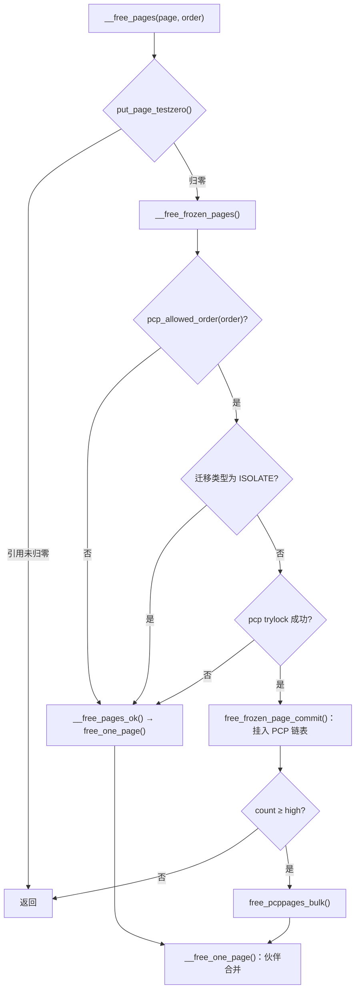

# 4.3 伙伴系统与 per-CPU 页缓存

> **本节源码**：`mm/page_alloc.c`、`mm/internal.h`、`mm/mempolicy.c`、`include/linux/mmzone.h`、`include/linux/gfp.h`
> **关键函数**：`__alloc_frozen_pages_noprof()`、`get_page_from_freelist()`、`rmqueue()`、`__rmqueue_smallest()`、`expand()`、`__rmqueue()`、`try_to_claim_block()`、`__free_frozen_pages()`、`__free_one_page()`、`free_frozen_page_commit()`
> **前置知识**：4.1 物理内存模型、4.2 内存初始化

## 概述

伙伴系统（Buddy System）是内核物理页分配的基础：所有其他分配器（slab、vmalloc、页缓存、用户页）最终都从这里拿页。它要解决的问题是**以页为单位、快速地分配与回收连续的物理内存，同时尽量避免外部碎片**。

核心思想是把空闲内存组织成大小为 2^order 页、并且起始 PFN 按自身大小对齐的块。分配时若没有恰好大小的块，就把更大的块对半拆分；释放时检查与之配对的"伙伴"块是否也空闲，若是则合并成更大的块。由于对齐约束，伙伴的位置只需一次异或运算即可算出。

在此之上，Linux 叠加了两层优化：**迁移类型**把可移动与不可移动的页分开存放，减少长期碎片化；**per-CPU 页缓存（Per-CPU Pageset，PCP）** 为小阶分配提供无需 zone 锁的快速通道。本节按"分配快速路径 → 伙伴算法 → 迁移类型回退 → 释放与合并 → PCP"的顺序展开，慢速路径与水位线留到 4.4 节。

## 核心数据结构

本节涉及的数据结构在 4.1 节已介绍过，这里汇总它们在分配器中的作用：

| 结构 | 位置 | 作用 |
|---|---|---|
| `zone->free_area[order]` | `include/linux/mmzone.h:138` | 每阶一组空闲链表，`free_list[mt]` 按迁移类型区分 |
| `zone->lock` | `include/linux/mmzone.h:1013` | 保护 `free_area` 的自旋锁 |
| `zone->per_cpu_pageset` | `include/linux/mmzone.h:744` | 每 CPU 一个 `per_cpu_pages`，缓存小阶空闲页 |
| `page->private` + `PG_buddy` | `include/linux/mm_types.h` | 空闲块首页记录阶数，并以 `PageBuddy()` 标识 |
| pageblock 标志位 | `mem_section->usage->pageblock_flags` | 每个页块的迁移类型 |

`per_cpu_pages` 的字段如下：

```c
// include/linux/mmzone.h:744-761（v6.18.60）
struct per_cpu_pages {
	spinlock_t lock;	/* Protects lists field */
	int count;		/* number of pages in the list */
	int high;		/* high watermark, emptying needed */
	int high_min;		/* min high watermark */
	int high_max;		/* max high watermark */
	int batch;		/* chunk size for buddy add/remove */
	u8 flags;		/* protected by pcp->lock */
	u8 alloc_factor;	/* batch scaling factor during allocate */
#ifdef CONFIG_NUMA
	u8 expire;		/* When 0, remote pagesets are drained */
#endif
	short free_count;	/* consecutive free count */

	/* Lists of pages, one per migrate type stored on the pcp-lists */
	struct list_head lists[NR_PCP_LISTS];
} ____cacheline_aligned_in_smp;
```

`lists[]` 的数量是 `NR_PCP_LISTS`：阶 0～3（`PAGE_ALLOC_COSTLY_ORDER`）每阶 3 个迁移类型共 12 条，加上启用 THP 时的 2 条 PMD 阶链表（可移动 / 不可移动各一条），共 14 条（`include/linux/mmzone.h:721-727`）。下标由 `order_to_pindex()` 计算：

```c
// mm/page_alloc.c:684-701（v6.18.60）
static inline unsigned int order_to_pindex(int migratetype, int order)
{

#ifdef CONFIG_TRANSPARENT_HUGEPAGE
	bool movable;
	if (order > PAGE_ALLOC_COSTLY_ORDER) {
		VM_BUG_ON(order != HPAGE_PMD_ORDER);

		movable = migratetype == MIGRATE_MOVABLE;

		return NR_LOWORDER_PCP_LISTS + movable;
	}
#else
	VM_BUG_ON(order > PAGE_ALLOC_COSTLY_ORDER);
#endif

	return (MIGRATE_PCPTYPES * order) + migratetype;
}
```

## 分配：调用链总览

```
alloc_pages(gfp, order)                              include/linux/gfp.h:346
└── alloc_pages_noprof()                             mm/mempolicy.c:2502     // 应用 NUMA 内存策略
    └── alloc_frozen_pages_noprof() → alloc_pages_mpol()
        └── __alloc_frozen_pages_noprof()            mm/page_alloc.c:5259
            ├── prepare_alloc_pages()                // 填写 alloc_context
            ├── get_page_from_freelist()             // 快速路径：遍历 zonelist
            │   ├── zone_watermark_fast()            // 水位检查（4.4）
            │   └── rmqueue()
            │       ├── rmqueue_pcplist()            // order ≤ 3 或 THP：走 PCP
            │       │   └── __rmqueue_pcplist()
            │       │       └── rmqueue_bulk()       // PCP 为空时批量从伙伴系统取
            │       │           └── __rmqueue()
            │       └── rmqueue_buddy()              // 其余阶：持 zone->lock
            │           └── __rmqueue()
            │               ├── __rmqueue_smallest()
            │               ├── __rmqueue_cma_fallback()
            │               ├── __rmqueue_claim()
            │               └── __rmqueue_steal()
            │   └── prep_new_page()                  // 清零、设置复合页等
            └── __alloc_pages_slowpath()             // 慢速路径（4.4）
```

### 入口与 `alloc_context`

`__alloc_frozen_pages_noprof()` 是所有页分配的汇合点。"frozen"指返回的页引用计数为 0，由调用者决定何时设为 1；普通的 `__alloc_pages_noprof()` 只是在它外面包了一层 `set_page_refcounted()`：

```c
// mm/page_alloc.c:5259-5311（v6.18.60，节选）
struct page *__alloc_frozen_pages_noprof(gfp_t gfp, unsigned int order,
		int preferred_nid, nodemask_t *nodemask)
{
	struct page *page;
	unsigned int alloc_flags = ALLOC_WMARK_LOW;
	gfp_t alloc_gfp; /* The gfp_t that was actually used for allocation */
	struct alloc_context ac = { };

	/*
	 * There are several places where we assume that the order value is sane
	 * so bail out early if the request is out of bound.
	 */
	if (WARN_ON_ONCE_GFP(order > MAX_PAGE_ORDER, gfp))
		return NULL;

	gfp &= gfp_allowed_mask;
	...
	gfp = current_gfp_context(gfp);
	alloc_gfp = gfp;
	if (!prepare_alloc_pages(gfp, order, preferred_nid, nodemask, &ac,
			&alloc_gfp, &alloc_flags))
		return NULL;

	/*
	 * Forbid the first pass from falling back to types that fragment
	 * memory until all local zones are considered.
	 */
	alloc_flags |= alloc_flags_nofragment(zonelist_zone(ac.preferred_zoneref), gfp);

	/* First allocation attempt */
	page = get_page_from_freelist(alloc_gfp, order, alloc_flags, &ac);
	if (likely(page))
		goto out;

	alloc_gfp = gfp;
	ac.spread_dirty_pages = false;
	...
	ac.nodemask = nodemask;

	page = __alloc_pages_slowpath(alloc_gfp, order, &ac);

out:
	...
```

要点有三：

1. 快速路径使用 `ALLOC_WMARK_LOW`，即要求分配后空闲页仍高于 **low** 水位；
2. `current_gfp_context()` 根据当前任务的 `memalloc_nofs_save()` 等作用域标志收紧 GFP，避免在文件系统回调中递归进入文件系统；
3. `alloc_flags_nofragment()` 可能加上 `ALLOC_NOFRAGMENT`，让第一轮尝试**不**拆分其他迁移类型的页块，这一点后面详述。

`prepare_alloc_pages()` 把 GFP 翻译为一个 `alloc_context`，后续所有函数都基于它工作：

```c
// mm/page_alloc.c:5041-5087（v6.18.60，节选）
static inline bool prepare_alloc_pages(gfp_t gfp_mask, unsigned int order,
		int preferred_nid, nodemask_t *nodemask,
		struct alloc_context *ac, gfp_t *alloc_gfp,
		unsigned int *alloc_flags)
{
	ac->highest_zoneidx = gfp_zone(gfp_mask);
	ac->zonelist = node_zonelist(preferred_nid, gfp_mask);
	ac->nodemask = nodemask;
	ac->migratetype = gfp_migratetype(gfp_mask);

	if (cpusets_enabled()) {
		*alloc_gfp |= __GFP_HARDWALL;
		...
		if (in_task() && !ac->nodemask)
			ac->nodemask = &cpuset_current_mems_allowed;
		else
			*alloc_flags |= ALLOC_CPUSET;
	}
	...
	*alloc_flags = gfp_to_alloc_flags_cma(gfp_mask, *alloc_flags);

	/* Dirty zone balancing only done in the fast path */
	ac->spread_dirty_pages = (gfp_mask & __GFP_WRITE);

	/*
	 * The preferred zone is used for statistics but crucially it is
	 * also used as the starting point for the zonelist iterator. It
	 * may get reset for allocations that ignore memory policies.
	 */
	ac->preferred_zoneref = first_zones_zonelist(ac->zonelist,
					ac->highest_zoneidx, ac->nodemask);

	return true;
}
```

`gfp_migratetype()` 把 `__GFP_MOVABLE` / `__GFP_RECLAIMABLE` 映射为 `MIGRATE_MOVABLE` / `MIGRATE_RECLAIMABLE`，两者都没有则是 `MIGRATE_UNMOVABLE`。

### 遍历 zonelist：`get_page_from_freelist()`

快速路径沿 zonelist 从 `preferred_zoneref` 开始，跳过所有高于 `highest_zoneidx` 或不在 `nodemask` 中的 zone，对每个 zone 检查水位，通过则调用 `rmqueue()`：

```c
// mm/page_alloc.c:3868-3947（v6.18.60，节选）
		if (test_bit(ZONE_BELOW_HIGH, &zone->flags))
			goto check_alloc_wmark;

		mark = high_wmark_pages(zone);
		if (zone_watermark_fast(zone, order, mark,
					ac->highest_zoneidx, alloc_flags,
					gfp_mask))
			goto try_this_zone;
		else
			set_bit(ZONE_BELOW_HIGH, &zone->flags);

check_alloc_wmark:
		mark = wmark_pages(zone, alloc_flags & ALLOC_WMARK_MASK);
		if (!zone_watermark_fast(zone, order, mark,
				       ac->highest_zoneidx, alloc_flags,
				       gfp_mask)) {
			...
			if (alloc_flags & ALLOC_NO_WATERMARKS)
				goto try_this_zone;

			if (!node_reclaim_enabled() ||
			    !zone_allows_reclaim(zonelist_zone(ac->preferred_zoneref), zone))
				continue;

			ret = node_reclaim(zone->zone_pgdat, gfp_mask, order);
			...
		}

try_this_zone:
		page = rmqueue(zonelist_zone(ac->preferred_zoneref), zone, order,
				gfp_mask, alloc_flags, ac->migratetype);
		if (page) {
			prep_new_page(page, order, gfp_mask, alloc_flags);

			/*
			 * If this is a high-order atomic allocation then check
			 * if the pageblock should be reserved for the future
			 */
			if (unlikely(alloc_flags & ALLOC_HIGHATOMIC))
				reserve_highatomic_pageblock(page, order, zone);

			return page;
		} else {
			...
		}
```

这里先用 **high** 水位做一次检查，失败时设置 `ZONE_BELOW_HIGH` 标志。这个标志不影响本次分配，而是用来通知释放路径"zone 内存偏紧，应减少 PCP 缓存"（见后文 `nr_pcp_high()`）。真正决定能否分配的是第二次检查，使用 `alloc_flags` 指定的水位（快速路径为 low）。

函数中还有几个跳过 zone 的条件，例如：

- `ALLOC_NOFRAGMENT` 时一旦要跨到远端节点，就去掉该标志从头重试——"局部性比避免碎片更重要"；
- 多节点系统上，若某节点的 kswapd 正在运行（`kswapd_wait` 上没有等待者），优先尝试其他节点，都不行再回头（`mm/page_alloc.c:3846-3857`）；
- `__GFP_WRITE` 分配会跳过脏页超标的节点。

### `rmqueue()`：PCP 还是伙伴系统

```c
// mm/page_alloc.c:3375-3402（v6.18.60）
struct page *rmqueue(struct zone *preferred_zone,
			struct zone *zone, unsigned int order,
			gfp_t gfp_flags, unsigned int alloc_flags,
			int migratetype)
{
	struct page *page;

	if (likely(pcp_allowed_order(order))) {
		page = rmqueue_pcplist(preferred_zone, zone, order,
				       migratetype, alloc_flags);
		if (likely(page))
			goto out;
	}

	page = rmqueue_buddy(preferred_zone, zone, order, alloc_flags,
							migratetype);

out:
	/* Separate test+clear to avoid unnecessary atomics */
	if ((alloc_flags & ALLOC_KSWAPD) &&
	    unlikely(test_bit(ZONE_BOOSTED_WATERMARK, &zone->flags))) {
		clear_bit(ZONE_BOOSTED_WATERMARK, &zone->flags);
		wakeup_kswapd(zone, 0, 0, zone_idx(zone));
	}

	VM_BUG_ON_PAGE(page && bad_range(zone, page), page);
	return page;
}
```

`pcp_allowed_order()`（`mm/page_alloc.c:717-726`）对 order ≤ 3 以及 THP 的 PMD 阶（9）返回 true。PCP 取不到（例如 trylock 失败）时回退到 `rmqueue_buddy()`。`ZONE_BOOSTED_WATERMARK` 与"水位提升"相关，在迁移类型回退一节说明。

## 伙伴算法

### 分配：`__rmqueue_smallest()` 与 `expand()`

在持有 `zone->lock` 的前提下，`__rmqueue_smallest()` 从请求的阶开始向上找第一个非空的链表：

```c
// mm/page_alloc.c:1927-1950（v6.18.60）
struct page *__rmqueue_smallest(struct zone *zone, unsigned int order,
						int migratetype)
{
	unsigned int current_order;
	struct free_area *area;
	struct page *page;

	/* Find a page of the appropriate size in the preferred list */
	for (current_order = order; current_order < NR_PAGE_ORDERS; ++current_order) {
		area = &(zone->free_area[current_order]);
		page = get_page_from_free_area(area, migratetype);
		if (!page)
			continue;

		page_del_and_expand(zone, page, order, current_order,
				    migratetype);
		trace_mm_page_alloc_zone_locked(page, order, migratetype,
				pcp_allowed_order(order) &&
				migratetype < MIGRATE_PCPTYPES);
		return page;
	}

	return NULL;
}
```

找到的块若比需要的大，由 `expand()` 逐级对半拆分，把**后半部分**挂回低一阶的链表，前半部分继续拆分，最终返回最前面的 2^order 页：

```c
// mm/page_alloc.c:1740-1776（v6.18.60）
static inline unsigned int expand(struct zone *zone, struct page *page, int low,
				  int high, int migratetype)
{
	unsigned int size = 1 << high;
	unsigned int nr_added = 0;

	while (high > low) {
		high--;
		size >>= 1;
		VM_BUG_ON_PAGE(bad_range(zone, &page[size]), &page[size]);

		/*
		 * Mark as guard pages (or page), that will allow to
		 * merge back to allocator when buddy will be freed.
		 * Corresponding page table entries will not be touched,
		 * pages will stay not present in virtual address space
		 */
		if (set_page_guard(zone, &page[size], high))
			continue;

		__add_to_free_list(&page[size], zone, high, migratetype, false);
		set_buddy_order(&page[size], high);
		nr_added += size;
	}

	return nr_added;
}

static __always_inline void page_del_and_expand(struct zone *zone,
						struct page *page, int low,
						int high, int migratetype)
{
	int nr_pages = 1 << high;

	__del_page_from_free_list(page, zone, high, migratetype);
	nr_pages -= expand(zone, page, low, high, migratetype);
	account_freepages(zone, -nr_pages, migratetype);
}
```

`set_buddy_order()` 把阶写入 `page->private` 并设置 `PG_buddy`（实际是 `page_type` 中的一种类型）：

```c
// mm/page_alloc.c:752-756（v6.18.60）
static inline void set_buddy_order(struct page *page, unsigned int order)
{
	set_page_private(page, order);
	__SetPageBuddy(page);
}
```

例如请求 order 1，而最小的可用块是 order 3（8 页，PFN 为 `0x100`～`0x107`）：

```
初始:     [0x100 ─────────────── order 3 ───────────────── 0x107]
high=2:   [0x100 ─── order 2 ─── 0x103] [0x104 ── 挂回 order 2 ── 0x107]
high=1:   [0x100 ─ 1 ─ 0x101] [0x102 ─ 挂回 order 1 ─ 0x103]
返回:     [0x100, 0x101]
```

*图 4-5：`expand()` 拆分 order 3 块以满足 order 1 请求*

### 释放：`__free_one_page()` 与伙伴查找

伙伴关系由一条简单的位运算决定：order 为 O、起始 PFN 为 B 的块，其伙伴起始 PFN 为 `B ^ (1 << O)`，合并后的父块起始 PFN 为 `B & ~(1 << O)`。

```c
// mm/internal.h:677-708（v6.18.60，删去注释）
static inline unsigned long
__find_buddy_pfn(unsigned long page_pfn, unsigned int order)
{
	return page_pfn ^ (1 << order);
}
...
static inline struct page *find_buddy_page_pfn(struct page *page,
			unsigned long pfn, unsigned int order, unsigned long *buddy_pfn)
{
	unsigned long __buddy_pfn = __find_buddy_pfn(pfn, order);
	struct page *buddy;

	buddy = page + (__buddy_pfn - pfn);
	if (buddy_pfn)
		*buddy_pfn = __buddy_pfn;

	if (page_is_buddy(page, buddy, order))
		return buddy;
	return NULL;
}
```

算出伙伴的位置后，还要确认它确实是一个**同阶、同 zone 的空闲块**：

```c
// mm/internal.h:639-658（v6.18.60）
static inline bool page_is_buddy(struct page *page, struct page *buddy,
				 unsigned int order)
{
	if (!page_is_guard(buddy) && !PageBuddy(buddy))
		return false;

	if (buddy_order(buddy) != order)
		return false;

	/*
	 * zone check is done late to avoid uselessly calculating
	 * zone/node ids for pages that could never merge.
	 */
	if (page_zone_id(page) != page_zone_id(buddy))
		return false;

	VM_BUG_ON_PAGE(page_count(buddy) != 0, buddy);

	return true;
}
```

`__free_one_page()` 循环执行"找伙伴 → 摘下伙伴 → 合并 → 阶加一"，直到伙伴不空闲或达到 `MAX_PAGE_ORDER`：

```c
// mm/page_alloc.c:998-1046（v6.18.60，节选）
	while (order < MAX_PAGE_ORDER) {
		int buddy_mt = migratetype;

		if (compaction_capture(capc, page, order, migratetype)) {
			account_freepages(zone, -(1 << order), migratetype);
			return;
		}

		buddy = find_buddy_page_pfn(page, pfn, order, &buddy_pfn);
		if (!buddy)
			goto done_merging;

		if (unlikely(order >= pageblock_order)) {
			/*
			 * We want to prevent merge between freepages on pageblock
			 * without fallbacks and normal pageblock. Without this,
			 * pageblock isolation could cause incorrect freepage or CMA
			 * accounting or HIGHATOMIC accounting.
			 */
			buddy_mt = get_pfnblock_migratetype(buddy, buddy_pfn);

			if (migratetype != buddy_mt &&
			    (!migratetype_is_mergeable(migratetype) ||
			     !migratetype_is_mergeable(buddy_mt)))
				goto done_merging;
		}

		/*
		 * Our buddy is free or it is CONFIG_DEBUG_PAGEALLOC guard page,
		 * merge with it and move up one order.
		 */
		if (page_is_guard(buddy))
			clear_page_guard(zone, buddy, order);
		else
			__del_page_from_free_list(buddy, zone, order, buddy_mt);
		...
		combined_pfn = buddy_pfn & pfn;
		page = page + (combined_pfn - pfn);
		pfn = combined_pfn;
		order++;
	}
```

两个细节值得注意：

- **跨页块合并的限制**：当阶达到 `pageblock_order` 时，合并会跨越页块边界。若两侧页块的迁移类型不同且有一方不可合并（如 `MIGRATE_ISOLATE`、`MIGRATE_CMA`、`MIGRATE_HIGHATOMIC`），就停止合并，否则会破坏这些特殊页块的计数。
- **`compaction_capture()`**：如果当前任务正在做直接规整（4.12 节），且释放的正好是它需要的阶，就直接"截获"这个块交给它，避免被别人抢走。

合并结束后决定挂在链表头还是尾：

```c
// mm/page_alloc.c:1049-1064（v6.18.60）
done_merging:
	set_buddy_order(page, order);

	if (fpi_flags & FPI_TO_TAIL)
		to_tail = true;
	else if (is_shuffle_order(order))
		to_tail = shuffle_pick_tail();
	else
		to_tail = buddy_merge_likely(pfn, buddy_pfn, page, order);

	__add_to_free_list(page, zone, order, migratetype, to_tail);

	/* Notify page reporting subsystem of freed page */
	if (!(fpi_flags & FPI_SKIP_REPORT_NOTIFY))
		page_reporting_notify_free(order);
}
```

`buddy_merge_likely()`（`mm/page_alloc.c:926-941`）检查"再高一阶的伙伴"是否空闲：如果是，说明当前块的伙伴很可能马上也会被释放，从而合并成更大的块，于是把当前块放到链表**尾部**，降低它被立刻分配出去的概率。`is_shuffle_order()` 对应 `CONFIG_SHUFFLE_PAGE_ALLOCATOR`（本书配置已启用，但需启动参数 `page_alloc.shuffle=1` 或检测到内存侧缓存才生效），随机选择头尾以降低可预测性。

`page_reporting_notify_free()` 服务于 `CONFIG_PAGE_REPORTING`：虚拟机中把大块空闲页报告给宿主机（如 virtio-balloon 的 free page reporting），使宿主机能回收这部分内存。

## 迁移类型与回退

### 为什么区分迁移类型

假设一个 2 MB 的页块中只有一个页被内核数据结构（不可移动）占用，那么即使其余 511 页都空闲，这个页块也永远无法合并成 order 9 的大块。内存碎片化的根源在于**不可移动页"污染"了大量页块**。

Linux 的对策（Mel Gorman 的反碎片化补丁，v2.6.24 合入）是按页块记录迁移类型，相同类型的分配尽量集中在同类型页块中。当某类型的页块用尽，需要从其他类型"借"时，尽量**整块借用**（改变页块类型），而不是零散地借几页。

### 回退顺序

```c
// mm/page_alloc.c:1959-1963（v6.18.60）
static int fallbacks[MIGRATE_PCPTYPES][MIGRATE_PCPTYPES - 1] = {
	[MIGRATE_UNMOVABLE]   = { MIGRATE_RECLAIMABLE, MIGRATE_MOVABLE   },
	[MIGRATE_MOVABLE]     = { MIGRATE_RECLAIMABLE, MIGRATE_UNMOVABLE },
	[MIGRATE_RECLAIMABLE] = { MIGRATE_UNMOVABLE,   MIGRATE_MOVABLE   },
};
```

### `__rmqueue()`：分级回退

`__rmqueue()` 按碎片化风险从低到高依次尝试四种模式：

```c
// mm/page_alloc.c:2485-2549（v6.18.60，节选）
static __always_inline struct page *
__rmqueue(struct zone *zone, unsigned int order, int migratetype,
	  unsigned int alloc_flags, enum rmqueue_mode *mode)
{
	struct page *page;

	if (IS_ENABLED(CONFIG_CMA)) {
		/*
		 * Balance movable allocations between regular and CMA areas by
		 * allocating from CMA when over half of the zone's free memory
		 * is in the CMA area.
		 */
		if (alloc_flags & ALLOC_CMA &&
		    zone_page_state(zone, NR_FREE_CMA_PAGES) >
		    zone_page_state(zone, NR_FREE_PAGES) / 2) {
			page = __rmqueue_cma_fallback(zone, order);
			if (page)
				return page;
		}
	}
	...
	switch (*mode) {
	case RMQUEUE_NORMAL:
		page = __rmqueue_smallest(zone, order, migratetype);
		if (page)
			return page;
		fallthrough;
	case RMQUEUE_CMA:
		if (alloc_flags & ALLOC_CMA) {
			page = __rmqueue_cma_fallback(zone, order);
			if (page) {
				*mode = RMQUEUE_CMA;
				return page;
			}
		}
		fallthrough;
	case RMQUEUE_CLAIM:
		page = __rmqueue_claim(zone, order, migratetype, alloc_flags);
		if (page) {
			/* Replenished preferred freelist, back to normal mode. */
			*mode = RMQUEUE_NORMAL;
			return page;
		}
		fallthrough;
	case RMQUEUE_STEAL:
		if (!(alloc_flags & ALLOC_NOFRAGMENT)) {
			page = __rmqueue_steal(zone, order, migratetype);
			if (page) {
				*mode = RMQUEUE_STEAL;
				return page;
			}
		}
	}
	return NULL;
}
```

| 模式 | 动作 | 碎片化风险 |
|---|---|---|
| `RMQUEUE_NORMAL` | 从本类型链表分配 | 无 |
| `RMQUEUE_CMA` | 可移动分配使用 CMA 区域（`ALLOC_CMA`） | 无（CMA 页块只放可移动页） |
| `RMQUEUE_CLAIM` | 把其他类型的整个页块"认领"为本类型，再分配 | 低 |
| `RMQUEUE_STEAL` | 从其他类型页块中只拿一块，不改页块类型 | 高，`ALLOC_NOFRAGMENT` 时禁止 |

`*mode` 参数是一项较新的优化：`rmqueue_bulk()` 在一次持锁中多次调用 `__rmqueue()`，记住上次成功的模式可以避免每次都从头搜索。

### 认领整块：`__rmqueue_claim()` 与 `try_to_claim_block()`

`__rmqueue_claim()` 从**最高阶**往下找其他类型的空闲块，因为大块所在的页块通常空闲页更多，认领它对碎片化影响最小：

```c
// mm/page_alloc.c:2394-2443（v6.18.60，节选）
static __always_inline struct page *
__rmqueue_claim(struct zone *zone, int order, int start_migratetype,
						unsigned int alloc_flags)
{
	...
	if (order < pageblock_order && alloc_flags & ALLOC_NOFRAGMENT)
		min_order = pageblock_order;

	/*
	 * Find the largest available free page in the other list. This roughly
	 * approximates finding the pageblock with the most free pages, which
	 * would be too costly to do exactly.
	 */
	for (current_order = MAX_PAGE_ORDER; current_order >= min_order;
				--current_order) {
		area = &(zone->free_area[current_order]);
		fallback_mt = find_suitable_fallback(area, current_order,
						     start_migratetype, true);

		/* No block in that order */
		if (fallback_mt == -1)
			continue;

		/* Advanced into orders too low to claim, abort */
		if (fallback_mt == -2)
			break;

		page = get_page_from_free_area(area, fallback_mt);
		page = try_to_claim_block(zone, page, current_order, order,
					  start_migratetype, fallback_mt,
					  alloc_flags);
		if (page) {
			...
			return page;
		}
	}

	return NULL;
}
```

`ALLOC_NOFRAGMENT` 下 `min_order` 被提升到 `pageblock_order`，即只认领**完全空闲**的页块。`try_to_claim_block()` 对不完全空闲的页块做统计，只有"空闲页 + 兼容页"超过半个页块时才改变其类型：

```c
// mm/page_alloc.c:2327-2386（v6.18.60，节选）
	/* Take ownership for orders >= pageblock_order */
	if (current_order >= pageblock_order) {
		unsigned int nr_added;

		del_page_from_free_list(page, zone, current_order, block_type);
		change_pageblock_range(page, current_order, start_type);
		nr_added = expand(zone, page, order, current_order, start_type);
		account_freepages(zone, nr_added, start_type);
		return page;
	}

	/*
	 * Boost watermarks to increase reclaim pressure to reduce the
	 * likelihood of future fallbacks. Wake kswapd now as the node
	 * may be balanced overall and kswapd will not wake naturally.
	 */
	if (boost_watermark(zone) && (alloc_flags & ALLOC_KSWAPD))
		set_bit(ZONE_BOOSTED_WATERMARK, &zone->flags);
	...
	/*
	 * If a sufficient number of pages in the block are either free or of
	 * compatible migratability as our allocation, claim the whole block.
	 */
	if (free_pages + alike_pages >= (1 << (pageblock_order-1)) ||
			page_group_by_mobility_disabled) {
		__move_freepages_block(zone, start_pfn, block_type, start_type);
		set_pageblock_migratetype(pfn_to_page(start_pfn), start_type);
		return __rmqueue_smallest(zone, order, start_type);
	}

	return NULL;
```

`boost_watermark()` 是另一项反碎片化措施：一旦发生跨类型的部分认领，就临时**提升**该 zone 的水位（`zone->watermark_boost`），并在 `rmqueue()` 返回时唤醒 kswapd，让它多回收一些内存，从而使后续分配不必再回退。提升幅度由 `vm.watermark_boost_factor` 控制（4.4 节）。

## per-CPU 页缓存

### 为什么需要 PCP

`zone->lock` 是一个全 zone 共享的自旋锁，在多核机器上，order 0 的频繁分配释放会使其成为热点。PCP 为每个 CPU、每个 zone 维护一组小阶空闲页链表：分配时先从本 CPU 链表取，空了再**批量**（`batch` 页）从伙伴系统补充；释放时先放回本 CPU 链表，超过 `high` 后再批量归还。这样 zone 锁的获取次数降低为约 1/batch，而且刚释放的页很可能还在本 CPU 缓存中（cache-hot）。

### 分配：`rmqueue_pcplist()`

```c
// mm/page_alloc.c:3329-3361（v6.18.60）
static struct page *rmqueue_pcplist(struct zone *preferred_zone,
			struct zone *zone, unsigned int order,
			int migratetype, unsigned int alloc_flags)
{
	struct per_cpu_pages *pcp;
	struct list_head *list;
	struct page *page;
	unsigned long __maybe_unused UP_flags;

	/* spin_trylock may fail due to a parallel drain or IRQ reentrancy. */
	pcp_trylock_prepare(UP_flags);
	pcp = pcp_spin_trylock(zone->per_cpu_pageset);
	if (!pcp) {
		pcp_trylock_finish(UP_flags);
		return NULL;
	}

	/*
	 * On allocation, reduce the number of pages that are batch freed.
	 * See nr_pcp_free() where free_factor is increased for subsequent
	 * frees.
	 */
	pcp->free_count >>= 1;
	list = &pcp->lists[order_to_pindex(migratetype, order)];
	page = __rmqueue_pcplist(zone, order, migratetype, alloc_flags, pcp, list);
	pcp_spin_unlock(pcp);
	pcp_trylock_finish(UP_flags);
	if (page) {
		__count_zid_vm_events(PGALLOC, page_zonenum(page), 1 << order);
		zone_statistics(preferred_zone, zone, 1);
	}
	return page;
}
```

PCP 用一把 per-CPU 的自旋锁 `pcp->lock` 保护，并且只 **trylock**：`pcp_spin_trylock()` 先禁止迁移/抢占，再尝试加锁。失败只可能来自本 CPU 上的中断重入或远程 drain，此时直接回退到伙伴系统，不会死锁。

`__rmqueue_pcplist()` 在链表为空时调用 `rmqueue_bulk()`，持一次 `zone->lock` 连续取 `batch` 个块：

```c
// mm/page_alloc.c:3297-3326（v6.18.60）
static inline
struct page *__rmqueue_pcplist(struct zone *zone, unsigned int order,
			int migratetype,
			unsigned int alloc_flags,
			struct per_cpu_pages *pcp,
			struct list_head *list)
{
	struct page *page;

	do {
		if (list_empty(list)) {
			int batch = nr_pcp_alloc(pcp, zone, order);
			int alloced;

			alloced = rmqueue_bulk(zone, order,
					batch, list,
					migratetype, alloc_flags);

			pcp->count += alloced << order;
			if (unlikely(list_empty(list)))
				return NULL;
		}

		page = list_first_entry(list, struct page, pcp_list);
		list_del(&page->pcp_list);
		pcp->count -= 1 << order;
	} while (check_new_pages(page, order));

	return page;
}
```

### 自适应的 batch 与 high

`batch` 和 `high` 并非固定值。初始值由 `zone_batchsize()` 与 `zone_highsize()` 计算：

```c
// mm/page_alloc.c:5980-5995（v6.18.60，节选）
	batch = min(zone_managed_pages(zone) >> 10, SZ_1M / PAGE_SIZE);
	batch /= 4;		/* We effectively *= 4 below */
	if (batch < 1)
		batch = 1;
	...
	batch = rounddown_pow_of_two(batch + batch/2) - 1;
```

即约为 zone 大小的 0.1% 或 1 MB 中较小者的四分之一，再修正为 2^n − 1（避免缓存着色问题）。对 1 GB 以上的 zone，batch 为 63。`high` 的范围由 `zone_set_pageset_high_and_batch()`（`mm/page_alloc.c:6130-6160`）调用 `zone_highsize()`（`mm/page_alloc.c:6018-6063`）确定：下限 `high_min` 是 zone 的 **low 水位**平分到本节点各 CPU 上，使所有 PCP 都装满时也不至于触发后台回收；上限 `high_max` 是 zone 的 1/8（`MIN_PERCPU_PAGELIST_HIGH_FRACTION`）平分到各 CPU；两者都不小于 `batch * 4`。若设置了 `vm.percpu_pagelist_high_fraction`，`high_min` 与 `high_max` 取同一个手动值，自动调节随之关闭。

运行时，`pcp->high` 在 `[high_min, high_max]` 之间动态调整：

- **分配侧**（`nr_pcp_alloc()`，`mm/page_alloc.c:3246-3295`）：连续分配而没有释放时，每次补充的数量按 `alloc_factor` 翻倍，上限为 `batch << CONFIG_PCP_BATCH_SCALE_MAX`（本书配置为 5，即 32 倍）；若 zone 未处于 `ZONE_BELOW_HIGH`，还会把 `high` 提高一个 batch，以容纳更多缓存。
- **释放侧**（`nr_pcp_high()`，`mm/page_alloc.c:2812-2858`）：若 zone 正在回收（`ZONE_RECLAIM_ACTIVE`）或低于 high 水位（`ZONE_BELOW_HIGH`），就降低 `high`，尽快把页还给伙伴系统。
- **周期衰减**：vmstat 的周期性工作调用 `decay_pcp_high()`（`mm/page_alloc.c:2596`），逐步把 `high` 降回 `high_min`。

这套 PCP high 自动调节机制由 Huang Ying 的补丁系列在 v6.7 引入，目标是在吞吐和内存占用之间自动平衡。

### 释放：`__free_frozen_pages()`

```c
// mm/page_alloc.c:2934-2981（v6.18.60，节选）
static void __free_frozen_pages(struct page *page, unsigned int order,
				fpi_t fpi_flags)
{
	unsigned long __maybe_unused UP_flags;
	struct per_cpu_pages *pcp;
	struct zone *zone;
	unsigned long pfn = page_to_pfn(page);
	int migratetype;

	if (!pcp_allowed_order(order)) {
		__free_pages_ok(page, order, fpi_flags);
		return;
	}

	if (!__free_pages_prepare(page, order, fpi_flags))
		return;

	/*
	 * We only track unmovable, reclaimable and movable on pcp lists.
	 * Place ISOLATE pages on the isolated list because they are being
	 * offlined but treat HIGHATOMIC and CMA as movable pages so we can
	 * get those areas back if necessary. Otherwise, we may have to free
	 * excessively into the page allocator
	 */
	zone = page_zone(page);
	migratetype = get_pfnblock_migratetype(page, pfn);
	if (unlikely(migratetype >= MIGRATE_PCPTYPES)) {
		if (unlikely(is_migrate_isolate(migratetype))) {
			free_one_page(zone, page, pfn, order, fpi_flags);
			return;
		}
		migratetype = MIGRATE_MOVABLE;
	}
	...
	pcp_trylock_prepare(UP_flags);
	pcp = pcp_spin_trylock(zone->per_cpu_pageset);
	if (pcp) {
		free_frozen_page_commit(zone, pcp, page, migratetype, order, fpi_flags);
		pcp_spin_unlock(pcp);
	} else {
		free_one_page(zone, page, pfn, order, fpi_flags);
	}
	pcp_trylock_finish(UP_flags);
}
```

`__free_pages_prepare()` 做释放前的检查与清理：清除页标志、检查是否有残留映射（"bad page"）、处理 `init_on_free`、通知 KASAN/memcg 等。`free_frozen_page_commit()` 把页挂到 PCP 链表头部，若 `count` 达到 `high` 则调用 `free_pcppages_bulk()` 批量归还：

```c
// mm/page_alloc.c:2873-2916（v6.18.60，节选）
	pcp->alloc_factor >>= 1;
	__count_vm_events(PGFREE, 1 << order);
	pindex = order_to_pindex(migratetype, order);
	list_add(&page->pcp_list, &pcp->lists[pindex]);
	pcp->count += 1 << order;

	batch = READ_ONCE(pcp->batch);
	...
	if (pcp->free_count < (batch << CONFIG_PCP_BATCH_SCALE_MAX))
		pcp->free_count += (1 << order);
	...
	high = nr_pcp_high(pcp, zone, batch, free_high);
	if (pcp->count < high)
		return;

	free_pcppages_bulk(zone, nr_pcp_free(pcp, batch, high, free_high),
			   pcp, pindex);
```

`free_pcppages_bulk()`（`mm/page_alloc.c:1494`）持 `zone->lock`，在各条 PCP 链表间轮转，从链表**尾部**（最冷的页）取出页，逐个调用 `__free_one_page()` 合并回伙伴系统。

### 直接进入伙伴系统：`free_one_page()`

不走 PCP 的释放（高阶页、隔离页、trylock 失败）进入 `free_one_page()`：

```c
// mm/page_alloc.c:1580-1614（v6.18.60，节选）
static void free_one_page(struct zone *zone, struct page *page,
			  unsigned long pfn, unsigned int order,
			  fpi_t fpi_flags)
{
	struct llist_head *llhead;
	unsigned long flags;

	if (unlikely(fpi_flags & FPI_TRYLOCK)) {
		if (!spin_trylock_irqsave(&zone->lock, flags)) {
			add_page_to_zone_llist(zone, page, order);
			return;
		}
	} else {
		spin_lock_irqsave(&zone->lock, flags);
	}

	/* The lock succeeded. Process deferred pages. */
	llhead = &zone->trylock_free_pages;
	...
	split_large_buddy(zone, page, pfn, order, fpi_flags);
	spin_unlock_irqrestore(&zone->lock, flags);

	__count_vm_events(PGFREE, 1 << order);
}
```

`FPI_TRYLOCK` 与 `zone->trylock_free_pages` 服务于 `free_pages_nolock()`：在 NMI 或持有 raw spinlock 的上下文（例如 BPF 程序）中释放页时不能自旋等锁，只能把页挂到无锁链表上，等下一次有人拿到 zone 锁时顺带处理。`split_large_buddy()` 把跨越多个页块的大块按页块切开分别调用 `__free_one_page()`，以便每个页块按自己的迁移类型入链。



*图 4-6：页释放路径*

## 关键细节

- **`__GFP_COMP` 与复合页**：带 `__GFP_COMP` 的高阶分配由 `prep_new_page()` → `prep_compound_page()` 设置头尾页结构，成为一个大 folio。`folio_alloc()` 总是带此标志（`mm/page_alloc.c:5336-5342` 中的 `__folio_alloc_noprof()`）。
- **非复合高阶页的释放**：`___free_pages()`（`mm/page_alloc.c:5367-5389`）处理"别人还持有首页引用"的情况：首页留给最后一个持有者释放，其余部分拆成若干小块立即释放，避免泄漏。
- **`init_on_alloc`**：本书配置 `CONFIG_INIT_ON_ALLOC_DEFAULT_ON=y`，`post_alloc_hook()` 会对所有新分配页清零，防止信息泄露，代价是一定的性能开销，可用启动参数 `init_on_alloc=0` 关闭。
- **PCP drain**：内存热插拔、页块隔离等操作需要把所有 CPU 的 PCP 清空，由 `drain_all_pages()` 通过工作队列在各 CPU 上执行；NUMA 下远端节点的 PCP 还会在 `expire` 计数归零时被周期性清空。

## 动手实验

观察伙伴系统的空闲块分布，以及大量分配后的变化：

```bash
cat /proc/buddyinfo
# Node 0, zone      DMA      0      0      0 ...
# Node 0, zone    DMA32    ...
# 每列依次为 order 0 ~ 10 的空闲块个数

# 分配 1 GB 匿名内存并保持，再观察 buddyinfo 的变化
python3 -c "import time; b=bytearray(1<<30); time.sleep(30)" &
sleep 2; cat /proc/buddyinfo
```

查看 PCP 参数（`/proc/zoneinfo` 中每个 CPU 的 `count`、`high`、`batch`）：

```bash
grep -A 6 "cpu: 0" /proc/zoneinfo | head -20
```

用 tracepoint 观察迁移类型回退（`extfrag` 事件），需要 root 权限：

```bash
sudo bpftrace -e 'tracepoint:kmem:mm_page_alloc_extfrag {
  @[args->alloc_migratetype, args->fallback_migratetype, args->change_ownership] = count();
}'
```

输出键依次为请求类型、回退类型、是否改变页块归属（0 表示"偷"，1 表示"认领"）。

## 小结

- 伙伴系统以 2^order 页、自然对齐的块为单位管理空闲内存，伙伴 PFN 为 `pfn ^ (1 << order)`，分配时 `expand()` 对半拆分，释放时 `__free_one_page()` 逐级合并。
- 所有分配汇入 `__alloc_frozen_pages_noprof()`：快速路径 `get_page_from_freelist()` 以 low 水位遍历 zonelist，失败后进入慢速路径。
- 迁移类型按页块记录，回退按 NORMAL → CMA → CLAIM（整块认领）→ STEAL（零散借用）的顺序进行；`ALLOC_NOFRAGMENT` 与水位提升共同抑制碎片化。
- PCP 为 order ≤ 3 及 THP 阶提供每 CPU 缓存，只用 trylock 访问；`batch`、`high` 根据分配/释放模式和 zone 压力动态调整。
- 释放路径会优先放入 PCP，超过 `high` 时批量归还伙伴系统；不能自旋的上下文通过 `trylock_free_pages` 延迟释放。

## 参考

- `linux/Documentation/mm/page_allocation.rst`
- `linux/Documentation/admin-guide/sysctl/vm.rst`（`percpu_pagelist_high_fraction`、`watermark_boost_factor`）
- Mel Gorman, *Understanding the Linux Virtual Memory Manager*, Chapter 6 Physical Page Allocation
- `linux/Documentation/mm/free_page_reporting.rst`
