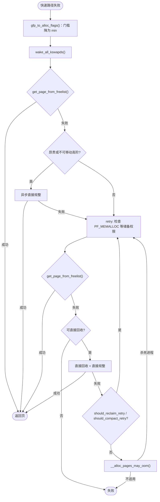

# 4.4 水位线与页分配慢速路径

> **本节源码**：`mm/page_alloc.c`、`mm/internal.h`、`mm/vmscan.c`、`include/linux/mmzone.h`、`include/linux/gfp_types.h`
> **关键函数**：`__setup_per_zone_wmarks()`、`setup_per_zone_lowmem_reserve()`、`__zone_watermark_ok()`、`gfp_to_alloc_flags()`、`__alloc_pages_slowpath()`、`wakeup_kswapd()`、`__alloc_pages_direct_reclaim()`、`should_reclaim_retry()`、`__alloc_pages_may_oom()`
> **前置知识**：4.3 伙伴系统与 per-CPU 页缓存

## 概述

如果每个 zone 都允许被分配到一页不剩，那么当中断处理程序、内存回收路径本身需要内存时，系统就会陷入死锁：回收需要分配内存，而分配又在等待回收。因此内核为每个 zone 设置了**水位线（Watermark）**，正常分配必须给系统留出一定余量，只有特定的高优先级请求才能动用这部分储备。

水位线也是后台回收的触发器：空闲页跌破 **low** 时唤醒 kswapd，kswapd 一直回收到 **high** 以上才休眠；跌破 **min** 时，普通分配者必须自己动手进行**直接回收（Direct Reclaim）**。

本节先分析水位线与 `lowmem_reserve` 的计算，再完整走一遍慢速路径 `__alloc_pages_slowpath()`：唤醒 kswapd、动用储备、直接规整、直接回收、重试判定，直至 OOM。

## 水位线

### 三条水位线的含义

```c
// include/linux/mmzone.h:708-714（v6.18.60）
enum zone_watermarks {
	WMARK_MIN,
	WMARK_LOW,
	WMARK_HIGH,
	WMARK_PROMO,
	NR_WMARK
};
```

```
 空闲页数
   ▲
   │ ─────────────────────────────── WMARK_PROMO   NUMA 分层内存提升使用
   │ ─────────────────────────────── WMARK_HIGH    kswapd 回收到此为止，然后休眠
   │      ▲ kswapd 后台回收
   │ ─────────────────────────────── WMARK_LOW     快速路径的门槛；跌破即唤醒 kswapd
   │      ▲ 慢速路径：以 min 为门槛再试
   │ ─────────────────────────────── WMARK_MIN     普通分配的底线；跌破须直接回收
   │      ▲ 仅 __GFP_HIGH / GFP_ATOMIC / PF_MEMALLOC / OOM 牺牲者可用
   │ ─────────────────────────────── 0
```

*图 4-7：zone 水位线及其作用（自下而上空闲页增多）*

`WMARK_PROMO` 用于 NUMA 内存分层（Memory Tiering）：在启用 `NUMA_BALANCING_MEMORY_TIERING` 模式时，慢速内存节点上的热页被提升到快速节点前，要求目标节点空闲页高于此水位，这里不展开。

读取水位线时要加上 `watermark_boost`：

```c
// include/linux/mmzone.h:1081-1085（v6.18.60）
static inline unsigned long wmark_pages(const struct zone *z,
					enum zone_watermarks w)
{
	return z->_watermark[w] + z->watermark_boost;
}
```

### 计算方法

所有水位线都源于一个全局参数 `min_free_kbytes`（`/proc/sys/vm/min_free_kbytes`）。启动时它按低端内存总量的平方根估算：

```c
// mm/page_alloc.c:6568-6582（v6.18.60）
void calculate_min_free_kbytes(void)
{
	unsigned long lowmem_kbytes;
	int new_min_free_kbytes;

	lowmem_kbytes = nr_free_buffer_pages() * (PAGE_SIZE >> 10);
	new_min_free_kbytes = int_sqrt(lowmem_kbytes * 16);

	if (new_min_free_kbytes > user_min_free_kbytes)
		min_free_kbytes = clamp(new_min_free_kbytes, 128, 262144);
	else
		pr_warn("min_free_kbytes is not updated to %d because user defined value %d is preferred\n",
				new_min_free_kbytes, user_min_free_kbytes);

}
```

即 `min_free_kbytes = 4 × sqrt(lowmem_kbytes)`，夹在 128 KB～256 MB 之间。源码注释给出了对照表：4 GB 内存约 8 MB，16 GB 约 16 MB。使用平方根而非线性比例，是因为"需要的应急储备"（主要由网络等中断上下文的突发分配决定）并不随内存容量线性增长。

`__setup_per_zone_wmarks()` 把 `min_free_kbytes` 按各 zone 的 `managed_pages` 比例分摊为 `WMARK_MIN`，再在其上叠加间隔得到 low 与 high：

```c
// mm/page_alloc.c:6456-6514（v6.18.60，节选）
static void __setup_per_zone_wmarks(void)
{
	unsigned long pages_min = min_free_kbytes >> (PAGE_SHIFT - 10);
	unsigned long lowmem_pages = 0;
	struct zone *zone;
	unsigned long flags;

	/* Calculate total number of !ZONE_HIGHMEM and !ZONE_MOVABLE pages */
	for_each_zone(zone) {
		if (!is_highmem(zone) && zone_idx(zone) != ZONE_MOVABLE)
			lowmem_pages += zone_managed_pages(zone);
	}

	for_each_zone(zone) {
		u64 tmp;

		spin_lock_irqsave(&zone->lock, flags);
		tmp = (u64)pages_min * zone_managed_pages(zone);
		tmp = div64_ul(tmp, lowmem_pages);
		if (is_highmem(zone) || zone_idx(zone) == ZONE_MOVABLE) {
			...
			unsigned long min_pages;

			min_pages = zone_managed_pages(zone) / 1024;
			min_pages = clamp(min_pages, SWAP_CLUSTER_MAX, 128UL);
			zone->_watermark[WMARK_MIN] = min_pages;
		} else {
			/*
			 * If it's a lowmem zone, reserve a number of pages
			 * proportionate to the zone's size.
			 */
			zone->_watermark[WMARK_MIN] = tmp;
		}

		/*
		 * Set the kswapd watermarks distance according to the
		 * scale factor in proportion to available memory, but
		 * ensure a minimum size on small systems.
		 */
		tmp = max_t(u64, tmp >> 2,
			    mult_frac(zone_managed_pages(zone),
				      watermark_scale_factor, 10000));

		zone->watermark_boost = 0;
		zone->_watermark[WMARK_LOW]  = min_wmark_pages(zone) + tmp;
		zone->_watermark[WMARK_HIGH] = low_wmark_pages(zone) + tmp;
		zone->_watermark[WMARK_PROMO] = high_wmark_pages(zone) + tmp;
		trace_mm_setup_per_zone_wmarks(zone);

		spin_unlock_irqrestore(&zone->lock, flags);
	}
```

归纳为公式（对普通 zone）：

```
min   = min_free_kbytes(页) × zone_managed / lowmem_managed
gap   = max(min / 4, zone_managed × watermark_scale_factor / 10000)
low   = min + gap
high  = low + gap
promo = high + gap
```

`watermark_scale_factor` 默认为 10（`mm/page_alloc.c:305`），即 zone 大小的 0.1%。在大内存机器上，`min/4` 往往远小于 0.1%，于是 gap 由后者决定。调大这个参数会让 kswapd 更早醒来、回收得更多，从而减少直接回收。`ZONE_MOVABLE` 的 min 只取一个很小的值（不超过 128 页），因为 `GFP_ATOMIC` 等需要储备的分配通常不会使用可移动 zone。

### 水位提升

4.3 节提到，发生跨迁移类型的部分认领时会调用 `boost_watermark()`：

```c
// mm/page_alloc.c:2213-2234（v6.18.60，节选）
	if ((pageblock_nr_pages * 4) > zone_managed_pages(zone))
		return false;

	max_boost = mult_frac(zone->_watermark[WMARK_HIGH],
			watermark_boost_factor, 10000);
	...
	if (!max_boost)
		return false;

	max_boost = max(pageblock_nr_pages, max_boost);

	zone->watermark_boost = min(zone->watermark_boost + pageblock_nr_pages,
		max_boost);
```

每次提升一个页块（2 MB）的量，上限为 high 水位的 `watermark_boost_factor / 10000` 倍，默认 15000 即 1.5 倍（`mm/page_alloc.c:304`）。被提升后，kswapd 会回收到"high + boost"为止，并在完成后将 boost 清零。这样在碎片化开始出现时，以多回收一些内存为代价，换取后续分配不必再跨类型借用。

### `lowmem_reserve`：保护低端 zone

zonelist 允许 `GFP_KERNEL` 分配从 `ZONE_NORMAL` 回退到 `ZONE_DMA32` 甚至 `ZONE_DMA`。如果不加限制，大量本可以放在高端 zone 的分配会把低端 zone 耗尽，导致真正只能使用低端内存的设备驱动分配失败。

`lowmem_reserve[j]` 表示"当请求的最高 zone 为 j 时，本 zone 额外保留的页数"：

```c
// mm/page_alloc.c:6430-6449（v6.18.60，节选）
	for_each_online_pgdat(pgdat) {
		for (i = 0; i < MAX_NR_ZONES - 1; i++) {
			struct zone *zone = &pgdat->node_zones[i];
			int ratio = sysctl_lowmem_reserve_ratio[i];
			bool clear = !ratio || !zone_managed_pages(zone);
			unsigned long managed_pages = 0;

			for (j = i + 1; j < MAX_NR_ZONES; j++) {
				struct zone *upper_zone = &pgdat->node_zones[j];

				managed_pages += zone_managed_pages(upper_zone);

				if (clear)
					zone->lowmem_reserve[j] = 0;
				else
					zone->lowmem_reserve[j] = managed_pages / ratio;
				...
			}
		}
	}
```

默认比例为 DMA、DMA32 各 256，NORMAL 为 32（`mm/page_alloc.c:258-270`）。例如某节点 `ZONE_NORMAL` 有 12 GB，那么一个最高 zone 为 NORMAL 的请求要使用 `ZONE_DMA32` 时，DMA32 必须在水位之外再多保留 12 GB / 256 = 48 MB。`ZONE_DMA32` 自身的请求（`GFP_DMA32`）不受此限制。

### 水位检查：`__zone_watermark_ok()`

```c
// mm/page_alloc.c:3568-3644（v6.18.60，节选）
bool __zone_watermark_ok(struct zone *z, unsigned int order, unsigned long mark,
			 int highest_zoneidx, unsigned int alloc_flags,
			 long free_pages)
{
	long min = mark;
	int o;

	/* free_pages may go negative - that's OK */
	free_pages -= __zone_watermark_unusable_free(z, order, alloc_flags);

	if (unlikely(alloc_flags & ALLOC_RESERVES)) {
		/*
		 * __GFP_HIGH allows access to 50% of the min reserve as well
		 * as OOM.
		 */
		if (alloc_flags & ALLOC_MIN_RESERVE) {
			min -= min / 2;
			...
			if (alloc_flags & ALLOC_NON_BLOCK)
				min -= min / 4;
		}
		...
		if (alloc_flags & ALLOC_OOM)
			min -= min / 2;
	}

	/*
	 * Check watermarks for an order-0 allocation request. If these
	 * are not met, then a high-order request also cannot go ahead
	 * even if a suitable page happened to be free.
	 */
	if (free_pages <= min + z->lowmem_reserve[highest_zoneidx])
		return false;

	/* If this is an order-0 request then the watermark is fine */
	if (!order)
		return true;

	/* For a high-order request, check at least one suitable page is free */
	for (o = order; o < NR_PAGE_ORDERS; o++) {
		struct free_area *area = &z->free_area[o];
		int mt;

		if (!area->nr_free)
			continue;

		for (mt = 0; mt < MIGRATE_PCPTYPES; mt++) {
			if (!free_area_empty(area, mt))
				return true;
		}
		...
	}
	return false;
}
```

检查分两步：

1. **总量检查**：可用空闲页（减去高阶原子储备、不可用的 CMA 页、以及 `2^order − 1`）必须超过 `min + lowmem_reserve`。动用储备的请求可以把 `min` 打折：`__GFP_HIGH` 打五折，不能阻塞的 `GFP_ATOMIC` 再减去四分之一（合计为原值的 37.5%）；带 `ALLOC_OOM` 的 OOM 牺牲者同样减半。
2. **阶检查**：高阶请求还要求在 `order` 及以上至少有一个合适迁移类型的空闲块。

`zone_watermark_fast()`（`mm/page_alloc.c:3653-3696`）为 order 0 提供了一条更快的路径，避免在最常见的情况下进入完整检查。

## 分配标志：从 GFP 到 `ALLOC_*`

伙伴系统内部不直接使用 GFP，而是把它翻译成 `ALLOC_*` 标志：

```c
// mm/internal.h:1276-1314（v6.18.60，节选）
#define ALLOC_WMARK_MIN		WMARK_MIN
#define ALLOC_WMARK_LOW		WMARK_LOW
#define ALLOC_WMARK_HIGH	WMARK_HIGH
#define ALLOC_NO_WATERMARKS	0x04 /* don't check watermarks at all */
...
#define ALLOC_OOM		0x08
...
#define ALLOC_NON_BLOCK		 0x10 /* Caller cannot block. Allow access
...
#define ALLOC_MIN_RESERVE	 0x20 /* __GFP_HIGH set. Allow access to 50%
...
#define ALLOC_CPUSET		 0x40 /* check for correct cpuset */
#define ALLOC_CMA		 0x80 /* allow allocations from CMA areas */
...
#define ALLOC_NOFRAGMENT	0x100 /* avoid mixing pageblock types */
...
#define ALLOC_HIGHATOMIC	0x200 /* Allows access to MIGRATE_HIGHATOMIC */
#define ALLOC_TRYLOCK		0x400 /* Only use spin_trylock in allocation path */
#define ALLOC_KSWAPD		0x800 /* allow waking of kswapd, __GFP_KSWAPD_RECLAIM set */
...
#define ALLOC_RESERVES (ALLOC_NON_BLOCK|ALLOC_MIN_RESERVE|ALLOC_HIGHATOMIC|ALLOC_OOM)
```

低 2 位是水位选择（0/1/2 对应 min/low/high）。快速路径固定使用 `ALLOC_WMARK_LOW`；慢速路径则由 `gfp_to_alloc_flags()` 精确计算：

```c
// mm/page_alloc.c:4514-4564（v6.18.60，节选）
static inline unsigned int
gfp_to_alloc_flags(gfp_t gfp_mask, unsigned int order)
{
	unsigned int alloc_flags = ALLOC_WMARK_MIN | ALLOC_CPUSET;
	...
	alloc_flags |= (__force int)
		(gfp_mask & (__GFP_HIGH | __GFP_KSWAPD_RECLAIM));

	if (!(gfp_mask & __GFP_DIRECT_RECLAIM)) {
		/*
		 * Not worth trying to allocate harder for __GFP_NOMEMALLOC even
		 * if it can't schedule.
		 */
		if (!(gfp_mask & __GFP_NOMEMALLOC)) {
			alloc_flags |= ALLOC_NON_BLOCK;

			if (order > 0 && (alloc_flags & ALLOC_MIN_RESERVE))
				alloc_flags |= ALLOC_HIGHATOMIC;
		}
		...
		if (alloc_flags & ALLOC_MIN_RESERVE)
			alloc_flags &= ~ALLOC_CPUSET;
	} else if (unlikely(rt_or_dl_task(current)) && in_task())
		alloc_flags |= ALLOC_MIN_RESERVE;

	alloc_flags = gfp_to_alloc_flags_cma(gfp_mask, alloc_flags);

	if (defrag_mode)
		alloc_flags |= ALLOC_NOFRAGMENT;

	return alloc_flags;
}
```

源码用 `BUILD_BUG_ON` 保证 `__GFP_HIGH == ALLOC_MIN_RESERVE`、`__GFP_KSWAPD_RECLAIM == ALLOC_KSWAPD`，于是一次按位与就完成了两个标志的转换。实时/deadline 任务即使能阻塞，也可以动用部分储备。`defrag_mode`（`vm.defrag_mode` sysctl）是较新版本引入的选项，开启后慢速路径始终禁止碎片化回退，而是通过回收和规整获得整块。

最高一级的储备访问由 `__gfp_pfmemalloc_flags()` 决定：

```c
// mm/page_alloc.c:4585-4601（v6.18.60）
static inline int __gfp_pfmemalloc_flags(gfp_t gfp_mask)
{
	if (unlikely(gfp_mask & __GFP_NOMEMALLOC))
		return 0;
	if (gfp_mask & __GFP_MEMALLOC)
		return ALLOC_NO_WATERMARKS;
	if (in_serving_softirq() && (current->flags & PF_MEMALLOC))
		return ALLOC_NO_WATERMARKS;
	if (!in_interrupt()) {
		if (current->flags & PF_MEMALLOC)
			return ALLOC_NO_WATERMARKS;
		else if (oom_reserves_allowed(current))
			return ALLOC_OOM;
	}

	return 0;
}
```

`PF_MEMALLOC` 标记"正在回收内存的任务"（kswapd、直接回收者），它们可以无视水位分配，因为回收本身可能需要少量内存（如分配 bio 写回脏页），而它们最终会释放更多内存。OOM 牺牲者（`tsk_is_oom_victim()`）获得 `ALLOC_OOM`，以便尽快退出并释放内存。

| 调用者 | 典型 GFP | 门槛 |
|---|---|---|
| 普通进程快速路径 | `GFP_KERNEL` | low |
| 普通进程慢速路径 | `GFP_KERNEL` | min |
| `__GFP_HIGH` 可阻塞 | `GFP_KERNEL \| __GFP_HIGH` | min × 50% |
| 中断上下文 | `GFP_ATOMIC` | min × 37.5% |
| OOM 牺牲者 | 任意 | min × 50%（`ALLOC_OOM`，替换原有标志） |
| 回收者 / `__GFP_MEMALLOC` | 任意 | 不检查 |

## 慢速路径：`__alloc_pages_slowpath()`

### 调用链总览

```
__alloc_pages_slowpath()                            mm/page_alloc.c:4728
├── gfp_to_alloc_flags()                            // 门槛降为 min
├── wake_all_kswapds()  → wakeup_kswapd()           mm/vmscan.c:7385
├── get_page_from_freelist()                        // 第 1 次尝试
├── __alloc_pages_direct_compact()                  // 高阶：先尝试异步规整（4.12）
├── retry:
│   ├── __gfp_pfmemalloc_flags()                    // 是否可无视水位
│   ├── get_page_from_freelist()                    // 第 2 次尝试
│   ├── __alloc_pages_direct_reclaim()              // 直接回收
│   │   └── __perform_reclaim() → try_to_free_pages()   mm/vmscan.c（4.10）
│   ├── __alloc_pages_direct_compact()              // 直接规整
│   ├── should_reclaim_retry()                      // 回收是否还有希望
│   ├── should_compact_retry()                      // 规整是否还有希望
│   └── __alloc_pages_may_oom()  → out_of_memory()  mm/oom_kill.c（4.12）
└── nopage:  __GFP_NOFAIL 无限重试 / warn_alloc()
```

### 第一阶段：唤醒 kswapd 并降低门槛

```c
// mm/page_alloc.c:4779-4814（v6.18.60，节选）
	alloc_flags = gfp_to_alloc_flags(gfp_mask, order);

	/*
	 * We need to recalculate the starting point for the zonelist iterator
	 * because we might have used different nodemask in the fast path, or
	 * there was a cpuset modification and we are retrying - otherwise we
	 * could end up iterating over non-eligible zones endlessly.
	 */
	ac->preferred_zoneref = first_zones_zonelist(ac->zonelist,
					ac->highest_zoneidx, ac->nodemask);
	if (!zonelist_zone(ac->preferred_zoneref))
		goto nopage;
	...
	if (alloc_flags & ALLOC_KSWAPD)
		wake_all_kswapds(order, gfp_mask, ac);

	/*
	 * The adjusted alloc_flags might result in immediate success, so try
	 * that first
	 */
	page = get_page_from_freelist(gfp_mask, order, alloc_flags, ac);
	if (page)
		goto got_pg;
```

`wake_all_kswapds()`（`mm/page_alloc.c:4489-4512`）对 zonelist 中每个节点调用一次 `wakeup_kswapd()`：

```c
// mm/vmscan.c:7385-7428（v6.18.60，节选）
void wakeup_kswapd(struct zone *zone, gfp_t gfp_flags, int order,
		   enum zone_type highest_zoneidx)
{
	...
	pgdat = zone->zone_pgdat;
	curr_idx = READ_ONCE(pgdat->kswapd_highest_zoneidx);

	if (curr_idx == MAX_NR_ZONES || curr_idx < highest_zoneidx)
		WRITE_ONCE(pgdat->kswapd_highest_zoneidx, highest_zoneidx);

	if (READ_ONCE(pgdat->kswapd_order) < order)
		WRITE_ONCE(pgdat->kswapd_order, order);

	if (!waitqueue_active(&pgdat->kswapd_wait))
		return;

	/* Hopeless node, leave it to direct reclaim if possible */
	if (atomic_read(&pgdat->kswapd_failures) >= MAX_RECLAIM_RETRIES ||
	    (pgdat_balanced(pgdat, order, highest_zoneidx) &&
	     !pgdat_watermark_boosted(pgdat, highest_zoneidx))) {
		...
		if (!(gfp_flags & __GFP_DIRECT_RECLAIM))
			wakeup_kcompactd(pgdat, order, highest_zoneidx);
		return;
	}

	trace_mm_vmscan_wakeup_kswapd(pgdat->node_id, highest_zoneidx, order,
				      gfp_flags);
	wake_up_interruptible(&pgdat->kswapd_wait);
}
```

唤醒前先把请求的阶和最高 zone 记录到 `pgdat->kswapd_order` / `kswapd_highest_zoneidx`，kswapd 醒来后据此决定回收目标。如果节点水位已经平衡，只是高阶块不足，就改为唤醒 kcompactd 做后台规整。

### 第二阶段：高阶分配先规整

```c
// mm/page_alloc.c:4825-4835（v6.18.60）
	if (can_direct_reclaim && can_compact &&
			(costly_order ||
			   (order > 0 && ac->migratetype != MIGRATE_MOVABLE))
			&& !gfp_pfmemalloc_allowed(gfp_mask)) {
		page = __alloc_pages_direct_compact(gfp_mask, order,
						alloc_flags, ac,
						INIT_COMPACT_PRIORITY,
						&compact_result);
		if (page)
			goto got_pg;
```

对 order > 3 的"昂贵"分配（`costly_order`）和不可移动的高阶分配，在回收之前先尝试一次异步规整：此时往往并不缺页，只是缺**连续**的页，规整比回收更对症。对 THP 缺页等带 `__GFP_NORETRY` 的昂贵分配，如果规整被跳过或推迟，直接失败返回（`mm/page_alloc.c:4840-4881`），由调用者回退到小页。

### 第三阶段：重试循环

```c
// mm/page_alloc.c:4885-4938（v6.18.60，节选）
retry:
	...
	/* Ensure kswapd doesn't accidentally go to sleep as long as we loop */
	if (alloc_flags & ALLOC_KSWAPD)
		wake_all_kswapds(order, gfp_mask, ac);

	reserve_flags = __gfp_pfmemalloc_flags(gfp_mask);
	if (reserve_flags)
		alloc_flags = gfp_to_alloc_flags_cma(gfp_mask, reserve_flags) |
					  (alloc_flags & ALLOC_KSWAPD);
	...
	/* Attempt with potentially adjusted zonelist and alloc_flags */
	page = get_page_from_freelist(gfp_mask, order, alloc_flags, ac);
	if (page)
		goto got_pg;

	/* Caller is not willing to reclaim, we can't balance anything */
	if (!can_direct_reclaim)
		goto nopage;

	/* Avoid recursion of direct reclaim */
	if (current->flags & PF_MEMALLOC)
		goto nopage;

	/* Try direct reclaim and then allocating */
	page = __alloc_pages_direct_reclaim(gfp_mask, order, alloc_flags, ac,
							&did_some_progress);
	if (page)
		goto got_pg;

	/* Try direct compaction and then allocating */
	page = __alloc_pages_direct_compact(gfp_mask, order, alloc_flags, ac,
					compact_priority, &compact_result);
	if (page)
		goto got_pg;
```

不能阻塞的请求（`GFP_ATOMIC`、`GFP_NOWAIT`）到这里就结束了——它们在 min 水位（打折后）下仍然分配不到，只能失败。`PF_MEMALLOC` 检查防止回收路径中的分配再次进入回收，造成无限递归。

### 直接回收

```c
// mm/page_alloc.c:4425-4487（v6.18.60，节选）
__perform_reclaim(gfp_t gfp_mask, unsigned int order,
					const struct alloc_context *ac)
{
	unsigned int noreclaim_flag;
	unsigned long progress;

	cond_resched();

	/* We now go into synchronous reclaim */
	cpuset_memory_pressure_bump();
	fs_reclaim_acquire(gfp_mask);
	noreclaim_flag = memalloc_noreclaim_save();

	progress = try_to_free_pages(ac->zonelist, order, gfp_mask,
								ac->nodemask);

	memalloc_noreclaim_restore(noreclaim_flag);
	fs_reclaim_release(gfp_mask);

	cond_resched();

	return progress;
}
...
	psi_memstall_enter(&pflags);
	*did_some_progress = __perform_reclaim(gfp_mask, reclaim_order, ac);
	if (unlikely(!(*did_some_progress)))
		goto out;

retry:
	page = get_page_from_freelist(gfp_mask, order, alloc_flags, ac);

	/*
	 * If an allocation failed after direct reclaim, it could be because
	 * pages are pinned on the per-cpu lists or in high alloc reserves.
	 * Shrink them and try again
	 */
	if (!page && !drained) {
		unreserve_highatomic_pageblock(ac, false);
		drain_all_pages(NULL);
		drained = true;
		goto retry;
	}
out:
	psi_memstall_leave(&pflags);
```

几个要点：

- `memalloc_noreclaim_save()` 为当前任务设置 `PF_MEMALLOC`，回收期间的分配可以无视水位，同时防止递归回收；
- `fs_reclaim_acquire()` 是 lockdep 注解，用于检测"持有文件系统锁时以 `GFP_KERNEL` 分配"这类潜在死锁；
- `psi_memstall_enter()` 把直接回收的耗时计入 PSI（Pressure Stall Information）的内存压力统计，即 `/proc/pressure/memory`；
- 回收后仍分配失败时，可能是页面被别的 CPU 的 PCP 或高阶原子储备占着，于是 `drain_all_pages()` 清空所有 PCP 后再试一次。

`try_to_free_pages()` 的内部实现见 4.10 节。

### 何时放弃：`should_reclaim_retry()`

```c
// mm/page_alloc.c:4632-4693（v6.18.60，节选）
	if (did_some_progress && order <= PAGE_ALLOC_COSTLY_ORDER)
		*no_progress_loops = 0;
	else
		(*no_progress_loops)++;

	if (*no_progress_loops > MAX_RECLAIM_RETRIES)
		goto out;
	...
	for_each_zone_zonelist_nodemask(zone, z, ac->zonelist,
				ac->highest_zoneidx, ac->nodemask) {
		unsigned long available;
		unsigned long reclaimable;
		unsigned long min_wmark = min_wmark_pages(zone);
		bool wmark;
		...
		available = reclaimable = zone_reclaimable_pages(zone);
		available += zone_page_state_snapshot(zone, NR_FREE_PAGES);

		/*
		 * Would the allocation succeed if we reclaimed all
		 * reclaimable pages?
		 */
		wmark = __zone_watermark_ok(zone, order, min_wmark,
				ac->highest_zoneidx, alloc_flags, available);
		...
		if (wmark) {
			ret = true;
			break;
		}
	}
	...
out:
	/* Before OOM, exhaust highatomic_reserve */
	if (!ret)
		return unreserve_highatomic_pageblock(ac, true);

	return ret;
```

判定规则是：连续 `MAX_RECLAIM_RETRIES`（16，`mm/internal.h:532`）次回收没有进展就放弃；否则，只要存在某个 zone"假如把所有可回收页都回收了，就能满足 min 水位"，就继续重试。注意昂贵分配即使回收有进展也会累加计数器，因为回收得到的零散页未必能拼成高阶块。放弃前还会释放高阶原子储备，作为进入 OOM 前的最后一搏。

### 重试与 OOM 的决策顺序

```c
// mm/page_alloc.c:4940-4996（v6.18.60，节选）
	/* Do not loop if specifically requested */
	if (gfp_mask & __GFP_NORETRY)
		goto nopage;

	/*
	 * Do not retry costly high order allocations unless they are
	 * __GFP_RETRY_MAYFAIL and we can compact
	 */
	if (costly_order && (!can_compact ||
			     !(gfp_mask & __GFP_RETRY_MAYFAIL)))
		goto nopage;

	if (should_reclaim_retry(gfp_mask, order, ac, alloc_flags,
				 did_some_progress > 0, &no_progress_loops))
		goto retry;
	...
	if (did_some_progress > 0 && can_compact &&
			should_compact_retry(ac, order, alloc_flags,
				compact_result, &compact_priority,
				&compaction_retries))
		goto retry;
	...
	/* Reclaim has failed us, start killing things */
	page = __alloc_pages_may_oom(gfp_mask, order, ac, &did_some_progress);
	if (page)
		goto got_pg;

	/* Avoid allocations with no watermarks from looping endlessly */
	if (tsk_is_oom_victim(current) &&
	    (alloc_flags & ALLOC_OOM ||
	     (gfp_mask & __GFP_NOMEMALLOC)))
		goto nopage;

	/* Retry as long as the OOM killer is making progress */
	if (did_some_progress) {
		no_progress_loops = 0;
		goto retry;
	}
```

GFP 中三个"重试语义"修饰符在这里体现：

| 标志 | 语义 |
|---|---|
| `__GFP_NORETRY` | 回收/规整一轮失败即返回，不触发 OOM |
| `__GFP_RETRY_MAYFAIL` | 允许多次重试，但宁可失败也不触发 OOM（见 `__alloc_pages_may_oom()` 中的检查） |
| `__GFP_NOFAIL` | 永不失败，`nopage` 处会无限重试（要求 order ≤ 1） |
| 均无 | 小阶（≤ 3）分配默认"几乎不会失败"：重试直到 OOM 杀死某个进程 |

最后一行说明了一个常被误解的事实：**`GFP_KERNEL` 的小阶分配在实践中几乎不会返回 NULL**，内核宁可触发 OOM Killer 也要满足它。

### `__alloc_pages_may_oom()`

```c
// mm/page_alloc.c:4053-4106（v6.18.60，节选）
	if (!mutex_trylock(&oom_lock)) {
		*did_some_progress = 1;
		schedule_timeout_uninterruptible(1);
		return NULL;
	}

	/*
	 * Go through the zonelist yet one more time, keep very high watermark
	 * here, this is only to catch a parallel oom killing, we must fail if
	 * we're still under heavy pressure. But make sure that this reclaim
	 * attempt shall not depend on __GFP_DIRECT_RECLAIM && !__GFP_NORETRY
	 * allocation which will never fail due to oom_lock already held.
	 */
	page = get_page_from_freelist((gfp_mask | __GFP_HARDWALL) &
				      ~__GFP_DIRECT_RECLAIM, order,
				      ALLOC_WMARK_HIGH|ALLOC_CPUSET, ac);
	if (page)
		goto out;

	/* Coredumps can quickly deplete all memory reserves */
	if (current->flags & PF_DUMPCORE)
		goto out;
	/* The OOM killer will not help higher order allocs */
	if (order > PAGE_ALLOC_COSTLY_ORDER)
		goto out;
	...
	if (gfp_mask & (__GFP_RETRY_MAYFAIL | __GFP_THISNODE))
		goto out;
	/* The OOM killer does not needlessly kill tasks for lowmem */
	if (ac->highest_zoneidx < ZONE_NORMAL)
		goto out;
	if (pm_suspended_storage())
		goto out;
	...
	/* Exhausted what can be done so it's blame time */
	if (out_of_memory(&oc) ||
	    WARN_ON_ONCE_GFP(gfp_mask & __GFP_NOFAIL, gfp_mask)) {
		*did_some_progress = 1;
```

`oom_lock` 保证同一时刻只有一个任务执行 OOM 选择，拿不到锁的任务视为"有进展"并短暂睡眠后重试。拿到锁后先以 **high** 水位再试一次，用于捕获"刚刚有别的任务完成了 OOM 杀进程"的情况。高阶分配、`__GFP_THISNODE`、只能用低端 zone 的请求都不会触发 OOM，因为杀进程未必能解决它们的问题。`out_of_memory()` 的实现见 4.12 节。



*图 4-8：慢速路径决策流程（省略 cpuset 重试与 `__GFP_NOFAIL` 处理）*

## 动手实验

查看各 zone 的水位线和 `lowmem_reserve`（`protection` 一行）：

```bash
awk '/^Node/ || /pages free/ || /^ +(min|low|high|promo) / || /protection/' /proc/zoneinfo
cat /proc/sys/vm/min_free_kbytes /proc/sys/vm/watermark_scale_factor /proc/sys/vm/watermark_boost_factor
```

调大 `watermark_scale_factor` 并观察 low/high 的变化（root）：

```bash
sudo sysctl vm.watermark_scale_factor=100
awk '/^Node/ || /^ +(min|low|high) /' /proc/zoneinfo
sudo sysctl vm.watermark_scale_factor=10
```

统计直接回收和 kswapd 的活动，可以对比内存压力下的 `/proc/vmstat`：

```bash
grep -E "^(allocstall|pgscan_kswapd|pgscan_direct|pgsteal_kswapd|pgsteal_direct|compact_stall|kswapd_)" /proc/vmstat
cat /proc/pressure/memory
```

用 bpftrace 记录进入直接回收的进程与耗时（root）：

```bash
sudo bpftrace -e '
tracepoint:vmscan:mm_vmscan_direct_reclaim_begin { @start[tid] = nsecs; }
tracepoint:vmscan:mm_vmscan_direct_reclaim_end /@start[tid]/ {
  @us[comm] = hist((nsecs - @start[tid]) / 1000); delete(@start[tid]);
}'
```

## 小结

- 每个 zone 有 min/low/high（及 promo）水位，均源自 `min_free_kbytes`（≈ 4√lowmem），间隔由 `watermark_scale_factor` 决定；`watermark_boost` 在碎片化时临时抬高水位。
- `lowmem_reserve` 让回退到低端 zone 的分配额外保留一部分页，保护只能使用低端内存的设备。
- 快速路径以 low 为门槛；慢速路径降为 min，并按 `__GFP_HIGH`、`GFP_ATOMIC`、OOM 牺牲者、`PF_MEMALLOC` 逐级放宽。
- 慢速路径依次执行：唤醒 kswapd → 高阶先规整 → 直接回收 → 直接规整 → 判定重试 → OOM。
- `should_reclaim_retry()` 以"连续 16 次无进展"或"回收全部可回收页也达不到 min"为放弃条件；小阶 `GFP_KERNEL` 分配在实践中会一直重试到 OOM。

## 参考

- `linux/Documentation/admin-guide/sysctl/vm.rst`（`min_free_kbytes`、`lowmem_reserve_ratio`、`watermark_scale_factor`、`watermark_boost_factor`）
- `linux/Documentation/mm/balance.rst`
- `linux/Documentation/accounting/psi.rst`
- `linux/include/linux/gfp_types.h` 中关于各 GFP 标志的注释
