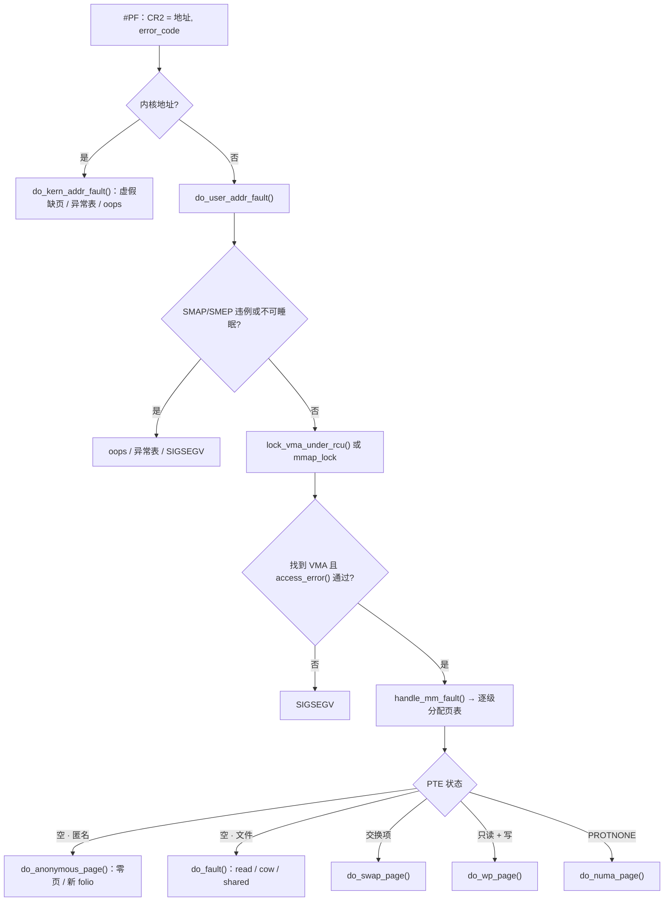

# 4.8 页表与缺页异常

> **本节源码**：`arch/x86/include/asm/pgtable_types.h`、`arch/x86/include/asm/pgtable_64_types.h`、`arch/x86/include/asm/trap_pf.h`、`arch/x86/mm/fault.c`、`mm/memory.c`、`mm/mmap_lock.c`、`include/linux/mm.h`
> **关键函数**：`exc_page_fault()`、`do_user_addr_fault()`、`access_error()`、`handle_mm_fault()`、`__handle_mm_fault()`、`handle_pte_fault()`、`do_anonymous_page()`、`alloc_anon_folio()`、`do_fault()`、`do_read_fault()`、`do_fault_around()`
> **前置知识**：4.7 进程地址空间

## 概述

4.7 节说过，`mmap()` 只登记 VMA，物理内存要等到第一次访问时才分配。这个"第一次访问"由 CPU 的**缺页异常（Page Fault，#PF，向量 14）** 通知内核：当 MMU 在页表中找不到有效映射，或者访问权限不符时，CPU 把出错的线性地址写入 `CR2`、把错误码压栈，然后跳转到内核的异常处理程序。

缺页处理的任务是：判断这次访问是否合法（地址是否落在某个 VMA 内、权限是否允许）；合法则补齐页表、分配或读入物理页，然后返回让 CPU 重新执行出错指令；不合法则向进程发送 `SIGSEGV`。缺页异常是匿名内存分配、文件映射读入、写时复制、换入、NUMA 迁移、userfaultfd 等众多机制的统一入口。

本节先介绍 x86_64 页表结构，然后沿 `exc_page_fault()` → `handle_mm_fault()` → `handle_pte_fault()` 的路径，分析匿名页和文件页两类最基本的缺页处理。写时复制在 4.9 节、换入在 4.11 节、大页缺页在 4.13 节分别展开。

## x86_64 页表

### 层级结构

四级页表把 48 位虚拟地址分为 4 个 9 位索引加 12 位页内偏移；五级页表在最上层再加一级 P4D，支持 57 位地址。Linux 用统一的五级抽象（PGD → P4D → PUD → PMD → PTE）描述所有架构，四级页表下 P4D 层被"折叠"：

```c
// arch/x86/include/asm/pgtable_64_types.h:50-80（v6.18.60，节选）
#define PGDIR_SHIFT	pgdir_shift
#define PTRS_PER_PGD	512
...
#define P4D_SHIFT		39
...
#define PTRS_PER_P4D		ptrs_per_p4d
...
#define PUD_SHIFT	30
#define PTRS_PER_PUD	512
...
#define PMD_SHIFT	21
#define PTRS_PER_PMD	512
...
#define PTRS_PER_PTE	512
```

```
  47      39 38      30 29      21 20      12 11          0     四级页表（48 位）
 ┌──────────┬──────────┬──────────┬──────────┬─────────────┐
 │ PGD 索引 │ PUD 索引 │ PMD 索引 │ PTE 索引 │  页内偏移   │
 └────┬─────┴────┬─────┴────┬─────┴────┬─────┴─────────────┘
      │          │          │          │
 CR3 ─┴─▶ PGD ───┴─▶ PUD ───┴─▶ PMD ───┴─▶ PTE ─▶ 4 KB 物理页
                     │          │
                     │          └─ PSE=1：2 MB 大页（PMD 映射）
                     └─ PSE=1：1 GB 大页（PUD 映射）
```

*图 4-12：x86_64 四级页表地址转换*

每级页表恰好一页（512 项 × 8 字节）。`pgdir_shift` 和 `ptrs_per_p4d` 是变量，在启动时根据是否启用五级页表设定为 39/1 或 48/512。

### 页表项格式

页表项的低 12 位和最高几位是标志位：

```c
// arch/x86/include/asm/pgtable_types.h:10-36（v6.18.60，节选）
#define _PAGE_BIT_PRESENT	0	/* is present */
#define _PAGE_BIT_RW		1	/* writeable */
#define _PAGE_BIT_USER		2	/* userspace addressable */
#define _PAGE_BIT_PWT		3	/* page write through */
#define _PAGE_BIT_PCD		4	/* page cache disabled */
#define _PAGE_BIT_ACCESSED	5	/* was accessed (raised by CPU) */
#define _PAGE_BIT_DIRTY		6	/* was written to (raised by CPU) */
#define _PAGE_BIT_PSE		7	/* 4 MB (or 2MB) page */
#define _PAGE_BIT_PAT		7	/* on 4KB pages */
#define _PAGE_BIT_GLOBAL	8	/* Global TLB entry PPro+ */
#define _PAGE_BIT_SOFTW1	9	/* available for programmer */
#define _PAGE_BIT_SOFTW2	10	/* " */
#define _PAGE_BIT_SOFTW3	11	/* " */
...
#define _PAGE_BIT_PKEY_BIT0	59	/* Protection Keys, bit 1/4 */
...
#define _PAGE_BIT_NX		63	/* No execute: only valid after cpuid check */
...
#define _PAGE_BIT_SPECIAL	_PAGE_BIT_SOFTW1
#define _PAGE_BIT_CPA_TEST	_PAGE_BIT_SOFTW1
#define _PAGE_BIT_UFFD_WP	_PAGE_BIT_SOFTW2 /* userfaultfd wrprotected */
#define _PAGE_BIT_SOFT_DIRTY	_PAGE_BIT_SOFTW3 /* software dirty tracking */
```

| 位 | 名称 | 由谁设置 | 用途 |
|---|---|---|---|
| 0 | Present | 内核 | 0 表示不存在；此时其余位由软件自由使用（交换项、迁移项等） |
| 1 | R/W | 内核 | 0 为只读；写时复制依赖它 |
| 2 | U/S | 内核 | 1 允许用户态访问 |
| 5 | Accessed | **CPU** | 访问时置 1，页面回收据此判断冷热 |
| 6 | Dirty | **CPU** | 写入时置 1，回收前需写回 |
| 7 | PSE | 内核 | 在 PMD/PUD 层表示大页 |
| 8 | Global | 内核 | 切换 CR3 时不刷新，用于内核映射 |
| 9～11 | 软件位 | 内核 | special、uffd-wp、soft-dirty 等 |
| 59～62 | PKEY | 内核 | 内存保护键（Protection Keys） |
| 63 | NX | 内核 | 禁止执行 |

`_PAGE_PROTNONE` 与 `_PAGE_GLOBAL` 共用第 8 位（`arch/x86/include/asm/pgtable_types.h:49`）：对用户页，Present 为 0 而 PROTNONE 为 1 表示"存在但禁止访问"，NUMA Balancing 用它制造可控的缺页（4.12 节）。

### 页表锁

修改页表需要加锁。整个 mm 只有一把 `page_table_lock` 会严重限制并发缺页，因此启用 `CONFIG_SPLIT_PTE_PTLOCKS`（本书配置已启用）后，**每个 PTE 页表页有自己的自旋锁**，存放在该页表页的 `struct ptdesc` 中（`ptlock_ptr()`，`include/linux/mm.h:3176-3197`）。PMD 层同理（`CONFIG_SPLIT_PMD_PTLOCKS=y`）。这样，同一进程中不同 2 MB 区域的缺页可以完全并行。

## 缺页入口：`exc_page_fault()`

```c
// arch/x86/mm/fault.c:1483-1531（v6.18.60，节选）
DEFINE_IDTENTRY_RAW_ERRORCODE(exc_page_fault)
{
	irqentry_state_t state;
	unsigned long address;

	address = cpu_feature_enabled(X86_FEATURE_FRED) ? fred_event_data(regs) : read_cr2();
	...
	if (kvm_handle_async_pf(regs, (u32)address))
		return;
	...
	state = irqentry_enter(regs);

	instrumentation_begin();
	handle_page_fault(regs, error_code, address);
	instrumentation_end();

	irqentry_exit(regs, state);
}
```

出错地址来自 `CR2`（启用 FRED 时由硬件放在事件数据中）。`handle_page_fault()` 按地址所在半区分流：

```c
// arch/x86/mm/fault.c:1461-1481（v6.18.60）
static __always_inline void
handle_page_fault(struct pt_regs *regs, unsigned long error_code,
			      unsigned long address)
{
	trace_page_fault_entries(regs, error_code, address);

	if (unlikely(kmmio_fault(regs, address)))
		return;

	/* Was the fault on kernel-controlled part of the address space? */
	if (unlikely(fault_in_kernel_space(address))) {
		do_kern_addr_fault(regs, error_code, address);
	} else {
		do_user_addr_fault(regs, error_code, address);
	}
	/*
	 * page fault handling might have reenabled interrupts,
	 * make sure to disable them again.
	 */
	local_irq_disable();
}
```

内核地址的缺页（`do_kern_addr_fault()`，`arch/x86/mm/fault.c:1134`）在 x86_64 上几乎都是错误：vmalloc 区的上层页表已预先分配（4.6 节），不存在需要惰性同步的情况，因此这里主要处理"虚假缺页"（TLB 中残留的旧权限）、kprobes，以及通过异常表（exception table）修复的 `copy_from_kernel_nofault()` 类访问，其余情况进入 oops。

### 错误码

```c
// arch/x86/include/asm/trap_pf.h:20-30（v6.18.60）
enum x86_pf_error_code {
	X86_PF_PROT	=		BIT(0),
	X86_PF_WRITE	=		BIT(1),
	X86_PF_USER	=		BIT(2),
	X86_PF_RSVD	=		BIT(3),
	X86_PF_INSTR	=		BIT(4),
	X86_PF_PK	=		BIT(5),
	X86_PF_SHSTK	=		BIT(6),
	X86_PF_SGX	=		BIT(15),
	X86_PF_RMP	=		BIT(31),
};
```

| 位 | 为 0 | 为 1 |
|---|---|---|
| `PROT` | 页不存在 | 页存在但违反保护 |
| `WRITE` | 读访问 | 写访问 |
| `USER` | 内核态访问 | 用户态访问 |
| `RSVD` | — | 页表项保留位被置位（页表损坏） |
| `INSTR` | — | 取指令引起 |
| `PK` | — | 被保护键拒绝 |
| `SHSTK` | — | 影子栈（CET）访问 |

## 用户地址缺页：`do_user_addr_fault()`

### 前置检查

```c
// arch/x86/mm/fault.c:1220-1279（v6.18.60，节选）
	if (unlikely((error_code & (X86_PF_USER | X86_PF_INSTR)) == X86_PF_INSTR)) {
		...
		page_fault_oops(regs, error_code, address);
		return;
	}
	...
	if (unlikely(cpu_feature_enabled(X86_FEATURE_SMAP) &&
		     !(error_code & X86_PF_USER) &&
		     !(regs->flags & X86_EFLAGS_AC))) {
		/*
		 * No extable entry here.  This was a kernel access to an
		 * invalid pointer.  get_kernel_nofault() will not get here.
		 */
		page_fault_oops(regs, error_code, address);
		return;
	}

	/*
	 * If we're in an interrupt, have no user context or are running
	 * in a region with pagefaults disabled then we must not take the fault
	 */
	if (unlikely(faulthandler_disabled() || !mm)) {
		bad_area_nosemaphore(regs, error_code, address);
		return;
	}
	...
	local_irq_enable();
```

- 内核态试图执行用户页上的代码（SMEP 违例）：直接 oops；
- 内核态访问用户页但 `EFLAGS.AC` 未置位（SMAP 违例）：说明内核在 `copy_from_user()` 等受控路径之外解引用了用户指针，直接 oops；
- 在中断上下文、`pagefault_disable()` 区域内或内核线程（`mm == NULL`）中：不能睡眠等待 I/O，按"坏地址"处理（通常经异常表修复后返回 `-EFAULT`）。

之后开中断，根据错误码设置 `FAULT_FLAG_WRITE`、`FAULT_FLAG_INSTRUCTION`、`FAULT_FLAG_USER` 等标志。

### 优先尝试 per-VMA 锁

```c
// arch/x86/mm/fault.c:1322-1352（v6.18.60）
	if (!(flags & FAULT_FLAG_USER))
		goto lock_mmap;

	vma = lock_vma_under_rcu(mm, address);
	if (!vma)
		goto lock_mmap;

	if (unlikely(access_error(error_code, vma))) {
		bad_area_access_error(regs, error_code, address, NULL, vma);
		count_vm_vma_lock_event(VMA_LOCK_SUCCESS);
		return;
	}
	fault = handle_mm_fault(vma, address, flags | FAULT_FLAG_VMA_LOCK, regs);
	if (!(fault & (VM_FAULT_RETRY | VM_FAULT_COMPLETED)))
		vma_end_read(vma);

	if (!(fault & VM_FAULT_RETRY)) {
		count_vm_vma_lock_event(VMA_LOCK_SUCCESS);
		goto done;
	}
	count_vm_vma_lock_event(VMA_LOCK_RETRY);
	if (fault & VM_FAULT_MAJOR)
		flags |= FAULT_FLAG_TRIED;

	/* Quick path to respond to signals */
	if (fault_signal_pending(fault, regs)) {
		if (!user_mode(regs))
			kernelmode_fixup_or_oops(regs, error_code, address,
						 SIGBUS, BUS_ADRERR,
						 ARCH_DEFAULT_PKEY);
		return;
	}
```

用户态缺页首先用 4.7 节介绍的 `lock_vma_under_rcu()` 只锁住单个 VMA。处理函数若需要做可能阻塞很久的事（比如等待 I/O）而 VMA 锁不支持这种情况，会返回 `VM_FAULT_RETRY`，此时退回传统路径。

### 传统路径：`mmap_lock` 读锁

```c
// arch/x86/mm/fault.c:1354-1413（v6.18.60，节选）
lock_mmap:

retry:
	vma = lock_mm_and_find_vma(mm, address, regs);
	if (unlikely(!vma)) {
		bad_area_nosemaphore(regs, error_code, address);
		return;
	}

	/*
	 * Ok, we have a good vm_area for this memory access, so
	 * we can handle it..
	 */
	if (unlikely(access_error(error_code, vma))) {
		bad_area_access_error(regs, error_code, address, mm, vma);
		return;
	}
	...
	fault = handle_mm_fault(vma, address, flags, regs);
	...
	/* The fault is fully completed (including releasing mmap lock) */
	if (fault & VM_FAULT_COMPLETED)
		return;

	/*
	 * If we need to retry the mmap_lock has already been released,
	 * and if there is a fatal signal pending there is no guarantee
	 * that we made any progress. Handle this case first.
	 */
	if (unlikely(fault & VM_FAULT_RETRY)) {
		flags |= FAULT_FLAG_TRIED;
		goto retry;
	}

	mmap_read_unlock(mm);
```

`lock_mm_and_find_vma()`（`mm/mmap_lock.c:424`）获取 `mmap_lock` 读锁并查找 VMA。若地址刚好位于一个 `VM_GROWSDOWN` 栈 VMA 下方，它会升级为写锁并扩展栈 VMA——这是 v6.5 为修复栈扩展竞态（StackRot）而重构的逻辑，之前栈扩展在读锁下进行。

**重试机制**：文件页缺页等待 I/O 时，`filemap_fault()` 会主动释放 `mmap_lock` 并返回 `VM_FAULT_RETRY`，I/O 完成后再重新获取锁、重新查找 VMA（因为 VMA 可能已被其他线程修改）。第二次带 `FAULT_FLAG_TRIED` 标志，不再允许释放锁。这避免了一个线程等待磁盘 I/O 时长时间持有 `mmap_lock`。

### 权限检查：`access_error()`

```c
// arch/x86/mm/fault.c:1095-1112（v6.18.60，节选）
	if (error_code & X86_PF_WRITE) {
		/* write, present and write, not present: */
		if (unlikely(vma->vm_flags & VM_SHADOW_STACK))
			return 1;
		if (unlikely(!(vma->vm_flags & VM_WRITE)))
			return 1;
		return 0;
	}

	/* read, present: */
	if (unlikely(error_code & X86_PF_PROT))
		return 1;

	/* read, not present: */
	if (unlikely(!vma_is_accessible(vma)))
		return 1;

	return 0;
```

检查的依据是 **VMA 的权限**，而非页表项的权限：写访问要求 `VM_WRITE`；页存在时的读访问出错说明真的违反了保护；页不存在时的读访问只要 VMA 可访问就合法。注意"写一个只读 PTE"并不一定是错误——如果 VMA 有 `VM_WRITE`，那就是写时复制，交给 `handle_mm_fault()` 处理。

### 错误结果的处理

```c
// arch/x86/mm/fault.c:1414-1447（v6.18.60，节选）
done:
	if (likely(!(fault & VM_FAULT_ERROR)))
		return;
	...
	if (fault & VM_FAULT_OOM) {
		...
		pagefault_out_of_memory();
	} else {
		if (fault & (VM_FAULT_SIGBUS|VM_FAULT_HWPOISON|
			     VM_FAULT_HWPOISON_LARGE))
			do_sigbus(regs, error_code, address, fault);
		else if (fault & VM_FAULT_SIGSEGV)
			bad_area_nosemaphore(regs, error_code, address);
		else
			BUG();
	}
```

`VM_FAULT_OOM` 通常意味着 memcg 达到上限或页分配失败，`pagefault_out_of_memory()` 会触发 memcg OOM 处理，然后返回用户态重新执行指令——要么这次成功，要么进程已被 OOM 杀死。`VM_FAULT_SIGBUS` 常见于访问超出文件末尾的映射。

## 体系无关的缺页处理

### 调用链总览

```
handle_mm_fault()                                mm/memory.c:6490
├── hugetlb_fault()                              // hugetlbfs VMA（4.13）
└── __handle_mm_fault()                          mm/memory.c:6260
    ├── p4d_alloc() / pud_alloc()                // 补齐上层页表
    ├── create_huge_pud() / create_huge_pmd()    // 可用 PUD/PMD 大页时（4.13）
    ├── pmd_alloc()
    └── handle_pte_fault()                       mm/memory.c:6166
        ├── do_pte_missing()                     // PTE 为空
        │   ├── do_anonymous_page()              //   匿名映射
        │   └── do_fault()                       //   文件映射
        │       ├── do_read_fault()              //     读：映射 page cache 页
        │       ├── do_cow_fault()               //     私有写：复制一份
        │       └── do_shared_fault()            //     共享写：标脏
        ├── do_swap_page()                       // PTE 为交换项（4.11）
        ├── do_numa_page()                       // PROTNONE（NUMA Balancing）
        └── do_wp_page()                         // 写只读 PTE：写时复制（4.9）
```

### `handle_mm_fault()`

```c
// mm/memory.c:6490-6525（v6.18.60，节选）
vm_fault_t handle_mm_fault(struct vm_area_struct *vma, unsigned long address,
			   unsigned int flags, struct pt_regs *regs)
{
	/* If the fault handler drops the mmap_lock, vma may be freed */
	struct mm_struct *mm = vma->vm_mm;
	vm_fault_t ret;
	bool is_droppable;

	__set_current_state(TASK_RUNNING);

	ret = sanitize_fault_flags(vma, &flags);
	if (ret)
		goto out;
	...
	/*
	 * Enable the memcg OOM handling for faults triggered in user
	 * space.  Kernel faults are handled more gracefully.
	 */
	if (flags & FAULT_FLAG_USER)
		mem_cgroup_enter_user_fault();

	lru_gen_enter_fault(vma);

	if (unlikely(is_vm_hugetlb_page(vma)))
		ret = hugetlb_fault(vma->vm_mm, vma, address, flags);
	else
		ret = __handle_mm_fault(vma, address, flags);
	...
```

`lru_gen_enter_fault()` 为 MGLRU 记录本次缺页所在 VMA 是否"具有时间局部性"：带 `VM_SEQ_READ`/`VM_RAND_READ`（`madvise()` 声明的顺序/随机访问）或文件以 `FMODE_NOREUSE` 打开时不具有（`vma_has_recency()`，`include/linux/mm_inline.h:609-618`），此时读入的页不会被当作工作集（4.10 节）。

### `struct vm_fault`

缺页处理的所有上下文都打包在 `struct vm_fault` 中，沿调用链传递：

```c
// include/linux/mm.h:625-669（v6.18.60，节选）
struct vm_fault {
	const struct {
		struct vm_area_struct *vma;	/* Target VMA */
		gfp_t gfp_mask;			/* gfp mask to be used for allocations */
		pgoff_t pgoff;			/* Logical page offset based on vma */
		unsigned long address;		/* Faulting virtual address - masked */
		unsigned long real_address;	/* Faulting virtual address - unmasked */
	};
	enum fault_flag flags;		/* FAULT_FLAG_xxx flags
					 * XXX: should really be 'const' */
	pmd_t *pmd;			/* Pointer to pmd entry matching
					 * the 'address' */
	pud_t *pud;			/* Pointer to pud entry matching
					 * the 'address'
					 */
	union {
		pte_t orig_pte;		/* Value of PTE at the time of fault */
		pmd_t orig_pmd;		/* Value of PMD at the time of fault,
					 * used by PMD fault only.
					 */
	};

	struct page *cow_page;		/* Page handler may use for COW fault */
	struct page *page;		/* ->fault handlers should return a
					 * page here, unless VM_FAULT_NOPAGE
					 * is set (which is also implied by
					 * VM_FAULT_ERROR).
					 */
	/* These three entries are valid only while holding ptl lock */
	pte_t *pte;			/* Pointer to pte entry matching
					 * the 'address'. NULL if the page
					 * table hasn't been allocated.
					 */
	spinlock_t *ptl;		/* Page table lock.
					 * Protects pte page table if 'pte'
					 * is not NULL, otherwise pmd.
					 */
	pgtable_t prealloc_pte;		/* Pre-allocated pte page table.
					 ...
					 */
};
```

`pgoff` 由 `linear_page_index()` 计算：`vma->vm_pgoff + (address - vm_start) >> PAGE_SHIFT`，即该地址在文件中的页偏移。`orig_pte` 是进入处理前读到的 PTE 值，后续持锁时会与当前值比较，以检测并发修改。

### 逐级分配页表：`__handle_mm_fault()`

```c
// mm/memory.c:6260-6327（v6.18.60，节选）
static vm_fault_t __handle_mm_fault(struct vm_area_struct *vma,
		unsigned long address, unsigned int flags)
{
	struct vm_fault vmf = {
		.vma = vma,
		.address = address & PAGE_MASK,
		.real_address = address,
		.flags = flags,
		.pgoff = linear_page_index(vma, address),
		.gfp_mask = __get_fault_gfp_mask(vma),
	};
	...
	pgd = pgd_offset(mm, address);
	p4d = p4d_alloc(mm, pgd, address);
	if (!p4d)
		return VM_FAULT_OOM;

	vmf.pud = pud_alloc(mm, p4d, address);
	if (!vmf.pud)
		return VM_FAULT_OOM;
retry_pud:
	if (pud_none(*vmf.pud) &&
	    thp_vma_allowable_order(vma, vm_flags, TVA_PAGEFAULT, PUD_ORDER)) {
		ret = create_huge_pud(&vmf);
		if (!(ret & VM_FAULT_FALLBACK))
			return ret;
	} else {
		...
	}

	vmf.pmd = pmd_alloc(mm, vmf.pud, address);
	if (!vmf.pmd)
		return VM_FAULT_OOM;

	/* Huge pud page fault raced with pmd_alloc? */
	if (pud_trans_unstable(vmf.pud))
		goto retry_pud;

	if (pmd_none(*vmf.pmd) &&
	    thp_vma_allowable_order(vma, vm_flags, TVA_PAGEFAULT, PMD_ORDER)) {
		ret = create_huge_pmd(&vmf);
		if (ret & VM_FAULT_FALLBACK)
			goto fallback;
		else
			return ret;
	}
```

`p4d_alloc()`、`pud_alloc()`、`pmd_alloc()` 在对应表项为空时分配一页新页表并填入上级表项。每一层都会检查能否用大页直接映射：PUD 层对应 1 GB（目前主要用于 DAX），PMD 层对应 2 MB 透明大页（4.13 节）。注意 PTE 页表此时**还未分配**——`handle_pte_fault()` 的注释解释了原因：文件系统的 `->fault` 可能想分配大页直接填入 PMD，提前分配 PTE 页表会让这件事变得复杂。

### 分发：`handle_pte_fault()`

```c
// mm/memory.c:6166-6252（v6.18.60，节选）
static vm_fault_t handle_pte_fault(struct vm_fault *vmf)
{
	pte_t entry;

	if (unlikely(pmd_none(*vmf->pmd))) {
		...
		vmf->pte = NULL;
		vmf->flags &= ~FAULT_FLAG_ORIG_PTE_VALID;
	} else {
		pmd_t dummy_pmdval;
		...
		vmf->pte = pte_offset_map_rw_nolock(vmf->vma->vm_mm, vmf->pmd,
						    vmf->address, &dummy_pmdval,
						    &vmf->ptl);
		if (unlikely(!vmf->pte))
			return 0;
		vmf->orig_pte = ptep_get_lockless(vmf->pte);
		vmf->flags |= FAULT_FLAG_ORIG_PTE_VALID;

		if (pte_none(vmf->orig_pte)) {
			pte_unmap(vmf->pte);
			vmf->pte = NULL;
		}
	}

	if (!vmf->pte)
		return do_pte_missing(vmf);

	if (!pte_present(vmf->orig_pte))
		return do_swap_page(vmf);

	if (pte_protnone(vmf->orig_pte) && vma_is_accessible(vmf->vma))
		return do_numa_page(vmf);

	spin_lock(vmf->ptl);
	entry = vmf->orig_pte;
	if (unlikely(!pte_same(ptep_get(vmf->pte), entry))) {
		update_mmu_tlb(vmf->vma, vmf->address, vmf->pte);
		goto unlock;
	}
	if (vmf->flags & (FAULT_FLAG_WRITE|FAULT_FLAG_UNSHARE)) {
		if (!pte_write(entry))
			return do_wp_page(vmf);
		else if (likely(vmf->flags & FAULT_FLAG_WRITE))
			entry = pte_mkdirty(entry);
	}
	entry = pte_mkyoung(entry);
	if (ptep_set_access_flags(vmf->vma, vmf->address, vmf->pte, entry,
				vmf->flags & FAULT_FLAG_WRITE)) {
		update_mmu_cache_range(vmf, vmf->vma, vmf->address,
				vmf->pte, 1);
	} else {
		...
		if (vmf->flags & FAULT_FLAG_WRITE)
			flush_tlb_fix_spurious_fault(vmf->vma, vmf->address,
						     vmf->pte);
	}
unlock:
	pte_unmap_unlock(vmf->pte, vmf->ptl);
	return 0;
}
```

这是整个缺页处理的"总开关"，按 PTE 的状态分为五种情况：

| PTE 状态 | 处理函数 | 典型场景 |
|---|---|---|
| 空（`pte_none`） | `do_pte_missing()` | 首次访问 |
| 非空但不存在（`!pte_present`） | `do_swap_page()` | 页已被换出、正在迁移、设备私有页等 |
| PROTNONE | `do_numa_page()` | NUMA Balancing 的采样缺页 |
| 存在、只读、写访问 | `do_wp_page()` | 写时复制、写保护 |
| 存在且权限匹配 | 更新 Accessed/Dirty 位 | 另一个 CPU 已处理了同一缺页，或 TLB 中残留旧项 |

`ptep_get_lockless()` 在不持锁的情况下读取 PTE，判断类型后，真正修改前再在锁内用 `pte_same()` 确认 PTE 没有被并发修改，这是缺页处理中贯穿始终的"乐观读、加锁验证"模式。

## 匿名页缺页：`do_anonymous_page()`

```c
// mm/memory.c:5149-5191（v6.18.60，节选）
static vm_fault_t do_anonymous_page(struct vm_fault *vmf)
{
	struct vm_area_struct *vma = vmf->vma;
	unsigned long addr = vmf->address;
	struct folio *folio;
	vm_fault_t ret = 0;
	int nr_pages = 1;
	pte_t entry;

	/* File mapping without ->vm_ops ? */
	if (vma->vm_flags & VM_SHARED)
		return VM_FAULT_SIGBUS;

	/*
	 * Use pte_alloc() instead of pte_alloc_map(), so that OOM can
	 * be distinguished from a transient failure of pte_offset_map().
	 */
	if (pte_alloc(vma->vm_mm, vmf->pmd))
		return VM_FAULT_OOM;

	/* Use the zero-page for reads */
	if (!(vmf->flags & FAULT_FLAG_WRITE) &&
			!mm_forbids_zeropage(vma->vm_mm)) {
		entry = pte_mkspecial(pfn_pte(my_zero_pfn(vmf->address),
						vma->vm_page_prot));
		vmf->pte = pte_offset_map_lock(vma->vm_mm, vmf->pmd,
				vmf->address, &vmf->ptl);
		...
		goto setpte;
	}
```

**零页优化**：对匿名页的**读**访问，内核不分配新页，而是把 PTE 指向全局共享的**零页（Zero Page）**，并设置为只读、`special`。进程读到的全是 0，符合匿名内存的语义；以后真正写入时会触发写保护缺页，再由 `do_wp_page()` 分配私有页。这对"申请大块内存但只读不写"的程序能节省大量物理内存。

写访问则分配新的匿名 folio：

```c
// mm/memory.c:5193-5252（v6.18.60，节选）
	/* Allocate our own private page. */
	ret = vmf_anon_prepare(vmf);
	if (ret)
		return ret;
	/* Returns NULL on OOM or ERR_PTR(-EAGAIN) if we must retry the fault */
	folio = alloc_anon_folio(vmf);
	if (IS_ERR(folio))
		return 0;
	if (!folio)
		goto oom;

	nr_pages = folio_nr_pages(folio);
	addr = ALIGN_DOWN(vmf->address, nr_pages * PAGE_SIZE);

	/*
	 * The memory barrier inside __folio_mark_uptodate makes sure that
	 * preceding stores to the page contents become visible before
	 * the set_pte_at() write.
	 */
	__folio_mark_uptodate(folio);

	entry = folio_mk_pte(folio, vma->vm_page_prot);
	entry = pte_sw_mkyoung(entry);
	if (vma->vm_flags & VM_WRITE)
		entry = pte_mkwrite(pte_mkdirty(entry), vma);

	vmf->pte = pte_offset_map_lock(vma->vm_mm, vmf->pmd, addr, &vmf->ptl);
	if (!vmf->pte)
		goto release;
	if (nr_pages == 1 && vmf_pte_changed(vmf)) {
		update_mmu_tlb(vma, addr, vmf->pte);
		goto release;
	} else if (nr_pages > 1 && !pte_range_none(vmf->pte, nr_pages)) {
		update_mmu_tlb_range(vma, addr, vmf->pte, nr_pages);
		goto release;
	}
	...
	folio_ref_add(folio, nr_pages - 1);
	add_mm_counter(vma->vm_mm, MM_ANONPAGES, nr_pages);
	count_mthp_stat(folio_order(folio), MTHP_STAT_ANON_FAULT_ALLOC);
	folio_add_new_anon_rmap(folio, vma, addr, RMAP_EXCLUSIVE);
	folio_add_lru_vma(folio, vma);
setpte:
	if (vmf_orig_pte_uffd_wp(vmf))
		entry = pte_mkuffd_wp(entry);
	set_ptes(vma->vm_mm, addr, vmf->pte, entry, nr_pages);

	/* No need to invalidate - it was non-present before */
	update_mmu_cache_range(vmf, vma, addr, vmf->pte, nr_pages);
```

步骤依次为：

1. **`vmf_anon_prepare()`**：确保 VMA 有 `anon_vma`（第一次写缺页时分配），这是反向映射的前提（4.9 节）；
2. **`alloc_anon_folio()`**：分配 folio，并完成 memcg 计费和清零；
3. **构造 PTE**：可写 VMA 直接设为可写且已脏（匿名页一旦写入就没有"干净"的副本）；
4. **加锁验证**：若 PTE 已被其他线程填充，放弃本次分配；
5. **建立反向映射并加入 LRU**：`folio_add_new_anon_rmap()` 设置 `folio->mapping` 指向 anon_vma，`folio_add_lru_vma()` 把 folio 放入 LRU（4.10 节）；
6. **`set_ptes()`** 写入 PTE。原来的 PTE 不存在，TLB 中不可能有它的缓存，无需刷新。

### 多尺寸 THP（mTHP）

`alloc_anon_folio()` 在启用 THP 时会尝试分配**大于 4 KB 但小于 2 MB** 的 folio（v6.8 引入的"多尺寸 THP"，mTHP）：

```c
// mm/memory.c:5059-5141（v6.18.60，节选）
static struct folio *alloc_anon_folio(struct vm_fault *vmf)
{
	struct vm_area_struct *vma = vmf->vma;
#ifdef CONFIG_TRANSPARENT_HUGEPAGE
	...
	orders = thp_vma_allowable_orders(vma, vma->vm_flags, TVA_PAGEFAULT,
					  BIT(PMD_ORDER) - 1);
	orders = thp_vma_suitable_orders(vma, vmf->address, orders);

	if (!orders)
		goto fallback;
	...
	order = highest_order(orders);
	while (orders) {
		addr = ALIGN_DOWN(vmf->address, PAGE_SIZE << order);
		if (pte_range_none(pte + pte_index(addr), 1 << order))
			break;
		order = next_order(&orders, order);
	}
	...
	/* Try allocating the highest of the remaining orders. */
	gfp = vma_thp_gfp_mask(vma);
	while (orders) {
		addr = ALIGN_DOWN(vmf->address, PAGE_SIZE << order);
		folio = vma_alloc_folio(gfp, order, vma, addr);
		if (folio) {
			if (mem_cgroup_charge(folio, vma->vm_mm, gfp)) {
				...
				goto next;
			}
			...
			if (user_alloc_needs_zeroing())
				folio_zero_user(folio, vmf->address);
			return folio;
		}
next:
		count_mthp_stat(order, MTHP_STAT_ANON_FAULT_FALLBACK);
		order = next_order(&orders, order);
	}

fallback:
#endif
	return folio_prealloc(vma->vm_mm, vma, vmf->address, true);
}
```

可用的阶由 `/sys/kernel/mm/transparent_hugepage/hugepages-<size>kB/enabled` 控制（默认全部为 `never`，只有 PMD 尺寸继承全局设置）。它从最高的可用阶开始，找到一个对齐后整段 PTE 都为空的阶，然后尝试分配，失败则降阶，最终回退到普通的 4 KB 页（`folio_prealloc()`）。一次缺页映射多个 PTE，可以减少缺页次数；在支持连续 PTE 提示的硬件（如 ARM64 的 contpte、AMD 的 PTE 合并）上还能提高 TLB 效率。

## 文件页缺页：`do_fault()`

```c
// mm/memory.c:5835-5869（v6.18.60，节选）
static vm_fault_t do_fault(struct vm_fault *vmf)
{
	struct vm_area_struct *vma = vmf->vma;
	struct mm_struct *vm_mm = vma->vm_mm;
	vm_fault_t ret;

	/*
	 * The VMA was not fully populated on mmap() or missing VM_DONTEXPAND
	 */
	if (!vma->vm_ops->fault) {
		...
	} else if (!(vmf->flags & FAULT_FLAG_WRITE))
		ret = do_read_fault(vmf);
	else if (!(vma->vm_flags & VM_SHARED))
		ret = do_cow_fault(vmf);
	else
		ret = do_shared_fault(vmf);
	...
```

三种情况对应三种语义：

| 函数 | 条件 | 行为 |
|---|---|---|
| `do_read_fault()` | 读访问 | 把 page cache 中的页直接映射进来（私有映射时只读，为日后的写时复制做准备） |
| `do_cow_fault()` | 私有映射的写访问 | 分配新匿名页，复制 page cache 页的内容，映射新页 |
| `do_shared_fault()` | 共享映射的写访问 | 映射 page cache 页并设为可写，通知文件系统（`->page_mkwrite`）并标脏 |

### 读缺页与 fault-around

```c
// mm/memory.c:5711-5741（v6.18.60）
static vm_fault_t do_read_fault(struct vm_fault *vmf)
{
	vm_fault_t ret = 0;
	struct folio *folio;

	/*
	 * Let's call ->map_pages() first and use ->fault() as fallback
	 * if page by the offset is not ready to be mapped (cold cache or
	 * something).
	 */
	if (should_fault_around(vmf)) {
		ret = do_fault_around(vmf);
		if (ret)
			return ret;
	}

	ret = vmf_can_call_fault(vmf);
	if (ret)
		return ret;

	ret = __do_fault(vmf);
	if (unlikely(ret & (VM_FAULT_ERROR | VM_FAULT_NOPAGE | VM_FAULT_RETRY)))
		return ret;

	ret |= finish_fault(vmf);
	folio = page_folio(vmf->page);
	folio_unlock(folio);
	if (unlikely(ret & (VM_FAULT_ERROR | VM_FAULT_NOPAGE | VM_FAULT_RETRY)))
		folio_put(folio);
	return ret;
}
```

**fault-around** 是一项重要优化：程序访问文件映射的某一页时，很可能马上会访问相邻的页。`do_fault_around()` 调用 `vm_ops->map_pages()`（对普通文件是 `filemap_map_pages()`），一次性把出错地址周围**已经在 page cache 中且就绪**的页全部映射上，默认范围为 64 KB：

```c
// mm/memory.c:5605-5606（v6.18.60）
static unsigned long fault_around_pages __read_mostly =
	65536 >> PAGE_SHIFT;
```

```c
// mm/memory.c:5665-5695（v6.18.60，节选）
static vm_fault_t do_fault_around(struct vm_fault *vmf)
{
	pgoff_t nr_pages = READ_ONCE(fault_around_pages);
	pgoff_t pte_off = pte_index(vmf->address);
	/* The page offset of vmf->address within the VMA. */
	pgoff_t vma_off = vmf->pgoff - vmf->vma->vm_pgoff;
	pgoff_t from_pte, to_pte;
	vm_fault_t ret;

	/* The PTE offset of the start address, clamped to the VMA. */
	from_pte = max(ALIGN_DOWN(pte_off, nr_pages),
		       pte_off - min(pte_off, vma_off));

	/* The PTE offset of the end address, clamped to the VMA and PTE. */
	to_pte = min3(from_pte + nr_pages, (pgoff_t)PTRS_PER_PTE,
		      pte_off + vma_pages(vmf->vma) - vma_off) - 1;
	...
	rcu_read_lock();
	ret = vmf->vma->vm_ops->map_pages(vmf,
			vmf->pgoff + from_pte - pte_off,
			vmf->pgoff + to_pte - pte_off);
	rcu_read_unlock();

	return ret;
}
```

映射范围被限制在当前 VMA 和当前 PTE 页表之内，这样只需获取一次 PTE 锁。`map_pages()` 在 RCU 下无锁地查找 page cache，遇到未就绪的页直接跳过，不会发起 I/O。如果出错地址本身的页被成功映射，返回 `VM_FAULT_NOPAGE`，整个缺页结束；否则回退到 `__do_fault()` 调用 `vm_ops->fault()`（`filemap_fault()`），后者会在 page cache 未命中时发起读 I/O 和预读（第 9 章）。

`finish_fault()`（`mm/memory.c:5488`）负责最后一步：分配 PTE 页表（如果还没有）、加锁验证、调用 `set_pte_range()`（`mm/memory.c:5429`）建立映射并增加文件页的映射计数。

### 主缺页与次缺页

如果缺页处理需要等待 I/O（`filemap_fault()` 未命中 page cache、`do_swap_page()` 从交换设备读入），处理函数会在返回值中设置 `VM_FAULT_MAJOR`，计为**主缺页（Major Fault）**；其余不需要 I/O 的缺页（匿名页首次分配、page cache 命中、写时复制）为**次缺页（Minor Fault）**。两者分别计入 `task_struct` 的 `maj_flt` 和 `min_flt`，可在 `/proc/PID/stat` 或 `ps -o min_flt,maj_flt` 中查看。



*图 4-13：缺页异常处理总流程*

## 动手实验

统计进程的主/次缺页：

```bash
/usr/bin/time -v python3 -c "b = bytearray(512 << 20)" 2>&1 | grep -E "page faults|Maximum resident"
# Minor (reclaiming a frame) page faults: ~131000（512 MB / 4 KB）
```

若系统启用了 mTHP 或 THP，次缺页数会显著减少。观察零页优化：

```bash
python3 - <<'EOF'
import mmap, re
rss = lambda: re.search(r"VmRSS:\s+(\d+)", open("/proc/self/status").read()).group(1)
m = mmap.mmap(-1, 1 << 30)
s = 0
for i in range(0, 1 << 30, 4096):
    s += m[i]                    # 只读访问：全部映射到零页
print("after read :", rss(), "kB")   # RSS 几乎不变
EOF
```

用 perf 和 bpftrace 观察缺页（root）：

```bash
sudo perf stat -e page-faults,major-faults,minor-faults -- ls -R /usr > /dev/null
sudo bpftrace -e 'tracepoint:exceptions:page_fault_user { @[comm] = count(); }'
sudo bpftrace -e 'kprobe:do_anonymous_page { @anon = count(); }
                  kprobe:do_read_fault { @read = count(); }
                  kprobe:do_wp_page { @wp = count(); }'
```

注意部分函数可能被内联而无法 kprobe，可用 `sudo bpftrace -l 'kprobe:do_*fault*'` 查看可用探针。

查看与修改 fault-around 大小（需挂载 debugfs）：

```bash
sudo cat /sys/kernel/debug/fault_around_bytes
```

## 小结

- x86_64 使用四级（或五级）页表，每级 512 项；Accessed/Dirty 位由 CPU 设置，是页面回收的重要依据；`CONFIG_SPLIT_PTE_PTLOCKS` 使每个页表页有独立的锁。
- `exc_page_fault()` 从 CR2 取得地址，用户地址进入 `do_user_addr_fault()`：SMAP/SMEP 检查 → 优先 per-VMA 锁 → 回退 `mmap_lock` → `access_error()` 依据 VMA 权限判断合法性。
- `handle_pte_fault()` 按 PTE 状态分发：空 → 匿名/文件缺页；交换项 → 换入；PROTNONE → NUMA；只读写 → 写时复制。
- 匿名读缺页映射零页，写缺页分配新 folio（可能是 mTHP），建立反向映射并加入 LRU。
- 文件缺页分为读、私有写（COW）、共享写三种；读缺页通过 fault-around 一次映射周围 64 KB 中已缓存的页。
- 需要 I/O 的为主缺页，否则为次缺页；长时间 I/O 期间会释放 `mmap_lock` 并以 `VM_FAULT_RETRY` 重试。

## 参考

- Intel® 64 and IA-32 Architectures Software Developer's Manual, Vol. 3A, Chapter 4 "Paging"
- `linux/Documentation/mm/page_tables.rst`
- `linux/Documentation/mm/split_page_table_lock.rst`
- `linux/Documentation/admin-guide/mm/transhuge.rst`（mTHP 控制接口）
- `linux/Documentation/mm/process_addrs.rst`
