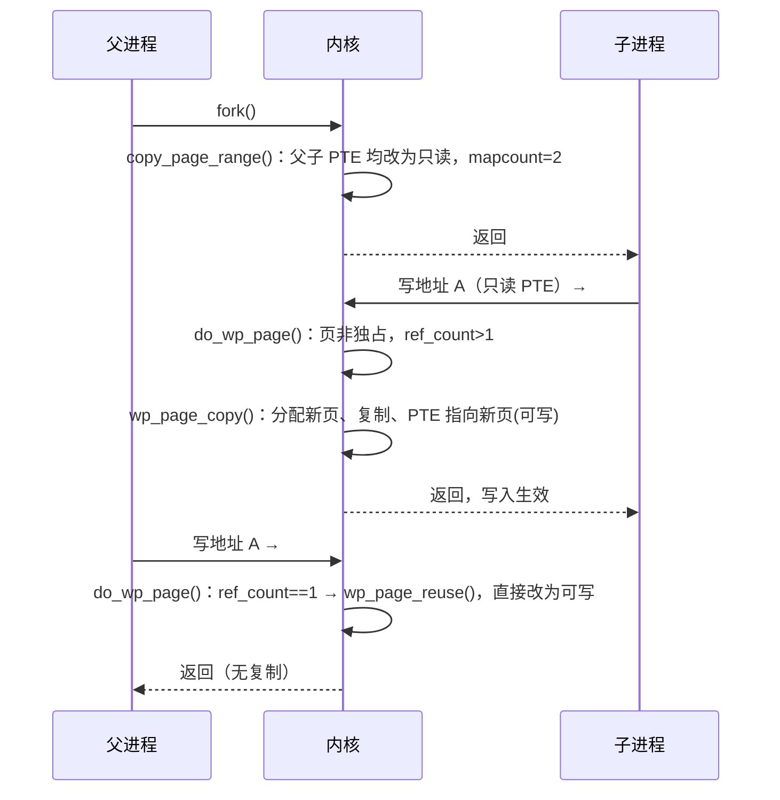

# 4.9 写时复制与反向映射

> **本节源码**：`kernel/fork.c`、`mm/mmap.c`、`mm/memory.c`、`mm/rmap.c`、`mm/internal.h`、`include/linux/rmap.h`
> **关键函数**：`dup_mmap()`、`copy_page_range()`、`copy_present_ptes()`、`__copy_present_ptes()`、`do_wp_page()`、`wp_can_reuse_anon_folio()`、`wp_page_copy()`、`__anon_vma_prepare()`、`anon_vma_fork()`、`__folio_set_anon()`、`rmap_walk()`、`vma_address()`
> **前置知识**：4.7 进程地址空间、4.8 页表与缺页异常

## 概述

`fork()` 创建的子进程在语义上拥有父进程地址空间的一份完整拷贝。如果真的逐页复制，`fork()` 会极其缓慢，而且大多数子进程紧接着就调用 `execve()` 丢弃这份拷贝。**写时复制（Copy-On-Write，COW）** 的做法是：`fork()` 时只复制页表，并把父子双方的可写私有页都改为只读，让它们共享同一批物理页；以后任一方写入时触发写保护缺页，此时才复制该页。

COW 让一个物理页可能同时被多个进程的多个页表项映射。页面回收、迁移、规整等操作需要**从物理页出发找到所有映射它的 PTE**（例如回收前要解除所有映射），这就是**反向映射（Reverse Mapping，rmap）**。Linux 没有为每个页维护映射链表（那会占用大量内存），而是利用 VMA 的线性性质：已知页在文件（或匿名区域）中的偏移和 VMA 的起始偏移，就能算出虚拟地址。

本节先分析 `fork()` 时的页表复制与 COW 缺页，再分析文件页与匿名页的反向映射结构（`address_space->i_mmap` 与 `anon_vma`）。

## fork 时的地址空间复制

### 调用链总览

```
copy_process()                                   kernel/fork.c
└── copy_mm()                                    kernel/fork.c:1520
    └── dup_mm()                                 kernel/fork.c:1479
        ├── allocate_mm() + memcpy(mm, oldmm)
        ├── mm_init()                            // 新 PGD、计数器初始化
        └── dup_mmap()                           mm/mmap.c:1719
            ├── __mt_dup()                       // 复制 maple tree 结构
            └── for_each_vma(oldmm):
                ├── vm_area_dup()                // 复制 VMA
                ├── anon_vma_fork()              mm/rmap.c:338   // 建立子进程 anon_vma
                ├── vma_link_file / i_mmap 插入
                └── copy_page_range()            mm/memory.c:1505 // 复制页表
                    └── copy_p4d/pud/pmd/pte_range()
                        ├── copy_present_ptes()  // 存在的页：写保护 + 增加映射计数
                        └── copy_nonpresent_pte()// 交换项、迁移项等
```

`CLONE_VM`（创建线程）时 `copy_mm()` 直接共享父进程的 `mm_struct`，不走上述路径。

### `dup_mmap()`

```c
// mm/mmap.c:1745-1797（v6.18.60，节选）
	retval = __mt_dup(&oldmm->mm_mt, &mm->mm_mt, GFP_KERNEL);
	...
	for_each_vma(vmi, mpnt) {
		struct file *file;

		vma_start_write(mpnt);
		if (mpnt->vm_flags & VM_DONTCOPY) {
			...
			continue;
		}
		...
		tmp = vm_area_dup(mpnt);
		if (!tmp)
			goto fail_nomem;
		retval = vma_dup_policy(mpnt, tmp);
		if (retval)
			goto fail_nomem_policy;
		tmp->vm_mm = mm;
		retval = dup_userfaultfd(tmp, &uf);
		if (retval)
			goto fail_nomem_anon_vma_fork;
		if (tmp->vm_flags & VM_WIPEONFORK) {
			/*
			 * VM_WIPEONFORK gets a clean slate in the child.
			 * Don't prepare anon_vma until fault since we don't
			 * copy page for current vma.
			 */
			tmp->anon_vma = NULL;
		} else if (anon_vma_fork(tmp, mpnt))
			goto fail_nomem_anon_vma_fork;
```

父进程的 `mmap_lock` 写锁在整个复制期间持有。`__mt_dup()` 一次性复制整棵 maple tree 的结构（v6.8 引入的优化），之后逐个替换其中的 VMA 指针，无需再为每次插入分配树节点。`MADV_DONTFORK` 设置的 `VM_DONTCOPY` 区域不会出现在子进程中；`MADV_WIPEONFORK` 设置的区域在子进程中变为全新的零页映射。

每个 VMA 复制完成后调用 `copy_page_range()`（`mm/mmap.c:1834`）。

### 哪些 VMA 需要复制页表

```c
// mm/memory.c:1479-1502（v6.18.60）
static bool
vma_needs_copy(struct vm_area_struct *dst_vma, struct vm_area_struct *src_vma)
{
	/*
	 * We check against dst_vma as while sane VMA flags will have been
	 * copied, VM_UFFD_WP may be set only on dst_vma.
	 */
	if (dst_vma->vm_flags & VM_COPY_ON_FORK)
		return true;
	/*
	 * The presence of an anon_vma indicates an anonymous VMA has page
	 * tables which naturally cannot be reconstituted on page fault.
	 */
	if (src_vma->anon_vma)
		return true;

	/*
	 * Don't copy ptes where a page fault will fill them correctly.  Fork
	 * becomes much lighter when there are big shared or private readonly
	 * mappings. The tradeoff is that copy_page_range is more efficient
	 * than faulting.
	 */
	return false;
}
```

这是一个重要的优化：**没有 anon_vma 的 VMA 根本不复制页表**。共享文件映射和从未写过的私有文件映射（如动态库的代码段），其所有页都在 page cache 中，子进程访问时通过缺页重新建立映射即可。只有含匿名页的 VMA（有 `anon_vma`）必须复制，因为匿名页无法从其他地方"重新找到"。`VM_COPY_ON_FORK` 包括 `VM_PFNMAP`、`VM_MIXEDMAP`、`VM_UFFD_WP` 等页表本身就是唯一信息来源的情形。

### 复制存在的 PTE

```c
// mm/memory.c:1097-1117（v6.18.60）
static __always_inline void __copy_present_ptes(struct vm_area_struct *dst_vma,
		struct vm_area_struct *src_vma, pte_t *dst_pte, pte_t *src_pte,
		pte_t pte, unsigned long addr, int nr)
{
	struct mm_struct *src_mm = src_vma->vm_mm;

	/* If it's a COW mapping, write protect it both processes. */
	if (is_cow_mapping(src_vma->vm_flags) && pte_write(pte)) {
		wrprotect_ptes(src_mm, addr, src_pte, nr);
		pte = pte_wrprotect(pte);
	}

	/* If it's a shared mapping, mark it clean in the child. */
	if (src_vma->vm_flags & VM_SHARED)
		pte = pte_mkclean(pte);
	pte = pte_mkold(pte);

	if (!userfaultfd_wp(dst_vma))
		pte = pte_clear_uffd_wp(pte);

	set_ptes(dst_vma->vm_mm, addr, dst_pte, pte, nr);
}
```

**COW 的核心就在前三行**：`is_cow_mapping()` 判断 VMA 是私有且可能可写（`VM_MAYWRITE` 且非 `VM_SHARED`），若 PTE 当前可写，则同时把**父进程**和**子进程**的 PTE 都设为只读。之后任一方写入都会触发写保护缺页。子进程的 PTE 还被标记为"未访问"（`pte_mkold`），因为子进程尚未访问过这些页；共享映射的 PTE 在子进程中标记为干净，脏状态只保留在父进程一侧，避免重复写回。

修改父进程 PTE 后需要刷新 TLB，这在 `dup_mmap()` 结束时对整个父 mm 执行一次 `flush_tlb_mm()`。

```c
// mm/memory.c:1173-1198（v6.18.60，节选）
	folio_get(folio);
	if (folio_test_anon(folio)) {
		/*
		 * If this page may have been pinned by the parent process,
		 * copy the page immediately for the child so that we'll always
		 * guarantee the pinned page won't be randomly replaced in the
		 * future.
		 */
		if (unlikely(folio_try_dup_anon_rmap_pte(folio, page, dst_vma, src_vma))) {
			/* Page may be pinned, we have to copy. */
			folio_put(folio);
			err = copy_present_page(dst_vma, src_vma, dst_pte, src_pte,
						addr, rss, prealloc, page);
			return err ? err : 1;
		}
		rss[MM_ANONPAGES]++;
		VM_WARN_ON_FOLIO(PageAnonExclusive(page), folio);
	} else {
		folio_dup_file_rmap_pte(folio, page, dst_vma);
		rss[mm_counter_file(folio)]++;
	}

copy_pte:
	__copy_present_ptes(dst_vma, src_vma, dst_pte, src_pte, pte, addr, 1);
```

每复制一个 PTE，folio 的引用计数和映射计数（`_mapcount`）各加一。对匿名页，`folio_try_dup_anon_rmap_pte()` 还会清除 `PageAnonExclusive` 标志（表示该页不再被单一进程独占）。但有一个例外：如果页可能被**长期固定**（GUP pin，常见于 RDMA、VFIO 等 DMA 场景），共享它会导致父进程日后 COW 时换到新页，而设备仍在向旧页 DMA，造成数据"消失"。因此对可能被固定的页，fork 时立即为子进程复制一份（`copy_present_page()`）。这一修正（"COW 与 GUP 一致性"）由 David Hildenbrand 在 v5.19 前后完成。

对于大 folio，`copy_present_ptes()` 会用 `folio_pte_batch_flags()` 一次批量处理映射同一 folio 的连续多个 PTE（`mm/memory.c:1146-1171`）。

## COW 缺页：`do_wp_page()`

当进程写入一个只读 PTE，而 VMA 允许写时，`handle_pte_fault()` 调用 `do_wp_page()`（4.8 节）：

```c
// mm/memory.c:4063-4156（v6.18.60，节选）
static vm_fault_t do_wp_page(struct vm_fault *vmf)
	__releases(vmf->ptl)
{
	const bool unshare = vmf->flags & FAULT_FLAG_UNSHARE;
	struct vm_area_struct *vma = vmf->vma;
	struct folio *folio = NULL;
	pte_t pte;
	...
	vmf->page = vm_normal_page(vma, vmf->address, vmf->orig_pte);

	if (vmf->page)
		folio = page_folio(vmf->page);

	/*
	 * Shared mapping: we are guaranteed to have VM_WRITE and
	 * FAULT_FLAG_WRITE set at this point.
	 */
	if (vma->vm_flags & (VM_SHARED | VM_MAYSHARE)) {
		...
		if (!vmf->page || is_fsdax_page(vmf->page)) {
			vmf->page = NULL;
			return wp_pfn_shared(vmf);
		}
		return wp_page_shared(vmf, folio);
	}

	/*
	 * Private mapping: create an exclusive anonymous page copy if reuse
	 * is impossible. We might miss VM_WRITE for FOLL_FORCE handling.
	 *
	 * If we encounter a page that is marked exclusive, we must reuse
	 * the page without further checks.
	 */
	if (folio && folio_test_anon(folio) &&
	    (PageAnonExclusive(vmf->page) || wp_can_reuse_anon_folio(folio, vma))) {
		if (!PageAnonExclusive(vmf->page))
			SetPageAnonExclusive(vmf->page);
		if (unlikely(unshare)) {
			pte_unmap_unlock(vmf->pte, vmf->ptl);
			return 0;
		}
		wp_page_reuse(vmf, folio);
		return 0;
	}
	/*
	 * Ok, we need to copy. Oh, well..
	 */
	if (folio)
		folio_get(folio);

	pte_unmap_unlock(vmf->pte, vmf->ptl);
	...
	return wp_page_copy(vmf);
}
```

三种结果：

| 情形 | 处理 |
|---|---|
| 共享映射 | 不复制。`wp_page_shared()` 调用文件系统的 `->page_mkwrite`（让文件系统分配块、处理日志等），然后把 PTE 设为可写并标脏。这种写保护缺页常见于文件系统为跟踪脏页而故意写保护干净页的场景 |
| 私有映射，匿名页**独占** | 复用（`wp_page_reuse()`）：直接把 PTE 改为可写，不复制 |
| 其他私有映射情形 | 复制（`wp_page_copy()`）：页被共享、是文件页（私有文件映射的第一次写入）或是零页 |

### 何时可以复用

"复用"是一项关键优化：`fork()` 后如果子进程已经退出或已经 COW 走了自己的副本，父进程再写入时，这个页实际上只剩父进程一个使用者，复制毫无意义。

`PageAnonExclusive` 标志记录"该匿名页确定只被一个进程映射"：新分配的匿名页带此标志（`RMAP_EXCLUSIVE`），fork 共享时被清除。带此标志的页直接复用。没有此标志时，`wp_can_reuse_anon_folio()` 通过引用计数判断：

```c
// mm/memory.c:4000-4039（v6.18.60，节选）
static bool wp_can_reuse_anon_folio(struct folio *folio,
				    struct vm_area_struct *vma)
{
	if (IS_ENABLED(CONFIG_TRANSPARENT_HUGEPAGE) && folio_test_large(folio))
		return __wp_can_reuse_large_anon_folio(folio, vma);
	...
	if (folio_test_ksm(folio) || folio_ref_count(folio) > 3)
		return false;
	if (!folio_test_lru(folio))
		/*
		 * We cannot easily detect+handle references from
		 * remote LRU caches or references to LRU folios.
		 */
		lru_add_drain();
	if (folio_ref_count(folio) > 1 + folio_test_swapcache(folio))
		return false;
	if (!folio_trylock(folio))
		return false;
	if (folio_test_swapcache(folio))
		folio_free_swap(folio);
	if (folio_test_ksm(folio) || folio_ref_count(folio) != 1) {
		folio_unlock(folio);
		return false;
	}
	/*
	 * Ok, we've got the only folio reference from our mapping
	 * and the folio is locked, it's dark out, and we're wearing
	 * sunglasses. Hit it.
	 */
	folio_move_anon_rmap(folio, vma);
	folio_unlock(folio);
	return true;
}
```

判断依据是**引用计数恰好为 1**（即只有当前这个页表映射持有引用）。如果页在交换缓存中，交换缓存也持有一个引用，先释放交换槽位再判断。`lru_add_drain()` 把本 CPU 的 LRU 批处理缓存（folio_batch）刷入 LRU，因为批处理缓存也会临时持有引用。复用前还调用 `folio_move_anon_rmap()` 把 `folio->mapping` 改为当前 VMA 的 anon_vma，使反向映射更精确。

早期内核在这里依据映射计数判断（`reuse_swap_page()`），这与 GUP 交互时会出问题（CVE-2020-29374）。v5.9 起改为依据引用计数判断，语义更严格：任何额外引用（包括 GUP pin）都会阻止复用。

### 复制：`wp_page_copy()`

```c
// mm/memory.c:3672-3795（v6.18.60，节选）
static vm_fault_t wp_page_copy(struct vm_fault *vmf)
{
	...
	if (vmf->page)
		old_folio = page_folio(vmf->page);
	ret = vmf_anon_prepare(vmf);
	if (unlikely(ret))
		goto out;

	pfn_is_zero = is_zero_pfn(pte_pfn(vmf->orig_pte));
	new_folio = folio_prealloc(mm, vma, vmf->address, pfn_is_zero);
	if (!new_folio)
		goto oom;

	if (!pfn_is_zero) {
		int err;

		err = __wp_page_copy_user(&new_folio->page, vmf->page, vmf);
		...
	}

	__folio_mark_uptodate(new_folio);
	...
	/*
	 * Re-check the pte - we dropped the lock
	 */
	vmf->pte = pte_offset_map_lock(mm, vmf->pmd, vmf->address, &vmf->ptl);
	if (likely(vmf->pte && pte_same(ptep_get(vmf->pte), vmf->orig_pte))) {
		...
		entry = folio_mk_pte(new_folio, vma->vm_page_prot);
		entry = pte_sw_mkyoung(entry);
		if (unlikely(unshare)) {
			...
		} else {
			entry = maybe_mkwrite(pte_mkdirty(entry), vma);
		}

		/*
		 * Clear the pte entry and flush it first, before updating the
		 * pte with the new entry, to keep TLBs on different CPUs in
		 * sync. This code used to set the new PTE then flush TLBs, but
		 * that left a window where the new PTE could be loaded into
		 * some TLBs while the old PTE remains in others.
		 */
		ptep_clear_flush(vma, vmf->address, vmf->pte);
		folio_add_new_anon_rmap(new_folio, vma, vmf->address, RMAP_EXCLUSIVE);
		folio_add_lru_vma(new_folio, vma);
		BUG_ON(unshare && pte_write(entry));
		set_pte_at(mm, vmf->address, vmf->pte, entry);
		update_mmu_cache_range(vmf, vma, vmf->address, vmf->pte, 1);
		if (old_folio) {
			...
			folio_remove_rmap_pte(old_folio, vmf->page, vma);
		}

		/* Free the old page.. */
		new_folio = old_folio;
		page_copied = 1;
		pte_unmap_unlock(vmf->pte, vmf->ptl);
	}
	...
```

流程是：分配新页（原页为零页时直接分配清零的页，不必复制）→ 在不持锁的情况下复制内容 → 加锁并确认 PTE 未变 → **先清除旧 PTE 并刷新 TLB**，再写入指向新页的可写 PTE → 为新页建立独占的匿名反向映射 → 减少旧页的映射计数。

TLB 刷新的顺序很重要：如果先写新 PTE 再刷新，其他 CPU 上运行的同一进程的线程可能在某个短暂窗口内一部分使用旧页、一部分使用新页，导致写入"丢失"。源码注释中的长段说明了 `folio_remove_rmap_pte()` 必须在 `ptep_clear_flush()` 之后的原因：确保其他进程看到映射计数减少时，本进程已经不可能再访问旧页。



*图 4-14：fork 后的写时复制与复用*

## 反向映射

### 为什么需要反向映射

页表提供"虚拟地址 → 物理页"的正向映射。页面回收时却面临相反的问题：选中一个要回收的 folio，必须找到所有映射它的 PTE 并逐一清除，否则进程仍可能访问已被释放的页。同样，页迁移、规整、内存故障处理（hwpoison）、KSM 合并、检查 Accessed 位（`folio_referenced()`）都需要这一能力。

Linux 采用**基于对象的反向映射（Object-based Reverse Mapping）**：folio 只记录它属于哪个"对象"（`folio->mapping`）以及在对象中的偏移（`folio->index`）；对象记录所有映射它的 VMA；对每个 VMA，用偏移算出虚拟地址，再查页表找到 PTE。

```c
// mm/internal.h:1078-1096（v6.18.60）
static inline unsigned long vma_address(const struct vm_area_struct *vma,
		pgoff_t pgoff, unsigned long nr_pages)
{
	unsigned long address;

	if (pgoff >= vma->vm_pgoff) {
		address = vma->vm_start +
			((pgoff - vma->vm_pgoff) << PAGE_SHIFT);
		/* Check for address beyond vma (or wrapped through 0?) */
		if (address < vma->vm_start || address >= vma->vm_end)
			address = -EFAULT;
	} else if (pgoff + nr_pages - 1 >= vma->vm_pgoff) {
		/* Test above avoids possibility of wrap to 0 on 32-bit */
		address = vma->vm_start;
	} else {
		address = -EFAULT;
	}
	return address;
}
```

即 `address = vm_start + (folio->index − vm_pgoff) × PAGE_SIZE`。这只需要 VMA 是线性映射——Linux 的 VMA 恰好总是如此（v4.0 前的 `remap_file_pages()` 非线性映射已被移除）。

### 文件页：`address_space->i_mmap`

文件页的 `folio->mapping` 指向文件的 `address_space`，`folio->index` 是页在文件中的偏移。每个映射该文件的 VMA 通过 `vma->shared.rb` 挂在 `mapping->i_mmap` 这棵**区间树（Interval Tree）** 上，键为 VMA 覆盖的文件页偏移范围 `[vm_pgoff, vm_pgoff + vma_pages)`。查找"哪些 VMA 映射了第 N 页"就是一次区间树的重叠查询：

```c
// mm/rmap.c:2935-2950（v6.18.60）
lookup:
	vma_interval_tree_foreach(vma, &mapping->i_mmap,
			pgoff_start, pgoff_end) {
		unsigned long address = vma_address(vma, pgoff_start, nr_pages);

		VM_BUG_ON_VMA(address == -EFAULT, vma);
		cond_resched();

		if (rwc->invalid_vma && rwc->invalid_vma(vma, rwc->arg))
			continue;

		if (!rwc->rmap_one(folio, vma, address, rwc->arg))
			goto done;
		if (rwc->done && rwc->done(folio))
			goto done;
	}
```

遍历期间持有 `mapping->i_mmap_rwsem` 读锁，防止 VMA 被加入或移除。

### 匿名页：`anon_vma`

匿名页没有文件，`folio->mapping` 指向一个 `anon_vma` 结构，并把最低位设为 1（`FOLIO_MAPPING_ANON`）以区别于 `address_space`：

```c
// mm/rmap.c:1366-1388（v6.18.60）
static void __folio_set_anon(struct folio *folio, struct vm_area_struct *vma,
			     unsigned long address, bool exclusive)
{
	struct anon_vma *anon_vma = vma->anon_vma;

	BUG_ON(!anon_vma);

	/*
	 * If the folio isn't exclusive to this vma, we must use the _oldest_
	 * possible anon_vma for the folio mapping!
	 */
	if (!exclusive)
		anon_vma = anon_vma->root;

	/*
	 * page_idle does a lockless/optimistic rmap scan on folio->mapping.
	 * Make sure the compiler doesn't split the stores of anon_vma and
	 * the FOLIO_MAPPING_ANON type identifier, otherwise the rmap code
	 * could mistake the mapping for a struct address_space and crash.
	 */
	anon_vma = (void *) anon_vma + FOLIO_MAPPING_ANON;
	WRITE_ONCE(folio->mapping, (struct address_space *) anon_vma);
	folio->index = linear_page_index(vma, address);
}
```

`folio->index` 被设为 `linear_page_index(vma, address)`，而私有匿名 VMA 的 `vm_pgoff` 在 mmap 时被设为 `vm_start >> PAGE_SHIFT`（4.7 节），于是 `index` 实际上是"虚拟页号"。即使 VMA 后来被 `mremap()` 移动，`vm_pgoff` 保持不变，`vma_address()` 的公式依然成立。

难点在于 fork：父进程的一个匿名页 fork 后同时被父子两个 VMA 映射，而之后子进程 COW 产生的新页只属于子进程。如果父子共用一个 anon_vma，那么对父进程新页做反向映射时也会扫描所有子进程的 VMA，在"多次 fork 的服务器进程"场景下开销巨大。

v2.6.34 引入的方案是**为每个进程的每个 VMA 都创建自己的 anon_vma，并用 `anon_vma_chain`（AVC）把 VMA 与它可能涉及的所有 anon_vma 连接起来**：

```c
// include/linux/rmap.h:32-92（v6.18.60，节选，删去部分注释）
struct anon_vma {
	struct anon_vma *root;		/* Root of this anon_vma tree */
	struct rw_semaphore rwsem;	/* W: modification, R: walking the list */
	...
	atomic_t refcount;
	...
	unsigned long num_children;
	/* Count of VMAs whose ->anon_vma pointer points to this object. */
	unsigned long num_active_vmas;

	struct anon_vma *parent;	/* Parent of this anon_vma */
	...
	/* Interval tree of private "related" vmas */
	struct rb_root_cached rb_root;
};
...
struct anon_vma_chain {
	struct vm_area_struct *vma;
	struct anon_vma *anon_vma;
	struct list_head same_vma;   /* locked by mmap_lock & page_table_lock */
	struct rb_node rb;			/* locked by anon_vma->rwsem */
	unsigned long rb_subtree_last;
	...
};
```

每个 AVC 表示"某 VMA 可能映射了属于某 anon_vma 的页"，它同时挂在两处：

- `vma->anon_vma_chain` 链表（经 `same_vma`）：该 VMA 关联的所有 anon_vma；
- `anon_vma->rb_root` 区间树（经 `rb`）：所有可能映射该 anon_vma 中页的 VMA。

`root` 指向整棵 fork 树的根 anon_vma，**整棵树共用根的 `rwsem`**，简化了加锁。

### anon_vma 的建立

第一次写缺页时，`vmf_anon_prepare()` → `__anon_vma_prepare()` 为 VMA 分配 anon_vma：

```c
// mm/rmap.c:184-223（v6.18.60，节选）
int __anon_vma_prepare(struct vm_area_struct *vma)
{
	...
	avc = anon_vma_chain_alloc(GFP_KERNEL);
	if (!avc)
		goto out_enomem;

	anon_vma = find_mergeable_anon_vma(vma);
	allocated = NULL;
	if (!anon_vma) {
		anon_vma = anon_vma_alloc();
		if (unlikely(!anon_vma))
			goto out_enomem_free_avc;
		anon_vma->num_children++; /* self-parent link for new root */
		allocated = anon_vma;
	}

	anon_vma_lock_write(anon_vma);
	/* page_table_lock to protect against threads */
	spin_lock(&mm->page_table_lock);
	if (likely(!vma->anon_vma)) {
		/*
		 * Make anon_vma fields visible before anon_vma is published.
		 * Paired with an address dependency in reusable_anon_vma().
		 */
		smp_store_release(&vma->anon_vma, anon_vma);
		anon_vma_chain_assign(vma, avc, anon_vma);
		anon_vma_interval_tree_insert(avc, &anon_vma->rb_root);
		anon_vma->num_active_vmas++;
		allocated = NULL;
		avc = NULL;
	}
	spin_unlock(&mm->page_table_lock);
	anon_vma_unlock_write(anon_vma);
	...
```

`find_mergeable_anon_vma()` 检查相邻 VMA 能否共用 anon_vma（例如一个 VMA 被 `mprotect()` 拆分成两半），以便它们日后能重新合并。由于缺页可能在多个线程上并发发生，这里用 `page_table_lock` 保证只有一个线程成功设置 `vma->anon_vma`。

### fork 时的 anon_vma

```c
// mm/rmap.c:338-393（v6.18.60，节选）
int anon_vma_fork(struct vm_area_struct *vma, struct vm_area_struct *pvma)
{
	...
	/* Don't bother if the parent process has no anon_vma here. */
	if (!pvma->anon_vma)
		return 0;

	/* Drop inherited anon_vma, we'll reuse existing or allocate new. */
	vma->anon_vma = NULL;

	/*
	 * First, attach the new VMA to the parent VMA's anon_vmas,
	 * so rmap can find non-COWed pages in child processes.
	 */
	error = anon_vma_clone(vma, pvma);
	if (error)
		return error;

	/* An existing anon_vma has been reused, all done then. */
	if (vma->anon_vma)
		return 0;

	/* Then add our own anon_vma. */
	anon_vma = anon_vma_alloc();
	...
	anon_vma->root = pvma->anon_vma->root;
	anon_vma->parent = pvma->anon_vma;
	...
	get_anon_vma(anon_vma->root);
	/* Mark this anon_vma as the one where our new (COWed) pages go. */
	vma->anon_vma = anon_vma;
	anon_vma_chain_assign(vma, avc, anon_vma);
	/* Now let rmap see it. */
	anon_vma_lock_write(anon_vma);
	anon_vma_interval_tree_insert(avc, &anon_vma->rb_root);
	anon_vma->parent->num_children++;
	anon_vma_unlock_write(anon_vma);

	return 0;
	...
```

分两步：

1. **`anon_vma_clone()`**：为子 VMA 复制父 VMA 的所有 AVC，即把子 VMA 加入父 VMA 关联的每个 anon_vma 的区间树。这样，父进程的旧页（`mapping` 指向父 anon_vma）在反向映射时能找到子 VMA。
2. **新建子进程自己的 anon_vma**：作为父 anon_vma 的子节点，子进程 COW 产生的新页挂在这里。由于子 VMA 之外没有任何 VMA 关联到它，对这些新页做反向映射时只需扫描子 VMA 本身。

`anon_vma_clone()` 还有一个优化：若发现某个已有的 anon_vma 既没有活跃 VMA（`num_active_vmas == 0`）又只有不超过一个子节点（`num_children < 2`，`mm/rmap.c:312-313`），就直接复用它，而不分配新的。这防止了反复 fork 的进程（如 shell 循环）造成 anon_vma 链无限增长。

以进程 P fork 出 C1、C2 为例：

```
          anon_vma(P) ◀── root
           ▲   ▲   ▲
   AVC     │   │   │  rb_root 区间树中挂着：VMA_P、VMA_C1、VMA_C2
           │   │   │
     ┌─────┘   │   └──────┐
  VMA_P     VMA_C1      VMA_C2
             │             │
             ▼             ▼
       anon_vma(C1)   anon_vma(C2)     各自的 rb_root 只挂着自己的 VMA
       parent=P       parent=P
```

*图 4-15：两次 fork 后的 anon_vma 结构*

P 的旧页（fork 前分配，`mapping` → anon_vma(P)）反向映射时扫描三个 VMA；C1 COW 出的新页（`mapping` → anon_vma(C1)）只扫描 VMA_C1。

注意 `__folio_set_anon()` 中的 `if (!exclusive) anon_vma = anon_vma->root;`：对非独占的页（例如换入时可能被多个进程共享的页），必须使用根 anon_vma，以保证能找到所有可能的映射者。

### 遍历：`rmap_walk()`

```c
// mm/rmap.c:2983-2991（v6.18.60）
void rmap_walk(struct folio *folio, struct rmap_walk_control *rwc)
{
	if (unlikely(folio_test_ksm(folio)))
		rmap_walk_ksm(folio, rwc);
	else if (folio_test_anon(folio))
		rmap_walk_anon(folio, rwc, false);
	else
		rmap_walk_file(folio, rwc, false);
}
```

```c
// mm/rmap.c:2852-2890（v6.18.60，节选）
static void rmap_walk_anon(struct folio *folio,
		struct rmap_walk_control *rwc, bool locked)
{
	...
		anon_vma = rmap_walk_anon_lock(folio, rwc);
	...
	pgoff_start = folio_pgoff(folio);
	pgoff_end = pgoff_start + folio_nr_pages(folio) - 1;
	anon_vma_interval_tree_foreach(avc, &anon_vma->rb_root,
			pgoff_start, pgoff_end) {
		struct vm_area_struct *vma = avc->vma;
		unsigned long address = vma_address(vma, pgoff_start,
				folio_nr_pages(folio));

		VM_BUG_ON_VMA(address == -EFAULT, vma);
		cond_resched();

		if (rwc->invalid_vma && rwc->invalid_vma(vma, rwc->arg))
			continue;

		if (!rwc->rmap_one(folio, vma, address, rwc->arg))
			break;
		if (rwc->done && rwc->done(folio))
			break;
	}

	if (!locked)
		anon_vma_unlock_read(anon_vma);
}
```

`rmap_walk_control` 是一个回调集合，不同用途传入不同的 `rmap_one`：

| 调用者 | `rmap_one` | 作用 |
|---|---|---|
| `folio_referenced()`（`mm/rmap.c:975`） | `folio_referenced_one()` | 检查并清除各 PTE 的 Accessed 位，统计近期访问次数（4.10 节） |
| `try_to_unmap()`（`mm/rmap.c:2293`） | `try_to_unmap_one()` | 解除所有映射；匿名页替换为交换项（4.11 节） |
| `try_to_migrate()` | `try_to_migrate_one()` | 替换为迁移项 |
| `remove_migration_ptes()` | `remove_migration_pte()` | 迁移完成后把迁移项恢复为新页的 PTE |
| `folio_mkclean()` | `page_mkclean_one()` | 写回前把所有映射设为只读、干净 |

`rmap_one` 内部用 `page_vma_mapped_walk()` 在页表中定位映射该 folio 的 PTE（或 PMD），这一步对大 folio 可能找到多个 PTE。

## 动手实验

观察 fork 后 COW 的开销：

```bash
python3 - <<'EOF'
import os, time, mmap
N = 512 << 20
m = mmap.mmap(-1, N); m.write(b"x" * N)        # 父进程写满 512 MB
t = time.time(); pid = os.fork()
if pid == 0:
    t1 = time.time()
    for i in range(0, N, 4096): m[i] = 0x79     # 子进程逐页写：每页一次 COW
    print("child COW 512MB: %.2fs" % (time.time() - t1)); os._exit(0)
print("fork(): %.3fs" % (time.time() - t)); os.waitpid(pid, 0)
EOF
```

`fork()` 本身很快（只复制页表），子进程的逐页写入才是真正的复制开销。

用 bpftrace 统计 COW 复制与复用（root）：

```bash
sudo bpftrace -e '
kprobe:wp_page_copy { @copy[comm] = count(); }
kprobe:do_wp_page  { @wp[comm] = count(); }'
```

查看一个进程中页的共享情况：`/proc/PID/smaps` 中 `Shared_Dirty` 与 `Private_Dirty` 分别是被多个进程共享和独占的脏页大小；`Pss`（比例集大小）把共享页按共享者数量平均分摊。

```bash
grep -E "^(Rss|Pss|Shared_|Private_)" /proc/self/smaps_rollup
```

## 小结

- fork 只复制含匿名页（有 anon_vma）的 VMA 的页表，并把父子双方的私有可写 PTE 都设为只读；可能被 GUP 固定的匿名页会在 fork 时立即复制。
- `do_wp_page()` 对共享映射直接改为可写，对私有映射中独占的匿名页（`PageAnonExclusive` 或引用计数为 1）复用，否则 `wp_page_copy()` 复制，且必须先刷新 TLB 再写新 PTE。
- 反向映射基于对象：`folio->mapping` + `folio->index`，结合 `vma_address()` 的线性公式计算虚拟地址。
- 文件页通过 `address_space->i_mmap` 区间树找到 VMA；匿名页通过 `anon_vma` 和 `anon_vma_chain` 组成的层次结构找到 VMA。
- 每个进程的每个 VMA 拥有自己的 anon_vma，子进程 COW 出的新页只需扫描子 VMA；整棵 fork 树共用根 anon_vma 的读写信号量。
- `rmap_walk()` 以回调形式服务于回收、迁移、写回等多种用途。

## 参考

- `linux/Documentation/mm/process_addrs.rst`（rmap 锁顺序）
- Rik van Riel, "change anon_vma linking to fix multi-process server scalability issue"（v2.6.34 引入 anon_vma_chain 的提交）
- LWN, "The case of the overly anonymous anon_vma": https://lwn.net/Articles/383162/
- LWN, "Patching until the COWs come home"（COW 与 GUP 问题综述）：https://lwn.net/Articles/849638/
