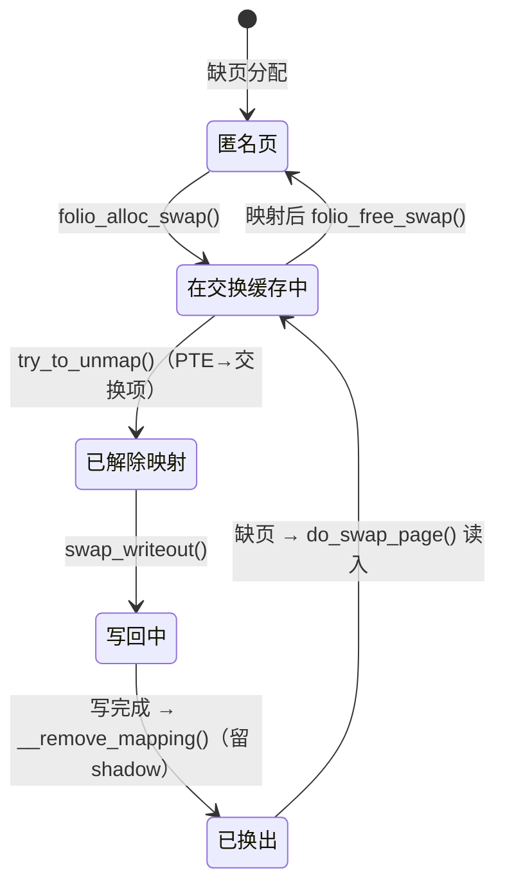

# 4.11 交换机制

> **本节源码**：[`include/linux/swap.h`](../../linux/include/linux/swap.h)、[`include/linux/swapops.h`](../../linux/include/linux/swapops.h)、[`arch/x86/include/asm/pgtable_64.h`](../../linux/arch/x86/include/asm/pgtable_64.h)、[`mm/swapfile.c`](../../linux/mm/swapfile.c)、[`mm/swap.h`](../../linux/mm/swap.h)、[`mm/swap_table.h`](../../linux/mm/swap_table.h)、[`mm/swap_state.c`](../../linux/mm/swap_state.c)、[`mm/page_io.c`](../../linux/mm/page_io.c)、[`mm/rmap.c`](../../linux/mm/rmap.c)、[`mm/vmscan.c`](../../linux/mm/vmscan.c)、[`mm/memory.c`](../../linux/mm/memory.c)、[`mm/zswap.c`](../../linux/mm/zswap.c)
> **关键函数**：`folio_alloc_swap()`、`swap_alloc_fast()`、`swap_alloc_slow()`、`swap_cache_get_folio()`、`try_to_unmap_one()`、`swap_writeout()`、`do_swap_page()`、`swapin_readahead()`、`zswap_store()`
> **前置知识**：4.9 写时复制与反向映射、4.10 页面回收

## 概述

文件页被回收时可以直接丢弃（干净页）或写回原文件（脏页），因为文件本身就是它们的后备存储（Backing Store）。匿名页（堆、栈、私有映射的写入副本）和 shmem/tmpfs 页没有这样的后备存储，若要回收，必须先把内容保存到别处——这就是**交换空间（Swap Space）**，它可以是专用的块设备分区，也可以是普通文件。

交换的完整生命周期是：回收选中一个匿名 folio → 在交换设备上分配**交换槽位（Swap Slot）** → 把 folio 放入**交换缓存（Swap Cache）** → 经反向映射把所有映射它的 PTE 替换为**交换项（Swap Entry）** → 写入交换设备 → 释放 folio。之后进程再访问该地址时，缺页处理发现 PTE 是交换项，就从交换设备读回数据（**换入**）。

本节依次分析交换项的编码、交换设备与槽位分配（v6.12 起的 cluster 分配器）、v6.18 引入的**交换表（Swap Table）** 形式的交换缓存、换出与换入路径，最后介绍压缩缓存 zswap。

## 交换项

### 逻辑格式

交换项 `swp_entry_t` 是一个 `unsigned long`，由两部分组成：交换设备号（type，即 `swap_info[]` 的下标）和设备内的槽位偏移（offset，以页为单位）：

[`include/linux/swapops.h:27-28`](../../linux/include/linux/swapops.h#L27-L28)（v6.18.60）

```c
#define SWP_TYPE_SHIFT	(BITS_PER_XA_VALUE - MAX_SWAPFILES_SHIFT)
#define SWP_OFFSET_MASK	((1UL << SWP_TYPE_SHIFT) - 1)
```

`swp_entry()`、`swp_type()`、`swp_offset()`（[`include/linux/swapops.h:86-110`](../../linux/include/linux/swapops.h#L86-L110)）在这个与体系结构无关的格式上做编解码。type 的高端编号被保留给"非交换"用途：迁移项（Migration Entry）、设备私有项、硬件损坏项（hwpoison）、PTE 标记等，它们复用同一套不存在 PTE 的编码，`non_swap_entry()` 用来区分。

### 在 x86_64 PTE 中的编码

交换项写入 PTE 时要转换为体系结构相关的格式，保证 Present 位为 0：

[`arch/x86/include/asm/pgtable_64.h:213-235`](../../linux/arch/x86/include/asm/pgtable_64.h#L213-L235)（v6.18.60）

```c
#define SWP_TYPE_BITS		5

#define SWP_OFFSET_FIRST_BIT	(_PAGE_BIT_PROTNONE + 1)

/* We always extract/encode the offset by shifting it all the way up, and then down again */
#define SWP_OFFSET_SHIFT	(SWP_OFFSET_FIRST_BIT+SWP_TYPE_BITS)

#define MAX_SWAPFILES_CHECK() BUILD_BUG_ON(MAX_SWAPFILES_SHIFT > SWP_TYPE_BITS)

/* Extract the high bits for type */
#define __swp_type(x) ((x).val >> (64 - SWP_TYPE_BITS))

/* Shift up (to get rid of type), then down to get value */
#define __swp_offset(x) (~(x).val << SWP_TYPE_BITS >> SWP_OFFSET_SHIFT)

/*
 * Shift the offset up "too far" by TYPE bits, then down again
 * The offset is inverted by a binary not operation to make the high
 * physical bits set.
 */
#define __swp_entry(type, offset) ((swp_entry_t) { \
	(~(unsigned long)(offset) << SWP_OFFSET_SHIFT >> SWP_TYPE_BITS) \
	| ((unsigned long)(type) << (64-SWP_TYPE_BITS)) })
```

```
  63    59 58                                        9  8  7  6  5  4  3  2  1  0
 ┌────────┬────────────────────────────────────────────┬──┬──┬──┬──┬──┬──┬──┬──┬──┐
 │ type   │          ~offset（取反存储）                │G │0 │D │A │  │E │F │SD│P=0│
 │ 5 位   │                                            │  │  │  │  │  │  │  │  │  │
 └────────┴────────────────────────────────────────────┴──┴──┴──┴──┴──┴──┴──┴──┴──┘
```

*图 4-17：x86_64 交换项 PTE 格式（P=0；E=独占，F=uffd-wp，SD=soft-dirty）*

几个设计细节（见 [`arch/x86/include/asm/pgtable_64.h:184-211`](../../linux/arch/x86/include/asm/pgtable_64.h#L184-L211) 的注释）：

- type 放在最高 5 位，最多 32 个交换设备（`MAX_SWAPFILES` 实际更少，部分编号保留给非交换项）；
- offset 从第 9 位开始，避开第 8 位（PROTNONE）以及 Accessed/Dirty 位（某些 CPU 的勘误会在不存在的 PTE 上错误地设置它们）；
- offset **取反存储**：这是 L1TF（L1 Terminal Fault）漏洞的缓解措施。L1TF 允许推测执行读取不存在 PTE 所指向的"物理地址"的 L1 缓存数据，把 offset 取反后高位物理地址位被置 1，指向不存在的物理内存；
- 低位的 1～3 位保存 soft-dirty、uffd-wp 和 `PG_anon_exclusive` 信息，换入时恢复。

## 交换设备与槽位分配

### `swap_info_struct`

每个交换设备（`swapon` 启用的分区或文件）由一个 `swap_info_struct` 描述：

[`include/linux/swap.h:263-286`](../../linux/include/linux/swap.h#L263-L286)（v6.18.60，节选）

```c
struct swap_info_struct {
	struct percpu_ref users;	/* indicate and keep swap device valid. */
	unsigned long	flags;		/* SWP_USED etc: see above */
	signed short	prio;		/* swap priority of this type */
	struct plist_node list;		/* entry in swap_active_head */
	signed char	type;		/* strange name for an index */
	unsigned int	max;		/* extent of the swap_map */
	unsigned char *swap_map;	/* vmalloc'ed array of usage counts */
	unsigned long *zeromap;		/* kvmalloc'ed bitmap to track zero pages */
	struct swap_cluster_info *cluster_info; /* cluster info. Only for SSD */
	struct list_head free_clusters; /* free clusters list */
	struct list_head full_clusters; /* full clusters list */
	struct list_head nonfull_clusters[SWAP_NR_ORDERS];
					/* list of cluster that contains at least one free slot */
	struct list_head frag_clusters[SWAP_NR_ORDERS];
					/* list of cluster that are fragmented or contented */
	unsigned int pages;		/* total of usable pages of swap */
	atomic_long_t inuse_pages;	/* number of those currently in use */
	struct swap_sequential_cluster *global_cluster; /* Use one global cluster for rotating device */
	spinlock_t global_cluster_lock;	/* Serialize usage of global cluster */
	struct rb_root swap_extent_root;/* root of the swap extent rbtree */
	struct block_device *bdev;	/* swap device or bdev of swap file */
	struct file *swap_file;		/* seldom referenced */
	...
```

| 字段 | 含义 |
|---|---|
| `prio` | 优先级；多个设备时优先使用高优先级设备，同优先级轮转（类似 RAID 0） |
| `swap_map[]` | 每个槽位一字节：低位是引用计数（有多少个 PTE 引用该槽位），`SWAP_HAS_CACHE` 位表示槽位在交换缓存中 |
| `zeromap` | 位图，记录哪些槽位对应全零页——这类页不需要实际 I/O |
| `cluster_info[]` | 每个 cluster（`SWAPFILE_CLUSTER` 个槽位）的元数据 |
| `swap_extent_root` | 交换文件中"槽位 → 磁盘块"的映射区间，交换文件在磁盘上可能不连续 |

`swap_map` 中的引用计数统计有多少个 PTE（或 shmem 页缓存项）指向该槽位。fork 时复制交换项 PTE 会增加计数（`copy_nonpresent_pte()` → `swap_duplicate()`，4.9 节）。计数超过 `SWAP_MAP_MAX` 时使用"计数延续页"扩展。

### cluster

槽位按 **cluster** 组织，每个 cluster 包含 `SWAPFILE_CLUSTER` 个槽位，启用 THP 时等于 `HPAGE_PMD_NR`（512，即 2 MB），否则为 256（[`mm/swap.h:12-15`](../../linux/mm/swap.h#L12-L15)）：

[`mm/swap.h:30-41`](../../linux/mm/swap.h#L30-L41)（v6.18.60）

```c
struct swap_cluster_info {
	spinlock_t lock;	/*
				 * Protect swap_cluster_info fields
				 * other than list, and swap_info_struct->swap_map
				 * elements corresponding to the swap cluster.
				 */
	u16 count;
	u8 flags;
	u8 order;
	atomic_long_t __rcu *table;	/* Swap table entries, see mm/swap_table.h */
	struct list_head list;
};
```

每个 cluster 有自己的锁和 `order`：一个 cluster 一旦被用于某个阶的分配，就只用于该阶，使得大 folio（mTHP、THP）能整体换出到连续的槽位。cluster 按状态挂在 `free_clusters`、`nonfull_clusters[order]`、`frag_clusters[order]`、`full_clusters` 链表上。这一分配器由 Chris Li、Kairui Song 等人自 v6.12 起逐步重写，取代了此前基于设备锁线性扫描 `swap_map` 的实现。

### 分配：`folio_alloc_swap()`

[`mm/swapfile.c:1429-1479`](../../linux/mm/swapfile.c#L1429-L1479)（v6.18.60，节选）

```c
int folio_alloc_swap(struct folio *folio, gfp_t gfp)
{
	unsigned int order = folio_order(folio);
	unsigned int size = 1 << order;
	swp_entry_t entry = {};
	...
	if (order) {
		/*
		 * Reject large allocation when THP_SWAP is disabled,
		 * the caller should split the folio and try again.
		 */
		if (!IS_ENABLED(CONFIG_THP_SWAP))
			return -EAGAIN;
		...
	}

again:
	local_lock(&percpu_swap_cluster.lock);
	if (!swap_alloc_fast(&entry, order))
		swap_alloc_slow(&entry, order);
	local_unlock(&percpu_swap_cluster.lock);

	if (unlikely(!order && !entry.val)) {
		if (swap_sync_discard())
			goto again;
	}

	/* Need to call this even if allocation failed, for MEMCG_SWAP_FAIL. */
	if (mem_cgroup_try_charge_swap(folio, entry))
		goto out_free;

	if (!entry.val)
		return -ENOMEM;

	swap_cache_add_folio(folio, entry, NULL);

	return 0;
	...
}
```

快速路径 `swap_alloc_fast()` 使用 per-CPU 记录的"当前 cluster"（每阶一个）：

[`mm/swapfile.c:1315-1344`](../../linux/mm/swapfile.c#L1315-L1344)（v6.18.60）

```c
static bool swap_alloc_fast(swp_entry_t *entry,
			    int order)
{
	struct swap_cluster_info *ci;
	struct swap_info_struct *si;
	unsigned int offset, found = SWAP_ENTRY_INVALID;

	/*
	 * Once allocated, swap_info_struct will never be completely freed,
	 * so checking it's liveness by get_swap_device_info is enough.
	 */
	si = this_cpu_read(percpu_swap_cluster.si[order]);
	offset = this_cpu_read(percpu_swap_cluster.offset[order]);
	if (!si || !offset || !get_swap_device_info(si))
		return false;

	ci = swap_cluster_lock(si, offset);
	if (cluster_is_usable(ci, order)) {
		if (cluster_is_empty(ci))
			offset = cluster_offset(si, ci);
		found = alloc_swap_scan_cluster(si, ci, offset, order, SWAP_HAS_CACHE);
		if (found)
			*entry = swp_entry(si->type, found);
	} else {
		swap_cluster_unlock(ci);
	}

	put_swap_device(si);
	return !!found;
}
```

只需持有该 cluster 的锁即可分配，不同 CPU 使用不同 cluster，互不竞争。同一 CPU 连续换出的页落在相邻槽位，换入时可以顺序预读，对机械硬盘尤其有利。快速路径失败时，`swap_alloc_slow()`（[`mm/swapfile.c:1347`](../../linux/mm/swapfile.c#L1347)）按优先级遍历可用设备（`swap_avail_heads[node]`，每个 NUMA 节点一个列表），从中选取新的 cluster（`cluster_alloc_swap_entry()`，[`mm/swapfile.c:1028`](../../linux/mm/swapfile.c#L1028)），同优先级设备之间通过 `plist_requeue()` 轮转。

`SWAP_HAS_CACHE` 参数表示分配的槽位同时被交换缓存占用。分配成功后 `mem_cgroup_try_charge_swap()` 把槽位计入 memcg 的交换用量（`memory.swap.max`），最后 `swap_cache_add_folio()` 把 folio 放入交换缓存。

## 交换缓存

### 为什么需要交换缓存

交换缓存是"交换槽位 → folio"的映射，类似文件的 page cache。它解决了换入换出过程中的同步问题：

1. **换出期间**：folio 已解除部分 PTE 映射、正在写入设备，另一个进程（共享该匿名页的 fork 子进程）恰好缺页访问。它可以从交换缓存中找到这个 folio 直接使用，而不必等待写完再读回。
2. **换入期间**：多个进程共享同一个交换槽位（fork 后换出的页），第一个缺页的进程读入 folio 并放入交换缓存，其他进程缺页时直接复用，保证所有进程最终映射到同一个物理页。
3. **换入后**：folio 留在交换缓存中、槽位暂不释放。如果该页再次被回收且内容未被修改（不脏），可以直接丢弃而无需再次写出。

### 交换表（v6.18）

v6.18 之前，交换缓存用每 64 MB 一棵的 XArray（基数树）实现。v6.18 引入**交换表**：每个 cluster 附带一个与 cluster 槽位一一对应的指针数组：

[`mm/swap_table.h:9-12`](../../linux/mm/swap_table.h#L9-L12)（v6.18.60）

```c
/* A typical flat array in each cluster as swap table */
struct swap_table {
	atomic_long_t entries[SWAPFILE_CLUSTER];
};
```

一个 cluster 有 512 个槽位，交换表恰好 512 × 8 字节 = 一页。表项有三种取值：NULL（槽位未用）、folio 指针（槽位正在换入/换出，或已换入但仍保留）、shadow 值（已换出，记录 workingset 信息供 refault 检测）。由于换入换出时总是已经知道（或持有）对应的 cluster，查找退化为一次数组下标访问：

[`mm/swap_state.c:87-103`](../../linux/mm/swap_state.c#L87-L103)（v6.18.60）

```c
struct folio *swap_cache_get_folio(swp_entry_t entry)
{
	unsigned long swp_tb;
	struct folio *folio;

	for (;;) {
		swp_tb = swap_table_get(__swap_entry_to_cluster(entry),
					swp_cluster_offset(entry));
		if (!swp_tb_is_folio(swp_tb))
			return NULL;
		folio = swp_tb_to_folio(swp_tb);
		if (likely(folio_try_get(folio)))
			return folio;
	}

	return NULL;
}
```

交换表在 RCU 保护下无锁读取，修改时持有 cluster 锁。folio 在交换缓存中时设置 `PG_swapcache`，`folio->swap` 字段保存其交换项。

## 换出

换出发生在 `shrink_folio_list()`（4.10 节）中，分为三步。

### 第一步：分配槽位并加入交换缓存

[`mm/vmscan.c:1307-1344`](../../linux/mm/vmscan.c#L1307-L1344)（v6.18.60，节选）

```c
		if (folio_test_anon(folio) && folio_test_swapbacked(folio)) {
			if (!folio_test_swapcache(folio)) {
				if (!(sc->gfp_mask & __GFP_IO))
					goto keep_locked;
				if (folio_maybe_dma_pinned(folio))
					goto keep_locked;
				if (folio_test_large(folio)) {
					...
				}
				if (folio_alloc_swap(folio, __GFP_HIGH | __GFP_NOWARN)) {
					int __maybe_unused order = folio_order(folio);

					if (!folio_test_large(folio))
						goto activate_locked_split;
					/* Fallback to swap normal pages */
					if (split_folio_to_list(folio, folio_list))
						goto activate_locked;
					...
					if (folio_alloc_swap(folio, __GFP_HIGH | __GFP_NOWARN))
						goto activate_locked_split;
				}
```

大 folio 若无法分配连续槽位（没有对应阶的可用 cluster），就拆分成小页逐个换出。被 DMA 固定的页不能换出。调用者不允许 I/O（无 `__GFP_IO`）时也跳过。

### 第二步：解除映射，写入交换项

`try_to_unmap()` 经反向映射对每个映射调用 `try_to_unmap_one()`，匿名页分支把 PTE 替换为交换项：

[`mm/rmap.c:2183-2228`](../../linux/mm/rmap.c#L2183-L2228)（v6.18.60，节选）

```c
			if (swap_duplicate(entry) < 0) {
				set_pte_at(mm, address, pvmw.pte, pteval);
				goto walk_abort;
			}
			...
			/* See folio_try_share_anon_rmap(): clear PTE first. */
			if (anon_exclusive &&
			    folio_try_share_anon_rmap_pte(folio, subpage)) {
				swap_free(entry);
				set_pte_at(mm, address, pvmw.pte, pteval);
				goto walk_abort;
			}
			if (list_empty(&mm->mmlist)) {
				spin_lock(&mmlist_lock);
				if (list_empty(&mm->mmlist))
					list_add(&mm->mmlist, &init_mm.mmlist);
				spin_unlock(&mmlist_lock);
			}
			dec_mm_counter(mm, MM_ANONPAGES);
			inc_mm_counter(mm, MM_SWAPENTS);
			swp_pte = swp_entry_to_pte(entry);
			if (anon_exclusive)
				swp_pte = pte_swp_mkexclusive(swp_pte);
			...
			set_pte_at(mm, address, pvmw.pte, swp_pte);
```

此前 PTE 已被 `ptep_clear_flush()` 清除并刷新 TLB（同一函数中更早的位置）。每替换一个 PTE，`swap_duplicate()` 把槽位引用计数加一。`PG_anon_exclusive` 信息被保存到交换项的 E 位中，换入时据此决定能否直接映射为可写。mm 被挂到全局 `init_mm.mmlist` 上，供 `swapoff` 时遍历所有可能使用交换空间的进程。

### 第三步：写出

解除所有映射后，脏的交换缓存 folio 由 `pageout()` 写出，匿名页最终进入 `swap_writeout()`：

[`mm/page_io.c:240-289`](../../linux/mm/page_io.c#L240-L289)（v6.18.60，节选）

```c
int swap_writeout(struct folio *folio, struct swap_iocb **swap_plug)
{
	int ret = 0;

	if (folio_free_swap(folio))
		goto out_unlock;
	...
	/*
	 * Use a bitmap (zeromap) to avoid doing IO for zero-filled pages.
	 * The bits in zeromap are protected by the locked swapcache folio
	 * and atomic updates are used to protect against read-modify-write
	 * corruption due to other zero swap entries seeing concurrent updates.
	 */
	if (is_folio_zero_filled(folio)) {
		swap_zeromap_folio_set(folio);
		goto out_unlock;
	}
	...
	swap_zeromap_folio_clear(folio);

	if (zswap_store(folio)) {
		count_mthp_stat(folio_order(folio), MTHP_STAT_ZSWPOUT);
		goto out_unlock;
	}
	if (!mem_cgroup_zswap_writeback_enabled(folio_memcg(folio))) {
		folio_mark_dirty(folio);
		return AOP_WRITEPAGE_ACTIVATE;
	}

	__swap_writepage(folio, swap_plug);
	return 0;
	...
}
```

依次尝试三种"不必真正写盘"的情况：

1. `folio_free_swap()` 成功：所有 PTE 引用都已消失（例如进程刚好退出），槽位可以直接释放；
2. **全零页**：只在 `zeromap` 中置位，不做 I/O，换入时直接填零（v6.12 引入）；
3. **zswap**：压缩后存入内存池（见后文），成功则不写盘。

都不满足时 `__swap_writepage()`（[`mm/page_io.c:447`](../../linux/mm/page_io.c#L447)）构造 bio 提交给块设备，或对交换文件调用文件系统的 `->swap_rw`。写完成后，回收路径的下一轮扫描会发现 folio 已干净、未映射，`__remove_mapping()` 把它从交换缓存中删除（留下 shadow），释放回伙伴系统。



*图 4-18：匿名页的换出与换入状态转换*

## 换入：`do_swap_page()`

### 分发

`handle_pte_fault()` 遇到"非空且不存在"的 PTE 时进入 `do_swap_page()`（4.8 节）。它首先区分非交换项：

[`mm/memory.c:4618-4672`](../../linux/mm/memory.c#L4618-L4672)（v6.18.60，节选）

```c
	entry = pte_to_swp_entry(vmf->orig_pte);
	if (unlikely(non_swap_entry(entry))) {
		if (is_migration_entry(entry)) {
			migration_entry_wait(vma->vm_mm, vmf->pmd,
					     vmf->address);
		} else if (is_device_exclusive_entry(entry)) {
			...
		} else if (is_device_private_entry(entry)) {
			...
		} else if (is_hwpoison_entry(entry)) {
			ret = VM_FAULT_HWPOISON;
		} else if (is_pte_marker_entry(entry)) {
			ret = handle_pte_marker(vmf);
		} else {
			print_bad_pte(vma, vmf->address, vmf->orig_pte, NULL);
			ret = VM_FAULT_SIGBUS;
		}
		goto out;
	}
```

迁移项表示该页正在被迁移（4.12 节），等待迁移完成即可；设备私有项用于 HMM（异构内存管理，页在 GPU 显存中），需要迁回系统内存。

### 查找或读入 folio

[`mm/memory.c:4674-4750`](../../linux/mm/memory.c#L4674-L4750)（v6.18.60，节选）

```c
	/* Prevent swapoff from happening to us. */
	si = get_swap_device(entry);
	if (unlikely(!si))
		goto out;

	folio = swap_cache_get_folio(entry);
	if (folio)
		swap_update_readahead(folio, vma, vmf->address);
	swapcache = folio;

	if (!folio) {
		if (data_race(si->flags & SWP_SYNCHRONOUS_IO) &&
		    __swap_count(entry) == 1) {
			/* skip swapcache */
			folio = alloc_swap_folio(vmf);
			if (folio) {
				...
				shadow = swap_cache_get_shadow(entry);
				if (shadow)
					workingset_refault(folio, shadow);

				folio_add_lru(folio);

				/* To provide entry to swap_read_folio() */
				folio->swap = entry;
				swap_read_folio(folio, NULL);
				folio->private = NULL;
			}
		} else {
			folio = swapin_readahead(entry, GFP_HIGHUSER_MOVABLE,
						vmf);
			swapcache = folio;
		}
		...
		/* Had to read the page from swap area: Major fault */
		ret = VM_FAULT_MAJOR;
		count_vm_event(PGMAJFAULT);
		count_memcg_event_mm(vma->vm_mm, PGMAJFAULT);
	}
```

三种情况：

1. **交换缓存命中**：folio 尚未被释放（刚换出不久，或其他进程刚换入），直接使用，属于次缺页；
2. **同步设备快速路径**：对 zram 这类同步完成 I/O 的设备（`SWP_SYNCHRONOUS_IO`），且槽位只被一个 PTE 引用时，跳过交换缓存，直接分配 folio（可能是 mTHP）同步读入，避免交换缓存的开销；
3. **常规路径**：`swapin_readahead()` 读入目标页并预读周围的页。

### 预读

[`mm/swap_state.c:815-828`](../../linux/mm/swap_state.c#L815-L828)（v6.18.60）

```c
struct folio *swapin_readahead(swp_entry_t entry, gfp_t gfp_mask,
				struct vm_fault *vmf)
{
	struct mempolicy *mpol;
	pgoff_t ilx;
	struct folio *folio;

	mpol = get_vma_policy(vmf->vma, vmf->address, 0, &ilx);
	folio = swap_use_vma_readahead() ?
		swap_vma_readahead(entry, gfp_mask, mpol, ilx, vmf) :
		swap_cluster_readahead(entry, gfp_mask, mpol, ilx);
	mpol_cond_put(mpol);

	return folio;
}
```

两种预读策略：

| 策略 | 依据 | 适用 |
|---|---|---|
| `swap_cluster_readahead()` | 交换设备上相邻的槽位（物理局部性），窗口大小 2^`vm.page-cluster`（默认 3，即 8 页） | 旋转介质（存在 `SWP_SOLIDSTATE` 以外设备时） |
| `swap_vma_readahead()` | 出错地址在 VMA 中相邻的 PTE 所指向的交换项（虚拟局部性） | 默认（`enable_vma_readahead`，SSD 上的交换） |

`swap_use_vma_readahead()`（[`mm/swap_state.c:360-363`](../../linux/mm/swap_state.c#L360-L363)）在没有旋转介质交换设备时选择 VMA 预读。两者的窗口大小都会根据近期预读命中率（`swap_update_readahead()` 统计）自适应调整（`__swapin_nr_pages()`，[`mm/swap_state.c:542`](../../linux/mm/swap_state.c#L542)）。

### 建立映射

[`mm/memory.c:4924-4986`](../../linux/mm/memory.c#L4924-L4986)（v6.18.60，节选）

```c
	arch_swap_restore(folio_swap(entry, folio), folio);

	/*
	 * Remove the swap entry and conditionally try to free up the swapcache.
	 * We're already holding a reference on the page but haven't mapped it
	 * yet.
	 */
	swap_free_nr(entry, nr_pages);
	if (should_try_to_free_swap(folio, vma, vmf->flags))
		folio_free_swap(folio);

	add_mm_counter(vma->vm_mm, MM_ANONPAGES, nr_pages);
	add_mm_counter(vma->vm_mm, MM_SWAPENTS, -nr_pages);
	pte = mk_pte(page, vma->vm_page_prot);
	...
	/*
	 * Same logic as in do_wp_page(); however, optimize for pages that are
	 * certainly not shared either because we just allocated them without
	 * exposing them to the swapcache or because the swap entry indicates
	 * exclusivity.
	 */
	if (!folio_test_ksm(folio) &&
	    (exclusive || folio_ref_count(folio) == 1)) {
		if ((vma->vm_flags & VM_WRITE) && !userfaultfd_pte_wp(vma, pte) &&
		    !pte_needs_soft_dirty_wp(vma, pte)) {
			pte = pte_mkwrite(pte, vma);
			if (vmf->flags & FAULT_FLAG_WRITE) {
				pte = pte_mkdirty(pte);
				vmf->flags &= ~FAULT_FLAG_WRITE;
			}
		}
		rmap_flags |= RMAP_EXCLUSIVE;
	}
	...
		folio_add_anon_rmap_ptes(folio, page, nr_pages, vma, address,
					rmap_flags);
	...
	set_ptes(vma->vm_mm, address, ptep, pte, nr_pages);
```

`swap_free_nr()` 减少槽位引用计数。`should_try_to_free_swap()`（[`mm/memory.c:4332-4349`](../../linux/mm/memory.c#L4332-L4349)）判断是否立即释放交换缓存与槽位：交换空间紧张（`mem_cgroup_swap_full()`，使用超过一半）、VMA 或 folio 被 mlock，或者这是一次写缺页且当前进程很可能是唯一使用者（换入后马上会被修改，交换副本没有保留价值）时释放。若交换项带有独占位（E 位）或引用计数表明独占，且 VMA 可写，则直接映射为可写，省去一次后续的写保护缺页。

## zswap：压缩交换缓存

zswap 是位于回收路径与交换设备之间的一层**压缩内存缓存**：换出时先尝试把页压缩后存入内存中的 zsmalloc 池，只有池满或压缩效果不佳时才真正写盘。对于 CPU 富余而 I/O 慢的场景，它能显著降低交换 I/O。

本书配置 `CONFIG_ZSWAP=y`，默认压缩算法为 lzo（`CONFIG_ZSWAP_COMPRESSOR_DEFAULT="lzo"`），但默认**未启用**（`CONFIG_ZSWAP_DEFAULT_ON` 未设置），需启动参数 `zswap.enabled=1` 或写 `/sys/module/zswap/parameters/enabled` 打开。

- **存储**：`zswap_store()`（[`mm/zswap.c:1496`](../../linux/mm/zswap.c#L1496)）逐页压缩（`zswap_compress()`），把压缩结果存入 zsmalloc（`CONFIG_ZSMALLOC=y`），并以交换项为键记录在 zswap 的 XArray 中。仍然需要先分配交换槽位——zswap 只是"截获"了写盘这一步。
- **加载**：换入时 `swap_read_folio()` 先调用 `zswap_load()`（[`mm/zswap.c:1602`](../../linux/mm/zswap.c#L1602)），命中则解压，不发起 I/O。
- **回写**：zswap 池超过 `max_pool_percent`（默认为内存的 20%），或 zswap shrinker（`CONFIG_ZSWAP_SHRINKER_DEFAULT_ON=y`）判断其中的页已经很冷时，把最老的压缩页解压并写入真正的交换设备。
- **memcg**：cgroup v2 的 `memory.zswap.max` 与 `memory.zswap.writeback` 可以分别限制每个 cgroup 的 zswap 用量和是否允许回写到磁盘（上文 `swap_writeout()` 中的 `mem_cgroup_zswap_writeback_enabled()` 检查）。

与之相关但机制不同的是 **zram**（`CONFIG_ZRAM=m`）：它是一个压缩内存块设备，常被直接用作交换设备（`SWP_SYNCHRONOUS_IO` 快速路径就是为它设计的）。zswap 是交换设备之前的缓存，zram 是交换设备本身。

## 动手实验

在 dev 虚拟机中创建并启用一个交换文件（root）：

```bash
sudo fallocate -l 1G /swapfile && sudo chmod 600 /swapfile
sudo mkswap /swapfile && sudo swapon -p 10 /swapfile
swapon --show
cat /proc/swaps
```

制造内存压力并观察换出、换入：

```bash
grep -E "^(pswpin|pswpout|swap_ra|swap_ra_hit|zswpin|zswpout)" /proc/vmstat
stress-ng --vm 1 --vm-bytes 120% --vm-keep -t 30s &
watch -n1 'grep -E "^(pswpin|pswpout)" /proc/vmstat; grep -E "Swap(Total|Free|Cached)" /proc/meminfo'
```

`SwapCached` 是仍在交换缓存中的页的总量。查看某个进程被换出的量：

```bash
grep VmSwap /proc/$(pgrep -n stress-ng)/status
grep -E "^Swap:" /proc/$(pgrep -n stress-ng)/smaps | awk '{s+=$2} END {print s " kB"}'
```

启用 zswap 并观察压缩效果：

```bash
echo 1 | sudo tee /sys/module/zswap/parameters/enabled
sudo grep -r . /sys/kernel/debug/zswap/ 2>/dev/null   # stored_pages、pool_total_size 等
grep -E "^Zswap" /proc/meminfo
```

## 小结

- 交换项编码在不存在的 PTE 中：x86_64 上高 5 位为设备号，offset 取反存储以缓解 L1TF，低位保留 soft-dirty、uffd-wp、独占标记。
- 交换槽位按 cluster 管理，每个 cluster 绑定一个阶并有独立的锁；per-CPU 当前 cluster 提供无竞争的快速分配，并让大 folio 能整体换出。
- v6.18 用每 cluster 一页的交换表取代 XArray 实现交换缓存，表项为 NULL、folio 或 shadow，查找变为数组访问。
- 换出三步：`folio_alloc_swap()` 分配槽位并加入交换缓存 → `try_to_unmap()` 把 PTE 替换为交换项 → `swap_writeout()` 写出（全零页与 zswap 可免去 I/O）。
- 换入由 `do_swap_page()` 完成：交换缓存命中、同步设备直读或带预读的常规读入；VMA 预读与 cluster 预读按设备类型选择。
- zswap 在交换设备之前提供压缩内存缓存，zram 则是压缩内存交换设备。

## 参考

- `linux/Documentation/mm/swap-table.rst`（交换表设计）
- `linux/Documentation/mm/swap.rst`
- `linux/Documentation/admin-guide/mm/zswap.rst`
- `linux/Documentation/admin-guide/blockdev/zram.rst`
- `linux/Documentation/admin-guide/sysctl/vm.rst`（`page-cluster`、`swappiness`）
- `linux/arch/x86/include/asm/pgtable_64.h` 中关于交换项格式与 L1TF 的注释
