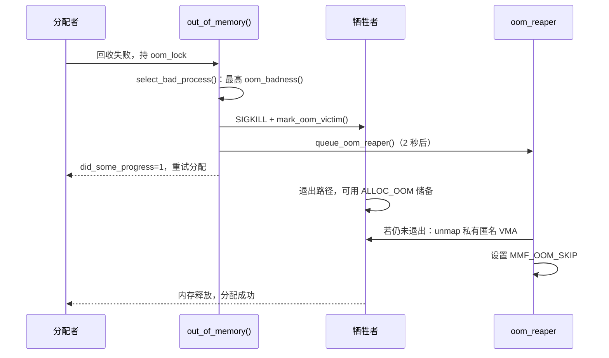

# 4.12 页迁移、内存规整与 OOM Killer

> **本节源码**：[`mm/compaction.c`](../../linux/mm/compaction.c)、[`mm/memory.c`](../../linux/mm/memory.c)、[`mm/mempolicy.c`](../../linux/mm/mempolicy.c)、[`kernel/sched/fair.c`](../../linux/kernel/sched/fair.c)、[`include/linux/compaction.h`](../../linux/include/linux/compaction.h)、[`mm/migrate.c`](../../linux/mm/migrate.c)、[`mm/rmap.c`](../../linux/mm/rmap.c)、[`mm/oom_kill.c`](../../linux/mm/oom_kill.c)、[`mm/page_alloc.c`](../../linux/mm/page_alloc.c)
> **关键函数**：`do_numa_page()`、`try_to_compact_pages()`、`compact_zone()`、`__compact_finished()`、`__compaction_suitable()`、`isolate_migratepages()`、`isolate_freepages()`、`kcompactd()`、`migrate_pages()`、`migrate_folio_unmap()`、`out_of_memory()`、`oom_badness()`、`select_bad_process()`、`__oom_kill_process()`、`oom_reap_task_mm()`
> **前置知识**：4.3 伙伴系统、4.4 慢速路径、4.9 反向映射、4.10 页面回收

## 概述

当空闲内存总量充足、却凑不出足够大的连续块时，回收无济于事——这是**外部碎片（External Fragmentation）** 问题。4.3 节介绍的迁移类型分组能降低碎片产生的速度，但无法消除碎片。**内存规整（Memory Compaction）** 主动移动已分配的可移动页：从 zone 的低端挑出正在使用的页，把内容复制到 zone 高端的空闲页中，从而在低端腾出连续的空闲块。规整的基础设施是**页迁移（Page Migration）**，它同样服务于 NUMA Balancing、内存热拔出、CMA 分配等场景。

当回收和规整都无法满足分配时，最后的手段是**内存不足杀手（Out-Of-Memory Killer，OOM Killer）**：选择一个"最值得牺牲"的进程杀死，释放其内存。

本节依次分析页迁移的通用机制、内存规整的双扫描器算法与触发时机，以及 OOM Killer 的选择、杀死与收割过程。

## 页迁移

### 迁移的含义

迁移一个 folio 意味着：分配一个新 folio，把旧 folio 的内容和元数据（标志、映射关系、memcg 计费等）复制过去，把所有引用旧 folio 的地方（页表、page cache、交换缓存）改为指向新 folio，最后释放旧 folio。这一切对进程透明——进程的虚拟地址不变，只是背后的物理页换了。

可迁移的前提是能找到并替换**所有**引用：页表映射通过反向映射找到（4.9 节）；page cache 与交换缓存中的引用通过 `folio->mapping` 找到；其他引用（如内核驱动直接持有的 `get_page()` 引用、DMA pin）无法替换，因此带有额外引用的页无法迁移。这也是"不可移动"分配必须与"可移动"分配分开的根本原因。给定迁移目标的方式由调用者决定：规整把页搬到同一 zone 的高端，NUMA Balancing 把页搬到访问者所在的节点，内存热拔出把页搬出要下线的内存块。

### 迁移项

迁移期间，页表中指向旧 folio 的 PTE 被替换为**迁移项（Migration Entry）**——一种特殊的不存在 PTE，编码了旧 folio 的 PFN 和读/写权限。进程此时访问该地址会触发缺页，`do_swap_page()` 识别出迁移项后调用 `migration_entry_wait()`（[`mm/migrate.c:480`](../../linux/mm/migrate.c#L480)）在旧 folio 的锁上等待，迁移完成后重新执行访问（4.11 节）。

### 主流程

```
migrate_pages(from, get_new_folio, put_new_folio, private, mode, reason)   mm/migrate.c:2081
└── migrate_pages_batch()                                                  mm/migrate.c:1792
    ├── 对每个 folio: migrate_folio_unmap()                                mm/migrate.c:1195
    │   ├── dst = get_new_folio(src)       // 由调用者提供分配策略（规整用 compaction_alloc）
    │   ├── folio_trylock(src)             // 异步模式下拿不到锁就放弃
    │   ├── 等待写回（同步模式）
    │   └── try_to_migrate(src)            mm/rmap.c:2627   // 经 rmap 把所有 PTE 换成迁移项
    ├── try_to_unmap_flush()               // 批量刷新 TLB
    └── 对每个 folio: migrate_folio_move()                                 mm/migrate.c:1345
        ├── move_to_new_folio()            mm/migrate.c:1082
        │   └── mapping->a_ops->migrate_folio() 或 migrate_folio()       // 替换 page cache 中的指针，复制内容与标志
        ├── remove_migration_ptes(src, dst)                               mm/migrate.c:454   // 迁移项 → 指向新页的 PTE
        └── 释放 src
```

v6.3 起，`migrate_pages_batch()` 把"解除映射"与"移动"拆成两个批次：先对一批 folio 全部解除映射，统一做一次 TLB 刷新，再逐个复制。这把每页一次的 TLB 刷新（需要 IPI）合并为每批一次，大幅降低了迁移大量页时的开销。

迁移模式决定了能容忍多少阻塞：

| 模式 | 行为 | 使用者 |
|---|---|---|
| `MIGRATE_ASYNC` | 不等锁、不等写回，遇到即跳过 | 直接规整的第一轮、kcompactd、THP 缺页 |
| `MIGRATE_SYNC_LIGHT` | 可以等锁，但不等写回 | 直接规整的后续轮次 |
| `MIGRATE_SYNC` | 可以等锁和写回 | `/proc/sys/vm/compact_memory`、内存热拔出、CMA |

### 应用：NUMA Balancing

页迁移的另一个重要使用者是 **自动 NUMA 平衡（Automatic NUMA Balancing）**（`CONFIG_NUMA_BALANCING=y`，默认启用），它把进程频繁访问的页迁移到进程所在 CPU 的本地节点。其机制是“制造缺页来采样访问”：

1. 调度器周期性地在任务返回用户态时执行 `task_numa_work()`（[`kernel/sched/fair.c:3374`](../../linux/kernel/sched/fair.c#L3374)），每次扫描进程地址空间的一段（默认 256 MB，`sysctl_numa_balancing_scan_size`，[`kernel/sched/fair.c:1527`](../../linux/kernel/sched/fair.c#L1527)），调用 `change_prot_numa()`（[`mm/mempolicy.c:821`](../../linux/mm/mempolicy.c#L821)）把其中的 PTE 改为 PROTNONE（4.8 节）；
2. 进程再访问这些页时触发缺页，`handle_pte_fault()` 调用 `do_numa_page()`（[`mm/memory.c:5980`](../../linux/mm/memory.c#L5980)）：恢复正常权限，并由 `numa_migrate_check()` 结合访问者的 CPU、该页上次访问者（`_last_cpupid`）和内存策略判断是否应迁移；
3. 需要迁移时调用 `migrate_misplaced_folio()`（[`mm/migrate.c:2731`](../../linux/mm/migrate.c#L2731)）把页迁到目标节点；`task_numa_fault()` 记录统计，供调度器决定是否反过来把任务迁到内存所在的节点（第 3 章）。

启用内存分层模式（`NUMA_BALANCING_MEMORY_TIERING`）时，同一机制还用于把慢速内存节点（如 CXL 内存）上的热页提升到快速节点，这就是 4.4 节 `WMARK_PROMO` 水位的用途。

## 内存规整

### 双扫描器算法

规整在一个 zone 内运行两个相向而行的扫描器：

- **迁移扫描器（Migrate Scanner）**：从 zone 低端向高端，按页块扫描，收集**可移动的已用页**，放入 `cc->migratepages`；
- **空闲扫描器（Free Scanner）**：从 zone 高端向低端，按页块扫描，收集**空闲页**，放入 `cc->freepages[]`，作为迁移目标。

两者相遇时一轮规整结束。其效果是把可移动页集中到 zone 高端，空闲页集中到低端，低端的空闲页合并成大块。

```
 zone_start_pfn                                                     zone_end_pfn
 ┌───┬───┬───┬───┬───┬───┬───┬───┬───┬───┬───┬───┬───┬───┬───┬───┐
 │ U │ M │ . │ M │ . │ M │ U │ . │ M │ . │ . │ M │ . │ . │ M │ . │   规整前
 └───┴───┴───┴───┴───┴───┴───┴───┴───┴───┴───┴───┴───┴───┴───┴───┘
   migrate_pfn ──▶                                     ◀── free_pfn
 ┌───┬───┬───┬───┬───┬───┬───┬───┬───┬───┬───┬───┬───┬───┬───┬───┐
 │ U │ . │ . │ . │ . │ . │ U │ . │ M │ M │ M │ M │ M │ M │ M │ . │   规整后
 └───┴───┴───┴───┴───┴───┴───┴───┴───┴───┴───┴───┴───┴───┴───┴───┘
   U = 不可移动页   M = 可移动页   . = 空闲页
```

*图 4-19：内存规整的双扫描器（PFN 从左到右递增）*

注意不可移动页（U）原地不动，所以不可移动页"污染"的页块永远无法完全腾空——这再次说明了迁移类型分组的重要性。

### 主循环：`compact_zone()`

[`mm/compaction.c:2541-2728`](../../linux/mm/compaction.c#L2541-L2728)（v6.18.60，节选）

```c
static enum compact_result
compact_zone(struct compact_control *cc, struct capture_control *capc)
{
	...
	if (!is_via_compact_memory(cc->order)) {
		ret = compaction_suit_allocation_order(cc->zone, cc->order,
						       cc->highest_zoneidx,
						       cc->alloc_flags,
						       cc->mode == MIGRATE_ASYNC,
						       !cc->direct_compaction);
		if (ret != COMPACT_CONTINUE)
			return ret;
	}
	...
	if (cc->whole_zone) {
		cc->migrate_pfn = start_pfn;
		cc->free_pfn = pageblock_start_pfn(end_pfn - 1);
	} else {
		cc->migrate_pfn = cc->zone->compact_cached_migrate_pfn[sync];
		cc->free_pfn = cc->zone->compact_cached_free_pfn;
		...
	}
	...
	while ((ret = compact_finished(cc)) == COMPACT_CONTINUE) {
		...
rescan:
		switch (isolate_migratepages(cc)) {
		case ISOLATE_ABORT:
			ret = COMPACT_CONTENDED;
			putback_movable_pages(&cc->migratepages);
			cc->nr_migratepages = 0;
			goto out;
		case ISOLATE_NONE:
			...
			goto check_drain;
		case ISOLATE_SUCCESS:
			update_cached = false;
			last_migrated_pfn = max(cc->zone->zone_start_pfn,
				pageblock_start_pfn(cc->migrate_pfn - 1));
		}
		...
		err = migrate_pages(&cc->migratepages, compaction_alloc,
				compaction_free, (unsigned long)cc, cc->mode,
				MR_COMPACTION, &nr_succeeded);
		...
		/* Stop if a page has been captured */
		if (capc && capc->page) {
			ret = COMPACT_SUCCESS;
			break;
		}
		...
	}
```

几个要点：

- **扫描位置缓存**：两个扫描器的位置保存在 `zone->compact_cached_migrate_pfn[]` 和 `compact_cached_free_pfn` 中，下次规整从上次停下的地方继续，避免每次都从头扫描。
- **跳过位（skip bit）**：扫描中发现无可迁移页或无空闲页的页块会被设置 `PB_migrate_skip` 标志，之后的扫描跳过它；规整多次失败后（`compaction_restarting()`）或 kswapd 休眠前清除这些标志。
- **`compaction_alloc()`**（[`mm/compaction.c:1877`](../../linux/mm/compaction.c#L1877)）是传给 `migrate_pages()` 的目标页分配函数：从 `cc->freepages[]` 中取空闲页，不够时调用 `isolate_freepages()` 让空闲扫描器继续前进。
- **捕获（capture）**：直接规整时，4.3 节 `__free_one_page()` 中的 `compaction_capture()` 会把迁移释放出的、恰好满足请求阶的块直接交给规整者，避免被其他分配抢走。

### 何时结束：`__compact_finished()`

[`mm/compaction.c:2265-2367`](../../linux/mm/compaction.c#L2265-L2367)（v6.18.60，节选）

```c
static enum compact_result __compact_finished(struct compact_control *cc)
{
	...
	/* Compaction run completes if the migrate and free scanner meet */
	if (compact_scanners_met(cc)) {
		/* Let the next compaction start anew. */
		reset_cached_positions(cc->zone);
		...
		if (cc->whole_zone)
			return COMPACT_COMPLETE;
		else
			return COMPACT_PARTIAL_SKIPPED;
	}
	...
	/*
	 * Always finish scanning a pageblock to reduce the possibility of
	 * fallbacks in the future. This is particularly important when
	 * migration source is unmovable/reclaimable but it's not worth
	 * special casing.
	 */
	if (!pageblock_aligned(cc->migrate_pfn))
		return COMPACT_CONTINUE;
	...
	/* Direct compactor: Is a suitable page free? */
	ret = COMPACT_NO_SUITABLE_PAGE;
	for (order = cc->order; order < NR_PAGE_ORDERS; order++) {
		struct free_area *area = &cc->zone->free_area[order];

		/* Job done if page is free of the right migratetype */
		if (!free_area_empty(area, migratetype))
			return COMPACT_SUCCESS;
		...
		if (find_suitable_fallback(area, order, migratetype, true) >= 0)
			...
			return COMPACT_SUCCESS;
	}
```

规整以"能否满足请求"为目标，而不是把整个 zone 整理干净：只要在请求阶或更高阶上出现了合适迁移类型的空闲块（或可以整块认领的其他类型块），就立即停止。

### 是否值得规整

规整需要空闲页作为迁移目标，如果空闲页太少，规整本身就会失败：

[`mm/compaction.c:2388-2413`](../../linux/mm/compaction.c#L2388-L2413)（v6.18.60，节选）

```c
static bool __compaction_suitable(struct zone *zone, int order,
				  unsigned long watermark, int highest_zoneidx,
				  unsigned long free_pages)
{
	...
	watermark += compact_gap(order);
	if (order > PAGE_ALLOC_COSTLY_ORDER)
		watermark += low_wmark_pages(zone) - min_wmark_pages(zone);
	return __zone_watermark_ok(zone, 0, watermark, highest_zoneidx,
				   ALLOC_CMA, free_pages);
}
```

`compact_gap(order)` 为 `2UL << order`（[`include/linux/compaction.h:66-82`](../../linux/include/linux/compaction.h#L66-L82)），即要求 order 0 的空闲页至少比水位多出请求大小的两倍。不满足时返回 `COMPACT_SKIPPED`，提示调用者应先回收。

另一个判断依据是**碎片化指数（Fragmentation Index）**：它衡量分配失败是因为"内存不足"（指数接近 0）还是"碎片化"（指数接近 1000）。指数低于 `vm.extfrag_threshold`（默认 500，[`mm/compaction.c:1922`](../../linux/mm/compaction.c#L1922)）时，说明缺的是内存而不是连续性，规整也被跳过（[`mm/compaction.c:2448`](../../linux/mm/compaction.c#L2448)）。

### 触发时机

规整有四个触发来源：

1. **直接规整**：慢速路径中的 `__alloc_pages_direct_compact()` → `try_to_compact_pages()`（[`mm/compaction.c:2814`](../../linux/mm/compaction.c#L2814)），对 zonelist 上每个合格 zone 调用 `compact_zone_order()`（4.4 节）。为避免反复失败，每个 zone 维护"推迟"机制：失败后 `compact_defer_shift` 加一，接下来的 2^shift 次请求直接跳过规整。
2. **kcompactd**：每个节点一个后台线程。kswapd 回收完成后、或 `wakeup_kswapd()` 判断节点只是碎片化时唤醒它（4.4 节）。
3. **主动规整（Proactive Compaction）**：kcompactd 每 500 ms（`HPAGE_FRAG_CHECK_INTERVAL_MSEC`，[`mm/compaction.c:33`](../../linux/mm/compaction.c#L33)）检查节点的碎片化分数，超过 `vm.compaction_proactiveness`（默认 20，[`mm/compaction.c:1921`](../../linux/mm/compaction.c#L1921)）对应的阈值时主动规整，使 THP 等大页分配更容易成功。
4. **手动**：`echo 1 > /proc/sys/vm/compact_memory` 对所有节点做完整规整。

## OOM Killer

### 触发路径

OOM Killer 由两条路径触发：

- **全局 OOM**：页分配慢速路径在回收和规整都失败后调用 `__alloc_pages_may_oom()` → `out_of_memory()`（4.4 节）；
- **memcg OOM**：cgroup 的内存用量达到 `memory.max` 且回收失败时，`mem_cgroup_out_of_memory()` 以 `oc->memcg` 非空的方式调用 `out_of_memory()`，只在该 cgroup 内部选择牺牲者（4.14 节）。

### `out_of_memory()`

[`mm/oom_kill.c:1118-1186`](../../linux/mm/oom_kill.c#L1118-L1186)（v6.18.60，节选）

```c
bool out_of_memory(struct oom_control *oc)
{
	unsigned long freed = 0;

	if (oom_killer_disabled)
		return false;

	if (!is_memcg_oom(oc)) {
		blocking_notifier_call_chain(&oom_notify_list, 0, &freed);
		if (freed > 0 && !is_sysrq_oom(oc))
			/* Got some memory back in the last second. */
			return true;
	}

	/*
	 * If current has a pending SIGKILL or is exiting, then automatically
	 * select it.  The goal is to allow it to allocate so that it may
	 * quickly exit and free its memory.
	 */
	if (task_will_free_mem(current)) {
		mark_oom_victim(current);
		queue_oom_reaper(current);
		return true;
	}

	/*
	 * The OOM killer does not compensate for IO-less reclaim.
	 * But mem_cgroup_oom() has to invoke the OOM killer even
	 * if it is a GFP_NOFS allocation.
	 */
	if (!(oc->gfp_mask & __GFP_FS) && !is_memcg_oom(oc))
		return true;

	/*
	 * Check if there were limitations on the allocation (only relevant for
	 * NUMA and memcg) that may require different handling.
	 */
	oc->constraint = constrained_alloc(oc);
	if (oc->constraint != CONSTRAINT_MEMORY_POLICY)
		oc->nodemask = NULL;
	check_panic_on_oom(oc);

	if (!is_memcg_oom(oc) && sysctl_oom_kill_allocating_task &&
	    current->mm && !oom_unkillable_task(current) &&
	    oom_cpuset_eligible(current, oc) &&
	    current->signal->oom_score_adj != OOM_SCORE_ADJ_MIN) {
		get_task_struct(current);
		oc->chosen = current;
		oom_kill_process(oc, "Out of memory (oom_kill_allocating_task)");
		return true;
	}

	select_bad_process(oc);
	/* Found nothing?!?! */
	if (!oc->chosen) {
		dump_header(oc);
		pr_warn("Out of memory and no killable processes...\n");
		...
		if (!is_sysrq_oom(oc) && !is_memcg_oom(oc))
			panic("System is deadlocked on memory\n");
	}
	if (oc->chosen && oc->chosen != (void *)-1UL)
		oom_kill_process(oc, !is_memcg_oom(oc) ? "Out of memory" :
				 "Memory cgroup out of memory");
	return !!oc->chosen;
}
```

处理顺序：

1. 通知 `oom_notify_list` 上的订阅者（如 virtio-balloon）释放内存，若有收获则不杀进程；
2. 当前任务已经在退出（或已收到 SIGKILL）：直接让它作为牺牲者，授予储备访问权以便尽快退出；
3. `GFP_NOFS` 分配不触发全局 OOM——这类分配无法进行完整的文件系统回收，杀进程可能并不必要，返回"有进展"让其重试；
4. `constrained_alloc()`（[`mm/oom_kill.c:252`](../../linux/mm/oom_kill.c#L252)）判断这次 OOM 是否只是 cpuset 或 mempolicy 限定的节点不足，以决定候选进程的范围和 `totalpages` 的计算；
5. `vm.panic_on_oom` 为真时直接 panic；`vm.oom_kill_allocating_task` 为真时直接杀当前进程；
6. 否则 `select_bad_process()` 选择得分最高者并杀死。

### 打分：`oom_badness()`

[`mm/oom_kill.c:202-240`](../../linux/mm/oom_kill.c#L202-L240)（v6.18.60）

```c
long oom_badness(struct task_struct *p, unsigned long totalpages)
{
	long points;
	long adj;

	if (oom_unkillable_task(p))
		return LONG_MIN;

	p = find_lock_task_mm(p);
	if (!p)
		return LONG_MIN;

	/*
	 * Do not even consider tasks which are explicitly marked oom
	 * unkillable or have been already oom reaped or the are in
	 * the middle of vfork
	 */
	adj = (long)p->signal->oom_score_adj;
	if (adj == OOM_SCORE_ADJ_MIN ||
			mm_flags_test(MMF_OOM_SKIP, p->mm) ||
			in_vfork(p)) {
		task_unlock(p);
		return LONG_MIN;
	}

	/*
	 * The baseline for the badness score is the proportion of RAM that each
	 * task's rss, pagetable and swap space use.
	 */
	points = get_mm_rss(p->mm) + get_mm_counter(p->mm, MM_SWAPENTS) +
		mm_pgtables_bytes(p->mm) / PAGE_SIZE;
	task_unlock(p);

	/* Normalize to oom_score_adj units */
	adj *= totalpages / 1000;
	points += adj;

	return points;
}
```

得分 = 驻留内存页数 + 交换项数 + 页表页数 + `oom_score_adj × totalpages / 1000`。也就是说，得分以"占用了多少内存"为基准，`oom_score_adj`（范围 −1000～1000，通过 `/proc/PID/oom_score_adj` 设置）按千分之一总内存为单位调整。`-1000`（`OOM_SCORE_ADJ_MIN`）使进程完全免于被选中；`+1000` 几乎保证被优先选中。内核线程、init 进程等 `oom_unkillable_task()` 返回真的任务不参与。

v2.6.36 之前的打分算法要复杂得多（考虑 CPU 时间、nice 值、运行时长、子进程数等），由 David Rientjes 重写为现在这种"只看内存占用"的简洁形式，行为更可预测。`/proc/PID/oom_score` 显示的是归一化后的分数（[`fs/proc/base.c:596`](../../linux/fs/proc/base.c#L596)，`(1000 + badness × 1000 / totalpages) × 2 / 3`）。

### 选择：`select_bad_process()`

[`mm/oom_kill.c:309-380`](../../linux/mm/oom_kill.c#L309-L380)（v6.18.60，节选）

```c
static int oom_evaluate_task(struct task_struct *task, void *arg)
{
	struct oom_control *oc = arg;
	long points;

	if (oom_unkillable_task(task))
		goto next;

	/* p may not have freeable memory in nodemask */
	if (!is_memcg_oom(oc) && !oom_cpuset_eligible(task, oc))
		goto next;

	/*
	 * This task already has access to memory reserves and is being killed.
	 * Don't allow any other task to have access to the reserves unless
	 * the task has MMF_OOM_SKIP because chances that it would release
	 * any memory is quite low.
	 */
	if (!is_sysrq_oom(oc) && tsk_is_oom_victim(task)) {
		if (mm_flags_test(MMF_OOM_SKIP, task->signal->oom_mm))
			goto next;
		goto abort;
	}
	...
	points = oom_badness(task, oc->totalpages);
	if (points == LONG_MIN || points < oc->chosen_points)
		goto next;
	...
}
...
static void select_bad_process(struct oom_control *oc)
{
	oc->chosen_points = LONG_MIN;

	if (is_memcg_oom(oc))
		mem_cgroup_scan_tasks(oc->memcg, oom_evaluate_task, oc);
	else {
		struct task_struct *p;

		rcu_read_lock();
		for_each_process(p)
			if (oom_evaluate_task(p, oc))
				break;
		rcu_read_unlock();
	}
}
```

关键的"abort"分支：如果已经存在一个正在退出的 OOM 牺牲者，且它的内存尚未被收割完（没有 `MMF_OOM_SKIP`），就**不再选择新的牺牲者**（`oc->chosen = -1`），而是让分配者等待它释放内存。这防止了一次内存紧张中连续杀死多个进程。

### 杀死：`__oom_kill_process()`

[`mm/oom_kill.c:927-1006`](../../linux/mm/oom_kill.c#L927-L1006)（v6.18.60，节选）

```c
static void __oom_kill_process(struct task_struct *victim, const char *message)
{
	...
	/* Get a reference to safely compare mm after task_unlock(victim) */
	mm = victim->mm;
	mmgrab(mm);

	/* Raise event before sending signal: task reaper must see this */
	count_vm_event(OOM_KILL);
	memcg_memory_event_mm(mm, MEMCG_OOM_KILL);

	/*
	 * We should send SIGKILL before granting access to memory reserves
	 * in order to prevent the OOM victim from depleting the memory
	 * reserves from the user space under its control.
	 */
	do_send_sig_info(SIGKILL, SEND_SIG_PRIV, victim, PIDTYPE_TGID);
	mark_oom_victim(victim);
	pr_err("%s: Killed process %d (%s) total-vm:%lukB, anon-rss:%lukB, file-rss:%lukB, shmem-rss:%lukB, UID:%u pgtables:%lukB oom_score_adj:%hd\n",
		...);
	task_unlock(victim);
	...
	rcu_read_lock();
	for_each_process(p) {
		if (!process_shares_mm(p, mm))
			continue;
		if (same_thread_group(p, victim))
			continue;
		if (is_global_init(p)) {
			can_oom_reap = false;
			mm_flags_set(MMF_OOM_SKIP, mm);
			...
			continue;
		}
		...
		do_send_sig_info(SIGKILL, SEND_SIG_PRIV, p, PIDTYPE_TGID);
	}
	rcu_read_unlock();

	if (can_oom_reap)
		queue_oom_reaper(victim);
	...
}
```

- 先发送 SIGKILL，再 `mark_oom_victim()` 设置 `TIF_MEMDIE` 等标记，使牺牲者在退出过程中能够动用内存储备（4.4 节的 `ALLOC_OOM`）；
- 所有共享同一 `mm` 的进程（`CLONE_VM` 但非同一线程组，如 `vfork()` 的子进程）也被杀死，否则 mm 不会被释放；
- 内核日志中常见的 "Killed process ... anon-rss:... file-rss:..." 就来自这里。

外层的 `oom_kill_process()`（[`mm/oom_kill.c:1023`](../../linux/mm/oom_kill.c#L1023)）还会处理 cgroup v2 的 `memory.oom.group`：若牺牲者所在的 cgroup 设置了该选项，整个 cgroup 的进程都会被一起杀死，保证一个多进程服务不会被"杀掉一半"。

### 收割：OOM Reaper

牺牲者收到 SIGKILL 后，要等到它被调度运行、执行完退出路径（`exit_mmap()`），内存才会释放。如果它正阻塞在某个不可中断的等待中（例如等待另一个也在等内存的锁），系统可能陷入活锁。

**OOM Reaper**（v4.6 引入）是一个内核线程，在牺牲者被杀约 2 秒后（`OOM_REAPER_DELAY`，[`mm/oom_kill.c:700`](../../linux/mm/oom_kill.c#L700)）主动替它拆除地址空间中的匿名映射：

[`mm/oom_kill.c:577-615`](../../linux/mm/oom_kill.c#L577-L615)（v6.18.60，节选）

```c
static bool oom_reap_task_mm(struct task_struct *tsk, struct mm_struct *mm)
{
	bool ret = true;

	if (!mmap_read_trylock(mm)) {
		trace_skip_task_reaping(tsk->pid);
		return false;
	}
	...
	if (mm_flags_test(MMF_OOM_SKIP, mm)) {
		trace_skip_task_reaping(tsk->pid);
		goto out_unlock;
	}

	trace_start_task_reaping(tsk->pid);

	/* failed to reap part of the address space. Try again later */
	ret = __oom_reap_task_mm(mm);
	if (!ret)
		goto out_finish;

	pr_info("oom_reaper: reaped process %d (%s), now anon-rss:%lukB, file-rss:%lukB, shmem-rss:%lukB\n",
			...);
	...
}
```

收割只需 `mmap_lock` 读锁（用 trylock，失败则稍后重试），`__oom_reap_task_mm()`（[`mm/oom_kill.c:515`](../../linux/mm/oom_kill.c#L515)）遍历所有 VMA，跳过 hugetlb 与 `VM_PFNMAP` 映射，对匿名 VMA 和私有（非 `VM_SHARED`）映射调用 `unmap_page_range()` 释放其中的页——牺牲者反正要死了，这些私有内存不再需要。共享映射被跳过，因为别的进程可能还在使用。收割完成（或重试多次失败）后设置 `MMF_OOM_SKIP`，告诉 OOM Killer"这个牺牲者已经尽力了"，如果内存仍然不足，可以选择下一个牺牲者。



*图 4-20：OOM Killer 的选择、杀死与收割*

### 用户态 OOM 处理

内核 OOM Killer 只在"真正分配不到内存"时才动手，此前系统可能已经因为频繁回收和换入换出而长时间卡顿（抖动，thrashing）。因此现代发行版普遍使用用户态 OOM 守护进程，如 systemd-oomd、Android 的 lmkd、Facebook 的 oomd。它们基于 PSI（`/proc/pressure/memory`，4.4 节）的内存压力指标，在压力持续过高时提前杀死 cgroup，以牺牲少量任务为代价保持系统响应。

## 动手实验

查看碎片化程度与规整统计：

```bash
cat /proc/buddyinfo
sudo cat /sys/kernel/debug/extfrag/extfrag_index      # 各阶碎片化指数，-1 表示该阶可以直接满足
sudo cat /sys/kernel/debug/extfrag/unusable_index     # 对各阶不可用的空闲内存比例
grep -E "^compact_" /proc/vmstat
```

手动触发规整并比较前后的 buddyinfo（root）：

```bash
cat /proc/buddyinfo; echo 1 | sudo tee /proc/sys/vm/compact_memory; cat /proc/buddyinfo
```

观察 OOM 打分并安全地触发 memcg OOM（需要 cgroup v2 与 root，不会影响整个系统）：

```bash
cat /proc/self/oom_score /proc/self/oom_score_adj
sudo mkdir /sys/fs/cgroup/oomtest
echo 100M | sudo tee /sys/fs/cgroup/oomtest/memory.max
echo 0    | sudo tee /sys/fs/cgroup/oomtest/memory.swap.max
sudo sh -c 'echo $$ > /sys/fs/cgroup/oomtest/cgroup.procs; exec python3 -c "b=bytearray(300<<20)"'
# 进程被杀，dmesg 中可见 "Memory cgroup out of memory: Killed process ..."
sudo dmesg | tail -20
cat /sys/fs/cgroup/oomtest/memory.events
sudo rmdir /sys/fs/cgroup/oomtest
```

## 小结

- 页迁移把旧 folio 的所有引用（经 rmap 找到的 PTE、page cache 或交换缓存）替换为新 folio；迁移期间 PTE 为迁移项，访问者等待。v6.3 起批量解除映射以合并 TLB 刷新。
- 自动 NUMA 平衡周期性地把 PTE 改为 PROTNONE 来采样访问，在 `do_numa_page()` 中把页迁移到访问者所在的节点。
- 内存规整在 zone 内运行相向的迁移扫描器与空闲扫描器，把可移动页集中到高端，以"能否满足请求阶"为结束条件。
- 规整前检查空闲页是否足够（`compact_gap()`）以及失败是否由碎片化引起（碎片化指数），失败时推迟后续尝试。
- 规整由直接规整、kcompactd、主动规整（`compaction_proactiveness`）和手动接口触发。
- OOM Killer 按"RSS + 交换 + 页表 + `oom_score_adj` 调整"打分，选最高者发送 SIGKILL 并授予储备访问权；存在未完成的牺牲者时不选新的牺牲者。
- OOM Reaper 在牺牲者无法及时退出时代为释放其私有匿名内存，然后设置 `MMF_OOM_SKIP`。

## 参考

- `linux/Documentation/mm/page_migration.rst`
- `linux/Documentation/admin-guide/sysctl/vm.rst`（`compact_memory`、`compaction_proactiveness`、`extfrag_threshold`、`panic_on_oom`、`oom_kill_allocating_task`）
- `linux/Documentation/admin-guide/cgroup-v2.rst`（`memory.oom.group`）
- Mel Gorman, "Memory compaction" 补丁系列（v2.6.35）
- Nitin Gupta, "mm: Proactive compaction" 补丁（v5.9）
