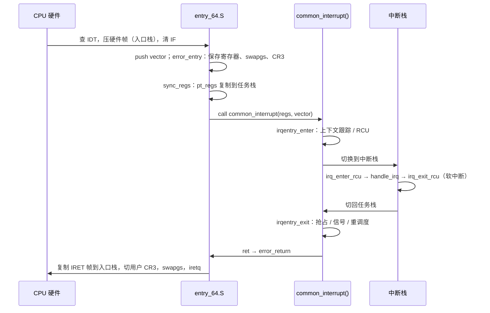

# 5.2 中断入口与出口：idtentry 与 irqentry 框架

> **本节源码**：`arch/x86/entry/entry_64.S`、`arch/x86/entry/calling.h`、`arch/x86/include/asm/idtentry.h`、`arch/x86/include/asm/irq_stack.h`、`arch/x86/include/asm/ptrace.h`、`kernel/entry/common.c`、`include/linux/irq-entry-common.h`、`include/linux/hardirq.h`、`kernel/softirq.c`、`arch/x86/kernel/irq.c`、`arch/x86/entry/entry_fred.c`
> **关键函数**：`error_entry()`、`sync_regs()`、`irqentry_enter()`、`irqentry_exit()`、`irq_enter_rcu()`、`irq_exit_rcu()`、`common_interrupt()`、`exit_to_user_mode_loop()`
> **前置知识**：5.1 x86_64 中断与异常体系、3.5 调度时钟与抢占模型、7.1 并发来源与执行上下文

## 概述

CPU 按 IDT 跳到入口地址时，只在栈上留下了 5 个（或带错误码时 6 个）字的**硬件帧**，其余寄存器、GS 基址、页表都还是被打断时的状态。从这里到真正执行 C 处理函数之间，内核要完成一系列与体系结构和安全缓解相关的操作：保存通用寄存器、在用户态进入时执行 `swapgs` 并切换到内核页表、把栈从入口栈搬到任务栈、通知 RCU 与上下文跟踪"CPU 已离开用户态 / idle"、按需切换到中断栈。返回时则以相反顺序撤销，并在合适的时机处理信号、重调度等待办事项。

v5.8 之前，这些逻辑大部分写在汇编里，各架构各自实现，容易出错。v5.8 起 Thomas Gleixner 主导的重构把它们拆成两层：**汇编层**（`entry_64.S`）只做必须用汇编完成的最少工作；**通用 C 层**（`kernel/entry/common.c`，`CONFIG_GENERIC_IRQ_ENTRY=y`）提供 `irqentry_enter()` / `irqentry_exit()`，处理 RCU、lockdep、tracing、抢占与返回用户态的工作。中间用 `DEFINE_IDTENTRY*()` 系列宏把二者粘合起来。

本节沿一次设备中断的完整路径，自下而上分析这三部分。

## 核心数据结构

### pt_regs：被打断现场的快照

入口代码把被打断的寄存器保存为一个 `struct pt_regs`，它同时是系统调用、异常、中断共用的现场格式：

```c
// arch/x86/include/asm/ptrace.h:103-170（v6.18.60）
struct pt_regs {
	/*
	 * C ABI says these regs are callee-preserved. They aren't saved on
	 * kernel entry unless syscall needs a complete, fully filled
	 * "struct pt_regs".
	 */
	unsigned long r15;
	unsigned long r14;
	unsigned long r13;
	unsigned long r12;
	unsigned long bp;
	unsigned long bx;

	/* These regs are callee-clobbered. Always saved on kernel entry. */
	unsigned long r11;
	unsigned long r10;
	unsigned long r9;
	unsigned long r8;
	unsigned long ax;
	unsigned long cx;
	unsigned long dx;
	unsigned long si;
	unsigned long di;

	/*
	 * orig_ax is used on entry for:
	 * - the syscall number (syscall, sysenter, int80)
	 * - error_code stored by the CPU on traps and exceptions
	 * - the interrupt number for device interrupts
	 *
	 ...
	 */
	unsigned long orig_ax;

	/* The IRETQ return frame starts here */
	unsigned long ip;

	union {
		/* CS selector */
		u16		cs;
		/* The extended 64-bit data slot containing CS */
		u64		csx;
		/* The FRED CS extension */
		struct fred_cs	fred_cs;
	};

	unsigned long flags;
	unsigned long sp;

	union {
		/* SS selector */
		u16		ss;
		...
	};
	...
};
```

结构体的字段顺序与栈上的压入顺序严格对应：从 `ip` 到 `ss` 的 5 个字是 CPU 压入的硬件帧；`orig_ax` 是错误码槽位（无错误码的异常由入口代码补压 `-1`，设备中断则是入口桩压入的向量号）；`di` 到 `r15` 由 `PUSH_REGS` 宏（`arch/x86/entry/calling.h:68-100`）依次压入。`user_mode(regs)` 通过检查 `regs->cs` 的低 2 位（CPL）判断被打断的是用户态还是内核态。

```
  高地址
 ┌──────────────┐ ← 栈顶（入口栈 / 任务栈 / IST 栈）
 │ ss           │ ┐
 │ sp           │ │
 │ flags        │ │ CPU 压入的硬件帧
 │ cs           │ │
 │ ip           │ ┘
 │ orig_ax      │   错误码 / 向量号 / -1
 │ di … r11     │   调用者保存寄存器
 │ bx bp r12…r15│   被调用者保存寄存器
 └──────────────┘ ← %rsp = struct pt_regs *
  低地址（栈向低地址增长）
```

*图 5-2：入口代码在栈上构造的 `struct pt_regs`*

### irqentry_state_t

`irqentry_enter()` 返回一个不透明的状态对象，必须原样传给 `irqentry_exit()`：

```c
// include/linux/irq-entry-common.h:310-315（v6.18.60）
typedef struct irqentry_state {
	union {
		bool	exit_rcu;
		bool	lockdep;
	};
} irqentry_state_t;
```

`exit_rcu` 记录进入时 RCU 是否"没在看"这个 CPU（CPU 处于 idle 或 NO_HZ_FULL 用户态等扩展静止状态），若是，退出时需要调用 `ct_irq_exit()` 让 CPU 重新进入扩展静止状态。`lockdep` 只在 NMI 路径中使用。

## 主流程分析

### 调用链总览

以一次在内核态打断任务的设备中断为例：

```
CPU 硬件：查 IDT[vector]，压入硬件帧，清 IF
irq_entries_start[vector - 0x20]         arch/x86/include/asm/idtentry.h   push $vector
└── asm_common_interrupt                 由 idtentry 宏生成（entry_64.S）
    ├── error_entry                      arch/x86/entry/entry_64.S        保存寄存器 / swapgs / CR3
    ├── common_interrupt()               arch/x86/kernel/irq.c            DEFINE_IDTENTRY_IRQ
    │   ├── irqentry_enter()             kernel/entry/common.c
    │   ├── run_irq_on_irqstack_cond()   arch/x86/include/asm/irq_stack.h 切到中断栈
    │   │   ├── irq_enter_rcu()          kernel/softirq.c                 HARDIRQ_OFFSET++
    │   │   ├── __common_interrupt()     arch/x86/kernel/irq.c
    │   │   │   └── call_irq_handler()   → generic_handle_irq_desc()（5.6 节）
    │   │   └── irq_exit_rcu()           kernel/softirq.c                 HARDIRQ_OFFSET--，执行软中断
    │   └── irqentry_exit()              kernel/entry/common.c            内核抢占 / 返回用户态工作
    └── error_return
        └── common_interrupt_return      arch/x86/entry/entry_64.S        恢复寄存器，iretq
```

### 第一步：汇编入口桩

`idtentry.h` 中的每个 `DECLARE_IDTENTRY*()` 在被 `entry_64.S` 包含时展开为一个汇编宏调用（`arch/x86/include/asm/idtentry.h:477-529`），在被 C 文件包含时展开为函数声明。这样同一份列表同时生成汇编桩和 C 原型，二者不会不一致。

最常用的 `idtentry` 宏如下：

```asm
// arch/x86/entry/entry_64.S:329-365（v6.18.60）
.macro idtentry vector asmsym cfunc has_error_code:req
SYM_CODE_START(\asmsym)

	.if \vector == X86_TRAP_BP
		/* #BP advances %rip to the next instruction */
		UNWIND_HINT_IRET_ENTRY offset=\has_error_code*8 signal=0
	.else
		UNWIND_HINT_IRET_ENTRY offset=\has_error_code*8
	.endif

	ENDBR
	ASM_CLAC
	cld

	.if \has_error_code == 0
		pushq	$-1			/* ORIG_RAX: no syscall to restart */
	.endif

	.if \vector == X86_TRAP_BP
		/*
		 * If coming from kernel space, create a 6-word gap to allow the
		 * int3 handler to emulate a call instruction.
		 */
		testb	$3, CS-ORIG_RAX(%rsp)
		jnz	.Lfrom_usermode_no_gap_\@
		.rept	6
		pushq	5*8(%rsp)
		.endr
		UNWIND_HINT_IRET_REGS offset=8
.Lfrom_usermode_no_gap_\@:
	.endif

	idtentry_body \cfunc \has_error_code

_ASM_NOKPROBE(\asmsym)
SYM_CODE_END(\asmsym)
.endm
```

- `ASM_CLAC`：在支持 SMAP 的 CPU 上清除 `RFLAGS.AC`，防止内核在中断上下文中意外访问用户内存；`cld` 保证字符串指令方向正确。
- 无错误码的异常补压 `-1`，使所有入口的栈布局一致。`-1` 同时表示"这不是系统调用"，信号处理不会尝试重启系统调用。
- #BP 的特殊处理是为 text_poke / static_call 服务的：内核在运行时改写指令时用 `int3` 临时替换首字节，`int3` 处理函数若需模拟一条 `call` 指令，就要往被打断的栈上压返回地址，所以这里预先在硬件帧下方复制出 6 个字的空隙。

设备中断使用的 `idtentry_irq` 只是 `has_error_code=1` 的 `idtentry`，并把入口对齐到缓存行（`arch/x86/entry/entry_64.S:376-379`）——入口桩压入的向量号正好占据错误码槽位。

`idtentry_body` 负责调用 `error_entry` 并转入 C 函数：

```asm
// arch/x86/entry/entry_64.S:289-317（v6.18.60）
.macro idtentry_body cfunc has_error_code:req

	/*
	 * Call error_entry() and switch to the task stack if from userspace.
	 *
	 * When in XENPV, it is already in the task stack, and it can't fault
	 * for native_iret() nor native_load_gs_index() since XENPV uses its
	 * own pvops for IRET and load_gs_index().  And it doesn't need to
	 * switch the CR3.  So it can skip invoking error_entry().
	 */
	ALTERNATIVE "call error_entry; movq %rax, %rsp", \
		    "call xen_error_entry", X86_FEATURE_XENPV

	ENCODE_FRAME_POINTER
	UNWIND_HINT_REGS

	movq	%rsp, %rdi			/* pt_regs pointer into 1st argument*/

	.if \has_error_code == 1
		movq	ORIG_RAX(%rsp), %rsi	/* get error code into 2nd argument*/
		movq	$-1, ORIG_RAX(%rsp)	/* no syscall to restart */
	.endif

	/* For some configurations \cfunc ends up being a noreturn. */
	ANNOTATE_REACHABLE
	call	\cfunc

	jmp	error_return
.endm
```

C 函数的第一个参数是 `pt_regs` 指针，第二个参数是错误码（或向量号）。错误码读出后，`orig_ax` 槽位被改写为 `-1`。

### 第二步：error_entry

```asm
// arch/x86/entry/entry_64.S:1006-1067（v6.18.60）
SYM_CODE_START(error_entry)
	ANNOTATE_NOENDBR
	UNWIND_HINT_FUNC

	PUSH_AND_CLEAR_REGS save_ret=1
	ENCODE_FRAME_POINTER 8

	testb	$3, CS+8(%rsp)
	jz	.Lerror_kernelspace

	/*
	 * We entered from user mode or we're pretending to have entered
	 * from user mode due to an IRET fault.
	 */
	swapgs
	FENCE_SWAPGS_USER_ENTRY
	/* We have user CR3.  Change to kernel CR3. */
	SWITCH_TO_KERNEL_CR3 scratch_reg=%rax
	IBRS_ENTER
	UNTRAIN_RET_FROM_CALL

	leaq	8(%rsp), %rdi			/* arg0 = pt_regs pointer */
	/* Put us onto the real thread stack. */
	jmp	sync_regs
	...
.Lerror_kernelspace:
	leaq	native_irq_return_iret(%rip), %rcx
	cmpq	%rcx, RIP+8(%rsp)
	je	.Lerror_bad_iret
	movl	%ecx, %eax			/* zero extend */
	cmpq	%rax, RIP+8(%rsp)
	je	.Lbstep_iret

	VALIDATE_UNRET_END

	HANDLE_INTR_SAFERET 8(%rsp)

	cmpq	$.Lgs_change, RIP+8(%rsp)
	jne	.Lerror_entry_done_lfence
	...
.Lerror_entry_done_lfence:
	FENCE_SWAPGS_KERNEL_ENTRY
	CALL_DEPTH_ACCOUNT
	leaq	8(%rsp), %rax			/* return pt_regs pointer */
	RET
```

`PUSH_AND_CLEAR_REGS save_ret=1` 压入所有通用寄存器，并把返回地址挪到栈顶（`error_entry` 是被 `call` 进来的）；随后把寄存器清零，防止被打断代码留下的值被推测执行攻击利用（`arch/x86/entry/calling.h:102-124`）。

接下来分两种情况：

**来自用户态**（`CS` 的 CPL 为 3）：
1. `swapgs`：交换 `GS.base` 与 `MSR_KERNEL_GS_BASE`，此后 `%gs:` 指向本 CPU 的 per-CPU 区域。`FENCE_SWAPGS_USER_ENTRY` 是 Spectre v1 swapgs 变种的缓解（推测执行可能越过 `swapgs` 用错误的 GS 访问内存）。
2. `SWITCH_TO_KERNEL_CR3`：PTI 开启时从用户页表切到内核页表。
3. `IBRS_ENTER` / `UNTRAIN_RET_FROM_CALL`：Retbleed 等漏洞的缓解，按 CPU 型号由 alternatives 打补丁，不需要时为空。
4. 尾调用 `sync_regs()`，把 `pt_regs` 从入口栈复制到任务栈顶，返回新地址；`idtentry_body` 中的 `movq %rax, %rsp` 完成栈切换。

```c
// arch/x86/kernel/traps.c:923-929（v6.18.60）
asmlinkage __visible noinstr struct pt_regs *sync_regs(struct pt_regs *eregs)
{
	struct pt_regs *regs = (struct pt_regs *)current_top_of_stack() - 1;
	if (regs != eregs)
		*regs = *eregs;
	return regs;
}
```

从用户态进入时任务栈一定是空的，`pt_regs` 总是位于任务栈的最顶端。这也是 `task_pt_regs()` 能直接算出用户现场地址的原因。

**来自内核态**：GS 与 CR3 已经是内核的值，无需切换，也不换栈。但有两处特例：如果异常发生在 `native_irq_return_iret`（返回用户态的 `iretq` 本身出错，例如用户提供了非法的段选择子）或 `.Lgs_change`（加载用户 GS 选择子时出错），此时 GS 已经是用户值，必须先 `swapgs`，并由 `fixup_bad_iret()` 伪造一个"好像是从用户态刚进入"的现场（`arch/x86/entry/entry_64.S:1069-1092`）。

### 第三步：C 入口宏

`common_interrupt()` 用 `DEFINE_IDTENTRY_IRQ` 定义：

```c
// arch/x86/include/asm/idtentry.h:206-222（v6.18.60）
#define DEFINE_IDTENTRY_IRQ(func)					\
static void __##func(struct pt_regs *regs, u32 vector);			\
									\
__visible noinstr void func(struct pt_regs *regs,			\
			    unsigned long error_code)			\
{									\
	irqentry_state_t state = irqentry_enter(regs);			\
	u32 vector = (u32)(u8)error_code;				\
									\
	kvm_set_cpu_l1tf_flush_l1d();                                   \
	instrumentation_begin();					\
	run_irq_on_irqstack_cond(__##func, regs, vector);		\
	instrumentation_end();						\
	irqentry_exit(regs, state);					\
}									\
									\
static noinline void __##func(struct pt_regs *regs, u32 vector)
```

宏把一个处理函数拆成两层：外层 `func()` 是 `noinstr` 的，只做进出口工作；内层 `__func()` 是普通函数，宏后面跟随的花括号就是它的函数体。`(u32)(u8)error_code` 撤销了入口桩 `push imm8` 的符号扩展。`kvm_set_cpu_l1tf_flush_l1d()` 告诉 KVM"本 CPU 刚处理过中断，下次 VM-entry 前要刷 L1D"，是 L1TF 漏洞的缓解。

**`noinstr` 与插桩区间**。`noinstr`（`include/linux/compiler_types.h:411-417`）把函数放进 `.noinstr.text` 段，并禁止 ftrace、kprobes、KASAN、KCSAN、gcov 等一切插桩。原因是：在 `irqentry_enter()` 完成之前，RCU 可能还没有"看着"这个 CPU，lockdep 还不知道中断已关闭；此时如果进入一个 tracer 回调，它使用的 RCU 读临界区就是无效的。`instrumentation_begin()` / `instrumentation_end()` 是给 objtool 的标注，表明区间内允许调用可插桩的代码；objtool 在构建时会检查 `noinstr` 函数是否在标注区间之外调用了普通函数。

其他几个变体：

| 宏 | 典型使用者 | 特点 |
|---|---|---|
| `DEFINE_IDTENTRY` | #DE、#OF、#NM | 外层调用 `irqentry_enter/exit`，内层无错误码 |
| `DEFINE_IDTENTRY_ERRORCODE` | #GP、#SS、#AC | 同上，带错误码 |
| `DEFINE_IDTENTRY_RAW` | #UD、#BP | 不自动调用 `irqentry_enter/exit`，函数体自行决定 |
| `DEFINE_IDTENTRY_RAW_ERRORCODE` | #PF | 同上，带错误码；#PF 需先读 CR2 再进入 |
| `DEFINE_IDTENTRY_IRQ` | `common_interrupt` | 带向量号，内层在中断栈上运行 |
| `DEFINE_IDTENTRY_SYSVEC` | 本地定时器、函数调用 IPI | 内层在中断栈上运行 |
| `DEFINE_IDTENTRY_SYSVEC_SIMPLE` | 重调度 IPI | 不切栈，只做最小的 `__irq_enter_raw()` |
| `DEFINE_IDTENTRY_IST` / `_NOIST` | #DB、#MC | 分别处理来自内核态 / 用户态（5.3、5.4 节） |
| `DEFINE_IDTENTRY_NMI` | NMI | RAW 形式，使用 `irqentry_nmi_enter/exit`（5.4 节） |

*表 5-3：`DEFINE_IDTENTRY*()` 宏族*

RAW 变体存在的原因以 #PF 为例：CR2 寄存器保存着缺页地址，必须在任何可能再次缺页的代码之前读出（`irqentry_enter()` 中的 tracing 就可能触发缺页），所以 `exc_page_fault()` 先 `read_cr2()`，再自己调用 `irqentry_enter()`（4.8 节）。

### 第四步：irqentry_enter

```c
// kernel/entry/common.c:78-144（v6.18.60）
noinstr irqentry_state_t irqentry_enter(struct pt_regs *regs)
{
	irqentry_state_t ret = {
		.exit_rcu = false,
	};

	if (user_mode(regs)) {
		irqentry_enter_from_user_mode(regs);
		return ret;
	}

	/*
	 * If this entry hit the idle task invoke ct_irq_enter() whether
	 * RCU is watching or not.
	 *
	 ...
	 */
	if (!IS_ENABLED(CONFIG_TINY_RCU) &&
	    (is_idle_task(current) || arch_in_rcu_eqs())) {
		/*
		 * If RCU is not watching then the same careful
		 * sequence vs. lockdep and tracing is required
		 * as in irqentry_enter_from_user_mode().
		 */
		lockdep_hardirqs_off(CALLER_ADDR0);
		ct_irq_enter();
		instrumentation_begin();
		kmsan_unpoison_entry_regs(regs);
		trace_hardirqs_off_finish();
		instrumentation_end();

		ret.exit_rcu = true;
		return ret;
	}

	/*
	 * If RCU is watching then RCU only wants to check whether it needs
	 * to restart the tick in NOHZ mode. rcu_irq_enter_check_tick()
	 * already contains a warning when RCU is not watching, so no point
	 * in having another one here.
	 */
	lockdep_hardirqs_off(CALLER_ADDR0);
	instrumentation_begin();
	kmsan_unpoison_entry_regs(regs);
	rcu_irq_enter_check_tick();
	trace_hardirqs_off_finish();
	instrumentation_end();

	return ret;
}
```

三条路径对应被打断时 CPU 的三种状态：

1. **用户态**：调用 `enter_from_user_mode()`（`include/linux/irq-entry-common.h:87-99`），其中 `user_exit_irqoff()` 通知上下文跟踪（Context Tracking）CPU 离开用户态。本书配置开启了 `CONFIG_NO_HZ_FULL` 与 `CONFIG_CONTEXT_TRACKING_USER`，在 nohz_full CPU 上用户态是 RCU 的扩展静止状态，这一步让 RCU 重新开始关注该 CPU，同时完成用户态 CPU 时间的记账（`CONFIG_VIRT_CPU_ACCOUNTING_GEN=y`）。
2. **内核态 idle**：idle 任务在 `cpuidle` 中可能已进入 RCU 扩展静止状态（7.10 节），必须调用 `ct_irq_enter()` 让 RCU 重新"看着"本 CPU，否则中断处理函数中的 `rcu_read_lock()` 将不受保护。注释解释了为什么这里要**无条件**调用而不是先检查 `rcu_is_watching()`：中断可能嵌套（第一个中断在退出时执行软中断并打开中断），嵌套的时钟中断若误以为自己是第一层，会错误地报告静止状态，提前结束宽限期。
3. **普通内核态**：RCU 已在工作，只需检查 NO_HZ 下是否要重启 tick（`rcu_irq_enter_check_tick()`）。

`lockdep_hardirqs_off()` 与 `trace_hardirqs_off_finish()` 让 lockdep 和 irqsoff tracer 知道"中断已被硬件关闭"。它们必须严格按"先 lockdep、再 RCU、最后 tracing"的顺序调用，因为 tracer 依赖 RCU。本书配置未开启 `CONFIG_TRACE_IRQFLAGS`，这些调用为空。

### 第五步：切换到中断栈

`run_irq_on_irqstack_cond()` 展开为 `call_on_irqstack_cond()`：

```c
// arch/x86/include/asm/irq_stack.h:132-153（v6.18.60）
#define call_on_irqstack_cond(func, regs, asm_call, constr, c_args...)	\
{									\
	/*								\
	 * User mode entry and interrupt on the irq stack do not	\
	 * switch stacks. If from user mode the task stack is empty.	\
	 */								\
	if (user_mode(regs) || __this_cpu_read(hardirq_stack_inuse)) {	\
		irq_enter_rcu();					\
		func(c_args);						\
		irq_exit_rcu();						\
	} else {							\
		/*							\
		 * Mark the irq stack inuse _before_ and unmark _after_	\
		 * switching stacks. Interrupts are disabled in both	\
		 * places. Invoke the stack switch macro with the call	\
		 * sequence which matches the above direct invocation.	\
		 */							\
		__this_cpu_write(hardirq_stack_inuse, true);		\
		call_on_irqstack(func, asm_call, constr);		\
		__this_cpu_write(hardirq_stack_inuse, false);		\
	}								\
}
```

两种情况不切栈：从用户态进入时任务栈是空的，16 KB 足够；已经在中断栈上（嵌套中断，或在软中断处理期间被打断）时也不能再切，否则会覆盖外层的栈帧。其余情况——内核态被打断，任务栈可能已经很深——切到 per-CPU 中断栈。

真正的切栈由内联汇编完成：

```c
// arch/x86/include/asm/irq_stack.h:81-100（v6.18.60）
#define call_on_stack(stack, func, asm_call, argconstr...)		\
{									\
	register void *tos asm("r11");					\
									\
	tos = ((void *)(stack));					\
									\
	asm_inline volatile(						\
	"movq	%%rsp, (%[tos])				\n"		\
	"movq	%[tos], %%rsp				\n"		\
									\
	asm_call							\
									\
	"popq	%%rsp					\n"		\
									\
	: "+r" (tos), ASM_CALL_CONSTRAINT				\
	: [__func] "i" (func), [tos] "r" (tos) argconstr		\
	: "cc", "rax", "rcx", "rdx", "rsi", "rdi", "r8", "r9", "r10",	\
	  "memory"							\
	);								\
}
```

先把旧 RSP 存到中断栈顶（`hardirq_stack_ptr` 指向的那 8 字节），再把 RSP 指向那里，调用完成后 `popq %rsp` 一步恢复。对设备中断，`asm_call` 是 `ASM_CALL_IRQ`（`arch/x86/include/asm/irq_stack.h:189-192`）：依次 `call irq_enter_rcu`、`call __common_interrupt`、`call irq_exit_rcu`。也就是说，**`irq_exit_rcu()` 及其中的软中断处理同样在中断栈上执行**，这正是本书配置 `CONFIG_HAVE_IRQ_EXIT_ON_IRQ_STACK=y` 的含义。

### 第六步：irq_enter_rcu / irq_exit_rcu

这对函数标记"硬中断上下文"的边界：

```c
// kernel/softirq.c:659-671（v6.18.60）
/**
 * irq_enter_rcu - Enter an interrupt context with RCU watching
 */
void irq_enter_rcu(void)
{
	__irq_enter_raw();

	if (tick_nohz_full_cpu(smp_processor_id()) ||
	    (is_idle_task(current) && (irq_count() == HARDIRQ_OFFSET)))
		tick_irq_enter();

	account_hardirq_enter(current);
}
```

`__irq_enter_raw()`（`include/linux/hardirq.h:46-50`）给 `preempt_count` 加上 `HARDIRQ_OFFSET`，此后 `in_hardirq()` 为真（7.1 节）。如果打断的是 idle 且是最外层中断，`tick_irq_enter()` 会在 NO_HZ 模式下补更新 jiffies，让中断处理函数看到正确的时间（第 8 章）。

```c
// kernel/softirq.c:713-742（v6.18.60）
static inline void __irq_exit_rcu(void)
{
#ifndef __ARCH_IRQ_EXIT_IRQS_DISABLED
	local_irq_disable();
#else
	lockdep_assert_irqs_disabled();
#endif
	account_hardirq_exit(current);
	preempt_count_sub(HARDIRQ_OFFSET);
	if (!in_interrupt() && local_softirq_pending())
		invoke_softirq();

	if (IS_ENABLED(CONFIG_IRQ_FORCED_THREADING) && force_irqthreads() &&
	    local_timers_pending_force_th() && !(in_nmi() | in_hardirq()))
		wake_timersd();

	tick_irq_exit();
}

/**
 * irq_exit_rcu() - Exit an interrupt context without updating RCU
 *
 * Also processes softirqs if needed and possible.
 */
void irq_exit_rcu(void)
{
	__irq_exit_rcu();
	 /* must be last! */
	lockdep_hardirq_exit();
}
```

减去 `HARDIRQ_OFFSET` 后，如果已经不在任何中断上下文中（不是嵌套中断，也没有处在软中断处理或关软中断区间内），且有挂起的软中断，就调用 `invoke_softirq()` 执行它们（5.9 节）。这是软中断最主要的执行时机。`tick_irq_exit()` 则在 idle 或 nohz_full CPU 上重新评估是否可以停掉 tick。

### 第七步：common_interrupt 的函数体

```c
// arch/x86/kernel/irq.c:314-329（v6.18.60）
/*
 * common_interrupt() handles all normal device IRQ's (the special SMP
 * cross-CPU interrupts have their own entry points).
 */
DEFINE_IDTENTRY_IRQ(common_interrupt)
{
	struct pt_regs *old_regs = set_irq_regs(regs);

	/* entry code tells RCU that we're not quiescent.  Check it. */
	RCU_LOCKDEP_WARN(!rcu_is_watching(), "IRQ failed to wake up RCU");

	if (unlikely(!call_irq_handler(vector, regs)))
		apic_eoi();

	set_irq_regs(old_regs);
}
```

这就是内层 `__common_interrupt()` 的函数体。`set_irq_regs()` 把 `regs` 存入 per-CPU 变量 `__irq_regs`，供 `get_irq_regs()` 在深层调用中取用（例如 perf 采样、sysrq 打印寄存器）。`call_irq_handler()`（`arch/x86/kernel/irq.c:273-312`）用 `vector_irq[vector]` 查到 `struct irq_desc`，调用 `generic_handle_irq_desc()` 进入通用中断层（5.6、5.7 节）。如果向量没有对应的描述符（例如设备中断刚被释放），只发送中断结束信号（End Of Interrupt，EOI），避免本地 APIC 一直停留在"服务中"状态（5.5 节）。

系统向量的入口更直接，以本地 APIC 定时器为例：

```c
// arch/x86/kernel/apic/apic.c:1052-1062（v6.18.60）
DEFINE_IDTENTRY_SYSVEC(sysvec_apic_timer_interrupt)
{
	struct pt_regs *old_regs = set_irq_regs(regs);

	apic_eoi();
	trace_local_timer_entry(LOCAL_TIMER_VECTOR);
	local_apic_timer_interrupt();
	trace_local_timer_exit(LOCAL_TIMER_VECTOR);

	set_irq_regs(old_regs);
}
```

系统向量不经过 `irq_desc`，处理函数自己负责 EOI。

### 第八步：irqentry_exit

```c
// kernel/entry/common.c:185-224（v6.18.60）
noinstr void irqentry_exit(struct pt_regs *regs, irqentry_state_t state)
{
	lockdep_assert_irqs_disabled();

	/* Check whether this returns to user mode */
	if (user_mode(regs)) {
		irqentry_exit_to_user_mode(regs);
	} else if (!regs_irqs_disabled(regs)) {
		/*
		 * If RCU was not watching on entry this needs to be done
		 * carefully and needs the same ordering of lockdep/tracing
		 * and RCU as the return to user mode path.
		 */
		if (state.exit_rcu) {
			instrumentation_begin();
			/* Tell the tracer that IRET will enable interrupts */
			trace_hardirqs_on_prepare();
			lockdep_hardirqs_on_prepare();
			instrumentation_end();
			ct_irq_exit();
			lockdep_hardirqs_on(CALLER_ADDR0);
			return;
		}

		instrumentation_begin();
		if (IS_ENABLED(CONFIG_PREEMPTION))
			irqentry_exit_cond_resched();

		/* Covers both tracing and lockdep */
		trace_hardirqs_on();
		instrumentation_end();
	} else {
		/*
		 * IRQ flags state is correct already. Just tell RCU if it
		 * was not watching on entry.
		 */
		if (state.exit_rcu)
			ct_irq_exit();
	}
}
```

退出同样分三种情况：

- **返回用户态**：`irqentry_exit_to_user_mode()` 调用 `exit_to_user_mode_prepare()` 处理挂起的工作，然后 `exit_to_user_mode()` 通知上下文跟踪 CPU 回到用户态。
- **返回开中断的内核态**：这是**内核抢占**的发生点之一。`irqentry_exit_cond_resched()` 在 `preempt_count() == 0` 且 `need_resched()` 时调用 `preempt_schedule_irq()`（`kernel/entry/common.c:160-170`）。本书配置为 `CONFIG_PREEMPT_DYNAMIC`，它是一个 static call，按当前抢占模型被修补为实际函数或空操作（3.5 节）。如果打断的是 idle（`exit_rcu` 为真），则不检查抢占——idle 循环自己会调用 `schedule()`。
- **返回关中断的内核态**：被打断的代码原本就关着中断（只可能是被异常打断，因为可屏蔽中断不会在 `IF=0` 时到来），不能抢占，只需恢复 RCU 状态。

返回用户态前的工作循环：

```c
// kernel/entry/common.c:19-63（v6.18.60）
__always_inline unsigned long exit_to_user_mode_loop(struct pt_regs *regs,
						     unsigned long ti_work)
{
	/*
	 * Before returning to user space ensure that all pending work
	 * items have been completed.
	 */
	while (ti_work & EXIT_TO_USER_MODE_WORK) {

		local_irq_enable_exit_to_user(ti_work);

		if (ti_work & (_TIF_NEED_RESCHED | _TIF_NEED_RESCHED_LAZY))
			schedule();

		if (ti_work & _TIF_UPROBE)
			uprobe_notify_resume(regs);

		if (ti_work & _TIF_PATCH_PENDING)
			klp_update_patch_state(current);

		if (ti_work & (_TIF_SIGPENDING | _TIF_NOTIFY_SIGNAL))
			arch_do_signal_or_restart(regs);

		if (ti_work & _TIF_NOTIFY_RESUME)
			resume_user_mode_work(regs);

		/* Architecture specific TIF work */
		arch_exit_to_user_mode_work(regs, ti_work);

		/*
		 * Disable interrupts and reevaluate the work flags as they
		 * might have changed while interrupts and preemption was
		 * enabled above.
		 */
		local_irq_disable_exit_to_user();

		/* Check if any of the above work has queued a deferred wakeup */
		tick_nohz_user_enter_prepare();

		ti_work = read_thread_flags();
	}

	/* Return the latest work state for arch_exit_to_user_mode() */
	return ti_work;
}
```

循环在开中断状态下处理工作，处理完关中断后重新读取标志，直到没有待办事项为止。这里检查的是 `_TIF_NEED_RESCHED | _TIF_NEED_RESCHED_LAZY`：惰性抢占请求在内核态不会触发抢占，但返回用户态时一定会处理（3.2、3.5 节）。信号投递（`arch_do_signal_or_restart()`）也在这里，所以向一个正在用户态死循环的进程发信号，信号会在它下一次被时钟中断打断、返回用户态时生效。

### 第九步：返回

`error_return` 根据 `CS` 选择返回路径：

```asm
// arch/x86/entry/entry_64.S:1095-1101（v6.18.60）
SYM_CODE_START_LOCAL(error_return)
	UNWIND_HINT_REGS
	DEBUG_ENTRY_ASSERT_IRQS_OFF
	testb	$3, CS(%rsp)
	jz	restore_regs_and_return_to_kernel
	jmp	swapgs_restore_regs_and_return_to_usermode
SYM_CODE_END(error_return)
```

返回内核态只需 `POP_REGS`、跳过 `orig_ax`、执行 `iretq`（`arch/x86/entry/entry_64.S:619-659`）。返回用户态要多做几件事：

```asm
// arch/x86/entry/entry_64.S:582-617（v6.18.60）
#ifdef CONFIG_MITIGATION_PAGE_TABLE_ISOLATION
.Lpti_restore_regs_and_return_to_usermode:
	POP_REGS pop_rdi=0

	/*
	 * The stack is now user RDI, orig_ax, RIP, CS, EFLAGS, RSP, SS.
	 * Save old stack pointer and switch to trampoline stack.
	 */
	movq	%rsp, %rdi
	movq	PER_CPU_VAR(cpu_tss_rw + TSS_sp0), %rsp
	UNWIND_HINT_END_OF_STACK

	/* Copy the IRET frame to the trampoline stack. */
	pushq	6*8(%rdi)	/* SS */
	pushq	5*8(%rdi)	/* RSP */
	pushq	4*8(%rdi)	/* EFLAGS */
	pushq	3*8(%rdi)	/* CS */
	pushq	2*8(%rdi)	/* RIP */

	/* Push user RDI on the trampoline stack. */
	pushq	(%rdi)

	/*
	 * We are on the trampoline stack.  All regs except RDI are live.
	 * We can do future final exit work right here.
	 */
	STACKLEAK_ERASE_NOCLOBBER

	push	%rax
	SWITCH_TO_USER_CR3 scratch_reg=%rdi scratch_reg2=%rax
	pop	%rax

	/* Restore RDI. */
	popq	%rdi
	jmp	.Lswapgs_and_iret
#endif
```

PTI 开启时，切回用户 CR3 之后任务栈就不再被映射，所以必须先把 IRET 帧复制到 cpu_entry_area 中的入口栈（`TSS_sp0`），在那里切换 CR3，最后 `swapgs` 并 `iretq`。`.Lswapgs_and_iret` 中的 `CLEAR_CPU_BUFFERS`（`arch/x86/entry/entry_64.S:574-580`）是 MDS 类漏洞的缓解，用 `verw` 清除 CPU 内部缓冲区。



*图 5-3：从用户态被设备中断打断到返回的完整时序（PTI 开启）*

## 关键细节 / 设计考量

### 为什么把入口逻辑从汇编移到 C

v5.8 之前，x86 的 `entry_64.S` 中有大量用汇编宏实现的 `TRACE_IRQS_OFF`、`ENTER_IRQ_STACK`、`prepare_exit_to_usermode` 调用等逻辑，各架构的实现也互不相同。这带来两类问题：一是正确性——RCU、lockdep、tracing、上下文跟踪的调用顺序有严格要求，汇编中很难验证；二是维护性——同样的 bug 要在每个架构上分别修。

重构后的设计原则是：汇编只做 C 代码无法完成的事（保存寄存器、GS、CR3、栈切换、缓解措施），然后尽快进入 `noinstr` C 代码；`noinstr` 区域内调用顺序由 objtool 在编译期检查；通用逻辑放在 `kernel/entry/` 中，由各架构共享。在 v6.18 中，x86、s390、LoongArch、RISC-V 选择了完整的 `GENERIC_ENTRY`，arm64 选择了其中的中断入口部分 `GENERIC_IRQ_ENTRY`。

### 异常与中断共用一套返回路径

设备中断、系统向量和普通异常都经由 `error_entry` / `error_return`，最终汇合到 `common_interrupt_return`。只有 IST 异常（NMI、#DB、#MC、#DF、#VC）在来自内核态时走 `paranoid_entry` / `paranoid_exit`，因为它们可能打断任意状态（包括 GS 已切换但 CR3 未切换的入口中间态），不能依赖 `CS` 来推断 GS 与 CR3 的当前值（5.4 节）。

### FRED 下的入口

开启 FRED（`fred=on`）后，上述大部分汇编工作由硬件完成：CPU 在事件投递时自动切换 GS、保存完整的扩展栈帧（包括事件类型、向量号、CR2/DR6 等事件数据），并跳到 `asm_fred_entrypoint_user` 或 `asm_fred_entrypoint_kernel`（`arch/x86/entry/entry_64_fred.S:38-59`）。软件只需 `PUSH_AND_CLEAR_REGS` 后调用 C 分发函数：

```c
// arch/x86/entry/entry_fred.c:278-304（v6.18.60）
__visible noinstr void fred_entry_from_kernel(struct pt_regs *regs)
{
	unsigned long error_code = regs->orig_ax;

	/* Invalidate orig_ax so that syscall_get_nr() works correctly */
	regs->orig_ax = -1;

	switch (regs->fred_ss.type) {
	case EVENT_TYPE_EXTINT:
		return fred_extint(regs);
	case EVENT_TYPE_NMI:
		if (likely(regs->fred_ss.vector == X86_TRAP_NMI))
			return fred_exc_nmi(regs);
		break;
	case EVENT_TYPE_HWEXC:
		return fred_hwexc(regs, error_code);
	case EVENT_TYPE_PRIV_SWEXC:
		if (likely(regs->fred_ss.vector == X86_TRAP_DB))
			return fred_exc_debug(regs);
		break;
	case EVENT_TYPE_SWEXC:
		return fred_swexc(regs, error_code);
	default: break;
	}

	return fred_bad_type(regs, error_code);
}
```

`fred_extint()`（`arch/x86/entry/entry_fred.c:168-186`）对系统向量查 `sysvec_table`，对设备向量直接调用 `common_interrupt(regs, vector)`——同一个 C 入口在 IDT 与 FRED 两种模式下复用。`DEFINE_IDTENTRY_SYSVEC` 中额外生成的 `fred_##func()`（`arch/x86/include/asm/idtentry.h:267-270`）就是为 FRED 分发表准备的。

### 中断嵌套

x86_64 Linux 的硬中断处理函数**总是在关中断状态下运行**：中断门在进入时清除 `IF`，`irqentry_enter()` 到 `irqentry_exit()` 期间不会打开它。因此设备中断之间不会嵌套。v2.6.35 起通用中断层统一在关中断状态下调用处理函数，此前由 `IRQF_DISABLED` 控制的"开中断运行"模式被废弃，该标志本身在 v4.1 被删除。嵌套只在以下情况出现：

- `irq_exit_rcu()` 执行软中断时会打开中断（5.9 节），此时新的硬中断可以到来，但它们处于中断栈上，`hardirq_stack_inuse` 阻止再次切栈；
- 异常处理函数（如 #PF）打开中断后，可被设备中断打断；
- NMI、#MC 可以打断任何代码，包括关中断区间。

`preempt_count` 中硬中断域只有 4 位（7.1 节），正是基于"嵌套层数有限"的假设。

## 动手实验

### 用 function_graph 观察中断路径

`noinstr` 函数不能被跟踪，但内层的 `__sysvec_apic_timer_interrupt()` 可以：

```bash
# 在 dev 虚拟机中执行，需要 root
cd /sys/kernel/tracing
echo __sysvec_apic_timer_interrupt > set_graph_function
echo function_graph > current_tracer
echo 1 > tracing_on; sleep 0.1; echo 0 > tracing_on
head -60 trace
echo nop > current_tracer
```

输出中可以看到 `local_apic_timer_interrupt()` → `hrtimer_interrupt()` → `tick_nohz_handler()` / `update_process_times()` 的调用树；`irq_enter_rcu()` / `irq_exit_rcu()` 位于外层，因为它们由 `ASM_CALL_SYSVEC` 从 `noinstr` 区间调用，不会出现在以 `__sysvec_*` 为根的图中。

### 观察中断上下文与栈

```bash
# 统计设备中断处理函数被调用时所在的任务（被打断者）
sudo bpftrace -e 'tracepoint:irq:irq_handler_entry { @[args->name, comm] = count(); } interval:s:5 { exit(); }'
```

`comm` 显示的是被打断的任务，常见为 `swapper/N`（idle）——这说明中断"借用"当前任务的上下文运行，它本身不是一个可调度实体。

## 小结

- 入口分为三层：汇编桩（保存寄存器、`swapgs`、切换 CR3、`sync_regs()` 换到任务栈）、`DEFINE_IDTENTRY*()` 生成的 `noinstr` 外层函数、可插桩的内层处理函数。
- `struct pt_regs` 的布局与栈上压入顺序一一对应，`orig_ax` 槽位在异常中是错误码，在设备中断中是向量号，入口统一补压 `-1`。
- `irqentry_enter()` 按"用户态 / idle / 普通内核态"三种情况处理上下文跟踪与 RCU；`irqentry_exit()` 对应地处理返回用户态的工作循环、内核抢占和 RCU 退出。
- 设备中断与系统向量在内核态被打断时切换到 per-CPU 中断栈；`irq_enter_rcu()` / `irq_exit_rcu()` 增减 `HARDIRQ_OFFSET`，后者是软中断最主要的执行点，且同样在中断栈上执行。
- 返回用户态时在开中断状态下循环处理重调度、信号、uprobe、livepatch 等工作，直到没有待办事项；返回内核态时在 `preempt_count() == 0` 时发生内核抢占。
- 硬中断处理函数总在关中断下运行，设备中断之间不嵌套；FRED 把 GS 切换与事件分类交给硬件，但复用同一套 C 入口。

## 参考

- `linux/Documentation/core-api/entry.rst`（通用入口代码与 `noinstr` 规则）
- `linux/Documentation/arch/x86/entry_64.rst`
- `linux/Documentation/arch/x86/x86_64/fred.rst`
- Thomas Gleixner 的 x86/entry 与 generic entry 重构补丁系列（LKML 2020，v5.8～v5.11 合入）
