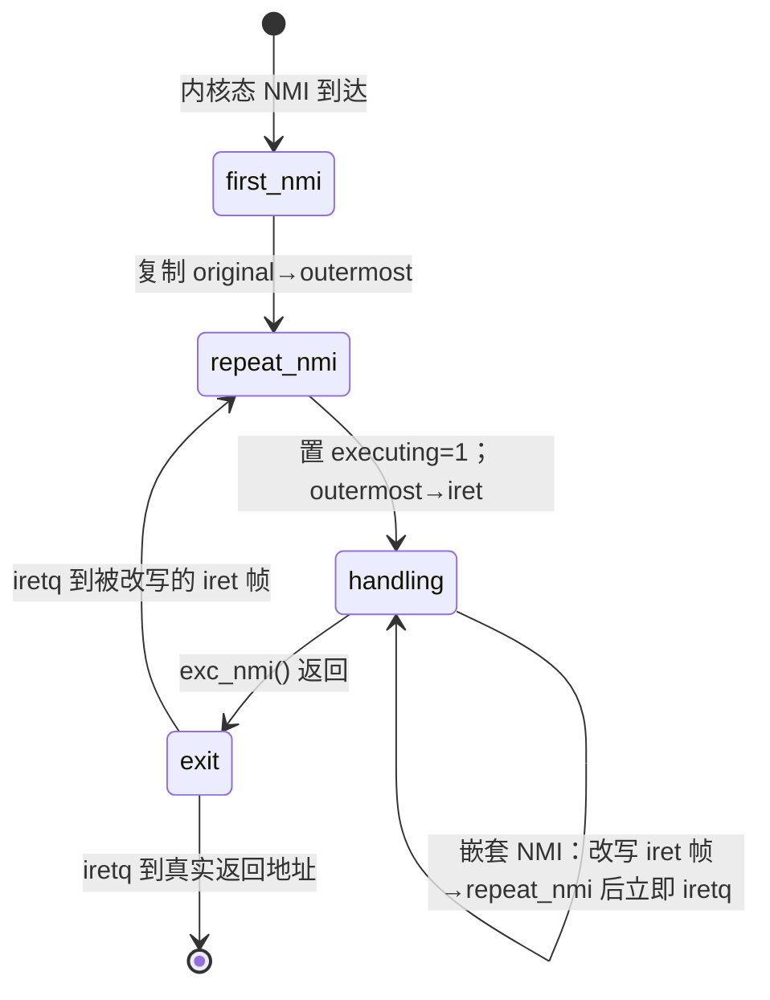

# 5.4 NMI 与机器检查

> **本节源码**：`arch/x86/entry/entry_64.S`、`arch/x86/kernel/nmi.c`、`arch/x86/include/asm/nmi.h`、`kernel/entry/common.c`、`include/linux/hardirq.h`、`arch/x86/kernel/apic/hw_nmi.c`、`kernel/watchdog_perf.c`、`arch/x86/kernel/cpu/mce/core.c`
> **关键函数**：`asm_exc_nmi()`、`exc_nmi()`、`default_do_nmi()`、`nmi_handle()`、`register_nmi_handler()`、`irqentry_nmi_enter()`、`paranoid_entry()`、`nmi_cpu_backtrace()`、`exc_machine_check()`、`do_machine_check()`
> **前置知识**：5.1 x86_64 中断与异常体系、5.2 中断入口与出口、7.1 并发来源与执行上下文

## 概述

不可屏蔽中断（NMI）是 x86 上"优先级最高"的中断：它不受 `RFLAGS.IF` 控制，可以打断关中断的代码、自旋锁的临界区，甚至其他异常处理函数。正因为如此，它被用于那些"无论 CPU 在做什么都必须得到响应"的场合：性能计数器溢出采样（perf）、硬锁死检测（hard lockup detector）、在所有 CPU 上打印调用栈、kdump 时让其他 CPU 停下、以及平台报告的硬件错误。

能打断一切也带来了相应的难题：NMI 处理函数可能在**任何**内核状态下运行——GS 刚交换了一半、CR3 还是用户页表、某个 CPU 正持有 `printk` 的锁……此外，x86 的 NMI 屏蔽机制有一个历史缺陷：任何 `iret` 指令都会解除 NMI 屏蔽，而 NMI 处理函数中发生的 #PF、#BP 返回时恰恰会执行 `iret`，使得 NMI 可以在 IST 栈上嵌套，覆盖外层的栈帧。

本节先分析 x86_64 入口汇编中著名的"嵌套 NMI"处理，再看 C 层的 NMI 分发与处理函数注册，然后介绍 NMI 的主要用户，最后简要讨论同样使用 IST、同样可打断一切的机器检查异常（Machine Check Exception，#MC）。

## NMI 的硬件语义

| 性质 | 说明 |
|---|---|
| 向量 | 固定为 2（`X86_TRAP_NMI`） |
| 屏蔽 | 不受 `IF` 影响；CPU 进入 NMI 处理时自动屏蔽后续 NMI，直到下一条 `iret` |
| 锁存 | 屏蔽期间到达的 NMI 最多锁存一个，其余丢失（边沿触发） |
| 栈 | IDT 门配置 IST（`IST_INDEX_NMI`），每次都从 NMI 栈顶开始 |
| 来源 | 本地 APIC（LVT 性能计数器、NMI IPI）、外部 NMI 引脚、芯片组错误（SERR、IOCHK） |

*表 5-6：x86 NMI 的硬件语义*

"屏蔽到下一条 `iret` 为止"是问题的关键。它不区分这条 `iret` 是 NMI 处理函数自己的返回，还是 NMI 中发生的 #PF、#BP、#DB 处理完后的返回。perf 在 NMI 中读取用户栈会触发缺页；kprobes 可以在 NMI 路径上放 `int3`；这些都会提前解除 NMI 屏蔽。此后再来一个 NMI，CPU 会再次把 RSP 设到 NMI 栈顶——正是外层 NMI 正在使用的位置。

## 主流程分析

### 入口汇编：三种情况

`asm_exc_nmi` 不使用 `idtentry` 宏，而是单独手写（`arch/x86/entry/entry_64.S:1111-1474`）。它首先按来源分流：

```asm
// arch/x86/entry/entry_64.S:1153-1205（v6.18.60）
	ASM_CLAC
	cld

	/* Use %rdx as our temp variable throughout */
	pushq	%rdx

	testb	$3, CS-RIP+8(%rsp)
	jz	.Lnmi_from_kernel

	/*
	 * NMI from user mode.  We need to run on the thread stack, but we
	 * can't go through the normal entry paths: NMIs are masked, and
	 * we don't want to enable interrupts, because then we'll end
	 * up in an awkward situation in which IRQs are on but NMIs
	 * are off.
	 *
	 * We also must not push anything to the stack before switching
	 * stacks lest we corrupt the "NMI executing" variable.
	 */

	swapgs
	FENCE_SWAPGS_USER_ENTRY
	SWITCH_TO_KERNEL_CR3 scratch_reg=%rdx
	movq	%rsp, %rdx
	movq	PER_CPU_VAR(cpu_current_top_of_stack), %rsp
	UNWIND_HINT_IRET_REGS base=%rdx offset=8
	pushq	5*8(%rdx)	/* pt_regs->ss */
	pushq	4*8(%rdx)	/* pt_regs->rsp */
	pushq	3*8(%rdx)	/* pt_regs->flags */
	pushq	2*8(%rdx)	/* pt_regs->cs */
	pushq	1*8(%rdx)	/* pt_regs->rip */
	UNWIND_HINT_IRET_REGS
	pushq   $-1		/* pt_regs->orig_ax */
	PUSH_AND_CLEAR_REGS rdx=(%rdx)
	ENCODE_FRAME_POINTER

	IBRS_ENTER
	UNTRAIN_RET

	/*
	 * At this point we no longer need to worry about stack damage
	 * due to nesting -- we're on the normal thread stack and we're
	 * done with the NMI stack.
	 */

	movq	%rsp, %rdi
	call	exc_nmi

	/*
	 * Return back to user mode.  We must *not* do the normal exit
	 * work, because we don't want to enable interrupts.
	 */
	jmp	swapgs_restore_regs_and_return_to_usermode
```

**来自用户态**的 NMI 最简单：GS 和 CR3 的状态是确定的（都是用户值），直接切换后把硬件帧搬到任务栈，从此与 NMI 栈无关，嵌套问题也就不存在了。返回时**不做** `exit_to_user_mode` 的工作循环，因为那会打开中断，而此时 NMI 仍处于屏蔽状态——"开中断但 NMI 屏蔽"是一种非常别扭的状态。NMI 中设置的待办事项（如 `TIF_NEED_RESCHED`）会在下一次普通中断或系统调用返回时处理。

**来自内核态**的 NMI 要复杂得多。

### 嵌套 NMI 的处理

内核态 NMI 在 NMI 栈上构造了一个特殊的布局：

```asm
// arch/x86/entry/entry_64.S:1207-1247（v6.18.60）
.Lnmi_from_kernel:
	/*
	 * Here's what our stack frame will look like:
	 * +---------------------------------------------------------+
	 * | original SS                                             |
	 * | original Return RSP                                     |
	 * | original RFLAGS                                         |
	 * | original CS                                             |
	 * | original RIP                                            |
	 * +---------------------------------------------------------+
	 * | temp storage for rdx                                    |
	 * +---------------------------------------------------------+
	 * | "NMI executing" variable                                |
	 * +---------------------------------------------------------+
	 * | iret SS          } Copied from "outermost" frame        |
	 * | iret Return RSP  } on each loop iteration; overwritten  |
	 * | iret RFLAGS      } by a nested NMI to force another     |
	 * | iret CS          } iteration if needed.                 |
	 * | iret RIP         }                                      |
	 * +---------------------------------------------------------+
	 * | outermost SS          } initialized in first_nmi;       |
	 * | outermost Return RSP  } will not be changed before      |
	 * | outermost RFLAGS      } NMI processing is done.         |
	 * | outermost CS          } Copied to "iret" frame on each  |
	 * | outermost RIP         } iteration.                      |
	 * +---------------------------------------------------------+
	 * | pt_regs                                                 |
	 * +---------------------------------------------------------+
	 *
	 * The "original" frame is used by hardware.  Before re-enabling
	 * NMIs, we need to be done with it, and we need to leave enough
	 * space for the asm code here.
	 *
	 * We return by executing IRET while RSP points to the "iret" frame.
	 * That will either return for real or it will loop back into NMI
	 * processing.
	 *
	 * The "outermost" frame is copied to the "iret" frame on each
	 * iteration of the loop, so each iteration starts with the "iret"
	 * frame pointing to the final return target.
	 */
```

栈上有三份硬件帧：

- **original**：CPU 压入的那一份。嵌套 NMI 到来时 CPU 会**覆盖**它，所以外层 NMI 在解除屏蔽前必须用完它。
- **outermost**：`first_nmi` 从 original 复制而来，记录"最终要返回到哪里"，整个 NMI 处理期间不变。
- **iret**：每轮循环开始时从 outermost 复制；外层 NMI 最终对它执行 `iretq`。嵌套 NMI 若发现自己是嵌套的，就**改写 iret 帧**，让外层的 `iretq` 跳到 `repeat_nmi` 再处理一轮，而不是真的返回。

另外还有一个"NMI executing"变量，标记外层 NMI 正在运行。整个方案的思路是：**嵌套的 NMI 不在 NMI 栈上真正运行，只是留下"请再跑一轮"的记号后立即返回**，从而模拟出硬件"锁存一个 NMI"的语义。

判断自己是否嵌套的逻辑如下：

```asm
// arch/x86/entry/entry_64.S:1260-1326（v6.18.60）
	movq	$repeat_nmi, %rdx
	cmpq	8(%rsp), %rdx
	ja	1f
	movq	$end_repeat_nmi, %rdx
	cmpq	8(%rsp), %rdx
	ja	nested_nmi_out
1:

	/*
	 * Now check "NMI executing".  If it's set, then we're nested.
	 * This will not detect if we interrupted an outer NMI just
	 * before IRET.
	 */
	cmpl	$1, -8(%rsp)
	je	nested_nmi
	...
	lea	6*8(%rsp), %rdx
	/* Compare the NMI stack (rdx) with the stack we came from (4*8(%rsp)) */
	cmpq	%rdx, 4*8(%rsp)
	/* If the stack pointer is above the NMI stack, this is a normal NMI */
	ja	first_nmi

	subq	$EXCEPTION_STKSZ, %rdx
	cmpq	%rdx, 4*8(%rsp)
	/* If it is below the NMI stack, it is a normal NMI */
	jb	first_nmi

	/* Ah, it is within the NMI stack. */

	testb	$(X86_EFLAGS_DF >> 8), (3*8 + 1)(%rsp)
	jz	first_nmi	/* RSP was user controlled. */

	/* This is a nested NMI. */

nested_nmi:
	/*
	 * Modify the "iret" frame to point to repeat_nmi, forcing another
	 * iteration of NMI handling.
	 */
	subq	$8, %rsp
	leaq	-10*8(%rsp), %rdx
	pushq	$__KERNEL_DS
	pushq	%rdx
	pushfq
	pushq	$__KERNEL_CS
	pushq	$repeat_nmi

	/* Put stack back */
	addq	$(6*8), %rsp

nested_nmi_out:
	popq	%rdx

	/* We are returning to kernel mode, so this cannot result in a fault. */
	iretq
```

依次检查三种"我是嵌套的"情形：

1. **被打断的 RIP 位于 `repeat_nmi` 与 `end_repeat_nmi` 之间**：外层正在把 outermost 复制到 iret 帧，此时不能改写 iret 帧，直接返回（外层马上就会再跑一轮）。
2. **"NMI executing" 为 1**：外层 NMI 正在运行，改写 iret 帧后返回。
3. **被打断时的 RSP 位于 NMI 栈内**：覆盖外层已清除"NMI executing"、但还没执行最终 `iretq` 的那几条指令。这里有一个陷阱——`syscall` 入口的头几条指令中 RSP 是用户可控的，用户可以故意让它指向 NMI 栈。内核的对策是：`syscall` 会清除 `RFLAGS.DF`（MSR `SYSCALL_MASK` 中包含 DF），而 NMI 出口在清除"NMI executing"之前先执行 `std` 置位 DF。因此只有 DF=1 且 RSP 在 NMI 栈内，才判定为嵌套。

第一次进入（`first_nmi`）时，复制 original 到 outermost，然后落入 `repeat_nmi`：

```asm
// arch/x86/entry/entry_64.S:1362-1412（v6.18.60）
repeat_nmi:
	ANNOTATE_NOENDBR // this code
	/*
	 * If there was a nested NMI, the first NMI's iret will return
	 * here. But NMIs are still enabled and we can take another
	 * nested NMI. The nested NMI checks the interrupted RIP to see
	 * if it is between repeat_nmi and end_repeat_nmi, and if so
	 * it will just return, as we are about to repeat an NMI anyway.
	 * This makes it safe to copy to the stack frame that a nested
	 * NMI will update.
	 *
	 * RSP is pointing to "outermost RIP".  gsbase is unknown, but, if
	 * we're repeating an NMI, gsbase has the same value that it had on
	 * the first iteration.  paranoid_entry will load the kernel
	 * gsbase if needed before we call exc_nmi().  "NMI executing"
	 * is zero.
	 */
	movq	$1, 10*8(%rsp)		/* Set "NMI executing". */

	/*
	 * Copy the "outermost" frame to the "iret" frame.  NMIs that nest
	 * here must not modify the "iret" frame while we're writing to
	 * it or it will end up containing garbage.
	 */
	addq	$(10*8), %rsp
	.rept 5
	pushq	-6*8(%rsp)
	.endr
	subq	$(5*8), %rsp
end_repeat_nmi:
	ANNOTATE_NOENDBR // this code

	/*
	 * Everything below this point can be preempted by a nested NMI.
	 * If this happens, then the inner NMI will change the "iret"
	 * frame to point back to repeat_nmi.
	 */
	pushq	$-1				/* ORIG_RAX: no syscall to restart */

	/*
	 * Use paranoid_entry to handle SWAPGS, but no need to use paranoid_exit
	 * as we should not be calling schedule in NMI context.
	 * Even with normal interrupts enabled. An NMI should not be
	 * setting NEED_RESCHED or anything that normal interrupts and
	 * exceptions might do.
	 */
	call	paranoid_entry
	UNWIND_HINT_REGS

	movq	%rsp, %rdi
	call	exc_nmi
```

出口处（`arch/x86/entry/entry_64.S:1440-1473`）先 `POP_REGS`，跳过 orig_ax 和 outermost 帧，然后 `std` 置 DF、清除"NMI executing"，最后对 iret 帧执行 `iretq`。如果期间来过嵌套 NMI，iret 帧已被改为指向 `repeat_nmi`，`iretq` 就会"返回"到那里再处理一轮；否则真正返回被打断的代码。



*图 5-4：内核态 NMI 的嵌套处理状态*

### paranoid_entry：不信任任何状态

普通入口用 `CS` 判断是否需要 `swapgs`，但对内核态 NMI 这不可靠：NMI 可能打断 `swapgs` 之前或之后的那一条指令，也可能打断已经切到用户 CR3、尚未 `sysret` 的返回路径。`paranoid_entry` 因此直接检查硬件状态：

```asm
// arch/x86/entry/entry_64.S:868-943（v6.18.60）
SYM_CODE_START(paranoid_entry)
	ANNOTATE_NOENDBR
	UNWIND_HINT_FUNC
	PUSH_AND_CLEAR_REGS save_ret=1
	ENCODE_FRAME_POINTER 8

	/*
	 * Always stash CR3 in %r14.  This value will be restored,
	 * verbatim, at exit.  Needed if paranoid_entry interrupted
	 * another entry that already switched to the user CR3 value
	 * but has not yet returned to userspace.
	 *
	 * This is also why CS (stashed in the "iret frame" by the
	 * hardware at entry) can not be used: this may be a return
	 * to kernel code, but with a user CR3 value.
	 *
	 * Switching CR3 does not depend on kernel GSBASE so it can
	 * be done before switching to the kernel GSBASE. This is
	 * required for FSGSBASE because the kernel GSBASE has to
	 * be retrieved from a kernel internal table.
	 */
	SAVE_AND_SWITCH_TO_KERNEL_CR3 scratch_reg=%rax save_reg=%r14

	/*
	 * Handling GSBASE depends on the availability of FSGSBASE.
	 *
	 * Without FSGSBASE the kernel enforces that negative GSBASE
	 * values indicate kernel GSBASE. With FSGSBASE no assumptions
	 * can be made about the GSBASE value when entering from user
	 * space.
	 */
	ALTERNATIVE "jmp .Lparanoid_entry_checkgs", "", X86_FEATURE_FSGSBASE

	/*
	 * Read the current GSBASE and store it in %rbx unconditionally,
	 * retrieve and set the current CPUs kernel GSBASE. The stored value
	 * has to be restored in paranoid_exit unconditionally.
	 *
	 * The unconditional write to GS base below ensures that no subsequent
	 * loads based on a mispredicted GS base can happen, therefore no LFENCE
	 * is needed here.
	 */
	SAVE_AND_SET_GSBASE scratch_reg=%rax save_reg=%rbx
	jmp .Lparanoid_gsbase_done

.Lparanoid_entry_checkgs:
	/* EBX = 1 -> kernel GSBASE active, no restore required */
	movl	$1, %ebx

	/*
	 * The kernel-enforced convention is a negative GSBASE indicates
	 * a kernel value. No SWAPGS needed on entry and exit.
	 */
	movl	$MSR_GS_BASE, %ecx
	rdmsr
	testl	%edx, %edx
	js	.Lparanoid_kernel_gsbase

	/* EBX = 0 -> SWAPGS required on exit */
	xorl	%ebx, %ebx
	swapgs
.Lparanoid_kernel_gsbase:
	FENCE_SWAPGS_KERNEL_ENTRY
.Lparanoid_gsbase_done:
	...
	RET
SYM_CODE_END(paranoid_entry)
```

- **CR3**：无条件保存当前 CR3 到 `%r14` 并切换到内核 CR3，退出时原样恢复。
- **GS**：在不支持 FSGSBASE 的 CPU 上，用 `rdmsr` 读 `MSR_GS_BASE`，利用"内核 GS 基址一定是负数（高半区地址）"的约定判断当前是否为内核值，结果存入 `%ebx` 供退出时决定是否 `swapgs`。在支持 FSGSBASE 的 CPU 上，用户可以把 GS 基址设成任意值（包括负数），约定失效，只能用 `rdgsbase` 保存当前值、从 GDT 中读出 CPU 编号（5.1 节 `setup_getcpu()`）查表得到内核 GS 基址并 `wrgsbase` 写入，退出时再写回保存的值。

NMI 出口不使用 `paranoid_exit`，而是内联了相同的恢复逻辑（`arch/x86/entry/entry_64.S:1414-1441`），并且**不检查重调度**——NMI 不应设置 `NEED_RESCHED`，即便设置了也留给下一次普通中断处理。

### exc_nmi：C 层的第二道防线

汇编层只能防住"外层来自内核态"的嵌套。外层 NMI 来自用户态时已经切到任务栈，不受栈覆盖之害，但嵌套 NMI 仍会再次进入 C 处理函数。`exc_nmi()` 用一个 per-CPU 状态机处理这种情况：

```c
// arch/x86/kernel/nmi.c:526-609（v6.18.60）
enum nmi_states {
	NMI_NOT_RUNNING = 0,
	NMI_EXECUTING,
	NMI_LATCHED,
};
static DEFINE_PER_CPU(enum nmi_states, nmi_state);
static DEFINE_PER_CPU(unsigned long, nmi_cr2);
static DEFINE_PER_CPU(unsigned long, nmi_dr7);

DEFINE_IDTENTRY_RAW(exc_nmi)
{
	irqentry_state_t irq_state;
	struct nmi_stats *nsp = this_cpu_ptr(&nmi_stats);
	...
	if (arch_cpu_is_offline(smp_processor_id())) {
		if (microcode_nmi_handler_enabled())
			microcode_offline_nmi_handler();
		return;
	}

	if (this_cpu_read(nmi_state) != NMI_NOT_RUNNING) {
		this_cpu_write(nmi_state, NMI_LATCHED);
		return;
	}
	this_cpu_write(nmi_state, NMI_EXECUTING);
	this_cpu_write(nmi_cr2, read_cr2());

nmi_restart:
	...
	this_cpu_write(nmi_dr7, local_db_save());

	irq_state = irqentry_nmi_enter(regs);

	inc_irq_stat(__nmi_count);

	if (IS_ENABLED(CONFIG_NMI_CHECK_CPU) && ignore_nmis) {
		WRITE_ONCE(nsp->idt_ignored, nsp->idt_ignored + 1);
	} else if (!ignore_nmis) {
		...
		default_do_nmi(regs);
		...
	}

	irqentry_nmi_exit(regs, irq_state);

	local_db_restore(this_cpu_read(nmi_dr7));

	sev_es_ist_exit();

	if (unlikely(this_cpu_read(nmi_cr2) != read_cr2()))
		write_cr2(this_cpu_read(nmi_cr2));
	...
	if (this_cpu_dec_return(nmi_state))
		goto nmi_restart;
}
```

- 嵌套进入时发现状态不是 `NOT_RUNNING`，只把状态改为 `LATCHED` 就返回。
- 外层处理完毕后 `this_cpu_dec_return()`：从 `EXECUTING` 减为 0 则正常结束；从 `LATCHED` 减为 `EXECUTING`（非 0）则说明期间来过 NMI，跳回 `nmi_restart` 再处理一次。
- **保存与恢复 CR2**：NMI 可能打断了一个刚发生、尚未读取 CR2 的缺页异常（`exc_page_fault()` 的第一件事就是读 CR2，但 NMI 可能恰好在它之前到达）。如果 NMI 处理中又发生了缺页，CR2 会被改写，外层缺页处理就会读到错误的地址。所以进入时保存 CR2，退出时若有变化则写回。
- **保存与清除 DR7**：防止 NMI 处理过程中触发硬件断点进入 #DB，而 #DB 也使用 IST 并且会执行 `iret` 解除 NMI 屏蔽。

`irqentry_nmi_enter()` 与普通中断入口的区别在于它从不检查"来自用户态"或"是否在 idle"，而是无条件调用 `ct_nmi_enter()`：

```c
// kernel/entry/common.c:226-244（v6.18.60）
irqentry_state_t noinstr irqentry_nmi_enter(struct pt_regs *regs)
{
	irqentry_state_t irq_state;

	irq_state.lockdep = lockdep_hardirqs_enabled();

	__nmi_enter();
	lockdep_hardirqs_off(CALLER_ADDR0);
	lockdep_hardirq_enter();
	ct_nmi_enter();

	instrumentation_begin();
	kmsan_unpoison_entry_regs(regs);
	trace_hardirqs_off_finish();
	ftrace_nmi_enter();
	instrumentation_end();

	return irq_state;
}
```

`__nmi_enter()`（`include/linux/hardirq.h:107-113`）给 `preempt_count` 同时加上 `NMI_OFFSET` 与 `HARDIRQ_OFFSET`，所以 NMI 中 `in_nmi()` 与 `in_hardirq()` 都为真（7.1 节）。`lockdep_off()` 关闭 lockdep 的锁跟踪，因为 NMI 中不应持有任何普通锁。`ct_nmi_enter()` 是上下文跟踪中专为 NMI 设计的版本：它只修改 per-CPU 的嵌套计数，不获取任何锁，可以在 RCU 自身的代码中途被调用。

### default_do_nmi：确定 NMI 来源

NMI 本身不携带"是谁发的"信息。内核只能逐个询问可能的来源：

```c
// arch/x86/kernel/nmi.c:355-406（v6.18.60）
static noinstr void default_do_nmi(struct pt_regs *regs)
{
	unsigned char reason = 0;
	int handled;
	bool b2b = false;

	/*
	 * Back-to-back NMIs are detected by comparing the RIP of the
	 * current NMI with that of the previous NMI. If it is the same,
	 * it is assumed that the CPU did not have a chance to jump back
	 * into a non-NMI context and execute code in between the two
	 * NMIs.
	 *
	 ...
	 */
	if (regs->ip == __this_cpu_read(last_nmi_rip))
		b2b = true;
	else
		__this_cpu_write(swallow_nmi, false);

	__this_cpu_write(last_nmi_rip, regs->ip);

	instrumentation_begin();

	if (microcode_nmi_handler_enabled() && microcode_nmi_handler())
		goto out;

	/*
	 * CPU-specific NMI must be processed before non-CPU-specific
	 * NMI, otherwise we may lose it, because the CPU-specific
	 * NMI can not be detected/processed on other CPUs.
	 */
	handled = nmi_handle(NMI_LOCAL, regs);
	__this_cpu_add(nmi_stats.normal, handled);
	if (handled) {
		/*
		 * There are cases when a NMI handler handles multiple
		 * events in the current NMI.  One of these events may
		 * be queued for in the next NMI.  Because the event is
		 * already handled, the next NMI will result in an unknown
		 * NMI.  Instead lets flag this for a potential NMI to
		 * swallow.
		 */
		if (handled > 1)
			__this_cpu_write(swallow_nmi, true);
		goto out;
	}
```

处理顺序：

1. **`NMI_LOCAL`**：本 CPU 本地 APIC 产生的 NMI——perf 计数器溢出、NMI IPI（调用栈打印、停机）、kgdb。这些只有本 CPU 能判断，必须最先处理。
2. **外部原因**：读 I/O 端口 `0x61`（`x86_platform.get_nmi_reason()`）判断是否为 PCI SERR 或 IOCHK，由 `pci_serr_error()` / `io_check_error()` 处理。端口是全局共享的，用 `nmi_reason_lock` 串行化；获取锁时用 `trylock` 循环并调用 `run_crash_ipi_callback()`，避免与正在 panic 的 CPU 死锁（`arch/x86/kernel/nmi.c:416-419`）。
3. **未知 NMI**：交给 `NMI_UNKNOWN` 链上的处理函数（如 Hyper-V、kgdb）做最后尝试；仍无人认领则打印 `Uhhuh. NMI received for unknown reason`，若设置了 `unknown_nmi_panic` 则 panic。

**背靠背 NMI 与"吞掉"机制**：由于 NMI 最多锁存一个，两个几乎同时发生的 NMI 中第二个可能被丢弃，因此 `nmi_handle()` 总是遍历**整个**处理函数链（`arch/x86/kernel/nmi.c:151-168` 的注释）。但这又带来反向的问题：一次遍历处理了两个事件，而第二个事件对应的 NMI 仍处于锁存状态，随后到来时就没有人认领，被误报为"未知 NMI"。内核的折中是：若本次处理了多于一个事件，记下 `swallow_nmi`；若紧接着的下一个 NMI 与本次 RIP 相同（说明 CPU 中间没执行过别的代码，是背靠背的）且无人认领，就静默吞掉它。

### 注册 NMI 处理函数

```c
// arch/x86/include/asm/nmi.h:37-57（v6.18.60）
enum {
	NMI_LOCAL=0,
	NMI_UNKNOWN,
	NMI_SERR,
	NMI_IO_CHECK,
	NMI_MAX
};

/* NMI handler return values */
#define NMI_DONE	0
#define NMI_HANDLED	1

typedef int (*nmi_handler_t)(unsigned int, struct pt_regs *);

struct nmiaction {
	struct list_head	list;
	nmi_handler_t		handler;
	u64			max_duration;
	unsigned long		flags;
	const char		*name;
};
```

`register_nmi_handler()` 宏（`arch/x86/include/asm/nmi.h:78-87`）定义一个静态的 `nmiaction` 并挂到对应类型的链表上。处理函数返回认领的事件数（通常 0 或 1）。

链表由 RCU 保护：`nmi_handle()` 中用 `list_for_each_entry_rcu()` 遍历，`unregister_nmi_handler()` 摘除后调用 `synchronize_rcu()` 等待所有正在执行的 NMI 结束（`arch/x86/kernel/nmi.c:208-235`）。这是 RCU 读者可以出现在 NMI 中的直接体现——读侧不需要任何锁，写侧在普通上下文中等待宽限期（7.9 节）。`nmi_check_duration()`（`arch/x86/kernel/nmi.c:113-128`）在单个处理函数运行超过 1 ms 时打印告警，阈值可通过 debugfs 的 `x86/nmi_longest_ns` 调整。

## NMI 的主要用户

| 用户 | 类型 | 注册位置 | 说明 |
|---|---|---|---|
| perf 采样 | `NMI_LOCAL` | `arch/x86/events/core.c:2141`，`"PMI"` | 性能计数器溢出时通过 LVT PC 投递 NMI |
| 硬锁死检测 | 经由 perf | `kernel/watchdog_perf.c` | 基于周期性 perf 事件，见下文 |
| 调用栈回溯 | `NMI_LOCAL` | `arch/x86/kernel/apic/hw_nmi.c:56`，`"arch_bt"` | sysrq-l、RCU stall、hung task 打印所有 CPU 栈 |
| 停机 / kdump | `NMI_LOCAL` | `arch/x86/kernel/smp.c:145`，`crash_nmi_callback` 等 | 在 panic 或关机时让其他 CPU 停下 |
| kgdb | `NMI_LOCAL` / `NMI_UNKNOWN` | `arch/x86/kernel/kgdb.c:605-610` | 进入调试器时停住其他 CPU |

*表 5-7：x86_64 上 NMI 的主要用户*

### 硬锁死检测

7.11 节介绍过软锁死与硬锁死检测。硬锁死指 CPU 长时间关中断不响应，此时普通的定时器中断无法运行，检测必须依赖 NMI。本书配置使用 `CONFIG_HARDLOCKUP_DETECTOR_PERF=y`：为每个 CPU 创建一个周期约为 `watchdog_thresh` 秒（默认 10 秒）的 CPU 周期计数事件，溢出时在 NMI 中调用回调：

```c
// kernel/watchdog_perf.c:105-119（v6.18.60）
static void watchdog_overflow_callback(struct perf_event *event,
				       struct perf_sample_data *data,
				       struct pt_regs *regs)
{
	/* Ensure the watchdog never gets throttled */
	event->hw.interrupts = 0;

	if (panic_in_progress())
		return;

	if (!watchdog_check_timestamp())
		return;

	watchdog_hardlockup_check(smp_processor_id(), regs);
}
```

`watchdog_hardlockup_check()`（`kernel/watchdog.c`）比较本 CPU 的 `hrtimer_interrupts` 计数是否自上次检查以来增加过。高精度定时器每 `watchdog_thresh * 2 / 5` 秒触发一次并递增该计数；如果在一个 NMI 周期内一次都没增加，说明定时器中断被长时间屏蔽，打印 `NMI watchdog: Watchdog detected hard LOCKUP on cpu N` 与寄存器、调用栈。

`hw_nmi_get_sample_period()`（`arch/x86/kernel/apic/hw_nmi.c:27-30`）用 `cpu_khz * 1000 * watchdog_thresh` 作为周期数。CPU 降频时实际时间会更长，`CONFIG_HARDLOCKUP_CHECK_TIMESTAMP=y` 的 `watchdog_check_timestamp()` 用于过滤因 Turbo Boost 导致的过早触发。启用成功时启动日志会打印 `NMI watchdog: Enabled. Permanently consumes one hw-PMU counter.`（`kernel/watchdog_perf.c:169`）；在 PMU 不可用或未向客户机暴露的虚拟机中，则打印 `NMI watchdog: Perf NMI watchdog permanently disabled`（`kernel/watchdog_perf.c:274`），硬锁死检测不工作。

### 调用栈回溯

`arch_trigger_cpumask_backtrace()` 向目标 CPU 发送 NMI IPI：

```c
// arch/x86/kernel/apic/hw_nmi.c:33-52（v6.18.60）
#ifdef arch_trigger_cpumask_backtrace
static void nmi_raise_cpu_backtrace(cpumask_t *mask)
{
	__apic_send_IPI_mask(mask, NMI_VECTOR);
}

void arch_trigger_cpumask_backtrace(const cpumask_t *mask, int exclude_cpu)
{
	nmi_trigger_cpumask_backtrace(mask, exclude_cpu,
				      nmi_raise_cpu_backtrace);
}

static int nmi_cpu_backtrace_handler(unsigned int cmd, struct pt_regs *regs)
{
	if (nmi_cpu_backtrace(regs))
		return NMI_HANDLED;

	return NMI_DONE;
}
NOKPROBE_SYMBOL(nmi_cpu_backtrace_handler);
```

`nmi_trigger_cpumask_backtrace()`（`lib/nmi_backtrace.c`）先在一个全局 cpumask 中置位目标 CPU，再发送 NMI；每个 CPU 的处理函数检查自己是否在 mask 中，若在则打印寄存器与调用栈并清除自己的位。正因为用的是 NMI，即便目标 CPU 在关中断的自旋锁中死循环，也能打印出它卡在哪里。RCU CPU stall 告警、`sysrq-l`、hung task 检测（`kernel.hung_task_all_cpu_backtrace`）都依赖这一机制。

## 机器检查异常

机器检查异常（#MC，向量 18）由 CPU 内部的机器检查架构（Machine Check Architecture，MCA）在检测到硬件错误时触发，例如内存 ECC 不可纠正错误、缓存奇偶校验错误、总线错误。它与 NMI 有很多相似之处：使用 IST 栈（`IST_INDEX_MCE`），可以打断关中断的代码，需要 `paranoid_entry`。

入口宏 `idtentry_mce_db` 与 #DB 相同（5.3 节），按来源分为两个 C 函数：

```c
// arch/x86/kernel/cpu/mce/core.c:2078-2127（v6.18.60）
static __always_inline void exc_machine_check_kernel(struct pt_regs *regs)
{
	irqentry_state_t irq_state;
	unsigned long dr7;

	dr7 = local_db_save();

	WARN_ON_ONCE(user_mode(regs));

	/*
	 * Only required when from kernel mode. See
	 * mce_check_crashing_cpu() for details.
	 */
	if (mca_cfg.initialized && mce_check_crashing_cpu())
		goto out;

	irq_state = irqentry_nmi_enter(regs);

	do_machine_check(regs);

	irqentry_nmi_exit(regs, irq_state);
out:
	local_db_restore(dr7);
}

static __always_inline void exc_machine_check_user(struct pt_regs *regs)
{
	unsigned long dr7;

	irqentry_enter_from_user_mode(regs);

	dr7 = local_db_save();
	do_machine_check(regs);
	local_db_restore(dr7);

	irqentry_exit_to_user_mode(regs);
}

#ifdef CONFIG_X86_64
/* MCE hit kernel mode */
DEFINE_IDTENTRY_MCE(exc_machine_check)
{
	exc_machine_check_kernel(regs);
}

/* The user mode variant. */
DEFINE_IDTENTRY_MCE_USER(exc_machine_check)
{
	exc_machine_check_user(regs);
}
```

`do_machine_check()`（`arch/x86/kernel/cpu/mce/core.c:1501`）读取各 MCA bank 的状态寄存器，用 `mce_severity()` 评估严重程度，然后：

- **不可恢复**：`mce_panic()`。
- **用户态访问到坏页**（`ACTION_REQUIRED`）：不能在 #MC 上下文中处理内存（需要睡眠），用 `queue_task_work(..., kill_me_maybe)` 登记一个 task_work，返回用户态前执行 `memory_failure()`，隔离坏页并向进程发送 `SIGBUS`。
- **内核态在可恢复位置访问到坏页**：例如 `copy_mc_to_kernel()` 或 `copy_from_user()`，这些指令在异常表中用 `EX_TYPE_*_MCE_SAFE` / `EX_TYPE_FAULT_MCE_SAFE` 登记过，`fixup_exception(regs, X86_TRAP_MC, 0, 0)` 修复后返回错误码（`arch/x86/kernel/cpu/mce/core.c:1670-1676`）。这使得读取文件时遇到内存坏块只会让该次 `read()` 失败，而不会让整个系统崩溃。

可纠正错误（Corrected Error）不触发 #MC，而是由 CMCI（Corrected Machine Check Interrupt，`THRESHOLD_APIC_VECTOR` 等系统向量）或周期性轮询发现，经 `mcelog` / `rasdaemon` 等用户态工具上报。

## 关键细节 / 设计考量

### NMI 上下文中能做什么

NMI 处理函数面临的约束比硬中断更严格（7.1 节）：

- **不能获取任何可能被普通上下文持有的锁**，包括 `raw_spinlock_t`。NMI 可能恰好打断持有该锁的代码，导致自死锁。`nmi_reason_lock` 是例外，因为它只在 NMI 中使用。
- **不能同步输出到控制台**。v5.10 引入无锁环形缓冲区、v5.15 移除 NMI 专用的 printk 缓冲区之后，`printk()` 在 NMI 中只把消息写入无锁环形缓冲区，控制台输出推迟到 irq_work 或控制台线程中完成。
- **可以使用** RCU 读侧临界区、原子操作、per-CPU 变量、`llist` 无锁链表、`irq_work_queue()`（5.11 节）。perf 正是用 irq_work 把 NMI 中采集到的事件"转交"给普通中断上下文去唤醒等待者。
- **可以访问用户内存**，但必须用 `nmi_uaccess_okay()` 确认当前 CR3 与 `current->mm` 一致（NMI 可能打断了 `switch_mm()` 的中间状态），且只能用 `copy_from_user_nmi()` 这类不睡眠的接口。

### 为什么不全都用 IST

既然 IST 能保证总有一个可用的栈，为什么普通中断不用？原因就是本节反复讨论的不可重入性：设备中断频繁且可以在软中断中嵌套，若使用 IST，每次嵌套都需要类似 NMI 的复杂处理。普通中断不会在 `syscall` 入口的窗口中到达（`syscall` 后到切换栈之前中断是关闭的），所以在当前栈上处理是安全的。只有那些"能打断关中断代码"的事件——NMI、#MC、#DB、#DF——才需要 IST。

### FRED 如何简化 NMI

FRED 在硬件层面解决了 NMI 的主要痛点：它用 `ERETS`/`ERETU` 返回，只有在返回帧中明确要求时才解除 NMI 屏蔽，普通异常的返回不再意外打开 NMI；栈切换按"栈级别"进行，NMI 嵌套时会在当前栈上继续压栈而不是回到栈顶；GS 的切换也由硬件完成。因此 FRED 模式下 `fred_exc_nmi()` 的入口非常简单，不需要上面那套 iret 帧改写机制。本书配置默认不启用 FRED（5.1 节）。

## 动手实验

### 查看 NMI 计数

```bash
# 在 dev 虚拟机中执行
grep -E '^ *NMI:' /proc/interrupts
cat /proc/sys/kernel/nmi_watchdog
sudo dmesg | grep -i 'NMI watchdog'
```

若 `nmi_watchdog` 为 1 且 perf 硬锁死检测已启用，`NMI` 行的计数会每约 10 秒增加一次（每个 CPU）。执行 `perf record -e cycles -a sleep 1` 后再查看，计数会显著增加——perf 的采样中断就是 NMI。

### 触发所有 CPU 的调用栈打印

```bash
echo 1 | sudo tee /proc/sys/kernel/sysrq
echo l | sudo tee /proc/sysrq-trigger
sudo dmesg | grep -A20 'NMI backtrace'
```

每个 CPU 会在 NMI 中打印一段 `NMI backtrace for cpu N`，空闲 CPU 的栈通常停在 `default_idle()` / `pv_native_safe_halt()`。

### 观察 NMI 处理时长

```bash
sudo bpftrace -e 'tracepoint:nmi:nmi_handler { @[ksym(args->handler)] = hist(args->delta_ns); } interval:s:10 { exit(); }'
```

`nmi_handler` 跟踪点由 `nmi_handle()` 在每个处理函数返回后触发（`arch/x86/kernel/nmi.c:165`），可以看到 `perf_event_nmi_handler` 的处理时间分布。

## 小结

- NMI 不受 `IF` 屏蔽，进入时硬件自动屏蔽后续 NMI，但**任何** `iret` 都会解除屏蔽；NMI 中发生的 #PF、#BP 因而可能导致 NMI 在 IST 栈上嵌套。
- 来自用户态的 NMI 直接切到任务栈处理，不做返回用户态的工作；来自内核态的 NMI 用 original / outermost / iret 三份帧加"NMI executing"变量，让嵌套 NMI 只改写 iret 帧后立即返回，由外层再处理一轮。
- `paranoid_entry` 不依赖 `CS`，直接根据 `MSR_GS_BASE` 或 `rdgsbase` 判断并切换 GS，无条件保存与恢复 CR3。
- `exc_nmi()` 用 `NOT_RUNNING / EXECUTING / LATCHED` 状态机处理外层来自用户态的嵌套，并保存恢复 CR2 与 DR7；`irqentry_nmi_enter()` 同时增加 NMI 与硬中断计数，并无条件调用 `ct_nmi_enter()`。
- NMI 不携带来源信息，`default_do_nmi()` 依次询问本地处理函数、端口 `0x61` 的外部原因与未知处理函数，并用"背靠背 + 吞掉"机制减少误报。
- perf 采样、硬锁死检测、全 CPU 调用栈打印、停机与 kdump 都依赖 NMI；#MC 同样走 IST 与 NMI 式入口，可恢复的内存错误通过 task_work 或异常表转为 `SIGBUS` 或错误返回值。

## 参考

- `linux/Documentation/arch/x86/x86_64/machinecheck.rst`
- `linux/Documentation/admin-guide/lockup-watchdogs.rst`
- `linux/Documentation/arch/x86/x86_64/fsgs.rst`（FSGSBASE 与 paranoid 入口的 GS 处理）
- Steven Rostedt, "The x86 NMI iret problem", LWN, 2012
- Andy Lutomirski 对 x86_64 嵌套 NMI 入口的重写补丁（2015 年，v4.2 合入，修复 CVE-2015-3290/3291）
