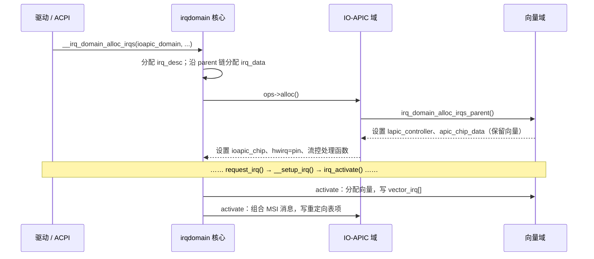

# 5.6 通用中断层：irq_desc、irq_chip 与 irq_domain

> **本节源码**：[`include/linux/irqdesc.h`](../../linux/include/linux/irqdesc.h)、[`include/linux/irq.h`](../../linux/include/linux/irq.h)、[`include/linux/irqdomain.h`](../../linux/include/linux/irqdomain.h)、[`kernel/irq/irqdesc.c`](../../linux/kernel/irq/irqdesc.c)、[`kernel/irq/irqdomain.c`](../../linux/kernel/irq/irqdomain.c)、[`kernel/irq/handle.c`](../../linux/kernel/irq/handle.c)、[`arch/x86/kernel/apic/vector.c`](../../linux/arch/x86/kernel/apic/vector.c)、[`arch/x86/kernel/apic/io_apic.c`](../../linux/arch/x86/kernel/apic/io_apic.c)、[`arch/x86/kernel/irq.c`](../../linux/arch/x86/kernel/irq.c)
> **关键函数**：`irq_to_desc()`、`early_irq_init()`、`generic_handle_irq_desc()`、`__irq_domain_alloc_irqs()`、`irq_domain_alloc_irq_data()`、`irq_domain_alloc_irqs_parent()`、`irq_domain_activate_irq()`、`mp_irqdomain_alloc()`、`handle_irq_event()`
> **前置知识**：5.2 中断入口与出口、5.5 中断控制器、7.9 RCU 原理与使用

## 概述

Linux 需要支持的中断控制器多得惊人：x86 的 LAPIC / I/O APIC / MSI，ARM 的 GIC，各种 SoC 上的 GPIO 控制器、PCIe 控制器内置的 MSI 控制器……同时，设备驱动希望用一套与硬件无关的接口申请中断：给我一个中断号，我注册一个处理函数。**通用中断层**（Generic IRQ，`kernel/irq/`）正是这两者之间的桥梁。

它的设计可以概括为三个抽象：

- **中断描述符**（`struct irq_desc`）：每个 Linux 中断号一个，记录该中断的状态、统计、处理函数链和流控处理函数；
- **中断芯片**（`struct irq_chip`）：中断控制器的操作集合——屏蔽、解除屏蔽、应答、EOI、设置亲和性；
- **中断域**（`struct irq_domain`）：负责把控制器本地的硬件中断号（hwirq）翻译为全局的 Linux 中断号，并在分层系统中描述控制器之间的父子关系。

本节先介绍这三个数据结构，再分析 x86 上中断从向量到描述符、从描述符到驱动处理函数的分发路径，以及分层中断域如何分配和激活一个中断。中断申请、流控处理函数与线程化中断留给 5.7 节，向量分配与亲和性留给 5.8 节。

## 三种"中断号"

理解通用中断层，首先要区分三种编号：

| 名称 | 含义 | 作用范围 | 例子 |
|---|---|---|---|
| 向量号（vector） | x86 CPU 查 IDT 的下标，0～255 | 每个 CPU 独立 | `0x21` |
| 硬件中断号（hwirq） | 中断控制器本地的输入编号 | 每个 `irq_domain` 独立 | I/O APIC 引脚 9；MSI-X 表项 3 |
| Linux 中断号（irq / virq） | 内核全局唯一的编号，`request_irq()` 的参数 | 全局 | `/proc/interrupts` 第一列 |

*表 5-9：三种中断编号*

驱动只看到 Linux 中断号；`irq_domain` 负责 hwirq 与 Linux 中断号之间的映射；x86 的向量域再负责为每个 Linux 中断在目标 CPU 上分配一个向量号。一个 Linux 中断在其生命周期中可以更换目标 CPU 和向量号（5.8 节），但 Linux 中断号与 hwirq 保持不变。

## 核心数据结构

### struct irq_desc

[`include/linux/irqdesc.h:67-120`](../../linux/include/linux/irqdesc.h#L67-L120)（v6.18.60）

```c
struct irq_desc {
	struct irq_common_data	irq_common_data;
	struct irq_data		irq_data;	// [注] 最外层（离设备最近）的 irq_data
	struct irqstat __percpu	*kstat_irqs;	// [注] per-CPU 中断计数，即 /proc/interrupts 各列
	irq_flow_handler_t	handle_irq;	// [注] 流控处理函数：handle_edge_irq 等
	struct irqaction	*action;	/* IRQ action list */
	unsigned int		status_use_accessors;
	unsigned int		core_internal_state__do_not_mess_with_it;
	unsigned int		depth;		/* nested irq disables */
	unsigned int		wake_depth;	/* nested wake enables */
	unsigned int		tot_count;
	unsigned int		irq_count;	/* For detecting broken IRQs */
	unsigned long		last_unhandled;	/* Aging timer for unhandled count */
	unsigned int		irqs_unhandled;
	atomic_t		threads_handled;
	int			threads_handled_last;
	raw_spinlock_t		lock;		// [注] 保护描述符，在硬中断中获取
	struct cpumask		*percpu_enabled;
	const struct cpumask	*percpu_affinity;
#ifdef CONFIG_SMP
	const struct cpumask	*affinity_hint;
	struct irq_affinity_notify *affinity_notify;
#ifdef CONFIG_GENERIC_PENDING_IRQ
	cpumask_var_t		pending_mask;	// [注] 延迟生效的亲和性（5.8 节）
#endif
#endif
	unsigned long		threads_oneshot;
	atomic_t		threads_active;
	wait_queue_head_t       wait_for_threads;
	...
#ifdef CONFIG_PROC_FS
	struct proc_dir_entry	*dir;		// [注] /proc/irq/N/
#endif
	...
#ifdef CONFIG_SPARSE_IRQ
	struct rcu_head		rcu;
	struct kobject		kobj;		// [注] /sys/kernel/irq/N/
#endif
	struct mutex		request_mutex;	// [注] 串行化 request_irq / free_irq
	int			parent_irq;
	struct module		*owner;
	const char		*name;		// [注] 流控处理函数名，如 "edge"、"fasteoi"
#ifdef CONFIG_HARDIRQS_SW_RESEND
	struct hlist_node	resend_node;
#endif
} ____cacheline_internodealigned_in_smp;
```

几个关键字段：

- `handle_irq`：**流控处理函数**（flow handler）。它根据中断的触发方式（边沿 / 电平 / fasteoi / per-CPU）决定何时应答、何时屏蔽、何时 EOI，然后调用 `handle_irq_event()` 执行驱动的处理函数（5.7 节）。
- `action`：`struct irqaction` 单链表，每个元素对应一次 `request_irq()`。共享中断线上可以有多个 action。
- `depth`：`disable_irq()` 的嵌套深度，非 0 时中断被禁用。
- `lock`：`raw_spinlock_t`，在硬中断处理和中断配置操作中都会获取。它必须是 raw 自旋锁，因为在 PREEMPT_RT 下硬中断流控处理仍在真正的硬中断上下文中运行，不能睡眠（7.4 节）。
- `status_use_accessors` 与 `core_internal_state__do_not_mess_with_it`：字段名本身就是警告——前者是 `IRQ_LEVEL`、`IRQ_NOREQUEST` 等可由驱动通过访问函数设置的状态，后者（宏定义为 `istate`）是核心内部的 `IRQS_PENDING`、`IRQS_ONESHOT` 等状态，驱动不得直接访问。

### struct irq_data 与 irq_common_data

[`include/linux/irq.h:145-188`](../../linux/include/linux/irq.h#L145-L188)（v6.18.60）

```c
struct irq_common_data {
	unsigned int		__private state_use_accessors;
#ifdef CONFIG_NUMA
	unsigned int		node;
#endif
	void			*handler_data;
	struct msi_desc		*msi_desc;
#ifdef CONFIG_SMP
	cpumask_var_t		affinity;	// [注] 用户请求的亲和性（/proc/irq/N/smp_affinity）
#endif
#ifdef CONFIG_GENERIC_IRQ_EFFECTIVE_AFF_MASK
	cpumask_var_t		effective_affinity;	// [注] 实际生效的目标 CPU
#endif
#ifdef CONFIG_GENERIC_IRQ_IPI
	unsigned int		ipi_offset;
#endif
};
...
struct irq_data {
	u32			mask;
	unsigned int		irq;		// [注] Linux 中断号
	irq_hw_number_t		hwirq;		// [注] 本层域中的硬件中断号
	struct irq_common_data	*common;
	struct irq_chip		*chip;		// [注] 本层的中断芯片
	struct irq_domain	*domain;	// [注] 本层的中断域
#ifdef	CONFIG_IRQ_DOMAIN_HIERARCHY
	struct irq_data		*parent_data;	// [注] 指向父层（更靠近 CPU）的 irq_data
#endif
	void			*chip_data;	// [注] 芯片私有数据，如 mp_chip_data、apic_chip_data
};
```

把 `irq_data` 从 `irq_desc` 中分离出来，是为了支持**分层中断域**：一个 Linux 中断在每一层控制器中都有一个 `irq_data`，记录该层的 hwirq、chip 和私有数据，通过 `parent_data` 串成一条链。最外层的 `irq_data` 嵌在 `irq_desc` 中，其余各层动态分配。`irq_common_data` 则保存各层共享的信息（亲和性、MSI 描述符等）。

### struct irq_chip

[`include/linux/irq.h:492-544`](../../linux/include/linux/irq.h#L492-L544)（v6.18.60）

```c
struct irq_chip {
	const char	*name;
	unsigned int	(*irq_startup)(struct irq_data *data);
	void		(*irq_shutdown)(struct irq_data *data);
	void		(*irq_enable)(struct irq_data *data);
	void		(*irq_disable)(struct irq_data *data);

	void		(*irq_ack)(struct irq_data *data);
	void		(*irq_mask)(struct irq_data *data);
	void		(*irq_mask_ack)(struct irq_data *data);
	void		(*irq_unmask)(struct irq_data *data);
	void		(*irq_eoi)(struct irq_data *data);

	int		(*irq_set_affinity)(struct irq_data *data, const struct cpumask *dest, bool force);
	int		(*irq_retrigger)(struct irq_data *data);
	int		(*irq_set_type)(struct irq_data *data, unsigned int flow_type);
	int		(*irq_set_wake)(struct irq_data *data, unsigned int on);

	void		(*irq_bus_lock)(struct irq_data *data);
	void		(*irq_bus_sync_unlock)(struct irq_data *data);
	...
	void		(*irq_compose_msi_msg)(struct irq_data *data, struct msi_msg *msg);
	void		(*irq_write_msi_msg)(struct irq_data *data, struct msi_msg *msg);

	int		(*irq_get_irqchip_state)(struct irq_data *data, enum irqchip_irq_state which, bool *state);
	int		(*irq_set_irqchip_state)(struct irq_data *data, enum irqchip_irq_state which, bool state);

	int		(*irq_set_vcpu_affinity)(struct irq_data *data, void *vcpu_info);
	...
	void		(*irq_force_complete_move)(struct irq_data *data);

	unsigned long	flags;
};
```

所有回调的参数都是**本层**的 `irq_data`。最常用的是：

| 回调 | 语义 | x86 例子 |
|---|---|---|
| `irq_mask` / `irq_unmask` | 在控制器上屏蔽 / 解除屏蔽该输入 | I/O APIC 置位表项 `masked`；MSI-X 置位向量控制屏蔽位 |
| `irq_ack` | 应答，使控制器可以接收下一次中断（边沿） | 向量域：LAPIC EOI |
| `irq_eoi` | 中断处理结束（fasteoi / 电平） | I/O APIC：LAPIC EOI + 必要时 I/O APIC EOI |
| `irq_set_affinity` | 更改目标 CPU | 向量域：分配新向量；I/O APIC：重写表项 |
| `irq_compose_msi_msg` | 由下层（父级）生成 MSI 消息 | 向量域：`x86_vector_msi_compose_msg()` |
| `irq_write_msi_msg` | 把 MSI 消息写入设备 | PCI-MSI：写配置空间 / MSI-X 表 |
| `irq_retrigger` | 软件重新触发一次中断 | 向量域：向目标 CPU 发送该向量的 IPI |

*表 5-10：常用 `irq_chip` 回调*

分层体系中有一组 `irq_chip_*_parent()` 辅助函数（`kernel/irq/chip.c`），例如 5.5 节中 `ioapic_chip.irq_ack = irq_chip_ack_parent`，表示"本层不做事，直接转给父层"。

### struct irq_domain

[`include/linux/irqdomain.h:147-176`](../../linux/include/linux/irqdomain.h#L147-L176)（v6.18.60）

```c
struct irq_domain {
	struct list_head		link;
	const char			*name;
	const struct irq_domain_ops	*ops;
	void				*host_data;
	unsigned int			flags;
	unsigned int			mapcount;
	struct mutex			mutex;
	struct irq_domain		*root;

	/* Optional data */
	struct fwnode_handle		*fwnode;	// [注] 对应的固件节点（DT / ACPI）
	enum irq_domain_bus_token	bus_token;
	struct irq_domain_chip_generic	*gc;
	struct device			*dev;
	struct device			*pm_dev;
#ifdef	CONFIG_IRQ_DOMAIN_HIERARCHY
	struct irq_domain		*parent;	// [注] 父域，x86 上最终指向向量域
#endif
#ifdef CONFIG_GENERIC_MSI_IRQ
	const struct msi_parent_ops	*msi_parent_ops;
#endif
	void				(*exit)(struct irq_domain *d);

	/* reverse map data. The linear map gets appended to the irq_domain */
	irq_hw_number_t			hwirq_max;
	unsigned int			revmap_size;
	struct radix_tree_root		revmap_tree;
	struct irq_data __rcu		*revmap[] __counted_by(revmap_size);	// [注] hwirq → irq_data 的线性反向映射
};
```

`revmap` / `revmap_tree` 保存 hwirq 到 `irq_data` 的反向映射，供 `irq_find_mapping()` 使用：hwirq 较小且密集时用线性数组，否则用基数树。在 ARM GIC 这类"控制器告诉 CPU 是哪个 hwirq"的体系中，反向映射位于中断处理热路径上；x86 则不同，CPU 拿到的是向量号，用 per-CPU 的 `vector_irq[]` 直接查到描述符（5.2 节），反向映射只在配置路径上使用。

域的操作集：

[`include/linux/irqdomain.h:79-104`](../../linux/include/linux/irqdomain.h#L79-L104)（v6.18.60）

```c
struct irq_domain_ops {
	int	(*match)(struct irq_domain *d, struct device_node *node,
			 enum irq_domain_bus_token bus_token);
	int	(*select)(struct irq_domain *d, struct irq_fwspec *fwspec,
			  enum irq_domain_bus_token bus_token);
	int	(*map)(struct irq_domain *d, unsigned int virq, irq_hw_number_t hw);
	void	(*unmap)(struct irq_domain *d, unsigned int virq);
	int	(*xlate)(struct irq_domain *d, struct device_node *node,
			 const u32 *intspec, unsigned int intsize,
			 unsigned long *out_hwirq, unsigned int *out_type);
#ifdef	CONFIG_IRQ_DOMAIN_HIERARCHY
	/* extended V2 interfaces to support hierarchy irq_domains */
	int	(*alloc)(struct irq_domain *d, unsigned int virq,
			 unsigned int nr_irqs, void *arg);
	void	(*free)(struct irq_domain *d, unsigned int virq,
			unsigned int nr_irqs);
	int	(*activate)(struct irq_domain *d, struct irq_data *irqd, bool reserve);
	void	(*deactivate)(struct irq_domain *d, struct irq_data *irq_data);
	int	(*translate)(struct irq_domain *d, struct irq_fwspec *fwspec,
			     unsigned long *out_hwirq, unsigned int *out_type);
#endif
	...
};
```

`map` / `xlate` 是早期的"单层"接口；`alloc` / `free` / `activate` / `deactivate` / `translate` 是分层接口（`CONFIG_IRQ_DOMAIN_HIERARCHY=y`），x86 在 v3.19～v4.1 期间完成了向分层域的迁移。

## 中断描述符的存储

本书配置开启了 `CONFIG_SPARSE_IRQ`，描述符按需动态分配，并存放在一棵**枫树**（maple tree，4.7 节 VMA 管理使用的同一种数据结构）中：

[`kernel/irq/irqdesc.c:167-181`](../../linux/kernel/irq/irqdesc.c#L167-L181)（v6.18.60）

```c
static DEFINE_MUTEX(sparse_irq_lock);
static struct maple_tree sparse_irqs = MTREE_INIT_EXT(sparse_irqs,
					MT_FLAGS_ALLOC_RANGE |
					MT_FLAGS_LOCK_EXTERN |
					MT_FLAGS_USE_RCU,
					sparse_irq_lock);

static int irq_find_free_area(unsigned int from, unsigned int cnt)
{
	MA_STATE(mas, &sparse_irqs, 0, 0);

	if (mas_empty_area(&mas, from, MAX_SPARSE_IRQS, cnt))
		return -ENOSPC;
	return mas.index;
}
```

[`kernel/irq/irqdesc.c:414-417`](../../linux/kernel/irq/irqdesc.c#L414-L417)（v6.18.60）

```c
struct irq_desc *irq_to_desc(unsigned int irq)
{
	return mtree_load(&sparse_irqs, irq);
}
```

v6.5 之前这里是一棵基数树加一个位图（`allocated_irqs`），v6.5 起改为枫树：`MT_FLAGS_ALLOC_RANGE` 支持查找连续空闲区间（MSI 需要一次分配多个连续中断号），`MT_FLAGS_USE_RCU` 使 `irq_to_desc()` 可以在 RCU 读侧无锁查找。描述符的释放也通过 RCU 延迟（`irq_desc.rcu` 字段），保证并发的查找者不会访问已释放的内存。

启动时 `early_irq_init()` 预分配传统的 16 个 ISA 中断描述符：

[`kernel/irq/irqdesc.c:549-575`](../../linux/kernel/irq/irqdesc.c#L549-L575)（v6.18.60）

```c
int __init early_irq_init(void)
{
	int i, initcnt, node = first_online_node;
	struct irq_desc *desc;

	init_irq_default_affinity();

	/* Let arch update nr_irqs and return the nr of preallocated irqs */
	initcnt = arch_probe_nr_irqs();
	printk(KERN_INFO "NR_IRQS: %d, nr_irqs: %d, preallocated irqs: %d\n",
	       NR_IRQS, nr_irqs, initcnt);

	if (WARN_ON(nr_irqs > MAX_SPARSE_IRQS))
		nr_irqs = MAX_SPARSE_IRQS;

	if (WARN_ON(initcnt > MAX_SPARSE_IRQS))
		initcnt = MAX_SPARSE_IRQS;

	if (initcnt > nr_irqs)
		nr_irqs = initcnt;

	for (i = 0; i < initcnt; i++) {
		desc = alloc_desc(i, node, 0, NULL, NULL);
		irq_insert_desc(i, desc);
	}
	return arch_early_irq_init();
}
```

`arch_early_irq_init()` 在 x86 上创建根中断域——**向量域**：

[`arch/x86/kernel/apic/vector.c:805-821`](../../linux/arch/x86/kernel/apic/vector.c#L805-L821)（v6.18.60）

```c
	x86_vector_domain = irq_domain_create_tree(fn, &x86_vector_domain_ops,
						   NULL);
	BUG_ON(x86_vector_domain == NULL);
	irq_set_default_domain(x86_vector_domain);

	BUG_ON(!alloc_cpumask_var(&vector_searchmask, GFP_KERNEL));

	/*
	 * Allocate the vector matrix allocator data structure and limit the
	 * search area.
	 */
	vector_matrix = irq_alloc_matrix(NR_VECTORS, FIRST_EXTERNAL_VECTOR,
					 FIRST_SYSTEM_VECTOR);
	BUG_ON(!vector_matrix);

	return arch_early_ioapic_init();
}
```

向量域的"硬件中断号"就是 Linux 中断号本身，它为每个中断在目标 CPU 上分配向量（由 `irq_matrix` 管理，5.8 节），并维护 per-CPU 的 `vector_irq[]`。启动日志中的 `NR_IRQS: 524544, nr_irqs: ..., preallocated irqs: 16` 就来自上面的 `printk`（本书配置 `NR_CPUS=8192`，`NR_IRQS = 256 + 64 × 8192`）。

## x86 的中断域层级

```
                         ┌────────────────────────────┐
                         │ x86_vector_domain（根）      │  chip: "APIC"（lapic_controller）
                         │ 分配 vector，维护 vector_irq │  irq_ack = apic_ack_edge
                         └──────────────┬─────────────┘
                     ┌──────────────────┼──────────────────────┐
                     │                  │                      │
          ┌──────────┴──────────┐       │          ┌───────────┴───────────┐
          │ INTEL-IR / AMD-IR    │       │          │ IO-APIC（每个一个域）  │  chip: "IO-APIC"
          │ 中断重映射（可选）     │       │          │ hwirq = 引脚号         │
          └──────────┬──────────┘       │          └───────────────────────┘
              ┌──────┴──────┐           │
     ┌────────┴───────┐ ┌───┴────────┐ ┌┴──────────────────┐
     │ IR-IO-APIC     │ │ IR-PCI-MSI │ │ PCI-MSI / PCI-MSIX │  chip: "PCI-MSIX-<BDF>"
     │                │ │            │ │ hwirq = MSI 索引    │  每个设备一个域（v6.2+）
     └────────────────┘ └────────────┘ └────────────────────┘
```

*图 5-6：x86 上的中断域层级（上为父，下为子；箭头方向即 `parent` 指针方向的反向）*

无中断重映射时，I/O APIC 域和 PCI-MSI 域的父域都是向量域；有中断重映射时，中间多一层 IR 域。v6.2 起 PCI-MSI 改为"每个设备一个 MSI 域"（per-device MSI domain），父域实现 `msi_parent_ops`（[`arch/x86/kernel/apic/msi.c:269-271`](../../linux/arch/x86/kernel/apic/msi.c#L269-L271) 把向量域标记为 MSI 父域），使不同设备可以有不同的 MSI 特性组合。`/proc/interrupts` 中的 `PCI-MSIX-0000:00:03.0` 就是这种 per-device 域的芯片名。

一个 MSI-X 中断因此有两层 `irq_data`：外层属于 PCI-MSIX 域，`hwirq` 是 MSI-X 表索引，`chip` 负责屏蔽表项和写消息；内层属于向量域，`hwirq` 等于 Linux 中断号，`chip_data` 是 `struct apic_chip_data`，其中的 `irq_cfg` 保存当前的向量和目标 APIC ID。

## 主流程分析

### 分配：自上而下建立 irq_data 链

以 I/O APIC 中断为例（ACPI 解析 PCI 中断路由时调用 `mp_map_pin_to_irq()` → `__irq_domain_alloc_irqs()`）。核心步骤在 `irq_domain_alloc_irqs_locked()` 中：

[`kernel/irq/irqdomain.c:1593-1637`](../../linux/kernel/irq/irqdomain.c#L1593-L1637)（v6.18.60）

```c
static int irq_domain_alloc_irqs_locked(struct irq_domain *domain, int irq_base,
					unsigned int nr_irqs, int node, void *arg,
					bool realloc, const struct irq_affinity_desc *affinity)
{
	int i, ret, virq;

	if (realloc && irq_base >= 0) {
		virq = irq_base;
	} else {
		virq = irq_domain_alloc_descs(irq_base, nr_irqs, 0, node,
					      affinity);
		if (virq < 0) {
			pr_debug("cannot allocate IRQ(base %d, count %d)\n",
				 irq_base, nr_irqs);
			return virq;
		}
	}

	if (irq_domain_alloc_irq_data(domain, virq, nr_irqs)) {
		pr_debug("cannot allocate memory for IRQ%d\n", virq);
		ret = -ENOMEM;
		goto out_free_desc;
	}

	ret = irq_domain_alloc_irqs_hierarchy(domain, virq, nr_irqs, arg);
	if (ret < 0)
		goto out_free_irq_data;

	for (i = 0; i < nr_irqs; i++) {
		ret = irq_domain_trim_hierarchy(virq + i);
		if (ret)
			goto out_free_irq_data;
	}

	for (i = 0; i < nr_irqs; i++)
		irq_domain_insert_irq(virq + i);

	return virq;

out_free_irq_data:
	irq_domain_free_irq_data(virq, nr_irqs);
out_free_desc:
	irq_free_descs(virq, nr_irqs);
	return ret;
}
```

1. `irq_domain_alloc_descs()`：在枫树中找一段空闲的 Linux 中断号并分配 `irq_desc`。`affinity` 参数用于多队列设备的 managed interrupt，使描述符分配在目标 CPU 所在的 NUMA 节点上（5.8 节）。
2. `irq_domain_alloc_irq_data()`：沿 `parent` 链为每一层分配一个 `irq_data` 并串起来：

[`kernel/irq/irqdomain.c:1436-1458`](../../linux/kernel/irq/irqdomain.c#L1436-L1458)（v6.18.60）

```c
static int irq_domain_alloc_irq_data(struct irq_domain *domain,
				     unsigned int virq, unsigned int nr_irqs)
{
	struct irq_data *irq_data;
	struct irq_domain *parent;
	int i;

	/* The outermost irq_data is embedded in struct irq_desc */
	for (i = 0; i < nr_irqs; i++) {
		irq_data = irq_get_irq_data(virq + i);
		irq_data->domain = domain;

		for (parent = domain->parent; parent; parent = parent->parent) {
			irq_data = irq_domain_insert_irq_data(parent, irq_data);
			if (!irq_data) {
				irq_domain_free_irq_data(virq, i + 1);
				return -ENOMEM;
			}
		}
	}

	return 0;
}
```

3. `irq_domain_alloc_irqs_hierarchy()`：调用最外层域的 `ops->alloc()`。每层的 `alloc` 负责**先调用父层的 alloc**，再填写本层的 `hwirq`、`chip`、`chip_data`。以 I/O APIC 为例：

[`arch/x86/kernel/apic/io_apic.c:2859-2900`](../../linux/arch/x86/kernel/apic/io_apic.c#L2859-L2900)（v6.18.60）

```c
int mp_irqdomain_alloc(struct irq_domain *domain, unsigned int virq,
		       unsigned int nr_irqs, void *arg)
{
	struct irq_alloc_info *info = arg;
	struct mp_chip_data *data;
	struct irq_data *irq_data;
	int ret, ioapic, pin;
	unsigned long flags;

	if (!info || nr_irqs > 1)
		return -EINVAL;
	irq_data = irq_domain_get_irq_data(domain, virq);
	if (!irq_data)
		return -EINVAL;

	ioapic = mp_irqdomain_ioapic_idx(domain);
	pin = info->ioapic.pin;
	if (irq_find_mapping(domain, (irq_hw_number_t)pin) > 0)
		return -EEXIST;

	data = kzalloc(sizeof(*data), GFP_KERNEL);
	if (!data)
		return -ENOMEM;

	ret = irq_domain_alloc_irqs_parent(domain, virq, nr_irqs, info);
	if (ret < 0)
		goto free_data;

	INIT_LIST_HEAD(&data->irq_2_pin);
	irq_data->hwirq = info->ioapic.pin;
	irq_data->chip = (domain->parent == x86_vector_domain) ?
			  &ioapic_chip : &ioapic_ir_chip;
	irq_data->chip_data = data;
	mp_irqdomain_get_attr(mp_pin_to_gsi(ioapic, pin), data, info);

	if (!add_pin_to_irq_node(data, ioapic_alloc_attr_node(info), ioapic, pin)) {
		ret = -ENOMEM;
		goto free_irqs;
	}

	mp_preconfigure_entry(data);
	mp_register_handler(virq, data->is_level);
```

注意它根据父域是否为向量域来选择 `ioapic_chip` 还是 `ioapic_ir_chip`——中断重映射的存在对上层几乎透明，只影响表项格式与 EOI 方式。`mp_register_handler()`（[`arch/x86/kernel/apic/io_apic.c:845-860`](../../linux/arch/x86/kernel/apic/io_apic.c#L845-L860)）按触发方式设置流控处理函数：电平触发用 `handle_fasteoi_irq`，边沿触发用 `handle_edge_irq`。

4. `irq_domain_insert_irq()`：把各层的 `irq_data` 登记到各自域的反向映射中。

**分配阶段只预留资源，不写硬件**。以向量域为例，此时只记下"这个中断需要一个向量"，并在 `irq_matrix` 中做"保留"记账，真正的向量要等到激活时才分配（5.8 节的"保留模式"）。这样中断在被 `request_irq()` 之前不会占用宝贵的向量。

### 激活：自下而上编程硬件

[`kernel/irq/irqdomain.c:1938-1976`](../../linux/kernel/irq/irqdomain.c#L1938-L1976)（v6.18.60）

```c
static int __irq_domain_activate_irq(struct irq_data *irqd, bool reserve)
{
	int ret = 0;

	if (irqd && irqd->domain) {
		struct irq_domain *domain = irqd->domain;

		if (irqd->parent_data)
			ret = __irq_domain_activate_irq(irqd->parent_data,
							reserve);
		if (!ret && domain->ops->activate) {
			ret = domain->ops->activate(domain, irqd, reserve);
			/* Rollback in case of error */
			if (ret && irqd->parent_data)
				__irq_domain_deactivate_irq(irqd->parent_data);
		}
	}
	return ret;
}

/**
 * irq_domain_activate_irq - Call domain_ops->activate recursively to activate
 *			     interrupt
 * @irq_data:	Outermost irq_data associated with interrupt
 * @reserve:	If set only reserve an interrupt vector instead of assigning one
 *
 * This is the second step to call domain_ops->activate to program interrupt
 * controllers, so the interrupt could actually get delivered.
 */
int irq_domain_activate_irq(struct irq_data *irq_data, bool reserve)
{
	int ret = 0;

	if (!irqd_is_activated(irq_data))
		ret = __irq_domain_activate_irq(irq_data, reserve);
	if (!ret)
		irqd_set_activated(irq_data);
	return ret;
}
```

激活从最内层（向量域）开始递归：先在向量域中分配真正的向量并写入目标 CPU 的 `vector_irq[]`，然后中断重映射域写 IRT 表项，最后 I/O APIC 域写重定向表项（`mp_irqdomain_activate()` → `ioapic_configure_entry()`），或者 PCI-MSI 域把消息写入设备。**父层先就绪，子层再编程**，保证硬件一旦开始发中断，接收端已经准备好。激活通常发生在 `request_irq()` 中（`__setup_irq()` → `irq_activate()`，5.7 节）；PCI MSI 中断则在分配时就以"保留模式"提前激活一次，让设备先拿到一个指向占位向量的消息，到 `request_irq()` 时再分配真正的向量（5.8 节）。



*图 5-7：分层中断域的分配（自上而下）与激活（自下而上）*

### 分发：从描述符到驱动处理函数

5.2 节的 `call_irq_handler()` 用 `vector_irq[vector]` 查到描述符后调用 `handle_irq()`，在 x86_64 上它就是：

[`include/linux/irqdesc.h:167-174`](../../linux/include/linux/irqdesc.h#L167-L174)（v6.18.60）

```c
/*
 * Architectures call this to let the generic IRQ layer
 * handle an interrupt.
 */
static inline void generic_handle_irq_desc(struct irq_desc *desc)
{
	desc->handle_irq(desc);
}
```

一次间接调用进入流控处理函数，后者在完成控制器相关的应答 / 屏蔽后调用 `handle_irq_event()`：

[`kernel/irq/handle.c:249-262`](../../linux/kernel/irq/handle.c#L249-L262)（v6.18.60）

```c
irqreturn_t handle_irq_event(struct irq_desc *desc)
{
	irqreturn_t ret;

	desc->istate &= ~IRQS_PENDING;
	irqd_set(&desc->irq_data, IRQD_IRQ_INPROGRESS);
	raw_spin_unlock(&desc->lock);

	ret = handle_irq_event_percpu(desc);

	raw_spin_lock(&desc->lock);
	irqd_clear(&desc->irq_data, IRQD_IRQ_INPROGRESS);
	return ret;
}
```

流控处理函数在调用它时持有 `desc->lock`。`handle_irq_event()` 设置 `IRQD_IRQ_INPROGRESS` 后**释放锁**再调用驱动的处理函数——驱动处理函数可能运行较长时间，不应让其他 CPU 上的 `disable_irq()`、亲和性设置等配置操作一直自旋等待。`IRQD_IRQ_INPROGRESS` 标志则让 `synchronize_irq()` 能等到处理函数结束（5.7 节）。

真正遍历 action 链的是 `__handle_irq_event_percpu()`：

[`kernel/irq/handle.c:177-234`](../../linux/kernel/irq/handle.c#L177-L234)（v6.18.60）

```c
irqreturn_t __handle_irq_event_percpu(struct irq_desc *desc)
{
	irqreturn_t retval = IRQ_NONE;
	unsigned int irq = desc->irq_data.irq;
	struct irqaction *action;

	record_irq_time(desc);

	for_each_action_of_desc(desc, action) {
		irqreturn_t res;

		/*
		 * If this IRQ would be threaded under force_irqthreads, mark it so.
		 */
		if (irq_settings_can_thread(desc) &&
		    !(action->flags & (IRQF_NO_THREAD | IRQF_PERCPU | IRQF_ONESHOT)))
			lockdep_hardirq_threaded();

		trace_irq_handler_entry(irq, action);

		if (static_branch_unlikely(&irqhandler_duration_check_enabled)) {
			u64 ts_start = local_clock();

			res = action->handler(irq, action->dev_id);
			irqhandler_duration_check(ts_start, irq, action);
		} else {
			res = action->handler(irq, action->dev_id);
		}

		trace_irq_handler_exit(irq, action, res);

		if (WARN_ONCE(!irqs_disabled(),"irq %u handler %pS enabled interrupts\n",
			      irq, action->handler))
			local_irq_disable();

		switch (res) {
		case IRQ_WAKE_THREAD:
			/*
			 * Catch drivers which return WAKE_THREAD but
			 * did not set up a thread function
			 */
			if (unlikely(!action->thread_fn)) {
				warn_no_thread(irq, action);
				break;
			}

			__irq_wake_thread(desc, action);
			break;

		default:
			break;
		}

		retval |= res;
	}

	return retval;
}
```

- 共享中断线上的**每个** action 都会被调用，处理函数需自行检查"是不是我的设备发的中断"，不是则返回 `IRQ_NONE`。
- 处理函数返回后若发现中断被打开了，打印警告并重新关闭——这是 5.2 节"硬中断处理函数总在关中断下运行"规则的运行时检查。
- 返回 `IRQ_WAKE_THREAD` 表示需要唤醒中断线程执行剩余工作（5.7 节）。
- `irq_handler_entry` / `irq_handler_exit` 跟踪点就在这里；启动参数 `irqhandler.duration_warn_us=` 可以打开处理函数耗时告警（[`kernel/irq/handle.c:139-175`](../../linux/kernel/irq/handle.c#L139-L175)）。

外层的 `handle_irq_event_percpu()`（[`kernel/irq/handle.c:236-247`](../../linux/kernel/irq/handle.c#L236-L247)）再做两件事：`add_interrupt_randomness()` 用中断时间为随机数子系统提供熵；`note_interrupt()` 统计 `IRQ_NONE` 的比例，检测"伪中断风暴"（5.7 节）。

整个分发链如下：

```
common_interrupt()                          arch/x86/kernel/irq.c
└── call_irq_handler(vector)                vector_irq[vector] → desc
    └── generic_handle_irq_desc(desc)       include/linux/irqdesc.h
        └── desc->handle_irq(desc)          如 handle_fasteoi_irq()   kernel/irq/chip.c
            ├── chip->irq_mask / irq_ack …  （视流控类型）
            ├── handle_irq_event(desc)      kernel/irq/handle.c
            │   └── __handle_irq_event_percpu()
            │       └── action->handler(irq, dev_id)   驱动
            └── chip->irq_eoi …             如 ioapic_ack_level()
```

## 关键细节 / 设计考量

### 为什么 x86 不用反向映射分发

ARM GIC 等控制器在中断到来时提供 hwirq，通用代码用 `generic_handle_domain_irq(domain, hwirq)`（[`include/linux/irqdesc.h:186`](../../linux/include/linux/irqdesc.h#L186)）查反向映射得到描述符。x86 硬件只提供向量号，而向量号是"每 CPU、可迁移"的，无法对应到某个固定的域。所以 x86 维护了自己的 per-CPU `vector_irq[]`，在向量分配、迁移时同步更新，中断分发时一次数组访问即可得到描述符，比任何树查找都快。代价是向量分配与迁移的逻辑更复杂（5.8 节需要处理新旧向量并存的过渡期）。

### desc->lock 与中断处理的并发

同一个中断可能在两个 CPU 上"同时"到来吗？对边沿触发的中断，在迁移亲和性的过程中确实可能：旧 CPU 正在处理，新 CPU 又收到一次。流控处理函数用 `desc->lock` 和 `IRQD_IRQ_INPROGRESS` 处理这种情况：后到者看到 `INPROGRESS` 就设置 `IRQS_PENDING` 并屏蔽中断后退出，先到者在 `handle_irq_event()` 返回后发现 `PENDING` 就再循环处理一次（5.7 节 `handle_edge_irq()`）。这保证了**同一中断的处理函数不会在多个 CPU 上并行执行**——驱动的中断处理函数因此无需考虑自身的重入。

### 从 irq_desc 到 sysfs 与 procfs

每个描述符在 `/proc/irq/N/` 下有 `smp_affinity`、`smp_affinity_list`、`effective_affinity`、`node`、`spurious` 等文件（`kernel/irq/proc.c`），在 `/sys/kernel/irq/N/` 下有 `chip_name`、`hwirq`、`type`、`actions`、`per_cpu_count` 等只读属性（`kernel/irq/irqdesc.c`，依赖 `CONFIG_SPARSE_IRQ`）。`/proc/interrupts` 由 `show_interrupts()`（`kernel/irq/proc.c`）遍历所有描述符生成，每行依次是 Linux 中断号、各 CPU 计数、芯片名、hwirq 与触发方式、各 action 的名字。

## 动手实验

### 读懂 /proc/interrupts

```bash
# 在 dev 虚拟机中执行
head -1 /proc/interrupts
grep -vE '^ *[A-Z]{3}:' /proc/interrupts | head -20
```

以 `  24:  0  1234  PCI-MSIX-0000:00:04.0   1-edge   virtio1-input.0` 为例：Linux 中断号 24；CPU1 上处理了 1234 次；芯片名表明它属于设备 `0000:00:04.0` 的 per-device MSI-X 域；hwirq 为 1（MSI-X 表第 1 项）；流控为 edge；action 名为 `virtio1-input.0`。

### 查看分层信息

```bash
IRQ=24   # 替换为上面看到的某个 MSI-X 中断号
for f in chip_name hwirq type name actions per_cpu_count; do
  printf '%-14s %s\n' $f "$(cat /sys/kernel/irq/$IRQ/$f)"
done
cat /proc/irq/$IRQ/smp_affinity_list /proc/irq/$IRQ/effective_affinity_list
```

`smp_affinity_list` 是允许的 CPU 集合，`effective_affinity_list` 是向量域实际选定的单个 CPU——x86 上一个中断在同一时刻只投递到一个 CPU（5.8 节）。本书配置未开启 `CONFIG_GENERIC_IRQ_DEBUGFS`，若开启，`/sys/kernel/debug/irq/irqs/N` 可以显示完整的各层 `irq_data`、chip 与域。

## 小结

- 通用中断层用 `irq_desc`（每个 Linux 中断号一个）、`irq_chip`（控制器操作集）和 `irq_domain`（hwirq 到 Linux 中断号的翻译与层级关系）三个抽象隔离驱动与硬件。
- 要区分向量号（每 CPU、可迁移）、hwirq（每域）与 Linux 中断号（全局）；驱动只使用 Linux 中断号。
- 分层域为每个中断在每一层分配一个 `irq_data`，以 `parent_data` 串联；x86 的根是向量域，其下可有中断重映射域，再下是 I/O APIC 域与 per-device 的 PCI-MSI 域。
- 中断的建立分两步：分配阶段自上而下建立 `irq_data` 链并预留资源，激活阶段自下而上编程硬件，父层先就绪子层再生效。
- 描述符存放在支持 RCU 的枫树中（v6.5 起）；x86 中断分发不经过域的反向映射，而是用 per-CPU `vector_irq[]` 一步查到描述符，再调用流控处理函数。
- `handle_irq_event()` 在设置 `IRQD_IRQ_INPROGRESS` 后释放 `desc->lock` 调用驱动处理函数，遍历共享中断上的所有 action，并配合流控处理函数保证同一中断不会并行处理。

## 参考

- `linux/Documentation/core-api/genericirq.rst`
- `linux/Documentation/core-api/irq/irq-domain.rst`
- `linux/Documentation/core-api/irq/concepts.rst`
- Jiang Liu 的 x86 分层 irqdomain 改造补丁系列（2014～2015 年，v3.19～v4.1 合入）
- Thomas Gleixner 的 per-device MSI 域补丁系列（2022 年，v6.2 合入）
