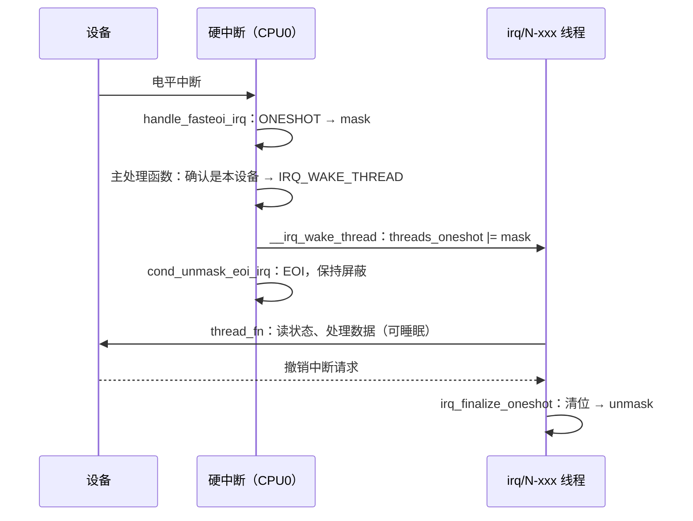

# 5.7 中断申请、流控处理与线程化中断

> **本节源码**：`include/linux/interrupt.h`、`kernel/irq/manage.c`、`kernel/irq/chip.c`、`kernel/irq/handle.c`、`kernel/irq/spurious.c`、`kernel/sched/syscalls.c`
> **关键函数**：`request_threaded_irq()`、`__setup_irq()`、`setup_irq_thread()`、`irq_setup_forced_threading()`、`handle_edge_irq()`、`handle_fasteoi_irq()`、`handle_level_irq()`、`__irq_wake_thread()`、`irq_thread()`、`irq_finalize_oneshot()`、`free_irq()`、`synchronize_irq()`、`note_interrupt()`
> **前置知识**：5.6 通用中断层、3.6 实时调度类、7.1 并发来源与执行上下文

## 概述

驱动与通用中断层打交道的入口只有几个函数：`request_irq()` / `request_threaded_irq()` 注册处理函数，`free_irq()` 注销，`disable_irq()` / `enable_irq()` 临时禁用，`synchronize_irq()` 等待正在执行的处理函数结束。本节分析这些接口背后的实现，以及与之配合的两个机制：

- **流控处理函数**（flow handler）：根据中断的触发方式，决定在调用驱动处理函数前后对中断控制器做哪些操作（应答、屏蔽、EOI）。它是 5.6 节 `desc->handle_irq` 的具体实现。
- **线程化中断**（Threaded IRQ）：把中断处理的主体放到一个专门的内核线程中执行，硬中断上下文只做最少的"确认并关闭设备中断"的工作。v2.6.30 引入，是 PREEMPT_RT 的基础，也为普通内核提供了一种不必使用软中断或工作队列的延迟处理方式。

## 核心数据结构

### struct irqaction

每次 `request_irq()` 创建一个 `irqaction`，挂到 `desc->action` 链表上：

```c
// include/linux/interrupt.h:122-136（v6.18.60）
struct irqaction {
	irq_handler_t		handler;	// [注] 主处理函数，硬中断上下文
	void			*dev_id;	// [注] 驱动私有指针，共享中断时用于识别 action
	void __percpu		*percpu_dev_id;
	struct irqaction	*next;		// [注] 共享中断链表
	irq_handler_t		thread_fn;	// [注] 线程处理函数，在 irq 线程中执行
	struct task_struct	*thread;	// [注] 对应的 irq/N-name 内核线程
	struct irqaction	*secondary;	// [注] 强制线程化时的第二个 action
	unsigned int		irq;
	unsigned int		flags;		// [注] IRQF_*
	unsigned long		thread_flags;	// [注] IRQTF_RUNTHREAD 等
	unsigned long		thread_mask;	// [注] ONESHOT 共享中断中本 action 的位
	const char		*name;
	struct proc_dir_entry	*dir;
} ____cacheline_internodealigned_in_smp;
```

### IRQF 标志

```c
// include/linux/interrupt.h:74-90（v6.18.60）
#define IRQF_SHARED		0x00000080
#define IRQF_PROBE_SHARED	0x00000100
#define __IRQF_TIMER		0x00000200
#define IRQF_PERCPU		0x00000400
#define IRQF_NOBALANCING	0x00000800
#define IRQF_IRQPOLL		0x00001000
#define IRQF_ONESHOT		0x00002000
#define IRQF_NO_SUSPEND		0x00004000
#define IRQF_FORCE_RESUME	0x00008000
#define IRQF_NO_THREAD		0x00010000
#define IRQF_EARLY_RESUME	0x00020000
#define IRQF_COND_SUSPEND	0x00040000
#define IRQF_NO_AUTOEN		0x00080000
#define IRQF_NO_DEBUG		0x00100000
#define IRQF_COND_ONESHOT	0x00200000

#define IRQF_TIMER		(__IRQF_TIMER | IRQF_NO_SUSPEND | IRQF_NO_THREAD)
```

常用的几个：

| 标志 | 含义 |
|---|---|
| `IRQF_SHARED` | 允许多个设备共享同一中断线，所有共享者都必须设置 |
| `IRQF_ONESHOT` | 硬中断处理后保持中断线屏蔽，直到线程处理函数结束才解除 |
| `IRQF_NO_THREAD` | 即使开启强制线程化也不线程化（定时器、级联中断等） |
| `IRQF_NO_AUTOEN` | `request_irq()` 后不自动使能，驱动稍后调用 `enable_irq()` |
| `IRQF_NOBALANCING` | 不允许修改亲和性（`/proc/irq/N/smp_affinity` 写入失败） |
| `IRQF_COND_ONESHOT` | 若共享者已设置 ONESHOT 则跟随（v6.9 引入；v6.18 中 `request_irq()` 默认带上该标志） |
| `IRQF_TRIGGER_*` | 指定触发方式（`include/linux/interrupt.h:31-38`），用于需要配置的控制器 |

*表 5-11：常用 IRQF 标志*

## 主流程分析

### request_threaded_irq

`request_irq()` 只是 `thread_fn` 为空的特例：

```c
// include/linux/interrupt.h:168-173（v6.18.60）
static inline int __must_check
request_irq(unsigned int irq, irq_handler_t handler, unsigned long flags,
	    const char *name, void *dev)
{
	return request_threaded_irq(irq, handler, NULL, flags | IRQF_COND_ONESHOT, name, dev);
}
```

```c
// kernel/irq/manage.c:2080-2146（v6.18.60）
int request_threaded_irq(unsigned int irq, irq_handler_t handler,
			 irq_handler_t thread_fn, unsigned long irqflags,
			 const char *devname, void *dev_id)
{
	struct irqaction *action;
	struct irq_desc *desc;
	int retval;

	if (irq == IRQ_NOTCONNECTED)
		return -ENOTCONN;
	...
	if (((irqflags & IRQF_SHARED) && !dev_id) ||
	    ((irqflags & IRQF_SHARED) && (irqflags & IRQF_NO_AUTOEN)) ||
	    (!(irqflags & IRQF_SHARED) && (irqflags & IRQF_COND_SUSPEND)) ||
	    ((irqflags & IRQF_NO_SUSPEND) && (irqflags & IRQF_COND_SUSPEND)))
		return -EINVAL;

	desc = irq_to_desc(irq);
	if (!desc)
		return -EINVAL;

	if (!irq_settings_can_request(desc) ||
	    WARN_ON(irq_settings_is_per_cpu_devid(desc)))
		return -EINVAL;

	if (!handler) {
		if (!thread_fn)
			return -EINVAL;
		handler = irq_default_primary_handler;
	}

	action = kzalloc(sizeof(struct irqaction), GFP_KERNEL);
	if (!action)
		return -ENOMEM;

	action->handler = handler;
	action->thread_fn = thread_fn;
	action->flags = irqflags;
	action->name = devname;
	action->dev_id = dev_id;

	retval = irq_chip_pm_get(&desc->irq_data);
	if (retval < 0) {
		kfree(action);
		return retval;
	}

	retval = __setup_irq(irq, desc, action);

	if (retval) {
		irq_chip_pm_put(&desc->irq_data);
		kfree(action->secondary);
		kfree(action);
	}
	...
```

- 共享中断必须提供非空的 `dev_id`：`free_irq()` 靠它在 action 链表中找到要删除的那一个。
- 只提供 `thread_fn` 而 `handler` 为空时，使用默认主处理函数 `irq_default_primary_handler()`（`kernel/irq/manage.c:986-989`），它什么都不做，直接返回 `IRQ_WAKE_THREAD`。
- 函数使用 `GFP_KERNEL` 分配内存并可能创建内核线程，**只能在进程上下文中调用**。

### __setup_irq

`__setup_irq()` 是注册的核心，按锁的层次分为几个阶段（`kernel/irq/manage.c:1431-1444` 的注释说明了锁规则：`request_mutex` → `chip_bus_lock` → `desc->lock`）。

**阶段一：线程化准备**（不持锁）

```c
// kernel/irq/manage.c:1469-1507（v6.18.60）
	/*
	 * Check whether the interrupt nests into another interrupt
	 * thread.
	 */
	nested = irq_settings_is_nested_thread(desc);
	if (nested) {
		if (!new->thread_fn) {
			ret = -EINVAL;
			goto out_mput;
		}
		/*
		 * Replace the primary handler which was provided from
		 * the driver for non nested interrupt handling by the
		 * dummy function which warns when called.
		 */
		new->handler = irq_nested_primary_handler;
	} else {
		if (irq_settings_can_thread(desc)) {
			ret = irq_setup_forced_threading(new);
			if (ret)
				goto out_mput;
		}
	}

	/*
	 * Create a handler thread when a thread function is supplied
	 * and the interrupt does not nest into another interrupt
	 * thread.
	 */
	if (new->thread_fn && !nested) {
		ret = setup_irq_thread(new, irq, false);
		if (ret)
			goto out_mput;
		if (new->secondary) {
			ret = setup_irq_thread(new->secondary, irq, true);
			if (ret)
				goto out_thread;
		}
	}
```

"嵌套线程"（nested thread）用于挂在慢速总线（I2C、SPI）后面的中断控制器：父中断本身已经线程化，子中断的处理函数直接在父中断的线程中调用（`handle_nested_irq()`），无需另起线程。x86 上较少见。

`setup_irq_thread()` 为每个带 `thread_fn` 的 action 创建一个内核线程：

```c
// kernel/irq/manage.c:1396-1429（v6.18.60）
static int
setup_irq_thread(struct irqaction *new, unsigned int irq, bool secondary)
{
	struct task_struct *t;

	if (!secondary) {
		t = kthread_create(irq_thread, new, "irq/%d-%s", irq,
				   new->name);
	} else {
		t = kthread_create(irq_thread, new, "irq/%d-s-%s", irq,
				   new->name);
	}

	if (IS_ERR(t))
		return PTR_ERR(t);

	/*
	 * We keep the reference to the task struct even if
	 * the thread dies to avoid that the interrupt code
	 * references an already freed task_struct.
	 */
	new->thread = get_task_struct(t);
	/*
	 * Tell the thread to set its affinity. This is
	 * important for shared interrupt handlers as we do
	 * not invoke setup_affinity() for the secondary
	 * handlers as everything is already set up. Even for
	 * interrupts marked with IRQF_NO_BALANCE this is
	 * correct as we want the thread to move to the cpu(s)
	 * on which the requesting code placed the interrupt.
	 */
	set_bit(IRQTF_AFFINITY, &new->thread_flags);
	return 0;
}
```

线程名为 `irq/<中断号>-<设备名>`，在 `ps` 中可以看到。`IRQTF_AFFINITY` 让线程在第一次运行时把自己的 CPU 亲和性设为与中断一致，此后中断亲和性变化时也会同步（`irq_thread_check_affinity()`）。

**阶段二：检查共享兼容性**（持 `desc->lock`）

```c
// kernel/irq/manage.c:1553-1612（v6.18.60）
	raw_spin_lock_irqsave(&desc->lock, flags);
	old_ptr = &desc->action;
	old = *old_ptr;
	if (old) {
		/*
		 * Can't share interrupts unless both agree to and are
		 * the same type (level, edge, polarity). So both flag
		 * fields must have IRQF_SHARED set and the bits which
		 * set the trigger type must match. Also all must
		 * agree on ONESHOT.
		 * Interrupt lines used for NMIs cannot be shared.
		 */
		unsigned int oldtype;
		...
		if (!((old->flags & new->flags) & IRQF_SHARED) ||
		    (oldtype != (new->flags & IRQF_TRIGGER_MASK)))
			goto mismatch;

		if ((old->flags & IRQF_ONESHOT) &&
		    (new->flags & IRQF_COND_ONESHOT))
			new->flags |= IRQF_ONESHOT;
		else if ((old->flags ^ new->flags) & IRQF_ONESHOT)
			goto mismatch;

		/* All handlers must agree on per-cpuness */
		if ((old->flags & IRQF_PERCPU) !=
		    (new->flags & IRQF_PERCPU))
			goto mismatch;

		/* add new interrupt at end of irq queue */
		do {
			/*
			 * Or all existing action->thread_mask bits,
			 * so we can find the next zero bit for this
			 * new action.
			 */
			thread_mask |= old->thread_mask;
			old_ptr = &old->next;
			old = *old_ptr;
		} while (old);
		shared = 1;
	}
```

共享中断要求所有共享者的 `IRQF_SHARED`、触发方式、`IRQF_ONESHOT`、`IRQF_PERCPU` 都一致，否则返回 `-EBUSY` 并打印 `Flags mismatch irq N`。ONESHOT 必须一致的原因是：ONESHOT 意味着"在所有线程处理完之前保持中断线屏蔽"，如果有一个共享者不是 ONESHOT，它的处理逻辑就会被别人的屏蔽卡住。`IRQF_COND_ONESHOT` 允许不需要 ONESHOT 的驱动（例如 ACPI 的 SCI 中断）与需要 ONESHOT 的驱动共享同一中断线。

**阶段三：分配 ONESHOT 位**

```c
// kernel/irq/manage.c:1619-1671（v6.18.60）
	if (new->flags & IRQF_ONESHOT) {
		/*
		 * Unlikely to have 32 resp 64 irqs sharing one line,
		 * but who knows.
		 */
		if (thread_mask == ~0UL) {
			ret = -EBUSY;
			goto out_unlock;
		}
		...
		new->thread_mask = 1UL << ffz(thread_mask);

	} else if (new->handler == irq_default_primary_handler &&
		   !(desc->irq_data.chip->flags & IRQCHIP_ONESHOT_SAFE)) {
		/*
		 * The interrupt was requested with handler = NULL, so
		 * we use the default primary handler for it. But it
		 * does not have the oneshot flag set. In combination
		 * with level interrupts this is deadly, because the
		 * default primary handler just wakes the thread, then
		 * the irq lines is reenabled, but the device still
		 * has the level irq asserted. Rinse and repeat....
		 *
		 * While this works for edge type interrupts, we play
		 * it safe and reject unconditionally because we can't
		 * say for sure which type this interrupt really
		 * has. The type flags are unreliable as the
		 * underlying chip implementation can override them.
		 */
		pr_err("Threaded irq requested with handler=NULL and !ONESHOT for %s (irq %d)\n",
		       new->name, irq);
		ret = -EINVAL;
		goto out_unlock;
	}
```

每个 ONESHOT action 分到 `thread_mask` 中的一位，硬中断唤醒线程时把该位或进 `desc->threads_oneshot`，线程结束时清除；所有位都清零后才解除中断线屏蔽。注释解释了"无主处理函数却不带 ONESHOT"为何被拒绝：对电平中断，默认主处理函数不会让设备撤销中断请求，一旦解除屏蔽，中断立即再次触发，形成中断风暴。

PCI MSI 的 `irq_chip` 设置了 `IRQCHIP_ONESHOT_SAFE`（`drivers/pci/msi/irqdomain.c:134`），`__setup_irq()` 在前面会清除 `IRQF_ONESHOT`（`kernel/irq/manage.c:1518-1519`）：MSI 是边沿语义，一次写入就是一次中断，不存在"电平持续有效"的问题，因此无需在屏蔽/解除屏蔽之间来回切换。

**阶段四：首个 action 启动中断**

```c
// kernel/irq/manage.c:1673-1734（v6.18.60）
	if (!shared) {
		/* Setup the type (level, edge polarity) if configured: */
		if (new->flags & IRQF_TRIGGER_MASK) {
			ret = __irq_set_trigger(desc,
						new->flags & IRQF_TRIGGER_MASK);

			if (ret)
				goto out_unlock;
		}

		/*
		 * Activate the interrupt. That activation must happen
		 * independently of IRQ_NOAUTOEN. request_irq() can fail
		 * and the callers are supposed to handle
		 * that. enable_irq() of an interrupt requested with
		 * IRQ_NOAUTOEN is not supposed to fail. The activation
		 * keeps it in shutdown mode, it merily associates
		 * resources if necessary and if that's not possible it
		 * fails. Interrupts which are in managed shutdown mode
		 * will simply ignore that activation request.
		 */
		ret = irq_activate(desc);
		if (ret)
			goto out_unlock;
		...
		if (!(new->flags & IRQF_NO_AUTOEN) &&
		    irq_settings_can_autoenable(desc)) {
			irq_startup(desc, IRQ_RESEND, IRQ_START_COND);
		} else {
			/*
			 * Shared interrupts do not go well with disabling
			 * auto enable. The sharing interrupt might request
			 * it while it's still disabled and then wait for
			 * interrupts forever.
			 */
			WARN_ON_ONCE(new->flags & IRQF_SHARED);
			/* Undo nested disables: */
			desc->depth = 1;
		}
```

只有第一个 action 才需要配置触发方式、激活和启动中断：`irq_activate()` 沿 5.6 节的域层级自下而上分配向量、写硬件；`irq_startup()` 调用 `chip->irq_startup()` 或 `irq_enable()` 解除屏蔽，此后中断即可到来。

**阶段五：挂入链表并唤醒线程**

```c
// kernel/irq/manage.c:1746-1775（v6.18.60）
	*old_ptr = new;

	irq_pm_install_action(desc, new);

	/* Reset broken irq detection when installing new handler */
	desc->irq_count = 0;
	desc->irqs_unhandled = 0;

	/*
	 * Check whether we disabled the irq via the spurious handler
	 * before. Reenable it and give it another chance.
	 */
	if (shared && (desc->istate & IRQS_SPURIOUS_DISABLED)) {
		desc->istate &= ~IRQS_SPURIOUS_DISABLED;
		__enable_irq(desc);
	}

	raw_spin_unlock_irqrestore(&desc->lock, flags);
	chip_bus_sync_unlock(desc);
	mutex_unlock(&desc->request_mutex);

	irq_setup_timings(desc, new);

	wake_up_and_wait_for_irq_thread_ready(desc, new);
	wake_up_and_wait_for_irq_thread_ready(desc, new->secondary);

	register_irq_proc(irq, desc);
	new->dir = NULL;
	register_handler_proc(irq, new);
	return 0;
```

新 action 追加到链表尾部。这里有一个值得注意的顺序：中断在阶段四就可能已经启动，但 action 直到这里才挂上链表——由于两者都在 `desc->lock` 保护下完成，到来的中断在拿到锁之前不会执行处理函数。`wake_up_and_wait_for_irq_thread_ready()` 唤醒新创建的中断线程，并等待它完成初始化（设置调度策略等）后才返回，保证 `request_irq()` 返回后线程已经可以响应。

### 流控处理函数

5.6 节提到，`desc->handle_irq` 在 x86 上通常是以下几种之一（由 `mp_register_handler()` 或 MSI 域设置）：

| 流控处理函数 | 使用者 | `/proc/interrupts` 中的名字 |
|---|---|---|
| `handle_edge_irq()` | PCI MSI / MSI-X、I/O APIC 边沿中断 | `edge` |
| `handle_fasteoi_irq()` | I/O APIC 电平中断 | `fasteoi` |
| `handle_level_irq()` | 8259 PIC 电平中断 | `level` |
| `handle_percpu_irq()` / `handle_percpu_devid_irq()` | per-CPU 中断（ARM 上的本地定时器等） | — |

*表 5-12：x86 上常见的流控处理函数*

#### handle_edge_irq

边沿中断的特点是：一旦应答，控制器就可以锁存下一次中断，即使上一次还没处理完。因此必须**先应答再处理**，并处理"处理期间又来了一次"的情况：

```c
// kernel/irq/chip.c:823-858（v6.18.60）
void handle_edge_irq(struct irq_desc *desc)
{
	guard(raw_spinlock)(&desc->lock);

	if (!irq_can_handle(desc)) {
		desc->istate |= IRQS_PENDING;
		mask_ack_irq(desc);
		return;
	}

	kstat_incr_irqs_this_cpu(desc);

	/* Start handling the irq */
	desc->irq_data.chip->irq_ack(&desc->irq_data);

	do {
		if (unlikely(!desc->action)) {
			mask_irq(desc);
			return;
		}

		/*
		 * When another irq arrived while we were handling
		 * one, we could have masked the irq.
		 * Reenable it, if it was not disabled in meantime.
		 */
		if (unlikely(desc->istate & IRQS_PENDING)) {
			if (!irqd_irq_disabled(&desc->irq_data) &&
			    irqd_irq_masked(&desc->irq_data))
				unmask_irq(desc);
		}

		handle_irq_event(desc);

	} while ((desc->istate & IRQS_PENDING) && !irqd_irq_disabled(&desc->irq_data));
}
```

- `irq_can_handle()`（`kernel/irq/chip.c:555-561`）在中断正在其他 CPU 上处理（`IRQD_IRQ_INPROGRESS`）、被禁用或没有 action 时返回假。此时记下 `IRQS_PENDING`、屏蔽并应答后直接返回，**不丢失这次中断**。
- 正在处理的 CPU 在 `handle_irq_event()` 返回后（它会重新获取 `desc->lock`），看到 `IRQS_PENDING` 就解除屏蔽、再循环处理一次。`handle_irq_event()` 开头会清除 `IRQS_PENDING`（5.6 节），所以循环在没有新中断时退出。
- 对 x86 的 MSI 和 I/O APIC 边沿中断，`irq_ack` 最终是向量域的 `apic_ack_edge()`（5.5 节），即 LAPIC EOI。**x86 上边沿中断的 EOI 在调用驱动处理函数之前就已发出**，LAPIC 可以立即投递同一或更低优先级的其他中断——但由于 CPU 此时关着中断，它们要等到这次中断返回后才会被处理。

`irq_can_handle_pm()` 中还有一段专门处理亲和性迁移的逻辑（`kernel/irq/chip.c:508-541`）：对单目标的边沿中断，若中断刚从 CPU0 迁到本 CPU、而 CPU0 仍在处理上一次，本 CPU 会自旋等待 CPU0 完成，而不是设置 PENDING 后返回。注释说明这是在虚拟机中观察到的问题：设备以极高频率发中断时，CPU0 可能因为不断看到 PENDING 而永远循环下去。

#### handle_fasteoi_irq

"fasteoi"指控制器在硬件中自行处理了应答与屏蔽，软件只需在处理结束时发一次 EOI。I/O APIC 的电平中断属于此类——Remote IRR 机制保证 EOI 之前不会再投递：

```c
// kernel/irq/chip.c:736-773（v6.18.60）
void handle_fasteoi_irq(struct irq_desc *desc)
{
	struct irq_chip *chip = desc->irq_data.chip;

	guard(raw_spinlock)(&desc->lock);

	/*
	 * When an affinity change races with IRQ handling, the next interrupt
	 * can arrive on the new CPU before the original CPU has completed
	 * handling the previous one - it may need to be resent.
	 */
	if (!irq_can_handle_pm(desc)) {
		if (irqd_needs_resend_when_in_progress(&desc->irq_data))
			desc->istate |= IRQS_PENDING;
		cond_eoi_irq(chip, &desc->irq_data);
		return;
	}

	if (!irq_can_handle_actions(desc)) {
		mask_irq(desc);
		cond_eoi_irq(chip, &desc->irq_data);
		return;
	}

	kstat_incr_irqs_this_cpu(desc);
	if (desc->istate & IRQS_ONESHOT)
		mask_irq(desc);

	handle_irq_event(desc);

	cond_unmask_eoi_irq(desc, chip);

	/*
	 * When the race described above happens this will resend the interrupt.
	 */
	if (unlikely(desc->istate & IRQS_PENDING))
		check_irq_resend(desc, false);
}
```

ONESHOT 中断在调用处理函数之前先屏蔽；处理之后由 `cond_unmask_eoi_irq()`（`kernel/irq/chip.c:700-719`）决定：若没有唤醒任何线程（`threads_oneshot == 0`），立即 EOI 并解除屏蔽；否则只 EOI、保持屏蔽，等线程结束后再解除。**EOI 与解除屏蔽被分开了**：EOI 让 I/O APIC 清除 Remote IRR，屏蔽则阻止设备仍然有效的电平信号再次触发中断。

#### handle_level_irq

传统电平控制器（如 8259 PIC）没有 Remote IRR，必须先屏蔽并应答，处理完再解除屏蔽：

```c
// kernel/irq/chip.c:685-697（v6.18.60）
void handle_level_irq(struct irq_desc *desc)
{
	guard(raw_spinlock)(&desc->lock);
	mask_ack_irq(desc);

	if (!irq_can_handle(desc))
		return;

	kstat_incr_irqs_this_cpu(desc);
	handle_irq_event(desc);

	cond_unmask_irq(desc);
}
```

三种流控处理函数对比：

```
handle_edge_irq：     [ack] ─▶ handler ─▶ (PENDING? 再来一轮)
handle_fasteoi_irq：  (ONESHOT? mask) ─▶ handler ─▶ [eoi] ─▶ (无线程? unmask)
handle_level_irq：    [mask+ack] ─▶ handler ─▶ (无线程? unmask)
```

*图 5-8：三种流控处理函数的控制器操作顺序*

### 线程化中断的执行

#### 唤醒

主处理函数返回 `IRQ_WAKE_THREAD` 后，`__handle_irq_event_percpu()` 调用 `__irq_wake_thread()`（5.6 节）：

```c
// kernel/irq/handle.c:61-137（v6.18.60）
void __irq_wake_thread(struct irq_desc *desc, struct irqaction *action)
{
	/*
	 * In case the thread crashed and was killed we just pretend that
	 * we handled the interrupt. The hardirq handler has disabled the
	 * device interrupt, so no irq storm is lurking.
	 */
	if (action->thread->flags & PF_EXITING)
		return;

	/*
	 * Wake up the handler thread for this action. If the
	 * RUNTHREAD bit is already set, nothing to do.
	 */
	if (test_and_set_bit(IRQTF_RUNTHREAD, &action->thread_flags))
		return;
	...
	desc->threads_oneshot |= action->thread_mask;

	/*
	 * We increment the threads_active counter in case we wake up
	 * the irq thread. The irq thread decrements the counter when
	 * it returns from the handler or in the exit path and wakes
	 * up waiters which are stuck in synchronize_irq() when the
	 * active count becomes zero. synchronize_irq() is serialized
	 * against this code (hard irq handler) via IRQS_INPROGRESS
	 * like the finalize_oneshot() code. See comment above.
	 */
	atomic_inc(&desc->threads_active);

	wake_up_process(action->thread);
}
```

`IRQTF_RUNTHREAD` 位保证线程尚未运行时重复到来的中断只唤醒一次——线程运行时会处理设备上所有挂起的事件。`threads_active` 计数供 `synchronize_irq()` 等待线程结束。注释（`kernel/irq/handle.c:78-122`）详细论证了为什么 `threads_oneshot` 可以在不持锁的情况下修改：同一中断的硬中断处理不会在两个 CPU 上并行（5.6 节），而线程清除该位时与硬中断通过 `IRQD_IRQ_INPROGRESS` 串行化。

#### 线程主循环

```c
// kernel/irq/manage.c:1242-1281（v6.18.60）
static int irq_thread(void *data)
{
	struct callback_head on_exit_work;
	struct irqaction *action = data;
	struct irq_desc *desc = irq_to_desc(action->irq);
	irqreturn_t (*handler_fn)(struct irq_desc *desc,
			struct irqaction *action);

	irq_thread_set_ready(desc, action);

	sched_set_fifo(current);

	if (force_irqthreads() && test_bit(IRQTF_FORCED_THREAD,
					   &action->thread_flags))
		handler_fn = irq_forced_thread_fn;
	else
		handler_fn = irq_thread_fn;

	init_task_work(&on_exit_work, irq_thread_dtor);
	task_work_add(current, &on_exit_work, TWA_NONE);

	while (!irq_wait_for_interrupt(desc, action)) {
		irqreturn_t action_ret;

		action_ret = handler_fn(desc, action);
		if (action_ret == IRQ_WAKE_THREAD)
			irq_wake_secondary(desc, action);

		wake_threads_waitq(desc);
	}

	/*
	 * This is the regular exit path. __free_irq() is stopping the
	 * thread via kthread_stop() after calling
	 * synchronize_hardirq(). So neither IRQTF_RUNTHREAD nor the
	 * oneshot mask bit can be set.
	 */
	task_work_cancel_func(current, irq_thread_dtor);
	return 0;
}
```

- **调度策略**：`sched_set_fifo()` 把线程设为 `SCHED_FIFO`、优先级 `MAX_RT_PRIO / 2` 即 50（`kernel/sched/syscalls.c:853-857`）。中断线程因此优先于所有普通任务，但低于更高优先级的实时任务——系统管理员可以用 `chrt` 调整，这正是 PREEMPT_RT 系统中区分中断重要性的手段（3.6 节）。
- **等待**：`irq_wait_for_interrupt()`（`kernel/irq/manage.c:1052-1077`）是一个标准的"设置状态 → 检查条件 → `schedule()`"循环（3.4 节的睡眠—唤醒协议），检查并清除 `IRQTF_RUNTHREAD`。
- **异常退出保护**：如果线程函数中发生 Oops 导致线程退出，`irq_thread_dtor()` 会被 task_work 调用，清理 `threads_active` 与 ONESHOT 状态，避免中断线永久屏蔽、`synchronize_irq()` 永久等待。

普通线程化中断调用 `irq_thread_fn()`：

```c
// kernel/irq/manage.c:1139-1148（v6.18.60）
static irqreturn_t irq_thread_fn(struct irq_desc *desc,	struct irqaction *action)
{
	irqreturn_t ret = action->thread_fn(action->irq, action->dev_id);

	if (ret == IRQ_HANDLED)
		atomic_inc(&desc->threads_handled);

	irq_finalize_oneshot(desc, action);
	return ret;
}
```

线程函数在**进程上下文**中运行：可以睡眠、可以获取 mutex、可以执行 I2C/SPI 传输等慢速操作。结束后 `irq_finalize_oneshot()` 清除本 action 的 ONESHOT 位，并在所有位都清零时解除中断线屏蔽：

```c
// kernel/irq/manage.c:1084-1132（v6.18.60）
static void irq_finalize_oneshot(struct irq_desc *desc,
				 struct irqaction *action)
{
	if (!(desc->istate & IRQS_ONESHOT) ||
	    action->handler == irq_forced_secondary_handler)
		return;
again:
	chip_bus_lock(desc);
	raw_spin_lock_irq(&desc->lock);

	/*
	 * Implausible though it may be we need to protect us against
	 * the following scenario:
	 *
	 * The thread is faster done than the hard interrupt handler
	 * on the other CPU. If we unmask the irq line then the
	 * interrupt can come in again and masks the line, leaves due
	 * to IRQS_INPROGRESS and the irq line is masked forever.
	 *
	 * This also serializes the state of shared oneshot handlers
	 * versus "desc->threads_oneshot |= action->thread_mask;" in
	 * irq_wake_thread(). See the comment there which explains the
	 * serialization.
	 */
	if (unlikely(irqd_irq_inprogress(&desc->irq_data))) {
		raw_spin_unlock_irq(&desc->lock);
		chip_bus_sync_unlock(desc);
		cpu_relax();
		goto again;
	}

	/*
	 * Now check again, whether the thread should run. Otherwise
	 * we would clear the threads_oneshot bit of this thread which
	 * was just set.
	 */
	if (test_bit(IRQTF_RUNTHREAD, &action->thread_flags))
		goto out_unlock;

	desc->threads_oneshot &= ~action->thread_mask;

	if (!desc->threads_oneshot && !irqd_irq_disabled(&desc->irq_data) &&
	    irqd_irq_masked(&desc->irq_data))
		unmask_threaded_irq(desc);

out_unlock:
	raw_spin_unlock_irq(&desc->lock);
	chip_bus_sync_unlock(desc);
}
```

注释描述的竞态是：线程在 CPU1 上比 CPU0 上的硬中断流程更早结束（硬中断流程还在 `handle_irq_event()` 中、尚未返回到流控函数），如果此时解除屏蔽，新中断会在 CPU2 上到来，看到 `INPROGRESS` 后屏蔽并返回，而 CPU0 不会再解除屏蔽——中断线就此永久屏蔽。所以线程必须等硬中断流程完全结束。



*图 5-9：ONESHOT 线程化中断的处理时序*

### 强制线程化

即使驱动只提供了主处理函数，内核也可以把它放到线程中执行，这就是**强制线程化**（forced threading），由启动参数 `threadirqs` 打开（`CONFIG_IRQ_FORCED_THREADING=y`，`kernel/irq/manage.c:27-36`）。PREEMPT_RT 内核则无条件开启（`force_irqthreads()` 恒为真）。

```c
// kernel/irq/manage.c:1307-1344（v6.18.60）
static int irq_setup_forced_threading(struct irqaction *new)
{
	if (!force_irqthreads())
		return 0;
	if (new->flags & (IRQF_NO_THREAD | IRQF_PERCPU | IRQF_ONESHOT))
		return 0;

	/*
	 * No further action required for interrupts which are requested as
	 * threaded interrupts already
	 */
	if (new->handler == irq_default_primary_handler)
		return 0;

	new->flags |= IRQF_ONESHOT;

	/*
	 * Handle the case where we have a real primary handler and a
	 * thread handler. We force thread them as well by creating a
	 * secondary action.
	 */
	if (new->handler && new->thread_fn) {
		/* Allocate the secondary action */
		new->secondary = kzalloc(sizeof(struct irqaction), GFP_KERNEL);
		if (!new->secondary)
			return -ENOMEM;
		new->secondary->handler = irq_forced_secondary_handler;
		new->secondary->thread_fn = new->thread_fn;
		new->secondary->dev_id = new->dev_id;
		new->secondary->irq = new->irq;
		new->secondary->name = new->name;
	}
	/* Deal with the primary handler */
	set_bit(IRQTF_FORCED_THREAD, &new->thread_flags);
	new->thread_fn = new->handler;
	new->handler = irq_default_primary_handler;
	return 0;
}
```

做法是把驱动的主处理函数"挪"成线程函数，主处理函数换成默认的 `irq_default_primary_handler()`，并加上 `IRQF_ONESHOT`。如果驱动本来就同时提供了主处理函数和线程函数，原线程函数被放进一个 `secondary` action，由第二个线程 `irq/N-s-name` 执行。

被强制线程化的处理函数原本是为硬中断上下文写的，它可能隐含地依赖"中断关闭、软中断关闭"这一事实。因此 `irq_forced_thread_fn()` 在调用前补上这些条件：

```c
// kernel/irq/manage.c:1150-1168（v6.18.60）
/*
 * Interrupts which are not explicitly requested as threaded
 * interrupts rely on the implicit bh/preempt disable of the hard irq
 * context. So we need to disable bh here to avoid deadlocks and other
 * side effects.
 */
static irqreturn_t irq_forced_thread_fn(struct irq_desc *desc, struct irqaction *action)
{
	irqreturn_t ret;

	local_bh_disable();
	if (!IS_ENABLED(CONFIG_PREEMPT_RT))
		local_irq_disable();
	ret = irq_thread_fn(desc, action);
	if (!IS_ENABLED(CONFIG_PREEMPT_RT))
		local_irq_enable();
	local_bh_enable();
	return ret;
}
```

非 RT 内核中，强制线程化后的处理函数在线程中**关中断**执行——看起来没有收益？关键在于它现在是一个可被调度器管理的实体：执行时机、优先级、CPU 都可以控制，而且多个中断的处理不再嵌套在被打断任务的上下文中。RT 内核中则连中断也不关，处理函数中的 `spinlock_t` 都已变为可睡眠的 rt_mutex（7.8 节）。

### free_irq 与同步

```c
// kernel/irq/manage.c:1851-1893（v6.18.60）
	/* Found it - now remove it from the list of entries: */
	*action_ptr = action->next;

	irq_pm_remove_action(desc, action);

	/* If this was the last handler, shut down the IRQ line: */
	if (!desc->action) {
		irq_settings_clr_disable_unlazy(desc);
		/* Only shutdown. Deactivate after synchronize_hardirq() */
		irq_shutdown(desc);
	}
	...
	raw_spin_unlock_irqrestore(&desc->lock, flags);
	...
	chip_bus_sync_unlock(desc);

	unregister_handler_proc(irq, action);

	/*
	 * Make sure it's not being used on another CPU and if the chip
	 * supports it also make sure that there is no (not yet serviced)
	 * interrupt in flight at the hardware level.
	 */
	__synchronize_irq(desc);
```

`__free_irq()`（`kernel/irq/manage.c:1818-1948`）的关键顺序：

1. 在 `desc->lock` 下把 action 从链表中摘除；若是最后一个，`irq_shutdown()` 屏蔽中断线。
2. 释放锁后 `__synchronize_irq()`，等待正在其他 CPU 上执行的硬中断处理函数和中断线程结束。
3. `kthread_stop_put()` 停止并回收中断线程。
4. 若是最后一个 action，`irq_domain_deactivate_irq()` 释放向量等资源。

第 2 步之后驱动才能安全释放 `dev_id` 指向的数据结构。`synchronize_irq()` 分两步等待：

```c
// kernel/irq/manage.c:40-72（v6.18.60）
static void __synchronize_hardirq(struct irq_desc *desc, bool sync_chip)
{
	struct irq_data *irqd = irq_desc_get_irq_data(desc);
	bool inprogress;

	do {
		/*
		 * Wait until we're out of the critical section.  This might
		 * give the wrong answer due to the lack of memory barriers.
		 */
		while (irqd_irq_inprogress(&desc->irq_data))
			cpu_relax();

		/* Ok, that indicated we're done: double-check carefully. */
		guard(raw_spinlock_irqsave)(&desc->lock);
		inprogress = irqd_irq_inprogress(&desc->irq_data);

		/*
		 * If requested and supported, check at the chip whether it
		 * is in flight at the hardware level, i.e. already pending
		 * in a CPU and waiting for service and acknowledge.
		 */
		if (!inprogress && sync_chip) {
			/*
			 * Ignore the return code. inprogress is only updated
			 * when the chip supports it.
			 */
			__irq_get_irqchip_state(irqd, IRQCHIP_STATE_ACTIVE,
						&inprogress);
		}
		/* Oops, that failed? */
	} while (inprogress);
}
```

先自旋等待 `IRQD_IRQ_INPROGRESS` 清除（硬中断处理结束），再在锁下复核；`sync_chip` 为真时还会询问控制器"是否有已投递但尚未服务的中断"——I/O APIC 的 `ioapic_irq_get_chip_state()` 检查 Remote IRR（5.5 节）。然后 `__synchronize_irq()` 在 `wait_for_threads` 等待队列上睡眠，直到 `threads_active` 归零（`kernel/irq/manage.c:108-116`）。

`disable_irq()` 是"禁用 + 同步"，`disable_irq_nosync()` 只禁用不等待。**在中断处理函数中调用 `disable_irq()` 处理自己的中断会死锁**：它会等待 `INPROGRESS` 清除，而那正是它自己。

### 伪中断检测

`note_interrupt()`（`kernel/irq/spurious.c`）统计处理函数返回 `IRQ_NONE` 的次数，检测"中断不断到来却没有人认领"的故障（通常是中断路由错误或设备没有清除中断条件）：

```c
// kernel/irq/spurious.c:355-380（v6.18.60）
	if (likely(!desc->irqs_unhandled))
		return;

	/* Now getting into unhandled irq detection */
	desc->irq_count++;
	if (likely(desc->irq_count < 100000))
		return;

	desc->irq_count = 0;
	if (unlikely(desc->irqs_unhandled > 99900)) {
		/*
		 * The interrupt is stuck
		 */
		__report_bad_irq(desc, action_ret);
		/*
		 * Now kill the IRQ
		 */
		pr_emerg("Disabling IRQ #%d\n", irq);
		desc->istate |= IRQS_SPURIOUS_DISABLED;
		desc->depth++;
		irq_disable(desc);

		mod_timer(&poll_spurious_irq_timer, jiffies + POLL_SPURIOUS_IRQ_INTERVAL);
	}
	desc->irqs_unhandled = 0;
}
```

每 10 万次中断中若有超过 99900 次无人处理，打印 `irq N: nobody cared (try booting with the "irqpoll" option)` 与所有 action 的信息，然后禁用该中断，并启动一个定时器周期性轮询。对线程化中断，主处理函数总是返回 `IRQ_WAKE_THREAD`，真正的结论要等线程运行后才知道，所以 `note_interrupt()` 用 `threads_handled` 计数做了"延迟一个周期"的判断（`kernel/irq/spurious.c:270-311`）。

## 关键细节 / 设计考量

### 何时使用线程化中断

| 场景 | 建议 |
|---|---|
| 处理很快、只需读写几个寄存器 | 普通 `request_irq()` |
| 设备位于 I2C / SPI 等慢速总线后面，需要睡眠访问 | `request_threaded_irq(irq, NULL, thread_fn, IRQF_ONESHOT, ...)` |
| 高吞吐网络 / 存储 | 硬中断中只调度 NAPI 或完成队列，主要工作放在软中断或 blk-mq 完成路径（5.9 节） |
| 需要按任务优先级控制中断处理 | 线程化中断 + `chrt` 调整线程优先级 |

*表 5-13：中断处理方式的选择*

线程化中断与软中断、工作队列的区别在于：它是**每个中断一个专属线程**，以实时优先级运行，与中断的屏蔽 / 解除屏蔽协议（ONESHOT）紧密耦合；软中断是 per-CPU 的、不可睡眠的批处理机制；工作队列是通用的、可睡眠的、由线程池执行的延迟机制（5.12 节）。

### 主处理函数的职责

对于共享中断上的线程化处理，主处理函数并非可有可无。如果只有线程函数（`handler = NULL`），则中断线必须保持屏蔽直到线程运行，共享该线的其他设备的中断也会被延迟。因此 `request_threaded_irq()` 的文档（`kernel/irq/manage.c:2059-2065`）建议：主处理函数检查中断是否来自本设备，若是则**在设备上关闭中断**并返回 `IRQ_WAKE_THREAD`，这样中断线可以立即解除屏蔽，线程处理完再在设备上重新开启中断。

### 中断处理函数的返回值

| 返回值 | 含义 |
|---|---|
| `IRQ_NONE` | 不是本设备的中断（共享中断时必须如实返回，否则伪中断检测失效） |
| `IRQ_HANDLED` | 已处理 |
| `IRQ_WAKE_THREAD` | 请唤醒线程函数 |

多个 action 的返回值按位或（5.6 节 `retval |= res`），只要有一个处理了就不算伪中断。

## 动手实验

### 观察中断线程

```bash
# 在 dev 虚拟机中执行
ps -eLo pid,cls,rtprio,comm | grep -E 'irq/' | head
```

普通内核中只有显式请求线程化的驱动会创建 `irq/N-name` 线程，`cls` 为 `FF`，`rtprio` 为 50。在 `/etc/default/grub` 中给内核命令行加上 `threadirqs` 重启后，几乎所有设备中断都会出现对应的线程。

### 统计中断处理耗时

```bash
sudo bpftrace -e '
tracepoint:irq:irq_handler_entry { @start[cpu] = nsecs; @name[cpu] = str(args->name); }
tracepoint:irq:irq_handler_exit /@start[cpu]/ {
  @us[@name[cpu]] = hist((nsecs - @start[cpu]) / 1000); delete(@start[cpu]);
}
interval:s:10 { exit(); }'
```

也可以用启动参数 `irqhandler.duration_warn_us=100` 让内核在单个处理函数超过 100 µs 时打印告警（5.6 节）。

### 编写一个线程化中断

```c
// 实验代码（非内核源码）：在一个共享的电平中断上注册线程化处理函数
static irqreturn_t demo_hardirq(int irq, void *dev)
{
	struct demo_dev *d = dev;

	if (!(readl(d->regs + STATUS) & DEMO_IRQ_PENDING))
		return IRQ_NONE;		/* 不是本设备 */
	writel(0, d->regs + IRQ_ENABLE);	/* 在设备上关中断 */
	return IRQ_WAKE_THREAD;
}

static irqreturn_t demo_thread(int irq, void *dev)
{
	struct demo_dev *d = dev;

	mutex_lock(&d->lock);			/* 线程上下文，可以睡眠 */
	demo_process(d);
	mutex_unlock(&d->lock);
	writel(1, d->regs + IRQ_ENABLE);	/* 重新开启设备中断 */
	return IRQ_HANDLED;
}

/* probe 中：*/
ret = request_threaded_irq(irq, demo_hardirq, demo_thread,
			   IRQF_SHARED, "demo", d);
```

## 小结

- `request_irq()` 是 `request_threaded_irq()` 的特例；注册时 `__setup_irq()` 创建中断线程、检查共享兼容性、分配 ONESHOT 位，首个 action 负责激活与启动中断，action 在 `desc->lock` 下挂入链表。
- 流控处理函数决定控制器操作的顺序：`handle_edge_irq()` 先应答再处理，用 `IRQS_PENDING` 处理处理期间到来的中断；`handle_fasteoi_irq()` 处理后发 EOI，ONESHOT 时把 EOI 与解除屏蔽分开；`handle_level_irq()` 先屏蔽应答、后解除屏蔽。
- 线程化中断的主处理函数返回 `IRQ_WAKE_THREAD`，由 `__irq_wake_thread()` 置位 `IRQTF_RUNTHREAD` 并唤醒 `SCHED_FIFO` 50 的 `irq/N-name` 线程；线程函数可以睡眠，结束后 `irq_finalize_oneshot()` 在所有 ONESHOT 位清零时解除中断线屏蔽。
- `threadirqs`（或 PREEMPT_RT）开启强制线程化：主处理函数被挪进线程，在非 RT 内核中仍以关中断、关软中断的方式调用，以保持原有语义。
- `free_irq()` 先摘除 action 并关闭中断线，再经 `synchronize_irq()` 等待硬中断与线程都结束，最后停止线程、释放向量；`disable_irq()` 不能在自身中断的处理函数中调用。
- `note_interrupt()` 在 10 万次中断中超过 99900 次无人认领时禁用该中断并改为轮询，共享中断的处理函数必须如实返回 `IRQ_NONE`。

## 参考

- `linux/Documentation/core-api/genericirq.rst`（流控处理函数与 `kernel/irq/manage.c` 的 API 文档）
- Thomas Gleixner, "genirq: add threaded interrupt handler support"（v2.6.30 合入）
- LWN, "Moving interrupts to threads"（2008）
