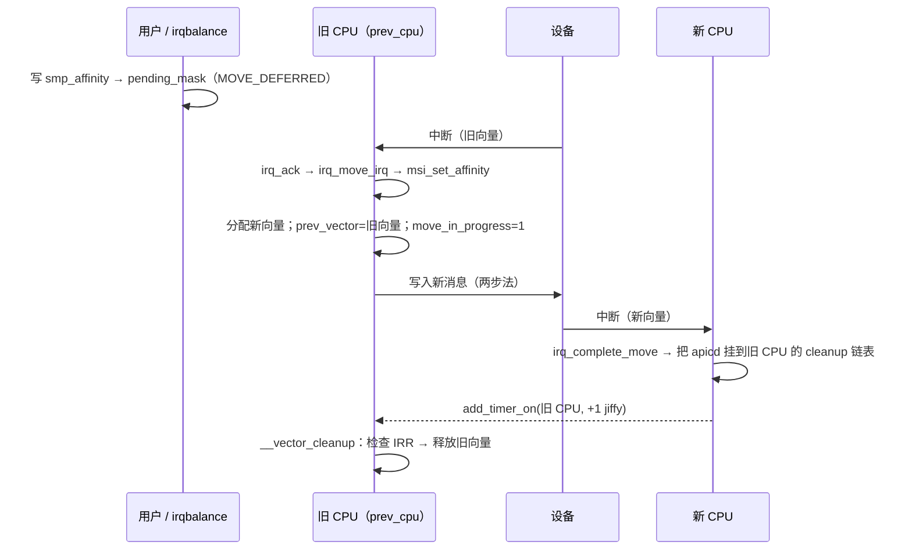

# 5.8 中断向量分配与亲和性

> **本节源码**：`kernel/irq/matrix.c`、`arch/x86/kernel/apic/vector.c`、`arch/x86/include/asm/hw_irq.h`、`kernel/irq/manage.c`、`kernel/irq/migration.c`、`kernel/irq/internals.h`、`kernel/irq/affinity.c`、`kernel/irq/msi.c`、`kernel/irq/cpuhotplug.c`、`kernel/irq/proc.c`、`arch/x86/kernel/irq.c`
> **关键函数**：`irq_matrix_alloc()`、`x86_vector_alloc_irqs()`、`x86_vector_activate()`、`assign_vector_locked()`、`chip_data_update()`、`irq_set_affinity_locked()`、`irq_do_set_affinity()`、`apic_set_affinity()`、`irq_move_masked_irq()`、`irq_complete_move()`、`irq_create_affinity_masks()`、`migrate_one_irq()`、`fixup_irqs()`
> **前置知识**：5.5 中断控制器、5.6 通用中断层、5.7 中断申请与线程化中断

## 概述

x86 的每个 CPU 只有 203 个设备向量可用（5.1 节），而一台服务器上的 NVMe 盘、多队列网卡、GPU 加起来很容易有上千个 MSI-X 中断。向量是一种稀缺的 per-CPU 资源，必须精心分配：既要让每个中断都能找到一个向量，又要尽量把中断分散到多个 CPU 上，还要在用户修改亲和性、CPU 上下线时安全地把中断从一个向量搬到另一个向量。

本节分析 x86 向量域的实现。它由三部分组成：**`irq_matrix`**——一个通用的二维位图分配器，记录每个 CPU 上每个向量的占用情况；**向量域的分配 / 激活策略**——"保留模式"和"managed 中断"两种节省向量的手段；**中断迁移**——修改亲和性时新旧向量并存、在新向量上收到第一个中断后才释放旧向量的两阶段协议。

## 核心数据结构

### irq_matrix

`irq_matrix`（v4.15 由 Thomas Gleixner 引入，`CONFIG_GENERIC_IRQ_MATRIX_ALLOCATOR=y`）是一个"CPU × 向量"的二维分配器：

```c
// kernel/irq/matrix.c:11-35（v6.18.60）
struct cpumap {
	unsigned int		available;	// [注] 本 CPU 尚可分配的向量数
	unsigned int		allocated;	// [注] 已分配的普通向量数
	unsigned int		managed;	// [注] 为 managed 中断保留的向量数
	unsigned int		managed_allocated;
	bool			initialized;
	bool			online;
	unsigned long		*managed_map;	// [注] managed 保留位图
	unsigned long		alloc_map[];	// [注] 普通分配位图
};

struct irq_matrix {
	unsigned int		matrix_bits;	// [注] 256
	unsigned int		alloc_start;	// [注] FIRST_EXTERNAL_VECTOR（0x20）
	unsigned int		alloc_end;	// [注] FIRST_SYSTEM_VECTOR（0xeb）
	unsigned int		alloc_size;
	unsigned int		global_available;	// [注] 所有在线 CPU 的 available 之和
	unsigned int		global_reserved;	// [注] 保留模式下"欠下"的向量数
	unsigned int		systembits_inalloc;
	unsigned int		total_allocated;
	unsigned int		online_maps;
	struct cpumap __percpu	*maps;
	unsigned long		*system_map;	// [注] 系统向量（所有 CPU 相同）
	unsigned long		scratch_map[];
};
```

它在 `arch_early_irq_init()` 中创建（5.6 节）：`irq_alloc_matrix(NR_VECTORS, FIRST_EXTERNAL_VECTOR, FIRST_SYSTEM_VECTOR)`。分配一个向量时先挑 CPU，再在该 CPU 的位图中找空位：

```c
// kernel/irq/matrix.c:116-153（v6.18.60）
static unsigned int matrix_alloc_area(struct irq_matrix *m, struct cpumap *cm,
				      unsigned int num, bool managed)
{
	unsigned int area, start = m->alloc_start;
	unsigned int end = m->alloc_end;

	bitmap_or(m->scratch_map, cm->managed_map, m->system_map, end);
	bitmap_or(m->scratch_map, m->scratch_map, cm->alloc_map, end);
	area = bitmap_find_next_zero_area(m->scratch_map, end, start, num, 0);
	if (area >= end)
		return area;
	if (managed)
		bitmap_set(cm->managed_map, area, num);
	else
		bitmap_set(cm->alloc_map, area, num);
	return area;
}

/* Find the best CPU which has the lowest vector allocation count */
static unsigned int matrix_find_best_cpu(struct irq_matrix *m,
					const struct cpumask *msk)
{
	unsigned int cpu, best_cpu, maxavl = 0;
	struct cpumap *cm;

	best_cpu = UINT_MAX;

	for_each_cpu(cpu, msk) {
		cm = per_cpu_ptr(m->maps, cpu);

		if (!cm->online || cm->available <= maxavl)
			continue;

		best_cpu = cpu;
		maxavl = cm->available;
	}
	return best_cpu;
}
```

选 CPU 的策略很简单：**在允许的 CPU 集合中选剩余向量最多的那个**。这让中断自然地分散到各个 CPU 上，即便用户没有手动设置亲和性。

```c
// kernel/irq/matrix.c:383-414（v6.18.60）
int irq_matrix_alloc(struct irq_matrix *m, const struct cpumask *msk,
		     bool reserved, unsigned int *mapped_cpu)
{
	unsigned int cpu, bit;
	struct cpumap *cm;

	/*
	 * Not required in theory, but matrix_find_best_cpu() uses
	 * for_each_cpu() which ignores the cpumask on UP .
	 */
	if (cpumask_empty(msk))
		return -EINVAL;

	cpu = matrix_find_best_cpu(m, msk);
	if (cpu == UINT_MAX)
		return -ENOSPC;

	cm = per_cpu_ptr(m->maps, cpu);
	bit = matrix_alloc_area(m, cm, 1, false);
	if (bit >= m->alloc_end)
		return -ENOSPC;
	cm->allocated++;
	cm->available--;
	m->total_allocated++;
	m->global_available--;
	if (reserved)
		m->global_reserved--;
	*mapped_cpu = cpu;
	trace_irq_matrix_alloc(bit, cpu, m, cm);
	return bit;

}
```

### apic_chip_data 与 irq_cfg

向量域为每个中断保存一个 `apic_chip_data`（即其 `irq_data->chip_data`）：

```c
// arch/x86/kernel/apic/vector.c:26-38（v6.18.60）
struct apic_chip_data {
	struct irq_cfg		hw_irq_cfg;	// [注] 当前生效的 {dest_apicid, vector}
	unsigned int		vector;		// [注] 当前向量
	unsigned int		prev_vector;	// [注] 迁移中的旧向量
	unsigned int		cpu;		// [注] 当前目标 CPU
	unsigned int		prev_cpu;	// [注] 迁移中的旧 CPU
	unsigned int		irq;
	struct hlist_node	clist;		// [注] 挂在旧 CPU 的 vector_cleanup 链表上
	unsigned int		move_in_progress	: 1,
				is_managed		: 1,
				can_reserve		: 1,
				has_reserved		: 1;
};
```

```c
// arch/x86/include/asm/hw_irq.h:88-91（v6.18.60）
struct irq_cfg {
	unsigned int		dest_apicid;
	unsigned int		vector;
};
```

`irq_cfg` 是上层（I/O APIC、MSI）组合中断消息时读取的内容（5.5 节 `__irq_msi_compose_msg()`）。`irqd_cfg()`（`arch/x86/kernel/apic/vector.c:100-106`）沿 `parent_data` 走到最内层取出它，所以任何一层的 chip 都能拿到当前的向量和目标。

### 三个 cpumask

每个中断有三个相关的 CPU 集合：

| 字段 | 含义 | 用户接口 |
|---|---|---|
| `irq_common_data.affinity` | 允许的目标 CPU 集合（用户或驱动设置） | `/proc/irq/N/smp_affinity[_list]` |
| `irq_common_data.effective_affinity` | 实际生效的目标 CPU（x86 上恰好一个） | `/proc/irq/N/effective_affinity[_list]` |
| `irq_desc.pending_mask` | 尚未生效、等待下一次中断时应用的新亲和性 | — |

*表 5-14：中断亲和性相关的 cpumask*

x86 向量域设置了 `irqd_set_single_target()`（`arch/x86/kernel/apic/vector.c:582`）：**一个中断同一时刻只投递到一个 CPU**。虽然 LAPIC 的逻辑目的模式理论上支持"投递给一组 CPU 中优先级最低的那个"，但它在 x2APIC cluster 模式下只能覆盖一个 cluster，且每个 CPU 都要为该中断占用同一个向量号，浪费严重。v4.15 的向量管理重写后统一改为单目标。

## 主流程分析

### 分配：三种策略

5.6 节介绍了分层域的分配过程，向量域的 `alloc` 回调是 `x86_vector_alloc_irqs()`：

```c
// arch/x86/kernel/apic/vector.c:567-612（v6.18.60）
	for (i = 0; i < nr_irqs; i++) {
		irqd = irq_domain_get_irq_data(domain, virq + i);
		BUG_ON(!irqd);
		node = irq_data_get_node(irqd);
		WARN_ON_ONCE(irqd->chip_data);
		apicd = alloc_apic_chip_data(node);
		if (!apicd) {
			err = -ENOMEM;
			goto error;
		}

		apicd->irq = virq + i;
		irqd->chip = &lapic_controller;
		irqd->chip_data = apicd;
		irqd->hwirq = virq + i;
		irqd_set_single_target(irqd);
		/*
		 * Prevent that any of these interrupts is invoked in
		 * non interrupt context via e.g. generic_handle_irq()
		 * as that can corrupt the affinity move state.
		 */
		irqd_set_handle_enforce_irqctx(irqd);

		/* Don't invoke affinity setter on deactivated interrupts */
		irqd_set_affinity_on_activate(irqd);

		/*
		 * Legacy vectors are already assigned when the IOAPIC
		 * takes them over. They stay on the same vector. This is
		 * required for check_timer() to work correctly as it might
		 * switch back to legacy mode. Only update the hardware
		 * config.
		 */
		if (info->flags & X86_IRQ_ALLOC_LEGACY) {
			if (!vector_configure_legacy(virq + i, irqd, apicd))
				continue;
		}

		err = assign_irq_vector_policy(irqd, info);
		trace_vector_setup(virq + i, false, err);
		if (err) {
			irqd->chip_data = NULL;
			free_apic_chip_data(apicd);
			goto error;
		}
	}
```

`assign_irq_vector_policy()` 决定分配时是否真正占用向量：

```c
// arch/x86/kernel/apic/vector.c:315-327（v6.18.60）
static int
assign_irq_vector_policy(struct irq_data *irqd, struct irq_alloc_info *info)
{
	if (irqd_affinity_is_managed(irqd))
		return reserve_managed_vector(irqd);
	if (info->mask)
		return assign_irq_vector(irqd, info->mask);
	/*
	 * Make only a global reservation with no guarantee. A real vector
	 * is associated at activation time.
	 */
	return reserve_irq_vector(irqd);
}
```

| 策略 | 适用 | 分配时 | 激活 / 启动时 |
|---|---|---|---|
| managed | 多队列设备的 per-CPU 队列中断 | 在亲和性集合的**每个** CPU 上各预留一个向量 | 从预留中取出一个 |
| 立即分配 | 调用者指定了 `info->mask` | 立即分配真实向量 | — |
| 保留模式 | 其他（大多数 MSI、I/O APIC） | 只把全局"欠账"加一（`irq_matrix_reserve()`） | 真正分配向量 |

*表 5-15：向量域的三种分配策略*

### 保留模式

很多驱动在 probe 时一次申请大量 MSI-X 向量，但只有在接口打开（`ip link set up`）时才 `request_irq()`。若分配时就占用真实向量，未使用的网卡也会消耗大量向量。**保留模式**（reservation mode，`CONFIG_GENERIC_IRQ_RESERVATION_MODE=y`）把分配推迟到真正需要的时候：

```c
// arch/x86/kernel/apic/vector.c:217-237（v6.18.60）
static void reserve_irq_vector_locked(struct irq_data *irqd)
{
	struct apic_chip_data *apicd = apic_chip_data(irqd);

	irq_matrix_reserve(vector_matrix);
	apicd->can_reserve = true;
	apicd->has_reserved = true;
	irqd_set_can_reserve(irqd);
	trace_vector_reserve(irqd->irq, 0);
	vector_assign_managed_shutdown(irqd);
}

static int reserve_irq_vector(struct irq_data *irqd)
{
	unsigned long flags;

	raw_spin_lock_irqsave(&vector_lock, flags);
	reserve_irq_vector_locked(irqd);
	raw_spin_unlock_irqrestore(&vector_lock, flags);
	return 0;
}
```

`vector_assign_managed_shutdown()`（`arch/x86/kernel/apic/vector.c:195-200`）把 `irq_cfg` 设为"第一个在线 CPU + `MANAGED_IRQ_SHUTDOWN_VECTOR`（`0xef`）"。这是一个所有 CPU 都设置为伪中断入口的系统向量（5.1 节 `spurious_entries_start`）。

但 PCI MSI 有个特殊要求：PCI 层在使能设备的 MSI 功能**之前**，必须先往设备里写入一条有效的消息，否则设备可能锁存一个随机的地址/数据对。`msi_init_virq()` 因此在分配时就以保留模式激活一次：

```c
// kernel/irq/msi.c:1259-1272（v6.18.60）
	if (!(vflags & VIRQ_ACTIVATE))
		return 0;

	ret = irq_domain_activate_irq(irqd, vflags & VIRQ_CAN_RESERVE);
	if (ret)
		return ret;
	/*
	 * If the interrupt uses reservation mode, clear the activated bit
	 * so request_irq() will assign the final vector.
	 */
	if (vflags & VIRQ_CAN_RESERVE)
		irqd_clr_activated(irqd);
	return 0;
}
```

`reserve` 参数为真时，向量域的激活只把消息指向占位向量 `0xef`；然后清除"已激活"标志，让 `request_irq()` 中的 `irq_activate()` 再走一次真正的激活。设备在此期间若误发中断，只会落到伪中断处理函数中。保留模式要求 MSI 可被屏蔽（`msi_check_reservation_mode()`，`kernel/irq/msi.c` 中要求 MSI-X 或支持逐向量屏蔽的 MSI），因为把占位消息换成真实消息时需要先屏蔽。

激活时的分派：

```c
// arch/x86/kernel/apic/vector.c:461-482（v6.18.60）
static int x86_vector_activate(struct irq_domain *dom, struct irq_data *irqd,
			       bool reserve)
{
	struct apic_chip_data *apicd = apic_chip_data(irqd);
	unsigned long flags;
	int ret = 0;

	trace_vector_activate(irqd->irq, apicd->is_managed,
			      apicd->can_reserve, reserve);

	raw_spin_lock_irqsave(&vector_lock, flags);
	if (!apicd->can_reserve && !apicd->is_managed)
		assign_irq_vector_any_locked(irqd);
	else if (reserve || irqd_is_managed_and_shutdown(irqd))
		vector_assign_managed_shutdown(irqd);
	else if (apicd->is_managed)
		ret = activate_managed(irqd);
	else if (apicd->has_reserved)
		ret = activate_reserved(irqd);
	raw_spin_unlock_irqrestore(&vector_lock, flags);
	return ret;
}
```

`activate_reserved()`（`arch/x86/kernel/apic/vector.c:405-435`）调用 `assign_irq_vector_any_locked()`，按"NUMA 节点 ∩ 亲和性 → 亲和性 → 节点 → 所有在线 CPU"的顺序逐级放宽，尝试分配（`arch/x86/kernel/apic/vector.c:287-313`）。如果最终分到的 CPU 不在用户要求的亲和性内，打印 `Affinity broken due to vector space exhaustion`——宁可违背亲和性，也要让中断能工作。

`free_irq()` 时 `x86_vector_deactivate()`（`arch/x86/kernel/apic/vector.c:381-403`）释放真实向量，并重新回到保留状态。

### 真正分配一个向量

无论哪种路径，最终都会调用 `assign_vector_locked()`：

```c
// arch/x86/kernel/apic/vector.c:239-273（v6.18.60）
static int
assign_vector_locked(struct irq_data *irqd, const struct cpumask *dest)
{
	struct apic_chip_data *apicd = apic_chip_data(irqd);
	bool resvd = apicd->has_reserved;
	unsigned int cpu = apicd->cpu;
	int vector = apicd->vector;

	lockdep_assert_held(&vector_lock);

	/*
	 * If the current target CPU is online and in the new requested
	 * affinity mask, there is no point in moving the interrupt from
	 * one CPU to another.
	 */
	if (vector && cpu_online(cpu) && cpumask_test_cpu(cpu, dest))
		return 0;

	/*
	 * Careful here. @apicd might either have move_in_progress set or
	 * be enqueued for cleanup. Assigning a new vector would either
	 * leave a stale vector on some CPU around or in case of a pending
	 * cleanup corrupt the hlist.
	 */
	if (apicd->move_in_progress || !hlist_unhashed(&apicd->clist))
		return -EBUSY;

	vector = irq_matrix_alloc(vector_matrix, dest, resvd, &cpu);
	trace_vector_alloc(irqd->irq, vector, resvd, vector);
	if (vector < 0)
		return vector;
	chip_data_update(irqd, vector, cpu);

	return 0;
}
```

两个要点：

- **当前目标仍在新集合中就不动**。用户把 `smp_affinity` 从 `0-3` 改为 `0-7`，若中断当前在 CPU2，就保持不变——迁移中断有代价。
- **上一次迁移尚未完成时返回 `-EBUSY`**。一个中断同一时刻最多只能处于一次迁移中，否则旧向量就无从清理。通用层收到 `-EBUSY` 会把新亲和性记入 `pending_mask`，留待以后再试（见下文）。

`chip_data_update()` 完成登记：

```c
// arch/x86/kernel/apic/vector.c:150-193（v6.18.60）
static void chip_data_update(struct irq_data *irqd, unsigned int newvec, unsigned int newcpu)
{
	struct apic_chip_data *apicd = apic_chip_data(irqd);
	struct irq_desc *desc = irq_data_to_desc(irqd);
	bool managed = irqd_affinity_is_managed(irqd);

	lockdep_assert_held(&vector_lock);

	trace_vector_update(irqd->irq, newvec, newcpu, apicd->vector,
			    apicd->cpu);

	/*
	 * If there is no vector associated or if the associated vector is
	 * the shutdown vector, which is associated to make PCI/MSI
	 * shutdown mode work, then there is nothing to release. Clear out
	 * prev_vector for this and the offlined target case.
	 */
	apicd->prev_vector = 0;
	if (!apicd->vector || apicd->vector == MANAGED_IRQ_SHUTDOWN_VECTOR)
		goto setnew;
	/*
	 * If the target CPU of the previous vector is online, then mark
	 * the vector as move in progress and store it for cleanup when the
	 * first interrupt on the new vector arrives. If the target CPU is
	 * offline then the regular release mechanism via the cleanup
	 * vector is not possible and the vector can be immediately freed
	 * in the underlying matrix allocator.
	 */
	if (cpu_online(apicd->cpu)) {
		apicd->move_in_progress = true;
		apicd->prev_vector = apicd->vector;
		apicd->prev_cpu = apicd->cpu;
		WARN_ON_ONCE(apicd->cpu == newcpu);
	} else {
		apic_free_vector(apicd->cpu, apicd->vector, managed);
	}

setnew:
	apicd->vector = newvec;
	apicd->cpu = newcpu;
	BUG_ON(!IS_ERR_OR_NULL(per_cpu(vector_irq, newcpu)[newvec]));
	per_cpu(vector_irq, newcpu)[newvec] = desc;
	apic_update_irq_cfg(irqd, newvec, newcpu);
}
```

如果中断原来已有向量，**旧向量不会立即释放**：它被记为 `prev_vector` / `prev_cpu`，`move_in_progress` 置位。原因是设备可能已经用旧消息发出了一个中断，它此刻正在总线上或旧 CPU 的 IRR 里；如果立即释放旧向量并把它分给别的设备，这个"在途"中断就会被错误地投递给别人的处理函数。新向量则立即登记到新 CPU 的 `vector_irq[]`，`apic_update_irq_cfg()` 更新 `irq_cfg` 与 `effective_affinity`。

### 修改亲和性

用户写 `/proc/irq/N/smp_affinity` 时，`write_irq_affinity()`（`kernel/irq/proc.c:134-174`）检查后调用 `irq_set_affinity()`，最终到达 `irq_set_affinity_locked()`：

```c
// kernel/irq/manage.c:365-391（v6.18.60）
int irq_set_affinity_locked(struct irq_data *data, const struct cpumask *mask,
			    bool force)
{
	struct irq_chip *chip = irq_data_get_irq_chip(data);
	struct irq_desc *desc = irq_data_to_desc(data);
	int ret = 0;

	if (!chip || !chip->irq_set_affinity)
		return -EINVAL;

	if (irq_set_affinity_deactivated(data, mask))
		return 0;

	if (irq_can_move_pcntxt(data) && !irqd_is_setaffinity_pending(data)) {
		ret = irq_try_set_affinity(data, mask, force);
	} else {
		irqd_set_move_pending(data);
		irq_copy_pending(desc, mask);
	}

	if (desc->affinity_notify)
		irq_affinity_schedule_notify_work(desc);

	irqd_set(data, IRQD_AFFINITY_SET);

	return ret;
}
```

分为两种情况：

- **可以在进程上下文中迁移**（`irq_can_move_pcntxt()` 为真）：直接调用 `irq_do_set_affinity()` → `chip->irq_set_affinity()`，沿域层级完成向量分配与硬件重编程。启用中断重映射时属于此类，因为改 IRT 表项是原子的。
- **只能在中断上下文中迁移**：芯片设置了 `IRQCHIP_MOVE_DEFERRED`（`kernel/irq/internals.h:413-416`）。不启用中断重映射时，I/O APIC（`arch/x86/kernel/apic/io_apic.c:1864`）与直接挂在向量域下的 PCI MSI（`arch/x86/kernel/apic/msi.c:216-217`）都设置了这个标志。此时只把新亲和性存入 `pending_mask` 并置位 `IRQD_SETAFFINITY_PENDING`，等下一次中断到来时，在中断处理流程中迁移。

为什么要延迟到中断上下文？回顾 5.5 节：不可屏蔽的 MSI 修改地址和数据不是原子的，`msi_set_affinity()` 的两步法要求"在当前目标 CPU 上、且关着中断"执行；I/O APIC 边沿中断在改写重定向表项时若恰好有中断到来，某些芯片会出错。在该中断自己的处理流程中迁移，天然满足"在当前目标 CPU、关中断、且没有同一中断正在投递"这些条件。

`irq_do_set_affinity()`（`kernel/irq/manage.c:220-291`）还处理了 CPU 隔离：若内核以 `isolcpus=managed_irq,...` 启动，managed 中断的亲和性会优先排除隔离 CPU，避免从非隔离 CPU 提交的 I/O 在隔离 CPU 上产生中断。

### 延迟迁移：在下一次中断中完成

延迟的迁移由流控处理函数中的应答回调触发。对 MSI，`handle_edge_irq()` 调用 `irq_ack`，经 `irq_chip_ack_parent` 到达向量域：

```c
// arch/x86/kernel/apic/vector.c:1014-1024（v6.18.60）
void apic_ack_irq(struct irq_data *irqd)
{
	irq_move_irq(irqd);
	apic_eoi();
}

void apic_ack_edge(struct irq_data *irqd)
{
	irq_complete_move(irqd_cfg(irqd));
	apic_ack_irq(irqd);
}
```

`irq_move_irq()`（`include/linux/irq.h:619-623`）在 `IRQD_SETAFFINITY_PENDING` 置位时调用 `__irq_move_irq()`，它先屏蔽中断，再调用 `irq_move_masked_irq()`：

```c
// kernel/irq/migration.c:48-102（v6.18.60）
void irq_move_masked_irq(struct irq_data *idata)
{
	struct irq_desc *desc = irq_data_to_desc(idata);
	struct irq_data *data = &desc->irq_data;
	struct irq_chip *chip = data->chip;

	if (likely(!irqd_is_setaffinity_pending(data)))
		return;

	irqd_clr_move_pending(data);

	/*
	 * Paranoia: cpu-local interrupts shouldn't be calling in here anyway.
	 */
	if (irqd_is_per_cpu(data)) {
		WARN_ON(1);
		return;
	}

	if (unlikely(cpumask_empty(desc->pending_mask)))
		return;

	if (!chip->irq_set_affinity)
		return;

	assert_raw_spin_locked(&desc->lock);

	/*
	 * If there was a valid mask to work with, please
	 * do the disable, re-program, enable sequence.
	 * This is *not* particularly important for level triggered
	 * but in a edge trigger case, we might be setting rte
	 * when an active trigger is coming in. This could
	 * cause some ioapics to mal-function.
	 * Being paranoid i guess!
	 *
	 * For correct operation this depends on the caller
	 * masking the irqs.
	 */
	if (cpumask_intersects(desc->pending_mask, cpu_online_mask)) {
		int ret;

		ret = irq_do_set_affinity(data, desc->pending_mask, false);
		/*
		 * If the there is a cleanup pending in the underlying
		 * vector management, reschedule the move for the next
		 * interrupt. Leave desc->pending_mask intact.
		 */
		if (ret == -EBUSY) {
			irqd_set_move_pending(data);
			return;
		}
	}
	cpumask_clear(desc->pending_mask);
}
```

此时 `irq_do_set_affinity()` 在中断上下文、持有 `desc->lock`、本地中断关闭的情况下调用 `msi_set_affinity()`（MSI）或 `ioapic_set_affinity()`（I/O APIC），满足了它们的前提条件。如果上一次迁移的旧向量还没清理完（`-EBUSY`），就把迁移再推迟到下一次中断。

### 清理旧向量

迁移完成后，新旧两个向量同时有效：旧 CPU 的 `vector_irq[prev_vector]` 与新 CPU 的 `vector_irq[vector]` 都指向同一个描述符，在途的中断无论落到哪里都能被正确处理。什么时候可以安全地释放旧向量？**当新向量上收到第一个中断时**——这证明设备已经在使用新消息了：

```c
// arch/x86/kernel/apic/vector.c:1137-1153（v6.18.60）
void irq_complete_move(struct irq_cfg *cfg)
{
	struct apic_chip_data *apicd;

	apicd = container_of(cfg, struct apic_chip_data, hw_irq_cfg);
	if (likely(!apicd->move_in_progress))
		return;

	/*
	 * If the interrupt arrived on the new target CPU, cleanup the
	 * vector on the old target CPU. A vector check is not required
	 * because an interrupt can never move from one vector to another
	 * on the same CPU.
	 */
	if (apicd->cpu == smp_processor_id())
		__vector_schedule_cleanup(apicd);
}
```

但旧向量必须在**旧 CPU 上**释放——要检查旧 CPU 的 IRR 中是否还挂着这个向量。`__vector_schedule_cleanup()` 把 `apicd` 挂到旧 CPU 的 per-CPU `vector_cleanup` 链表上，并在旧 CPU 上启动一个 1 jiffy 后到期的定时器：

```c
// arch/x86/kernel/apic/vector.c:1092-1126（v6.18.60）
static void __vector_schedule_cleanup(struct apic_chip_data *apicd)
{
	unsigned int cpu = apicd->prev_cpu;

	raw_spin_lock(&vector_lock);
	apicd->move_in_progress = 0;
	if (cpu_online(cpu)) {
		struct vector_cleanup *cl = per_cpu_ptr(&vector_cleanup, cpu);

		hlist_add_head(&apicd->clist, &cl->head);

		/*
		 * The lockless timer_pending() check is safe here. If it
		 * returns true, then the callback will observe this new
		 * apic data in the hlist as everything is serialized by
		 * vector lock.
		 *
		 * If it returns false then the timer is either not armed
		 * or the other CPU executes the callback, which again
		 * would be blocked on vector lock. Rearming it in the
		 * latter case makes it fire for nothing.
		 *
		 * This is also safe against the callback rearming the timer
		 * because that's serialized via vector lock too.
		 */
		if (!timer_pending(&cl->timer)) {
			cl->timer.expires = jiffies + 1;
			add_timer_on(&cl->timer, cpu);
		}
	} else {
		pr_warn("IRQ %u schedule cleanup for offline CPU %u\n", apicd->irq, cpu);
		free_moved_vector(apicd);
	}
	raw_spin_unlock(&vector_lock);
}
```

定时器回调在旧 CPU 上执行 `__vector_cleanup()`：

```c
// arch/x86/kernel/apic/vector.c:1043-1080（v6.18.60）
static void __vector_cleanup(struct vector_cleanup *cl, bool check_irr)
{
	struct apic_chip_data *apicd;
	struct hlist_node *tmp;
	bool rearm = false;

	lockdep_assert_held(&vector_lock);

	hlist_for_each_entry_safe(apicd, tmp, &cl->head, clist) {
		unsigned int vector = apicd->prev_vector;

		/*
		 * Paranoia: Check if the vector that needs to be cleaned
		 * up is registered at the APICs IRR. That's clearly a
		 * hardware issue if the vector arrived on the old target
		 * _after_ interrupts were disabled above. Keep @apicd
		 * on the list and schedule the timer again to give the CPU
		 * a chance to handle the pending interrupt.
		 *
		 * Do not check IRR when called from lapic_offline(), because
		 * fixup_irqs() was just called to scan IRR for set bits and
		 * forward them to new destination CPUs via IPIs.
		 */
		if (check_irr && is_vector_pending(vector)) {
			pr_warn_once("Moved interrupt pending in old target APIC %u\n", apicd->irq);
			rearm = true;
			continue;
		}
		free_moved_vector(apicd);
	}

	/*
	 * Must happen under vector_lock to make the timer_pending() check
	 * in __vector_schedule_cleanup() race free against the rearm here.
	 */
	if (rearm)
		mod_timer(&cl->timer, jiffies + 1);
}
```

若旧向量在旧 CPU 的 IRR 中仍有挂起，推迟 1 jiffy 再试，给旧 CPU 机会把它处理掉；否则 `free_moved_vector()`（`arch/x86/kernel/apic/vector.c:897-919`）把旧 CPU 的 `vector_irq[prev_vector]` 置为 `VECTOR_UNUSED`，在 `irq_matrix` 中释放，并清除 `move_in_progress`。

> **历史演进**：v6.6 之前，清理由一个专门的 IPI（`IRQ_MOVE_CLEANUP_VECTOR`，占用向量 `0x20`）触发：新 CPU 向旧 CPU 发送清理 IPI，旧 CPU 在 IPI 处理函数中释放向量。v6.6 起改为 per-CPU 定时器：它是唯一一个位于 `FIRST_SYSTEM_VECTOR` 之下的特殊向量，去掉它之后所有系统向量都集中在高端，FRED 分发时只需一次范围判断（5.2 节 `fred_extint()`）即可区分系统向量与设备向量。



*图 5-10：非重映射 MSI 中断亲和性迁移的完整过程*

### managed 中断

多队列设备（NVMe、高速网卡）通常为每个 CPU 或每组 CPU 配一个队列，每个队列一个中断，且希望中断永远在"提交 I/O 的那组 CPU"上处理。这类中断的亲和性由内核在分配时计算并固定下来，用户不能修改，称为 **managed 中断**（managed interrupt，v4.8 引入）。

驱动通过 `pci_alloc_irq_vectors_affinity(..., PCI_IRQ_AFFINITY, &affd)` 申请，PCI 层调用 `irq_create_affinity_masks()` 计算每个向量的亲和性：

```c
// kernel/irq/affinity.c:63-101（v6.18.60）
	/* Fill out vectors at the beginning that don't need affinity */
	for (curvec = 0; curvec < affd->pre_vectors; curvec++)
		cpumask_copy(&masks[curvec].mask, irq_default_affinity);

	/*
	 * Spread on present CPUs starting from affd->pre_vectors. If we
	 * have multiple sets, build each sets affinity mask separately.
	 */
	for (i = 0, usedvecs = 0; i < affd->nr_sets; i++) {
		unsigned int nr_masks, this_vecs = affd->set_size[i];
		struct cpumask *result = group_cpus_evenly(this_vecs, &nr_masks);

		if (!result) {
			kfree(masks);
			return NULL;
		}

		for (int j = 0; j < nr_masks; j++)
			cpumask_copy(&masks[curvec + j].mask, &result[j]);
		kfree(result);

		curvec += nr_masks;
		usedvecs += nr_masks;
	}

	/* Fill out vectors at the end that don't need affinity */
	if (usedvecs >= affvecs)
		curvec = affd->pre_vectors + affvecs;
	else
		curvec = affd->pre_vectors + usedvecs;
	for (; curvec < nvecs; curvec++)
		cpumask_copy(&masks[curvec].mask, irq_default_affinity);

	/* Mark the managed interrupts */
	for (i = affd->pre_vectors; i < nvecs - affd->post_vectors; i++)
		masks[i].is_managed = 1;

	return masks;
}
```

`group_cpus_evenly()`（`lib/group_cpus.c`）把所有 possible CPU 按 NUMA 节点与核拓扑均匀分成 `this_vecs` 组，每组对应一个队列中断。`pre_vectors` / `post_vectors` 是不参与分散的向量（例如 NVMe 的管理队列中断），使用默认亲和性。

managed 中断与普通中断的区别：

| 方面 | 普通中断 | managed 中断 |
|---|---|---|
| 亲和性来源 | 用户 / irqbalance / 驱动 hint | 内核按拓扑计算，固定不变 |
| `/proc/irq/N/smp_affinity` | 可写 | 写入返回 `-EPERM`（`irq_can_set_affinity_usr()` 为假，`kernel/irq/manage.c:170-176`） |
| 向量 | 保留模式，按需分配 | 在亲和性集合的每个 CPU 上预留一个（`irq_matrix_reserve_managed()`） |
| 集合内 CPU 全部下线 | 迁移到任意在线 CPU（"打破亲和性"） | **关闭中断**，CPU 上线后再启动 |

*表 5-16：managed 中断与普通中断的对比*

最后一行是 managed 中断的核心设计：一个队列的中断若被迁移到别的 CPU，就失去了"在提交者本地完成"的意义；而且该队列对应的 CPU 都下线了，也就不会有新的 I/O 提交到这个队列上。所以干脆关闭它，避免占用其他 CPU 的向量。为了保证上线时一定有向量可用，分配阶段就在每个可能的 CPU 上都预留了一个。

### CPU 下线时的中断迁移

CPU 下线时，在 stop_machine 的上下文中调用 `fixup_irqs()`：

```c
// arch/x86/kernel/irq.c:505-549（v6.18.60）
void fixup_irqs(void)
{
	unsigned int vector;
	struct irq_desc *desc;
	struct irq_data *data;
	struct irq_chip *chip;

	irq_migrate_all_off_this_cpu();

	/*
	 * We can remove mdelay() and then send spurious interrupts to
	 * new cpu targets for all the irqs that were handled previously by
	 * this cpu. While it works, I have seen spurious interrupt messages
	 * (nothing wrong but still...).
	 *
	 * So for now, retain mdelay(1) and check the IRR and then send those
	 * interrupts to new targets as this cpu is already offlined...
	 */
	mdelay(1);

	/*
	 * We can walk the vector array of this cpu without holding
	 * vector_lock because the cpu is already marked !online, so
	 * nothing else will touch it.
	 */
	for (vector = FIRST_EXTERNAL_VECTOR; vector < NR_VECTORS; vector++) {
		if (IS_ERR_OR_NULL(__this_cpu_read(vector_irq[vector])))
			continue;

		if (is_vector_pending(vector)) {
			desc = __this_cpu_read(vector_irq[vector]);

			raw_spin_lock(&desc->lock);
			data = irq_desc_get_irq_data(desc);
			chip = irq_data_get_irq_chip(data);
			if (chip->irq_retrigger) {
				chip->irq_retrigger(data);
				__this_cpu_write(vector_irq[vector], VECTOR_RETRIGGERED);
			}
			raw_spin_unlock(&desc->lock);
		}
		if (__this_cpu_read(vector_irq[vector]) != VECTOR_RETRIGGERED)
			__this_cpu_write(vector_irq[vector], VECTOR_UNUSED);
	}
}
```

1. `irq_migrate_all_off_this_cpu()`（`kernel/irq/cpuhotplug.c:171-190`）遍历所有中断，对目标是本 CPU 的中断调用 `migrate_one_irq()`。此时可以**直接**迁移（即使芯片是 `MOVE_DEFERRED`，也会先屏蔽再改，`kernel/irq/cpuhotplug.c:109-111`），并先调用 `irq_force_complete_move()` 强制完成尚未结束的上一次迁移（`apic_force_complete_move()`，`arch/x86/kernel/apic/vector.c:924-995`）。
2. 若中断的亲和性集合中已没有在线 CPU：managed 中断被关闭（`irqd_set_managed_shutdown()`），普通中断改为允许所有在线 CPU，即"打破亲和性"（`kernel/irq/cpuhotplug.c:113-125`）。
3. 等待 1 ms 让在途中断落定，然后扫描本 CPU 的 IRR：仍挂着的中断用 `irq_retrigger`（向量域的 `apic_retrigger_irq()` 向新目标 CPU 发送新向量的 IPI，`arch/x86/kernel/apic/vector.c:1002-1012`）补发，保证不丢失。

CPU 上线时，`irq_affinity_online_cpu()`（`kernel/irq/cpuhotplug.c:233-247`）对亲和性包含该 CPU 的 managed 中断重新启动，并在需要时把中断移回来。

## 关键细节 / 设计考量

### 向量耗尽

大型服务器上向量耗尽并不罕见：若一个 CPU 的 203 个向量都已占满，`irq_matrix_alloc()` 会选择其他 CPU；所有允许的 CPU 都满了则逐级放宽到所有在线 CPU；最终仍失败则 `request_irq()` 返回 `-ENOSPC`。CPU 下线前，`lapic_can_unplug_cpu()`（`arch/x86/kernel/apic/vector.c:1160-1182`）检查其余 CPU 是否有足够的空闲向量容纳本 CPU 上的中断，不够则拒绝下线：`CPU N has X vectors, Y available. Cannot disable CPU`。

### irqbalance 与内核的分工

内核的 `irq_matrix` 只保证"新分配的中断尽量均匀"，不会根据运行时负载主动迁移中断。运行时的均衡由用户态守护进程 **irqbalance** 负责：它周期性读取 `/proc/interrupts` 与 `/proc/stat`，按中断频率和 CPU 负载、NUMA 拓扑、缓存层级重新分配，写入 `/proc/irq/N/smp_affinity`。对 managed 中断写入会失败，irqbalance 会跳过它们。驱动可以用 `irq_set_affinity_hint()` 给出建议（`/proc/irq/N/affinity_hint`），irqbalance 的部分策略会参考它。

### 中断线程随中断迁移

线程化中断的线程会跟随中断亲和性：`irq_do_set_affinity()` 成功后调用 `irq_set_thread_affinity()`（`kernel/irq/manage.c:286`），给每个 action 的线程置位 `IRQTF_AFFINITY`，线程下次运行时把自己的 `cpus_allowed` 设为中断的 effective affinity（5.7 节 `irq_thread_check_affinity()`）。这样硬中断与线程在同一 CPU 上处理，缓存局部性最好。

## 动手实验

### 观察向量分配与迁移

```bash
# 在 dev 虚拟机中执行（需要多于一个 vCPU）
IRQ=$(grep -m1 'virtio.*input' /proc/interrupts | awk -F: '{print $1}' | tr -d ' ')
cat /proc/irq/$IRQ/smp_affinity_list /proc/irq/$IRQ/effective_affinity_list
echo 1 | sudo tee /sys/kernel/tracing/events/irq_vectors/vector_update/enable
echo 1 | sudo tee /sys/kernel/tracing/events/irq_vectors/vector_free_moved/enable
echo 1 | sudo tee /proc/irq/$IRQ/smp_affinity_list
ping -c 3 -q 10.0.2.2 >/dev/null      # 产生网络中断，触发延迟迁移
sudo cat /sys/kernel/tracing/trace | tail -5
cat /proc/irq/$IRQ/effective_affinity_list
```

跟踪输出中可以看到 `vector_update: irq=.. vector=.. cpu=1 prev_vector=.. prev_cpu=..`，随后（约 1 jiffy 后）在旧 CPU 上出现 `vector_free_moved`。注意若虚拟网卡的中断是 managed 的，写 `smp_affinity_list` 会返回 `Operation not permitted`（`kernel/irq/proc.c:141-142`）。

### 查看向量占用

```bash
sudo cat /sys/kernel/tracing/events/irq_matrix/irq_matrix_alloc/format | head -20
grep -E 'CPU|^ *[0-9]+:' /proc/interrupts | awk '{print NF}' | sort | uniq -c | head
```

开启 `CONFIG_GENERIC_IRQ_DEBUGFS`（本书配置未开启）后，`/sys/kernel/debug/irq/domains/VECTOR` 会打印 `irq_matrix` 的完整状态：每个 CPU 的 `avl`、`man`、`mac`、`act` 计数以及位图。

## 小结

- x86 用 `irq_matrix` 管理"CPU × 向量"二维资源，分配时在允许的 CPU 中挑剩余向量最多的那个，使中断自然分散；一个中断同一时刻只有一个目标 CPU。
- 向量域有三种分配策略：managed 中断在亲和性内每个 CPU 上预留，指定掩码时立即分配，其余采用保留模式——分配时只记账、`request_irq()` 激活时才占用真实向量，PCI MSI 在此之前先指向占位向量 `0xef`。
- 修改亲和性时，支持中断重映射的中断可直接迁移；不支持时 I/O APIC 与 MSI 标记为 `IRQCHIP_MOVE_DEFERRED`，新亲和性存入 `pending_mask`，在下一次中断的应答路径 `irq_move_irq()` 中迁移。
- 迁移采用两阶段协议：分配新向量后旧向量保留为 `prev_vector`，新向量上收到第一个中断时 `irq_complete_move()` 在旧 CPU 上调度定时器，确认 IRR 中无挂起后才释放旧向量；v6.6 起用 per-CPU 定时器取代清理 IPI。
- managed 中断由 `irq_create_affinity_masks()` 按拓扑均匀分配、用户不可修改，其 CPU 全部下线时中断被关闭而不是迁移；普通中断则"打破亲和性"迁到任意在线 CPU。
- CPU 下线时 `fixup_irqs()` 迁移所有中断，并扫描本 CPU 的 IRR，把仍挂起的中断通过 IPI 补发到新目标，保证不丢失。

## 参考

- `linux/Documentation/core-api/irq/irq-affinity.rst`
- Thomas Gleixner, "x86/apic: Sanitize vector management" 补丁系列（v4.15，引入 `irq_matrix`）
- Christoph Hellwig, "genirq: Add affinity hint and managed interrupts" 相关补丁（v4.8）
- irqbalance 项目：<https://github.com/Irqbalance/irqbalance>
