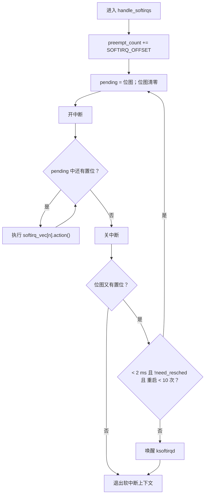

# 5.9 软中断

> **本节源码**：`include/linux/interrupt.h`、`arch/x86/include/asm/hardirq.h`、`kernel/softirq.c`、`arch/x86/include/asm/irq_stack.h`、`include/linux/vtime.h`、`net/core/dev.c`
> **关键函数**：`open_softirq()`、`raise_softirq()`、`raise_softirq_irqoff()`、`__raise_softirq_irqoff()`、`irq_exit_rcu()`、`invoke_softirq()`、`do_softirq()`、`handle_softirqs()`、`wakeup_softirqd()`、`run_ksoftirqd()`
> **前置知识**：5.2 中断入口与出口、7.1 并发来源与执行上下文

## 概述

硬中断处理函数在关中断状态下运行，执行期间本 CPU 不能响应其他中断。如果把收包协议栈处理、块设备完成回调、定时器回调都放在硬中断中执行，中断延迟会变得不可接受。Linux 的经典做法是把中断处理分成两半：**上半部**（top half）在硬中断中只做必须立即完成的事——应答硬件、取走数据、标记有工作待做；**下半部**（bottom half）在稍后、开中断的情况下完成其余工作。

软中断（softirq）是 Linux 最底层、性能最高的下半部机制。它有三个特点：

- **静态定义**：编译时确定的 10 种类型，不能动态注册；
- **per-CPU**：在哪个 CPU 上触发就在哪个 CPU 上执行，同一种软中断可以在多个 CPU 上**并行**执行，处理函数必须自行处理并发；
- **执行时机靠近硬中断**：主要在硬中断退出时执行，仍属于"中断上下文"，不能睡眠。

本节分析软中断的触发、执行与 `ksoftirqd` 线程。`local_bh_disable()` / `local_bh_enable()` 与 `preempt_count` 中软中断计数的编码已在 7.1 节介绍；建立在软中断之上的 tasklet 留给 5.10 节。

## 核心数据结构

### 软中断类型

```c
// include/linux/interrupt.h:541-561（v6.18.60）
/* PLEASE, avoid to allocate new softirqs, if you need not _really_ high
   frequency threaded job scheduling. For almost all the purposes
   tasklets are more than enough. F.e. all serial device BHs et
   al. should be converted to tasklets, not to softirqs.
 */

enum
{
	HI_SOFTIRQ=0,
	TIMER_SOFTIRQ,
	NET_TX_SOFTIRQ,
	NET_RX_SOFTIRQ,
	BLOCK_SOFTIRQ,
	IRQ_POLL_SOFTIRQ,
	TASKLET_SOFTIRQ,
	SCHED_SOFTIRQ,
	HRTIMER_SOFTIRQ,
	RCU_SOFTIRQ,    /* Preferable RCU should always be the last softirq */

	NR_SOFTIRQS
};
```

| 编号 | 名称 | 处理函数 | 注册位置 | 用途 |
|---|---|---|---|---|
| 0 | `HI` | `tasklet_hi_action()` | `kernel/softirq.c:1047` | 高优先级 tasklet 与 BH 工作队列（5.10 节） |
| 1 | `TIMER` | `run_timer_softirq()` | `kernel/time/timer.c:2579` | 定时器轮（timer wheel）回调（第 8 章） |
| 2 | `NET_TX` | `net_tx_action()` | `net/core/dev.c:13269` | 网络发送完成、qdisc 调度 |
| 3 | `NET_RX` | `net_rx_action()` | `net/core/dev.c:13270` | NAPI 收包轮询 |
| 4 | `BLOCK` | `blk_done_softirq()` | `block/blk-mq.c:5288` | 块 I/O 完成回调 |
| 5 | `IRQ_POLL` | `irq_poll_softirq()` | `lib/irq_poll.c:214` | 块设备驱动的类 NAPI 轮询 |
| 6 | `TASKLET` | `tasklet_action()` | `kernel/softirq.c:1046` | 普通 tasklet 与 BH 工作队列 |
| 7 | `SCHED` | `sched_balance_softirq()` | `kernel/sched/fair.c:14211` | 负载均衡（3.9 节） |
| 8 | `HRTIMER` | `hrtimer_run_softirq()` | `kernel/time/hrtimer.c:2335` | `HRTIMER_MODE_SOFT` 高精度定时器 |
| 9 | `RCU` | `rcu_core_si()` | `kernel/rcu/tree.c:4879` | RCU 回调处理（7.10 节） |

*表 5-17：Linux v6.18 的 10 种软中断*

编号即优先级：同一轮中从低编号到高编号依次执行。`RCU_SOFTIRQ` 放在最后（注释写明"Preferable RCU should always be the last softirq"），这样它能看到同一轮中其他软中断产生的 RCU 回调。注释中"请避免分配新的软中断"的告诫已有二十多年历史——新的下半部需求应使用 tasklet、线程化中断或工作队列。

软中断处理函数表极其简单：

```c
// include/linux/interrupt.h:587-590（v6.18.60）
struct softirq_action
{
	void	(*action)(void);
};
```

```c
// kernel/softirq.c:60-67（v6.18.60）
static struct softirq_action softirq_vec[NR_SOFTIRQS] __cacheline_aligned_in_smp;

DEFINE_PER_CPU(struct task_struct *, ksoftirqd);

const char * const softirq_to_name[NR_SOFTIRQS] = {
	"HI", "TIMER", "NET_TX", "NET_RX", "BLOCK", "IRQ_POLL",
	"TASKLET", "SCHED", "HRTIMER", "RCU"
};
```

`softirq_vec` 是全局共享的（所有 CPU 用同一组处理函数），而"哪些软中断待处理"是 per-CPU 的。

### 挂起位图

每个 CPU 有一个 16 位的挂起位图，第 *n* 位为 1 表示第 *n* 种软中断待执行：

```c
// arch/x86/include/asm/hardirq.h:68-69（v6.18.60）
DECLARE_PER_CPU_CACHE_HOT(u16, __softirq_pending);
#define local_softirq_pending_ref       __softirq_pending
```

```c
// include/linux/interrupt.h:525-527（v6.18.60）
#define local_softirq_pending()	(__this_cpu_read(local_softirq_pending_ref))
#define set_softirq_pending(x)	(__this_cpu_write(local_softirq_pending_ref, (x)))
#define or_softirq_pending(x)	(__this_cpu_or(local_softirq_pending_ref, (x)))
```

x86 把它放在"缓存热"（`CACHE_HOT`）的 per-CPU 区段中，与 `__preempt_count`、`current_task` 等热点变量位于同一缓存行，因为每次中断退出都要读它。读写都是单条 `%gs:` 前缀指令（7.1 节），但"读—改—写"不是原子的，因此**修改挂起位图必须关中断**。

## 主流程分析

### 注册与触发

```c
// kernel/softirq.c:757-796（v6.18.60）
/*
 * This function must run with irqs disabled!
 */
inline void raise_softirq_irqoff(unsigned int nr)
{
	__raise_softirq_irqoff(nr);

	/*
	 * If we're in an interrupt or softirq, we're done
	 * (this also catches softirq-disabled code). We will
	 * actually run the softirq once we return from
	 * the irq or softirq.
	 *
	 * Otherwise we wake up ksoftirqd to make sure we
	 * schedule the softirq soon.
	 */
	if (!in_interrupt() && should_wake_ksoftirqd())
		wakeup_softirqd();
}

void raise_softirq(unsigned int nr)
{
	unsigned long flags;

	local_irq_save(flags);
	raise_softirq_irqoff(nr);
	local_irq_restore(flags);
}

void __raise_softirq_irqoff(unsigned int nr)
{
	lockdep_assert_irqs_disabled();
	trace_softirq_raise(nr);
	or_softirq_pending(1UL << nr);
}

void open_softirq(int nr, void (*action)(void))
{
	softirq_vec[nr].action = action;
}
```

三个触发接口的区别：

- `__raise_softirq_irqoff()`：只置位，调用者保证已关中断，且知道稍后一定会有执行时机（典型情况是在硬中断处理函数中调用，硬中断退出时就会执行）。
- `raise_softirq_irqoff()`：置位后，若当前**不在**中断上下文（硬中断、软中断处理中、或关闭了软中断），就唤醒 `ksoftirqd`。在进程上下文中触发软中断时，没有"即将到来的中断退出"可以依靠，必须让 ksoftirqd 来执行。
- `raise_softirq()`：自带关中断，可在任何上下文调用。

`in_interrupt()` 包含了"关闭软中断"的情况（`SOFTIRQ_MASK` 非零，7.1 节）——在 `local_bh_disable()` 区间内触发的软中断会在 `local_bh_enable()` 时执行，不需要唤醒 ksoftirqd。非 RT 内核中 `should_wake_ksoftirqd()` 恒为真（`kernel/softirq.c:482-485`）。

### 执行时机

软中断在以下几个时刻被执行：

```
irq_exit_rcu()                       硬中断退出（最主要）          kernel/softirq.c
└── invoke_softirq()
    └── __do_softirq() → handle_softirqs(false)

local_bh_enable() / spin_unlock_bh() 重新打开软中断（7.1 节）      kernel/softirq.c
└── __local_bh_enable_ip()
    └── do_softirq()
        └── do_softirq_own_stack() → __do_softirq()（在硬中断栈上）

ksoftirqd/N                          软中断过多或在进程上下文触发    kernel/softirq.c
└── run_ksoftirqd()
    └── handle_softirqs(true)
```

此外，CPU 在 idle 中处理完 `smp_call_function` 队列后也会检查软中断（`do_softirq_post_smp_call_flush()`，5.11 节）。

#### 硬中断退出时

5.2 节分析过 `__irq_exit_rcu()`：减去 `HARDIRQ_OFFSET` 后，如果 `!in_interrupt() && local_softirq_pending()`，调用 `invoke_softirq()`：

```c
// kernel/softirq.c:487-508（v6.18.60）
static inline void invoke_softirq(void)
{
	if (!force_irqthreads() || !__this_cpu_read(ksoftirqd)) {
#ifdef CONFIG_HAVE_IRQ_EXIT_ON_IRQ_STACK
		/*
		 * We can safely execute softirq on the current stack if
		 * it is the irq stack, because it should be near empty
		 * at this stage.
		 */
		__do_softirq();
#else
		/*
		 * Otherwise, irq_exit() is called on the task stack that can
		 * be potentially deep already. So call softirq in its own stack
		 * to prevent from any overrun.
		 */
		do_softirq_own_stack();
#endif
	} else {
		wakeup_softirqd();
	}
}
```

`!in_interrupt()` 这个条件意味着：**嵌套的硬中断不会执行软中断**，被打断的软中断处理也不会被另一个软中断"抢占"。软中断在同一 CPU 上永不嵌套，这是软中断处理函数可以不考虑自身重入的前提。

x86_64 设置了 `CONFIG_HAVE_IRQ_EXIT_ON_IRQ_STACK`：`irq_exit_rcu()` 本身就在硬中断栈上执行（5.2 节 `ASM_CALL_IRQ`），直接调用 `__do_softirq()` 即可。开启强制线程化（`threadirqs`）时，软中断一律交给 ksoftirqd——与线程化中断的初衷一致，把尽可能多的工作放到可调度的线程中。

#### 重新打开软中断时

7.1 节分析过 `__local_bh_enable_ip()`：软中断计数归零且有挂起的软中断时调用 `do_softirq()`：

```c
// kernel/softirq.c:510-526（v6.18.60）
asmlinkage __visible void do_softirq(void)
{
	__u32 pending;
	unsigned long flags;

	if (in_interrupt())
		return;

	local_irq_save(flags);

	pending = local_softirq_pending();

	if (pending)
		do_softirq_own_stack();

	local_irq_restore(flags);
}
```

这里调用方可能位于很深的任务栈上，因此用 `do_softirq_own_stack()` 切到硬中断栈执行（`CONFIG_SOFTIRQ_ON_OWN_STACK=y`）：

```c
// arch/x86/include/asm/irq_stack.h:206-220（v6.18.60）
#ifdef CONFIG_SOFTIRQ_ON_OWN_STACK
/*
 * Macro to invoke __do_softirq on the irq stack. This is only called from
 * task context when bottom halves are about to be reenabled and soft
 * interrupts are pending to be processed. The interrupt stack cannot be in
 * use here.
 */
#define do_softirq_own_stack()						\
{									\
	__this_cpu_write(hardirq_stack_inuse, true);			\
	call_on_irqstack(__do_softirq, ASM_CALL_ARG0);			\
	__this_cpu_write(hardirq_stack_inuse, false);			\
}

#endif
```

### handle_softirqs：处理循环

三条路径最终都进入 `handle_softirqs()`：

```c
// kernel/softirq.c:579-652（v6.18.60）
static void handle_softirqs(bool ksirqd)
{
	unsigned long end = jiffies + MAX_SOFTIRQ_TIME;
	unsigned long old_flags = current->flags;
	int max_restart = MAX_SOFTIRQ_RESTART;
	struct softirq_action *h;
	bool in_hardirq;
	__u32 pending;
	int softirq_bit;

	/*
	 * Mask out PF_MEMALLOC as the current task context is borrowed for the
	 * softirq. A softirq handled, such as network RX, might set PF_MEMALLOC
	 * again if the socket is related to swapping.
	 */
	current->flags &= ~PF_MEMALLOC;

	pending = local_softirq_pending();

	softirq_handle_begin();
	in_hardirq = lockdep_softirq_start();
	account_softirq_enter(current);

restart:
	/* Reset the pending bitmask before enabling irqs */
	set_softirq_pending(0);

	local_irq_enable();

	h = softirq_vec;

	while ((softirq_bit = ffs(pending))) {
		unsigned int vec_nr;
		int prev_count;

		h += softirq_bit - 1;

		vec_nr = h - softirq_vec;
		prev_count = preempt_count();

		kstat_incr_softirqs_this_cpu(vec_nr);

		trace_softirq_entry(vec_nr);
		h->action();
		trace_softirq_exit(vec_nr);
		if (unlikely(prev_count != preempt_count())) {
			pr_err("huh, entered softirq %u %s %p with preempt_count %08x, exited with %08x?\n",
			       vec_nr, softirq_to_name[vec_nr], h->action,
			       prev_count, preempt_count());
			preempt_count_set(prev_count);
		}
		h++;
		pending >>= softirq_bit;
	}

	if (!IS_ENABLED(CONFIG_PREEMPT_RT) && ksirqd)
		rcu_softirq_qs();

	local_irq_disable();

	pending = local_softirq_pending();
	if (pending) {
		if (time_before(jiffies, end) && !need_resched() &&
		    --max_restart)
			goto restart;

		wakeup_softirqd();
	}

	account_softirq_exit(current);
	lockdep_softirq_end(in_hardirq);
	softirq_handle_end();
	current_restore_flags(old_flags, PF_MEMALLOC);
}
```

逐步分析：

1. **借用当前任务**。软中断没有自己的任务结构，它在被打断的任务（或 ksoftirqd）的上下文中运行，`current` 指向那个任务。清除 `PF_MEMALLOC` 是为了不让软中断意外继承"可以动用紧急内存储备"的特权（4.4 节）。
2. **进入软中断上下文**。`softirq_handle_begin()`（`kernel/softirq.c:461-464`）给 `preempt_count` 加 `SOFTIRQ_OFFSET`，此后 `in_serving_softirq()` 为真，抢占被禁止，`in_interrupt()` 也为真——后者保证处理期间到来的硬中断退出时不会递归执行软中断。
3. **先清位、再开中断**。把挂起位图读到局部变量 `pending` 后清零，然后**打开中断**。软中断处理函数在开中断状态下运行，这正是下半部存在的意义：硬中断可以随时打断软中断处理，新到的软中断请求会重新置位 per-CPU 位图，而不会干扰本轮正在处理的 `pending` 副本。
4. **按位依次执行**。`ffs()` 找到最低的置位，调用对应的处理函数。执行前后对比 `preempt_count`，若处理函数忘记释放锁或打开抢占，打印 `huh, entered softirq ...` 并强行恢复。
5. **重新检查**。处理完一轮后关中断，若又有新的软中断挂起（处理期间到来的硬中断触发的），在满足三个条件时 `goto restart` 再处理一轮：
   - 总耗时未超过 `MAX_SOFTIRQ_TIME`（2 ms；本书配置 `CONFIG_HZ=1000`，即 2 个 jiffy）；
   - 没有任务等待调度（`!need_resched()`）；
   - 重启次数未达 `MAX_SOFTIRQ_RESTART`（10 次）。
6. **否则交给 ksoftirqd**。剩余的软中断留在位图中，唤醒 ksoftirqd 在进程上下文中慢慢处理。

```c
// kernel/softirq.c:530-544（v6.18.60）
/*
 * We restart softirq processing for at most MAX_SOFTIRQ_RESTART times,
 * but break the loop if need_resched() is set or after 2 ms.
 * The MAX_SOFTIRQ_TIME provides a nice upper bound in most cases, but in
 * certain cases, such as stop_machine(), jiffies may cease to
 * increment and so we need the MAX_SOFTIRQ_RESTART limit as
 * well to make sure we eventually return from this method.
 *
 * These limits have been established via experimentation.
 * The two things to balance is latency against fairness -
 * we want to handle softirqs as soon as possible, but they
 * should not be able to lock up the box.
 */
#define MAX_SOFTIRQ_TIME  msecs_to_jiffies(2)
#define MAX_SOFTIRQ_RESTART 10
```

注释点明了权衡：软中断要尽快处理（延迟），但不能把 CPU 占死、饿死用户进程（公平）。两个上限缺一不可：`stop_machine()` 期间 jiffies 可能停止增长，单靠时间限制可能永远不会退出。



*图 5-11：`handle_softirqs()` 的处理循环*

### ksoftirqd

每个 CPU 有一个 `ksoftirqd/N` 内核线程，由 smpboot 框架管理（随 CPU 上下线创建与停放）：

```c
// kernel/softirq.c:1050-1069（v6.18.60）
static int ksoftirqd_should_run(unsigned int cpu)
{
	return local_softirq_pending();
}

static void run_ksoftirqd(unsigned int cpu)
{
	ksoftirqd_run_begin();
	if (local_softirq_pending()) {
		/*
		 * We can safely run softirq on inline stack, as we are not deep
		 * in the task stack here.
		 */
		handle_softirqs(true);
		ksoftirqd_run_end();
		cond_resched();
		return;
	}
	ksoftirqd_run_end();
}
```

```c
// kernel/softirq.c:1103-1108（v6.18.60）
static struct smp_hotplug_thread softirq_threads = {
	.store			= &ksoftirqd,
	.thread_should_run	= ksoftirqd_should_run,
	.thread_fn		= run_ksoftirqd,
	.thread_comm		= "ksoftirqd/%u",
};
```

smpboot 线程主循环在 `thread_should_run()` 返回真时调用 `thread_fn()`，否则睡眠。`run_ksoftirqd()` 关中断后调用同一个 `handle_softirqs()`，处理完一轮就 `cond_resched()` 让出 CPU。

ksoftirqd 是普通的 `SCHED_NORMAL` 任务（nice 0），与用户进程公平竞争 CPU。这意味着在软中断负载极高时（例如网络泛洪），软中断处理会受调度器节流，用户进程仍能获得 CPU 时间；代价是软中断延迟增大。`rcu_softirq_qs()` 在 ksoftirqd 处理完一轮后报告 RCU 静止状态（`kernel/softirq.c:634-635`）——ksoftirqd 可能长时间运行，若不报告，在不可抢占内核中会阻塞 RCU 宽限期（7.10 节）。

```c
// kernel/softirq.c:69-82（v6.18.60）
/*
 * we cannot loop indefinitely here to avoid userspace starvation,
 * but we also don't want to introduce a worst case 1/HZ latency
 * to the pending events, so lets the scheduler to balance
 * the softirq load for us.
 */
static void wakeup_softirqd(void)
{
	/* Interrupts are disabled: no need to stop preemption */
	struct task_struct *tsk = __this_cpu_read(ksoftirqd);

	if (tsk)
		wake_up_process(tsk);
}
```

### 一个例子：NAPI 收包

软中断最典型的使用者是网络收包。网卡驱动在硬中断中关闭网卡的接收中断，调用 `napi_schedule()` 把自己的 `napi_struct` 挂到本 CPU 的 `softnet_data.poll_list` 上并触发 `NET_RX_SOFTIRQ`；软中断中 `net_rx_action()` 逐个轮询：

```c
// net/core/dev.c:7834-7885（v6.18.60）
static __latent_entropy void net_rx_action(void)
{
	struct softnet_data *sd = this_cpu_ptr(&softnet_data);
	unsigned long time_limit = jiffies +
		usecs_to_jiffies(READ_ONCE(net_hotdata.netdev_budget_usecs));
	struct bpf_net_context __bpf_net_ctx, *bpf_net_ctx;
	int budget = READ_ONCE(net_hotdata.netdev_budget);
	LIST_HEAD(list);
	LIST_HEAD(repoll);

	bpf_net_ctx = bpf_net_ctx_set(&__bpf_net_ctx);
start:
	sd->in_net_rx_action = true;
	local_irq_disable();
	list_splice_init(&sd->poll_list, &list);
	local_irq_enable();

	for (;;) {
		struct napi_struct *n;

		skb_defer_free_flush();

		if (list_empty(&list)) {
			if (list_empty(&repoll)) {
				sd->in_net_rx_action = false;
				barrier();
				/* We need to check if ____napi_schedule()
				 * had refilled poll_list while
				 * sd->in_net_rx_action was true.
				 */
				if (!list_empty(&sd->poll_list))
					goto start;
				if (!sd_has_rps_ipi_waiting(sd))
					goto end;
			}
			break;
		}

		n = list_first_entry(&list, struct napi_struct, poll_list);
		budget -= napi_poll(n, &repoll);

		/* If softirq window is exhausted then punt.
		 * Allow this to run for 2 jiffies since which will allow
		 * an average latency of 1.5/HZ.
		 */
		if (unlikely(budget <= 0 ||
			     time_after_eq(jiffies, time_limit))) {
			/* Pairs with READ_ONCE() in softnet_seq_show() */
			WRITE_ONCE(sd->time_squeeze, sd->time_squeeze + 1);
			break;
		}
	}
```

这里体现了软中断处理函数的典型写法：**自己也有预算**。`netdev_budget`（默认 300 个包，sysctl `net.core.netdev_budget`）与 `netdev_budget_usecs`（默认 2 个 jiffy，本书配置下为 2000 µs，`net/core/hotdata.c:16`）任一耗尽就退出，未处理完的 NAPI 实例重新触发 `NET_RX_SOFTIRQ`，交给 `handle_softirqs()` 的重启逻辑或 ksoftirqd。`/proc/net/softnet_stat` 第三列 `time_squeeze` 统计了预算耗尽的次数，是判断收包软中断是否过载的重要指标。

硬中断（关网卡中断、挂 NAPI）+ 软中断（批量轮询，预算控制）的组合，使得高负载下网卡不必为每个包产生一次中断，中断频率自动降低，处理逐渐转为轮询——这就是 NAPI（New API）的核心思想。

## 关键细节 / 设计考量

### 软中断的并发语义

| 情形 | 是否可能 | 处理函数需要做什么 |
|---|---|---|
| 同一软中断在两个 CPU 上同时执行 | 可能 | 共享数据需加锁（`spin_lock()`）或使用 per-CPU 数据 |
| 同一软中断在同一 CPU 上嵌套 | 不可能 | — |
| 软中断被硬中断打断 | 可能 | 与硬中断共享的数据需 `spin_lock_irq*()` |
| 软中断被进程抢占 | 不可能（`preempt_count` 非零） | — |
| 软中断处理函数睡眠 | 禁止 | — |

*表 5-18：软中断的并发语义*

正是"同一软中断可在多 CPU 并行"这一点，使软中断拥有最好的可扩展性（NET_RX 在每个 CPU 上处理本 CPU 的收包队列），也使得编写软中断处理函数比 tasklet 更难。这也是新代码被劝阻直接使用软中断的原因之一。

### 软中断与进程上下文共享数据

进程上下文代码若与软中断共享数据，必须用 `spin_lock_bh()`（7.4 节）或 `local_bh_disable()`：仅用 `spin_lock()` 时，若持锁期间本 CPU 来了硬中断，硬中断退出时执行的软中断去获取同一把锁，就会自死锁。`local_bh_disable()` 使 `in_interrupt()` 为真，`irq_exit_rcu()` 便不会执行软中断，挂起的软中断推迟到 `local_bh_enable()` 时执行（7.1 节）。

### 软中断时间的统计

`account_softirq_enter()` / `account_softirq_exit()`（`include/linux/vtime.h:139-148`）在软中断前后进行时间记账。本书配置开启了 `CONFIG_VIRT_CPU_ACCOUNTING_GEN`、未开启 `CONFIG_IRQ_TIME_ACCOUNTING`：在 nohz_full CPU 上，软中断时间会通过 vtime 精确计入 `/proc/stat` 的 `softirq` 列；在普通 CPU 上仍按 tick 采样统计。被打断任务的 CPU 时间中可能"包含"了软中断的执行时间，这是 `top` 中 `si` 与进程 CPU 占用率之间常见的误差来源。

### PREEMPT_RT 下的软中断

PREEMPT_RT 中（`kernel/softirq.c:106-308`），软中断不再在硬中断退出时执行，而是：在触发它的线程化中断处理结束时、在 `local_bh_enable()` 时、或由 ksoftirqd 执行；`local_bh_disable()` 变为获取一个 per-CPU 的 `local_lock`，使关软中断的区间可以被抢占。本书配置未开启 `CONFIG_PREEMPT_RT`。

## 动手实验

### 查看软中断统计

```bash
# 在 dev 虚拟机中执行
watch -n1 -d cat /proc/softirqs
```

`/proc/softirqs` 每行一种软中断、每列一个 CPU，数值是 `kstat_incr_softirqs_this_cpu()` 的累计次数。在系统空闲时 `TIMER`、`RCU`、`SCHED` 增长最快；执行 `iperf3` 或大量 `ping -f` 时 `NET_RX` 迅速增长。

### 观察软中断执行时长与执行者

```bash
sudo bpftrace -e '
tracepoint:irq:softirq_entry { @ts[cpu] = nsecs; }
tracepoint:irq:softirq_exit /@ts[cpu]/ {
  @us[args->vec] = hist((nsecs - @ts[cpu]) / 1000);
  @who[args->vec, comm] = count();
  delete(@ts[cpu]);
}
interval:s:10 { exit(); }'
```

`@who` 中 `comm` 为 `ksoftirqd/N` 的计数代表交给 ksoftirqd 执行的部分，其余是在硬中断退出或 `local_bh_enable()` 时借用当前任务执行的。

### 判断网络软中断是否过载

```bash
cat /proc/net/softnet_stat     # 每行一个 CPU，第 3 列（十六进制）为 time_squeeze
sysctl net.core.netdev_budget net.core.netdev_budget_usecs
```

## 小结

- 软中断是静态定义的 10 种 per-CPU 下半部，编号即优先级，同一软中断可在多个 CPU 上并行，但在同一 CPU 上不会嵌套。
- 触发软中断只是在 per-CPU 的 16 位挂起位图中置位；在进程上下文中触发时 `raise_softirq_irqoff()` 还会唤醒 ksoftirqd。
- 主要执行时机是 `irq_exit_rcu()`（x86_64 上就在硬中断栈上执行）与 `local_bh_enable()`（经 `do_softirq_own_stack()` 切到硬中断栈）；嵌套中断或关软中断区间内不会执行。
- `handle_softirqs()` 先清位图再开中断，依次执行各处理函数；处理期间又有新软中断时，在 2 ms、10 轮、无待调度任务三个条件下重启，否则交给 ksoftirqd。
- ksoftirqd 是 `SCHED_NORMAL` 的 per-CPU 线程，让调度器在软中断过载时平衡软中断与用户进程，并在每轮后报告 RCU 静止状态。
- 软中断处理函数自身也应有预算，如 `net_rx_action()` 的 `netdev_budget` 与 `netdev_budget_usecs`；`/proc/softirqs` 与 `/proc/net/softnet_stat` 是观察软中断负载的主要接口。

## 参考

- `linux/Documentation/kernel-hacking/locking.rst`（软中断、tasklet 与锁的使用规则）
- `linux/Documentation/networking/napi.rst`
- Rusty Russell, "Unreliable Guide To Hacking The Linux Kernel"（`Documentation/kernel-hacking/hacking.rst`）
- LWN, "Software interrupts and realtime"（2012）
