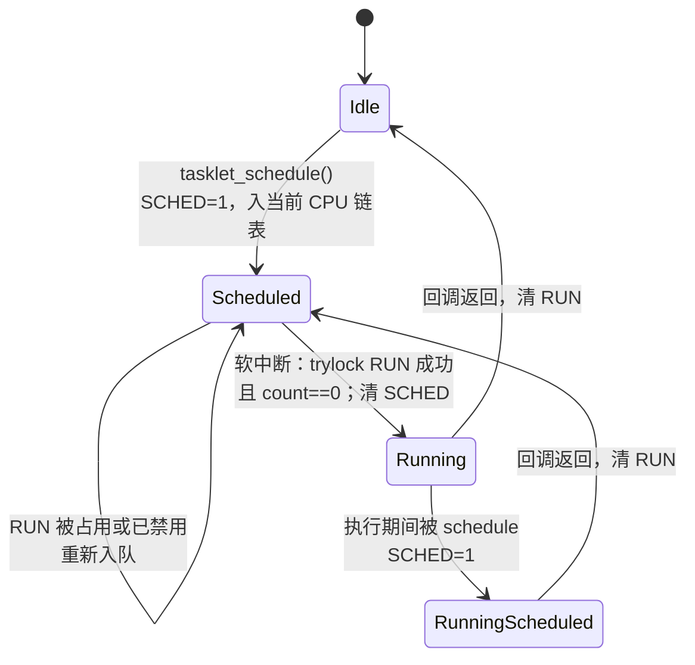

# 5.10 tasklet 与 BH 工作队列

> **本节源码**：`include/linux/interrupt.h`、`kernel/softirq.c`、`include/linux/workqueue.h`、`kernel/workqueue.c`
> **关键函数**：`tasklet_setup()`、`tasklet_schedule()`、`__tasklet_schedule_common()`、`tasklet_action_common()`、`tasklet_disable()`、`tasklet_kill()`、`workqueue_softirq_action()`、`bh_worker()`、`kick_bh_pool()`
> **前置知识**：5.9 软中断

## 概述

软中断数量固定、同类型可以在多个 CPU 上并行，编写难度大。为了给驱动提供一个"像软中断一样快、但更容易使用"的下半部，Linux 在 v2.3 引入了 **tasklet**：它建立在 `TASKLET_SOFTIRQ` 和 `HI_SOFTIRQ` 两个软中断之上，可以动态创建任意多个，并保证**同一个 tasklet 在任一时刻最多只在一个 CPU 上运行**。

二十多年后，tasklet 已被标记为废弃（`include/linux/interrupt.h:665-668`）：它的实现有若干长期存在的缺陷，在 PREEMPT_RT 下尤其麻烦。v6.9 起，工作队列增加了 `WQ_BH` 类型——**BH 工作队列**（BH workqueue），在软中断上下文中执行工作项，作为 tasklet 的替代品。有趣的是，在 v6.18 中 BH 工作队列本身就搭载在 tasklet 的两个软中断上运行。

本节先分析 tasklet 的实现，再介绍 BH 工作队列以及从 tasklet 迁移的方法。

## 核心数据结构

```c
// include/linux/interrupt.h:688-699（v6.18.60）
struct tasklet_struct
{
	struct tasklet_struct *next;	// [注] per-CPU 链表中的下一个
	unsigned long state;		// [注] TASKLET_STATE_SCHED / TASKLET_STATE_RUN
	atomic_t count;			// [注] 禁用计数，非 0 时不执行
	bool use_callback;		// [注] 新接口 callback 还是旧接口 func
	union {
		void (*func)(unsigned long data);
		void (*callback)(struct tasklet_struct *t);
	};
	unsigned long data;
};
```

```c
// include/linux/interrupt.h:730-734（v6.18.60）
enum
{
	TASKLET_STATE_SCHED,	/* Tasklet is scheduled for execution */
	TASKLET_STATE_RUN	/* Tasklet is running (SMP only) */
};
```

两个状态位是 tasklet 语义的核心：

- `TASKLET_STATE_SCHED`：已被调度、在某个 CPU 的链表中等待执行。保证"调度多次只执行一次"。
- `TASKLET_STATE_RUN`：正在某个 CPU 上执行。保证"同一 tasklet 不会在两个 CPU 上并行"。

`callback` 是 v5.9 引入的新接口，回调直接拿到 `tasklet_struct` 指针，再用 `from_tasklet()`（`container_of()` 的包装）取出包含它的驱动结构；旧的 `func(unsigned long data)` 接口需要把指针强制转换为 `unsigned long`，既不类型安全，也妨碍了控制流完整性（CFI）检查。

每个 CPU 维护两条待执行链表：

```c
// kernel/softirq.c:801-807（v6.18.60）
struct tasklet_head {
	struct tasklet_struct *head;
	struct tasklet_struct **tail;
};

static DEFINE_PER_CPU(struct tasklet_head, tasklet_vec);
static DEFINE_PER_CPU(struct tasklet_head, tasklet_hi_vec);
```

`tail` 是指向最后一个元素 `next` 字段的指针，使追加操作为 O(1)。`tasklet_vec` 由 `TASKLET_SOFTIRQ` 处理，`tasklet_hi_vec` 由 `HI_SOFTIRQ`（软中断 0，最先执行）处理。

## 主流程分析

### 调度

```c
// include/linux/interrupt.h:753-767（v6.18.60）
extern void __tasklet_schedule(struct tasklet_struct *t);

static inline void tasklet_schedule(struct tasklet_struct *t)
{
	if (!test_and_set_bit(TASKLET_STATE_SCHED, &t->state))
		__tasklet_schedule(t);
}

extern void __tasklet_hi_schedule(struct tasklet_struct *t);

static inline void tasklet_hi_schedule(struct tasklet_struct *t)
{
	if (!test_and_set_bit(TASKLET_STATE_SCHED, &t->state))
		__tasklet_hi_schedule(t);
}
```

`test_and_set_bit()` 是原子操作（7.2 节）：只有把 SCHED 位从 0 置为 1 的那一次调用才会真正入队。已经在队列中的 tasklet 再次被调度时什么都不做。

```c
// kernel/softirq.c:809-837（v6.18.60）
static void __tasklet_schedule_common(struct tasklet_struct *t,
				      struct tasklet_head __percpu *headp,
				      unsigned int softirq_nr)
{
	struct tasklet_head *head;
	unsigned long flags;

	local_irq_save(flags);
	head = this_cpu_ptr(headp);
	t->next = NULL;
	*head->tail = t;
	head->tail = &(t->next);
	raise_softirq_irqoff(softirq_nr);
	local_irq_restore(flags);
}

void __tasklet_schedule(struct tasklet_struct *t)
{
	__tasklet_schedule_common(t, &tasklet_vec,
				  TASKLET_SOFTIRQ);
}
EXPORT_SYMBOL(__tasklet_schedule);

void __tasklet_hi_schedule(struct tasklet_struct *t)
{
	__tasklet_schedule_common(t, &tasklet_hi_vec,
				  HI_SOFTIRQ);
}
EXPORT_SYMBOL(__tasklet_hi_schedule);
```

tasklet 被挂到**调用 `tasklet_schedule()` 的那个 CPU** 的链表上，并触发该 CPU 的软中断。关中断保护的是 per-CPU 链表——硬中断处理函数也可能调用 `tasklet_schedule()`。

### 执行

```c
// kernel/softirq.c:903-960（v6.18.60）
static void tasklet_action_common(struct tasklet_head *tl_head,
				  unsigned int softirq_nr)
{
	struct tasklet_struct *list;

	local_irq_disable();
	list = tl_head->head;
	tl_head->head = NULL;
	tl_head->tail = &tl_head->head;
	local_irq_enable();

	tasklet_lock_callback();
	while (list) {
		struct tasklet_struct *t = list;

		list = list->next;

		if (tasklet_trylock(t)) {
			if (!atomic_read(&t->count)) {
				if (tasklet_clear_sched(t)) {
					if (t->use_callback) {
						trace_tasklet_entry(t, t->callback);
						t->callback(t);
						trace_tasklet_exit(t, t->callback);
					} else {
						trace_tasklet_entry(t, t->func);
						t->func(t->data);
						trace_tasklet_exit(t, t->func);
					}
				}
				tasklet_unlock(t);
				tasklet_callback_sync_wait_running();
				continue;
			}
			tasklet_unlock(t);
		}

		local_irq_disable();
		t->next = NULL;
		*tl_head->tail = t;
		tl_head->tail = &t->next;
		__raise_softirq_irqoff(softirq_nr);
		local_irq_enable();
	}
	tasklet_unlock_callback();
}

static __latent_entropy void tasklet_action(void)
{
	workqueue_softirq_action(false);
	tasklet_action_common(this_cpu_ptr(&tasklet_vec), TASKLET_SOFTIRQ);
}

static __latent_entropy void tasklet_hi_action(void)
{
	workqueue_softirq_action(true);
	tasklet_action_common(this_cpu_ptr(&tasklet_hi_vec), HI_SOFTIRQ);
}
```

1. **摘下整条链表**：关中断，把 per-CPU 链表整体取下并置空，开中断。此后新调度的 tasklet 进入新链表，不影响本次遍历。
2. **尝试获取运行权**：`tasklet_trylock()`（`include/linux/interrupt.h:737-740`）用 `test_and_set_bit(TASKLET_STATE_RUN)` 尝试置位 RUN。失败说明该 tasklet 正在**另一个 CPU** 上运行——这可能发生在它运行期间被重新调度到本 CPU 时。
3. **检查禁用计数**：`count` 非零说明被 `tasklet_disable()` 禁用。
4. **清除 SCHED 并执行**：`tasklet_clear_sched()`（`kernel/softirq.c:839-849`）用 `test_and_clear_wake_up_bit()` 清除 SCHED 位并唤醒可能在 `tasklet_kill()` 中等待的任务，然后调用回调。**先清 SCHED 再执行**意味着回调执行期间可以再次被调度（包括在回调内部调度自己），新的调度会让它在执行完后再运行一次。
5. **释放运行权**：`tasklet_unlock()` 清除 RUN 位并唤醒 `tasklet_unlock_wait()` 的等待者（`kernel/softirq.c:1022-1032`）。
6. **无法执行则重新入队**：若第 2 或第 3 步失败，把 tasklet 放回本 CPU 的链表尾部并重新触发软中断，等下一轮再试。



*图 5-12：tasklet 的状态转换*

### 禁用与销毁

```c
// include/linux/interrupt.h:769-797（v6.18.60）
static inline void tasklet_disable_nosync(struct tasklet_struct *t)
{
	atomic_inc(&t->count);
	smp_mb__after_atomic();
}

/*
 * Do not use in new code. Disabling tasklets from atomic contexts is
 * error prone and should be avoided.
 */
static inline void tasklet_disable_in_atomic(struct tasklet_struct *t)
{
	tasklet_disable_nosync(t);
	tasklet_unlock_spin_wait(t);
	smp_mb();
}

static inline void tasklet_disable(struct tasklet_struct *t)
{
	tasklet_disable_nosync(t);
	tasklet_unlock_wait(t);
	smp_mb();
}

static inline void tasklet_enable(struct tasklet_struct *t)
{
	smp_mb__before_atomic();
	atomic_dec(&t->count);
}
```

`tasklet_disable()` 增加计数后**等待**正在运行的实例结束（`wait_on_bit()` 睡眠等待 RUN 位清除），之后可以确定回调不会再执行，直到 `tasklet_enable()`。禁用期间被调度的 tasklet 会在软中断中不停地"取下—发现已禁用—重新入队—触发软中断"，这是 tasklet 的一个设计缺陷：被长时间禁用的 tasklet 会让软中断空转。

```c
// kernel/softirq.c:1009-1018（v6.18.60）
void tasklet_kill(struct tasklet_struct *t)
{
	if (in_interrupt())
		pr_notice("Attempt to kill tasklet from interrupt\n");

	wait_on_bit_lock(&t->state, TASKLET_STATE_SCHED, TASK_UNINTERRUPTIBLE);

	tasklet_unlock_wait(t);
	tasklet_clear_sched(t);
}
```

`tasklet_kill()` 用于驱动卸载：`wait_on_bit_lock()` 等待 SCHED 位清除并**原子地将其置位**——这样它"占住"了调度权，此后 `tasklet_schedule()` 都会因 SCHED 已置位而什么都不做；再等待 RUN 清除，最后清除 SCHED。返回后 tasklet 既不在队列中也不在运行，可以安全释放。注意它**不能阻止其他代码之后再次调度**，调用者必须先确保不会再有人调度它（例如先关闭设备中断）。

### 在 CPU 下线时

```c
// kernel/softirq.c:1071-1098（v6.18.60）
#ifdef CONFIG_HOTPLUG_CPU
static int takeover_tasklets(unsigned int cpu)
{
	workqueue_softirq_dead(cpu);

	/* CPU is dead, so no lock needed. */
	local_irq_disable();

	/* Find end, append list for that CPU. */
	if (&per_cpu(tasklet_vec, cpu).head != per_cpu(tasklet_vec, cpu).tail) {
		*__this_cpu_read(tasklet_vec.tail) = per_cpu(tasklet_vec, cpu).head;
		__this_cpu_write(tasklet_vec.tail, per_cpu(tasklet_vec, cpu).tail);
		per_cpu(tasklet_vec, cpu).head = NULL;
		per_cpu(tasklet_vec, cpu).tail = &per_cpu(tasklet_vec, cpu).head;
	}
	raise_softirq_irqoff(TASKLET_SOFTIRQ);

	if (&per_cpu(tasklet_hi_vec, cpu).head != per_cpu(tasklet_hi_vec, cpu).tail) {
		*__this_cpu_read(tasklet_hi_vec.tail) = per_cpu(tasklet_hi_vec, cpu).head;
		__this_cpu_write(tasklet_hi_vec.tail, per_cpu(tasklet_hi_vec, cpu).tail);
		per_cpu(tasklet_hi_vec, cpu).head = NULL;
		per_cpu(tasklet_hi_vec, cpu).tail = &per_cpu(tasklet_hi_vec, cpu).head;
	}
	raise_softirq_irqoff(HI_SOFTIRQ);

	local_irq_enable();
	return 0;
}
```

CPU 下线后（`CPUHP_SOFTIRQ_DEAD` 阶段，`kernel/softirq.c:1154-1155`），另一个 CPU 把死亡 CPU 上未执行的 tasklet 整条链表接到自己的链表后面。这正是 tail 指针设计的另一个好处。`workqueue_softirq_dead()` 对 BH 工作队列做类似的接管。

## tasklet 的问题

tasklet 被废弃的原因主要有以下几点：

- **执行上下文不可控**。tasklet 在软中断中执行，借用被打断的任务或 ksoftirqd，优先级与调度都不可控。对需要低延迟的驱动，线程化中断（可设置实时优先级）是更好的选择；对可以容忍延迟的驱动，工作队列更合适。
- **与调度 CPU 绑定**。tasklet 总在调度它的 CPU 上执行，不能指定 CPU，也无法做负载均衡。
- **禁用语义的缺陷**。被禁用的 tasklet 会导致软中断反复空转；`tasklet_disable()` 在原子上下文中无法使用，旧代码中大量的 `tasklet_disable()` 在原子上下文中自旋等待，在 PREEMPT_RT 下会导致活锁（`kernel/softirq.c:851-901` 中 RT 专用的 `tasklet_sync_callback` 就是为此打的补丁）。
- **与工作队列功能重叠**。内核中已有成熟的工作队列框架提供并发管理、CPU 亲和性、flush / cancel 等完整语义，tasklet 却是一套独立的、功能更弱的实现。

2020 年起社区就倡议用线程化中断替代 tasklet（`include/linux/interrupt.h:667-668` 注释中的链接），但存量代码太多（v6.18 的 `drivers/`、`net/`、`sound/` 中仍有四百余处 `tasklet_setup()` / `tasklet_init()` 调用），需要一个语义上尽量接近、便于机械转换的替代品——这就是 BH 工作队列。

## BH 工作队列

### 设计

v6.9 中 Tejun Heo 为工作队列增加了 `WQ_BH` 标志：

```c
// include/linux/workqueue.h:370-371（v6.18.60）
enum wq_flags {
	WQ_BH			= 1 << 0, /* execute in bottom half (softirq) context */
```

BH 工作队列的工作项在**软中断上下文**中执行：不能睡眠，与 tasklet 相同；但接口、并发语义、flush / cancel / disable 都与普通工作队列一致（5.12 节）。内核预建了两个系统 BH 工作队列：

```c
// kernel/workqueue.c:7966-7968（v6.18.60）
	system_bh_wq = alloc_workqueue("events_bh", WQ_BH | WQ_PERCPU, 0);
	system_bh_highpri_wq = alloc_workqueue("events_bh_highpri",
					       WQ_BH | WQ_HIGHPRI | WQ_PERCPU, 0);
```

`system_bh_wq` 对应普通 tasklet，`system_bh_highpri_wq` 对应高优先级 tasklet。BH 工作队列只允许 `WQ_BH | WQ_HIGHPRI | WQ_PERCPU` 这几个标志（`include/linux/workqueue.h:412-413`）。

### 实现：借道 tasklet 软中断

每个 CPU 有两个 BH worker pool（普通与高优先级），与普通工作队列的 per-CPU pool 并列初始化（`kernel/workqueue.c:7918-7933`）。BH pool 中只有一个"虚拟"worker，没有对应的内核线程。向 BH pool 提交工作项后，`kick_pool()` 不唤醒线程，而是触发软中断：

```c
// kernel/workqueue.c:1236-1250（v6.18.60）
static void kick_bh_pool(struct worker_pool *pool)
{
#ifdef CONFIG_SMP
	/* see drain_dead_softirq_workfn() for BH_DRAINING */
	if (unlikely(pool->cpu != smp_processor_id() &&
		     !(pool->flags & POOL_BH_DRAINING))) {
		irq_work_queue_on(bh_pool_irq_work(pool), pool->cpu);
		return;
	}
#endif
	if (pool->attrs->nice == HIGHPRI_NICE_LEVEL)
		raise_softirq_irqoff(HI_SOFTIRQ);
	else
		raise_softirq_irqoff(TASKLET_SOFTIRQ);
}
```

普通 BH pool 触发 `TASKLET_SOFTIRQ`，高优先级 BH pool 触发 `HI_SOFTIRQ`。如果工作项被提交到另一个 CPU 的 BH pool（`queue_work_on()`），不能直接触发别的 CPU 的软中断，于是用 irq_work（5.11 节）给目标 CPU 发一个 IPI，在那里触发软中断（`bh_pool_kick_normal()` / `bh_pool_kick_highpri()`，`kernel/workqueue.c:7821-7829`）。

前面已经看到，`tasklet_action()` 与 `tasklet_hi_action()` 在处理 tasklet 之前会先调用 `workqueue_softirq_action()`：

```c
// kernel/workqueue.c:3685-3702（v6.18.60）
/*
 * TODO: Convert all tasklet users to workqueue and use softirq directly.
 *
 * This is currently called from tasklet[_hi]action() and thus is also called
 * whenever there are tasklets to run. Let's do an early exit if there's nothing
 * queued. Once conversion from tasklet is complete, the need_more_worker() test
 * can be dropped.
 *
 * After full conversion, we'll add worker->softirq_action, directly use the
 * softirq action and obtain the worker pointer from the softirq_action pointer.
 */
void workqueue_softirq_action(bool highpri)
{
	struct worker_pool *pool =
		&per_cpu(bh_worker_pools, smp_processor_id())[highpri];
	if (need_more_worker(pool))
		bh_worker(list_first_entry(&pool->workers, struct worker, node));
}
```

注释说明这是过渡期的安排：等所有 tasklet 用户都迁移完，两个软中断将直接由工作队列接管。`bh_worker()` 模仿普通 worker 线程的主循环，但带有与软中断相同的时间与次数上限：

```c
// kernel/workqueue.c:3647-3683（v6.18.60）
static void bh_worker(struct worker *worker)
{
	struct worker_pool *pool = worker->pool;
	int nr_restarts = BH_WORKER_RESTARTS;
	unsigned long end = jiffies + BH_WORKER_JIFFIES;

	worker_lock_callback(pool);
	raw_spin_lock_irq(&pool->lock);
	worker_leave_idle(worker);

	/*
	 * This function follows the structure of worker_thread(). See there for
	 * explanations on each step.
	 */
	if (!need_more_worker(pool))
		goto done;

	WARN_ON_ONCE(!list_empty(&worker->scheduled));
	worker_clr_flags(worker, WORKER_PREP | WORKER_REBOUND);

	do {
		struct work_struct *work =
			list_first_entry(&pool->worklist,
					 struct work_struct, entry);

		if (assign_work(work, worker, NULL))
			process_scheduled_works(worker);
	} while (keep_working(pool) &&
		 --nr_restarts && time_before(jiffies, end));

	worker_set_flags(worker, WORKER_PREP);
done:
	worker_enter_idle(worker);
	kick_pool(pool);
	raw_spin_unlock_irq(&pool->lock);
	worker_unlock_callback(pool);
}
```

`BH_WORKER_JIFFIES` 为 2 ms、`BH_WORKER_RESTARTS` 为 10（`kernel/workqueue.c:139-140`），与 `handle_softirqs()` 的 `MAX_SOFTIRQ_TIME`、`MAX_SOFTIRQ_RESTART` 一致。超限时 `kick_pool()` 重新触发软中断，剩余工作由 `handle_softirqs()` 的重启逻辑或 ksoftirqd 继续处理。`assign_work()`（`kernel/workqueue.c:1193-1227`）检查该工作项是否正被同 pool 的其他 worker 执行——对 BH pool 只有一个 worker，这保证了**同一工作项不会并行执行**，与 tasklet 的串行语义一致。

### 从 tasklet 迁移

| tasklet | BH 工作队列 |
|---|---|
| `struct tasklet_struct` | `struct work_struct` |
| `tasklet_setup(&t, cb)` | `INIT_WORK(&w, fn)` |
| `tasklet_schedule(&t)` | `queue_work(system_bh_wq, &w)` |
| `tasklet_hi_schedule(&t)` | `queue_work(system_bh_highpri_wq, &w)` |
| `tasklet_disable(&t)` | `disable_work_sync(&w)` |
| `tasklet_enable(&t)` | `enable_work(&w)` |
| `tasklet_kill(&t)` | `cancel_work_sync(&w)` |
| `from_tasklet(p, t, field)` | `from_work(p, w, field)` |

*表 5-19：tasklet 到 BH 工作队列的接口对应*

`disable_work()` / `enable_work()`（`include/linux/workqueue.h:642-644`）是 v6.10 为配合迁移新增的接口：被禁用的工作项在提交时直接忽略，不会像 tasklet 那样在软中断中空转。

BH 工作队列与 tasklet 的一个语义差别：tasklet 总在调度它的 CPU 上执行，`queue_work(system_bh_wq, ...)` 在 `WQ_PERCPU` 工作队列上默认也提交到当前 CPU，二者一致；但工作队列还允许 `queue_work_on()` 指定 CPU。截至 v6.18，已有数十个子系统（如 `drivers/` 下的部分网卡、USB、加密驱动）完成了迁移。

## 关键细节 / 设计考量

### 选择下半部机制

| 机制 | 上下文 | 能否睡眠 | 同一实例并行 | 典型用途 |
|---|---|---|---|---|
| 软中断 | 软中断 | 否 | 可以（多 CPU） | 网络收发、块完成、定时器、RCU |
| tasklet（已废弃） | 软中断 | 否 | 否 | 旧驱动的下半部 |
| BH 工作队列 | 软中断 | 否 | 否 | tasklet 的替代 |
| 线程化中断 | 实时线程 | 能 | 否 | 慢速总线设备、RT 系统 |
| 工作队列 | 内核线程 | 能 | 否 | 通用延迟工作（5.12 节） |
| irq_work | 硬中断（IPI） | 否 | 否 | NMI 或关中断上下文中延迟到"尽快的中断上下文"（5.11 节） |

*表 5-20：下半部与延迟执行机制对比*

### 为什么 tasklet 在调度它的 CPU 上执行

这是有意的设计：调用 `tasklet_schedule()` 的通常是硬中断处理函数，它刚刚读取了设备数据，数据还在本 CPU 的缓存中；在同一 CPU 上处理下半部，缓存局部性最好。同时，per-CPU 链表只需关中断保护，无需跨 CPU 的锁。代价是当某个设备的中断总落在同一 CPU 上时，下半部的负载也全部集中在那里——这需要通过中断亲和性（5.8 节）来分散。

## 动手实验

### 统计 tasklet 的执行

```bash
# 在 dev 虚拟机中执行
sudo bpftrace -e '
tracepoint:irq:tasklet_entry { @[ksym(args->func)] = count(); }
interval:s:10 { exit(); }'
```

`tasklet_entry` 跟踪点（`include/trace/events/irq.h`）记录了每次 tasklet 回调的函数地址。在虚拟机中通常只能看到很少几个，物理机上常见的有 USB 主机控制器、部分网卡和声卡驱动。

### 观察 BH 工作队列

```bash
sudo bpftrace -e '
tracepoint:workqueue:workqueue_queue_work /str(args->workqueue) == "events_bh" ||
                                           str(args->workqueue) == "events_bh_highpri"/ {
  @[ksym(args->function), args->cpu] = count();
}
interval:s:10 { exit(); }'
```

`workqueue_queue_work` 跟踪点（`include/trace/events/workqueue.h`）带有工作队列名与目标 CPU，可以看到哪些子系统已经在使用系统 BH 工作队列。

## 小结

- tasklet 建立在 `TASKLET_SOFTIRQ` 与 `HI_SOFTIRQ` 之上，调度时挂到当前 CPU 的链表并触发软中断；`SCHED` 位保证多次调度只执行一次，`RUN` 位保证同一 tasklet 不会在多个 CPU 上并行。
- 执行时先摘下整条 per-CPU 链表，对每个 tasklet 尝试获取 `RUN`、检查禁用计数、清除 `SCHED` 后调用回调；无法执行的重新入队并再次触发软中断。
- `tasklet_disable()` 会等待正在运行的实例结束，`tasklet_kill()` 通过 `wait_on_bit_lock()` 占住 `SCHED` 位确保 tasklet 彻底停止；CPU 下线时未执行的 tasklet 被其他 CPU 接管。
- tasklet 因上下文不可控、禁用时软中断空转、PREEMPT_RT 下的活锁问题与和工作队列功能重叠而被废弃，推荐改用线程化中断、工作队列或 BH 工作队列。
- v6.9 引入的 BH 工作队列在软中断上下文中执行工作项，目前借道 tasklet 的两个软中断运行，跨 CPU 提交时用 irq_work 触发目标 CPU 的软中断；它提供与普通工作队列一致的 flush / cancel / disable 语义，可以机械地替换 tasklet。

## 参考

- `linux/Documentation/core-api/workqueue.rst`（BH 工作队列一节）
- Tejun Heo, "workqueue: Implement BH workqueues to eventually replace tasklets" 补丁系列（v6.9 合入）
- Allen Pais 等，"tasklet: Introduce new initialization API"（v5.9 合入，`tasklet_setup()`）
- Thomas Gleixner, "softirq: Tasklet rework" 补丁系列（v5.13 合入，`tasklet_unlock_wait()` 改为睡眠等待等）
