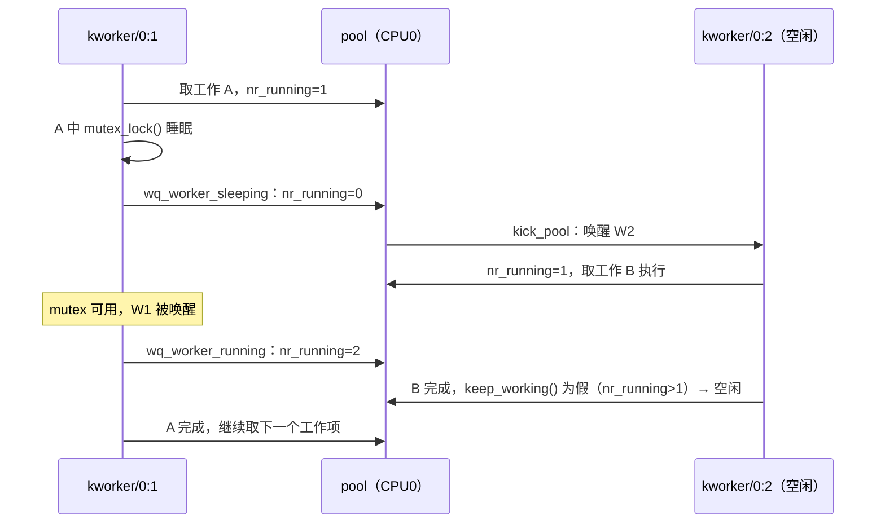

# 5.12 工作队列

> **本节源码**：[`include/linux/workqueue_types.h`](../../linux/include/linux/workqueue_types.h)、[`include/linux/workqueue.h`](../../linux/include/linux/workqueue.h)、[`kernel/workqueue.c`](../../linux/kernel/workqueue.c)、[`kernel/workqueue_internal.h`](../../linux/kernel/workqueue_internal.h)、[`kernel/sched/core.c`](../../linux/kernel/sched/core.c)
> **关键函数**：`alloc_workqueue()`、`queue_work_on()`、`__queue_work()`、`insert_work()`、`kick_pool()`、`worker_thread()`、`process_one_work()`、`wq_worker_sleeping()`、`wq_worker_running()`、`wq_worker_tick()`、`manage_workers()`、`rescuer_thread()`、`__queue_delayed_work()`、`flush_work()`、`cancel_work_sync()`
> **前置知识**：5.9 软中断、5.10 tasklet 与 BH 工作队列、3.4 任务创建与唤醒

## 概述

软中断与 tasklet 运行在中断上下文，不能睡眠。而很多延迟工作恰恰需要睡眠：分配大块内存、获取 mutex、等待 I/O 完成、访问用户空间。**工作队列**（workqueue）为此提供了最通用的机制：驱动把一个函数封装成**工作项**（work item）提交给工作队列，由内核线程（`kworker`）在进程上下文中执行。

早期的工作队列为每个工作队列在每个 CPU 上创建一个专属线程，系统中动辄有上千个内核线程，且同一工作队列内的工作项相互阻塞。v2.6.36 起 Tejun Heo 重写为**并发管理工作队列**（Concurrency Managed Workqueue，CMWQ）：所有工作队列共享按 CPU 和优先级划分的**工作者池**（worker pool），池中的线程数由内核根据"是否有线程在运行"动态调整。驱动只需描述"我需要什么样的执行环境"（是否绑定 CPU、是否高优先级、是否用于内存回收），而不必关心线程管理。

本节分析 CMWQ 的核心数据结构、提交与执行流程、并发管理机制、救援线程以及 flush / cancel 的同步语义。

## 核心数据结构

```
  驱动视角                      内核视角
  ┌──────────────────┐
  │ workqueue_struct │  "events"、"kblockd"、"writeback" ……
  │ （flags、max_active）│
  └───────┬──────────┘
          │ 每 CPU 一个（per-CPU wq）/ 每 pod 一个（unbound wq）
  ┌───────▼──────────┐
  │ pool_workqueue   │  wq 与 pool 之间的桥：nr_active、inactive_works、flush color
  └───────┬──────────┘
          │ 多个 pwq 共享同一个 pool
  ┌───────▼──────────┐       ┌──────────┐ ┌──────────┐
  │ worker_pool      │──────▶│ worker   │ │ worker   │ …  kworker/N:M 线程
  │ worklist、nr_running │    └──────────┘ └──────────┘
  └──────────────────┘
```

*图 5-13：CMWQ 的三层结构*

### work_struct

[`include/linux/workqueue_types.h:16-23`](../../linux/include/linux/workqueue_types.h#L16-L23)（v6.18.60）

```c
struct work_struct {
	atomic_long_t data;	// [注] 标志位 + pwq 指针或 pool ID
	struct list_head entry;	// [注] 挂在 pool->worklist 或 pwq->inactive_works 上
	work_func_t func;
#ifdef CONFIG_LOCKDEP
	struct lockdep_map lockdep_map;
#endif
};
```

`data` 字段身兼数职：

[`include/linux/workqueue.h:40-57`](../../linux/include/linux/workqueue.h#L40-L57)（v6.18.60）

```c
	/*
	 * When WORK_STRUCT_PWQ is set, reserve 8 bits off of pwq pointer w/
	 * debugobjects turned off. This makes pwqs aligned to 256 bytes (512
	 * bytes w/ DEBUG_OBJECTS_WORK) and allows 16 workqueue flush colors.
	 *
	 * MSB
	 * [ pwq pointer ] [ flush color ] [ STRUCT flags ]
	 *                     4 bits        4 or 5 bits
	 */
	WORK_STRUCT_PWQ_SHIFT	= WORK_STRUCT_COLOR_SHIFT + WORK_STRUCT_COLOR_BITS,

	/*
	 * data contains off-queue information when !WORK_STRUCT_PWQ.
	 *
	 * MSB
	 * [ pool ID ] [ disable depth ] [ OFFQ flags ] [ STRUCT flags ]
	 *                  16 bits          1 bit        4 or 5 bits
	 */
```

- 工作项**在队列中**时，高位是所属 `pool_workqueue` 的指针（pwq 按 256 字节对齐，低 8 位空出来放标志与 flush 颜色）。
- 工作项**不在队列中**时，高位记录它最后一次执行所在的 pool ID 与禁用深度（5.10 节 `disable_work()`）。记住"最后在哪个 pool 执行"是为了保证**同一工作项不会并发执行**（见下文 `__queue_work()`）。
- 最低位 `WORK_STRUCT_PENDING_BIT` 表示"已提交、尚未开始执行"，与 tasklet 的 SCHED 位作用相同。

### worker_pool

[`kernel/workqueue.c:187-236`](../../linux/kernel/workqueue.c#L187-L236)（v6.18.60）

```c
struct worker_pool {
	raw_spinlock_t		lock;		/* the pool lock */
	int			cpu;		/* I: the associated cpu */
	int			node;		/* I: the associated node ID */
	int			id;		/* I: pool ID */
	unsigned int		flags;		/* L: flags */

	unsigned long		watchdog_ts;	/* L: watchdog timestamp */
	bool			cpu_stall;	/* WD: stalled cpu bound pool */

	/*
	 * The counter is incremented in a process context on the associated CPU
	 * w/ preemption disabled, and decremented or reset in the same context
	 * but w/ pool->lock held. The readers grab pool->lock and are
	 * guaranteed to see if the counter reached zero.
	 */
	int			nr_running;

	struct list_head	worklist;	/* L: list of pending works */

	int			nr_workers;	/* L: total number of workers */
	int			nr_idle;	/* L: currently idle workers */

	struct list_head	idle_list;	/* L: list of idle workers */
	struct timer_list	idle_timer;	/* L: worker idle timeout */
	struct work_struct      idle_cull_work; /* L: worker idle cleanup */

	struct timer_list	mayday_timer;	  /* L: SOS timer for workers */

	/* a workers is either on busy_hash or idle_list, or the manager */
	DECLARE_HASHTABLE(busy_hash, BUSY_WORKER_HASH_ORDER);
						/* L: hash of busy workers */

	struct worker		*manager;	/* L: purely informational */
	struct list_head	workers;	/* A: attached workers */

	struct ida		worker_ida;	/* worker IDs for task name */

	struct workqueue_attrs	*attrs;		/* I: worker attributes */
	struct hlist_node	hash_node;	/* PL: unbound_pool_hash node */
	int			refcnt;		/* PL: refcnt for unbound pools */
#ifdef CONFIG_PREEMPT_RT
	spinlock_t		cb_lock;	/* BH worker cancel lock */
#endif
	/*
	 * Destruction of pool is RCU protected to allow dereferences
	 * from get_work_pool().
	 */
	struct rcu_head		rcu;
};
```

- `worklist`：待执行的工作项，来自所有共享该池的工作队列。
- `nr_running`：**当前正在运行（未睡眠）的 worker 数**，是并发管理的核心计数。
- `busy_hash`：以工作项地址为键，记录哪个 worker 正在执行哪个工作项，用于检测重入。

pool 有两类：

- **per-CPU pool**：每个 CPU 两个（普通 nice 0 与高优先级 nice −20），另有两个 BH pool（5.10 节）。线程名为 `kworker/<cpu>:<id>`，高优先级加 `H` 后缀。
- **unbound pool**：按属性（nice、cpumask、affinity scope）动态创建、共享，线程不绑定单个 CPU。线程名为 `kworker/u<pool_id>:<id>`（`format_worker_id()`，[`kernel/workqueue.c:2780-2798`](../../linux/kernel/workqueue.c#L2780-L2798)）。

### pool_workqueue 与 workqueue_struct

`pool_workqueue`（pwq）连接一个工作队列与一个 pool，记录该工作队列在这个 pool 上的活跃工作数：

[`kernel/workqueue.c:261-288`](../../linux/kernel/workqueue.c#L261-L288)（v6.18.60）

```c
struct pool_workqueue {
	struct worker_pool	*pool;		/* I: the associated pool */
	struct workqueue_struct *wq;		/* I: the owning workqueue */
	int			work_color;	/* L: current color */
	int			flush_color;	/* L: flushing color */
	int			refcnt;		/* L: reference count */
	int			nr_in_flight[WORK_NR_COLORS];
						/* L: nr of in_flight works */
	bool			plugged;	/* L: execution suspended */

	/*
	 * nr_active management and WORK_STRUCT_INACTIVE:
	 *
	 * When pwq->nr_active >= max_active, new work item is queued to
	 * pwq->inactive_works instead of pool->worklist and marked with
	 * WORK_STRUCT_INACTIVE.
	 *
	 ...
	 */
	int			nr_active;	/* L: nr of active works */
	struct list_head	inactive_works;	/* L: inactive works */
```

`max_active` 限制一个工作队列在每个 pool 上同时活跃的工作项数，超出的进入 `inactive_works` 排队。`max_active = 1` 的有序工作队列（`alloc_ordered_workqueue()`）借此保证工作项按提交顺序串行执行。

`workqueue_struct`（[`kernel/workqueue.c:341-389`](../../linux/kernel/workqueue.c#L341-L389)）保存工作队列的标志、`max_active`、救援线程、flush 状态，以及指向各 CPU pwq 的 `cpu_pwq` 指针数组。

### 系统工作队列

[`kernel/workqueue.c:7953-7968`](../../linux/kernel/workqueue.c#L7953-L7968)（v6.18.60）

```c
	system_wq = alloc_workqueue("events", WQ_PERCPU, 0);
	system_percpu_wq = alloc_workqueue("events", WQ_PERCPU, 0);
	system_highpri_wq = alloc_workqueue("events_highpri",
					    WQ_HIGHPRI | WQ_PERCPU, 0);
	system_long_wq = alloc_workqueue("events_long", WQ_PERCPU, 0);
	system_unbound_wq = alloc_workqueue("events_unbound", WQ_UNBOUND, WQ_MAX_ACTIVE);
	system_dfl_wq = alloc_workqueue("events_unbound", WQ_UNBOUND, WQ_MAX_ACTIVE);
	system_freezable_wq = alloc_workqueue("events_freezable",
					      WQ_FREEZABLE | WQ_PERCPU, 0);
	system_power_efficient_wq = alloc_workqueue("events_power_efficient",
					      WQ_POWER_EFFICIENT | WQ_PERCPU, 0);
	system_freezable_power_efficient_wq = alloc_workqueue("events_freezable_pwr_efficient",
					      WQ_FREEZABLE | WQ_POWER_EFFICIENT | WQ_PERCPU, 0);
	system_bh_wq = alloc_workqueue("events_bh", WQ_BH | WQ_PERCPU, 0);
	system_bh_highpri_wq = alloc_workqueue("events_bh_highpri",
					       WQ_BH | WQ_HIGHPRI | WQ_PERCPU, 0);
```

`schedule_work()` 提交到 `system_wq`。v6.18 中正在进行一次重命名过渡：新增的 `system_percpu_wq` 与 `system_dfl_wq` 分别与 `system_wq`、`system_unbound_wq` 等价，并新增了显式的 `WQ_PERCPU` 标志，社区计划在后续版本中把"不带 `WQ_UNBOUND` 即为 per-CPU"的默认行为反转为默认 unbound。本书配置开启了 `CONFIG_WQ_POWER_EFFICIENT_DEFAULT`，`WQ_POWER_EFFICIENT` 工作队列会被转为 unbound（[`kernel/workqueue.c:5787`](../../linux/kernel/workqueue.c#L5787)），让空闲 CPU 不必为执行工作项而被唤醒。

常用的分配标志：

| 标志 | 含义 |
|---|---|
| `WQ_UNBOUND` | 不绑定 CPU，由 unbound pool 执行，适合长时间运行或 CPU 密集的工作 |
| `WQ_HIGHPRI` | 使用高优先级（nice −20）pool |
| `WQ_CPU_INTENSIVE` | 工作项不参与并发管理，长时间运行不会阻碍同池其他工作项 |
| `WQ_MEM_RECLAIM` | 可能在内存回收路径上被等待，创建专属救援线程保证前进 |
| `WQ_FREEZABLE` | 系统挂起时被冻结 |
| `WQ_BH` | 在软中断上下文执行（5.10 节） |

*表 5-24：常用工作队列标志*

## 主流程分析

### 提交

[`kernel/workqueue.c:2417-2433`](../../linux/kernel/workqueue.c#L2417-L2433)（v6.18.60）

```c
bool queue_work_on(int cpu, struct workqueue_struct *wq,
		   struct work_struct *work)
{
	bool ret = false;
	unsigned long irq_flags;

	local_irq_save(irq_flags);

	if (!test_and_set_bit(WORK_STRUCT_PENDING_BIT, work_data_bits(work)) &&
	    !clear_pending_if_disabled(work)) {
		__queue_work(cpu, wq, work);
		ret = true;
	}

	local_irq_restore(irq_flags);
	return ret;
}
```

与 tasklet、irq_work 相同，用 `test_and_set_bit()` 抢 PENDING 位实现"已在队列中则不重复提交"。提交可以在任何上下文中进行（包括硬中断），因此全程关中断。`queue_work()` 等价于 `queue_work_on(WORK_CPU_UNBOUND, ...)`。

[`kernel/workqueue.c:2296-2386`](../../linux/kernel/workqueue.c#L2296-L2386)（v6.18.60）

```c
	rcu_read_lock();
retry:
	/* pwq which will be used unless @work is executing elsewhere */
	if (req_cpu == WORK_CPU_UNBOUND) {
		if (wq->flags & WQ_UNBOUND)
			cpu = wq_select_unbound_cpu(raw_smp_processor_id());
		else
			cpu = raw_smp_processor_id();
	}

	pwq = rcu_dereference(*per_cpu_ptr(wq->cpu_pwq, cpu));
	pool = pwq->pool;

	/*
	 * If @work was previously on a different pool, it might still be
	 * running there, in which case the work needs to be queued on that
	 * pool to guarantee non-reentrancy.
	 *
	 * For ordered workqueue, work items must be queued on the newest pwq
	 * for accurate order management.  Guaranteed order also guarantees
	 * non-reentrancy.  See the comments above unplug_oldest_pwq().
	 */
	last_pool = get_work_pool(work);
	if (last_pool && last_pool != pool && !(wq->flags & __WQ_ORDERED)) {
		struct worker *worker;

		raw_spin_lock(&last_pool->lock);

		worker = find_worker_executing_work(last_pool, work);

		if (worker && worker->current_pwq->wq == wq) {
			pwq = worker->current_pwq;
			pool = pwq->pool;
			WARN_ON_ONCE(pool != last_pool);
		} else {
			/* meh... not running there, queue here */
			raw_spin_unlock(&last_pool->lock);
			raw_spin_lock(&pool->lock);
		}
	} else {
		raw_spin_lock(&pool->lock);
	}
	...
	/* pwq determined, queue */
	trace_workqueue_queue_work(req_cpu, pwq, work);

	if (WARN_ON(!list_empty(&work->entry)))
		goto out;

	pwq->nr_in_flight[pwq->work_color]++;
	work_flags = work_color_to_flags(pwq->work_color);

	/*
	 * Limit the number of concurrently active work items to max_active.
	 * @work must also queue behind existing inactive work items to maintain
	 * ordering when max_active changes. See wq_adjust_max_active().
	 */
	if (list_empty(&pwq->inactive_works) && pwq_tryinc_nr_active(pwq, false)) {
		if (list_empty(&pool->worklist))
			pool->watchdog_ts = jiffies;

		trace_workqueue_activate_work(work);
		insert_work(pwq, work, &pool->worklist, work_flags);
		kick_pool(pool);
	} else {
		work_flags |= WORK_STRUCT_INACTIVE;
		insert_work(pwq, work, &pwq->inactive_works, work_flags);
	}

out:
	raw_spin_unlock(&pool->lock);
	rcu_read_unlock();
}
```

1. **选择目标 pool**：per-CPU 工作队列默认用当前 CPU 的 pwq；unbound 工作队列由 `wq_select_unbound_cpu()` 选一个允许的 CPU，再找到它所在 pod 的 pwq。
2. **保证不重入**：工作项上一次如果在另一个 pool 上执行、且此刻**仍在执行**，就把它排到那个 pool 上。这样同一工作项的两次执行总在同一个 pool 中，而同一 pool 内的 `assign_work()` 会检查 `busy_hash`，若工作项正被某个 worker 执行，就把它挂到那个 worker 的 `scheduled` 链表上，等其执行完再执行（`assign_work()`，[`kernel/workqueue.c:1193-1227`](../../linux/kernel/workqueue.c#L1193-L1227)）。结果是：**工作项函数不会在多个 CPU 上并发执行**，驱动无需为此加锁。
3. **`max_active` 控制**：未超过限制则进入 `pool->worklist` 并 `kick_pool()` 唤醒一个空闲 worker，否则进入 `pwq->inactive_works`。

`insert_work()`（[`kernel/workqueue.c:2215-2227`](../../linux/kernel/workqueue.c#L2215-L2227)）用 `set_work_pwq()` 把 pwq 指针写入 `work->data`，挂入链表并增加 pwq 引用。

### worker 线程主循环

[`kernel/workqueue.c:3416-3488`](../../linux/kernel/workqueue.c#L3416-L3488)（v6.18.60）

```c
static int worker_thread(void *__worker)
{
	struct worker *worker = __worker;
	struct worker_pool *pool = worker->pool;

	/* tell the scheduler that this is a workqueue worker */
	set_pf_worker(true);
woke_up:
	raw_spin_lock_irq(&pool->lock);

	/* am I supposed to die? */
	if (unlikely(worker->flags & WORKER_DIE)) {
		raw_spin_unlock_irq(&pool->lock);
		set_pf_worker(false);
		/*
		 * The worker is dead and PF_WQ_WORKER is cleared, worker->pool
		 * shouldn't be accessed, reset it to NULL in case otherwise.
		 */
		worker->pool = NULL;
		ida_free(&pool->worker_ida, worker->id);
		return 0;
	}

	worker_leave_idle(worker);
recheck:
	/* no more worker necessary? */
	if (!need_more_worker(pool))
		goto sleep;

	/* do we need to manage? */
	if (unlikely(!may_start_working(pool)) && manage_workers(worker))
		goto recheck;

	/*
	 * ->scheduled list can only be filled while a worker is
	 * preparing to process a work or actually processing it.
	 * Make sure nobody diddled with it while I was sleeping.
	 */
	WARN_ON_ONCE(!list_empty(&worker->scheduled));

	/*
	 * Finish PREP stage.  We're guaranteed to have at least one idle
	 * worker or that someone else has already assumed the manager
	 * role.  This is where @worker starts participating in concurrency
	 * management if applicable and concurrency management is restored
	 * after being rebound.  See rebind_workers() for details.
	 */
	worker_clr_flags(worker, WORKER_PREP | WORKER_REBOUND);

	do {
		struct work_struct *work =
			list_first_entry(&pool->worklist,
					 struct work_struct, entry);

		if (assign_work(work, worker, NULL))
			process_scheduled_works(worker);
	} while (keep_working(pool));

	worker_set_flags(worker, WORKER_PREP);
sleep:
	/*
	 * pool->lock is held and there's no work to process and no need to
	 * manage, sleep.  Workers are woken up only while holding
	 * pool->lock or from local cpu, so setting the current state
	 * before releasing pool->lock is enough to prevent losing any
	 * event.
	 */
	worker_enter_idle(worker);
	__set_current_state(TASK_IDLE);
	raw_spin_unlock_irq(&pool->lock);
	schedule();
	goto woke_up;
}
```

几个判断函数决定了 worker 的行为：

[`kernel/workqueue.c:942-963`](../../linux/kernel/workqueue.c#L942-L963)（v6.18.60）

```c
static bool need_more_worker(struct worker_pool *pool)
{
	return !list_empty(&pool->worklist) && !pool->nr_running;
}

/* Can I start working?  Called from busy but !running workers. */
static bool may_start_working(struct worker_pool *pool)
{
	return pool->nr_idle;
}

/* Do I need to keep working?  Called from currently running workers. */
static bool keep_working(struct worker_pool *pool)
{
	return !list_empty(&pool->worklist) && (pool->nr_running <= 1);
}

/* Do we need a new worker?  Called from manager. */
static bool need_to_create_worker(struct worker_pool *pool)
{
	return need_more_worker(pool) && !may_start_working(pool);
}
```

- `need_more_worker()`：有工作但**没有任何 worker 在运行**时才需要一个 worker 出来干活。
- `may_start_working()`：只有当池中还有空闲 worker 时才能开始干活——保证总有一个"后备"可以在自己睡眠时接手。没有则先当管理者创建一个（`manage_workers()`）。
- `keep_working()`：自己是**唯一**在运行的 worker 时才继续取下一个工作项；若已有其他 worker 在运行，就让出。

`worker_clr_flags(..., WORKER_PREP)` 让 worker 开始计入 `nr_running`；`worker_set_flags(..., WORKER_PREP)` 让它退出计数。`TASK_IDLE` 状态使空闲 worker 不计入系统负载平均值。

### 并发管理：与调度器的协作

CMWQ 的核心思想是：**每个 per-CPU pool 在任意时刻只保持一个正在运行的 worker**。一个 worker 就足以占满一个 CPU；多个 worker 同时可运行只会带来无谓的上下文切换。但如果正在运行的 worker 睡眠了（例如等待 I/O），CPU 就空闲了，此时应当唤醒另一个 worker 接着处理队列中的工作。

这需要调度器的配合。worker 线程设置了 `PF_WQ_WORKER` 标志，调度器在它睡眠前和唤醒后调用工作队列的钩子：

[`kernel/sched/core.c:6980-6986`](../../linux/kernel/sched/core.c#L6980-L6986)（v6.18.60）

```c
	task_flags = tsk->flags;
	/*
	 * If a worker goes to sleep, notify and ask workqueue whether it
	 * wants to wake up a task to maintain concurrency.
	 */
	if (task_flags & PF_WQ_WORKER)
		wq_worker_sleeping(tsk);
```

[`kernel/workqueue.c:1445-1482`](../../linux/kernel/workqueue.c#L1445-L1482)（v6.18.60）

```c
void wq_worker_sleeping(struct task_struct *task)
{
	struct worker *worker = kthread_data(task);
	struct worker_pool *pool;

	/*
	 * Rescuers, which may not have all the fields set up like normal
	 * workers, also reach here, let's not access anything before
	 * checking NOT_RUNNING.
	 */
	if (worker->flags & WORKER_NOT_RUNNING)
		return;

	pool = worker->pool;

	/* Return if preempted before wq_worker_running() was reached */
	if (READ_ONCE(worker->sleeping))
		return;

	WRITE_ONCE(worker->sleeping, 1);
	raw_spin_lock_irq(&pool->lock);

	/*
	 * Recheck in case unbind_workers() preempted us. We don't
	 * want to decrement nr_running after the worker is unbound
	 * and nr_running has been reset.
	 */
	if (worker->flags & WORKER_NOT_RUNNING) {
		raw_spin_unlock_irq(&pool->lock);
		return;
	}

	pool->nr_running--;
	if (kick_pool(pool))
		worker->current_pwq->stats[PWQ_STAT_CM_WAKEUP]++;

	raw_spin_unlock_irq(&pool->lock);
}
```

worker 即将睡眠时，`nr_running` 减一；若减到 0 且 `worklist` 非空，`kick_pool()` 立即唤醒一个空闲 worker。当睡眠的 worker 被唤醒、重新运行时，`sched_update_worker()`（[`kernel/sched/core.c:7006-7014`](../../linux/kernel/sched/core.c#L7006-L7014)）调用 `wq_worker_running()`（[`kernel/workqueue.c:1411-1436`](../../linux/kernel/workqueue.c#L1411-L1436)）把 `nr_running` 加回来。此时可能有两个 worker 同时在运行，`keep_working()` 中的 `nr_running <= 1` 条件会让其中一个在处理完当前工作项后退出循环、回到空闲状态。



*图 5-14：并发管理在 worker 睡眠与唤醒时的行为*

只有 per-CPU pool 参与并发管理。unbound pool 中的 worker 设置了 `WORKER_UNBOUND`（属于 `WORKER_NOT_RUNNING`），不计入 `nr_running`，每个待执行的工作项都可能唤醒一个新 worker——unbound 工作队列的并发度只受 `max_active` 限制，由调度器负责在 CPU 之间分配。

### CPU 密集工作项的自动识别

并发管理有一个前提：工作项要么很快完成，要么会睡眠。如果一个工作项长时间占用 CPU 却不睡眠，同一 pool 中的其他工作项就会一直等待（`nr_running` 始终为 1）。`WQ_CPU_INTENSIVE` 标志可以让工作队列退出并发管理，但驱动作者未必知道自己的工作项是 CPU 密集的。v6.5 起，内核在 tick 中自动检测：

[`kernel/workqueue.c:1491-1532`](../../linux/kernel/workqueue.c#L1491-L1532)（v6.18.60）

```c
void wq_worker_tick(struct task_struct *task)
{
	struct worker *worker = kthread_data(task);
	struct pool_workqueue *pwq = worker->current_pwq;
	struct worker_pool *pool = worker->pool;

	if (!pwq)
		return;

	pwq->stats[PWQ_STAT_CPU_TIME] += TICK_USEC;

	if (!wq_cpu_intensive_thresh_us)
		return;

	/*
	 * If the current worker is concurrency managed and hogged the CPU for
	 * longer than wq_cpu_intensive_thresh_us, it's automatically marked
	 * CPU_INTENSIVE to avoid stalling other concurrency-managed work items.
	 *
	 ...
	 */
	if ((worker->flags & WORKER_NOT_RUNNING) || READ_ONCE(worker->sleeping) ||
	    worker->task->se.sum_exec_runtime - worker->current_at <
	    wq_cpu_intensive_thresh_us * NSEC_PER_USEC)
		return;

	raw_spin_lock(&pool->lock);

	worker_set_flags(worker, WORKER_CPU_INTENSIVE);
	wq_cpu_intensive_report(worker->current_func);
	pwq->stats[PWQ_STAT_CPU_INTENSIVE]++;

	if (kick_pool(pool))
		pwq->stats[PWQ_STAT_CM_WAKEUP]++;

	raw_spin_unlock(&pool->lock);
}
```

`sched_tick()`（[`kernel/sched/core.c:5641`](../../linux/kernel/sched/core.c#L5641)）在当前任务是 worker 时调用它。一个工作项连续运行超过阈值（默认 10 ms，[`kernel/workqueue.c:7988-8000`](../../linux/kernel/workqueue.c#L7988-L8000) 的注释说明了取值依据，可通过模块参数 `workqueue.cpu_intensive_thresh_us` 修改），就被临时标记为 CPU 密集，退出 `nr_running` 计数，并唤醒另一个 worker 处理其余工作。本书配置开启了 `CONFIG_WQ_CPU_INTENSIVE_REPORT`，内核会在日志中报告频繁触发此机制的工作函数，提示开发者为其工作队列加上 `WQ_UNBOUND` 或 `WQ_CPU_INTENSIVE`。

### 执行单个工作项

[`kernel/workqueue.c:3231-3276`](../../linux/kernel/workqueue.c#L3231-L3276)（v6.18.60）

```c
	/* claim and dequeue */
	debug_work_deactivate(work);
	hash_add(pool->busy_hash, &worker->hentry, (unsigned long)work);
	worker->current_work = work;
	worker->current_func = work->func;
	worker->current_pwq = pwq;
	if (worker->task)
		worker->current_at = worker->task->se.sum_exec_runtime;
	work_data = *work_data_bits(work);
	worker->current_color = get_work_color(work_data);

	/*
	 * Record wq name for cmdline and debug reporting, may get
	 * overridden through set_worker_desc().
	 */
	strscpy(worker->desc, pwq->wq->name, WORKER_DESC_LEN);

	list_del_init(&work->entry);

	/*
	 * CPU intensive works don't participate in concurrency management.
	 * They're the scheduler's responsibility.  This takes @worker out
	 * of concurrency management and the next code block will chain
	 * execution of the pending work items.
	 */
	if (unlikely(pwq->wq->flags & WQ_CPU_INTENSIVE))
		worker_set_flags(worker, WORKER_CPU_INTENSIVE);

	/*
	 * Kick @pool if necessary. It's always noop for per-cpu worker pools
	 * since nr_running would always be >= 1 at this point. This is used to
	 * chain execution of the pending work items for WORKER_NOT_RUNNING
	 * workers such as the UNBOUND and CPU_INTENSIVE ones.
	 */
	kick_pool(pool);

	/*
	 * Record the last pool and clear PENDING which should be the last
	 * update to @work.  Also, do this inside @pool->lock so that
	 * PENDING and queued state changes happen together while IRQ is
	 * disabled.
	 */
	set_work_pool_and_clear_pending(work, pool->id, pool_offq_flags(pool));

	pwq->stats[PWQ_STAT_STARTED]++;
	raw_spin_unlock_irq(&pool->lock);
```

`process_one_work()`（[`kernel/workqueue.c:3206-3365`](../../linux/kernel/workqueue.c#L3206-L3365)）在 `pool->lock` 下完成登记：加入 `busy_hash`、记录当前函数，然后**清除 PENDING** 并把 `work->data` 改为"最后在本 pool"。此后工作项可以被重新提交——若在执行期间被提交，`__queue_work()` 会发现它仍在本 pool 上执行，把它排到本 pool，保证不重入。释放锁后调用工作函数：

[`kernel/workqueue.c:3305-3340`](../../linux/kernel/workqueue.c#L3305-L3340)（v6.18.60）

```c
	lockdep_invariant_state(true);
	trace_workqueue_execute_start(work);
	worker->current_func(work);
	/*
	 * While we must be careful to not use "work" after this, the trace
	 * point will only record its address.
	 */
	trace_workqueue_execute_end(work, worker->current_func);

	lock_map_release(&lockdep_map);
	if (!bh_draining)
		lock_map_release(pwq->wq->lockdep_map);

	if (unlikely((worker->task && in_atomic()) ||
		     lockdep_depth(current) != lockdep_start_depth ||
		     rcu_preempt_depth() != rcu_start_depth)) {
		pr_err("BUG: workqueue leaked atomic, lock or RCU: %s[%d]\n"
		       "     preempt=0x%08x lock=%d->%d RCU=%d->%d workfn=%ps\n",
		       current->comm, task_pid_nr(current), preempt_count(),
		       lockdep_start_depth, lockdep_depth(current),
		       rcu_start_depth, rcu_preempt_depth(),
		       worker->current_func);
		debug_show_held_locks(current);
		dump_stack();
	}

	/*
	 * The following prevents a kworker from hogging CPU on !PREEMPTION
	 * kernels, where a requeueing work item waiting for something to
	 * happen could deadlock with stop_machine as such work item could
	 * indefinitely requeue itself while all other CPUs are trapped in
	 * stop_machine. At the same time, report a quiescent RCU state so
	 * the same condition doesn't freeze RCU.
	 */
	if (worker->task)
		cond_resched();
```

工作函数可以释放 `work` 本身（常见于一次性工作项），所以之后不再访问它。函数返回后检查是否泄漏了锁、关抢占或 RCU 读临界区。`lock_map_acquire(pwq->wq->lockdep_map)` 与 `lock_map_acquire(&lockdep_map)` 把"执行工作项"建模为获取两把伪锁，使 lockdep 能检测"在工作项中 flush 自己所在的工作队列"之类的死锁（7.11 节）。

### 管理者与 worker 的创建

当 worker 发现有工作要做但池中没有空闲 worker 了（`!may_start_working()`），它先成为**管理者**：

[`kernel/workqueue.c:3174-3190`](../../linux/kernel/workqueue.c#L3174-L3190)（v6.18.60）

```c
static bool manage_workers(struct worker *worker)
{
	struct worker_pool *pool = worker->pool;

	if (pool->flags & POOL_MANAGER_ACTIVE)
		return false;

	pool->flags |= POOL_MANAGER_ACTIVE;
	pool->manager = worker;

	maybe_create_worker(pool);

	pool->manager = NULL;
	pool->flags &= ~POOL_MANAGER_ACTIVE;
	rcuwait_wake_up(&manager_wait);
	return true;
}
```

`maybe_create_worker()`（[`kernel/workqueue.c:3087-3116`](../../linux/kernel/workqueue.c#L3087-L3116)）释放池锁后调用 `create_worker()`：分配 `struct worker`、用 `kthread_create_on_node()` 创建线程、绑定到池的 CPU。这需要 `GFP_KERNEL` 内存分配。同一时刻每个池最多一个管理者。空闲 worker 过多时，`idle_timer` 在 `IDLE_WORKER_TIMEOUT`（5 分钟，[`kernel/workqueue.c:113`](../../linux/kernel/workqueue.c#L113)）后回收多余的线程。

### 救援线程

`GFP_KERNEL` 分配可能触发内存回收，而回收可能要等待某些工作项完成（例如写回脏页的工作项）。如果这些工作项恰好排在一个创建不出新 worker 的池中，就形成死锁：创建 worker 需要内存 → 回收内存需要执行工作项 → 执行工作项需要 worker。

`WQ_MEM_RECLAIM` 工作队列为此预先创建一个专属的**救援线程**（rescuer，`kworker/R-<wq名>`）。管理者开始创建 worker 时启动 `mayday_timer`（首次 10 ms，之后每 100 ms，[`kernel/workqueue.c:115-118`](../../linux/kernel/workqueue.c#L115-L118)）：

[`kernel/workqueue.c:3044-3067`](../../linux/kernel/workqueue.c#L3044-L3067)（v6.18.60）

```c
static void pool_mayday_timeout(struct timer_list *t)
{
	struct worker_pool *pool = timer_container_of(pool, t, mayday_timer);
	struct work_struct *work;

	raw_spin_lock_irq(&pool->lock);
	raw_spin_lock(&wq_mayday_lock);		/* for wq->maydays */

	if (need_to_create_worker(pool)) {
		/*
		 * We've been trying to create a new worker but
		 * haven't been successful.  We might be hitting an
		 * allocation deadlock.  Send distress signals to
		 * rescuers.
		 */
		list_for_each_entry(work, &pool->worklist, entry)
			send_mayday(work);
	}

	raw_spin_unlock(&wq_mayday_lock);
	raw_spin_unlock_irq(&pool->lock);

	mod_timer(&pool->mayday_timer, jiffies + MAYDAY_INTERVAL);
}
```

若超时后仍没能创建出 worker，就向池中所有排队工作项所属工作队列的救援线程"呼救"（`send_mayday()`，[`kernel/workqueue.c:3020-3042`](../../linux/kernel/workqueue.c#L3020-L3042)）。救援线程（`rescuer_thread()`，[`kernel/workqueue.c:3540`](../../linux/kernel/workqueue.c#L3540) 起）临时加入该池，只处理**属于自己工作队列**的工作项，保证这些可能被回收路径等待的工作项总能前进。内核中所有可能在回收路径上被等待的工作队列（块层、文件系统写回、网络存储等）都必须设置 `WQ_MEM_RECLAIM`。

### 延迟工作

`delayed_work` 是 `work_struct` 加一个定时器：

[`kernel/workqueue.c:2526-2565`](../../linux/kernel/workqueue.c#L2526-L2565)（v6.18.60）

```c
static void __queue_delayed_work(int cpu, struct workqueue_struct *wq,
				struct delayed_work *dwork, unsigned long delay)
{
	struct timer_list *timer = &dwork->timer;
	struct work_struct *work = &dwork->work;

	WARN_ON_ONCE(!wq);
	WARN_ON_ONCE(timer->function != delayed_work_timer_fn);
	WARN_ON_ONCE(timer_pending(timer));
	WARN_ON_ONCE(!list_empty(&work->entry));

	/*
	 * If @delay is 0, queue @dwork->work immediately.  This is for
	 * both optimization and correctness.  The earliest @timer can
	 * expire is on the closest next tick and delayed_work users depend
	 * on that there's no such delay when @delay is 0.
	 */
	if (!delay) {
		__queue_work(cpu, wq, &dwork->work);
		return;
	}

	WARN_ON_ONCE(cpu != WORK_CPU_UNBOUND && !cpu_online(cpu));
	dwork->wq = wq;
	dwork->cpu = cpu;
	timer->expires = jiffies + delay;

	if (housekeeping_enabled(HK_TYPE_TIMER)) {
		/* If the current cpu is a housekeeping cpu, use it. */
		cpu = smp_processor_id();
		if (!housekeeping_test_cpu(cpu, HK_TYPE_TIMER))
			cpu = housekeeping_any_cpu(HK_TYPE_TIMER);
		add_timer_on(timer, cpu);
	} else {
		if (likely(cpu == WORK_CPU_UNBOUND))
			add_timer_global(timer);
		else
			add_timer_on(timer, cpu);
	}
}
```

定时器到期时（在 `TIMER_SOFTIRQ` 中，5.9 节），`delayed_work_timer_fn()` 调用 `__queue_work()` 把工作项真正入队。PENDING 位在定时器挂起期间就已置位，因此 `queue_delayed_work()` 在定时器未到期时再次调用不会重复提交，而 `mod_delayed_work()` 可以修改到期时间。启用 CPU 隔离（`nohz_full` / `isolcpus`）时，定时器被放到 housekeeping CPU 上，避免打扰隔离 CPU。

### flush 与 cancel

`flush_work(work)` 等待某个工作项执行完毕。实现方法是在它后面插入一个**屏障工作项**（barrier）：

[`kernel/workqueue.c:3885-3900`](../../linux/kernel/workqueue.c#L3885-L3900)（v6.18.60）

```c
	/*
	 * If @target is currently being executed, schedule the
	 * barrier to the worker; otherwise, put it after @target.
	 */
	if (worker) {
		head = worker->scheduled.next;
		work_color = worker->current_color;
	} else {
		unsigned long *bits = work_data_bits(target);

		head = target->entry.next;
		/* there can already be other linked works, inherit and set */
		work_flags |= *bits & WORK_STRUCT_LINKED;
		work_color = get_work_color(*bits);
		__set_bit(WORK_STRUCT_LINKED_BIT, bits);
	}
```

`insert_wq_barrier()`（[`kernel/workqueue.c:3855`](../../linux/kernel/workqueue.c#L3855) 起）在栈上构造一个 `wq_barrier`，其函数为 `wq_barrier_func()`，只做一件事——`complete()` 一个完成量。若目标工作项正在执行，屏障插到执行它的 worker 的 `scheduled` 链表头部；若还在队列中，插到它的正后方并设置 `LINKED` 标志，保证二者被同一个 worker 连续执行。调用者随后在完成量上睡眠等待。`start_flush_work()`（[`kernel/workqueue.c:4237-4291`](../../linux/kernel/workqueue.c#L4237-L4291)）还会让 lockdep 记录"flush 依赖"，在单线程或带救援线程的工作队列中从工作项内部 flush 自身时报告死锁。

`cancel_work_sync(work)`（[`kernel/workqueue.c:4494`](../../linux/kernel/workqueue.c#L4494)）先尝试"偷走" PENDING 位，把还在队列中的工作项摘除；若工作项正在执行，则等待它完成。返回后可以保证工作项既不在队列中也不在执行，是驱动卸载时释放工作项所在结构之前的标准操作。`flush_workqueue(wq)` 用"颜色"机制等待整个工作队列中所有在提交时刻之前入队的工作项完成：每次 flush 推进一次颜色，等待旧颜色的 `nr_in_flight` 归零。

## 关键细节 / 设计考量

### unbound 工作队列与亲和性范围

unbound 工作队列的工作项不绑定 CPU，但完全不考虑拓扑会损失缓存局部性。v6.5 起引入了**亲和性范围**（affinity scope）：`cpu`、`smt`、`cache`、`numa`、`system`（[`kernel/workqueue.c:408-414`](../../linux/kernel/workqueue.c#L408-L414)），默认是 `cache`（[`kernel/workqueue.c:441`](../../linux/kernel/workqueue.c#L441)）。每种范围把 CPU 划分为若干 pod（例如共享同一 LLC 的 CPU 为一个 pod），每个 pod 一个 pwq / pool，工作项优先在提交者所在 pod 内执行。可以通过 `/sys/devices/virtual/workqueue/<name>/affinity_scope` 为每个工作队列单独设置，或用启动参数 `workqueue.default_affinity_scope=` 全局设置。

### 选择 per-CPU 还是 unbound

| 特征 | per-CPU 工作队列 | unbound 工作队列 |
|---|---|---|
| 执行 CPU | 提交时的 CPU（或指定 CPU） | 提交者所在 pod 内的任意 CPU |
| 并发管理 | 有：每 CPU 通常一个运行中的 worker | 无：只受 `max_active` 限制 |
| 缓存局部性 | 最好 | 较好（pod 内） |
| 适合的工作 | 短小、访问 per-CPU 数据 | 长时间运行、CPU 密集、需要分散负载 |
| 对 CPU 隔离的影响 | 会打扰被提交到的 CPU | 可用 `wq_unbound_cpumask` 限制在 housekeeping CPU |

*表 5-25：per-CPU 与 unbound 工作队列对比*

### 工作队列的监控

- `/sys/devices/virtual/workqueue/`：可调属性（`cpumask`、`nice`、`affinity_scope`、`max_active`），仅对设置了 `WQ_SYSFS` 的工作队列可见。
- `tools/workqueue/wq_dump.py` 与 `tools/workqueue/wq_monitor.py`：基于 drgn，分别打印 pool / pwq 拓扑与实时统计（`PWQ_STAT_*`，[`kernel/workqueue.c:242`](../../linux/kernel/workqueue.c#L242) 起）。
- `workqueue:*` 跟踪点：`workqueue_queue_work`、`workqueue_activate_work`、`workqueue_execute_start` / `_end`。
- 本书配置未开启 `CONFIG_WQ_WATCHDOG`；开启后，某个 pool 超过 `workqueue.watchdog_thresh`（默认 30 秒）没有进展会打印 `BUG: workqueue lockup`。

## 动手实验

### 观察 kworker

```bash
# 在 dev 虚拟机中执行
ps -eo pid,ni,psr,comm | grep kworker | sort -k4 | head -20
```

`kworker/0:1`、`kworker/0:2H`（高优先级，nice −20）、`kworker/u16:3`（unbound pool 16）、`kworker/R-kblockd`（救援线程）。`/proc/<pid>/comm` 在 worker 执行工作项时会附加工作队列名，例如 `kworker/2:1-events`。

### 统计工作项的执行时间

```bash
sudo bpftrace -e '
tracepoint:workqueue:workqueue_execute_start { @ts[tid] = nsecs; @fn[tid] = args->function; }
tracepoint:workqueue:workqueue_execute_end /@ts[tid]/ {
  @us[ksym(@fn[tid])] = hist((nsecs - @ts[tid]) / 1000);
  delete(@ts[tid]); delete(@fn[tid]);
}
interval:s:10 { exit(); }'
```

### 观察并发管理

```c
// 实验代码（非内核源码）：同一 per-CPU 工作队列上提交两个工作项，第一个睡眠
static void slow_fn(struct work_struct *w) { msleep(100); pr_info("slow on %s\n", current->comm); }
static void fast_fn(struct work_struct *w) { pr_info("fast on %s\n", current->comm); }
static DECLARE_WORK(slow, slow_fn);
static DECLARE_WORK(fast, fast_fn);

static int __init cmwq_demo_init(void)
{
	queue_work_on(0, system_wq, &slow);
	queue_work_on(0, system_wq, &fast);
	return 0;
}
```

加载后 `dmesg` 中 `fast` 会先于 `slow` 打印，且两者运行在不同的 `kworker/0:N` 上：`slow_fn` 睡眠时 `wq_worker_sleeping()` 唤醒了另一个 worker 来执行 `fast_fn`。

## 小结

- CMWQ 用 `workqueue_struct` → `pool_workqueue` → `worker_pool` → `worker` 三层结构，让所有工作队列共享按 CPU、优先级或属性划分的 worker 池；`work->data` 在入队时保存 pwq 指针，出队后记录最后执行的 pool。
- `queue_work_on()` 以 PENDING 位防止重复提交；`__queue_work()` 把仍在执行的工作项排到原 pool，配合 `busy_hash` 保证同一工作项不会并发执行；`max_active` 超限的工作项进入 `inactive_works`。
- per-CPU pool 通过调度器钩子 `wq_worker_sleeping()` / `wq_worker_running()` 维护 `nr_running`：正在运行的 worker 睡眠时唤醒空闲 worker 接手，保持每 CPU 一个运行中的 worker；unbound pool 不做并发管理。
- 运行超过 10 ms 不睡眠的工作项由 `wq_worker_tick()` 自动标记为 CPU 密集并退出并发管理；管理者在需要时创建 worker，空闲 5 分钟后回收。
- `WQ_MEM_RECLAIM` 工作队列有专属救援线程，创建 worker 失败时通过 mayday 机制接管该队列的工作项，保证内存回收路径的前进。
- `delayed_work` 借助定时器延迟入队；`flush_work()` 通过在目标后插入屏障工作项并等待完成量实现，`cancel_work_sync()` 摘除排队实例并等待执行中的实例结束。

## 参考

- `linux/Documentation/core-api/workqueue.rst`
- Tejun Heo, "Concurrency Managed Workqueue" 补丁系列（v2.6.36 合入）
- Tejun Heo, "workqueue: Improve unbound workqueue execution locality"（v6.5，亲和性范围）
- Tejun Heo, "workqueue: Automatically mark CPU-hogging work items CPU_INTENSIVE"（v6.5）
