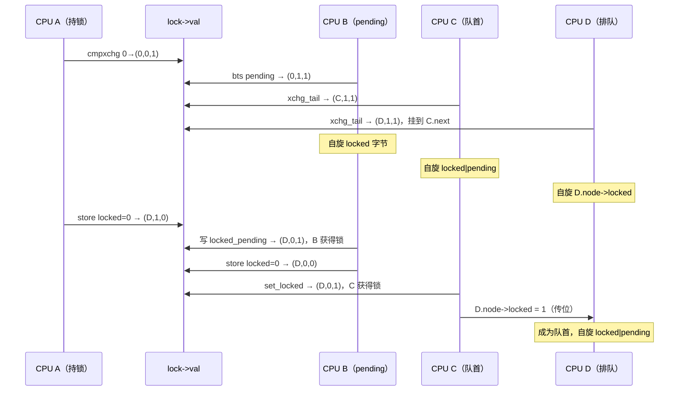

# 7.4 自旋锁与 qspinlock

> **本节源码**：[`include/linux/spinlock.h`](../../linux/include/linux/spinlock.h)、[`include/linux/spinlock_types.h`](../../linux/include/linux/spinlock_types.h)、[`include/linux/spinlock_types_raw.h`](../../linux/include/linux/spinlock_types_raw.h)、[`include/linux/spinlock_api_smp.h`](../../linux/include/linux/spinlock_api_smp.h)、[`kernel/locking/spinlock.c`](../../linux/kernel/locking/spinlock.c)、[`include/asm-generic/qspinlock_types.h`](../../linux/include/asm-generic/qspinlock_types.h)、[`include/asm-generic/qspinlock.h`](../../linux/include/asm-generic/qspinlock.h)、[`arch/x86/include/asm/qspinlock.h`](../../linux/arch/x86/include/asm/qspinlock.h)、[`kernel/locking/qspinlock.c`](../../linux/kernel/locking/qspinlock.c)、[`kernel/locking/qspinlock.h`](../../linux/kernel/locking/qspinlock.h)、[`kernel/locking/mcs_spinlock.h`](../../linux/kernel/locking/mcs_spinlock.h)、[`kernel/locking/qspinlock_paravirt.h`](../../linux/kernel/locking/qspinlock_paravirt.h)
> **关键函数**：`spin_lock()`、`_raw_spin_lock()`、`__raw_spin_lock()`、`queued_spin_lock()`、`queued_spin_lock_slowpath()`、`queued_spin_unlock()`、`pv_wait_node()`
> **前置知识**：7.1 并发来源与执行上下文、7.2 原子操作、7.3 内存屏障

## 概述

自旋锁（Spinlock）是内核中最基础的互斥锁：获取失败时不睡眠，而是在原地循环等待。它适用于临界区很短、且可能处于原子上下文（中断、软中断、关抢占）的场合。持有自旋锁期间必须关闭抢占，否则持锁者被换下后，其他 CPU 上的等待者会空转整个时间片。

最朴素的自旋锁是一个 test-and-set 标志位，问题在于**不公平**且**缓存行争抢严重**：释放时所有等待者同时冲向同一缓存行，哪个 CPU 抢到全凭运气。v2.6.25 引入的票号锁（Ticket Lock）解决了公平性，但所有等待者仍在同一个缓存行上自旋，CPU 数增多后性能急剧下降。v4.2 起 x86 改用 **qspinlock**（Queued Spinlock）：它基于 MCS 锁的思想让每个等待者在自己的 per-CPU 节点上自旋，同时把整个锁状态压缩进 4 字节，保持 `spinlock_t` 的大小和 API 不变。

本节先梳理 `spin_lock()` 的分层调用链，再详细分析 qspinlock 的三级获取路径（快速路径、pending 位、MCS 队列），最后介绍虚拟化环境下的半虚拟化自旋锁。

## 核心数据结构

### spinlock_t 与 raw_spinlock_t

[`include/linux/spinlock_types_raw.h:14-23`](../../linux/include/linux/spinlock_types_raw.h#L14-L23)（v6.18.60）

```c
typedef struct raw_spinlock {
	arch_spinlock_t raw_lock;
#ifdef CONFIG_DEBUG_SPINLOCK
	unsigned int magic, owner_cpu;
	void *owner;
#endif
#ifdef CONFIG_DEBUG_LOCK_ALLOC
	struct lockdep_map dep_map;
#endif
} raw_spinlock_t;
```

[`include/linux/spinlock_types.h:17-29`](../../linux/include/linux/spinlock_types.h#L17-L29)（v6.18.60）

```c
typedef struct spinlock {
	union {
		struct raw_spinlock rlock;

#ifdef CONFIG_DEBUG_LOCK_ALLOC
# define LOCK_PADSIZE (offsetof(struct raw_spinlock, dep_map))
		struct {
			u8 __padding[LOCK_PADSIZE];
			struct lockdep_map dep_map;
		};
#endif
	};
} spinlock_t;
```

在非 PREEMPT_RT 内核中，`spinlock_t` 只是 `raw_spinlock_t` 的包装；两者行为相同。区分它们是为了 PREEMPT_RT：RT 内核中 `spinlock_t` 被替换为基于 rt_mutex 的可睡眠锁（[`include/linux/spinlock_types.h:50-55`](../../linux/include/linux/spinlock_types.h#L50-L55)），而 `raw_spinlock_t` 始终是真正的自旋锁。因此调度器、中断控制器、定时器等在 RT 下也不能睡眠的路径必须使用 `raw_spinlock_t`，其余代码应使用 `spinlock_t`。本书配置未开启 lockdep 与 `CONFIG_DEBUG_SPINLOCK`，两者都只有 4 字节。

### qspinlock 的 32 位编码

[`include/asm-generic/qspinlock_types.h:14-44`](../../linux/include/asm-generic/qspinlock_types.h#L14-L44)（v6.18.60）

```c
typedef struct qspinlock {
	union {
		atomic_t val;

		/*
		 * By using the whole 2nd least significant byte for the
		 * pending bit, we can allow better optimization of the lock
		 * acquisition for the pending bit holder.
		 */
#ifdef __LITTLE_ENDIAN
		struct {
			u8	locked;
			u8	pending;
		};
		struct {
			u16	locked_pending;
			u16	tail;
		};
#else
		struct {
			u16	tail;
			u16	locked_pending;
		};
		struct {
			u8	reserved[2];
			u8	pending;
			u8	locked;
		};
#endif
	};
} arch_spinlock_t;
```

[`include/asm-generic/qspinlock_types.h:51-93`](../../linux/include/asm-generic/qspinlock_types.h#L51-L93)（v6.18.60）

```c
/*
 * Bitfields in the atomic value:
 *
 * When NR_CPUS < 16K
 *  0- 7: locked byte
 *     8: pending
 *  9-15: not used
 * 16-17: tail index
 * 18-31: tail cpu (+1)
 *
 * When NR_CPUS >= 16K
 *  0- 7: locked byte
 *     8: pending
 *  9-10: tail index
 * 11-31: tail cpu (+1)
 */
#define	_Q_SET_MASK(type)	(((1U << _Q_ ## type ## _BITS) - 1)\
				      << _Q_ ## type ## _OFFSET)
#define _Q_LOCKED_OFFSET	0
#define _Q_LOCKED_BITS		8
#define _Q_LOCKED_MASK		_Q_SET_MASK(LOCKED)

#define _Q_PENDING_OFFSET	(_Q_LOCKED_OFFSET + _Q_LOCKED_BITS)
#if CONFIG_NR_CPUS < (1U << 14)
#define _Q_PENDING_BITS		8
#else
#define _Q_PENDING_BITS		1
#endif
#define _Q_PENDING_MASK		_Q_SET_MASK(PENDING)

#define _Q_TAIL_IDX_OFFSET	(_Q_PENDING_OFFSET + _Q_PENDING_BITS)
#define _Q_TAIL_IDX_BITS	2
#define _Q_TAIL_IDX_MASK	_Q_SET_MASK(TAIL_IDX)

#define _Q_TAIL_CPU_OFFSET	(_Q_TAIL_IDX_OFFSET + _Q_TAIL_IDX_BITS)
#define _Q_TAIL_CPU_BITS	(32 - _Q_TAIL_CPU_OFFSET)
#define _Q_TAIL_CPU_MASK	_Q_SET_MASK(TAIL_CPU)

#define _Q_TAIL_OFFSET		_Q_TAIL_IDX_OFFSET
#define _Q_TAIL_MASK		(_Q_TAIL_IDX_MASK | _Q_TAIL_CPU_MASK)

#define _Q_LOCKED_VAL		(1U << _Q_LOCKED_OFFSET)
#define _Q_PENDING_VAL		(1U << _Q_PENDING_OFFSET)
```

本书配置 `CONFIG_NR_CPUS=8192`，小于 `1 << 14`，因此 pending 域占满第 8～15 位，`tail` 恰好是高 16 位：

```
 31                    18 17  16 15          8 7           0
┌────────────────────────┬──────┬─────────────┬─────────────┐
│     tail cpu (+1)      │ idx  │   pending   │   locked    │
└────────────────────────┴──────┴─────────────┴─────────────┘
 ◀──────────── tail（u16）──────▶◀──────── locked_pending（u16）───▶
```

*图 7-2：x86_64（NR_CPUS < 16K）上 qspinlock 的位域布局*

用"（tail，pending，locked）"三元组描述锁状态：

- `locked`：一个字节，非 0 表示锁被持有。单独占一个字节，使得解锁可以用一次字节写完成。
- `pending`：第一个竞争者在这里"排队"，不必动用 MCS 节点。
- `tail`：MCS 队列队尾节点的编码，由 CPU 号加 1（0 表示空队列）和该 CPU 上的嵌套层级 `idx`（0～3）组成。

### per-CPU MCS 节点

传统 MCS 锁需要一个指向队尾节点的指针，等待者节点通常分配在栈上。qspinlock 改用静态的 per-CPU 节点数组：

[`kernel/locking/qspinlock.c:72-80`](../../linux/kernel/locking/qspinlock.c#L72-L80)（v6.18.60）

```c
/*
 * Per-CPU queue node structures; we can never have more than 4 nested
 * contexts: task, softirq, hardirq, nmi.
 *
 * Exactly fits one 64-byte cacheline on a 64-bit architecture.
 *
 * PV doubles the storage and uses the second cacheline for PV state.
 */
static DEFINE_PER_CPU_ALIGNED(struct qnode, qnodes[_Q_MAX_NODES]);
```

[`kernel/locking/qspinlock.h:40-75`](../../linux/kernel/locking/qspinlock.h#L40-L75)（v6.18.60）

```c
struct qnode {
	struct mcs_spinlock mcs;
#ifdef CONFIG_PARAVIRT_SPINLOCKS
	long reserved[2];
#endif
};

/*
 * We must be able to distinguish between no-tail and the tail at 0:0,
 * therefore increment the cpu number by one.
 */

static inline __pure u32 encode_tail(int cpu, int idx)
{
	u32 tail;

	tail  = (cpu + 1) << _Q_TAIL_CPU_OFFSET;
	tail |= idx << _Q_TAIL_IDX_OFFSET; /* assume < 4 */

	return tail;
}

static inline __pure struct mcs_spinlock *decode_tail(u32 tail,
						      struct qnode __percpu *qnodes)
{
	int cpu = (tail >> _Q_TAIL_CPU_OFFSET) - 1;
	int idx = (tail &  _Q_TAIL_IDX_MASK) >> _Q_TAIL_IDX_OFFSET;

	return per_cpu_ptr(&qnodes[idx].mcs, cpu);
}

static inline __pure
struct mcs_spinlock *grab_mcs_node(struct mcs_spinlock *base, int idx)
{
	return &((struct qnode *)base + idx)->mcs;
}
```

每个 CPU 最多同时在 4 个上下文中自旋等待（进程、软中断、硬中断、NMI 各一个，后者会打断前者），所以 4 个节点足够；`qnodes[0].mcs.count` 记录当前用到第几个。有了 `(cpu, idx)`，任何 CPU 都能通过 `decode_tail()` 找到队尾节点，无需存放 64 位指针，这是能把 tail 压进 16 位的关键。

`struct mcs_spinlock` 本身只有三个字段：

[`include/asm-generic/mcs_spinlock.h:4-8`](../../linux/include/asm-generic/mcs_spinlock.h#L4-L8)（v6.18.60）

```c
struct mcs_spinlock {
	struct mcs_spinlock *next;
	int locked; /* 1 if lock acquired */
	int count;  /* nesting count, see qspinlock.c */
};
```

## 主流程分析

### 调用链总览

```
spin_lock(lock)                              include/linux/spinlock.h:349
└── raw_spin_lock() → _raw_spin_lock()        kernel/locking/spinlock.c:152
    └── __raw_spin_lock()                     include/linux/spinlock_api_smp.h:130
        ├── preempt_disable()
        ├── spin_acquire()                    // lockdep，本书配置为空
        └── do_raw_spin_lock()                include/linux/spinlock.h:184
            └── arch_spin_lock() = queued_spin_lock()   include/asm-generic/qspinlock.h:107
                └── queued_spin_lock_slowpath()         // 竞争时
                    = pv_queued_spin_lock_slowpath()    // PARAVIRT_SPINLOCKS：经 pv_ops 分发
                      ├── native_queued_spin_lock_slowpath()  kernel/locking/qspinlock.c:130
                      └── __pv_queued_spin_lock_slowpath()    // KVM/Xen 客户机

spin_unlock(lock)
└── _raw_spin_unlock()                        kernel/locking/spinlock.c:184
    └── __raw_spin_unlock()                   include/linux/spinlock_api_smp.h:139
        ├── do_raw_spin_unlock() → queued_spin_unlock()
        └── preempt_enable()
```

### 通用层：关抢占再加锁

本书配置未定义 `CONFIG_INLINE_SPIN_LOCK`，`_raw_spin_lock()` 是 `kernel/locking/spinlock.c` 中的一个非内联函数，便于在性能剖析中定位；`CONFIG_UNINLINE_SPIN_UNLOCK=y` 使解锁同样不内联。真正的逻辑在 `spinlock_api_smp.h`：

[`include/linux/spinlock_api_smp.h:104-161`](../../linux/include/linux/spinlock_api_smp.h#L104-L161)（v6.18.60）

```c
static inline unsigned long __raw_spin_lock_irqsave(raw_spinlock_t *lock)
{
	unsigned long flags;

	local_irq_save(flags);
	preempt_disable();
	spin_acquire(&lock->dep_map, 0, 0, _RET_IP_);
	LOCK_CONTENDED(lock, do_raw_spin_trylock, do_raw_spin_lock);
	return flags;
}

static inline void __raw_spin_lock_irq(raw_spinlock_t *lock)
{
	local_irq_disable();
	preempt_disable();
	spin_acquire(&lock->dep_map, 0, 0, _RET_IP_);
	LOCK_CONTENDED(lock, do_raw_spin_trylock, do_raw_spin_lock);
}

static inline void __raw_spin_lock_bh(raw_spinlock_t *lock)
{
	__local_bh_disable_ip(_RET_IP_, SOFTIRQ_LOCK_OFFSET);
	spin_acquire(&lock->dep_map, 0, 0, _RET_IP_);
	LOCK_CONTENDED(lock, do_raw_spin_trylock, do_raw_spin_lock);
}

static inline void __raw_spin_lock(raw_spinlock_t *lock)
{
	preempt_disable();
	spin_acquire(&lock->dep_map, 0, 0, _RET_IP_);
	LOCK_CONTENDED(lock, do_raw_spin_trylock, do_raw_spin_lock);
}

#endif /* !CONFIG_GENERIC_LOCKBREAK || CONFIG_DEBUG_LOCK_ALLOC */

static inline void __raw_spin_unlock(raw_spinlock_t *lock)
{
	spin_release(&lock->dep_map, _RET_IP_);
	do_raw_spin_unlock(lock);
	preempt_enable();
}

static inline void __raw_spin_unlock_irqrestore(raw_spinlock_t *lock,
					    unsigned long flags)
{
	spin_release(&lock->dep_map, _RET_IP_);
	do_raw_spin_unlock(lock);
	local_irq_restore(flags);
	preempt_enable();
}

static inline void __raw_spin_unlock_irq(raw_spinlock_t *lock)
{
	spin_release(&lock->dep_map, _RET_IP_);
	do_raw_spin_unlock(lock);
	local_irq_enable();
	preempt_enable();
}
```

各变体的差别仅在加锁前关闭什么：

| 变体 | 加锁前 | 解锁后 | 使用场景 |
|---|---|---|---|
| `spin_lock()` | 关抢占 | 开抢占 | 不与中断 / 软中断共享 |
| `spin_lock_bh()` | 关软中断（`SOFTIRQ_LOCK_OFFSET`，隐含关抢占） | 开软中断 | 与软中断共享 |
| `spin_lock_irq()` | 关中断、关抢占 | 开中断、开抢占 | 确定调用前中断是开着的 |
| `spin_lock_irqsave()` | 保存并关中断、关抢占 | 恢复中断、开抢占 | 不确定中断状态（最通用） |

`LOCK_CONTENDED()` 在未开启 `CONFIG_LOCK_STAT` 时就是直接调用 `do_raw_spin_lock()`（[`include/linux/lockdep.h:467-468`](../../linux/include/linux/lockdep.h#L467-L468)）。

注意顺序：加锁时**先关抢占再获取锁**，解锁时**先释放锁再开抢占**。若顺序相反，任务可能在持锁后、关抢占前被换下，其他 CPU 将在它身上空转。`spin_unlock_irqrestore()` 也是先恢复中断再开抢占，让 `preempt_enable()` 中可能发生的调度在中断打开的状态下进行。

### 快速路径

[`include/asm-generic/qspinlock.h:102-130`](../../linux/include/asm-generic/qspinlock.h#L102-L130)（v6.18.60）

```c
#ifndef queued_spin_lock
/**
 * queued_spin_lock - acquire a queued spinlock
 * @lock: Pointer to queued spinlock structure
 */
static __always_inline void queued_spin_lock(struct qspinlock *lock)
{
	int val = 0;

	if (likely(atomic_try_cmpxchg_acquire(&lock->val, &val, _Q_LOCKED_VAL)))
		return;

	queued_spin_lock_slowpath(lock, val);
}
#endif

#ifndef queued_spin_unlock
/**
 * queued_spin_unlock - release a queued spinlock
 * @lock : Pointer to queued spinlock structure
 */
static __always_inline void queued_spin_unlock(struct qspinlock *lock)
{
	/*
	 * unlock() needs release semantics:
	 */
	smp_store_release(&lock->locked, 0);
}
#endif
```

无竞争时，加锁就是一次 `lock cmpxchg`：把 `val` 从 0 改为 `_Q_LOCKED_VAL`。失败时 `try_cmpxchg` 已把当前值写回 `val`，直接作为参数传给慢速路径，省去一次读取。

解锁是对 `locked` 字节的一次 `smp_store_release()`，在 x86 上就是一条普通的 `movb $0`：不需要原子指令，因为只有持锁者会写 `locked` 字节，`pending` 与 `tail` 位于其他字节，不会被这次写入覆盖。本书配置开启了 `CONFIG_PARAVIRT_SPINLOCKS`，解锁经过 `pv_queued_spin_unlock()`（[`arch/x86/include/asm/qspinlock.h:54-58`](../../linux/arch/x86/include/asm/qspinlock.h#L54-L58)），在裸机上被 alternatives 补丁为与 `native_queued_spin_unlock()` 等价的内联代码。

### 慢速路径第一级：pending 位

qspinlock 的状态机由 `queued_spin_lock_slowpath()` 上方的注释给出：

```
              fast     :    slow                                  :    unlock
                       :                                          :
 uncontended  (0,0,0) -:--> (0,0,1) ------------------------------:--> (*,*,0)
                       :       | ^--------.------.             /  :
                       :       v           \      \            |  :
 pending               :    (0,1,1) +--> (0,1,0)   \           |  :
                       :       | ^--'              |           |  :
                       :       v                   |           |  :
 uncontended           :    (n,x,y) +--> (n,0,0) --'           |  :
   queue               :       | ^--'                          |  :
                       :       v                               |  :
 contended             :    (*,x,y) +--> (*,0,0) ---> (*,0,1) -'  :
   queue               :         ^--'                             :
```

*图 7-3：qspinlock 状态转换（三元组为 tail, pending, locked），引自 [`kernel/locking/qspinlock.c:116-128`](../../linux/kernel/locking/qspinlock.c#L116-L128)*

慢速路径首先处理"只有一个竞争者"的常见情况：

[`kernel/locking/qspinlock.c:130-160`](../../linux/kernel/locking/qspinlock.c#L130-L160)（v6.18.60）

```c
void __lockfunc queued_spin_lock_slowpath(struct qspinlock *lock, u32 val)
{
	struct mcs_spinlock *prev, *next, *node;
	u32 old, tail;
	int idx;

	BUILD_BUG_ON(CONFIG_NR_CPUS >= (1U << _Q_TAIL_CPU_BITS));

	if (pv_enabled())
		goto pv_queue;

	if (virt_spin_lock(lock))
		return;

	/*
	 * Wait for in-progress pending->locked hand-overs with a bounded
	 * number of spins so that we guarantee forward progress.
	 *
	 * 0,1,0 -> 0,0,1
	 */
	if (val == _Q_PENDING_VAL) {
		int cnt = _Q_PENDING_LOOPS;
		val = atomic_cond_read_relaxed(&lock->val,
					       (VAL != _Q_PENDING_VAL) || !cnt--);
	}

	/*
	 * If we observe any contention; queue.
	 */
	if (val & ~_Q_LOCKED_MASK)
		goto queue;
```

- 如果看到 `(0,1,0)`——pending 者正在接手刚释放的锁——就有界地自旋等待这一短暂状态结束（x86 上 `_Q_PENDING_LOOPS` 为 `1 << 9`）。
- 只要 tail 或 pending 非零，说明已有其他等待者，直接去排队，保证 FIFO 公平。

否则尝试成为 pending 者：

[`kernel/locking/qspinlock.c:167-206`](../../linux/kernel/locking/qspinlock.c#L167-L206)（v6.18.60）

```c
	val = queued_fetch_set_pending_acquire(lock);

	/*
	 * If we observe contention, there is a concurrent locker.
	 *
	 * Undo and queue; our setting of PENDING might have made the
	 * n,0,0 -> 0,0,0 transition fail and it will now be waiting
	 * on @next to become !NULL.
	 */
	if (unlikely(val & ~_Q_LOCKED_MASK)) {

		/* Undo PENDING if we set it. */
		if (!(val & _Q_PENDING_MASK))
			clear_pending(lock);

		goto queue;
	}

	/*
	 * We're pending, wait for the owner to go away.
	 *
	 * 0,1,1 -> *,1,0
	 *
	 * this wait loop must be a load-acquire such that we match the
	 * store-release that clears the locked bit and create lock
	 * sequentiality; this is because not all
	 * clear_pending_set_locked() implementations imply full
	 * barriers.
	 */
	if (val & _Q_LOCKED_MASK)
		smp_cond_load_acquire(&lock->locked, !VAL);

	/*
	 * take ownership and clear the pending bit.
	 *
	 * 0,1,0 -> 0,0,1
	 */
	clear_pending_set_locked(lock);
	lockevent_inc(lock_pending);
	return;
```

x86 的 `queued_fetch_set_pending_acquire()`（[`arch/x86/include/asm/qspinlock.h:14-28`](../../linux/arch/x86/include/asm/qspinlock.h#L14-L28)）用 `lock btsl` 原子地置位 pending 并取回旧值。成为 pending 者后，它在 `locked` 字节上自旋直到持锁者释放，然后用一次 16 位写 `clear_pending_set_locked()` 把 `(0,1,0)` 变为 `(0,0,1)`——同时清除 pending 并置位 locked。

pending 位的意义在于：**两个 CPU 竞争时不必触碰 MCS 节点**。访问 per-CPU 节点意味着至少多一次缓存未命中，而大多数锁竞争都只有两方参与。

### 慢速路径第二级：加入 MCS 队列

三个及以上的竞争者进入排队阶段：

[`kernel/locking/qspinlock.c:212-261`](../../linux/kernel/locking/qspinlock.c#L212-L261)（v6.18.60）

```c
queue:
	lockevent_inc(lock_slowpath);
pv_queue:
	node = this_cpu_ptr(&qnodes[0].mcs);
	idx = node->count++;
	tail = encode_tail(smp_processor_id(), idx);

	trace_contention_begin(lock, LCB_F_SPIN);

	/*
	 * 4 nodes are allocated based on the assumption that there will
	 * not be nested NMIs taking spinlocks. That may not be true in
	 * some architectures even though the chance of needing more than
	 * 4 nodes will still be extremely unlikely. When that happens,
	 * we fall back to spinning on the lock directly without using
	 * any MCS node. This is not the most elegant solution, but is
	 * simple enough.
	 */
	if (unlikely(idx >= _Q_MAX_NODES)) {
		lockevent_inc(lock_no_node);
		while (!queued_spin_trylock(lock))
			cpu_relax();
		goto release;
	}

	node = grab_mcs_node(node, idx);

	/*
	 * Keep counts of non-zero index values:
	 */
	lockevent_cond_inc(lock_use_node2 + idx - 1, idx);

	/*
	 * Ensure that we increment the head node->count before initialising
	 * the actual node. If the compiler is kind enough to reorder these
	 * stores, then an IRQ could overwrite our assignments.
	 */
	barrier();

	node->locked = 0;
	node->next = NULL;
	pv_init_node(node);

	/*
	 * We touched a (possibly) cold cacheline in the per-cpu queue node;
	 * attempt the trylock once more in the hope someone let go while we
	 * weren't watching.
	 */
	if (queued_spin_trylock(lock))
		goto release;
```

取出本 CPU 当前嵌套层级的节点并初始化。`node->count++` 之后的 `barrier()` 很关键：如果编译器把节点初始化提前到计数增加之前，此时到来的中断会拿到同一个节点并覆盖它。初始化完成后再试一次 `trylock`，因为访问节点的缓存未命中可能已经让锁变得空闲。

接下来发布自己为新的队尾：

[`kernel/locking/qspinlock.c:268-302`](../../linux/kernel/locking/qspinlock.c#L268-L302)（v6.18.60）

```c
	smp_wmb();

	/*
	 * Publish the updated tail.
	 * We have already touched the queueing cacheline; don't bother with
	 * pending stuff.
	 *
	 * p,*,* -> n,*,*
	 */
	old = xchg_tail(lock, tail);
	next = NULL;

	/*
	 * if there was a previous node; link it and wait until reaching the
	 * head of the waitqueue.
	 */
	if (old & _Q_TAIL_MASK) {
		prev = decode_tail(old, qnodes);

		/* Link @node into the waitqueue. */
		WRITE_ONCE(prev->next, node);

		pv_wait_node(node, prev);
		arch_mcs_spin_lock_contended(&node->locked);

		/*
		 * While waiting for the MCS lock, the next pointer may have
		 * been set by another lock waiter. We optimistically load
		 * the next pointer & prefetch the cacheline for writing
		 * to reduce latency in the upcoming MCS unlock operation.
		 */
		next = READ_ONCE(node->next);
		if (next)
			prefetchw(next);
	}
```

`xchg_tail()` 对高 16 位做一次 `xchg`（[`kernel/locking/qspinlock.h:114-122`](../../linux/kernel/locking/qspinlock.h#L114-L122)），原子地取回旧的 tail。如果旧 tail 非空，就把自己挂到前驱的 `next` 上，然后在**自己节点的** `locked` 字段上自旋（`arch_mcs_spin_lock_contended()` 即 `smp_cond_load_acquire(l, VAL)`）。每个等待者只在本地缓存行上自旋，锁释放时只有队首被通知，消除了"惊群"式的缓存行争抢。

`smp_wmb()` 保证节点初始化先于 tail 发布可见：其他 CPU 一旦通过 tail 找到这个节点，看到的必须是初始化后的内容。

### 慢速路径第三级：队首获取锁

成为队首后（无前驱，或被前驱"传位"），等待者改为在锁字本身上自旋：

[`kernel/locking/qspinlock.c:325-371`](../../linux/kernel/locking/qspinlock.c#L325-L371)（v6.18.60）

```c
	if ((val = pv_wait_head_or_lock(lock, node)))
		goto locked;

	val = atomic_cond_read_acquire(&lock->val, !(VAL & _Q_LOCKED_PENDING_MASK));

locked:
	/*
	 * claim the lock:
	 *
	 * n,0,0 -> 0,0,1 : lock, uncontended
	 * *,*,0 -> *,*,1 : lock, contended
	 *
	 * If the queue head is the only one in the queue (lock value == tail)
	 * and nobody is pending, clear the tail code and grab the lock.
	 * Otherwise, we only need to grab the lock.
	 */

	/*
	 * In the PV case we might already have _Q_LOCKED_VAL set, because
	 * of lock stealing; therefore we must also allow:
	 *
	 * n,0,1 -> 0,0,1
	 *
	 * Note: at this point: (val & _Q_PENDING_MASK) == 0, because of the
	 *       above wait condition, therefore any concurrent setting of
	 *       PENDING will make the uncontended transition fail.
	 */
	if ((val & _Q_TAIL_MASK) == tail) {
		if (atomic_try_cmpxchg_relaxed(&lock->val, &val, _Q_LOCKED_VAL))
			goto release; /* No contention */
	}

	/*
	 * Either somebody is queued behind us or _Q_PENDING_VAL got set
	 * which will then detect the remaining tail and queue behind us
	 * ensuring we'll see a @next.
	 */
	set_locked(lock);

	/*
	 * contended path; wait for next if not observed yet, release.
	 */
	if (!next)
		next = smp_cond_load_relaxed(&node->next, (VAL));

	arch_mcs_spin_unlock_contended(&next->locked);
	pv_kick_node(lock, next);
```

队首要等 `locked` 与 `pending` 都清零，然后分两种情况：

- **自己就是队尾**（`tail` 未变）：用一次 cmpxchg 把 `(n,0,0)` 改为 `(0,0,1)`，同时清空队列并加锁。若这一刻恰好有新等待者加入，cmpxchg 失败，转入第二种情况。
- **后面还有人**：用 `set_locked()` 只写 `locked` 字节（tail 保持不变），然后等待后继者把自己链接到 `next` 上，再以 `smp_store_release(&next->locked, 1)` 把"队首"身份传给它。

最后在 `release:` 处 `__this_cpu_dec(qnodes[0].mcs.count)` 归还节点。注意：MCS 节点只在**等待**期间使用，获得锁后立即释放，持锁期间不占用节点，所以解锁路径完全不需要知道节点的存在——这是 qspinlock 能保持 `spin_unlock()` 简单的原因。



*图 7-4：四个 CPU 竞争同一 qspinlock 的时序*

## 半虚拟化自旋锁

### 锁持有者抢占问题

在虚拟机中，持锁的 vCPU 可能被宿主机调度出去，其他 vCPU 只能空转等待一个"不在运行"的持锁者，这称为**锁持有者抢占**（Lock Holder Preemption）。公平锁让问题更严重：即使锁已释放，下一个排队的 vCPU 若也被抢占，所有后来者都要等它。

### virt_spin_lock：退化为 TAS 锁

在不支持半虚拟化自旋锁的超级调用（hypervisor）上，x86 干脆放弃公平性：

[`arch/x86/include/asm/qspinlock.h:79-110`](../../linux/arch/x86/include/asm/qspinlock.h#L79-L110)（v6.18.60）

```c
/*
 * Shortcut for the queued_spin_lock_slowpath() function that allows
 * virt to hijack it.
 *
 * Returns:
 *   true - lock has been negotiated, all done;
 *   false - queued_spin_lock_slowpath() will do its thing.
 */
#define virt_spin_lock virt_spin_lock
static inline bool virt_spin_lock(struct qspinlock *lock)
{
	int val;

	if (!static_branch_likely(&virt_spin_lock_key))
		return false;

	/*
	 * On hypervisors without PARAVIRT_SPINLOCKS support we fall
	 * back to a Test-and-Set spinlock, because fair locks have
	 * horrible lock 'holder' preemption issues.
	 */

 __retry:
	val = atomic_read(&lock->val);

	if (val || !atomic_try_cmpxchg(&lock->val, &val, _Q_LOCKED_VAL)) {
		cpu_relax();
		goto __retry;
	}

	return true;
}
```

`virt_spin_lock_key` 在检测到运行于虚拟机中时由 `native_pv_lock_init()`（[`arch/x86/kernel/paravirt.c:57`](../../linux/arch/x86/kernel/paravirt.c#L57)）打开；KVM 与 Xen 在启用了更优的半虚拟化自旋锁、或判断无需该机制（如 vCPU 独占物理 CPU）时再关闭它（[`arch/x86/kernel/kvm.c:1165`](../../linux/arch/x86/kernel/kvm.c#L1165)）。开启时，慢速路径的第一步就是用 test-and-set 循环取锁，绕过整个排队机制。

### pv_wait / pv_kick

KVM 与 Xen 支持更好的方案：`__pv_queued_spin_lock_slowpath()` 由同一份 `qspinlock.c` 源码在定义 `_GEN_PV_LOCK_SLOWPATH` 后再编译一遍得到（[`kernel/locking/qspinlock.c:384-404`](../../linux/kernel/locking/qspinlock.c#L384-L404)），把 `pv_wait_node()` 等钩子替换为真实实现：

[`kernel/locking/qspinlock_paravirt.h:290-322`](../../linux/kernel/locking/qspinlock_paravirt.h#L290-L322)（v6.18.60）

```c
static void pv_wait_node(struct mcs_spinlock *node, struct mcs_spinlock *prev)
{
	struct pv_node *pn = (struct pv_node *)node;
	struct pv_node *pp = (struct pv_node *)prev;
	bool wait_early;
	int loop;

	for (;;) {
		for (wait_early = false, loop = SPIN_THRESHOLD; loop; loop--) {
			if (READ_ONCE(node->locked))
				return;
			if (pv_wait_early(pp, loop)) {
				wait_early = true;
				break;
			}
			cpu_relax();
		}

		/*
		 * Order pn->state vs pn->locked thusly:
		 *
		 * [S] pn->state = VCPU_HALTED	  [S] next->locked = 1
		 *     MB			      MB
		 * [L] pn->locked		[RmW] pn->state = VCPU_HASHED
		 *
		 * Matches the cmpxchg() from pv_kick_node().
		 */
		smp_store_mb(pn->state, VCPU_HALTED);

		if (!READ_ONCE(node->locked)) {
			lockevent_inc(pv_wait_node);
			lockevent_cond_inc(pv_wait_early, wait_early);
			pv_wait(&pn->state, VCPU_HALTED);
```

排队的 vCPU 先自旋 `SPIN_THRESHOLD`（`1 << 15`，[`arch/x86/include/asm/spinlock.h:25`](../../linux/arch/x86/include/asm/spinlock.h#L25)）次，仍未拿到就把自己标记为 `VCPU_HALTED` 并调用 `pv_wait()` 让出物理 CPU。KVM 上 `pv_wait` 为 `kvm_wait()`（执行 `HLT` 陷入宿主机），`pv_kick` 为 `kvm_kick_cpu()`（发起 `KVM_HC_KICK_CPU` 超级调用唤醒目标 vCPU），注册于 [`arch/x86/kernel/kvm.c:1156-1157`](../../linux/arch/x86/kernel/kvm.c#L1156-L1157)。

队首 vCPU 睡眠前会把 `locked` 字节设为 `_Q_SLOW_VAL`（值为 3）并把锁登记到哈希表；解锁者发现 `locked == _Q_SLOW_VAL` 时走慢速解锁路径，查哈希表找到并踢醒队首。普通解锁（`locked == 1`）仍只是一次字节写。启动参数 `nopvspin` 可以关闭这一机制。

## 关键细节 / 设计考量

### 自旋锁使用规则

- 持有自旋锁时不能睡眠，不能调用可能睡眠的函数（`kmalloc(GFP_KERNEL)`、`mutex_lock()`、`copy_to_user()` 等）。
- 自旋锁不可重入：同一 CPU 对同一把锁加锁两次会死锁。
- 临界区应尽量短；长时间持锁会推迟本 CPU 的抢占（以及在 `_irq` 变体下推迟中断），引起延迟。需要在长循环中持锁时，可用 `cond_resched_lock()` 或 `spin_needbreak()` 检查是否有人在等待并临时放锁。
- 多把锁要按固定顺序获取，否则会出现 ABBA 死锁；lockdep 可以检测这种错误（7.11 节）。

### 作用域锁 guard

v6.5 起内核提供基于 `__attribute__((cleanup))` 的作用域锁（`include/linux/cleanup.h`）。`spinlock.h` 为各种变体定义了 guard 类型（如 [`include/linux/spinlock.h:565`](../../linux/include/linux/spinlock.h#L565) 的 `DEFINE_LOCK_GUARD_1(spinlock, ...)`），使用方式为：

```c
// 用法示例（非源码原文）
guard(spinlock_irqsave)(&dev->lock);
if (!dev->ready)
	return -EAGAIN;		/* 离开作用域时自动解锁并恢复中断 */
```

它消除了错误路径上漏解锁的问题，在新代码中被广泛采用。

### lockref：自旋锁与计数合一

dentry 的引用计数需要在持有 `d_lock` 时修改，但大多数引用增减并不需要锁。`struct lockref`（[`include/linux/lockref.h:25-35`](../../linux/include/linux/lockref.h#L25-L35)）把 4 字节的 `spinlock_t` 与 4 字节的计数放进一个 64 位字：只要锁空闲（`queued_spin_value_unlocked()` 为真），就用一次 64 位 cmpxchg 直接修改计数；锁被持有时才退回加锁路径。这依赖 `CONFIG_ARCH_USE_CMPXCHG_LOCKREF=y` 以及 `spinlock_t` 恰好 4 字节——这也是 qspinlock 坚持压缩到 32 位的原因之一。

## 动手实验

### 统计自旋锁竞争

v5.19 起锁慢速路径带有 `lock:contention_begin` / `lock:contention_end` 跟踪点（`trace_contention_begin()`），`perf lock contention` 基于它们工作，不需要 lockdep：

```bash
# 在 dev 虚拟机中，制造一些负载后执行
sudo perf lock contention -a -b -- sleep 5
```

输出按等待时间排序列出竞争最严重的锁及调用者，`type` 列为 `spinlock`、`mutex`、`rwsem:R` 等。

用 bpftrace 直方图统计 qspinlock 慢速路径的耗时：

```bash
sudo bpftrace -e '
kprobe:native_queued_spin_lock_slowpath { @start[tid] = nsecs; }
kretprobe:native_queued_spin_lock_slowpath /@start[tid]/ {
	@ns = hist(nsecs - @start[tid]); delete(@start[tid]);
}'
```

在虚拟机中，若内核选择了半虚拟化路径，应把函数名改为 `__pv_queued_spin_lock_slowpath`。

## 小结

- `spin_lock()` 的本质是"关抢占（或关中断 / 软中断）+ 跨 CPU 互斥"；加锁先关抢占，解锁后开抢占。
- `raw_spinlock_t` 在任何配置下都自旋；`spinlock_t` 在 PREEMPT_RT 下变为可睡眠锁，非 RT 下二者等价。
- qspinlock 把锁压缩为 32 位：locked 字节、pending 字节、16 位 tail（CPU 号 + 嵌套层级）；无竞争加锁是一次 cmpxchg，解锁是一次字节写。
- 慢速路径分三级：第一个竞争者用 pending 位等待；更多竞争者加入 MCS 队列并在各自的 per-CPU 节点上自旋；队首在锁字上自旋并负责向后继传位。
- 虚拟机中，qspinlock 可退化为 TAS 锁，或通过 `pv_wait()` / `pv_kick()` 让等待的 vCPU 让出物理 CPU，缓解锁持有者抢占。

## 参考

- `linux/Documentation/locking/spinlocks.rst`
- `linux/Documentation/locking/locktypes.rst`
- John M. Mellor-Crummey, Michael L. Scott, "Algorithms for Scalable Synchronization on Shared-Memory Multiprocessors", ACM TOCS, 1991
- Waiman Long, Peter Zijlstra, "qspinlock: Introducing a 4-byte queue spinlock implementation" 补丁系列（v4.2 合入）
- LWN: "MCS locks and qspinlocks", 2014（https://lwn.net/Articles/590243/）
