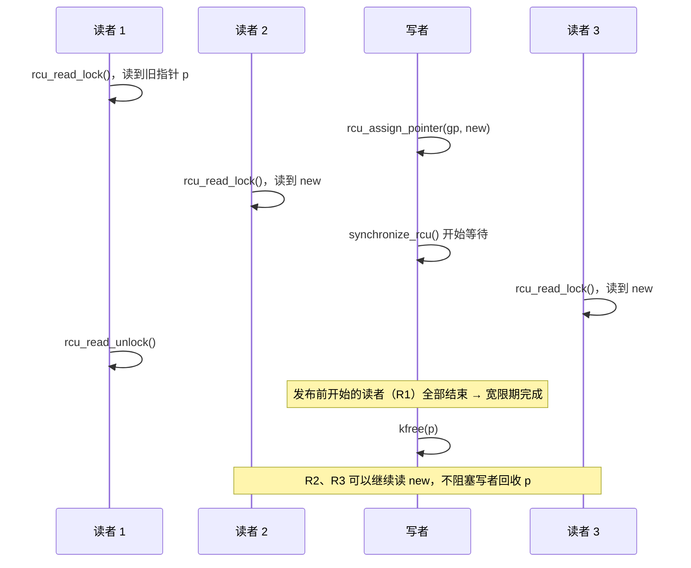

# 7.9 RCU 原理与使用

> **本节源码**：[`include/linux/rcupdate.h`](../../linux/include/linux/rcupdate.h)、[`include/linux/rculist.h`](../../linux/include/linux/rculist.h)、[`kernel/rcu/tree_plugin.h`](../../linux/kernel/rcu/tree_plugin.h)、[`include/linux/sched.h`](../../linux/include/linux/sched.h)
> **关键函数**：`rcu_read_lock()`、`rcu_read_unlock()`、`rcu_dereference()`、`rcu_assign_pointer()`、`synchronize_rcu()`、`call_rcu()`、`kfree_rcu()`、`__rcu_read_lock()`、`__rcu_read_unlock()`、`rcu_note_context_switch()`、`rcu_read_unlock_special()`
> **前置知识**：7.3 内存屏障与 Linux 内核内存模型、7.5 读写锁与顺序锁

## 概述

读拷贝更新（Read-Copy Update，RCU）是 Linux 内核中最具特色的同步机制，自 v2.5.43 引入以来，已被用于路由表、文件系统路径查找（dcache）、进程链表、模块列表、网络设备列表等数以万计的场合。它针对"读多写少"的场景，让**读者完全不加锁、不写共享内存、不执行原子指令或内存屏障**，从而获得近乎零开销且线性扩展的读性能。

RCU 的核心思想是把更新拆成三步：

1. **移除**（Removal）：写者创建数据的新版本（或直接从链表中摘除旧节点），用一次原子的指针发布让新读者看到新版本。已经在读旧版本的读者不受影响。
2. **等待宽限期**（Grace Period）：等待所有在发布之前就已开始的读者结束。
3. **回收**（Reclamation）：此时已不可能有读者引用旧版本，安全地释放它。

难点在于第 2 步：读者不留下任何痕迹，写者如何知道"所有旧读者都已结束"？RCU 的回答是利用**静止状态**（Quiescent State，QS）：约定读者在 RCU 读临界区内不得进行上下文切换（或者在可抢占 RCU 中被单独跟踪），那么只要每个 CPU 都至少经历过一次上下文切换、进入过 idle 或用户态，此前开始的读者就必然已经结束。宽限期就是"所有 CPU 都经过至少一个静止状态"的时间段。

本节从使用者角度介绍 RCU 的语义与 API，以及可抢占 RCU 读端的实现；7.10 节分析 Tree RCU 如何高效地检测宽限期并处理回调。

## RCU 的语义



*图 7-8：RCU 宽限期只需等待发布前已开始的读者*

宽限期的定义有两个要点：

- 它只等待**在宽限期开始前已经进入**读临界区的读者。宽限期开始后才进入的读者看到的一定是新版本，与旧数据无关，写者无需等它们。
- 宽限期结束意味着所有旧读者都已退出，而不是"此刻没有读者"。系统中可能始终有读者在运行，RCU 依然能推进宽限期。

## 核心 API

| 角色 | API | 作用 |
|---|---|---|
| 读者 | `rcu_read_lock()` / `rcu_read_unlock()` | 标记读临界区 |
| 读者 | `rcu_dereference(p)` | 读取 RCU 保护的指针 |
| 写者 | `rcu_assign_pointer(p, v)` | 发布新指针 |
| 写者 | `rcu_replace_pointer()` | 发布并返回旧指针 |
| 写者 | `synchronize_rcu()` | 同步等待一个宽限期 |
| 写者 | `call_rcu(head, func)` | 异步：宽限期后调用 `func` |
| 写者 | `kfree_rcu(ptr, field)` / `kvfree_rcu()` | 宽限期后释放，批量处理 |
| 写者 | `rcu_barrier()` | 等待所有已提交的 `call_rcu()` 回调执行完毕 |

### 读端：rcu_read_lock

[`include/linux/rcupdate.h:863-900`](../../linux/include/linux/rcupdate.h#L863-L900)（v6.18.60）

```c
static __always_inline void rcu_read_lock(void)
{
	__rcu_read_lock();
	__acquire(RCU);
	rcu_lock_acquire(&rcu_lock_map);
	RCU_LOCKDEP_WARN(!rcu_is_watching(),
			 "rcu_read_lock() used illegally while idle");
}

/*
 * So where is rcu_write_lock()?  It does not exist, as there is no
 * way for writers to lock out RCU readers.  This is a feature, not
 * a bug -- this property is what provides RCU's performance benefits.
 * Of course, writers must coordinate with each other.  The normal
 * spinlock primitives work well for this, but any other technique may be
 * used as well.  RCU does not care how the writers keep out of each
 * others' way, as long as they do so.
 */

/**
 * rcu_read_unlock() - marks the end of an RCU read-side critical section.
 *
 * In almost all situations, rcu_read_unlock() is immune from deadlock.
 * This deadlock immunity also extends to the scheduler's runqueue
 * and priority-inheritance spinlocks, courtesy of the quiescent-state
 * deferral that is carried out when rcu_read_unlock() is invoked with
 * interrupts disabled.
 *
 * See rcu_read_lock() for more information.
 */
static inline void rcu_read_unlock(void)
{
	RCU_LOCKDEP_WARN(!rcu_is_watching(),
			 "rcu_read_unlock() used illegally while idle");
	rcu_lock_release(&rcu_lock_map); /* Keep acq info for rls diags. */
	__release(RCU);
	__rcu_read_unlock();
}
```

`__acquire(RCU)` / `__release(RCU)` 供 sparse 静态检查，`rcu_lock_acquire()` 供 lockdep 使用，本书配置下都为空。真正的工作在 `__rcu_read_lock()`，它有两种实现：

- **非可抢占 RCU**（`CONFIG_PREEMPT_RCU=n`）：就是 `preempt_disable()`（[`include/linux/rcupdate.h:91-94`](../../linux/include/linux/rcupdate.h#L91-L94)）。读者不会被抢占，CPU 发生上下文切换即证明读者已经结束。
- **可抢占 RCU**（`CONFIG_PREEMPT_RCU=y`，本书配置，由 `CONFIG_PREEMPTION` 选中）：读临界区可以被抢占，只增加一个 per-task 计数，见下文。

注释中提到"没有 `rcu_write_lock()`"：写者之间的互斥由使用者自己用普通锁解决，RCU 只负责读者与写者之间的同步。

### 发布与订阅：rcu_assign_pointer / rcu_dereference

[`include/linux/rcupdate.h:588-597`](../../linux/include/linux/rcupdate.h#L588-L597)（v6.18.60）

```c
#define rcu_assign_pointer(p, v)					      \
do {									      \
	uintptr_t _r_a_p__v = (uintptr_t)(v);				      \
	rcu_check_sparse(p, __rcu);					      \
									      \
	if (__builtin_constant_p(v) && (_r_a_p__v) == (uintptr_t)NULL)	      \
		WRITE_ONCE((p), (typeof(p))(_r_a_p__v));		      \
	else								      \
		smp_store_release(&p, RCU_INITIALIZER((typeof(p))_r_a_p__v)); \
} while (0)
```

`rcu_assign_pointer()` 就是一次 `smp_store_release()`：保证新对象的初始化写入先于指针发布可见（7.3 节消息传递模式的写端）。赋值为常量 `NULL` 时无需顺序，退化为 `WRITE_ONCE()`。

[`include/linux/rcupdate.h:529-536`](../../linux/include/linux/rcupdate.h#L529-L536)（v6.18.60）

```c
#define __rcu_dereference_check(p, local, c, space) \
({ \
	/* Dependency order vs. p above. */ \
	typeof(*p) *local = (typeof(*p) *__force)READ_ONCE(p); \
	RCU_LOCKDEP_WARN(!(c), "suspicious rcu_dereference_check() usage"); \
	rcu_check_sparse(p, space); \
	((typeof(*p) __force __kernel *)(local)); \
})
```

`rcu_dereference()` 就是一次 `READ_ONCE()`，**没有任何屏障**。它依赖地址依赖（7.3 节）：后续对 `p->field` 的读取依赖于读到的指针值，CPU 不会把它提前。这使得 RCU 读端在所有主流架构上都只是普通的读指令。`RCU_LOCKDEP_WARN` 在开启 `CONFIG_PROVE_RCU` 时检查调用者是否处于读临界区（或满足参数 `c` 给出的条件，如持有更新锁），`rcu_check_sparse()` 让 sparse 检查指针带有 `__rcu` 标注。

### RCU 链表

`include/linux/rculist.h` 提供了 RCU 版本的链表操作：

[`include/linux/rculist.h:97-107`](../../linux/include/linux/rculist.h#L97-L107)（v6.18.60）

```c
static inline void __list_add_rcu(struct list_head *new,
		struct list_head *prev, struct list_head *next)
{
	if (!__list_add_valid(new, prev, next))
		return;

	new->next = next;
	new->prev = prev;
	rcu_assign_pointer(list_next_rcu(prev), new);
	next->prev = new;
}
```

[`include/linux/rculist.h:176-180`](../../linux/include/linux/rculist.h#L176-L180)（v6.18.60）

```c
static inline void list_del_rcu(struct list_head *entry)
{
	__list_del_entry(entry);
	entry->prev = LIST_POISON2;
}
```

插入时先设置新节点的 `next`/`prev`，再用 `rcu_assign_pointer()` 把它挂到前驱的 `next` 上——读者从前往后遍历，要么看不到新节点，要么看到完整初始化的新节点。删除时 `list_del_rcu()` 只修改前后节点的指针，**不清空被删节点的 `next`**，因为此刻可能有读者正停留在该节点上，需要通过它的 `next` 继续遍历。被删节点的 `prev` 被毒化，因为 RCU 读者只允许正向遍历。

一个典型的"RCU 读 + 自旋锁写"示例（伪代码，非源码原文）：

```c
// 伪代码：RCU 保护的链表
struct foo { struct list_head list; int key; int val; struct rcu_head rcu; };
static LIST_HEAD(foo_list);
static DEFINE_SPINLOCK(foo_lock);

int foo_get(int key)                       /* 读者：任意上下文，可并发 */
{
	struct foo *p; int ret = -ENOENT;

	rcu_read_lock();
	list_for_each_entry_rcu(p, &foo_list, list)
		if (p->key == key) { ret = p->val; break; }
	rcu_read_unlock();
	return ret;
}

void foo_del(int key)                      /* 写者：互相之间用锁串行化 */
{
	struct foo *p;

	spin_lock(&foo_lock);
	list_for_each_entry(p, &foo_list, list)
		if (p->key == key) {
			list_del_rcu(&p->list);   /* 1. 移除 */
			spin_unlock(&foo_lock);
			kfree_rcu(p, rcu);        /* 2+3. 宽限期后释放 */
			return;
		}
	spin_unlock(&foo_lock);
}
```

### 回收：synchronize_rcu 与 call_rcu

`synchronize_rcu()` 阻塞调用者直到一个完整的宽限期结束，通常需要数毫秒到数十毫秒（取决于 `HZ`、负载与 NO_HZ 状态）。它只能在可睡眠的上下文中调用，也绝不能在 RCU 读临界区中调用（会自我死锁）。

`call_rcu(head, func)` 把一个回调挂到本 CPU 的回调队列上立即返回，宽限期结束后在软中断（或 `rcuc` / `rcuo` 内核线程）中调用 `func(head)`。`struct rcu_head` 通常嵌入在被保护的对象中，回调用 `container_of()` 找回对象并释放它。`kfree_rcu()` 是最常见的特例：它不需要使用者写回调函数，内部把待释放指针批量收集到页大小的数组中（`kvfree_call_rcu()`，[`include/linux/rcupdate.h:1113`](../../linux/include/linux/rcupdate.h#L1113)），宽限期后用 `kfree_bulk()` 一次释放，大幅减少回调数量。

## 可抢占 RCU 的读端

### 每任务嵌套计数

本书配置的读端实现位于 `kernel/rcu/tree_plugin.h`：

[`kernel/rcu/tree_plugin.h:386-449`](../../linux/kernel/rcu/tree_plugin.h#L386-L449)（v6.18.60）

```c
/* limit value for ->rcu_read_lock_nesting. */
#define RCU_NEST_PMAX (INT_MAX / 2)

static void rcu_preempt_read_enter(void)
{
	WRITE_ONCE(current->rcu_read_lock_nesting, READ_ONCE(current->rcu_read_lock_nesting) + 1);
}

static int rcu_preempt_read_exit(void)
{
	int ret = READ_ONCE(current->rcu_read_lock_nesting) - 1;

	WRITE_ONCE(current->rcu_read_lock_nesting, ret);
	return ret;
}

static void rcu_preempt_depth_set(int val)
{
	WRITE_ONCE(current->rcu_read_lock_nesting, val);
}

/*
 * Preemptible RCU implementation for rcu_read_lock().
 * Just increment ->rcu_read_lock_nesting, shared state will be updated
 * if we block.
 */
void __rcu_read_lock(void)
{
	rcu_preempt_read_enter();
	if (IS_ENABLED(CONFIG_PROVE_LOCKING))
		WARN_ON_ONCE(rcu_preempt_depth() > RCU_NEST_PMAX);
	if (IS_ENABLED(CONFIG_RCU_STRICT_GRACE_PERIOD) && rcu_state.gp_kthread)
		WRITE_ONCE(current->rcu_read_unlock_special.b.need_qs, true);
	barrier();  /* critical section after entry code. */
}
EXPORT_SYMBOL_GPL(__rcu_read_lock);

/*
 * Preemptible RCU implementation for rcu_read_unlock().
 * Decrement ->rcu_read_lock_nesting.  If the result is zero (outermost
 * rcu_read_unlock()) and ->rcu_read_unlock_special is non-zero, then
 * invoke rcu_read_unlock_special() to clean up after a context switch
 * in an RCU read-side critical section and other special cases.
 */
void __rcu_read_unlock(void)
{
	struct task_struct *t = current;

	barrier();  // critical section before exit code.
	if (rcu_preempt_read_exit() == 0) {
		barrier();  // critical-section exit before .s check.
		if (unlikely(READ_ONCE(t->rcu_read_unlock_special.s)))
			rcu_read_unlock_special(t);
	}
	if (IS_ENABLED(CONFIG_PROVE_LOCKING)) {
		int rrln = rcu_preempt_depth();

		WARN_ON_ONCE(rrln < 0 || rrln > RCU_NEST_PMAX);
	}
}
EXPORT_SYMBOL_GPL(__rcu_read_unlock);

/*
 * Advance a ->blkd_tasks-list pointer to the next entry, instead
```

读者进入时只把 `current->rcu_read_lock_nesting` 加一，退出时减一——普通的内存读写，没有原子指令、没有内存屏障，也不关抢占。`barrier()` 防止编译器把临界区内的访问挪到计数修改之外。只有最外层退出（计数归零）且 `rcu_read_unlock_special` 非零时，才进入慢速路径。

[`include/linux/sched.h:781-789`](../../linux/include/linux/sched.h#L781-L789)（v6.18.60）

```c
union rcu_special {
	struct {
		u8			blocked;
		u8			need_qs;
		u8			exp_hint; /* Hint for performance. */
		u8			need_mb; /* Readers need smp_mb(). */
	} b; /* Bits. */
	u32 s; /* Set of bits. */
};
```

[`include/linux/sched.h:926-929`](../../linux/include/linux/sched.h#L926-L929)（v6.18.60）

```c
	int				rcu_read_lock_nesting;
	union rcu_special		rcu_read_unlock_special;
	struct list_head		rcu_node_entry;
	struct rcu_node			*rcu_blocked_node;
```

`rcu_read_unlock_special` 的四个字节分别表示：

- `blocked`：读者在临界区内被抢占过，挂在了 `rcu_node` 的阻塞任务链表上；
- `need_qs`：当前宽限期正在等待本 CPU 报告静止状态，退出时应尽快报告；
- `exp_hint`：有加速宽限期在等待本读者；
- `need_mb`：读者需要执行内存屏障（用于 Tasks Trace RCU 等）。

把它们合并为一个 `u32`，读端出口只需一次比较 `t->rcu_read_unlock_special.s` 是否非零。

### 读者被抢占

可抢占 RCU 的难点在于：读者可能在临界区中被换下 CPU，此后该 CPU 发生了上下文切换，但读者显然还没结束。因此调度器在每次切换前调用 `rcu_note_context_switch()`（由 `__schedule()` 调用，3.2 节）：

[`kernel/rcu/tree_plugin.h:324-375`](../../linux/kernel/rcu/tree_plugin.h#L324-L375)（v6.18.60）

```c
void rcu_note_context_switch(bool preempt)
{
	struct task_struct *t = current;
	struct rcu_data *rdp = this_cpu_ptr(&rcu_data);
	struct rcu_node *rnp;

	trace_rcu_utilization(TPS("Start context switch"));
	lockdep_assert_irqs_disabled();
	WARN_ONCE(!preempt && rcu_preempt_depth() > 0, "Voluntary context switch within RCU read-side critical section!");
	if (rcu_preempt_depth() > 0 &&
	    !t->rcu_read_unlock_special.b.blocked) {

		/* Possibly blocking in an RCU read-side critical section. */
		rnp = rdp->mynode;
		raw_spin_lock_rcu_node(rnp);
		t->rcu_read_unlock_special.b.blocked = true;
		t->rcu_blocked_node = rnp;

		/*
		 * Verify the CPU's sanity, trace the preemption, and
		 * then queue the task as required based on the states
		 * of any ongoing and expedited grace periods.
		 */
		WARN_ON_ONCE(!rcu_rdp_cpu_online(rdp));
		WARN_ON_ONCE(!list_empty(&t->rcu_node_entry));
		trace_rcu_preempt_task(rcu_state.name,
				       t->pid,
				       (rnp->qsmask & rdp->grpmask)
				       ? rnp->gp_seq
				       : rcu_seq_snap(&rnp->gp_seq));
		rcu_preempt_ctxt_queue(rnp, rdp);
	} else {
		rcu_preempt_deferred_qs(t);
	}

	/*
	 * Either we were not in an RCU read-side critical section to
	 * begin with, or we have now recorded that critical section
	 * globally.  Either way, we can now note a quiescent state
	 * for this CPU.  Again, if we were in an RCU read-side critical
	 * section, and if that critical section was blocking the current
	 * grace period, then the fact that the task has been enqueued
	 * means that we continue to block the current grace period.
	 */
	rcu_qs();
	if (rdp->cpu_no_qs.b.exp)
		rcu_report_exp_rdp(rdp);
	rcu_tasks_qs(current, preempt);
	trace_rcu_utilization(TPS("End context switch"));
}
EXPORT_SYMBOL_GPL(rcu_note_context_switch);

```

如果当前任务处于读临界区（`rcu_preempt_depth() > 0`）且尚未登记，就把它挂到本 CPU 所属叶子 `rcu_node` 的 `blkd_tasks` 链表上，并设置 `blocked` 标志。之后 CPU 就可以照常报告静止状态（`rcu_qs()`），因为"这个读者还没结束"这一事实已经被记录在 `rcu_node` 上了。宽限期要结束，除了所有 CPU 都报告静止状态，还必须等待 `rcu_node->gp_tasks` 所指的、在宽限期开始前就已阻塞的读者全部离开链表（7.10 节）。

当被抢占的读者最终执行最外层 `rcu_read_unlock()` 时，看到 `blocked` 位，进入 `rcu_read_unlock_special()`，把自己从 `blkd_tasks` 移除；若它是阻塞当前宽限期的最后一个任务，就代表该 `rcu_node` 向上报告静止状态。

### 在关中断 / 关抢占时退出读临界区

`rcu_read_unlock()` 可能在持有调度器锁、关中断等上下文中调用，此时不能获取 `rcu_node` 锁或唤醒任务。`rcu_read_unlock_special()` 会检测这种情况，把静止状态报告推迟：

[`kernel/rcu/tree_plugin.h:725-760`](../../linux/kernel/rcu/tree_plugin.h#L725-L760)（v6.18.60）

```c
static void rcu_read_unlock_special(struct task_struct *t)
{
	unsigned long flags;
	bool irqs_were_disabled;
	bool preempt_bh_were_disabled =
			!!(preempt_count() & (PREEMPT_MASK | SOFTIRQ_MASK));

	/* NMI handlers cannot block and cannot safely manipulate state. */
	if (in_nmi())
		return;

	local_irq_save(flags);
	irqs_were_disabled = irqs_disabled_flags(flags);
	if (preempt_bh_were_disabled || irqs_were_disabled) {
		bool needs_exp; // Expedited handling needed.
		struct rcu_data *rdp = this_cpu_ptr(&rcu_data);
		struct rcu_node *rnp = rdp->mynode;

		needs_exp = rcu_unlock_needs_exp_handling(t, rdp, rnp, irqs_were_disabled);

		// Need to defer quiescent state until everything is enabled.
		if (use_softirq && (in_hardirq() || (needs_exp && !irqs_were_disabled))) {
			// Using softirq, safe to awaken, and either the
			// wakeup is free or there is either an expedited
			// GP in flight or a potential need to deboost.
			if (rdp->defer_qs_pending != DEFER_QS_PENDING) {
				rdp->defer_qs_pending = DEFER_QS_PENDING;
				raise_softirq_irqoff(RCU_SOFTIRQ);
			}
		} else {
			// Enabling BH or preempt does reschedule, so...
			// Also if no expediting and no possible deboosting,
			// slow is OK.  Plus nohz_full CPUs eventually get
			// tick enabled.
			set_tsk_need_resched(current);
			set_preempt_need_resched();
```

推迟的报告会在稍后通过 `RCU_SOFTIRQ`、irq_work 或下一次调度时完成（`rcu_preempt_deferred_qs()`）。

### 优先级提升

可抢占 RCU 带来一个新问题：低优先级读者在临界区中被高优先级任务长期抢占，宽限期就无法结束，所有等待中的回调和 `synchronize_rcu()` 调用者都被拖住，最终可能耗尽内存。`CONFIG_RCU_BOOST` 开启时，宽限期持续过久后会用 `rcu_node->boost_mtx`（一个 rt_mutex，7.8 节）把阻塞宽限期的读者提升为实时优先级。本书配置未开启 `CONFIG_RCU_BOOST`（它依赖 `CONFIG_RCU_EXPERT`，仅在 PREEMPT_RT 下默认开启，`kernel/rcu/Kconfig:211-214`）。

## RCU 风味的统一

历史上 Linux 有三种独立的 RCU "风味"（flavor）：RCU-preempt（`rcu_read_lock()`）、RCU-bh（`rcu_read_lock_bh()`）、RCU-sched（`rcu_read_lock_sched()` 或任何关抢占区间）。v4.20 起它们被统一：现在一个宽限期同时等待三类读者——关软中断区间、关抢占区间、关中断区间都被视为 RCU 读临界区。这正是 7.1 节说"关抢占也是 RCU 读临界区"的原因：`rcu_flavor_sched_clock_irq()` 在发现 `preempt_count()` 中有抢占或软中断计数时不报告静止状态（[`kernel/rcu/tree_plugin.h:816-823`](../../linux/kernel/rcu/tree_plugin.h#L816-L823)）。

此外还有几种用途特殊的变体：

| 变体 | 读端 | 特点 |
|---|---|---|
| SRCU（`CONFIG_TREE_SRCU=y`） | `srcu_read_lock(ssp)` 返回索引 | 读者**可以睡眠**；每个 `srcu_struct` 独立的宽限期域 |
| Tasks RCU | 无显式读端；自愿上下文切换为静止状态 | 用于 trampoline（ftrace、kprobes）的释放 |
| Tasks Rude RCU | 关抢占区间 | 通过在每个 CPU 上调度一次来推进 |
| Tasks Trace RCU | `rcu_read_lock_trace()` | 读者可睡眠，用于可睡眠的 BPF 程序 |

本书配置开启了 `CONFIG_TASKS_RCU`、`CONFIG_TASKS_RUDE_RCU`、`CONFIG_TASKS_TRACE_RCU`。

## 关键细节 / 设计考量

### 读临界区中的规则

- 在可抢占 RCU 中读者可以被抢占，但**不能主动睡眠**（不能调用 `mutex_lock()`、`msleep()` 等）；`rcu_note_context_switch()` 中的 `WARN_ONCE` 会对"自愿上下文切换发生在读临界区内"发出警告。需要在读端睡眠时应使用 SRCU。
- 读到的指针只在读临界区内有效。如需在临界区外使用对象，必须在临界区内用 `refcount_inc_not_zero()` 等手段获取引用（7.2 节）。
- 不要在读临界区之外缓存 `rcu_dereference()` 的结果。

### RCU 与读写锁的比较

| 维度 | 读写锁 | RCU |
|---|---|---|
| 读者开销 | 原子指令 + 缓存行争抢 | 普通读（可抢占 RCU 再加一个 per-task 计数） |
| 读者与写者并发 | 互斥 | 并发，读者可能看到旧版本 |
| 写者延迟 | 等读者释放锁 | 发布立即生效，回收需等宽限期 |
| 内存开销 | 无 | 旧版本在宽限期内不能释放 |
| 适用数据 | 任意 | 可以通过指针替换实现更新的数据结构 |

*表 7-7：读写锁与 RCU 的比较*

RCU 并不适用于所有场景：如果读者必须看到最新数据，或更新需要原地修改多个字段且不能被看到中间状态，RCU 就需要配合其他机制（如在对象中加锁或使用顺序计数）。

### SLAB_TYPESAFE_BY_RCU

以 `SLAB_TYPESAFE_BY_RCU` 创建的 slab 缓存保证：对象被 `kmem_cache_free()` 后，其内存在一个宽限期内只会被重新分配为**同类型**对象，而 slab 页本身要等宽限期后才还给伙伴系统（4.5 节）。这让读者在 RCU 读临界区中访问一个可能已被释放并复用的对象时不会崩溃，但读者必须在获取引用后**重新验证**对象身份（例如比较键值），这正是 `refcount_inc_not_zero_acquire()` 存在的原因（7.2 节）。`sighand_struct`（[`kernel/fork.c:2986`](../../linux/kernel/fork.c#L2986)）、`anon_vma`（[`mm/rmap.c:469`](../../linux/mm/rmap.c#L469)）、`struct file`（[`fs/file_table.c:634`](../../linux/fs/file_table.c#L634)）等都采用这一技术。

## 动手实验

### 查看 RCU 相关线程与参数

```bash
ps -eo pid,cls,pri,comm | grep -E 'rcu'          # rcu_preempt；启用 NOCB 的 CPU 还有 rcuog/N、rcuop/N
ls /sys/module/rcutree/parameters/
cat /sys/module/rcutree/parameters/{jiffies_till_first_fqs,jiffies_till_next_fqs,blimit}
grep RCU /proc/softirqs
```

### 测量 synchronize_rcu() 的延迟

```bash
sudo bpftrace -e '
kprobe:synchronize_rcu { @start[tid] = nsecs; }
kretprobe:synchronize_rcu /@start[tid]/ {
	@us = hist((nsecs - @start[tid]) / 1000); delete(@start[tid]);
}'
```

在空闲系统上通常为数毫秒；`CONFIG_HZ=1000` 下宽限期的强制静止状态扫描间隔约为 3 个 jiffy（7.10 节）。

## 小结

- RCU 把更新分为"移除—等待宽限期—回收"三步，读者不加锁、不写共享内存，与写者并发执行。
- 宽限期只需等待在它开始前进入读临界区的读者；只要每个 CPU 都经历过静止状态（上下文切换、idle、用户态），旧读者必然已结束。
- `rcu_assign_pointer()` 是 store-release，`rcu_dereference()` 是 `READ_ONCE()` 并依赖地址依赖，读端在所有主流架构上都无需屏障。
- 可抢占 RCU 的读端只增减 `current->rcu_read_lock_nesting`；读者被抢占时由 `rcu_note_context_switch()` 挂到 `rcu_node->blkd_tasks`，宽限期还需等待这些任务退出。
- v4.20 起 RCU 风味统一，关抢占、关软中断、关中断区间都是 RCU 读临界区；需要在读端睡眠时使用 SRCU。

## 参考

- `linux/Documentation/RCU/whatisRCU.rst`
- `linux/Documentation/RCU/rcu_dereference.rst`
- `linux/Documentation/RCU/checklist.rst`
- `linux/Documentation/RCU/Design/Requirements/Requirements.rst`
- Paul E. McKenney, Jonathan Walpole, "What is RCU, Fundamentally?", LWN, 2007（https://lwn.net/Articles/262464/）
- Paul E. McKenney, "The RCU API, 2019 edition", LWN（https://lwn.net/Articles/777036/）
