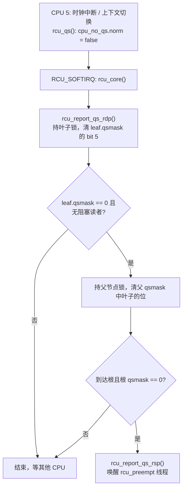

# 7.10 Tree RCU：宽限期检测与回调处理

> **本节源码**：[`kernel/rcu/tree.h`](../../linux/kernel/rcu/tree.h)、[`kernel/rcu/tree.c`](../../linux/kernel/rcu/tree.c)、[`kernel/rcu/tree_plugin.h`](../../linux/kernel/rcu/tree_plugin.h)、[`kernel/rcu/rcu.h`](../../linux/kernel/rcu/rcu.h)、[`include/linux/rcu_node_tree.h`](../../linux/include/linux/rcu_node_tree.h)、[`include/linux/rcu_segcblist.h`](../../linux/include/linux/rcu_segcblist.h)、[`include/linux/rcupdate.h`](../../linux/include/linux/rcupdate.h)
> **关键函数**：`rcu_gp_kthread()`、`rcu_gp_init()`、`rcu_gp_fqs_loop()`、`rcu_gp_fqs()`、`rcu_gp_cleanup()`、`rcu_sched_clock_irq()`、`rcu_flavor_sched_clock_irq()`、`rcu_qs()`、`rcu_core()`、`rcu_report_qs_rdp()`、`rcu_report_qs_rnp()`、`__call_rcu_common()`、`rcu_accelerate_cbs()`、`rcu_do_batch()`、`synchronize_rcu()`
> **前置知识**：7.9 RCU 原理与使用

## 概述

7.9 节从使用者角度定义了宽限期："所有 CPU 都经历过至少一次静止状态"。一个朴素的实现是维护一个全局 CPU 位图，宽限期开始时置满，每个 CPU 报告静止状态时清除自己的位，位图清空即宽限期结束。问题在于数千个 CPU 同时争抢同一把保护位图的锁，扩展性极差。

**Tree RCU**（`CONFIG_TREE_RCU`，SMP 内核的默认实现）把这个位图组织成一棵**组合树**（Combining Tree）：每个叶子节点只管理 16 个 CPU，CPU 只与自己的叶子节点竞争锁；叶子节点上的所有 CPU 都报告后，才由最后一个 CPU 向父节点报告一次。这样根节点锁的竞争被降低了几个数量级。

宽限期的推进由一个专门的内核线程 `rcu_preempt`（本书配置下的名字）驱动；CPU 在时钟中断、上下文切换中检测并报告自己的静止状态；处于 idle 或 NO_HZ_FULL 用户态的 CPU 不会有时钟中断，由 GP 线程主动扫描其状态代为报告。等待宽限期的回调则以分段链表的形式挂在每个 CPU 上，按"它们需要等待的宽限期编号"分组，宽限期结束后在 `RCU_SOFTIRQ` 中批量执行。

## 核心数据结构

### 三层结构

```
                    rcu_state（全局，唯一）
                    ├── gp_seq：宽限期序号
                    ├── gp_kthread：rcu_preempt 线程
                    └── node[NUM_RCU_NODES]：rcu_node 树（按层平铺）
                                     │
                     ┌───────────────┴───────────────┐
              rcu_node（根，level 0）               ...
              qsmask：哪些子节点尚未报告
                     │
          ┌──────────┼──────────┐
   rcu_node（level 1） ...    rcu_node
          │
   ┌──────┼──────┐
 rcu_node（叶子）  ...      ← 每个叶子管理 ≤ 16 个 CPU
 qsmask：哪些 CPU 尚未报告
 blkd_tasks：在本节点 CPU 上被抢占的读者
   │
   ├── rcu_data（CPU 0，per-CPU）
   ├── rcu_data（CPU 1）
   └── ...
       cpu_no_qs：本 CPU 尚未报告静止状态
       cblist：分段回调链表
```

*图 7-9：Tree RCU 的三层数据结构*

树的形状由编译期常量决定：

[`include/linux/rcu_node_tree.h:33-52`](../../linux/include/linux/rcu_node_tree.h#L33-L52)（v6.18.60）

```c
#ifdef CONFIG_RCU_FANOUT
#define RCU_FANOUT CONFIG_RCU_FANOUT
#else /* #ifdef CONFIG_RCU_FANOUT */
# ifdef CONFIG_64BIT
# define RCU_FANOUT 64
# else
# define RCU_FANOUT 32
# endif
#endif /* #else #ifdef CONFIG_RCU_FANOUT */

#ifdef CONFIG_RCU_FANOUT_LEAF
#define RCU_FANOUT_LEAF CONFIG_RCU_FANOUT_LEAF
#else /* #ifdef CONFIG_RCU_FANOUT_LEAF */
#define RCU_FANOUT_LEAF 16
#endif /* #else #ifdef CONFIG_RCU_FANOUT_LEAF */

#define RCU_FANOUT_1	      (RCU_FANOUT_LEAF)
#define RCU_FANOUT_2	      (RCU_FANOUT_1 * RCU_FANOUT)
#define RCU_FANOUT_3	      (RCU_FANOUT_2 * RCU_FANOUT)
#define RCU_FANOUT_4	      (RCU_FANOUT_3 * RCU_FANOUT)
```

[`include/linux/rcu_node_tree.h:69-77`](../../linux/include/linux/rcu_node_tree.h#L69-L77)（v6.18.60）

```c
#elif NR_CPUS <= RCU_FANOUT_3
#  define RCU_NUM_LVLS	      3
#  define NUM_RCU_LVL_0	      1
#  define NUM_RCU_LVL_1	      DIV_ROUND_UP(NR_CPUS, RCU_FANOUT_2)
#  define NUM_RCU_LVL_2	      DIV_ROUND_UP(NR_CPUS, RCU_FANOUT_1)
#  define NUM_RCU_NODES	      (NUM_RCU_LVL_0 + NUM_RCU_LVL_1 + NUM_RCU_LVL_2)
#  define NUM_RCU_LVL_INIT    { NUM_RCU_LVL_0, NUM_RCU_LVL_1, NUM_RCU_LVL_2 }
#  define RCU_NODE_NAME_INIT  { "rcu_node_0", "rcu_node_1", "rcu_node_2" }
#  define RCU_FQS_NAME_INIT   { "rcu_node_fqs_0", "rcu_node_fqs_1", "rcu_node_fqs_2" }
```

本书配置 `CONFIG_NR_CPUS=8192`，叶子扇出 16、内部扇出 64：`RCU_FANOUT_2 = 1024 < 8192 ≤ RCU_FANOUT_3 = 65536`，因此是三层树，节点数为 1 + ⌈8192/1024⌉ + ⌈8192/16⌉ = 1 + 8 + 512 = 521 个。启动时 `rcu_init_geometry()`（[`kernel/rcu/tree.c:4754`](../../linux/kernel/rcu/tree.c#L4754)）会根据实际可能的 CPU 数 `nr_cpu_ids` 重新计算层数和每层节点数，所以 8 核虚拟机上实际只使用一个 `rcu_node`。

### rcu_node

[`kernel/rcu/tree.h:41-58`](../../linux/kernel/rcu/tree.h#L41-L58)（v6.18.60）

```c
struct rcu_node {
	raw_spinlock_t __private lock;	/* Root rcu_node's lock protects */
					/*  some rcu_state fields as well as */
					/*  following. */
	unsigned long gp_seq;	/* Track rsp->gp_seq. */
	unsigned long gp_seq_needed; /* Track furthest future GP request. */
	unsigned long completedqs; /* All QSes done for this node. */
	unsigned long qsmask;	/* CPUs or groups that need to switch in */
				/*  order for current grace period to proceed.*/
				/*  In leaf rcu_node, each bit corresponds to */
				/*  an rcu_data structure, otherwise, each */
				/*  bit corresponds to a child rcu_node */
				/*  structure. */
	unsigned long rcu_gp_init_mask;	/* Mask of offline CPUs at GP init. */
	unsigned long qsmaskinit;
				/* Per-GP initial value for qsmask. */
				/*  Initialized from ->qsmaskinitnext at the */
				/*  beginning of each grace period. */
```

[`kernel/rcu/tree.h:76-95`](../../linux/kernel/rcu/tree.h#L76-L95)（v6.18.60）

```c
	unsigned long ffmask;	/* Fully functional CPUs. */
	unsigned long grpmask;	/* Mask to apply to parent qsmask. */
				/*  Only one bit will be set in this mask. */
	int	grplo;		/* lowest-numbered CPU here. */
	int	grphi;		/* highest-numbered CPU here. */
	u8	grpnum;		/* group number for next level up. */
	u8	level;		/* root is at level 0. */
	bool	wait_blkd_tasks;/* Necessary to wait for blocked tasks to */
				/*  exit RCU read-side critical sections */
				/*  before propagating offline up the */
				/*  rcu_node tree? */
	struct rcu_node *parent;
	struct list_head blkd_tasks;
				/* Tasks blocked in RCU read-side critical */
				/*  section.  Tasks are placed at the head */
				/*  of this list and age towards the tail. */
	struct list_head *gp_tasks;
				/* Pointer to the first task blocking the */
				/*  current grace period, or NULL if there */
				/*  is no such task. */
```

- `qsmask`：本宽限期中尚未报告静止状态的子节点（叶子中为 CPU）位图，宽限期开始时从 `qsmaskinit`（在线 CPU）复制而来。
- `grpmask`：本节点在父节点 `qsmask` 中对应的那一位。
- `blkd_tasks`：在本节点所辖 CPU 上被抢占的 RCU 读者链表（7.9 节）；`gp_tasks` 指向其中第一个阻塞**当前**宽限期的任务。新任务插入链表头部，`gp_tasks` 之后（较老）的任务才阻塞当前宽限期。

### rcu_data

[`kernel/rcu/tree.h:189-217`](../../linux/kernel/rcu/tree.h#L189-L217)（v6.18.60）

```c
struct rcu_data {
	/* 1) quiescent-state and grace-period handling : */
	unsigned long	gp_seq;		/* Track rsp->gp_seq counter. */
	unsigned long	gp_seq_needed;	/* Track furthest future GP request. */
	union rcu_noqs	cpu_no_qs;	/* No QSes yet for this CPU. */
	bool		core_needs_qs;	/* Core waits for quiescent state. */
	bool		beenonline;	/* CPU online at least once. */
	bool		gpwrap;		/* Possible ->gp_seq wrap. */
	unsigned int	gpwrap_count;	/* Count of GP sequence wrap. */
	bool		cpu_started;	/* RCU watching this onlining CPU. */
	struct rcu_node *mynode;	/* This CPU's leaf of hierarchy */
	unsigned long grpmask;		/* Mask to apply to leaf qsmask. */
	unsigned long	ticks_this_gp;	/* The number of scheduling-clock */
					/*  ticks this CPU has handled */
					/*  during and after the last grace */
					/* period it is aware of. */
	struct irq_work defer_qs_iw;	/* Obtain later scheduler attention. */
	int defer_qs_pending;		/* irqwork or softirq pending? */
	struct work_struct strict_work;	/* Schedule readers for strict GPs. */

	/* 2) batch handling */
	struct rcu_segcblist cblist;	/* Segmented callback list, with */
					/* different callbacks waiting for */
					/* different grace periods. */
	long		qlen_last_fqs_check;
					/* qlen at last check for QS forcing */
	unsigned long	n_cbs_invoked;	/* # callbacks invoked since boot. */
	unsigned long	n_force_qs_snap;
					/* did other CPU force QS recently? */
```

`cpu_no_qs.b.norm` 为真表示本 CPU 在当前宽限期中还没有经历静止状态；`core_needs_qs` 表示 RCU 核心正在等待本 CPU 报告。`gp_seq` 是本 CPU 所知道的宽限期序号，可能落后于全局值——每个 CPU 在下一次检查时才会"注意到"新的宽限期（`note_gp_changes()`）。

### 宽限期序号

`gp_seq` 的最低 2 位是状态，其余位是计数：

[`include/linux/rcupdate.h:37-38`](../../linux/include/linux/rcupdate.h#L37-L38)（v6.18.60）

```c
#define RCU_SEQ_CTR_SHIFT    2
#define RCU_SEQ_STATE_MASK   ((1 << RCU_SEQ_CTR_SHIFT) - 1)
```

[`kernel/rcu/rcu.h:93-113`](../../linux/kernel/rcu/rcu.h#L93-L113)（v6.18.60）

```c
/* Adjust sequence number for start of update-side operation. */
static inline void rcu_seq_start(unsigned long *sp)
{
	WRITE_ONCE(*sp, *sp + 1);
	smp_mb(); /* Ensure update-side operation after counter increment. */
	WARN_ON_ONCE(rcu_seq_state(*sp) != 1);
}

/* Compute the end-of-grace-period value for the specified sequence number. */
static inline unsigned long rcu_seq_endval(unsigned long *sp)
{
	return (*sp | RCU_SEQ_STATE_MASK) + 1;
}

/* Adjust sequence number for end of update-side operation. */
static inline void rcu_seq_end(unsigned long *sp)
{
	smp_mb(); /* Ensure update-side operation before counter increment. */
	WARN_ON_ONCE(!rcu_seq_state(*sp));
	WRITE_ONCE(*sp, rcu_seq_endval(sp));
}
```

宽限期开始时 `gp_seq` 加一（状态位变为 1，表示"进行中"）；结束时进位到下一个计数值（状态位归零）。`rcu_seq_snap()` 计算"从现在起，要等到 `gp_seq` 至少为多少才能保证一个完整的宽限期已经过去"：

[`kernel/rcu/rcu.h:126-133`](../../linux/kernel/rcu/rcu.h#L126-L133)（v6.18.60）

```c
static inline unsigned long rcu_seq_snap(unsigned long *sp)
{
	unsigned long s;

	s = (READ_ONCE(*sp) + 2 * RCU_SEQ_STATE_MASK + 1) & ~RCU_SEQ_STATE_MASK;
	smp_mb(); /* Above access must not bleed into critical section. */
	return s;
}
```

若当前没有宽限期在进行（状态位为 0），结果是下一个宽限期结束时的值；若已有宽限期在进行，它开始时我们可能已经在读临界区内了，不能算数，所以结果是**再下一个**宽限期结束时的值。回调和轮询 API（`get_state_synchronize_rcu()` / `poll_state_synchronize_rcu()`）都用这个值来判断是否已经"等够了"。

## 主流程分析

### 宽限期线程

[`kernel/rcu/tree.c:2259-2292`](../../linux/kernel/rcu/tree.c#L2259-L2292)（v6.18.60）

```c
static int __noreturn rcu_gp_kthread(void *unused)
{
	rcu_bind_gp_kthread();
	for (;;) {

		/* Handle grace-period start. */
		for (;;) {
			trace_rcu_grace_period(rcu_state.name, rcu_state.gp_seq,
					       TPS("reqwait"));
			WRITE_ONCE(rcu_state.gp_state, RCU_GP_WAIT_GPS);
			swait_event_idle_exclusive(rcu_state.gp_wq,
					 READ_ONCE(rcu_state.gp_flags) &
					 RCU_GP_FLAG_INIT);
			rcu_gp_torture_wait();
			WRITE_ONCE(rcu_state.gp_state, RCU_GP_DONE_GPS);
			/* Locking provides needed memory barrier. */
			if (rcu_gp_init())
				break;
			cond_resched_tasks_rcu_qs();
			WRITE_ONCE(rcu_state.gp_activity, jiffies);
			WARN_ON(signal_pending(current));
			trace_rcu_grace_period(rcu_state.name, rcu_state.gp_seq,
					       TPS("reqwaitsig"));
		}

		/* Handle quiescent-state forcing. */
		rcu_gp_fqs_loop();

		/* Handle grace-period end. */
		WRITE_ONCE(rcu_state.gp_state, RCU_GP_CLEANUP);
		rcu_gp_cleanup();
		WRITE_ONCE(rcu_state.gp_state, RCU_GP_CLEANED);
	}
}
```

GP 线程是一个三阶段循环：等待有人请求宽限期（`RCU_GP_FLAG_INIT`）→ 初始化 → 反复强制静止状态直到宽限期结束 → 清理。由于宽限期的推进集中在一个线程中，CPU 上的报告路径只需修改位图和唤醒该线程，代价很小。

### 阶段一：rcu_gp_init()

[`kernel/rcu/tree.c:1852-1852`](../../linux/kernel/rcu/tree.c#L1852)（v6.18.60）

```c
	rcu_seq_start(&rcu_state.gp_seq);
```

`rcu_seq_start()` 把 `rcu_state.gp_seq` 加一，标志着新宽限期在全局层面开始。随后处理 CPU 热插拔带来的 `qsmaskinit` 变化（略），再按广度优先顺序初始化每个 `rcu_node`：

[`kernel/rcu/tree.c:1952-1987`](../../linux/kernel/rcu/tree.c#L1952-L1987)（v6.18.60）

```c
	WRITE_ONCE(rcu_state.gp_state, RCU_GP_INIT);
	rcu_for_each_node_breadth_first(rnp) {
		rcu_gp_slow(gp_init_delay);
		raw_spin_lock_irqsave_rcu_node(rnp, flags);
		rdp = this_cpu_ptr(&rcu_data);
		rcu_preempt_check_blocked_tasks(rnp);
		rnp->qsmask = rnp->qsmaskinit;
		WRITE_ONCE(rnp->gp_seq, rcu_state.gp_seq);
		if (rnp == rdp->mynode)
			(void)__note_gp_changes(rnp, rdp);
		rcu_preempt_boost_start_gp(rnp);
		trace_rcu_grace_period_init(rcu_state.name, rnp->gp_seq,
					    rnp->level, rnp->grplo,
					    rnp->grphi, rnp->qsmask);
		/*
		 * Quiescent states for tasks on any now-offline CPUs. Since we
		 * released the ofl and rnp lock before this loop, CPUs might
		 * have gone offline and we have to report QS on their behalf.
		 * See Requirements.rst > Hotplug CPU > Concurrent QS Reporting.
		 */
		mask = rnp->qsmask & ~rnp->qsmaskinitnext;
		rnp->rcu_gp_init_mask = mask;
		if ((mask || rnp->wait_blkd_tasks) && rcu_is_leaf_node(rnp))
			rcu_report_qs_rnp(mask, rnp, rnp->gp_seq, flags);
		else
			raw_spin_unlock_irq_rcu_node(rnp);
		cond_resched_tasks_rcu_qs();
		WRITE_ONCE(rcu_state.gp_activity, jiffies);
	}

	// If strict, make all CPUs aware of new grace period.
	if (IS_ENABLED(CONFIG_RCU_STRICT_GRACE_PERIOD))
		on_each_cpu(rcu_strict_gp_boundary, NULL, 0);

	return true;
}
```

每个节点的 `qsmask` 被置为 `qsmaskinit`（所有在线的子节点 / CPU），`gp_seq` 被更新为新值，`rcu_preempt_check_blocked_tasks()` 让 `gp_tasks` 指向此时已在 `blkd_tasks` 中的读者——它们开始于宽限期之前，必须等它们。由于根先于叶子初始化，CPU（只看叶子）一旦看到新的 `gp_seq`，整棵树就已经准备好接收报告了。

### CPU 如何发现并报告静止状态

**来源一：时钟中断。** 每个 tick 调用 `rcu_sched_clock_irq()`（由 `update_process_times()` 调用）：

[`kernel/rcu/tree.c:2684-2713`](../../linux/kernel/rcu/tree.c#L2684-L2713)（v6.18.60）

```c
void rcu_sched_clock_irq(int user)
{
	unsigned long j;

	if (IS_ENABLED(CONFIG_PROVE_RCU)) {
		j = jiffies;
		WARN_ON_ONCE(time_before(j, __this_cpu_read(rcu_data.last_sched_clock)));
		__this_cpu_write(rcu_data.last_sched_clock, j);
	}
	trace_rcu_utilization(TPS("Start scheduler-tick"));
	lockdep_assert_irqs_disabled();
	raw_cpu_inc(rcu_data.ticks_this_gp);
	/* The load-acquire pairs with the store-release setting to true. */
	if (smp_load_acquire(this_cpu_ptr(&rcu_data.rcu_urgent_qs))) {
		/* Idle and userspace execution already are quiescent states. */
		if (!rcu_is_cpu_rrupt_from_idle() && !user) {
			set_tsk_need_resched(current);
			set_preempt_need_resched();
		}
		__this_cpu_write(rcu_data.rcu_urgent_qs, false);
	}
	rcu_flavor_sched_clock_irq(user);
	if (rcu_pending(user))
		invoke_rcu_core();
	if (user || rcu_is_cpu_rrupt_from_idle())
		rcu_note_voluntary_context_switch(current);
	lockdep_assert_irqs_disabled();

	trace_rcu_utilization(TPS("End scheduler-tick"));
}
```

[`kernel/rcu/tree_plugin.h:811-837`](../../linux/kernel/rcu/tree_plugin.h#L811-L837)（v6.18.60）

```c
static void rcu_flavor_sched_clock_irq(int user)
{
	struct task_struct *t = current;

	lockdep_assert_irqs_disabled();
	if (rcu_preempt_depth() > 0 ||
	    (preempt_count() & (PREEMPT_MASK | SOFTIRQ_MASK))) {
		/* No QS, force context switch if deferred. */
		if (rcu_preempt_need_deferred_qs(t)) {
			set_tsk_need_resched(t);
			set_preempt_need_resched();
		}
	} else if (rcu_preempt_need_deferred_qs(t)) {
		rcu_preempt_deferred_qs(t); /* Report deferred QS. */
		return;
	} else if (!WARN_ON_ONCE(rcu_preempt_depth())) {
		rcu_qs(); /* Report immediate QS. */
		return;
	}

	/* If GP is oldish, ask for help from rcu_read_unlock_special(). */
	if (rcu_preempt_depth() > 0 &&
	    __this_cpu_read(rcu_data.core_needs_qs) &&
	    __this_cpu_read(rcu_data.cpu_no_qs.b.norm) &&
	    !t->rcu_read_unlock_special.b.need_qs &&
	    time_after(jiffies, rcu_state.gp_start + HZ))
		t->rcu_read_unlock_special.b.need_qs = true;
```

在可抢占 RCU 下，如果时钟中断打断的不是 RCU 读临界区、也不在关抢占 / 关软中断区间内，那么这一刻本 CPU 显然不在任何 RCU 读者之中，可以立即记录一个静止状态（`rcu_qs()`）。注意被中断的用户态也满足这一条件。若读者在临界区中停留超过 1 秒，就设置 `need_qs`，让它在 `rcu_read_unlock()` 时主动报告。

**来源二：上下文切换。** `rcu_note_context_switch()` 在每次 `__schedule()` 中调用 `rcu_qs()`（7.9 节）：

[`kernel/rcu/tree_plugin.h:298-309`](../../linux/kernel/rcu/tree_plugin.h#L298-L309)（v6.18.60）

```c
static void rcu_qs(void)
{
	RCU_LOCKDEP_WARN(preemptible(), "rcu_qs() invoked with preemption enabled!!!\n");
	if (__this_cpu_read(rcu_data.cpu_no_qs.b.norm)) {
		trace_rcu_grace_period(TPS("rcu_preempt"),
				       __this_cpu_read(rcu_data.gp_seq),
				       TPS("cpuqs"));
		__this_cpu_write(rcu_data.cpu_no_qs.b.norm, false);
		barrier(); /* Coordinate with rcu_flavor_sched_clock_irq(). */
		WRITE_ONCE(current->rcu_read_unlock_special.b.need_qs, false);
	}
}
```

`rcu_qs()` 只清除 per-CPU 的 `cpu_no_qs.b.norm` 标志，这是一次纯本地写。真正向树报告由 `rcu_core()` 在软中断中完成：`rcu_sched_clock_irq()` 末尾的 `rcu_pending()` 检查到有工作要做，就调用 `invoke_rcu_core()`：

[`kernel/rcu/tree.c:2907-2915`](../../linux/kernel/rcu/tree.c#L2907-L2915)（v6.18.60）

```c
static void invoke_rcu_core(void)
{
	if (!cpu_online(smp_processor_id()))
		return;
	if (use_softirq)
		raise_softirq(RCU_SOFTIRQ);
	else
		invoke_rcu_core_kthread();
}
```

[`kernel/rcu/tree.c:2825-2865`](../../linux/kernel/rcu/tree.c#L2825-L2865)（v6.18.60）

```c
static __latent_entropy void rcu_core(void)
{
	unsigned long flags;
	struct rcu_data *rdp = raw_cpu_ptr(&rcu_data);
	struct rcu_node *rnp = rdp->mynode;

	if (cpu_is_offline(smp_processor_id()))
		return;
	trace_rcu_utilization(TPS("Start RCU core"));
	WARN_ON_ONCE(!rdp->beenonline);

	/* Report any deferred quiescent states if preemption enabled. */
	if (IS_ENABLED(CONFIG_PREEMPT_COUNT) && (!(preempt_count() & PREEMPT_MASK))) {
		rcu_preempt_deferred_qs(current);
	} else if (rcu_preempt_need_deferred_qs(current)) {
		set_tsk_need_resched(current);
		set_preempt_need_resched();
	}

	/* Update RCU state based on any recent quiescent states. */
	rcu_check_quiescent_state(rdp);

	/* No grace period and unregistered callbacks? */
	if (!rcu_gp_in_progress() &&
	    rcu_segcblist_is_enabled(&rdp->cblist) && !rcu_rdp_is_offloaded(rdp)) {
		local_irq_save(flags);
		if (!rcu_segcblist_restempty(&rdp->cblist, RCU_NEXT_READY_TAIL))
			rcu_accelerate_cbs_unlocked(rnp, rdp);
		local_irq_restore(flags);
	}

	rcu_check_gp_start_stall(rnp, rdp, rcu_jiffies_till_stall_check());

	/* If there are callbacks ready, invoke them. */
	if (!rcu_rdp_is_offloaded(rdp) && rcu_segcblist_ready_cbs(&rdp->cblist) &&
	    likely(READ_ONCE(rcu_scheduler_fully_active))) {
		rcu_do_batch(rdp);
		/* Re-invoke RCU core processing if there are callbacks remaining. */
		if (rcu_segcblist_ready_cbs(&rdp->cblist))
			invoke_rcu_core();
	}
```

`rcu_check_quiescent_state()` 先通过 `note_gp_changes()` 让本 CPU 注意到新宽限期，若此后已经记录了静止状态，就调用 `rcu_report_qs_rdp()`：

[`kernel/rcu/tree.c:2431-2476`](../../linux/kernel/rcu/tree.c#L2431-L2476)（v6.18.60）

```c
rcu_report_qs_rdp(struct rcu_data *rdp)
{
	unsigned long flags;
	unsigned long mask;
	struct rcu_node *rnp;

	WARN_ON_ONCE(rdp->cpu != smp_processor_id());
	rnp = rdp->mynode;
	raw_spin_lock_irqsave_rcu_node(rnp, flags);
	if (rdp->cpu_no_qs.b.norm || rdp->gp_seq != rnp->gp_seq ||
	    rdp->gpwrap) {

		/*
		 * The grace period in which this quiescent state was
		 * recorded has ended, so don't report it upwards.
		 * We will instead need a new quiescent state that lies
		 * within the current grace period.
		 */
		rdp->cpu_no_qs.b.norm = true;	/* need qs for new gp. */
		raw_spin_unlock_irqrestore_rcu_node(rnp, flags);
		return;
	}
	mask = rdp->grpmask;
	rdp->core_needs_qs = false;
	if ((rnp->qsmask & mask) == 0) {
		raw_spin_unlock_irqrestore_rcu_node(rnp, flags);
	} else {
		/*
		 * This GP can't end until cpu checks in, so all of our
		 * callbacks can be processed during the next GP.
		 *
		 * NOCB kthreads have their own way to deal with that...
		 */
		if (!rcu_rdp_is_offloaded(rdp)) {
			/*
			 * The current GP has not yet ended, so it
			 * should not be possible for rcu_accelerate_cbs()
			 * to return true.  So complain, but don't awaken.
			 */
			WARN_ON_ONCE(rcu_accelerate_cbs(rnp, rdp));
		}

		rcu_disable_urgency_upon_qs(rdp);
		rcu_report_qs_rnp(mask, rnp, rnp->gp_seq, flags);
		/* ^^^ Released rnp->lock */
	}
```

它在叶子节点锁下检查：本 CPU 的静止状态是否属于当前宽限期（`rdp->gp_seq == rnp->gp_seq`），若属于，就清除叶子 `qsmask` 中自己的位并向上传播：

[`kernel/rcu/tree.c:2327-2374`](../../linux/kernel/rcu/tree.c#L2327-L2374)（v6.18.60）

```c
static void rcu_report_qs_rnp(unsigned long mask, struct rcu_node *rnp,
			      unsigned long gps, unsigned long flags)
	__releases(rnp->lock)
{
	unsigned long oldmask = 0;
	struct rcu_node *rnp_c;

	raw_lockdep_assert_held_rcu_node(rnp);

	/* Walk up the rcu_node hierarchy. */
	for (;;) {
		if ((!(rnp->qsmask & mask) && mask) || rnp->gp_seq != gps) {

			/*
			 * Our bit has already been cleared, or the
			 * relevant grace period is already over, so done.
			 */
			raw_spin_unlock_irqrestore_rcu_node(rnp, flags);
			return;
		}
		WARN_ON_ONCE(oldmask); /* Any child must be all zeroed! */
		WARN_ON_ONCE(!rcu_is_leaf_node(rnp) &&
			     rcu_preempt_blocked_readers_cgp(rnp));
		WRITE_ONCE(rnp->qsmask, rnp->qsmask & ~mask);
		trace_rcu_quiescent_state_report(rcu_state.name, rnp->gp_seq,
						 mask, rnp->qsmask, rnp->level,
						 rnp->grplo, rnp->grphi,
						 !!rnp->gp_tasks);
		if (rnp->qsmask != 0 || rcu_preempt_blocked_readers_cgp(rnp)) {

			/* Other bits still set at this level, so done. */
			raw_spin_unlock_irqrestore_rcu_node(rnp, flags);
			return;
		}
		rnp->completedqs = rnp->gp_seq;
		mask = rnp->grpmask;
		if (rnp->parent == NULL) {

			/* No more levels.  Exit loop holding root lock. */

			break;
		}
		raw_spin_unlock_irqrestore_rcu_node(rnp, flags);
		rnp_c = rnp;
		rnp = rnp->parent;
		raw_spin_lock_irqsave_rcu_node(rnp, flags);
		oldmask = READ_ONCE(rnp_c->qsmask);
	}
```

向上传播的规则很简单：清除本层的位后，如果本层 `qsmask` 仍非零，或仍有阻塞当前宽限期的读者（`rcu_preempt_blocked_readers_cgp()`），就到此为止；否则释放本层锁、获取父节点锁，清除父节点中本节点对应的位（`grpmask`），继续向上。只有**最后一个**完成的 CPU 会一路走到根，并调用 `rcu_report_qs_rsp()` 唤醒 GP 线程。每个节点在一个宽限期中最多被向上报告一次，根节点锁每个宽限期只被获取有限次。



*图 7-10：静止状态沿 rcu_node 树向上报告*

### 阶段二：强制静止状态

idle CPU 和运行在 NO_HZ_FULL 用户态的 CPU 没有时钟中断，也不发生上下文切换，永远不会主动报告。但它们处于"扩展静止状态"（Extended Quiescent State，EQS）——RCU 根本不关注它们。GP 线程负责代为检测：

[`kernel/rcu/tree.c:2052-2105`](../../linux/kernel/rcu/tree.c#L2052-L2105)（v6.18.60）

```c
static noinline_for_stack void rcu_gp_fqs_loop(void)
{
	bool first_gp_fqs = true;
	int gf = 0;
	unsigned long j;
	int ret;
	struct rcu_node *rnp = rcu_get_root();

	j = READ_ONCE(jiffies_till_first_fqs);
	if (rcu_state.cbovld)
		gf = RCU_GP_FLAG_OVLD;
	ret = 0;
	for (;;) {
		if (rcu_state.cbovld) {
			j = (j + 2) / 3;
			if (j <= 0)
				j = 1;
		}
		if (!ret || time_before(jiffies + j, rcu_state.jiffies_force_qs)) {
			WRITE_ONCE(rcu_state.jiffies_force_qs, jiffies + j);
			/*
			 * jiffies_force_qs before RCU_GP_WAIT_FQS state
			 * update; required for stall checks.
			 */
			smp_wmb();
			WRITE_ONCE(rcu_state.jiffies_kick_kthreads,
				   jiffies + (j ? 3 * j : 2));
		}
		trace_rcu_grace_period(rcu_state.name, rcu_state.gp_seq,
				       TPS("fqswait"));
		WRITE_ONCE(rcu_state.gp_state, RCU_GP_WAIT_FQS);
		(void)swait_event_idle_timeout_exclusive(rcu_state.gp_wq,
				 rcu_gp_fqs_check_wake(&gf), j);
		rcu_gp_torture_wait();
		WRITE_ONCE(rcu_state.gp_state, RCU_GP_DOING_FQS);
		/* Locking provides needed memory barriers. */
		/*
		 * Exit the loop if the root rcu_node structure indicates that the grace period
		 * has ended, leave the loop.  The rcu_preempt_blocked_readers_cgp(rnp) check
		 * is required only for single-node rcu_node trees because readers blocking
		 * the current grace period are queued only on leaf rcu_node structures.
		 * For multi-node trees, checking the root node's ->qsmask suffices, because a
		 * given root node's ->qsmask bit is cleared only when all CPUs and tasks from
		 * the corresponding leaf nodes have passed through their quiescent state.
		 */
		if (!READ_ONCE(rnp->qsmask) &&
		    !rcu_preempt_blocked_readers_cgp(rnp))
			break;
		/* If time for quiescent-state forcing, do it. */
		if (!time_after(rcu_state.jiffies_force_qs, jiffies) ||
		    (gf & (RCU_GP_FLAG_FQS | RCU_GP_FLAG_OVLD))) {
			trace_rcu_grace_period(rcu_state.name, rcu_state.gp_seq,
					       TPS("fqsstart"));
			rcu_gp_fqs(first_gp_fqs);
```

GP 线程在 `rcu_state.gp_wq` 上睡眠最多 `j` 个 jiffy（首次为 `jiffies_till_first_fqs`，在 `HZ=1000` 下默认为 3，见 `kernel/rcu/tree.h` 中的 `RCU_JIFFIES_TILL_FORCE_QS`），醒来后若根节点 `qsmask` 已清空就退出循环，否则调用 `rcu_gp_fqs()`：

[`kernel/rcu/tree.c:2016-2047`](../../linux/kernel/rcu/tree.c#L2016-L2047)（v6.18.60）

```c
static void rcu_gp_fqs(bool first_time)
{
	int nr_fqs = READ_ONCE(rcu_state.nr_fqs_jiffies_stall);
	struct rcu_node *rnp = rcu_get_root();

	WRITE_ONCE(rcu_state.gp_activity, jiffies);
	WRITE_ONCE(rcu_state.n_force_qs, rcu_state.n_force_qs + 1);

	WARN_ON_ONCE(nr_fqs > 3);
	/* Only countdown nr_fqs for stall purposes if jiffies moves. */
	if (nr_fqs) {
		if (nr_fqs == 1) {
			WRITE_ONCE(rcu_state.jiffies_stall,
				   jiffies + rcu_jiffies_till_stall_check());
		}
		WRITE_ONCE(rcu_state.nr_fqs_jiffies_stall, --nr_fqs);
	}

	if (first_time) {
		/* Collect dyntick-idle snapshots. */
		force_qs_rnp(rcu_watching_snap_save);
	} else {
		/* Handle dyntick-idle and offline CPUs. */
		force_qs_rnp(rcu_watching_snap_recheck);
	}
	/* Clear flag to prevent immediate re-entry. */
	if (READ_ONCE(rcu_state.gp_flags) & RCU_GP_FLAG_FQS) {
		raw_spin_lock_irq_rcu_node(rnp);
		WRITE_ONCE(rcu_state.gp_flags, rcu_state.gp_flags & ~RCU_GP_FLAG_FQS);
		raw_spin_unlock_irq_rcu_node(rnp);
	}
}
```

`force_qs_rnp()` 遍历所有叶子节点，对其中尚未报告的 CPU 调用给定函数。第一次扫描用 `rcu_watching_snap_save()` 读取每个 CPU 的上下文跟踪（context tracking）计数：

[`kernel/rcu/tree.c:818-838`](../../linux/kernel/rcu/tree.c#L818-L838)（v6.18.60）

```c
static int rcu_watching_snap_save(struct rcu_data *rdp)
{
	/*
	 * Full ordering between remote CPU's post idle accesses and updater's
	 * accesses prior to current GP (and also the started GP sequence number)
	 * is enforced by rcu_seq_start() implicit barrier and even further by
	 * smp_mb__after_unlock_lock() barriers chained all the way throughout the
	 * rnp locking tree since rcu_gp_init() and up to the current leaf rnp
	 * locking.
	 *
	 * Ordering between remote CPU's pre idle accesses and post grace period
	 * updater's accesses is enforced by the below acquire semantic.
	 */
	rdp->watching_snap = ct_rcu_watching_cpu_acquire(rdp->cpu);
	if (rcu_watching_snap_in_eqs(rdp->watching_snap)) {
		trace_rcu_fqs(rcu_state.name, rdp->gp_seq, rdp->cpu, TPS("dti"));
		rcu_gpnum_ovf(rdp->mynode, rdp);
		return 1;
	}
	return 0;
}
```

`ct_rcu_watching_cpu_acquire()` 读取目标 CPU 的"RCU 监视计数"，CPU 每次进入或退出 idle / 用户态（EQS）时它都会加一，奇偶性表示当前是否处于 EQS。若此刻对方就在 EQS 中，直接代它报告静止状态。后续扫描用 `rcu_watching_snap_recheck()` 比较计数是否变化——变了说明对方至少进出过一次 EQS，同样算作静止状态。对于一直在内核态运行、迟迟不报告的 CPU，`rcu_watching_snap_recheck()`（[`kernel/rcu/tree.c:854`](../../linux/kernel/rcu/tree.c#L854)）会随宽限期年龄逐步升级手段：先设置 `rcu_urgent_qs`，让它在下次 tick 中强制重调度；再同时设置 `rcu_need_heavy_qs`；对 NO_HZ_FULL CPU 强制开启 tick；最后直接调用 `resched_cpu()` 向其发送重调度 IPI。

### 阶段三：rcu_gp_cleanup()

[`kernel/rcu/tree.c:2176-2211`](../../linux/kernel/rcu/tree.c#L2176-L2211)（v6.18.60）

```c
	new_gp_seq = rcu_state.gp_seq;
	rcu_seq_end(&new_gp_seq);
	rcu_for_each_node_breadth_first(rnp) {
		raw_spin_lock_irq_rcu_node(rnp);
		if (WARN_ON_ONCE(rcu_preempt_blocked_readers_cgp(rnp)))
			dump_blkd_tasks(rnp, 10);
		WARN_ON_ONCE(rnp->qsmask);
		WRITE_ONCE(rnp->gp_seq, new_gp_seq);
		if (!rnp->parent)
			smp_mb(); // Order against failing poll_state_synchronize_rcu_full().
		rdp = this_cpu_ptr(&rcu_data);
		if (rnp == rdp->mynode)
			needgp = __note_gp_changes(rnp, rdp) || needgp;
		/* smp_mb() provided by prior unlock-lock pair. */
		needgp = rcu_future_gp_cleanup(rnp) || needgp;
		// Reset overload indication for CPUs no longer overloaded
		if (rcu_is_leaf_node(rnp))
			for_each_leaf_node_cpu_mask(rnp, cpu, rnp->cbovldmask) {
				rdp = per_cpu_ptr(&rcu_data, cpu);
				check_cb_ovld_locked(rdp, rnp);
			}
		sq = rcu_nocb_gp_get(rnp);
		raw_spin_unlock_irq_rcu_node(rnp);
		rcu_nocb_gp_cleanup(sq);
		cond_resched_tasks_rcu_qs();
		WRITE_ONCE(rcu_state.gp_activity, jiffies);
		rcu_gp_slow(gp_cleanup_delay);
	}
	rnp = rcu_get_root();
	raw_spin_lock_irq_rcu_node(rnp); /* GP before ->gp_seq update. */

	/* Declare grace period done, trace first to use old GP number. */
	trace_rcu_grace_period(rcu_state.name, rcu_state.gp_seq, TPS("end"));
	rcu_seq_end(&rcu_state.gp_seq);
	ASSERT_EXCLUSIVE_WRITER(rcu_state.gp_seq);
	WRITE_ONCE(rcu_state.gp_state, RCU_GP_IDLE);
```

清理阶段先把新的（已结束状态的）`gp_seq` 按广度优先写入每个 `rcu_node`，再对 `rcu_state.gp_seq` 执行 `rcu_seq_end()`。各 CPU 通过 `__note_gp_changes()` 看到自己叶子节点的 `gp_seq` 前进，就知道哪些回调可以执行了。如果还有回调在等待未来的宽限期（`gp_seq_needed`），就立即设置 `RCU_GP_FLAG_INIT` 开始下一个宽限期。

### 回调：分段链表

每个 CPU 的回调挂在 `rdp->cblist` 中，这是一个分为 4 段的单链表：

[`include/linux/rcu_segcblist.h:31-64`](../../linux/include/linux/rcu_segcblist.h#L31-L64)（v6.18.60）

```c
/*
 * Index values for segments in rcu_segcblist structure.
 *
 * The segments are as follows:
 *
 * [head, *tails[RCU_DONE_TAIL]):
 *	Callbacks whose grace period has elapsed, and thus can be invoked.
 * [*tails[RCU_DONE_TAIL], *tails[RCU_WAIT_TAIL]):
 *	Callbacks waiting for the current GP from the current CPU's viewpoint.
 * [*tails[RCU_WAIT_TAIL], *tails[RCU_NEXT_READY_TAIL]):
 *	Callbacks that arrived before the next GP started, again from
 *	the current CPU's viewpoint.  These can be handled by the next GP.
 * [*tails[RCU_NEXT_READY_TAIL], *tails[RCU_NEXT_TAIL]):
 *	Callbacks that might have arrived after the next GP started.
 *	There is some uncertainty as to when a given GP starts and
 *	ends, but a CPU knows the exact times if it is the one starting
 *	or ending the GP.  Other CPUs know that the previous GP ends
 *	before the next one starts.
 *
 * Note that RCU_WAIT_TAIL cannot be empty unless RCU_NEXT_READY_TAIL is also
 * empty.
 *
 * The ->gp_seq[] array contains the grace-period number at which the
 * corresponding segment of callbacks will be ready to invoke.  A given
 * element of this array is meaningful only when the corresponding segment
 * is non-empty, and it is never valid for RCU_DONE_TAIL (whose callbacks
 * are already ready to invoke) or for RCU_NEXT_TAIL (whose callbacks have
 * not yet been assigned a grace-period number).
 */
#define RCU_DONE_TAIL		0	/* Also RCU_WAIT head. */
#define RCU_WAIT_TAIL		1	/* Also RCU_NEXT_READY head. */
#define RCU_NEXT_READY_TAIL	2	/* Also RCU_NEXT head. */
#define RCU_NEXT_TAIL		3
#define RCU_CBLIST_NSEGS	4
```

[`include/linux/rcu_segcblist.h:190-201`](../../linux/include/linux/rcu_segcblist.h#L190-L201)（v6.18.60）

```c
struct rcu_segcblist {
	struct rcu_head *head;
	struct rcu_head **tails[RCU_CBLIST_NSEGS];
	unsigned long gp_seq[RCU_CBLIST_NSEGS];
#ifdef CONFIG_RCU_NOCB_CPU
	atomic_long_t len;
#else
	long len;
#endif
	long seglen[RCU_CBLIST_NSEGS];
	u8 flags;
};
```

```
 head ──▶ cb ──▶ cb ──▶ cb ──▶ cb ──▶ cb ──▶ cb ──▶ NULL
          └ DONE ┘      └ WAIT ┘└ NEXT_READY┘└ NEXT ┘
          可以执行     等当前 GP   等下一个 GP   尚未分配 GP 号
                       gp_seq[1]   gp_seq[2]
```

*图 7-11：`rcu_segcblist` 的四个分段*

所有段共享一条链表，`tails[i]` 指向第 i 段最后一个回调的 `next` 字段。回调在段之间"移动"只需修改 `tails[]` 指针，不需要搬动任何节点。

`call_rcu()` 把新回调追加到 `RCU_NEXT_TAIL` 段：

[`kernel/rcu/tree.c:3094-3149`](../../linux/kernel/rcu/tree.c#L3094-L3149)（v6.18.60）

```c
__call_rcu_common(struct rcu_head *head, rcu_callback_t func, bool lazy_in)
{
	static atomic_t doublefrees;
	unsigned long flags;
	bool lazy;
	struct rcu_data *rdp;

	/* Misaligned rcu_head! */
	WARN_ON_ONCE((unsigned long)head & (sizeof(void *) - 1));

	/* Avoid NULL dereference if callback is NULL. */
	if (WARN_ON_ONCE(!func))
		return;

	if (debug_rcu_head_queue(head)) {
		/*
		 * Probable double call_rcu(), so leak the callback.
		 * Use rcu:rcu_callback trace event to find the previous
		 * time callback was passed to call_rcu().
		 */
		if (atomic_inc_return(&doublefrees) < 4) {
			pr_err("%s(): Double-freed CB %p->%pS()!!!  ", __func__, head, head->func);
			mem_dump_obj(head);
		}
		WRITE_ONCE(head->func, rcu_leak_callback);
		return;
	}
	head->func = func;
	head->next = NULL;
	kasan_record_aux_stack(head);

	local_irq_save(flags);
	rdp = this_cpu_ptr(&rcu_data);
	RCU_LOCKDEP_WARN(!rcu_rdp_cpu_online(rdp), "Callback enqueued on offline CPU!");

	lazy = lazy_in && !rcu_async_should_hurry();

	/* Add the callback to our list. */
	if (unlikely(!rcu_segcblist_is_enabled(&rdp->cblist))) {
		// This can trigger due to call_rcu() from offline CPU:
		WARN_ON_ONCE(rcu_scheduler_active != RCU_SCHEDULER_INACTIVE);
		WARN_ON_ONCE(!rcu_is_watching());
		// Very early boot, before rcu_init().  Initialize if needed
		// and then drop through to queue the callback.
		if (rcu_segcblist_empty(&rdp->cblist))
			rcu_segcblist_init(&rdp->cblist);
	}

	check_cb_ovld(rdp);

	if (unlikely(rcu_rdp_is_offloaded(rdp)))
		call_rcu_nocb(rdp, head, func, flags, lazy);
	else
		call_rcu_core(rdp, head, func, flags);
	local_irq_restore(flags);
}
```

此后由两个操作推动回调前进：

- **加速**（`rcu_accelerate_cbs()`）：用 `rcu_seq_snap(&rcu_state.gp_seq)` 计算 NEXT 段回调需要等待的宽限期号，把它们并入已有的、等待同一宽限期号的段（或分配一个新段），必要时调用 `rcu_start_this_gp()` 请求宽限期。

[`kernel/rcu/tree.c:1142-1179`](../../linux/kernel/rcu/tree.c#L1142-L1179)（v6.18.60）

```c
static bool rcu_accelerate_cbs(struct rcu_node *rnp, struct rcu_data *rdp)
{
	unsigned long gp_seq_req;
	bool ret = false;

	rcu_lockdep_assert_cblist_protected(rdp);
	raw_lockdep_assert_held_rcu_node(rnp);

	/* If no pending (not yet ready to invoke) callbacks, nothing to do. */
	if (!rcu_segcblist_pend_cbs(&rdp->cblist))
		return false;

	trace_rcu_segcb_stats(&rdp->cblist, TPS("SegCbPreAcc"));

	/*
	 * Callbacks are often registered with incomplete grace-period
	 * information.  Something about the fact that getting exact
	 * information requires acquiring a global lock...  RCU therefore
	 * makes a conservative estimate of the grace period number at which
	 * a given callback will become ready to invoke.	The following
	 * code checks this estimate and improves it when possible, thus
	 * accelerating callback invocation to an earlier grace-period
	 * number.
	 */
	gp_seq_req = rcu_seq_snap(&rcu_state.gp_seq);
	if (rcu_segcblist_accelerate(&rdp->cblist, gp_seq_req))
		ret = rcu_start_this_gp(rnp, rdp, gp_seq_req);

	/* Trace depending on how much we were able to accelerate. */
	if (rcu_segcblist_restempty(&rdp->cblist, RCU_WAIT_TAIL))
		trace_rcu_grace_period(rcu_state.name, gp_seq_req, TPS("AccWaitCB"));
	else
		trace_rcu_grace_period(rcu_state.name, gp_seq_req, TPS("AccReadyCB"));

	trace_rcu_segcb_stats(&rdp->cblist, TPS("SegCbPostAcc"));

	return ret;
}
```

- **推进**（`rcu_advance_cbs()`，[`kernel/rcu/tree.c:1218`](../../linux/kernel/rcu/tree.c#L1218)）：根据叶子节点的 `gp_seq`，把等待的宽限期已经结束的段合并到 DONE 段。

### 执行回调

`rcu_core()` 发现 DONE 段非空时调用 `rcu_do_batch()`（[`kernel/rcu/tree.c:2528`](../../linux/kernel/rcu/tree.c#L2528)）。它先在关中断的情况下把 DONE 段整体摘下，再逐个调用回调函数。为了不让软中断占用 CPU 过久，每批最多执行 `blimit` 个回调（默认 10，[`kernel/rcu/tree.c:415-418`](../../linux/kernel/rcu/tree.c#L415-L418)）；但当本 CPU 积压的回调超过 `qhimark`（默认 10000）时取消这一限制，同时受时间上限约束。剩余回调会再次触发 `invoke_rcu_core()`，或在 `ksoftirqd` 中继续。

### synchronize_rcu()

[`kernel/rcu/tree.c:3341-3356`](../../linux/kernel/rcu/tree.c#L3341-L3356)（v6.18.60）

```c
void synchronize_rcu(void)
{
	unsigned long flags;
	struct rcu_node *rnp;

	RCU_LOCKDEP_WARN(lock_is_held(&rcu_bh_lock_map) ||
			 lock_is_held(&rcu_lock_map) ||
			 lock_is_held(&rcu_sched_lock_map),
			 "Illegal synchronize_rcu() in RCU read-side critical section");
	if (!rcu_blocking_is_gp()) {
		if (rcu_gp_is_expedited())
			synchronize_rcu_expedited();
		else
			synchronize_rcu_normal();
		return;
	}
```

`rcu_blocking_is_gp()`（[`kernel/rcu/tree.c:3257`](../../linux/kernel/rcu/tree.c#L3257)）只在系统启动早期（`rcu_scheduler_active` 仍为 `RCU_SCHEDULER_INACTIVE`）返回真，此时宽限期是"空的"，直接递增计数即可。正常情况下：

- 若通过 `rcupdate.rcu_expedited` 等方式要求加速，调用 `synchronize_rcu_expedited()`：向所有尚未报告的 CPU 发送 IPI 强制检查，代价是对系统中所有 CPU 的打扰，延迟可降至数十微秒。
- 否则调用 `synchronize_rcu_normal()`（[`kernel/rcu/tree.c:3269`](../../linux/kernel/rcu/tree.c#L3269)）。默认做法是 `wait_rcu_gp(call_rcu_hurry)`：挂一个唤醒自己的回调，再等待它被执行。较新的内核增加了另一种方式：把等待者加入 `rcu_state.srs_next` 无锁链表，由 GP 线程在宽限期结束时直接唤醒，避免在回调大量积压时被拖慢。是否启用由 `rcutree.rcu_normal_wake_from_gp` 控制，默认值 -1 表示在 CPU 数不超过 16 的系统上自动启用（[`kernel/rcu/tree.c:1634-1638`](../../linux/kernel/rcu/tree.c#L1634-L1638)）。

## 关键细节 / 设计考量

### 回调卸载（NOCB）

`CONFIG_RCU_NOCB_CPU=y` 允许把指定 CPU 的回调交给内核线程处理：`rcuog/N` 负责等待宽限期，`rcuop/N` 负责执行回调，这些线程可以被绑定到"管家"CPU 上。这样隔离出来的 CPU（通常配合 `nohz_full=`）就不会被 RCU 软中断打扰，对实时与高性能计算场景非常重要。启动参数 `rcu_nocbs=` 指定哪些 CPU 卸载回调；本书配置未开启 `CONFIG_RCU_NOCB_CPU_DEFAULT_ALL`，默认不卸载。

### 惰性 RCU

`CONFIG_RCU_LAZY=y`（v6.2 引入）让 `call_rcu()` 挂上的"不着急"回调（如 `kfree_rcu()` 产生的）在卸载 CPU 上最多延迟 `LAZY_FLUSH_JIFFIES`（10 秒，[`kernel/rcu/tree_nocb.h:245`](../../linux/kernel/rcu/tree_nocb.h#L245)）再批量请求宽限期，减少空闲系统上的唤醒次数，降低功耗。急迫的回调可用 `call_rcu_hurry()`。本书配置同时开启了 `CONFIG_RCU_LAZY_DEFAULT_OFF`，即默认不启用，需用启动参数 `rcutree.enable_rcu_lazy=1` 打开。

### RCU CPU 停顿告警

如果某个宽限期持续超过 `CONFIG_RCU_CPU_STALL_TIMEOUT`（本书配置为 60 秒），RCU 会打印 "rcu: INFO: rcu_preempt detected stalls on CPUs/tasks"，并给出阻塞宽限期的 CPU 与任务及其调用栈。常见原因是某个 CPU 在内核态关抢占循环过久、读者在临界区中死循环，或实时任务饿死了持有读锁的低优先级任务。`CONFIG_RCU_CPU_STALL_CPUTIME=y` 让告警附带停顿期间的 CPU 时间分布（硬中断、软中断、系统态）。

### 为什么使用专门的 GP 线程

早期 Tree RCU 在软中断中推进宽限期，初始化与清理需要遍历整棵树，在大型系统上可能耗时数毫秒，造成软中断延迟尖峰。v3.7 起宽限期管理移入 `rcu_gp_kthread()`，可以在遍历中途调用 `cond_resched_tasks_rcu_qs()` 让出 CPU。

## 动手实验

### 观察宽限期线程

```bash
ps -eo pid,cls,rtprio,comm | grep -E 'rcu_preempt|rcu_exp'
sudo cat /proc/$(pgrep -x rcu_preempt)/stack     # 通常停在 swait_event_idle_timeout_exclusive
cat /proc/$(pgrep -x rcu_preempt)/sched | grep -E 'nr_switches|sum_exec_runtime'
```

`nr_switches` 的增长速度大致反映宽限期频率。

### 统计宽限期初始化与回调批处理

本书配置未开启 `CONFIG_RCU_TRACE`，大多数 `rcu:` 跟踪点（[`include/trace/events/rcu.h:10-14`](../../linux/include/trace/events/rcu.h#L10-L14)）被编译为空，只有 `rcu:rcu_utilization` 与 `rcu:rcu_stall_warning` 可用。可以改用 kprobe：

```bash
sudo bpftrace -e '
kprobe:rcu_gp_init { @gp_start = count(); }
tracepoint:rcu:rcu_utilization { @util[str(args->s)] = count(); }
interval:s:10 { exit(); }'
```

`rcu_utilization` 的 "Start RCU core" 计数即 `rcu_core()` 的执行次数。若 `rcu_gp_init` 被内联而无法挂载，可改为探测 `rcu_gp_cleanup`。

### 制造一次 RCU 停顿（仅限实验机）

```c
// 实验模块（非内核源码）：在 RCU 读临界区中忙等 70 秒，触发 60 秒停顿告警
static int __init stall_init(void)
{
	unsigned long end = jiffies + 70 * HZ;

	rcu_read_lock();
	while (time_before(jiffies, end))
		cpu_relax();
	rcu_read_unlock();
	return 0;
}
```

`dmesg` 中可以看到停顿告警以及该任务的调用栈。

## 小结

- Tree RCU 用 `rcu_state` → `rcu_node` 组合树 → per-CPU `rcu_data` 三层结构检测宽限期，每个叶子管理至多 16 个 CPU，只有最后一个报告的 CPU 才会向上层传播，根锁竞争极低。
- `gp_seq` 低 2 位表示状态；`rcu_seq_snap()` 给出"保证经过一个完整宽限期"所需达到的序号，回调和轮询 API 据此判断是否等够。
- 专用的 `rcu_preempt` 线程分三阶段推进宽限期：初始化各节点 `qsmask`、周期性强制静止状态、清理并传播新序号。
- CPU 在时钟中断和上下文切换中以纯本地写记录静止状态，在 `RCU_SOFTIRQ` 中向树报告；idle 与 NO_HZ_FULL CPU 由 GP 线程通过上下文跟踪计数代为报告。
- 回调挂在 per-CPU 四段式链表中，通过"加速"和"推进"在段间移动，宽限期结束后由 `rcu_do_batch()` 按 `blimit` 分批执行；NOCB 与惰性 RCU 分别优化隔离 CPU 与功耗。

## 参考

- `linux/Documentation/RCU/Design/Data-Structures/Data-Structures.rst`
- `linux/Documentation/RCU/Design/Memory-Ordering/Tree-RCU-Memory-Ordering.rst`
- `linux/Documentation/RCU/stallwarn.rst`
- `linux/Documentation/admin-guide/kernel-parameters.txt`（`rcutree.*`、`rcu_nocbs` 参数）
- Paul E. McKenney, "Hierarchical RCU", LWN, 2008（https://lwn.net/Articles/305782/）
