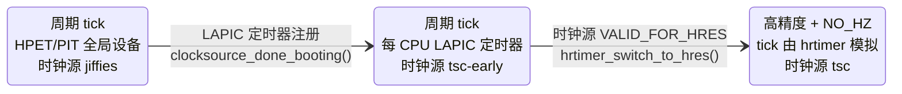

# 8.1 时间子系统概览：硬件、分层与时间表示

> **本节源码**：[`include/linux/jiffies.h`](../../linux/include/linux/jiffies.h)、[`include/vdso/jiffies.h`](../../linux/include/vdso/jiffies.h)、[`include/linux/types.h`](../../linux/include/linux/types.h)、[`include/linux/time64.h`](../../linux/include/linux/time64.h)、[`include/uapi/linux/time.h`](../../linux/include/uapi/linux/time.h)、[`kernel/time/timer.c`](../../linux/kernel/time/timer.c)、[`arch/x86/kernel/vmlinux.lds.S`](../../linux/arch/x86/kernel/vmlinux.lds.S)、[`arch/x86/kernel/time.c`](../../linux/arch/x86/kernel/time.c)、[`init/main.c`](../../linux/init/main.c)
> **关键函数**：`start_kernel()`、`tick_init()`、`timers_init()`、`hrtimers_init()`、`timekeeping_init()`、`time_init()`、`x86_late_time_init()`、`tsc_init()`、`time_after()`
> **前置知识**：5.5 中断控制器（LAPIC 定时器）、5.9 软中断、7.5 顺序锁

## 概述

内核与时间打交道，归结起来是三个问题：

1. **现在几点？**——维护一个连续、单调、尽可能准确的时间，供 `clock_gettime()`、文件时间戳、调度器记账等使用。这是**时间维护**（Timekeeping）的职责。
2. **过多久做某事？**——在未来某个时刻执行回调：网络重传、I/O 超时、`nanosleep()`、POSIX 定时器。这是**定时器**（Timer）的职责。
3. **谁来按时打断 CPU？**——无论是推进时间还是触发定时器，最终都需要硬件在指定时刻产生中断。这是**时钟事件**（Clock Event）与 **tick** 的职责。

Linux 把这三件事拆成相互独立的层次：最底层用两类硬件抽象分别回答"读时间"与"定时中断"，中间层在它们之上构建 timekeeping、tick 与两套定时器，最上层再向用户态导出 POSIX 时钟、定时器和 vDSO。本节先给出这张全景图，再介绍贯穿全章的几种时间表示和启动时的初始化顺序；之后各节自底向上逐层展开。

## 两类时钟硬件

时钟硬件按用途分为两类，内核分别用两种结构体抽象：

| 抽象 | 结构体 | 回答的问题 | 典型能力 | x86 上的实例 |
|---|---|---|---|---|
| 时钟源（Clocksource） | `struct clocksource` | 现在计数器读数是多少 | 只读、自由运行、单调递增 | TSC、HPET 主计数器、ACPI PM 定时器、PIT、kvm-clock |
| 时钟事件设备（Clock Event Device） | `struct clock_event_device` | 在某时刻给我一个中断 | 可编程、单次或周期触发 | LAPIC 定时器（含 TSC-deadline 模式）、HPET 比较器、PIT |

*表 8-1：两类时钟硬件抽象*

二者的区别在于"读"与"写"：时钟源只需要能被**读**，读得越快、分辨率越高、越稳定越好；时钟事件设备需要能被**编程**，最好是每个 CPU 一个、在深度 idle 中也不停振。同一块硬件可能同时扮演两种角色（HPET 既有自由运行的主计数器，又有可编程的比较器），但内核仍把它拆成一个时钟源和若干个时钟事件设备分别注册。

x86_64 上最重要的组合是：**TSC 作时钟源，LAPIC 定时器作时钟事件设备**。时间戳计数器（Time Stamp Counter，TSC）是每个逻辑 CPU 内部的 64 位周期计数器，一条 `rdtsc` 指令即可读取；LAPIC 定时器是每个 CPU 私有的可编程定时器（5.5 节），在支持 TSC-deadline 模式的 CPU 上直接以 TSC 值作为到期时刻。高精度事件定时器（High Precision Event Timer，HPET）、ACPI PM 定时器、PIT 等较老的硬件主要用于启动早期、TSC 校准，以及在 LAPIC 定时器于深度 C-state 停振时充当 tick 广播设备（8.6 节）。

## 软件分层

```
 用户态    clock_gettime() / gettimeofday()      timer_create() / setitimer() / timerfd     nanosleep()
              │  vDSO（8.12）                            │                                  │
 ─────────────┼──────────────────────────────────────────┼──────────────────────────────────┼──────────
 系统调用      │  POSIX 时钟 k_clock（8.11）  ───────  POSIX 定时器 / itimer / alarmtimer / timerfd（8.11）
              ▼                                          ▼                                  ▼
 时间维护   timekeeping：timekeeper（8.4） ◀── NTP / adjtimex（8.5）     高精度定时器 hrtimer（8.9）
              │ update_wall_time()                       ▲      ▲                 时间轮 timer_list（8.7）
              │                                          │      │ tick_nohz_handler       ▲  迁移层次（8.8）
 tick 层      └──── tick-sched：周期 tick 模拟 / NO_HZ（8.10） ──┘                        │
                              │ jiffies_64++ / update_process_times() ───────────────────┘ TIMER_SOFTIRQ
                              ▲ event_handler（hrtimer_interrupt / tick_handle_periodic）
 硬件抽象   clocksource 框架（8.2）                  clockevents 框架 / tick_device（8.6）
              ▲ read()                                  ▲ set_next_event()
 硬件       TSC / HPET / ACPI PM / kvm-clock（8.3）    LAPIC 定时器 / HPET / PIT
```

*图 8-1：Linux 时间子系统的分层结构*

几条主线值得先记住：

- **读时间路径**：`ktime_get()` 等接口读取当前时钟源的计数器，减去上次更新时的读数，按 `mult`/`shift` 换算成纳秒，再加上 timekeeper 中保存的基准时间（8.4 节）。用户态经 vDSO 走同样的计算，只是数据来自一页只读共享内存（8.12 节）。
- **中断路径**：时钟事件设备到期 → `sysvec_apic_timer_interrupt()`（5.2、5.5 节）→ 设备的 `event_handler`。高精度模式下这个处理函数是 `hrtimer_interrupt()`，它运行到期的高精度定时器，其中之一就是模拟周期 tick 的 `tick_sched_timer`（8.9、8.10 节）。
- **tick 的副作用**：tick 回调推进 `jiffies_64` 与 timekeeper，调用 `update_process_times()` 完成进程时间记账、触发 `TIMER_SOFTIRQ`、驱动调度器的 `sched_tick()`（3.5 节）。时间轮中的定时器在 `TIMER_SOFTIRQ` 中执行（8.7 节）。
- **两套定时器**：时间轮（`timer_list`）以 jiffy 为单位、精度随超时长度降低，专为"多数会被取消的超时"优化；hrtimer 以纳秒为单位、用红黑树精确排序，服务于 `nanosleep()`、POSIX 定时器和 tick 本身。

## 时间的表示

内核中同时存在多种时间表示，各有适用场合：

| 类型 | 定义 | 单位 / 范围 | 用途 |
|---|---|---|---|
| `jiffies` / `jiffies_64` | `unsigned long` / `u64` | tick 数，`HZ` 次每秒 | 时间轮、粗粒度超时 |
| `ktime_t` | `s64` | 纳秒，约 ±292 年 | hrtimer、timekeeping 内部 |
| `struct timespec64` | `time64_t tv_sec` + `long tv_nsec` | 秒 + 纳秒 | 与用户态交换、墙上时间 |
| 时钟源周期数 | `u64` | 硬件计数，经 `mult`/`shift` 换算 | timekeeping 读时间 |

*表 8-2：内核中常见的时间表示*

### ktime_t 与 timespec64

[`include/linux/types.h:126`](../../linux/include/linux/types.h#L126)（v6.18.60）

```c
typedef s64	ktime_t;
```

[`include/linux/time64.h:13-16`](../../linux/include/linux/time64.h#L13-L16)（v6.18.60）

```c
struct timespec64 {
	time64_t	tv_sec;			/* seconds */
	long		tv_nsec;		/* nanoseconds */
};
```

`ktime_t` 曾经是一个在 32 位平台上拆成秒和纳秒两部分的联合体，如今统一为 64 位有符号纳秒数，加减比较都是普通整数运算，这正是 hrtimer 与 timekeeping 内部偏爱它的原因。`timespec64` 则是 Y2038 改造后的标准秒 / 纳秒对，`time64_t` 为 64 位，与用户态交换时间时使用（`CONFIG_COMPAT_32BIT_TIME=y` 时，内核仍保留处理 32 位 `old_timespec32` 的兼容系统调用，如 `clock_gettime32`）。

### POSIX 时钟 ID

用户态通过时钟 ID 选择"哪一种时间"。v6.18.60 定义的时钟如下：

[`include/uapi/linux/time.h:49-76`](../../linux/include/uapi/linux/time.h#L49-L76)（v6.18.60）

```c
#define CLOCK_REALTIME			0
#define CLOCK_MONOTONIC			1
#define CLOCK_PROCESS_CPUTIME_ID	2
#define CLOCK_THREAD_CPUTIME_ID		3
#define CLOCK_MONOTONIC_RAW		4
#define CLOCK_REALTIME_COARSE		5
#define CLOCK_MONOTONIC_COARSE		6
#define CLOCK_BOOTTIME			7
#define CLOCK_REALTIME_ALARM		8
#define CLOCK_BOOTTIME_ALARM		9
/*
 * The driver implementing this got removed. The clock ID is kept as a
 * place holder. Do not reuse!
 */
#define CLOCK_SGI_CYCLE			10
#define CLOCK_TAI			11

#define MAX_CLOCKS			16
...
#define CLOCK_AUX			MAX_CLOCKS
#define MAX_AUX_CLOCKS			8
#define CLOCK_AUX_LAST			(CLOCK_AUX + MAX_AUX_CLOCKS - 1)
```

| 时钟 | 语义 | 能否被设置 / 调整 | 挂起期间是否前进 |
|---|---|---|---|
| `CLOCK_REALTIME` | 墙上时间（Wall Time），UTC 自 1970-01-01 起 | 可设置、可被 NTP 调频 | 是 |
| `CLOCK_MONOTONIC` | 单调时钟（Monotonic Clock），启动时为 0 附近 | 不可设置，但受 NTP 调频 | 否 |
| `CLOCK_MONOTONIC_RAW` | 硬件原始单调时间 | 不受 NTP 影响 | 否 |
| `CLOCK_BOOTTIME` | 单调时间 + 累计挂起时间 | 不可设置 | 是 |
| `CLOCK_TAI` | 国际原子时，= REALTIME + TAI 偏移（无闰秒） | 随 REALTIME | 是 |
| `*_COARSE` | 上一次 tick 更新时的值，不读硬件 | 同对应时钟 | 同对应时钟 |
| `*_ALARM` | 对应时钟的定时器能把系统从挂起中唤醒 | — | — |
| `CLOCK_*_CPUTIME_ID` | 进程 / 线程消耗的 CPU 时间 | — | — |
| `CLOCK_AUX` ～ `CLOCK_AUX + 7` | 辅助时钟（Auxiliary Clock，v6.17，`CONFIG_POSIX_AUX_CLOCKS`），可独立调频 | 可设置、可调频 | 否 |

*表 8-3：POSIX 时钟的语义*

除 CPU 时间时钟外，所有时钟都由同一个 timekeeper 派生：timekeeper 维护 `CLOCK_MONOTONIC` 的基准，REALTIME、BOOTTIME、TAI 只是在它之上加不同的偏移（`offs_real`、`offs_boot`、`offs_tai`），这是 8.4 节的核心内容。辅助时钟是 v6.17 引入的新特性，每个辅助时钟拥有一个独立的 timekeeper，用于 PTP 等需要跟踪外部时间域、又不想影响系统时间的场景，本书配置开启了 `CONFIG_POSIX_AUX_CLOCKS`。

### jiffies 与 HZ

jiffies 是内核最古老的时间单位：每发生一次 tick，`jiffies_64` 加 1。`HZ` 是每秒 tick 数，本书配置 `CONFIG_HZ=1000`，即 1 jiffy = 1 ms。

[`include/linux/jiffies.h:85-86`](../../linux/include/linux/jiffies.h#L85-L86)（v6.18.60）

```c
extern u64 __cacheline_aligned_in_smp jiffies_64;
extern unsigned long volatile __cacheline_aligned_in_smp __jiffy_arch_data jiffies;
```

[`kernel/time/timer.c:60`](../../linux/kernel/time/timer.c#L60)（v6.18.60）

```c
__visible u64 jiffies_64 __cacheline_aligned_in_smp = INITIAL_JIFFIES;
```

C 代码中只定义了 `jiffies_64`，`jiffies` 并没有 C 定义——它由链接脚本声明为 `jiffies_64` 的别名：

[`arch/x86/kernel/vmlinux.lds.S:45`](../../linux/arch/x86/kernel/vmlinux.lds.S#L45)（v6.18.60）

```
jiffies = jiffies_64;
```

在 x86_64 上二者是同一个 64 位变量，只是类型不同：`jiffies` 是 `volatile unsigned long`，每次访问都重新读内存。32 位小端平台上 `jiffies` 是 `jiffies_64` 的低 32 位，读取完整的 64 位值必须通过 `get_jiffies_64()` 在 `jiffies_seq` 顺序锁保护下进行（[`kernel/time/jiffies.c:47-60`](../../linux/kernel/time/jiffies.c#L47-L60)）；64 位平台上 `get_jiffies_64()` 直接返回 `jiffies`（[`include/linux/jiffies.h:99-102`](../../linux/include/linux/jiffies.h#L99-L102)）。

`jiffies_64` 的初值不是 0：

[`include/linux/jiffies.h:316-320`](../../linux/include/linux/jiffies.h#L316-L320)（v6.18.60）

```c
/*
 * Have the 32-bit jiffies value wrap 5 minutes after boot
 * so jiffies wrap bugs show up earlier.
 */
#define INITIAL_JIFFIES ((unsigned long)(unsigned int) (-300*HZ))
```

初值设为"32 位回绕前 300 秒"，让依赖 jiffies 不回绕的错误代码在启动 5 分钟后就暴露出来，而不是在运行 49.7 天（HZ=1000 时 32 位 jiffies 的回绕周期）后才出问题。比较 jiffies 时必须使用能正确处理回绕的宏：

[`include/linux/jiffies.h:127-130`](../../linux/include/linux/jiffies.h#L127-L130)（v6.18.60）

```c
#define time_after(a,b)		\
	(typecheck(unsigned long, a) && \
	 typecheck(unsigned long, b) && \
	 ((long)((b) - (a)) < 0))
```

无符号相减再转成有符号数，只要两个时刻相距不超过 `LONG_MAX`，结果的符号就正确反映先后关系。`typecheck()` 在编译期确保参数是 `unsigned long`，防止把 `int` 与 jiffies 混用导致截断。

与 jiffies 相关的几个常量：

| 常量 | 定义位置 | 本书配置下的值 | 含义 |
|---|---|---|---|
| `HZ` | `CONFIG_HZ` | 1000 | 每秒 tick 数 |
| `TICK_NSEC` | [`include/vdso/jiffies.h:9`](../../linux/include/vdso/jiffies.h#L9) | 1000000 | 一个 tick 的纳秒数 |
| `TICK_USEC` | [`include/linux/jiffies.h:65`](../../linux/include/linux/jiffies.h#L65) | 1000 | 一个 tick 的微秒数 |
| `USER_HZ` | [`include/uapi/asm-generic/param.h:6`](../../linux/include/uapi/asm-generic/param.h#L6) | 100 | `times()`、`/proc/<pid>/stat` 等接口的时间单位 |

*表 8-4：与 jiffies 相关的常量*

`USER_HZ` 与 `HZ` 解耦，使内核修改 `HZ` 时不破坏用户态 ABI，`jiffies_to_clock_t()` 负责二者之间的换算。

> **NO_HZ 下的 jiffies**：开启 `NO_HZ` 后 tick 可以停止，jiffies 不再"每个 tick 加 1"，而是在 tick 恢复或中断进入时按实际流逝的时间一次补足多个 tick（`tick_do_update_jiffies64()`，8.10 节）。因此 jiffies 依然是"自启动以来经过的 tick 数"，但其更新不再是周期性的。

## 启动时的初始化顺序

时间子系统的初始化分散在启动过程的多个阶段。`start_kernel()` 中与时间相关的调用集中在中断初始化之后：

[`init/main.c:977-984`](../../linux/init/main.c#L977-L984)（v6.18.60）

```c
	tick_init();
	rcu_init_nohz();
	timers_init();
	srcu_init();
	hrtimers_init();
	softirq_init();
	timekeeping_init();
	time_init();
```

[`init/main.c:1034-1037`](../../linux/init/main.c#L1034-L1037)（v6.18.60）

```c
	if (late_time_init)
		late_time_init();
	sched_clock_init();
	calibrate_delay();
```

x86 的 `time_init()` 只是登记一个延后执行的回调，真正的硬件初始化要等 `ioremap` 可用之后：

[`arch/x86/kernel/time.c:67-96`](../../linux/arch/x86/kernel/time.c#L67-L96)（v6.18.60）

```c
static __init void x86_late_time_init(void)
{
	/*
	 * Before PIT/HPET init, select the interrupt mode. This is required
	 * to make the decision whether PIT should be initialized correct.
	 */
	x86_init.irqs.intr_mode_select();

	/* Setup the legacy timers */
	x86_init.timers.timer_init();

	/*
	 * After PIT/HPET timers init, set up the final interrupt mode for
	 * delivering IRQs.
	 */
	x86_init.irqs.intr_mode_init();
	tsc_init();

	if (static_cpu_has(X86_FEATURE_WAITPKG))
		use_tpause_delay();
}

/*
 * Initialize TSC and delay the periodic timer init to
 * late x86_late_time_init() so ioremap works.
 */
void __init time_init(void)
{
	late_time_init = x86_late_time_init;
}
```

把整个过程串起来：

```
setup_arch()                                arch/x86/kernel/setup.c
└── tsc_early_init()                        arch/x86/kernel/tsc.c       // CPUID/MSR 快速获取 TSC 频率，启用 TSC 版 sched_clock（8.3）
start_kernel()                              init/main.c
├── tick_init()                             kernel/time/tick-common.c   // 广播掩码、nohz_full 初始化
├── timers_init()                           kernel/time/timer.c         // 每 CPU timer_base，注册 TIMER_SOFTIRQ（8.7）
├── hrtimers_init()                         kernel/time/hrtimer.c       // 启动 CPU 的 hrtimer_cpu_base，注册 HRTIMER_SOFTIRQ（8.9）
├── timekeeping_init()                      kernel/time/timekeeping.c   // 读 RTC 得到墙上时间，以 jiffies 时钟源启动（8.4）
├── time_init()                             arch/x86/kernel/time.c      // 登记 x86_late_time_init
├── ... local_irq_enable() ...
└── late_time_init() = x86_late_time_init()
    ├── x86_init.timers.timer_init()        // hpet_time_init()：HPET 或 PIT 作为全局时钟事件设备，提供最初的周期 tick
    ├── x86_init.irqs.intr_mode_init()      // 启用 APIC，校准并注册 BSP 的 LAPIC 定时器（8.6）
    └── tsc_init()                          // 注册 tsc-early 时钟源（8.3）
kernel_init() → kernel_init_freeable()       init/main.c
├── do_pre_smp_initcalls()
│   └── early_initcall(tmigr_init)          kernel/time/timer_migration.c   // 定时器迁移层次（8.8）
└── do_basic_setup() → do_initcalls()
    ├── fs_initcall(clocksource_done_booting)   kernel/time/clocksource.c   // 允许切换时钟源，选出评级最高者（通常为 tsc-early，8.2）
    └── device_initcall(init_tsc_clocksource)   arch/x86/kernel/tsc.c       // 精校准后注册 tsc，替换 tsc-early（8.3）
之后某个 tick：hrtimer_run_queues() → tick_check_oneshot_change() → hrtimer_switch_to_hres()   // 切换到高精度 / NO_HZ 模式（8.9、8.10）
```

这个顺序揭示了一个重要事实：**系统是以最差的配置启动、再逐步升级的**。`timekeeping_init()` 时还没有任何像样的时钟源，timekeeper 先挂在精度只有 1 个 jiffy 的 `jiffies` 时钟源上；tick 最初由 HPET/PIT 以周期模式产生，然后切换到每个 CPU 的 LAPIC 定时器；TSC 先以 `tsc-early` 身份登记，`fs_initcall` 阶段才真正被选为时钟源，`device_initcall` 阶段完成精校准后再换成正式的 `tsc`；只有当时钟源被 watchdog 认可为"可用于高精度"（`CLOCK_SOURCE_VALID_FOR_HRES`）、且时钟事件设备支持单次触发后，tick 层才切换到高精度模式与 NO_HZ。每一次升级都通过通知机制完成：`timekeeping_notify()` 切换时钟源，`tick_clock_notify()` / `tick_oneshot_notify()` 置位 `check_clocks`，下一个 tick 中 `hrtimer_run_queues()` 检查到后再做模式切换。



*图 8-2：启动过程中时间子系统的三个阶段*

## 关键细节 / 设计考量

### 为什么拆成 clocksource 与 clockevent

早期 Linux 把"读时间"与"产生 tick"绑在一起：每次 PIT 中断让 jiffies 与墙上时间各前进一个固定步长，两次中断之间的时间靠插值估算，代码按架构各写一套。2006—2007 年 John Stultz 的通用时间维护框架（v2.6.18）与 Thomas Gleixner 的 clockevents/hrtimer 框架（v2.6.21）把二者解耦：timekeeping 只关心"从时钟源读出多少周期"，而不关心 tick 何时到来；tick 不再推进时间，只是"顺便"调用一次 `update_wall_time()` 把累计的周期折算进 timekeeper。这一解耦是 NO_HZ 得以实现的前提——tick 停掉一秒钟，时间也不会少走一秒，因为下一次读时钟源时差值自然包含了这一秒。

### 精度、分辨率与开销

时钟源的分辨率决定了"能读多细"：TSC 在 GHz 级别，分辨率亚纳秒；ACPI PM 定时器为 3.579545 MHz，约 280 ns；`jiffies` 时钟源只有 1 ms。时钟事件设备的分辨率决定了"能多精确地被打断"：TSC-deadline 模式下以 TSC 周期为单位编程。两者都高，hrtimer 才能真正提供微秒乃至更细的定时精度。另一方面，读取开销同样重要：`rdtsc` 只需几十个周期，HPET 读一次是一次 MMIO 访问，开销可达微秒级，这也是 HPET 作为时钟源时 `clock_gettime()` 性能急剧下降的原因（8.3、8.12 节）。

## 动手实验

以下命令在 dev 虚拟机中执行，输出依虚拟化平台而定。

```bash
# 当前与可用的时钟源（8.2 节）
cat /sys/devices/system/clocksource/clocksource0/current_clocksource
cat /sys/devices/system/clocksource/clocksource0/available_clocksource

# 每个 CPU 的 tick 设备与广播设备（8.6 节）
cat /sys/devices/system/clockevents/clockevent0/current_device
cat /sys/devices/system/clockevents/broadcast/current_device

# 启动日志中的时钟初始化过程
dmesg | grep -Ei 'clocksource|tsc|hpet|clockevents|hrtimer|NO_HZ'

# 观察 jiffies：/proc/timer_list 的每 CPU tick 状态中包含当前 jiffies 值
sudo grep -m1 '^jiffies' /proc/timer_list

# 比较各时钟的当前值
python3 - <<'EOF'
import time
for name in ("CLOCK_REALTIME", "CLOCK_MONOTONIC", "CLOCK_MONOTONIC_RAW",
             "CLOCK_BOOTTIME", "CLOCK_TAI"):
    print(f"{name:22s} {time.clock_gettime(getattr(time, name)):.9f}")
EOF
```

`dmesg` 中可以依次看到 `tsc: Detected ... MHz processor`、`clocksource: hpet: ...`、`clocksource: Switched to clocksource tsc-early`、`tsc: Refined TSC clocksource calibration`、`clocksource: Switched to clocksource tsc` 等行，对应图 8-2 中的阶段切换。虚拟机中可能看到 `kvm-clock` 被选为时钟源（8.3 节）。

## 小结

- 时间子系统回答三个问题：现在几点（timekeeping）、过多久做事（定时器）、谁按时打断 CPU（时钟事件与 tick）。
- 硬件被抽象为两类：只读的时钟源 `clocksource` 与可编程的时钟事件设备 `clock_event_device`；x86_64 上典型组合是 TSC + LAPIC 定时器。
- 内核时间表示包括 jiffies、`ktime_t`（64 位纳秒）、`timespec64` 与时钟源周期数；除 CPU 时间时钟外，所有 POSIX 时钟都由 timekeeper 的单调基准加偏移派生。
- `jiffies` 是链接脚本中 `jiffies_64` 的别名，初值为 32 位回绕前 5 分钟，比较时必须使用 `time_after()` 系列宏。
- 系统以 jiffies 时钟源与 HPET/PIT 周期 tick 启动，经 LAPIC 定时器、`tsc-early`、`tsc` 逐步升级，最终切换到高精度与 NO_HZ 模式。

## 参考

- `linux/Documentation/timers/timekeeping.rst`（clocksource 与 clockevent 的设计说明）
- `linux/Documentation/core-api/timekeeping.rst`（`ktime_get()` 系列接口说明）
- `linux/Documentation/timers/highres.rst`
- Thomas Gleixner, Douglas Niehaus, "Hrtimers and Beyond: Transforming the Linux Time Subsystems", OLS 2006
- John Stultz, Nishanth Aravamudan, Darren Hart, "We Are Not Getting Any Younger: A New Approach to Time and Timers", OLS 2005
