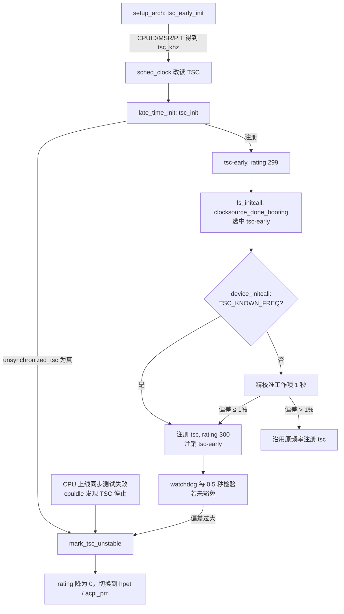

# 8.3 x86 时钟硬件：TSC、HPET 与 kvm-clock

> **本节源码**：[`arch/x86/kernel/tsc.c`](../../linux/arch/x86/kernel/tsc.c)、[`arch/x86/kernel/tsc_sync.c`](../../linux/arch/x86/kernel/tsc_sync.c)、[`arch/x86/include/asm/tsc.h`](../../linux/arch/x86/include/asm/tsc.h)、[`arch/x86/kernel/hpet.c`](../../linux/arch/x86/kernel/hpet.c)、[`arch/x86/kernel/kvmclock.c`](../../linux/arch/x86/kernel/kvmclock.c)、[`arch/x86/kernel/pvclock.c`](../../linux/arch/x86/kernel/pvclock.c)、[`arch/x86/include/asm/pvclock.h`](../../linux/arch/x86/include/asm/pvclock.h)、[`kernel/sched/clock.c`](../../linux/kernel/sched/clock.c)
> **关键函数**：`rdtsc_ordered()`、`tsc_early_init()`、`tsc_init()`、`determine_cpu_tsc_frequencies()`、`native_calibrate_tsc()`、`pit_hpet_ptimer_calibrate_cpu()`、`tsc_refine_calibration_work()`、`init_tsc_clocksource()`、`check_tsc_sync_target()`、`mark_tsc_unstable()`、`native_sched_clock()`、`kvmclock_init()`
> **前置知识**：8.1 时间子系统概览、8.2 时钟源框架、7.5 顺序锁（latch）

## 概述

时间戳计数器（Time Stamp Counter，TSC）是 x86 处理器内部的一个 64 位计数器，复位时清零，此后按固定节拍递增，用 `rdtsc` 指令即可在用户态或内核态读取，开销只有几十个时钟周期。它几乎是理想的时钟源：快、分辨率高、64 位不回绕。但它的历史并不光彩——早期 TSC 随 CPU 实际频率变化、在深度 C-state 停止计数，多路系统上各 CPU 的 TSC 可能不同步，BIOS 还可能改写它。Linux 中 TSC 相关代码的复杂性几乎全部来自"判断这块 TSC 能不能信"。

本节先分析 TSC 的读取方式与 CPU 特性位，再沿启动顺序看 TSC 频率如何获得与精校准、两个 TSC 时钟源如何先后注册、CPU 之间的同步如何检查，以及 TSC 如何同时作为调度器时钟 `sched_clock()` 的来源。最后简要介绍 HPET 与虚拟机中的 kvm-clock。

## TSC 的特性位

现代 CPU 通过一组 CPUID 特性位声明 TSC 的行为，内核据此决定信任程度：

| 特性位 | `/proc/cpuinfo` | 含义 | 对内核的影响 |
|---|---|---|---|
| `X86_FEATURE_TSC` | `tsc` | 存在 TSC | 前提条件 |
| `X86_FEATURE_CONSTANT_TSC` | `constant_tsc` | TSC 以恒定速率递增，不随 P-state 变化 | 无需 cpufreq 通知；认为跨 CPU 同步 |
| `X86_FEATURE_NONSTOP_TSC` | `nonstop_tsc` | TSC 在 C-state 中不停止 | 二者合称"不变 TSC"（Invariant TSC） |
| `X86_FEATURE_NONSTOP_TSC_S3` | `nonstop_tsc_s3` | 在 S3 挂起中不停止 | TSC 可作挂起计时时钟源 |
| `X86_FEATURE_TSC_KNOWN_FREQ` | `tsc_known_freq` | 频率由 CPUID/MSR 或虚拟化平台给出 | 跳过精校准 |
| `X86_FEATURE_TSC_RELIABLE` | `tsc_reliable` | 已知可靠（部分 SoC、虚拟机） | 不接受 watchdog 检验，跳过同步测试 |
| `X86_FEATURE_TSC_ADJUST` | `tsc_adjust` | 存在 `IA32_TSC_ADJUST` MSR | 可检测并修正 BIOS 对 TSC 的改写 |
| `X86_FEATURE_TSC_DEADLINE_TIMER` | `tsc_deadline_timer` | LAPIC 定时器支持 TSC-deadline 模式 | 时钟事件设备直接以 TSC 编程（8.6 节） |
| `X86_FEATURE_ART` | `art` | 始终运行定时器（Always Running Timer） | 设备时间戳与 TSC 交叉换算 |

*表 8-7：与 TSC 相关的 CPU 特性位*

定义见 [`arch/x86/include/asm/cpufeatures.h:80-103`](../../linux/arch/x86/include/asm/cpufeatures.h#L80-L103) 与 [`arch/x86/include/asm/cpufeatures.h:234`](../../linux/arch/x86/include/asm/cpufeatures.h#L234)。

## 读取 TSC

作为时钟源时，TSC 的 `read()` 回调只有一行：

[`arch/x86/kernel/tsc.c:1132-1135`](../../linux/arch/x86/kernel/tsc.c#L1132-L1135)（v6.18.60）

```c
static u64 read_tsc(struct clocksource *cs)
{
	return (u64)rdtsc_ordered();
}
```

[`arch/x86/include/asm/tsc.h:39-65`](../../linux/arch/x86/include/asm/tsc.h#L39-L65)（v6.18.60）

```c
static __always_inline u64 rdtsc_ordered(void)
{
	EAX_EDX_DECLARE_ARGS(val, low, high);

	/*
	 * The RDTSC instruction is not ordered relative to memory
	 * access.  The Intel SDM and the AMD APM are both vague on this
	 * point, but empirically an RDTSC instruction can be
	 * speculatively executed before prior loads.  An RDTSC
	 * immediately after an appropriate barrier appears to be
	 * ordered as a normal load, that is, it provides the same
	 * ordering guarantees as reading from a global memory location
	 * that some other imaginary CPU is updating continuously with a
	 * time stamp.
	 *
	 * Thus, use the preferred barrier on the respective CPU, aiming for
	 * RDTSCP as the default.
	 */
	asm volatile(ALTERNATIVE_2("rdtsc",
				   "lfence; rdtsc", X86_FEATURE_LFENCE_RDTSC,
				   "rdtscp", X86_FEATURE_RDTSCP)
			: EAX_EDX_RET(val, low, high)
			/* RDTSCP clobbers ECX with MSR_TSC_AUX. */
			:: "ecx");

	return EAX_EDX_VAL(val, low, high);
}
```

`rdtsc` 本身不是序列化指令，CPU 可以把它提前到之前的内存读之前推测执行。对 timekeeping 而言这会造成问题：读者先在顺序锁保护下读出 `cycle_last`，再读 TSC；如果 TSC 被提前读取，得到的值可能小于另一个 CPU 刚写入的 `cycle_last`，差值变成负数。`rdtsc_ordered()` 用 alternatives 机制在启动时把指令改写为 `rdtscp`（支持时优先）或 `lfence; rdtsc`，使 TSC 读取的顺序与普通内存读相同。

即便如此，CPU 之间 TSC 的微小偏差仍可能导致"看到负差值"，这由 timekeeping 的 `max_raw_delta` 检查与 vDSO 的负值过滤兜底（8.2、8.4、8.12 节）。`read_tsc()` 上方的长注释记录了这段历史：早年在驱动中把读数与 `cycle_last` 比较，现在统一移到了核心代码（[`arch/x86/kernel/tsc.c:1116-1131`](../../linux/arch/x86/kernel/tsc.c#L1116-L1131)）。

## 频率获取与校准

TSC 的计数频率必须先知道，才能计算 `mult`/`shift`。内核按可靠程度依次尝试多种方法，并分早晚两个阶段进行。

### 早期：tsc_early_init()

`setup_arch()` 在识别虚拟化平台之后立即调用 `tsc_early_init()`（[`arch/x86/kernel/setup.c:1009-1011`](../../linux/arch/x86/kernel/setup.c#L1009-L1011)），此时还没有 HPET、ACPI，只能依靠 CPUID、MSR 和老式 PIT：

[`arch/x86/kernel/tsc.c:1512-1525`](../../linux/arch/x86/kernel/tsc.c#L1512-L1525)（v6.18.60）

```c
void __init tsc_early_init(void)
{
	if (!boot_cpu_has(X86_FEATURE_TSC))
		return;
	/* Don't change UV TSC multi-chassis synchronization */
	if (is_early_uv_system())
		return;

	snp_secure_tsc_init();

	if (!determine_cpu_tsc_frequencies(true))
		return;
	tsc_enable_sched_clock();
}
```

`determine_cpu_tsc_frequencies(true)` 分别得到 `cpu_khz`（CPU 标称频率）与 `tsc_khz`（TSC 频率），二者在现代 CPU 上通常相等（[`arch/x86/kernel/tsc.c:1449-1491`](../../linux/arch/x86/kernel/tsc.c#L1449-L1491)）：

- `tsc_khz` 优先来自启动参数 `tsc_early_khz=`，其次是 `x86_platform.calibrate_tsc()`，默认实现为 `native_calibrate_tsc()`；虚拟机中可能被替换为 `kvm_get_tsc_khz()` 等。
- `cpu_khz` 来自 `x86_platform.calibrate_cpu()`，早期默认实现 `native_calibrate_cpu_early()` 依次尝试 CPUID 0x16、Intel 的 MSR、PIT 快速校准（[`arch/x86/kernel/tsc.c:910-922`](../../linux/arch/x86/kernel/tsc.c#L910-L922)）。
- 若 `tsc_khz` 为 0 则以 `cpu_khz` 代替；若二者相差超过 10%，以 `tsc_khz` 为准。

`native_calibrate_tsc()` 读取 CPUID 0x15 叶，它给出"TSC 频率 / 晶振频率"的比值以及晶振频率：

[`arch/x86/kernel/tsc.c:663-682`](../../linux/arch/x86/kernel/tsc.c#L663-L682)（v6.18.60）

```c
unsigned long native_calibrate_tsc(void)
{
	unsigned int eax_denominator, ebx_numerator, ecx_hz, edx;
	unsigned int crystal_khz;

	if (boot_cpu_data.x86_vendor != X86_VENDOR_INTEL)
		return 0;

	if (boot_cpu_data.cpuid_level < CPUID_LEAF_TSC)
		return 0;

	eax_denominator = ebx_numerator = ecx_hz = edx = 0;

	/* CPUID 15H TSC/Crystal ratio, plus optionally Crystal Hz */
	cpuid(CPUID_LEAF_TSC, &eax_denominator, &ebx_numerator, &ecx_hz, &edx);

	if (ebx_numerator == 0 || eax_denominator == 0)
		return 0;

	crystal_khz = ecx_hz / 1000;
```

TSC 频率 = 晶振频率 × EBX / EAX。CPUID 直接报告了晶振频率时，内核强制置位 `X86_FEATURE_TSC_KNOWN_FREQ`，认为这是"硬件报告的、目前最准确的频率"（[`arch/x86/kernel/tsc.c:693-699`](../../linux/arch/x86/kernel/tsc.c#L693-L699)）；部分 SoC 不报告晶振频率，则借助 CPUID 0x16 的基础频率反推。函数末尾还有一个附带收获：

[`arch/x86/kernel/tsc.c:724-735`](../../linux/arch/x86/kernel/tsc.c#L724-L735)（v6.18.60）

```c
#ifdef CONFIG_X86_LOCAL_APIC
	/*
	 * The local APIC appears to be fed by the core crystal clock
	 * (which sounds entirely sensible). We can set the global
	 * lapic_timer_period here to avoid having to calibrate the APIC
	 * timer later.
	 */
	lapic_timer_period = crystal_khz * 1000 / HZ;
#endif

	return crystal_khz * ebx_numerator / eax_denominator;
}
```

LAPIC 定时器由同一个晶振驱动，因此顺便算出每个 tick 对应的 LAPIC 计数，免去 8.6 节要介绍的 LAPIC 定时器校准。这个函数只处理 Intel 处理器，对其他厂商直接返回 0（见上面代码开头的厂商检查），此时频率改由 `cpu_khz` 的测量值给出。

得到频率后，`tsc_enable_sched_clock()`（[`arch/x86/kernel/tsc.c:1501-1510`](../../linux/arch/x86/kernel/tsc.c#L1501-L1510)）设置 `loops_per_jiffy`、把 `udelay()` 切换为基于 TSC 的实现（8.13 节）、检查 `TSC_ADJUST`、初始化启动 CPU 的 `cyc2ns` 换算参数，最后打开 `__use_tsc` 静态键，从此 `sched_clock()` 改读 TSC。这一切发生在 `start_kernel()` 之前，所以 printk 时间戳在很早的阶段就是精确的。

### 晚期：tsc_init()

`x86_late_time_init()` 中调用的 `tsc_init()`（[`arch/x86/kernel/tsc.c:1527-1570`](../../linux/arch/x86/kernel/tsc.c#L1527-L1570)）运行时 HPET 与 ACPI PM 定时器已经可用。如果早期没能得到频率，它会调用 `pit_hpet_ptimer_calibrate_cpu()` 再测一次：用 PIT 通道 2 定时 10 ms，同时以 HPET 或 PM 定时器作参照，最多重复 3 次，两种测量相差在 10% 以内时采用参照值（[`arch/x86/kernel/tsc.c:758-905`](../../linux/arch/x86/kernel/tsc.c#L758-L905)）。随后它完成以下工作：

1. `cyc2ns_init_secondary_cpus()`：把启动 CPU 的换算参数复制给所有 CPU。
2. `check_system_tsc_reliable()`：判断是否可以免除 watchdog 检验（见下文）。
3. `unsynchronized_tsc()`：粗略判断 TSC 是否跨 CPU 同步，若否直接 `mark_tsc_unstable("TSCs unsynchronized")`。
4. 以 `tsc_khz` 注册 rating 为 299 的 `tsc-early` 时钟源。

### 精校准与 tsc 时钟源

[`arch/x86/kernel/tsc.c:1411-1442`](../../linux/arch/x86/kernel/tsc.c#L1411-L1442)（v6.18.60）

```c
static int __init init_tsc_clocksource(void)
{
	if (!boot_cpu_has(X86_FEATURE_TSC) || !tsc_khz)
		return 0;

	if (tsc_unstable) {
		clocksource_unregister(&clocksource_tsc_early);
		return 0;
	}

	if (boot_cpu_has(X86_FEATURE_NONSTOP_TSC_S3))
		clocksource_tsc.flags |= CLOCK_SOURCE_SUSPEND_NONSTOP;

	/*
	 * When TSC frequency is known (retrieved via MSR or CPUID), we skip
	 * the refined calibration and directly register it as a clocksource.
	 */
	if (boot_cpu_has(X86_FEATURE_TSC_KNOWN_FREQ)) {
		if (boot_cpu_has(X86_FEATURE_ART)) {
			have_art = true;
			clocksource_tsc.base = &art_base_clk;
		}
		clocksource_register_khz(&clocksource_tsc, tsc_khz);
		clocksource_unregister(&clocksource_tsc_early);

		if (!tsc_force_recalibrate)
			return 0;
	}

	schedule_delayed_work(&tsc_irqwork, 0);
	return 0;
}
```

`device_initcall` 阶段（此时 HPET 已在 `fs_initcall` 阶段完成初始化）：频率已知时直接注册 `tsc` 并注销 `tsc-early`；否则启动一个延迟工作项 `tsc_refine_calibration_work()`，用 1 秒钟的时间做一次更精确的测量。

精校准的思路很简单：第一次运行时同时读取 TSC 与 HPET（或 PM 定时器），记下起点并让自己 1 秒后再运行；第二次运行时再读一次，用参照时钟计算这 1 秒内 TSC 走了多少周期：

[`arch/x86/kernel/tsc.c:1355-1388`](../../linux/arch/x86/kernel/tsc.c#L1355-L1388)（v6.18.60，节选）

```c
	delta = tsc_stop - tsc_start;
	delta *= 1000000LL;
	if (hpet)
		freq = calc_hpet_ref(delta, ref_start, ref_stop);
	else
		freq = calc_pmtimer_ref(delta, ref_start, ref_stop);
	...
	/* Make sure we're within 1% */
	if (abs(tsc_khz - freq) > tsc_khz/100)
		goto out;

	tsc_khz = freq;
	pr_info("Refined TSC clocksource calibration: %lu.%03lu MHz\n",
		(unsigned long)tsc_khz / 1000,
		(unsigned long)tsc_khz % 1000);
```

精校准结果与早期结果相差超过 1% 时被丢弃（多半是测量期间被 SMI 等打断）。采纳新频率后，还要通知 LAPIC 的 TSC-deadline 时钟事件设备更新频率（`lapic_update_tsc_freq()`），并为每个 CPU 重设 `cyc2ns` 参数，最后注册 `tsc`、注销 `tsc-early`（[`arch/x86/kernel/tsc.c:1390-1407`](../../linux/arch/x86/kernel/tsc.c#L1390-L1407)）。使用工作项而不是在启动路径上忙等 1 秒，是为了不拖慢启动。

`tsc-early` 与 `tsc` 两个时钟源的区别总结如下：

| | `tsc-early` | `tsc` |
|---|---|---|
| 注册时机 | `tsc_init()`（`late_time_init`） | `init_tsc_clocksource()` 或精校准工作项（`device_initcall` 之后） |
| rating | 299 | 300 |
| 频率 | 早期粗测或 CPUID 值 | 精校准值或 CPUID 值 |
| `uncertainty_margin` | 32 ms（[`arch/x86/kernel/tsc.c:1170`](../../linux/arch/x86/kernel/tsc.c#L1170)） | 按频率计算，下限为 `2 × WATCHDOG_MAX_SKEW` |
| `VALID_FOR_HRES` | 注册时没有，需 watchdog 授予 | 注册时即带有 |
| `VERIFY_PERCPU` | 无 | 有 |

*表 8-8：tsc-early 与 tsc 时钟源*

## TSC 的同步与稳定性

### 系统级判断

[`arch/x86/kernel/tsc.c:1250-1265`](../../linux/arch/x86/kernel/tsc.c#L1250-L1265)（v6.18.60）

```c
	if (boot_cpu_has(X86_FEATURE_TSC_RELIABLE))
		tsc_clocksource_reliable = 1;

	/*
	 * Disable the clocksource watchdog when the system has:
	 *  - TSC running at constant frequency
	 *  - TSC which does not stop in C-States
	 *  - the TSC_ADJUST register which allows to detect even minimal
	 *    modifications
	 *  - not more than four packages
	 */
	if (boot_cpu_has(X86_FEATURE_CONSTANT_TSC) &&
	    boot_cpu_has(X86_FEATURE_NONSTOP_TSC) &&
	    boot_cpu_has(X86_FEATURE_TSC_ADJUST) &&
	    topology_max_packages() <= 4)
		tsc_disable_clocksource_watchdog();
```

满足"不变 TSC + `TSC_ADJUST` + 不超过 4 个封装"时，TSC 的 `MUST_VERIFY` 标志被清除，watchdog 不再检验它（8.2 节）。理由在注释中：有了 `TSC_ADJUST`，即使极小的改写也能被检测出来，HPET 检验反而带来误判风险。超过 4 个封装的大型系统中，封装之间的 TSC 同步依赖主板设计，仍保留检验。

`unsynchronized_tsc()`（[`arch/x86/kernel/tsc.c:1272-1298`](../../linux/arch/x86/kernel/tsc.c#L1272-L1298)）则给出一个保守的启发式判断：没有 TSC 或已标记不稳定时返回真；`CONSTANT_TSC` 或 `tsc=reliable` 时返回假；非 Intel 的多封装系统默认不同步。

### TSC_ADJUST：发现 BIOS 的改写

`IA32_TSC_ADJUST` MSR 记录了对 TSC 的累计调整量：软件写 TSC 时，硬件同时把差值加到 `TSC_ADJUST` 上。同一封装内所有 CPU 的 `TSC_ADJUST` 应当相等，不相等说明有人（通常是 BIOS 或 SMM）单独改写了某个 CPU 的 TSC。

内核在三个时机检查它：

- 每个 CPU 上线时，`tsc_store_and_check_tsc_adjust()`（[`arch/x86/kernel/tsc_sync.c:181-240`](../../linux/arch/x86/kernel/tsc_sync.c#L181-L240)）记下初值；若同一封装中已有在线 CPU 且其值不同，打印 "TSC ADJUST differs within socket(s), fixing all errors" 并把新 CPU 的值改写为已在线 CPU 的值。一个封装内的 CPU 由此被强制同步，可以跳过下面的同步测试。
- CPU 进入 idle 时（[`arch/x86/kernel/process.c:790`](../../linux/arch/x86/kernel/process.c#L790)），以及一个每 10 分钟轮转一个 CPU 的定时器中（[`arch/x86/kernel/tsc_sync.c:93-108`](../../linux/arch/x86/kernel/tsc_sync.c#L93-L108)），`tsc_verify_tsc_adjust()` 每秒至多读一次 MSR，发现值被改写就恢复并告警。
- 从挂起中恢复时，TSC 时钟源的 `resume` 回调强制检查一次。

### 上线时的同步测试

封装中第一个上线的 CPU 无法与同封装的 CPU 比较 `TSC_ADJUST`，需要做一次实测。新 CPU 在启动路径中调用 `check_tsc_sync_target()`（[`arch/x86/kernel/smpboot.c:286`](../../linux/arch/x86/kernel/smpboot.c#L286)），并经 IPI 让第一个在线 CPU 执行 `check_tsc_sync_source()`，两个 CPU 同时运行下面的测量循环：

[`arch/x86/kernel/tsc_sync.c:277-319`](../../linux/arch/x86/kernel/tsc_sync.c#L277-L319)（v6.18.60）

```c
	for (i = 0; ; i++) {
		/*
		 * We take the global lock, measure TSC, save the
		 * previous TSC that was measured (possibly on
		 * another CPU) and update the previous TSC timestamp.
		 */
		arch_spin_lock(&sync_lock);
		prev = last_tsc;
		now = rdtsc_ordered();
		last_tsc = now;
		arch_spin_unlock(&sync_lock);

		/*
		 * Be nice every now and then (and also check whether
		 * measurement is done [we also insert a 10 million
		 * loops safety exit, so we dont lock up in case the
		 * TSC readout is totally broken]):
		 */
		if (unlikely(!(i & 7))) {
			if (now > end || i > 10000000)
				break;
			cpu_relax();
			touch_nmi_watchdog();
		}
		/*
		 * Outside the critical section we can now see whether
		 * we saw a time-warp of the TSC going backwards:
		 */
		if (unlikely(prev > now)) {
			arch_spin_lock(&sync_lock);
			max_warp = max(max_warp, prev - now);
			cur_max_warp = max_warp;
			/*
			 * Check whether this bounces back and forth. Only
			 * one CPU should observe time going backwards.
			 */
			if (cur_warps != nr_warps)
				random_warps++;
			nr_warps++;
			cur_warps = nr_warps;
			arch_spin_unlock(&sync_lock);
		}
	}
```

思路是：两个 CPU 在同一把锁下交替读 TSC 并写入全局的 `last_tsc`。锁保证了读取的先后顺序，如果某次读到的 TSC 比锁内前一次（可能是另一个 CPU 读的）还小，就说明两个 CPU 的 TSC 存在偏差。测量持续 2 ms（同一封装已有其他核在线）或 20 ms（第一个核）。如果只有一个 CPU 观察到倒流，偏差是稳定的，有 `TSC_ADJUST` 时目标 CPU 可以把偏差写入 MSR 补偿后重测，最多 3 轮；如果两边轮流观察到倒流（`random_warps`），说明不是固定偏差，无法补偿，直接放弃。最终失败时打印 "Measured %Ld cycles TSC warp between CPUs, turning off TSC clock." 并经工作项调用 `mark_tsc_unstable()`（[`arch/x86/kernel/tsc_sync.c:389-406`](../../linux/arch/x86/kernel/tsc_sync.c#L389-L406)）。

### 标记不稳定

[`arch/x86/kernel/tsc.c:1207-1220`](../../linux/arch/x86/kernel/tsc.c#L1207-L1220)（v6.18.60）

```c
void mark_tsc_unstable(char *reason)
{
	if (tsc_unstable)
		return;

	tsc_unstable = 1;
	if (using_native_sched_clock())
		clear_sched_clock_stable();
	disable_sched_clock_irqtime();
	pr_info("Marking TSC unstable due to %s\n", reason);

	clocksource_mark_unstable(&clocksource_tsc_early);
	clocksource_mark_unstable(&clocksource_tsc);
}
```

除同步测试外，`mark_tsc_unstable()` 的调用者还包括启动参数 `tsc=unstable`、`notsc`，以及 cpuidle 驱动在发现 TSC 会在某个 C-state 停止时（例如 `intel_idle` 对不带 `NONSTOP_TSC` 的 CPU）。它做三件事：让调度器时钟退回"不稳定"模式（3.5 节）、关闭基于 TSC 的中断时间统计、通知 clocksource 框架降级两个 TSC 时钟源。watchdog 发现偏差时走的是另一条路——`tsc_cs_mark_unstable()` 回调，效果相同，只是不再重复调用 `clocksource_mark_unstable()`（[`arch/x86/kernel/tsc.c:1137-1147`](../../linux/arch/x86/kernel/tsc.c#L1137-L1147)）。



*图 8-4：TSC 时钟源的生命周期*

## TSC 作为调度器时钟

调度器需要一个比 timekeeping 更廉价的纳秒时钟：它在每次上下文切换、每次唤醒都要读时间，可以容忍小误差，但不能容忍锁和顺序锁重试。x86 的 `sched_clock()` 直接读 TSC 并做一次乘法：

[`arch/x86/kernel/tsc.c:236-256`](../../linux/arch/x86/kernel/tsc.c#L236-L256)（v6.18.60）

```c
noinstr u64 native_sched_clock(void)
{
	if (static_branch_likely(&__use_tsc)) {
		u64 tsc_now = rdtsc();

		/* return the value in ns */
		return __cycles_2_ns(tsc_now);
	}

	/*
	 * Fall back to jiffies if there's no TSC available:
	 * ( But note that we still use it if the TSC is marked
	 *   unstable. We do this because unlike Time Of Day,
	 *   the scheduler clock tolerates small errors and it's
	 *   very important for it to be as fast as the platform
	 *   can achieve it. )
	 */

	/* No locking but a rare wrong value is not a big deal: */
	return (jiffies_64 - INITIAL_JIFFIES) * (1000000000 / HZ);
}
```

与时钟源不同，这里用的是普通 `rdtsc`，不加屏障；即使 TSC 被标为不稳定也继续使用（注释说明调度器时钟容忍小误差），不稳定带来的跨 CPU 不单调由 `kernel/sched/clock.c` 中的 `sched_clock_cpu()` 修补（3.5 节）。

换算参数保存在每 CPU 的 `cyc2ns` 中，采用 latch 顺序计数（7.5 节）保护的双副本：

[`arch/x86/kernel/tsc.c:62-89`](../../linux/arch/x86/kernel/tsc.c#L62-L89)（v6.18.60）

```c
struct cyc2ns {
	struct cyc2ns_data data[2];	/*  0 + 2*16 = 32 */
	seqcount_latch_t   seq;		/* 32 + 4    = 36 */

}; /* fits one cacheline */

static DEFINE_PER_CPU_ALIGNED(struct cyc2ns, cyc2ns);
...
__always_inline void __cyc2ns_read(struct cyc2ns_data *data)
{
	int seq, idx;

	do {
		seq = this_cpu_read(cyc2ns.seq.seqcount.sequence);
		idx = seq & 1;

		data->cyc2ns_offset = this_cpu_read(cyc2ns.data[idx].cyc2ns_offset);
		data->cyc2ns_mul    = this_cpu_read(cyc2ns.data[idx].cyc2ns_mul);
		data->cyc2ns_shift  = this_cpu_read(cyc2ns.data[idx].cyc2ns_shift);

	} while (unlikely(seq != this_cpu_read(cyc2ns.seq.seqcount.sequence)));
}
```

`sched_clock()` 可能在 NMI 中被调用（例如 perf 采样打时间戳），普通顺序锁在 NMI 打断写者时会死等；latch 让读者总能读到一份完整的副本。`cyc2ns_data` 除 `mul`、`shift` 外还有一个 `offset`（[`arch/x86/include/asm/timer.h:27-31`](../../linux/arch/x86/include/asm/timer.h#L27-L31)），换算公式为 `ns = offset + (cyc × mul) >> shift`。

`offset` 的作用是在**频率变化时保持连续**：

[`arch/x86/kernel/tsc.c:154-176`](../../linux/arch/x86/kernel/tsc.c#L154-L176)（v6.18.60，节选）

```c
	ns_now = cycles_2_ns(tsc_now);
	...
	clocks_calc_mult_shift(&data.cyc2ns_mul, &data.cyc2ns_shift, khz,
			       NSEC_PER_MSEC, 0);
	...
	data.cyc2ns_offset = ns_now -
		mul_u64_u32_shr(tsc_now, data.cyc2ns_mul, data.cyc2ns_shift);
```

先用旧参数算出当前时刻的纳秒值 `ns_now`，再选取新的 `offset`，使新参数在 `tsc_now` 处得到同一个值。于是精校准修改 `tsc_khz`，或者老 CPU 上 cpufreq 改变 TSC 频率时（`time_cpufreq_notifier()`，仅对不带 `CONSTANT_TSC` 的 CPU 注册，[`arch/x86/kernel/tsc.c:1058-1067`](../../linux/arch/x86/kernel/tsc.c#L1058-L1067)），`sched_clock()` 不会跳变。这里 `maxsec` 传入 0，意味着按"任意大的 `cyc` 都要用 `mul_u64_u32_shr()` 做 128 位乘法"来选取精度最高的参数——`sched_clock()` 换算的是绝对 TSC 值而非差值，不能依赖"差值很小不溢出"。

调度器时钟何时被视为"稳定"，取决于两件事：`kernel/sched/clock.c` 默认假设稳定（`__sched_clock_stable_early = 1`），在 `late_initcall` 阶段正式启用（[`kernel/sched/clock.c:227-244`](../../linux/kernel/sched/clock.c#L227-L244)），这个时机特意放在 `intel_idle` 等可能标记 TSC 不稳定的驱动之后；此后若 `mark_tsc_unstable()` 调用 `clear_sched_clock_stable()`，就退回每 CPU 修正模式。watchdog 每次检验通过时回调 `tsc_cs_tick_stable()` → `sched_clock_tick_stable()`，借机刷新调度器时钟与 GTOD 时间之间的偏移（[`kernel/sched/clock.c:432-447`](../../linux/kernel/sched/clock.c#L432-L447)）。

## HPET

高精度事件定时器（High Precision Event Timer，HPET）是芯片组中的一块 MMIO 设备，包含一个至少 10 MHz（常见 14.318 MHz 或 24 MHz）的主计数器和若干个比较器通道。`hpet_enable()`（[`arch/x86/kernel/hpet.c:991-1105`](../../linux/arch/x86/kernel/hpet.c#L991-L1105)）在 `hpet_time_init()` 中被调用，它：

- 以 rating 250 注册 `hpet` 时钟源，`read()` 为一次 MMIO 读。由于 HPET 的 `vdso_clock_mode` 为 `NONE`，选用它作时钟源时 `clock_gettime()` 无法在 vDSO 中完成，只能陷入内核。
- 若支持传统替代路由（`HPET_ID_LEGSUP`），把通道 0 注册为 rating 50 的全局时钟事件设备（[`arch/x86/kernel/hpet.c:419-427`](../../linux/arch/x86/kernel/hpet.c#L419-L427)），在 LAPIC 定时器可用之前提供周期 tick，之后退居为 tick 广播设备（8.6 节）。
- 在 TSC 校准中充当参照时钟，在 watchdog 中充当检验者（8.2 节）。

HPET 读取一次往往需要数百纳秒到微秒，作为高频读取的时钟源性能很差，现代系统中它的主要价值在于校准、watchdog 与广播。

## 虚拟机中的 kvm-clock

虚拟机中直接使用 TSC 有两个难点：宿主可能在不同频率的物理 CPU 间迁移 vCPU，虚拟机热迁移到另一台主机后 TSC 频率也可能改变。KVM 的半虚拟化时钟（pvclock）方案是：宿主为每个 vCPU 在客户机内存中维护一个结构，记录"某个 TSC 时刻对应的系统时间"以及 TSC 到纳秒的换算系数，客户机读 TSC 后自行换算。

[`arch/x86/include/asm/pvclock-abi.h:26-35`](../../linux/arch/x86/include/asm/pvclock-abi.h#L26-L35)（v6.18.60）

```c
struct pvclock_vcpu_time_info {
	u32   version;
	u32   pad0;
	u64   tsc_timestamp;
	u64   system_time;
	u32   tsc_to_system_mul;
	s8    tsc_shift;
	u8    flags;
	u8    pad[2];
} __attribute__((__packed__)); /* 32 bytes */
```

[`arch/x86/include/asm/pvclock.h:84-90`](../../linux/arch/x86/include/asm/pvclock.h#L84-L90)（v6.18.60）

```c
u64 __pvclock_read_cycles(const struct pvclock_vcpu_time_info *src, u64 tsc)
{
	u64 delta = tsc - src->tsc_timestamp;
	u64 offset = pvclock_scale_delta(delta, src->tsc_to_system_mul,
					     src->tsc_shift);
	return src->system_time + offset;
}
```

`version` 字段的作用与顺序锁的序号相同：宿主更新前后各加 1，客户机读到奇数或前后不一致就重试（[`arch/x86/kernel/pvclock.c:75-79`](../../linux/arch/x86/kernel/pvclock.c#L75-L79)）。kvm-clock 返回的"周期数"已经是纳秒，所以以 `NSEC_PER_SEC` 为频率注册，`mult`/`shift` 换算近似恒等。

`kvmclock_init()`（[`arch/x86/kernel/kvmclock.c:288-349`](../../linux/arch/x86/kernel/kvmclock.c#L288-L349)）在 `init_hypervisor_platform()` 中被调用，早于 `tsc_early_init()`。除注册 rating 为 400 的 `kvm-clock` 时钟源外，它还接管了一系列平台钩子：

[`arch/x86/kernel/kvmclock.c:321-347`](../../linux/arch/x86/kernel/kvmclock.c#L321-L347)（v6.18.60，节选）

```c
	kvm_sched_clock_init(flags & PVCLOCK_TSC_STABLE_BIT);

	x86_platform.calibrate_tsc = kvm_get_tsc_khz;
	x86_platform.calibrate_cpu = kvm_get_tsc_khz;
	x86_platform.get_wallclock = kvm_get_wallclock;
	x86_platform.set_wallclock = kvm_set_wallclock;
	...
	/*
	 * X86_FEATURE_NONSTOP_TSC is TSC runs at constant rate
	 * with P/T states and does not stop in deep C-states.
	 *
	 * Invariant TSC exposed by host means kvmclock is not necessary:
	 * can use TSC as clocksource.
	 *
	 */
	if (boot_cpu_has(X86_FEATURE_CONSTANT_TSC) &&
	    boot_cpu_has(X86_FEATURE_NONSTOP_TSC) &&
	    !check_tsc_unstable())
		kvm_clock.rating = 299;

	clocksource_register_hz(&kvm_clock, NSEC_PER_SEC);
```

- `sched_clock()` 被替换为 `kvm_sched_clock_read()`（经 paravirt 静态调用，[`arch/x86/kernel/kvmclock.c:89-106`](../../linux/arch/x86/kernel/kvmclock.c#L89-L106)）。
- TSC 频率直接取自 pvclock 结构，并置位 `TSC_KNOWN_FREQ`，客户机不再做 PIT/HPET 校准——在宿主繁忙时校准往往不准（[`arch/x86/kernel/kvmclock.c:108-121`](../../linux/arch/x86/kernel/kvmclock.c#L108-L121)）。
- 墙上时间从宿主提供的 wall clock 读取，而不读虚拟 CMOS RTC。
- 宿主暴露了不变 TSC 时，kvm-clock 的 rating 降为 299，低于 `tsc` 的 300，客户机最终选用 TSC。注释的意思是：TSC 已经可靠时，直接读 TSC 比再经过 pvclock 换算更简单。

kvm-clock 同样支持 vDSO（`VDSO_CLOCKMODE_PVCLOCK`），用户态可以直接读 pvclock 页（8.12 节）。

## 关键细节 / 设计考量

### 为什么时钟源与 sched_clock 用不同的读法

timekeeping 读 TSC 用 `rdtsc_ordered()`，换算用时钟源的 `mult`/`shift` 并受 NTP 调频；`sched_clock()` 用裸 `rdtsc`，换算用独立的 `cyc2ns` 参数，不受 NTP 影响。二者服务于不同需求：前者要求跨 CPU 一致、与外部时间对齐；后者要求极快、在 NMI 中可用、只需在单个 CPU 上大致单调。把它们分开，调度器就不必承担 timekeeping 的顺序锁与屏障开销。

### 启动参数速查

| 参数 | 作用 |
|---|---|
| `tsc=reliable` | 视 TSC 为可靠：免除 watchdog 检验与上线同步测试 |
| `tsc=unstable` / `notsc` | 标记 TSC 不稳定，不用作时钟源 |
| `tsc=nowatchdog` | 不让 watchdog 检验 TSC |
| `tsc=watchdog` | 在 TSC 已豁免检验时，反过来用 TSC 检验 HPET / ACPI PM |
| `tsc=recalibrate` | 即使频率已知也做精校准，并报告与 CPUID 值的偏差 |
| `tsc=noirqtime` | 不使用 TSC 统计中断时间 |
| `tsc_early_khz=` | 指定早期 TSC 频率 |
| `clocksource=` | 指定时钟源（8.2 节） |
| `no-kvmclock` | 虚拟机中不使用 kvm-clock |

*表 8-9：与 TSC 相关的启动参数*

解析代码见 [`arch/x86/kernel/tsc.c:323-350`](../../linux/arch/x86/kernel/tsc.c#L323-L350)。

## 动手实验

```bash
# 查看 CPU 声明的 TSC 特性
grep -o -w -E 'tsc|constant_tsc|nonstop_tsc|tsc_known_freq|tsc_reliable|tsc_adjust|tsc_deadline_timer|art' /proc/cpuinfo | sort | uniq -c

# 启动日志中的 TSC 校准与切换过程
dmesg | grep -i -E 'tsc|kvm-clock|hpet|Switched to clocksource|sched_clock'

# 比较不同时钟源下 clock_gettime 的开销（需 root）
for cs in $(cat /sys/devices/system/clocksource/clocksource0/available_clocksource); do
  echo $cs > /sys/devices/system/clocksource/clocksource0/current_clocksource
  printf "%-12s " $cs
  python3 -c 'import time,timeit; print("%.1f ns/call" % (timeit.timeit(lambda: time.clock_gettime_ns(time.CLOCK_MONOTONIC), number=200000)/200000*1e9))'
done
```

在虚拟机中，`dmesg` 通常可以看到 `kvm-clock: Using msrs ...`、`tsc: Detected ... MHz processor`（频率来自 pvclock）以及最终选中的时钟源。比较开销时注意，Python 解释器本身有数十纳秒的调用开销，时钟源之间的差距仍然明显：`tsc` 与 `kvm-clock` 走 vDSO，`hpet`、`acpi_pm` 需要陷入内核并做 I/O。

## 小结

- TSC 是 x86 上首选的时钟源，`rdtsc_ordered()` 以 `rdtscp` 或 `lfence; rdtsc` 保证读取不被提前；一组 CPUID 特性位描述了 TSC 是否恒速、是否在 C-state 中停止、频率是否已知等。
- TSC 频率在 `tsc_early_init()` 中经 CPUID 0x15/0x16、MSR 或 PIT 快速获得，`tsc_init()` 中可借 HPET/PM 定时器复测，`device_initcall` 后再用 1 秒做精校准；`tsc-early`（299）先注册，`tsc`（300）随后接替。
- 不变 TSC + `TSC_ADJUST` + 不超过 4 个封装时 TSC 免除 watchdog 检验；`TSC_ADJUST` 用于发现并修正 BIOS 改写，封装内首个 CPU 上线时通过锁内交替读 TSC 的方式检测跨 CPU 偏差。
- `mark_tsc_unstable()` 降级 TSC 时钟源、让调度器时钟退回不稳定模式；`sched_clock()` 用裸 `rdtsc` 与每 CPU 的 latch 保护参数换算，`offset` 保证频率更新时连续。
- HPET 读取慢，主要用于校准、watchdog 与 tick 广播；KVM 客户机通过 pvclock 获得宿主提供的 TSC 换算参数，宿主暴露不变 TSC 时 kvm-clock 让位于 TSC。

## 参考

- `linux/Documentation/virt/kvm/x86/timekeeping.rst`（虚拟化环境中的时钟问题，详尽介绍 TSC 的历史缺陷）
- `linux/Documentation/timers/hpet.rst`
- `linux/Documentation/admin-guide/kernel-parameters.txt`（`tsc=`、`tsc_early_khz=`、`no-kvmclock`）
- Intel® 64 and IA-32 Architectures Software Developer's Manual, Vol. 3B, "Time-Stamp Counter"、"Invariant TSC"、"IA32_TSC_ADJUST"
