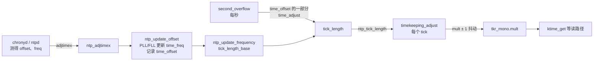
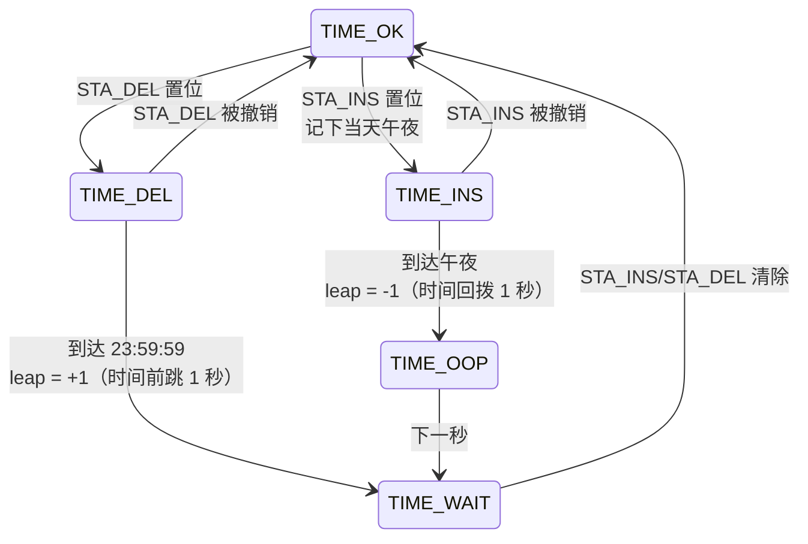

# 8.5 NTP 调频、闰秒与 RTC 同步

> **本节源码**：[`kernel/time/ntp.c`](../../linux/kernel/time/ntp.c)、[`kernel/time/timekeeping.c`](../../linux/kernel/time/timekeeping.c)、[`kernel/time/time.c`](../../linux/kernel/time/time.c)、[`include/linux/timex.h`](../../linux/include/linux/timex.h)、[`arch/x86/kernel/rtc.c`](../../linux/arch/x86/kernel/rtc.c)
> **关键函数**：`do_adjtimex()`、`ntp_adjtimex()`、`ntp_update_offset()`、`ntp_update_frequency()`、`second_overflow()`、`ntp_tick_length()`、`timekeeping_adjust()`、`timekeeping_apply_adjustment()`、`accumulate_nsecs_to_secs()`、`sync_hw_clock()`
> **前置知识**：8.2 时钟源框架（`mult`/`shift`、`maxadj`）、8.4 时间维护

## 概述

即使时钟源本身工作正常，它的标称频率也不可能完全准确：普通晶振有几十 ppm 的偏差，且随温度漂移，一天下来可能误差数秒。网络时间协议（Network Time Protocol，NTP）守护进程（`chronyd`、`ntpd`、`systemd-timesyncd`）通过与外部时间源比对测得本机时钟的**相位偏差**（快了或慢了多少）与**频率偏差**（每秒快慢多少），但它不在用户态频繁地"拨表"，而是把测量结果交给内核，由内核以平滑的方式校正：

- **调相**：把偏差分摊到后续若干秒中逐步消除，而不是让时间跳变；
- **调频**：持续修正时钟的走速，使之与外部时间一致。

内核中的这部分逻辑分两层：`kernel/time/ntp.c` 实现了 RFC 1589/5905 描述的内核时钟规程（Clock Discipline），以锁相环（Phase-Locked Loop，PLL）或锁频环（Frequency-Locked Loop，FLL）算法把用户给出的偏差换算成"每个 tick 应该前进多少纳秒"（tick length）；`timekeeping.c` 则把这个目标值转换成对 `tkr_mono.mult` 的微调，并用误差累计保证长期精确。此外，NTP 层还负责闰秒（Leap Second）的插入与删除，以及每 11 分钟把同步后的时间写回实时时钟（Real-Time Clock，RTC）。

## 系统调用接口

用户态通过 `adjtimex(2)` / `clock_adjtime(2)` 与内核交换 NTP 参数，参数结构为 `struct __kernel_timex`，其 `modes` 字段指明要设置哪些值：

| `modes` 位 | 作用 | 内核中的落点 |
|---|---|---|
| `ADJ_OFFSET` | 提交测得的相位偏差 | `ntp_update_offset()`，更新 `time_offset` 与 `time_freq` |
| `ADJ_FREQUENCY` | 直接设置频率偏差（ppm，16 位小数） | `time_freq`，立即重算 tick length 与 `mult` |
| `ADJ_TICK` | 设置每个 `USER_HZ` tick 的微秒数 | `tick_usec`，粗调 |
| `ADJ_STATUS` | 设置状态位（`STA_PLL`、`STA_INS`、`STA_DEL`、`STA_UNSYNC` 等） | `time_status` |
| `ADJ_TIMECONST` | PLL 时间常数 | `time_constant` |
| `ADJ_TAI` | 设置 TAI − UTC 偏移 | `tai_offset` |
| `ADJ_SETOFFSET` | 一次性跳变时间 | `timekeeping_inject_offset()`（8.4 节） |
| `ADJ_OFFSET_SINGLESHOT` | 传统 `adjtime(3)` 语义的缓慢调整 | `time_adjust` |
| `ADJ_MAXERROR` / `ADJ_ESTERROR` | 报告误差估计 | 仅记录，供用户查询 |

*表 8-12：adjtimex 的主要模式位*

调用链如下：

```
SYSCALL_DEFINE1(adjtimex)                   kernel/time/time.c
└── do_adjtimex()                           kernel/time/timekeeping.c
    └── __do_adjtimex(&tk_core, ...)
        ├── timekeeping_validate_timex()                    // 参数检查、CAP_SYS_TIME 权限
        ├── __timekeeping_inject_offset()                   // ADJ_SETOFFSET
        ├── ntp_adjtimex()                  kernel/time/ntp.c
        │   └── process_adjtimex_modes()
        │       ├── ntp_update_offset()                     // ADJ_OFFSET：PLL/FLL
        │       └── ntp_update_frequency()                  // 重算 tick_length_base
        └── __timekeeping_advance(TK_ADV_FREQ)              // 频率改变时立即重算 mult
    ├── clock_was_set()                                     // 时间跳变时通知 hrtimer
    └── ntp_notify_cmos_timer()                             // 启动或取消 RTC 同步
```

[`kernel/time/timekeeping.c:2701-2757`](../../linux/kernel/time/timekeeping.c#L2701-L2757)（v6.18.60，节选）

```c
static int __do_adjtimex(struct tk_data *tkd, struct __kernel_timex *txc,
			 struct adjtimex_result *result)
{
	struct timekeeper *tks = &tkd->shadow_timekeeper;
	bool aux_clock = !timekeeper_is_core_tk(tks);
	struct timespec64 ts;
	s32 orig_tai, tai;
	int ret;

	/* Validate the data before disabling interrupts */
	ret = timekeeping_validate_timex(txc, aux_clock);
	if (ret)
		return ret;
	...
	guard(raw_spinlock_irqsave)(&tkd->lock);
	...
	orig_tai = tai = tks->tai_offset;
	ret = ntp_adjtimex(tks->id, txc, &ts, &tai, &result->ad);

	if (tai != orig_tai) {
		__timekeeping_set_tai_offset(tks, tai);
		timekeeping_update_from_shadow(tkd, TK_CLOCK_WAS_SET);
		result->clock_set = true;
	} else {
		tk_update_leap_state_all(tkd);
	}

	/* Update the multiplier immediately if frequency was set directly */
	if (txc->modes & (ADJ_FREQUENCY | ADJ_TICK))
		result->clock_set |= __timekeeping_advance(tkd, TK_ADV_FREQ);

	return ret;
}
```

NTP 状态由 timekeeper 的锁保护。每个 timekeeper（核心时钟与每个辅助时钟）都有一份独立的 NTP 状态，`ntp_adjtimex()` 的第一个参数就是 timekeeper ID。只读查询（`modes == 0`）不需要特权，普通用户也可以用 `adjtimex(2)` 查看内核的 NTP 状态（见本节动手实验）。

## 核心数据结构

[`kernel/time/ntp.c:59-88`](../../linux/kernel/time/ntp.c#L59-L88)（v6.18.60，省略 `CONFIG_NTP_PPS` 相关字段）

```c
struct ntp_data {
	unsigned long		tick_usec;		// [注] 每个 USER_HZ tick 的微秒数，默认 10000
	u64			tick_length;		// [注] 本秒内每个 NTP 间隔应前进的纳秒数（<<32）
	u64			tick_length_base;	// [注] 不含相位调整的基础值
	int			time_state;		// [注] 闰秒状态机：TIME_OK / INS / DEL / OOP / WAIT
	int			time_status;		// [注] STA_* 状态位
	s64			time_offset;		// [注] 待消除的相位偏差（<<32，按间隔折算）
	long			time_constant;		// [注] PLL 时间常数，决定调相速度
	long			time_maxerror;
	long			time_esterror;
	s64			time_freq;		// [注] 频率偏差（ns/s，<<32）
	time64_t		time_reftime;		// [注] 上次 ADJ_OFFSET 的时刻
	long			time_adjust;		// [注] adjtime() 剩余的调整量（微秒）
	s64			ntp_tick_adj;		// [注] 启动参数 ntp_tick_adj= 给出的固定修正
	time64_t		ntp_next_leap_sec;	// [注] 下一个闰秒的 REALTIME 秒数
	/* 省略 CONFIG_NTP_PPS 相关的 pps_* 字段 */
};
```

本书配置未开启 `CONFIG_NTP_PPS`，内核不直接处理 PPS（每秒脉冲）信号的硬件时间戳，相应函数为空桩（[`kernel/time/ntp.c:215-230`](../../linux/kernel/time/ntp.c#L215-L230)）。

几个关键的定点数常量：

| 常量 | 定义 | 值 | 含义 |
|---|---|---|---|
| `NTP_SCALE_SHIFT` | [`include/linux/timex.h:149`](../../linux/include/linux/timex.h#L149) | 32 | NTP 内部定点数的小数位数 |
| `NTP_INTERVAL_FREQ` | [`include/linux/timex.h:151`](../../linux/include/linux/timex.h#L151) | `HZ` | 每秒的 NTP 间隔数 |
| `NTP_INTERVAL_LENGTH` | [`include/linux/timex.h:152`](../../linux/include/linux/timex.h#L152) | 1000000 ns | 一个 NTP 间隔的名义长度 |
| `MAXPHASE` | [`include/linux/timex.h:135`](../../linux/include/linux/timex.h#L135) | 500 ms | 单次可提交的最大相位偏差 |
| `MAXFREQ` | [`include/linux/timex.h:136`](../../linux/include/linux/timex.h#L136) | 500000 ns/s | 最大频率修正，即 500 ppm |

*表 8-13：NTP 定点数常量*

`tick_length` 是 NTP 层与 timekeeping 层之间唯一的接口：它表示"在当前这一秒中，每个 NTP 间隔（即每个 tick）时间应当前进多少纳秒"，以 32 位小数的定点数表示。没有任何调整时它等于 `NTP_INTERVAL_LENGTH << 32`。

## 从偏差到 tick length

### 基础频率

[`kernel/time/ntp.c:251-268`](../../linux/kernel/time/ntp.c#L251-L268)（v6.18.60）

```c
static void ntp_update_frequency(struct ntp_data *ntpdata)
{
	u64 second_length, new_base, tick_usec = (u64)ntpdata->tick_usec;

	second_length		 = (u64)(tick_usec * NSEC_PER_USEC * USER_HZ) << NTP_SCALE_SHIFT;

	second_length		+= ntpdata->ntp_tick_adj;
	second_length		+= ntpdata->time_freq;

	new_base		 = div_u64(second_length, NTP_INTERVAL_FREQ);

	/*
	 * Don't wait for the next second_overflow, apply the change to the
	 * tick length immediately:
	 */
	ntpdata->tick_length		+= new_base - ntpdata->tick_length_base;
	ntpdata->tick_length_base	 = new_base;
}
```

先算出"一秒应该有多长"：`tick_usec × USER_HZ` 微秒（默认 10000 × 100 = 1 秒），加上启动参数给出的固定修正与 NTP 的频率偏差 `time_freq`，再平均分摊到每秒 `HZ` 个间隔上。`time_freq` 为正表示本机时钟偏慢，需要让每个间隔"多走"一点。

### 相位调整：PLL 与 FLL

`ADJ_OFFSET` 提交的是"本机比参考时间快/慢了多少"。`ntp_update_offset()`（[`kernel/time/ntp.c:285-332`](../../linux/kernel/time/ntp.c#L285-L332)）据此做两件事：

1. **修正频率**：两次偏差测量之间间隔 `secs` 秒，偏差可以看作频率误差积累的结果。PLL 模式下频率修正量 ∝ `offset × secs`（时间常数越大增益越小）；当测量间隔较长（`MINSEC` 256 秒以上且处于 FLL 模式，或超过 `MAXSEC` 2048 秒）时改用 FLL，频率修正量 ∝ `offset / secs`。结果累加到 `time_freq` 并限制在 ±500 ppm 以内。
2. **记录待消除的相位**：把偏差按间隔折算后存入 `time_offset`，由 `second_overflow()` 每秒取出一部分消除。

### 每秒一次：second_overflow()

timekeeping 每次把 `xtime_nsec` 进位一秒时调用 `second_overflow()`（见下文 `accumulate_nsecs_to_secs()`）。它的前半部分是闰秒状态机，后半部分重新计算本秒的 `tick_length`：

[`kernel/time/ntp.c:453-491`](../../linux/kernel/time/ntp.c#L453-L491)（v6.18.60）

```c
	/* Bump the maxerror field */
	ntpdata->time_maxerror += MAXFREQ / NSEC_PER_USEC;
	if (ntpdata->time_maxerror > NTP_PHASE_LIMIT) {
		ntpdata->time_maxerror = NTP_PHASE_LIMIT;
		ntpdata->time_status |= STA_UNSYNC;
	}

	/* Compute the phase adjustment for the next second */
	ntpdata->tick_length	 = ntpdata->tick_length_base;

	delta			 = ntp_offset_chunk(ntpdata, ntpdata->time_offset);
	ntpdata->time_offset	-= delta;
	ntpdata->tick_length	+= delta;

	/* Check PPS signal */
	pps_dec_valid(ntpdata);

	if (!ntpdata->time_adjust)
		goto out;

	if (ntpdata->time_adjust > MAX_TICKADJ) {
		ntpdata->time_adjust -= MAX_TICKADJ;
		ntpdata->tick_length += MAX_TICKADJ_SCALED;
		goto out;
	}

	if (ntpdata->time_adjust < -MAX_TICKADJ) {
		ntpdata->time_adjust += MAX_TICKADJ;
		ntpdata->tick_length -= MAX_TICKADJ_SCALED;
		goto out;
	}

	ntpdata->tick_length += (s64)(ntpdata->time_adjust * NSEC_PER_USEC / NTP_INTERVAL_FREQ)
				<< NTP_SCALE_SHIFT;
	ntpdata->time_adjust = 0;

out:
	return leap;
}
```

- **最大误差递增**：每秒把 `time_maxerror` 增加 500 μs（假设最坏情况下时钟以最大频偏漂移），超过 `NTP_PHASE_LIMIT`（16 秒）就置位 `STA_UNSYNC`。守护进程停止工作约 9 小时后，内核就自动认为时钟不再同步，这会停止下文的 RTC 写回。
- **调相**：`ntp_offset_chunk()` 取出 `time_offset >> (SHIFT_PLL + time_constant)`（[`kernel/time/ntp.c:217-220`](../../linux/kernel/time/ntp.c#L217-L220)），即每秒消除剩余相位的 1/2^(2+时间常数)。这是一个指数衰减：偏差先快后慢地趋近于零，时间连续、无跳变。
- **adjtime 语义**：传统的 `adjtime(3)` 通过 `ADJ_OFFSET_SINGLESHOT` 设置 `time_adjust`，每秒至多调整 500 μs（`MAX_TICKADJ`），即以 500 ppm 的速率匀速追赶，直到调整量耗尽。

## 从 tick length 到 mult

NTP 层只给出"每个间隔应前进多少纳秒"，真正改变时钟走速的是 timekeeping 中的 `tkr_mono.mult`。8.4 节的 `__timekeeping_advance()` 在累加完周期后调用 `timekeeping_adjust()`：

[`kernel/time/timekeeping.c:2179-2205`](../../linux/kernel/time/timekeeping.c#L2179-L2205)（v6.18.60）

```c
static void timekeeping_adjust(struct timekeeper *tk, s64 offset)
{
	u64 ntp_tl = ntp_tick_length(tk->id);
	u32 mult;

	/*
	 * Determine the multiplier from the current NTP tick length.
	 * Avoid expensive division when the tick length doesn't change.
	 */
	if (likely(tk->ntp_tick == ntp_tl)) {
		mult = tk->tkr_mono.mult - tk->ntp_err_mult;
	} else {
		tk->ntp_tick = ntp_tl;
		mult = div64_u64((tk->ntp_tick >> tk->ntp_error_shift) -
				 tk->xtime_remainder, tk->cycle_interval);
	}

	/*
	 * If the clock is behind the NTP time, increase the multiplier by 1
	 * to catch up with it. If it's ahead and there was a remainder in the
	 * tick division, the clock will slow down. Otherwise it will stay
	 * ahead until the tick length changes to a non-divisible value.
	 */
	tk->ntp_err_mult = tk->ntp_error > 0 ? 1 : 0;
	mult += tk->ntp_err_mult;

	timekeeping_apply_adjustment(tk, offset, mult - tk->tkr_mono.mult);
	...
```

这段代码把 NTP 的目标精确地落实到整数 `mult` 上：

1. **基础乘数**：`ntp_tick >> ntp_error_shift` 把以 2^32 为分母的目标值换算成以 2^`shift` 为分母的 shifted ns（`ntp_error_shift = NTP_SCALE_SHIFT − clock->shift`），减去取整余数 `xtime_remainder`，再除以每个间隔的周期数 `cycle_interval`，就得到使"一个间隔恰好前进 tick length"的乘数。tick length 不变时跳过除法。
2. **误差抖动**：整数 `mult` 无法精确表示目标值，差额累积在 `ntp_error` 中。8.4 节的对数累加每走一个间隔，就把"NTP 期望前进量"加到 `ntp_error`、把"实际前进量"减去（[`kernel/time/timekeeping.c:2316-2319`](../../linux/kernel/time/timekeeping.c#L2316-L2319)）。`ntp_error > 0` 表示时钟落后，于是 `mult` 临时加 1 跑快一点；追上后又恢复。`mult` 就这样在相邻两个整数之间抖动，长期平均值精确等于目标值。

以 8.2 节的 3 GHz TSC 为例，`mult = 5592405`，`mult` 加 1 相当于加快约 0.18 ppm。500 ppm 的最大频率修正约对应 `mult` 变化 2800，远小于 `maxadj`（`mult` 的 11%）。若调整超出 `maxadj`，内核会打印 "Adjusting %s more than 11%" 警告（[`kernel/time/timekeeping.c:2207-2214`](../../linux/kernel/time/timekeeping.c#L2207-L2214)），这通常意味着时钟源频率校准严重错误。

### 保持连续：timekeeping_apply_adjustment()

改变 `mult` 不能让当前时刻的读数跳变。设时钟源已经走过、尚未累加的周期数为 `offset`，此刻的时间是 `offset × mult + xtime_nsec`；`mult` 加 1 后，若 `xtime_nsec` 不变，读数会突然增加 `offset`。

[`kernel/time/timekeeping.c:2163-2173`](../../linux/kernel/time/timekeeping.c#L2163-L2173)（v6.18.60）

```c
	if ((mult_adj > 0) && (tk->tkr_mono.mult + mult_adj < mult_adj)) {
		/* NTP adjustment caused clocksource mult overflow */
		WARN_ON_ONCE(1);
		return;
	}

	tk->tkr_mono.mult += mult_adj;
	tk->xtime_interval += interval;
	tk->tkr_mono.xtime_nsec -= offset;
	tk->ntp_error += offset << tk->ntp_error_shift;
}
```

函数上方有一段完整的推导注释（[`kernel/time/timekeeping.c:2111-2162`](../../linux/kernel/time/timekeeping.c#L2111-L2162)），结论是：`mult` 增加 `adj` 时，`xtime_nsec` 减去 `offset × adj`，`xtime_interval` 增加 `cycle_interval × adj`，同时把 `xtime_nsec` 的变化量记入 `ntp_error`，保证误差统计不受影响。由于 `xtime_nsec` 可能因此被减去一个小量，8.4 节的 COARSE 时钟才需要单独的 `coarse_nsec`；若减成负数，`timekeeping_adjust()` 末尾借一秒并置 `skip_second_overflow`，防止同一秒被 `second_overflow()` 处理两次（[`kernel/time/timekeeping.c:2216-2231`](../../linux/kernel/time/timekeeping.c#L2216-L2231)）。



*图 8-6：NTP 调整从用户态到 mult 的传递*

## 闰秒

UTC 为了与地球自转保持一致，偶尔在 6 月 30 日或 12 月 31 日的最后一分钟插入（或理论上删除）一秒，插入时会出现 23:59:60。Linux 的做法是：NTP 守护进程提前通过 `ADJ_STATUS` 设置 `STA_INS` 或 `STA_DEL`，内核在当天 UTC 午夜执行。

### 状态机

[`kernel/time/ntp.c:398-446`](../../linux/kernel/time/ntp.c#L398-L446)（v6.18.60，节选）

```c
int second_overflow(unsigned int tkid, time64_t secs)
{
	struct ntp_data *ntpdata = &tk_ntp_data[tkid];
	s64 delta;
	int leap = 0;
	s32 rem;

	/*
	 * Leap second processing. If in leap-insert state at the end of the
	 * day, the system clock is set back one second; if in leap-delete
	 * state, the system clock is set ahead one second.
	 */
	switch (ntpdata->time_state) {
	case TIME_OK:
		if (ntpdata->time_status & STA_INS) {
			ntpdata->time_state = TIME_INS;
			div_s64_rem(secs, SECS_PER_DAY, &rem);
			ntpdata->ntp_next_leap_sec = secs + SECS_PER_DAY - rem;
		} else if (ntpdata->time_status & STA_DEL) {
			ntpdata->time_state = TIME_DEL;
			div_s64_rem(secs + 1, SECS_PER_DAY, &rem);
			ntpdata->ntp_next_leap_sec = secs + SECS_PER_DAY - rem;
		}
		break;
	case TIME_INS:
		if (!(ntpdata->time_status & STA_INS)) {
			ntpdata->ntp_next_leap_sec = TIME64_MAX;
			ntpdata->time_state = TIME_OK;
		} else if (secs == ntpdata->ntp_next_leap_sec) {
			leap = -1;
			ntpdata->time_state = TIME_OOP;
			pr_notice("Clock: inserting leap second 23:59:60 UTC\n");
		}
		break;
	...
```



*图 8-7：闰秒状态机*

`TIME_OOP`（time out of phase）表示"正处于闰秒中"，`adjtimex()` 在此期间返回 `TIME_OOP`，并把报告给用户的时间回退一秒、`tai` 加一，让用户态能看到 23:59:60（[`kernel/time/ntp.c:834-848`](../../linux/kernel/time/ntp.c#L834-L848)）。

### 在 timekeeper 中应用

[`kernel/time/timekeeping.c:2241-2279`](../../linux/kernel/time/timekeeping.c#L2241-L2279)（v6.18.60）

```c
static inline unsigned int accumulate_nsecs_to_secs(struct timekeeper *tk)
{
	u64 nsecps = (u64)NSEC_PER_SEC << tk->tkr_mono.shift;
	unsigned int clock_set = 0;

	while (tk->tkr_mono.xtime_nsec >= nsecps) {
		int leap;

		tk->tkr_mono.xtime_nsec -= nsecps;
		tk->xtime_sec++;

		/*
		 * Skip NTP update if this second was accumulated before,
		 * i.e. xtime_nsec underflowed in timekeeping_adjust()
		 */
		if (unlikely(tk->skip_second_overflow)) {
			tk->skip_second_overflow = 0;
			continue;
		}

		/* Figure out if its a leap sec and apply if needed */
		leap = second_overflow(tk->id, tk->xtime_sec);
		if (unlikely(leap)) {
			struct timespec64 ts;

			tk->xtime_sec += leap;

			ts.tv_sec = leap;
			ts.tv_nsec = 0;
			tk_set_wall_to_mono(tk,
				timespec64_sub(tk->wall_to_monotonic, ts));

			__timekeeping_set_tai_offset(tk, tk->tai_offset - leap);

			clock_set = TK_CLOCK_WAS_SET;
		}
	}
	return clock_set;
}
```

插入闰秒时 `leap = −1`：`xtime_sec` 减 1，于是 REALTIME 回到 23:59:59 再走一遍；`wall_to_monotonic` 反向加 1 秒，MONOTONIC 不受影响；`tai_offset` 加 1，TAI 也连续。返回 `TK_CLOCK_WAS_SET` 使 `update_wall_time()` 调用 `clock_was_set_delayed()` 通知 hrtimer。

这里存在一个精度问题：`second_overflow()` 在 tick 中被调用，闰秒实际生效的时刻比午夜晚了最多一个 tick。为了让 hrtimer 精确地在午夜看到 REALTIME 回拨，timekeeper 预先计算闰秒的单调时间 `next_leap_ktime`（`tk_update_leap_state()`，[`kernel/time/timekeeping.c:646-652`](../../linux/kernel/time/timekeeping.c#L646-L652)），hrtimer 中断取偏移时若发现已越过该时刻，就提前把 `offs_real` 减去 1 秒：

[`kernel/time/timekeeping.c:2590-2592`](../../linux/kernel/time/timekeeping.c#L2590-L2592)（v6.18.60）

```c
		/* Handle leapsecond insertion adjustments */
		if (unlikely(base >= tk->next_leap_ktime))
			*offs_real = ktime_sub(tk->offs_real, ktime_set(1, 0));
```

> **闰秒的现实处理**：闰秒导致的时间回拨曾多次引发应用故障（例如 2012 年的闰秒使大量 Java 应用和 MySQL 占满 CPU）。许多大型基础设施改用"闰秒平滑"（leap smear），由 NTP 服务器在闰秒前后若干小时内微调频率把这一秒摊开，客户机内核根本看不到 `STA_INS`。国际计量大会已于 2022 年决定在 2035 年前废除闰秒。

## RTC 同步

### 启动时读取

8.4 节已经介绍，`timekeeping_init()` 通过 `read_persistent_clock64()` 读取 CMOS RTC 作为初始墙上时间。x86 上 RTC 是 MC146818 兼容芯片，`mach_get_cmos_time()` 读出年月日时分秒并转换为自 1970 年起的秒数（[`arch/x86/kernel/rtc.c:57-78`](../../linux/arch/x86/kernel/rtc.c#L57-L78)）。此外，RTC 类设备驱动 `rtc-cmos` 注册完成后，若开启 `CONFIG_RTC_HCTOSYS`（本书配置为 y，设备为 `rtc0`），`drivers/rtc/class.c` 还会再读一次 RTC 并调用 `do_settimeofday64()`，以支持没有持久时钟接口的平台。

RTC 只记录到秒，且通常保存 UTC；若主板 RTC 保存的是本地时间（Windows 双系统常见），用户态的 `hwclock --localtime` 会让内核记住时区偏移（`persistent_clock_is_local`，[`kernel/time/timekeeping.c:1557-1567`](../../linux/kernel/time/timekeeping.c#L1557-L1567)）。

### 每 11 分钟写回

NTP 同步期间，内核每 11 分钟把系统时间写回 RTC，使下次启动时的初始时间尽量准确。这项功能由 `CONFIG_GENERIC_CMOS_UPDATE` 或 `CONFIG_RTC_SYSTOHC` 开启（本书配置两者均为 y）：

[`kernel/time/ntp.c:627-666`](../../linux/kernel/time/ntp.c#L627-L666)（v6.18.60）

```c
static void sync_hw_clock(struct work_struct *work)
{
	/*
	 * The default synchronization offset is 500ms for the deprecated
	 * update_persistent_clock64() under the assumption that it uses
	 * the infamous CMOS clock (MC146818).
	 */
	static unsigned long offset_nsec = NSEC_PER_SEC / 2;
	struct timespec64 now, to_set;
	int res = -EAGAIN;

	/*
	 * Don't update if STA_UNSYNC is set and if ntp_notify_cmos_timer()
	 * managed to schedule the work between the timer firing and the
	 * work being able to rearm the timer. Wait for the timer to expire.
	 */
	if (!ntp_synced() || hrtimer_is_queued(&sync_hrtimer))
		return;

	ktime_get_real_ts64(&now);
	/* If @now is not in the allowed window, try again */
	if (!rtc_tv_nsec_ok(offset_nsec, &to_set, &now))
		goto rearm;

	/* Take timezone adjusted RTCs into account */
	if (persistent_clock_is_local)
		to_set.tv_sec -= (sys_tz.tz_minuteswest * 60);

	/* Try the legacy RTC first. */
	res = update_persistent_clock64(to_set);
	if (res != -ENODEV)
		goto rearm;

	/* Try the RTC class */
	res = update_rtc(&to_set, &offset_nsec);
	if (res == -ENODEV)
		return;
rearm:
	sched_sync_hw_clock(offset_nsec, res != 0);
}
```

- **触发**：每次 `adjtimex()` 结束时 `ntp_notify_cmos_timer()` 检查时钟是否已同步（`STA_UNSYNC` 清除），是则调度这个工作项（[`kernel/time/ntp.c:668-685`](../../linux/kernel/time/ntp.c#L668-L685)）。工作项结束时用一个 `CLOCK_REALTIME` 的 hrtimer 安排 11 分钟后（`SYNC_PERIOD_NS`）再次执行，失败则 2 秒后重试（[`kernel/time/ntp.c:506-516`](../../linux/kernel/time/ntp.c#L506-L516)）。
- **对齐秒边界**：RTC 只能写入整秒，而且很多 RTC 在被写入时会重置其内部的亚秒分频器。以 MC146818 为例，写入后恰好 500 ms 才翻到下一秒，所以必须在"目标秒的前 500 ms"时写入"目标秒 − 1"。`rtc_tv_nsec_ok()`（[`kernel/time/ntp.c:539-561`](../../linux/kernel/time/ntp.c#L539-L561)）检查当前时刻是否落在允许的窗口（±5 个 tick）内，不在就重新安排定时器，精确地在下一个合适时刻到期。
- **两条写入路径**：先尝试架构提供的 `update_persistent_clock64()`，x86 上即 `mach_set_cmos_time()`（[`arch/x86/kernel/rtc.c:103-106`](../../linux/arch/x86/kernel/rtc.c#L103-L106)）；返回 `-ENODEV` 时再通过 RTC 类设备 `rtc0` 写入，后者的 `set_offset_nsec` 由驱动提供。KVM 客户机中 `set_wallclock` 被替换为返回 `-ENODEV` 的桩（8.3 节），于是走 RTC 类设备路径。

## 关键细节 / 设计考量

### 为什么在内核中做时钟规程

用户态守护进程完全可以自己计算并周期性地调用 `ADJ_FREQUENCY`，为什么内核要实现 PLL？原因是历史上的 NTP 协议设计（RFC 1589 的"内核时钟模型"）：内核的调相在每个 tick 中连续进行，比用户态每隔数十秒一次的调整平滑得多；守护进程退出后，内核仍能按最后的频率修正继续运行。现代的 `chronyd` 实际上更倾向于自己计算并直接设置频率与 `ADJ_OFFSET`，但内核接口保持了兼容。

### 频率调整会立即生效

`ADJ_FREQUENCY` 与 `ADJ_TICK` 不必等到下一个 tick：`__do_adjtimex()` 以 `TK_ADV_FREQ` 模式调用 `__timekeeping_advance()`，即使不足一个间隔也执行 `timekeeping_adjust()`，让新的 `mult` 立刻生效。这使得精密时间同步软件（如 `ptp4l`、`phc2sys`）可以高频率地以小步长调频。

### 时间跳变与平滑调整的选择

偏差较小时守护进程使用 `ADJ_OFFSET` 平滑校正，代价是校正需要较长时间（500 ppm 上限下，校正 1 秒偏差至少需要 2000 秒）。偏差较大（例如 `chronyd` 默认配置下的启动时阶跃）时则用 `ADJ_SETOFFSET` 或 `clock_settime()` 直接跳变，此时 `clock_was_set()` 通知 hrtimer 与 timerfd，`ntp_notify_cmos_timer(true)` 取消正在进行的 RTC 同步，`TK_CLEAR_NTP` 清除内核 NTP 状态。

## 动手实验

```bash
# 查看内核 NTP 状态（不需要 root）
python3 - <<'EOF'
import ctypes, ctypes.util
class Timex(ctypes.Structure):
    _fields_ = [("modes", ctypes.c_uint), ("offset", ctypes.c_long), ("freq", ctypes.c_long),
                ("maxerror", ctypes.c_long), ("esterror", ctypes.c_long), ("status", ctypes.c_int),
                ("constant", ctypes.c_long), ("precision", ctypes.c_long), ("tolerance", ctypes.c_long),
                ("tv_sec", ctypes.c_long), ("tv_usec", ctypes.c_long), ("tick", ctypes.c_long),
                ("ppsfreq", ctypes.c_long), ("jitter", ctypes.c_long), ("shift", ctypes.c_int),
                ("stabil", ctypes.c_long), ("jitcnt", ctypes.c_long), ("calcnt", ctypes.c_long),
                ("errcnt", ctypes.c_long), ("stbcnt", ctypes.c_long), ("tai", ctypes.c_int),
                ("pad", ctypes.c_int * 11)]
libc = ctypes.CDLL(ctypes.util.find_library("c"))
t = Timex()
state = libc.adjtimex(ctypes.byref(t))
print("state =", state, " status = %#x" % t.status, " freq = %.3f ppm" % (t.freq / 65536),
      " offset =", t.offset, " maxerror =", t.maxerror, "us  tai =", t.tai)
EOF

# 若使用 chrony，可对照守护进程的视角
chronyc tracking 2>/dev/null || timedatectl timesync-status 2>/dev/null

# 观察 NTP 调频引起的 mult 变化：MONOTONIC 与 MONOTONIC_RAW 的流速差
python3 -c '
import time
r0, m0 = time.clock_gettime(time.CLOCK_MONOTONIC_RAW), time.clock_gettime(time.CLOCK_MONOTONIC)
time.sleep(60)
r1, m1 = time.clock_gettime(time.CLOCK_MONOTONIC_RAW), time.clock_gettime(time.CLOCK_MONOTONIC)
print("rate diff = %.3f ppm" % (((m1 - m0) / (r1 - r0) - 1) * 1e6))'

# RTC 状态
cat /sys/class/rtc/rtc0/name /sys/class/rtc/rtc0/hctosys 2>/dev/null
sudo hwclock --show
```

`status` 中 `0x40`（`STA_UNSYNC`）为 0 表示已同步；第三个实验测得的流速差应与 `freq` 字段报告的 ppm 值接近，直观验证了 `tkr_mono.mult` 与 `tkr_raw.mult` 的差异。

## 小结

- NTP 守护进程测得相位与频率偏差，经 `adjtimex()` 交给内核；`ntp.c` 用 PLL/FLL 更新 `time_freq` 并记录待消除的 `time_offset`，二者最终体现为每个间隔应前进的纳秒数 `tick_length`。
- `second_overflow()` 每秒执行一次：处理闰秒状态机、递增最大误差、取出一部分相位偏差与 `adjtime()` 调整量叠加到本秒的 `tick_length`。
- `timekeeping_adjust()` 把 `tick_length` 换算为整数 `mult`，并依据 `ntp_error` 让 `mult` 在相邻整数间抖动以消除取整误差；`timekeeping_apply_adjustment()` 同步修正 `xtime_nsec`，保证调频瞬间读数连续。
- 闰秒在 `accumulate_nsecs_to_secs()` 中通过调整 `xtime_sec`、`wall_to_monotonic` 与 `tai_offset` 实现，MONOTONIC 与 TAI 保持连续；hrtimer 借助 `next_leap_ktime` 在闰秒时刻精确地看到 REALTIME 回拨。
- 时钟同步后，内核每 11 分钟在精确的亚秒时刻把系统时间写回 RTC，优先使用架构接口，其次使用 RTC 类设备。

## 参考

- `linux/Documentation/admin-guide/kernel-parameters.txt`（`ntp_tick_adj=`）
- RFC 1589, "A Kernel Model for Precision Timekeeping"
- RFC 5905, "Network Time Protocol Version 4"
- David L. Mills, *Computer Network Time Synchronization: The Network Time Protocol*
- `man 2 adjtimex`、`man 2 clock_adjtime`
