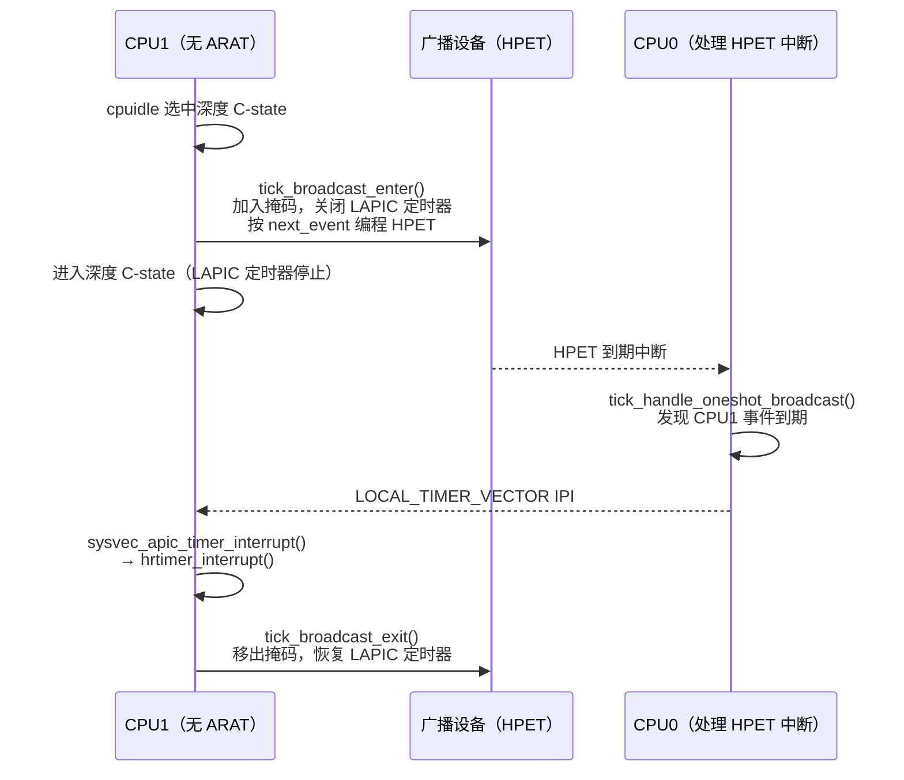

# 8.6 时钟事件设备与 tick 设备

> **本节源码**：[`include/linux/clockchips.h`](../../linux/include/linux/clockchips.h)、[`kernel/time/clockevents.c`](../../linux/kernel/time/clockevents.c)、[`kernel/time/tick-common.c`](../../linux/kernel/time/tick-common.c)、[`kernel/time/tick-oneshot.c`](../../linux/kernel/time/tick-oneshot.c)、[`kernel/time/tick-broadcast.c`](../../linux/kernel/time/tick-broadcast.c)、[`kernel/time/tick-broadcast-hrtimer.c`](../../linux/kernel/time/tick-broadcast-hrtimer.c)、[`kernel/time/tick-sched.h`](../../linux/kernel/time/tick-sched.h)、[`arch/x86/kernel/apic/apic.c`](../../linux/arch/x86/kernel/apic/apic.c)
> **关键函数**：`clockevents_register_device()`、`clockevents_config_and_register()`、`clockevents_program_event()`、`tick_check_new_device()`、`tick_setup_device()`、`tick_setup_periodic()`、`tick_handle_periodic()`、`tick_periodic()`、`tick_program_event()`、`tick_switch_to_oneshot()`、`setup_APIC_timer()`、`tick_broadcast_oneshot_control()`、`tick_handle_oneshot_broadcast()`
> **前置知识**：8.1 时间子系统概览、5.5 中断控制器（LAPIC 定时器）、5.2 中断入口

## 概述

时钟源回答"现在几点"，时钟事件设备（Clock Event Device）则回答"在某个时刻叫醒我"。它是对可编程定时器硬件的抽象：内核告诉它"N 纳秒后产生一次中断"或"每隔 N 纳秒产生一次中断"，到期时硬件触发中断，中断处理程序调用设备上登记的 `event_handler` 回调。

clockevents 框架本身很薄，只负责注册、状态切换、把纳秒换算成硬件计数并编程。决定"谁来用哪个设备、用它做什么"的是 tick 层：每个 CPU 有一个 tick 设备（`struct tick_device`），从所有可用的时钟事件设备中挑出最适合本 CPU 的一个，并根据系统所处的模式为它安装不同的 `event_handler`：

- **周期模式**：`tick_handle_periodic()`，每个 tick 推进 jiffies、调用 `update_process_times()`；
- **高精度模式**：`hrtimer_interrupt()`，由 hrtimer 子系统决定下一次中断时间，tick 被模拟成一个 hrtimer（8.9、8.10 节）；
- **低精度 NO_HZ 模式**：`tick_nohz_lowres_handler()`（8.10 节）。

x86 还有一个特殊问题：LAPIC 定时器在部分 CPU 的深度 C-state 中会停止，CPU 进入这些状态前必须把唤醒任务委托给一个不会停振的全局设备，这就是 tick 广播（Tick Broadcast）。

## 核心数据结构

### struct clock_event_device

[`include/linux/clockchips.h:100-132`](../../linux/include/linux/clockchips.h#L100-L132)（v6.18.60）

```c
struct clock_event_device {
	void			(*event_handler)(struct clock_event_device *);	// [注] 由 tick 层安装的中断回调
	int			(*set_next_event)(unsigned long evt, struct clock_event_device *);	// [注] 以硬件计数编程
	int			(*set_next_ktime)(ktime_t expires, struct clock_event_device *);	// [注] 以绝对时间编程
	ktime_t			next_event;		// [注] 单次模式下下一次事件的绝对时间
	u64			max_delta_ns;		// [注] 可编程的最长间隔
	u64			min_delta_ns;		// [注] 可编程的最短间隔
	u32			mult;			// [注] 纳秒 → 硬件计数（与 clocksource 方向相反）
	u32			shift;
	enum clock_event_state	state_use_accessors;	// [注] 当前状态，只能通过访问函数修改
	unsigned int		features;		// [注] CLOCK_EVT_FEAT_*
	unsigned long		retries;

	int			(*set_state_periodic)(struct clock_event_device *);
	int			(*set_state_oneshot)(struct clock_event_device *);
	int			(*set_state_oneshot_stopped)(struct clock_event_device *);
	int			(*set_state_shutdown)(struct clock_event_device *);
	int			(*tick_resume)(struct clock_event_device *);

	void			(*broadcast)(const struct cpumask *mask);	// [注] 向其他 CPU 转发事件
	void			(*suspend)(struct clock_event_device *);
	void			(*resume)(struct clock_event_device *);
	unsigned long		min_delta_ticks;
	unsigned long		max_delta_ticks;

	const char		*name;
	int			rating;
	int			irq;
	int			bound_on;
	const struct cpumask	*cpumask;		// [注] 本设备能为哪些 CPU 服务
	struct list_head	list;
	struct module		*owner;
} ____cacheline_aligned;
```

与时钟源一样，换算采用 `mult`/`shift`，只是方向相反：`计数 = (ns × mult) >> shift`。`clockevents_calc_mult_shift()` 直接复用 `clocks_calc_mult_shift()`，只是把 `from`/`to` 对调（[`include/linux/clockchips.h:192-196`](../../linux/include/linux/clockchips.h#L192-L196)）。

### 特性与状态

[`include/linux/clockchips.h:35-68`](../../linux/include/linux/clockchips.h#L35-L68)（v6.18.60，节选）

```c
enum clock_event_state {
	CLOCK_EVT_STATE_DETACHED,
	CLOCK_EVT_STATE_SHUTDOWN,
	CLOCK_EVT_STATE_PERIODIC,
	CLOCK_EVT_STATE_ONESHOT,
	CLOCK_EVT_STATE_ONESHOT_STOPPED,
};

/*
 * Clock event features
 */
# define CLOCK_EVT_FEAT_PERIODIC	0x000001
# define CLOCK_EVT_FEAT_ONESHOT		0x000002
# define CLOCK_EVT_FEAT_KTIME		0x000004

/*
 * x86(64) specific (mis)features:
 *
 * - Clockevent source stops in C3 State and needs broadcast support.
 * - Local APIC timer is used as a dummy device.
 */
# define CLOCK_EVT_FEAT_C3STOP		0x000008
# define CLOCK_EVT_FEAT_DUMMY		0x000010
...
```

| 特性 | 含义 |
|---|---|
| `PERIODIC` | 支持周期模式 |
| `ONESHOT` | 支持单次模式，高精度定时器与 NO_HZ 的前提 |
| `KTIME` | 以绝对 `ktime_t` 编程（`set_next_ktime`），如基于 hrtimer 的广播设备 |
| `C3STOP` | 在深度 C-state 中停止，需要广播（注释称之为 x86 的"misfeature"） |
| `DUMMY` | 占位设备，本身不产生中断，完全依赖广播 |
| `PERCPU` | 每 CPU 设备，不能用作广播设备 |
| `HRTIMER` | 由 hrtimer 实现的广播设备 |

*表 8-14：时钟事件设备的特性*

状态转换为：注册后处于 `DETACHED`；被 tick 层选中后进入 `PERIODIC` 或 `ONESHOT`；单次模式下没有待处理事件时可进入 `ONESHOT_STOPPED` 以省电；被替换后进入 `SHUTDOWN`。状态切换由 `clockevents_switch_state()` 调用设备对应的 `set_state_*` 回调完成（[`kernel/time/clockevents.c:91-165`](../../linux/kernel/time/clockevents.c#L91-L165)）。

### struct tick_device

[`kernel/time/tick-sched.h:7-15`](../../linux/kernel/time/tick-sched.h#L7-L15)（v6.18.60）

```c
enum tick_device_mode {
	TICKDEV_MODE_PERIODIC,
	TICKDEV_MODE_ONESHOT,
};

struct tick_device {
	struct clock_event_device *evtdev;
	enum tick_device_mode mode;
};
```

[`kernel/time/tick-common.c:26-51`](../../linux/kernel/time/tick-common.c#L26-L51)（v6.18.60，节选）

```c
/*
 * Tick devices
 */
DEFINE_PER_CPU(struct tick_device, tick_cpu_device);
/*
 * Tick next event: keeps track of the tick time. It's updated by the
 * CPU which handles the tick and protected by jiffies_lock. There is
 * no requirement to write hold the jiffies seqcount for it.
 */
ktime_t tick_next_period;
...
int tick_do_timer_cpu __read_mostly = TICK_DO_TIMER_BOOT;
```

`tick_device` 只是"本 CPU 当前使用哪个时钟事件设备、处于什么模式"的记录。两个全局变量同样关键：

- `tick_next_period`：下一个 tick 的绝对时间，周期 tick 与 jiffies 更新都以它为基准。
- `tick_do_timer_cpu`：负责推进 jiffies 与调用 `update_wall_time()` 的 CPU。所有 CPU 都有 tick，但只有一个 CPU 负责计时，避免所有 CPU 同时争抢 `jiffies_lock`（源码注释称之为惊群问题，[`kernel/time/tick-common.c:37-50`](../../linux/kernel/time/tick-common.c#L37-L50)）。它的初值 `TICK_DO_TIMER_BOOT`（−2）表示尚未分配，NO_HZ 下还可能被设为 `TICK_DO_TIMER_NONE`（−1），表示当前没有 CPU 负责、由下一个处理 tick 的 CPU 接手（8.10 节）。

## 注册与选择

### clockevents_config_and_register()

驱动通常调用这个函数，给出设备频率与可编程的最小、最大计数：

[`kernel/time/clockevents.c:479-520`](../../linux/kernel/time/clockevents.c#L479-L520)（v6.18.60）

```c
static void clockevents_config(struct clock_event_device *dev, u32 freq)
{
	u64 sec;

	if (!(dev->features & CLOCK_EVT_FEAT_ONESHOT))
		return;

	/*
	 * Calculate the maximum number of seconds we can sleep. Limit
	 * to 10 minutes for hardware which can program more than
	 * 32bit ticks so we still get reasonable conversion values.
	 */
	sec = dev->max_delta_ticks;
	do_div(sec, freq);
	if (!sec)
		sec = 1;
	else if (sec > 600 && dev->max_delta_ticks > UINT_MAX)
		sec = 600;

	clockevents_calc_mult_shift(dev, freq, sec);
	dev->min_delta_ns = cev_delta2ns(dev->min_delta_ticks, dev, false);
	dev->max_delta_ns = cev_delta2ns(dev->max_delta_ticks, dev, true);
}

/**
 * clockevents_config_and_register - Configure and register a clock event device
 * @dev:	device to register
 * @freq:	The clock frequency
 * @min_delta:	The minimum clock ticks to program in oneshot mode
 * @max_delta:	The maximum clock ticks to program in oneshot mode
 *
 * min/max_delta can be 0 for devices which do not support oneshot mode.
 */
void clockevents_config_and_register(struct clock_event_device *dev,
				     u32 freq, unsigned long min_delta,
				     unsigned long max_delta)
{
	dev->min_delta_ticks = min_delta;
	dev->max_delta_ticks = max_delta;
	clockevents_config(dev, freq);
	clockevents_register_device(dev);
}
```

`cev_delta2ns()` 把计数换回纳秒，并保证结果不小于 1 μs（[`kernel/time/clockevents.c:32-76`](../../linux/kernel/time/clockevents.c#L32-L76)）——注释说更短的间隔"毫无意义"。换算时对 `min_delta` 向上取整、对 `max_delta` 不向上取整，确保换回计数后既不低于硬件下限也不超过上限。

### clockevents_register_device()

[`kernel/time/clockevents.c:451-476`](../../linux/kernel/time/clockevents.c#L451-L476)（v6.18.60）

```c
void clockevents_register_device(struct clock_event_device *dev)
{
	unsigned long flags;

	/* Initialize state to DETACHED */
	clockevent_set_state(dev, CLOCK_EVT_STATE_DETACHED);

	if (!dev->cpumask) {
		WARN_ON(num_possible_cpus() > 1);
		dev->cpumask = cpumask_of(smp_processor_id());
	}

	if (dev->cpumask == cpu_all_mask) {
		WARN(1, "%s cpumask == cpu_all_mask, using cpu_possible_mask instead\n",
		     dev->name);
		dev->cpumask = cpu_possible_mask;
	}

	raw_spin_lock_irqsave(&clockevents_lock, flags);

	list_add(&dev->list, &clockevent_devices);
	tick_check_new_device(dev);
	clockevents_notify_released();

	raw_spin_unlock_irqrestore(&clockevents_lock, flags);
}
```

注册后立即调用 `tick_check_new_device()`，让**当前 CPU** 的 tick 层判断要不要用它。每 CPU 设备（如 LAPIC 定时器）需要在各自的 CPU 上注册，这就是 `setup_APIC_timer()` 在每个 CPU 启动时运行的原因。被替换下来的设备放到 `clockevents_released` 链表，`clockevents_notify_released()` 再让它们参与广播设备的竞争。

### tick_check_new_device()

[`kernel/time/tick-common.c:325-361`](../../linux/kernel/time/tick-common.c#L325-L361)（v6.18.60）

```c
void tick_check_new_device(struct clock_event_device *newdev)
{
	struct clock_event_device *curdev;
	struct tick_device *td;
	int cpu;

	cpu = smp_processor_id();
	td = &per_cpu(tick_cpu_device, cpu);
	curdev = td->evtdev;

	if (!tick_check_replacement(curdev, newdev))
		goto out_bc;

	if (!try_module_get(newdev->owner))
		return;

	/*
	 * Replace the eventually existing device by the new
	 * device. If the current device is the broadcast device, do
	 * not give it back to the clockevents layer !
	 */
	if (tick_is_broadcast_device(curdev)) {
		clockevents_shutdown(curdev);
		curdev = NULL;
	}
	clockevents_exchange_device(curdev, newdev);
	tick_setup_device(td, newdev, cpu, cpumask_of(cpu));
	if (newdev->features & CLOCK_EVT_FEAT_ONESHOT)
		tick_oneshot_notify();
	return;

out_bc:
	/*
	 * Can the new device be used as a broadcast device ?
	 */
	tick_install_broadcast_device(newdev, cpu);
}
```

`tick_check_replacement()` 由两步判断组成（[`kernel/time/tick-common.c:272-319`](../../linux/kernel/time/tick-common.c#L272-L319)）：

- `tick_check_percpu()`：新设备必须能服务本 CPU；若它不是本 CPU 私有的，则要求其中断亲和性可设置，且当前没有本 CPU 私有的设备。
- `tick_check_preferred()`：优先选择支持单次模式的设备；rating 更高者胜出；但**本 CPU 私有的设备优先于全局设备**，即使 rating 更低（`!cpumask_equal(curdev->cpumask, newdev->cpumask)` 这一条使私有设备总能替换全局设备）。

于是 x86 上的典型过程是：启动 CPU 先注册 HPET 通道 0（rating 50，全局，8.3 节），被选为 tick 设备；随后注册 LAPIC 定时器（rating 100 或 150，本 CPU 私有），替换 HPET；被替换下来的 HPET 进入 `tick_install_broadcast_device()`，成为广播设备。不合格的新设备也走这条路径，尝试成为广播设备。

### tick_setup_device()

[`kernel/time/tick-common.c:184-259`](../../linux/kernel/time/tick-common.c#L184-L259)（v6.18.60，节选）

```c
static void tick_setup_device(struct tick_device *td,
			      struct clock_event_device *newdev, int cpu,
			      const struct cpumask *cpumask)
{
	void (*handler)(struct clock_event_device *) = NULL;
	ktime_t next_event = 0;

	/*
	 * First device setup ?
	 */
	if (!td->evtdev) {
		/*
		 * If no cpu took the do_timer update, assign it to
		 * this cpu:
		 */
		if (READ_ONCE(tick_do_timer_cpu) == TICK_DO_TIMER_BOOT) {
			WRITE_ONCE(tick_do_timer_cpu, cpu);
			tick_next_period = ktime_get();
			...
		}

		/*
		 * Startup in periodic mode first.
		 */
		td->mode = TICKDEV_MODE_PERIODIC;
	} else {
		handler = td->evtdev->event_handler;
		next_event = td->evtdev->next_event;
		td->evtdev->event_handler = clockevents_handle_noop;
	}

	td->evtdev = newdev;
	...
	if (tick_device_uses_broadcast(newdev, cpu))
		return;

	if (td->mode == TICKDEV_MODE_PERIODIC)
		tick_setup_periodic(newdev, 0);
	else
		tick_setup_oneshot(newdev, handler, next_event);
}
```

- **首次安装**：第一个拿到 tick 设备的 CPU 成为 `tick_do_timer_cpu`，并以当前时间初始化 `tick_next_period`。所有 tick 设备都从周期模式起步。`CONFIG_NO_HZ_FULL` 下若启动 CPU 本身是 nohz_full CPU，计时职责会移交给第一个上线的 housekeeping CPU（省略部分，[`kernel/time/tick-common.c:202-224`](../../linux/kernel/time/tick-common.c#L202-L224)）。
- **替换设备**：保留旧设备的 `event_handler` 与 `next_event`，新设备直接接替；旧设备的回调被换成空函数。
- **广播占位**：若新设备是 `DUMMY` 或带 `C3STOP` 且广播已经激活，`tick_device_uses_broadcast()` 让本 CPU 加入广播掩码（[`kernel/time/tick-broadcast.c:255-334`](../../linux/kernel/time/tick-broadcast.c#L255-L334)）。

## 周期模式

### 设置

[`kernel/time/tick-common.c:151-179`](../../linux/kernel/time/tick-common.c#L151-L179)（v6.18.60）

```c
void tick_setup_periodic(struct clock_event_device *dev, int broadcast)
{
	tick_set_periodic_handler(dev, broadcast);

	/* Broadcast setup ? */
	if (!tick_device_is_functional(dev))
		return;

	if ((dev->features & CLOCK_EVT_FEAT_PERIODIC) &&
	    !tick_broadcast_oneshot_active()) {
		clockevents_switch_state(dev, CLOCK_EVT_STATE_PERIODIC);
	} else {
		unsigned int seq;
		ktime_t next;

		do {
			seq = read_seqcount_begin(&jiffies_seq);
			next = tick_next_period;
		} while (read_seqcount_retry(&jiffies_seq, seq));

		clockevents_switch_state(dev, CLOCK_EVT_STATE_ONESHOT);

		for (;;) {
			if (!clockevents_program_event(dev, next, false))
				return;
			next = ktime_add_ns(next, TICK_NSEC);
		}
	}
}
```

硬件支持周期模式时直接切换过去，由硬件自动以 `HZ` 频率中断（LAPIC 定时器的周期计数值就是 `lapic_timer_period`）。不支持周期模式的设备（例如 TSC-deadline 模式的 LAPIC 定时器）用单次模式模拟：从 `tick_next_period` 开始编程，若该时刻已过就跳到下一个周期再试。

### tick_handle_periodic() 与 tick_periodic()

[`kernel/time/tick-common.c:86-146`](../../linux/kernel/time/tick-common.c#L86-L146)（v6.18.60）

```c
static void tick_periodic(int cpu)
{
	if (READ_ONCE(tick_do_timer_cpu) == cpu) {
		raw_spin_lock(&jiffies_lock);
		write_seqcount_begin(&jiffies_seq);

		/* Keep track of the next tick event */
		tick_next_period = ktime_add_ns(tick_next_period, TICK_NSEC);

		do_timer(1);
		write_seqcount_end(&jiffies_seq);
		raw_spin_unlock(&jiffies_lock);
		update_wall_time();
	}

	update_process_times(user_mode(get_irq_regs()));
	profile_tick(CPU_PROFILING);
}

/*
 * Event handler for periodic ticks
 */
void tick_handle_periodic(struct clock_event_device *dev)
{
	int cpu = smp_processor_id();
	ktime_t next = dev->next_event;

	tick_periodic(cpu);

	/*
	 * The cpu might have transitioned to HIGHRES or NOHZ mode via
	 * update_process_times() -> run_local_timers() ->
	 * hrtimer_run_queues().
	 */
	if (IS_ENABLED(CONFIG_TICK_ONESHOT) && dev->event_handler != tick_handle_periodic)
		return;

	if (!clockevent_state_oneshot(dev))
		return;
	for (;;) {
		/*
		 * Setup the next period for devices, which do not have
		 * periodic mode:
		 */
		next = ktime_add_ns(next, TICK_NSEC);

		if (!clockevents_program_event(dev, next, false))
			return;
		/*
		 * Have to be careful here. If we're in oneshot mode,
		 * before we call tick_periodic() in a loop, we need
		 * to be sure we're using a real hardware clocksource.
		 * Otherwise we could get trapped in an infinite
		 * loop, as the tick_periodic() increments jiffies,
		 * which then will increment time, possibly causing
		 * the loop to trigger again and again.
		 */
		if (timekeeping_valid_for_hres())
			tick_periodic(cpu);
	}
}
```

这就是周期模式下一个 tick 所做的全部工作：

- 负责计时的 CPU 持 `jiffies_lock` 推进 `tick_next_period` 与 `jiffies_64`（`do_timer()` 同时计算全局负载均值，[`kernel/time/timekeeping.c:2549-2553`](../../linux/kernel/time/timekeeping.c#L2549-L2553)），然后调用 `update_wall_time()`（8.4 节）。
- 所有 CPU 调用 `update_process_times()`：进程时间记账、检查时间轮与 hrtimer、RCU、`sched_tick()`、POSIX CPU 定时器（3.5、8.7、8.11 节）。

`update_process_times()` → `run_local_timers()` → `hrtimer_run_queues()` 中可能完成向高精度或 NO_HZ 模式的切换（8.9 节），切换后设备的 `event_handler` 已经不再是 `tick_handle_periodic`，函数立即返回。用单次模式模拟周期时，若编程失败（时刻已过）且时钟源可靠，就补执行一次 `tick_periodic()`，把错过的 tick 计入 jiffies；时钟源若是 `jiffies` 本身则不能这样做，否则推进 jiffies 又使"现在"前进，可能陷入死循环。

## 单次模式

### 编程下一次事件

[`kernel/time/clockevents.c:303-337`](../../linux/kernel/time/clockevents.c#L303-L337)（v6.18.60）

```c
int clockevents_program_event(struct clock_event_device *dev, ktime_t expires,
			      bool force)
{
	unsigned long long clc;
	int64_t delta;
	int rc;

	if (WARN_ON_ONCE(expires < 0))
		return -ETIME;

	dev->next_event = expires;

	if (clockevent_state_shutdown(dev))
		return 0;

	/* We must be in ONESHOT state here */
	WARN_ONCE(!clockevent_state_oneshot(dev), "Current state: %d\n",
		  clockevent_get_state(dev));

	/* Shortcut for clockevent devices that can deal with ktime. */
	if (dev->features & CLOCK_EVT_FEAT_KTIME)
		return dev->set_next_ktime(expires, dev);

	delta = ktime_to_ns(ktime_sub(expires, ktime_get()));
	if (delta <= 0)
		return force ? clockevents_program_min_delta(dev) : -ETIME;

	delta = min(delta, (int64_t) dev->max_delta_ns);
	delta = max(delta, (int64_t) dev->min_delta_ns);

	clc = ((unsigned long long) delta * dev->mult) >> dev->shift;
	rc = dev->set_next_event((unsigned long) clc, dev);

	return (rc && force) ? clockevents_program_min_delta(dev) : rc;
}
```

调用者给出的是绝对单调时间，函数先用 `ktime_get()` 算出距现在的间隔，钳制到 `[min_delta_ns, max_delta_ns]`，换算成硬件计数后调用驱动的 `set_next_event()`。几个细节：

- **时刻已过**：返回 `-ETIME`，由调用者决定怎么办（`hrtimer_interrupt()` 会重新运行到期定时器，8.9 节）。`force` 为真时改为以最小间隔编程，保证"尽快来一次中断"。
- **超过上限**：钳制到 `max_delta_ns`，设备会提前到期，到期后上层发现没有事件到期，会重新编程。这也是 NO_HZ 下 CPU 无法无限期睡眠的硬件原因之一。
- **最小间隔自适应**：`CONFIG_GENERIC_CLOCKEVENTS_MIN_ADJUST`（本书配置开启）下，`clockevents_program_min_delta()` 连续 3 次以最小间隔编程失败时，把 `min_delta_ns` 增大 50%（至少 5 μs，上限 `MIN_DELTA_LIMIT`），并打印 "CE: %s increased min_delta_ns to %llu nsec"（[`kernel/time/clockevents.c:202-262`](../../linux/kernel/time/clockevents.c#L202-L262)）。这用来应对硬件实际最小间隔比驱动声明的更大的情况。

tick 层通过 `tick_program_event()` 编程本 CPU 的设备，它额外处理 `ONESHOT_STOPPED` 状态：

[`kernel/time/tick-oneshot.c:23-45`](../../linux/kernel/time/tick-oneshot.c#L23-L45)（v6.18.60）

```c
int tick_program_event(ktime_t expires, int force)
{
	struct clock_event_device *dev = __this_cpu_read(tick_cpu_device.evtdev);

	if (unlikely(expires == KTIME_MAX)) {
		/*
		 * We don't need the clock event device any more, stop it.
		 */
		clockevents_switch_state(dev, CLOCK_EVT_STATE_ONESHOT_STOPPED);
		dev->next_event = KTIME_MAX;
		return 0;
	}

	if (unlikely(clockevent_state_oneshot_stopped(dev))) {
		/*
		 * We need the clock event again, configure it in ONESHOT mode
		 * before using it.
		 */
		clockevents_switch_state(dev, CLOCK_EVT_STATE_ONESHOT);
	}

	return clockevents_program_event(dev, expires, force);
}
```

没有任何待处理事件（`KTIME_MAX`）时，设备被停止而不是编程到一个遥远的时刻，避免无谓的中断。

### 切换到单次模式

[`kernel/time/tick-oneshot.c:73-99`](../../linux/kernel/time/tick-oneshot.c#L73-L99)（v6.18.60）

```c
int tick_switch_to_oneshot(void (*handler)(struct clock_event_device *))
{
	struct tick_device *td = this_cpu_ptr(&tick_cpu_device);
	struct clock_event_device *dev = td->evtdev;

	if (!dev || !(dev->features & CLOCK_EVT_FEAT_ONESHOT) ||
		    !tick_device_is_functional(dev)) {

		pr_info("Clockevents: could not switch to one-shot mode:");
		...
		return -EINVAL;
	}

	td->mode = TICKDEV_MODE_ONESHOT;
	dev->event_handler = handler;
	clockevents_switch_state(dev, CLOCK_EVT_STATE_ONESHOT);
	tick_broadcast_switch_to_oneshot();
	return 0;
}
```

切换本身只是改模式、换回调、切换硬件状态，并把广播设备也切到单次模式。调用者有两个：高精度模式下 `tick_init_highres()` 传入 `hrtimer_interrupt`（[`kernel/time/tick-oneshot.c:124-127`](../../linux/kernel/time/tick-oneshot.c#L124-L127)），低精度 NO_HZ 模式下传入 `tick_nohz_lowres_handler`（8.10 节）。

能否切换由 `tick_is_oneshot_available()` 预先判断（[`kernel/time/tick-common.c:72-81`](../../linux/kernel/time/tick-common.c#L72-L81)）：设备必须支持单次模式；若设备带 `C3STOP`，还要求存在支持单次模式的广播设备。

## LAPIC 定时器

5.5 节已经介绍了 LAPIC 定时器的两种编程方式，这里从 clockevents 的角度补充它的注册过程。

[`arch/x86/kernel/apic/apic.c:495-509`](../../linux/arch/x86/kernel/apic/apic.c#L495-L509)（v6.18.60）

```c
static struct clock_event_device lapic_clockevent = {
	.name				= "lapic",
	.features			= CLOCK_EVT_FEAT_PERIODIC |
					  CLOCK_EVT_FEAT_ONESHOT | CLOCK_EVT_FEAT_C3STOP
					  | CLOCK_EVT_FEAT_DUMMY,
	.shift				= 32,
	.set_state_shutdown		= lapic_timer_shutdown,
	.set_state_periodic		= lapic_timer_set_periodic,
	.set_state_oneshot		= lapic_timer_set_oneshot,
	.set_state_oneshot_stopped	= lapic_timer_shutdown,
	.set_next_event			= lapic_next_event,
	.broadcast			= lapic_timer_broadcast,
	.rating				= 100,
	.irq				= -1,
};
```

模板默认带 `C3STOP` 与 `DUMMY`：在校准成功之前，它只是广播机制的占位者。

[`arch/x86/kernel/apic/apic.c:572-597`](../../linux/arch/x86/kernel/apic/apic.c#L572-L597)（v6.18.60）

```c
static void setup_APIC_timer(void)
{
	struct clock_event_device *levt = this_cpu_ptr(&lapic_events);

	if (this_cpu_has(X86_FEATURE_ARAT)) {
		lapic_clockevent.features &= ~CLOCK_EVT_FEAT_C3STOP;
		/* Make LAPIC timer preferable over percpu HPET */
		lapic_clockevent.rating = 150;
	}

	memcpy(levt, &lapic_clockevent, sizeof(*levt));
	levt->cpumask = cpumask_of(smp_processor_id());

	if (this_cpu_has(X86_FEATURE_TSC_DEADLINE_TIMER)) {
		levt->name = "lapic-deadline";
		levt->features &= ~(CLOCK_EVT_FEAT_PERIODIC |
				    CLOCK_EVT_FEAT_DUMMY);
		levt->set_next_event = lapic_next_deadline;
		clockevents_config_and_register(levt,
						tsc_khz * (1000 / TSC_DIVISOR),
						0xF, ~0UL);
	} else
		clockevents_register_device(levt);

	apic_update_vector(smp_processor_id(), LOCAL_TIMER_VECTOR, true);
}
```

- **ARAT**（Always Running APIC Timer）：CPU 声明 LAPIC 定时器在所有 C-state 中都运行时，去掉 `C3STOP`，此 CPU 不需要广播，rating 提升到 150。现代 Intel 与 AMD 处理器普遍支持 ARAT。
- **TSC-deadline 模式**：设备名为 `lapic-deadline`，不支持周期模式，频率按 `tsc_khz × 1000 / 8` 注册。`lapic_next_deadline()` 把计数值乘以 `TSC_DIVISOR`（8）后加到当前 TSC 上写入 MSR（5.5 节）。之所以除以 8，是因为 `clockevents_config_and_register()` 的频率参数是以 Hz 为单位的 `u32`，TSC 频率超过约 4.29 GHz 就会溢出；除以 8 后可容纳 34 GHz 以内的频率，而 8 个 TSC 周期的粒度对定时器来说仍然绰绰有余。这种模式不需要校准。
- **计数模式**：沿用启动 CPU 校准得到的 `mult` 等参数直接注册。启动 CPU 上的 `calibrate_APIC_clock()`（[`arch/x86/kernel/apic/apic.c:791-960`](../../linux/arch/x86/kernel/apic/apic.c#L791-L960)）若能从 CPUID 0x15 得到 `lapic_timer_period`（8.3 节）就直接使用；否则以最大初值启动 LAPIC 计数，等待 100 ms（`LAPIC_CAL_LOOPS = HZ/10` 个 tick，以 TSC 或 jiffies 计时），用计数差算出 LAPIC 频率，可能时再以 PM 定时器校验。校准成功才清除 `DUMMY` 标志。

到期中断经 `sysvec_apic_timer_interrupt()` → `local_apic_timer_interrupt()` 调用 `evt->event_handler(evt)`（[`arch/x86/kernel/apic/apic.c:1013-1062`](../../linux/arch/x86/kernel/apic/apic.c#L1013-L1062)，5.5 节）。

## tick 广播

### 问题

不支持 ARAT 的 CPU 在深度 C-state（历史上称 C3，故名 `C3STOP`）中会关闭 LAPIC 定时器。如果某个 CPU 的下一个事件在 10 ms 后，而它在这 10 ms 内进入深度睡眠，就再也不会被唤醒。tick 广播的思路是：进入深度 C-state 前，把自己的下一个事件时间登记到一个不受 C-state 影响的全局设备（通常是 HPET），由这个设备在到期时通过 IPI 唤醒对应的 CPU。

### 进入与退出

cpuidle 在选择带 `CPUIDLE_FLAG_TIMER_STOP` 标志的 C-state 时调用 `tick_broadcast_enter()`，退出时调用 `tick_broadcast_exit()`：

[`drivers/cpuidle/cpuidle.c:222-238`](../../linux/drivers/cpuidle/cpuidle.c#L222-L238)（v6.18.60）

```c
	bool broadcast = !!(target_state->flags & CPUIDLE_FLAG_TIMER_STOP);
	ktime_t time_start, time_end;

	instrumentation_begin();

	/*
	 * Tell the time framework to switch to a broadcast timer because our
	 * local timer will be shut down.  If a local timer is used from another
	 * CPU as a broadcast timer, this call may fail if it is not available.
	 */
	if (broadcast && tick_broadcast_enter()) {
		index = find_deepest_state(drv, dev, target_state->exit_latency_ns,
					   CPUIDLE_FLAG_TIMER_STOP, false);

		target_state = &drv->states[index];
		broadcast = false;
	}
```

`tick_broadcast_enter()` 最终调用 `___tick_broadcast_oneshot_control()`（[`kernel/time/tick-broadcast.c:804-940`](../../linux/kernel/time/tick-broadcast.c#L804-L940)）。进入时：

1. 把本 CPU 加入 `tick_broadcast_oneshot_mask`；
2. 关闭本地时钟事件设备（`broadcast_shutdown_local()`）；
3. 若本 CPU 的 `next_event` 早于广播设备当前的到期时间，把广播设备重新编程为本 CPU 的时间。

退出时把本 CPU 移出掩码、把本地设备切回单次模式并重新编程。若广播中断已经为本 CPU 处理过（`tick_broadcast_pending_mask`），或者本 CPU 的事件已经到期、广播处理即将进行，就跳过重新编程，交给广播处理函数调用本地回调，避免两边反复编程造成"乒乓"——源码中有一大段注释解释这种情况（[`kernel/time/tick-broadcast.c:888-929`](../../linux/kernel/time/tick-broadcast.c#L888-L929)）。

### 广播处理

[`kernel/time/tick-broadcast.c:698-776`](../../linux/kernel/time/tick-broadcast.c#L698-L776)（v6.18.60，节选）

```c
static void tick_handle_oneshot_broadcast(struct clock_event_device *dev)
{
	struct tick_device *td;
	ktime_t now, next_event;
	int cpu, next_cpu = 0;
	bool bc_local;

	raw_spin_lock(&tick_broadcast_lock);
	dev->next_event = KTIME_MAX;
	next_event = KTIME_MAX;
	cpumask_clear(tmpmask);
	now = ktime_get();
	/* Find all expired events */
	for_each_cpu(cpu, tick_broadcast_oneshot_mask) {
		...
		td = &per_cpu(tick_cpu_device, cpu);
		if (td->evtdev->next_event <= now) {
			cpumask_set_cpu(cpu, tmpmask);
			/*
			 * Mark the remote cpu in the pending mask, so
			 * it can avoid reprogramming the cpu local
			 * timer in tick_broadcast_oneshot_control().
			 */
			cpumask_set_cpu(cpu, tick_broadcast_pending_mask);
		} else if (td->evtdev->next_event < next_event) {
			next_event = td->evtdev->next_event;
			next_cpu = cpu;
		}
	}
	...
	/*
	 * Wakeup the cpus which have an expired event.
	 */
	bc_local = tick_do_broadcast(tmpmask);
	...
	if (next_event != KTIME_MAX)
		tick_broadcast_set_event(dev, next_cpu, next_event);

	raw_spin_unlock(&tick_broadcast_lock);

	if (bc_local) {
		td = this_cpu_ptr(&tick_cpu_device);
		td->evtdev->event_handler(td->evtdev);
	}
}
```

广播设备到期时，处理函数扫描所有在掩码中的 CPU，收集事件已到期者，调用 `tick_do_broadcast()`（[`kernel/time/tick-broadcast.c:354-393`](../../linux/kernel/time/tick-broadcast.c#L354-L393)）。后者对远程 CPU 调用它们本地设备的 `broadcast()` 回调——LAPIC 的实现是向目标 CPU 发送 `LOCAL_TIMER_VECTOR` IPI（`lapic_timer_broadcast()`，[`arch/x86/kernel/apic/apic.c:484-489`](../../linux/arch/x86/kernel/apic/apic.c#L484-L489)）。目标 CPU 被唤醒后，走的是与本地定时器中断完全相同的路径 `sysvec_apic_timer_interrupt()`，执行 `hrtimer_interrupt()`。若处理广播中断的 CPU 自己也在掩码中，就直接调用本地回调。最后把广播设备编程为剩余 CPU 中最早的事件。



*图 8-8：tick 广播的工作过程*

### 基于 hrtimer 的广播

没有合适的全局硬件设备时（某些 ARM 平台常见），内核可以注册一个由 hrtimer 实现的伪广播设备 `bc_hrtimer`（[`kernel/time/tick-broadcast-hrtimer.c:76-92`](../../linux/kernel/time/tick-broadcast-hrtimer.c#L76-L92)）：它把广播事件挂在某个 CPU 的 hrtimer 上，那个 CPU 因此不能进入会停止定时器的 C-state——`broadcast_needs_cpu()` 让该 CPU 的 `tick_broadcast_enter()` 返回 `-EBUSY`，cpuidle 随即改选较浅的状态。

## 关键细节 / 设计考量

### 计时职责的转移

`tick_do_timer_cpu` 不是固定不变的：NO_HZ 下负责计时的 CPU 停 tick 前会放弃职责（8.10 节）；CPU 下线时 `tick_cpu_dying()` 在 stop_machine 上下文中把职责交给第一个在线 CPU（[`kernel/time/tick-common.c:393-411`](../../linux/kernel/time/tick-common.c#L393-L411)）。由于任何时刻至多有一个 CPU 推进 jiffies，而且推进本身有 `jiffies_lock` 保护，即使出现短暂的两个 CPU 都认为自己负责的竞态，也只是多一次加锁检查，不会重复计数（8.10 节的 `tick_do_update_jiffies64()` 会在锁内重新判断）。

### 为什么 tick 设备都从周期模式起步

单次模式需要一个可靠的高精度时钟源来计算"距下一事件还有多久"。启动早期 timekeeper 还挂在 `jiffies` 时钟源上，单次模式根本无法工作。因此所有 tick 设备都以周期模式启动，等到时钟源被 watchdog 认可（`VALID_FOR_HRES`）、`tick_clock_notify()` 置位各 CPU 的 `check_clocks` 后，才在下一个 tick 中切换（8.1、8.10 节）。

## 动手实验

```bash
# 每个 CPU 当前使用的 tick 设备与广播设备
for d in /sys/devices/system/clockevents/clockevent*; do echo "$d: $(cat $d/current_device)"; done
cat /sys/devices/system/clockevents/broadcast/current_device

# /proc/timer_list 末尾列出所有时钟事件设备的详细参数
sudo grep -A 20 'Tick Device: mode' /proc/timer_list | head -60

# LAPIC 定时器中断次数（LOC 行）与广播相关统计
grep -E 'LOC|TIMER' /proc/interrupts
sudo grep -E 'tick_broadcast_(mask|oneshot_mask)' /proc/timer_list
```

`/proc/timer_list` 中每个设备会列出 `max_delta_ns`、`min_delta_ns`、`mult`、`shift`、`mode`、`next_event`、`set_next_event` 回调名等信息，可以直接对照本节的字段。支持 ARAT 的 CPU 上广播掩码通常为空；虚拟机中 `current_device` 一般是 `lapic-deadline` 或 `lapic`。

## 小结

- 时钟事件设备是可编程定时器的抽象，`mult`/`shift` 把纳秒换算成硬件计数；`min_delta_ns`/`max_delta_ns` 限定可编程区间，最小间隔不足时可自适应增大。
- 每个 CPU 有一个 tick 设备，注册时 `tick_check_new_device()` 优先选择支持单次模式、本 CPU 私有、rating 更高的设备；落选或被替换的设备尝试成为广播设备。
- 所有 tick 设备从周期模式起步，`tick_periodic()` 中只有 `tick_do_timer_cpu` 推进 jiffies 与 timekeeper，所有 CPU 调用 `update_process_times()`；时钟源合格后切换到单次模式，`event_handler` 换成 `hrtimer_interrupt()`。
- x86 上 LAPIC 定时器在支持 TSC-deadline 时以 TSC 绝对值编程、无需校准；支持 ARAT 时不受 C-state 影响。
- 不支持 ARAT 的 CPU 进入深度 C-state 前通过 `tick_broadcast_enter()` 把下一个事件委托给 HPET 等全局设备，到期时由处理广播中断的 CPU 用 IPI 唤醒它们。

## 参考

- `linux/Documentation/timers/highres.rst`（clockevents 与 tick 设备的设计）
- `linux/Documentation/timers/timekeeping.rst`
- Thomas Gleixner, Douglas Niehaus, "Hrtimers and Beyond: Transforming the Linux Time Subsystems", OLS 2006
- Intel® SDM Vol. 3A, "APIC Timer"、"TSC-Deadline Mode"
