# 8.7 时间轮定时器：timer_list

> **本节源码**：[`include/linux/timer_types.h`](../../linux/include/linux/timer_types.h)、[`include/linux/timer.h`](../../linux/include/linux/timer.h)、[`kernel/time/timer.c`](../../linux/kernel/time/timer.c)
> **关键函数**：`timer_setup()`、`mod_timer()`、`add_timer()`、`add_timer_on()`、`__mod_timer()`、`calc_wheel_index()`、`enqueue_timer()`、`forward_timer_base()`、`run_local_timers()`、`run_timer_softirq()`、`__run_timers()`、`collect_expired_timers()`、`expire_timers()`、`timer_delete_sync()`、`timer_shutdown_sync()`
> **前置知识**：8.1 时间子系统概览（jiffies）、5.9 软中断、7.4 自旋锁

## 概述

内核中绝大多数定时器是**超时**：网络协议的重传与保活、块设备请求的超时、看门狗、各种"若干秒后重试"。它们有三个共同特点：精度要求不高（晚几毫秒无关紧要）、数量巨大（一台繁忙的服务器上同时有数十万个）、大多数在到期前就被取消（请求正常完成后删除超时定时器）。

时间轮（Timer Wheel）正是为这种负载设计的数据结构：以 jiffy 为时间单位，把定时器按到期时间散列到固定数量的桶中，插入与删除都是 O(1) 的链表操作，代价是到期时间按桶的粒度对齐。v4.8 起 Linux 使用由 Thomas Gleixner 重写的**非级联**时间轮：离得越远的定时器放在粒度越粗的层级，永远不再被"级联"到更细的层级中，到期时间允许有最多约 12.5% 的延迟。精确定时由 hrtimer（8.9 节）负责。

本节分析 `struct timer_list` 与每 CPU 的 `timer_base`、时间轮的层级结构、定时器的插入与修改、`TIMER_SOFTIRQ` 中的到期处理，以及删除定时器时的同步语义。v6.9 引入的定时器迁移层次（Timer Migration Hierarchy，全局定时器在 CPU 空闲时由其他 CPU 代为处理）留给 8.8 节。

## 核心数据结构

### struct timer_list

[`include/linux/timer_types.h:8-21`](../../linux/include/linux/timer_types.h#L8-L21)（v6.18.60）

```c
struct timer_list {
	/*
	 * All fields that change during normal runtime grouped to the
	 * same cacheline
	 */
	struct hlist_node	entry;		// [注] 挂在某个桶的链表上
	unsigned long		expires;	// [注] 到期时刻（jiffies，绝对值）
	void			(*function)(struct timer_list *);	// [注] 回调；NULL 表示已关闭
	u32			flags;		// [注] CPU 号、桶下标与标志位

#ifdef CONFIG_LOCKDEP
	struct lockdep_map	lockdep_map;
#endif
};
```

结构非常紧凑，回调只接收定时器指针本身，需要上下文时用 `timer_container_of()`（即 `container_of()`）从定时器找到外层结构。`flags` 一个 32 位字段打包了多种信息：

[`include/linux/timer.h:44-52`](../../linux/include/linux/timer.h#L44-L52)（v6.18.60）

```c
#define TIMER_CPUMASK		0x0003FFFF
#define TIMER_MIGRATING		0x00040000
#define TIMER_BASEMASK		(TIMER_CPUMASK | TIMER_MIGRATING)
#define TIMER_DEFERRABLE	0x00080000
#define TIMER_PINNED		0x00100000
#define TIMER_IRQSAFE		0x00200000
#define TIMER_INIT_FLAGS	(TIMER_DEFERRABLE | TIMER_PINNED | TIMER_IRQSAFE)
#define TIMER_ARRAYSHIFT	22
#define TIMER_ARRAYMASK		0xFFC00000
```

| 位域 | 含义 |
|---|---|
| bit 0～17 `TIMER_CPUMASK` | 定时器所在 `timer_base` 的 CPU 号 |
| bit 18 `TIMER_MIGRATING` | 正在迁移到另一个 CPU 的 base，持锁者需等待 |
| bit 19 `TIMER_DEFERRABLE` | 可延迟（Deferrable Timer）：不会把空闲 CPU 唤醒，等 CPU 因其他原因醒来时再处理 |
| bit 20 `TIMER_PINNED` | 固定在入队时的 CPU 上到期 |
| bit 21 `TIMER_IRQSAFE` | 回调在关中断状态下执行，允许在中断中 `timer_delete_sync()` 等待它 |
| bit 22～31 `TIMER_ARRAYMASK` | 所在桶的下标（0～575） |

*表 8-15：timer_list 的 flags 字段*

把 CPU 号存在 `flags` 中，就可以由定时器直接找到它所属的 base 与锁；把桶下标存在 `flags` 中，`mod_timer()` 就能 O(1) 判断新到期时间是否落在同一个桶里。

### 时间轮的几何结构

[`kernel/time/timer.c:152-187`](../../linux/kernel/time/timer.c#L152-L187)（v6.18.60，节选）

```c
/* Clock divisor for the next level */
#define LVL_CLK_SHIFT	3
#define LVL_CLK_DIV	(1UL << LVL_CLK_SHIFT)
#define LVL_CLK_MASK	(LVL_CLK_DIV - 1)
#define LVL_SHIFT(n)	((n) * LVL_CLK_SHIFT)
#define LVL_GRAN(n)	(1UL << LVL_SHIFT(n))
...
#define LVL_START(n)	((LVL_SIZE - 1) << (((n) - 1) * LVL_CLK_SHIFT))

/* Size of each clock level */
#define LVL_BITS	6
#define LVL_SIZE	(1UL << LVL_BITS)
#define LVL_MASK	(LVL_SIZE - 1)
#define LVL_OFFS(n)	((n) * LVL_SIZE)

/* Level depth */
#if HZ > 100
# define LVL_DEPTH	9
# else
# define LVL_DEPTH	8
#endif
...
#define WHEEL_SIZE	(LVL_SIZE * LVL_DEPTH)
```

时间轮共 `LVL_DEPTH = 9` 层（`HZ > 100` 时），每层 `LVL_SIZE = 64` 个桶，共 576 个桶。第 *n* 层的粒度是 8ⁿ 个 jiffy，即每上一层粒度扩大 8 倍。源码注释中给出了 `HZ=1000` 时各层的粒度与范围（[`kernel/time/timer.c:102-114`](../../linux/kernel/time/timer.c#L102-L114)）：

| 层 | 桶下标 | 粒度 | 覆盖的相对到期时间 |
|---|---|---|---|
| 0 | 0～63 | 1 ms | 0～63 ms |
| 1 | 64～127 | 8 ms | 64～511 ms |
| 2 | 128～191 | 64 ms | 512 ms～约 4 s |
| 3 | 192～255 | 512 ms | 约 4 s～32 s |
| 4 | 256～319 | 约 4 s | 约 32 s～4 min |
| 5 | 320～383 | 约 32 s | 约 4 min～34 min |
| 6 | 384～447 | 约 4 min | 约 34 min～4 h |
| 7 | 448～511 | 约 34 min | 约 4 h～1 d |
| 8 | 512～575 | 约 4 h | 约 1 d～12 d |

*表 8-16：HZ=1000 时时间轮各层的粒度与范围*

```
 层 0  │ 粒度 1    │ ■■■■■■■■■■■■■■■■■■■■■■■■■■■■■■■■■■■■■■■■■■■■■■■■■■■■■■■■■■■■ │ 64 个桶
 层 1  │ 粒度 8    │ ■■■■■■■■■■■■■■■■■■■■■■■■■■■■■■■■■■■■■■■■■■■■■■■■■■■■■■■■■■■■ │
 层 2  │ 粒度 64   │ ■■■■■■■■■■■■■■■■■■■■■■■■■■■■■■■■■■■■■■■■■■■■■■■■■■■■■■■■■■■■ │
  ...  │           │                                                                  │
 层 8  │ 粒度 8^8  │ ■■■■■■■■■■■■■■■■■■■■■■■■■■■■■■■■■■■■■■■■■■■■■■■■■■■■■■■■■■■■ │
       每个桶：hlist 链表；pending_map：576 位位图，每位表示对应桶非空
```

*图 8-9：时间轮的层级结构*

每层的 64 个桶构成一个环：第 *n* 层的桶号由到期时间右移 `3n` 位后取低 6 位得到。越远的定时器落在越高的层，粒度越粗。超出第 8 层覆盖范围（约 12 天）的定时器被强制设为最远可表示的时刻——注释说实测的最大值是网络连接跟踪的 5 天，这不构成问题。

### struct timer_base

[`kernel/time/timer.c:250-267`](../../linux/kernel/time/timer.c#L250-L267)（v6.18.60）

```c
struct timer_base {
	raw_spinlock_t		lock;
	struct timer_list	*running_timer;	// [注] 正在执行回调的定时器
#ifdef CONFIG_PREEMPT_RT
	spinlock_t		expiry_lock;
	atomic_t		timer_waiters;
#endif
	unsigned long		clk;		// [注] 本 base 的"当前时刻"（jiffies）
	unsigned long		next_expiry;	// [注] 最早到期桶的时刻
	unsigned int		cpu;
	bool			next_expiry_recalc;	// [注] 删除定时器后需要重新计算 next_expiry
	bool			is_idle;	// [注] 本 CPU 已停 tick
	bool			timers_pending;
	DECLARE_BITMAP(pending_map, WHEEL_SIZE);	// [注] 非空桶位图
	struct hlist_head	vectors[WHEEL_SIZE];	// [注] 576 个桶
} ____cacheline_aligned;

static DEFINE_PER_CPU(struct timer_base, timer_bases[NR_BASES]);
```

`CONFIG_NO_HZ_COMMON` 下每个 CPU 有 3 个 base（[`kernel/time/timer.c:189-203`](../../linux/kernel/time/timer.c#L189-L203)）：

| base | 下标 | 存放的定时器 |
|---|---|---|
| `BASE_LOCAL` | 0 | 带 `TIMER_PINNED` 的定时器，必须在本 CPU 到期 |
| `BASE_GLOBAL` | 1 | 普通定时器，CPU 空闲时可由其他 CPU 代为到期（8.8 节） |
| `BASE_DEF` | 2 | 带 `TIMER_DEFERRABLE` 的定时器，不影响停 tick 的决策 |

*表 8-17：每 CPU 的三个 timer_base*

`clk` 是 base 的"当前时刻"，桶下标相对于它计算。正常情况下它紧跟 jiffies；CPU 空闲停 tick 时，`clk` 可能落后于 jiffies，在下一次插入定时器前由 `forward_timer_base()` 追上。

## 接口

| 接口 | 作用 |
|---|---|
| `timer_setup(timer, fn, flags)` | 初始化定时器（[`include/linux/timer.h:120`](../../linux/include/linux/timer.h#L120)） |
| `DEFINE_TIMER(name, fn)` | 静态定义并初始化 |
| `mod_timer(timer, expires)` | 设置到期时间并激活；已激活则修改 |
| `add_timer(timer)` | 激活一个未激活的定时器，等价于 `mod_timer(timer, timer->expires)` |
| `add_timer_local()` / `add_timer_global()` | 激活并设置 / 清除 `TIMER_PINNED` |
| `add_timer_on(timer, cpu)` | 在指定 CPU 上激活，并设置 `TIMER_PINNED` |
| `timer_reduce(timer, expires)` | 只在新时间更早时修改 |
| `mod_timer_pending()` | 只修改已激活的定时器，不激活未激活的 |
| `timer_delete(timer)` | 停用，不等待正在执行的回调 |
| `timer_delete_sync(timer)` | 停用，并等待正在其他 CPU 上执行的回调结束 |
| `timer_shutdown_sync(timer)` | 停用、等待，并永久禁止再次激活（`function` 置 NULL） |
| `timer_pending(timer)` | 是否已激活 |
| `round_jiffies()` 等 | 把到期时间舍入到整秒，便于多个定时器合并唤醒 |

*表 8-18：timer_list 的主要接口*

v6.2～v6.16 期间，这些接口经历了一轮重命名：`del_timer()`/`del_timer_sync()` 改为 `timer_delete()`/`timer_delete_sync()`，`from_timer()` 改为 `timer_container_of()`，新增 `timer_shutdown*()`。阅读旧资料时要注意对应关系。

## 插入：计算桶下标

### calc_wheel_index()

[`kernel/time/timer.c:524-577`](../../linux/kernel/time/timer.c#L524-L577)（v6.18.60）

```c
static inline unsigned calc_index(unsigned long expires, unsigned lvl,
				  unsigned long *bucket_expiry)
{

	/*
	 * The timer wheel has to guarantee that a timer does not fire
	 * early. Early expiry can happen due to:
	 * - Timer is armed at the edge of a tick
	 * - Truncation of the expiry time in the outer wheel levels
	 *
	 * Round up with level granularity to prevent this.
	 */
	expires = (expires >> LVL_SHIFT(lvl)) + 1;
	*bucket_expiry = expires << LVL_SHIFT(lvl);
	return LVL_OFFS(lvl) + (expires & LVL_MASK);
}

static int calc_wheel_index(unsigned long expires, unsigned long clk,
			    unsigned long *bucket_expiry)
{
	unsigned long delta = expires - clk;
	unsigned int idx;

	if (delta < LVL_START(1)) {
		idx = calc_index(expires, 0, bucket_expiry);
	} else if (delta < LVL_START(2)) {
		idx = calc_index(expires, 1, bucket_expiry);
	} else if (delta < LVL_START(3)) {
		idx = calc_index(expires, 2, bucket_expiry);
	...
	} else if ((long) delta < 0) {
		idx = clk & LVL_MASK;
		*bucket_expiry = clk;
	} else {
		/*
		 * Force expire obscene large timeouts to expire at the
		 * capacity limit of the wheel.
		 */
		if (delta >= WHEEL_TIMEOUT_CUTOFF)
			expires = clk + WHEEL_TIMEOUT_MAX;

		idx = calc_index(expires, LVL_DEPTH - 1, bucket_expiry);
	}
	return idx;
}
```

- **选层**：由相对时间 `delta = expires − clk` 决定，`LVL_START(n) = 63 × 8ⁿ⁻¹`，即 63、504、4032……
- **向上取整**：`calc_index()` 把到期时间右移 `3 × lvl` 位后**加 1**，再取低 6 位作为层内桶号；`bucket_expiry` 是这个桶真正被处理的时刻，总是不早于 `expires`。即使在第 0 层也要加 1：定时器可能在一个 jiffy 的末尾被设置，若放在当前 jiffy 的桶里，下一次 tick 就会到期，实际等待不足 1 个 jiffy。定时器保证"不会早到"，但可能晚到。
- **已过期**：`delta` 为负（`expires` 早于 `clk`）时放进 `clk` 对应的桶，下一次处理就会到期。

以 `HZ=1000` 时设置 100 ms 后到期为例：`delta = 100`，落在第 1 层，粒度 8 ms，到期时刻被向上取整到 8 的倍数再加 8，实际在 100～108 ms 后到期。第 *n*（≥1）层的最大延迟是一个粒度 8ⁿ，而该层最短的定时器相对时间约为 63 × 8ⁿ⁻¹ ≈ 8ⁿ⁺¹ / 8，所以最坏情况下的相对误差约为 1/8 = 12.5%。这就是 `msleep()` 注释中"最大 12.5% 松弛"的由来（8.13 节）。

### enqueue_timer()

[`kernel/time/timer.c:612-637`](../../linux/kernel/time/timer.c#L612-L637)（v6.18.60）

```c
static void enqueue_timer(struct timer_base *base, struct timer_list *timer,
			  unsigned int idx, unsigned long bucket_expiry)
{

	hlist_add_head(&timer->entry, base->vectors + idx);
	__set_bit(idx, base->pending_map);
	timer_set_idx(timer, idx);

	trace_timer_start(timer, bucket_expiry);

	/*
	 * Check whether this is the new first expiring timer. The
	 * effective expiry time of the timer is required here
	 * (bucket_expiry) instead of timer->expires.
	 */
	if (time_before(bucket_expiry, base->next_expiry)) {
		/*
		 * Set the next expiry time and kick the CPU so it
		 * can reevaluate the wheel:
		 */
		WRITE_ONCE(base->next_expiry, bucket_expiry);
		base->timers_pending = true;
		base->next_expiry_recalc = false;
		trigger_dyntick_cpu(base, timer);
	}
}
```

插入只是三步：挂到桶链表头、在位图中置位、把桶下标记入 `flags`。若新定时器比 base 中所有定时器都早，就更新 `next_expiry`，并通过 `trigger_dyntick_cpu()` 检查目标 CPU 是否已停 tick：若该 base 处于空闲状态（只可能是被远程 `add_timer_on()` 的固定定时器，或 nohz_full CPU），调用 `wake_up_nohz_cpu()` 发 IPI 让它重新评估下一次 tick（[`kernel/time/timer.c:579-605`](../../linux/kernel/time/timer.c#L579-L605)）。可延迟定时器不唤醒对方。

## 修改：__mod_timer()

`mod_timer()`、`add_timer()`、`timer_reduce()` 等都通过 `__mod_timer()` 实现：

[`kernel/time/timer.c:1017-1095`](../../linux/kernel/time/timer.c#L1017-L1095)（v6.18.60，节选）

```c
static inline int
__mod_timer(struct timer_list *timer, unsigned long expires, unsigned int options)
{
	unsigned long clk = 0, flags, bucket_expiry;
	struct timer_base *base, *new_base;
	unsigned int idx = UINT_MAX;
	int ret = 0;

	debug_assert_init(timer);

	/*
	 * This is a common optimization triggered by the networking code - if
	 * the timer is re-modified to have the same timeout or ends up in the
	 * same array bucket then just return:
	 */
	if (!(options & MOD_TIMER_NOTPENDING) && timer_pending(timer)) {
		...
		long diff = timer->expires - expires;

		if (!diff)
			return 1;
		if (options & MOD_TIMER_REDUCE && diff <= 0)
			return 1;
		...
		base = lock_timer_base(timer, &flags);
		...
		forward_timer_base(base);
		...
		clk = base->clk;
		idx = calc_wheel_index(expires, clk, &bucket_expiry);

		/*
		 * Retrieve and compare the array index of the pending
		 * timer. If it matches set the expiry to the new value so a
		 * subsequent call will exit in the expires check above.
		 */
		if (idx == timer_get_idx(timer)) {
			if (!(options & MOD_TIMER_REDUCE))
				timer->expires = expires;
			else if (time_after(timer->expires, expires))
				timer->expires = expires;
			ret = 1;
			goto out_unlock;
		}
	} else {
		...
	}
```

**同桶优化**是专门为网络代码准备的：TCP 每收到一个 ACK 都会把重传定时器往后推，新旧到期时间往往落在同一个桶里。此时只更新 `expires` 字段，完全不碰链表与位图——连锁都可能不用拿（`expires` 完全相同时）。代价是到期时间按旧桶对齐，注释承认"这可能导致比新加定时器更粗的粒度"。

不在同一个桶时，进入通用路径：

[`kernel/time/timer.c:1097-1136`](../../linux/kernel/time/timer.c#L1097-L1136)（v6.18.60，节选）

```c
	ret = detach_if_pending(timer, base, false);
	if (!ret && (options & MOD_TIMER_PENDING_ONLY))
		goto out_unlock;

	new_base = get_timer_this_cpu_base(timer->flags);

	if (base != new_base) {
		/*
		 * We are trying to schedule the timer on the new base.
		 * However we can't change timer's base while it is running,
		 * otherwise timer_delete_sync() can't detect that the timer's
		 * handler yet has not finished. This also guarantees that the
		 * timer is serialized wrt itself.
		 */
		if (likely(base->running_timer != timer)) {
			/* See the comment in lock_timer_base() */
			timer->flags |= TIMER_MIGRATING;

			raw_spin_unlock(&base->lock);
			base = new_base;
			raw_spin_lock(&base->lock);
			WRITE_ONCE(timer->flags,
				   (timer->flags & ~TIMER_BASEMASK) | base->cpu);
			forward_timer_base(base);
		}
	}

	debug_timer_activate(timer);

	timer->expires = expires;
	...
	if (idx != UINT_MAX && clk == base->clk)
		enqueue_timer(base, timer, idx, bucket_expiry);
	else
		internal_add_timer(base, timer);
```

- **目标 base 总是本 CPU**：`get_timer_this_cpu_base()`（[`kernel/time/timer.c:928-940`](../../linux/kernel/time/timer.c#L928-L940)）按 `PINNED` / `DEFERRABLE` 标志选取**当前 CPU** 的 `BASE_LOCAL`、`BASE_GLOBAL` 或 `BASE_DEF`。也就是说，`mod_timer()` 会把定时器迁移到调用者所在的 CPU。v6.9 之前，非固定定时器会经 `get_nohz_timer_target()` 被放到某个"忙碌"的 CPU 上以免唤醒空闲 CPU；v6.9 起改为总在本地入队，空闲时由定时器迁移层次代为处理（8.8 节）。
- **不迁移正在执行的定时器**：若定时器的回调正在旧 base 上执行（`running_timer == timer`），就留在原 CPU，否则 `timer_delete_sync()` 无法通过 `running_timer` 判断回调是否结束，同一个定时器的两次回调也可能在两个 CPU 上并发。
- **迁移协议**：切换 base 时先置 `TIMER_MIGRATING`、释放旧锁、获取新锁，最后写入新 CPU 号并清除 `MIGRATING`。期间其他 CPU 上的 `lock_timer_base()` 看到 `MIGRATING` 就自旋等待（[`kernel/time/timer.c:987-1011`](../../linux/kernel/time/timer.c#L987-L1011)）——这是一种用标志位代替同时持有两把锁的"哈希锁"技巧。

### forward_timer_base()

[`kernel/time/timer.c:947-969`](../../linux/kernel/time/timer.c#L947-L969)（v6.18.60，节选）

```c
static inline void __forward_timer_base(struct timer_base *base,
					unsigned long basej)
{
	/*
	 * Check whether we can forward the base. We can only do that when
	 * @basej is past base->clk otherwise we might rewind base->clk.
	 */
	if (time_before_eq(basej, base->clk))
		return;

	/*
	 * If the next expiry value is > jiffies, then we fast forward to
	 * jiffies otherwise we forward to the next expiry value.
	 */
	if (time_after(base->next_expiry, basej)) {
		base->clk = basej;
	} else {
		if (WARN_ON_ONCE(time_before(base->next_expiry, base->clk)))
			return;
		base->clk = base->next_expiry;
	}

}
```

CPU 长时间空闲后，`base->clk` 可能比 jiffies 落后很多。若不追上就插入，`delta = expires − clk` 会偏大，定时器被放到粒度过粗的层。追赶时不能越过尚未处理的最早桶（`next_expiry`），否则那个桶里的定时器会被跳过。

## 到期处理

### 触发软中断

每个 tick 中，`update_process_times()` 调用 `run_local_timers()`：

[`kernel/time/timer.c:2415-2461`](../../linux/kernel/time/timer.c#L2415-L2461)（v6.18.60，节选）

```c
static void run_local_timers(void)
{
	struct timer_base *base = this_cpu_ptr(&timer_bases[BASE_LOCAL]);

	hrtimer_run_queues();

	for (int i = 0; i < NR_BASES; i++, base++) {
		/*
		 * Raise the softirq only if required.
		 ...
		 */
		if (time_after_eq(jiffies, READ_ONCE(base->next_expiry)) ||
		    (i == BASE_DEF && tmigr_requires_handle_remote())) {
			raise_timer_softirq(TIMER_SOFTIRQ);
			return;
		}
	}
}
```

硬中断中只做一次廉价的比较：任一 base 的 `next_expiry` 已到（或者定时器迁移层次中有其他 CPU 的全局定时器需要本 CPU 代为处理，8.8 节），才触发 `TIMER_SOFTIRQ`。大多数 tick 中没有定时器到期，软中断不会被触发。函数开头的 `hrtimer_run_queues()` 在低精度模式下运行 hrtimer，并负责检查能否切换到高精度模式（8.9 节）。

### run_timer_softirq() 与 __run_timers()

[`kernel/time/timer.c:2343-2410`](../../linux/kernel/time/timer.c#L2343-L2410)（v6.18.60，节选）

```c
static inline void __run_timers(struct timer_base *base)
{
	struct hlist_head heads[LVL_DEPTH];
	int levels;

	lockdep_assert_held(&base->lock);

	if (base->running_timer)
		return;

	while (time_after_eq(jiffies, base->clk) &&
	       time_after_eq(jiffies, base->next_expiry)) {
		levels = collect_expired_timers(base, heads);
		...
		/*
		 * While executing timers, base->clk is set 1 offset ahead of
		 * jiffies to avoid endless requeuing to current jiffies.
		 */
		base->clk++;
		timer_recalc_next_expiry(base);

		while (levels--)
			expire_timers(base, heads + levels);
	}
}

static void __run_timer_base(struct timer_base *base)
{
	/* Can race against a remote CPU updating next_expiry under the lock */
	if (time_before(jiffies, READ_ONCE(base->next_expiry)))
		return;

	timer_base_lock_expiry(base);
	raw_spin_lock_irq(&base->lock);
	__run_timers(base);
	raw_spin_unlock_irq(&base->lock);
	timer_base_unlock_expiry(base);
}
...
static __latent_entropy void run_timer_softirq(void)
{
	run_timer_base(BASE_LOCAL);
	if (IS_ENABLED(CONFIG_NO_HZ_COMMON)) {
		run_timer_base(BASE_GLOBAL);
		run_timer_base(BASE_DEF);

		if (is_timers_nohz_active())
			tmigr_handle_remote();
	}
}
```

软中断依次处理本 CPU 的三个 base，最后处理定时器迁移层次中需要本 CPU 代劳的远程全局定时器。`__run_timers()` 以 `next_expiry` 为步长跳跃前进，而不是逐个 jiffy 检查：`collect_expired_timers()` 直接把 `clk` 设为 `next_expiry`，取出到期的桶；`timer_recalc_next_expiry()` 计算下一个非空桶。CPU 长时间空闲后也只需处理真正非空的桶。

处理过程中 `clk` 比当前 jiffy 超前 1，这样回调中重新设置"1 个 jiffy 后到期"的定时器会进入下一个 jiffy 的桶，而不会在本轮循环中被再次取出，避免无限循环。

### collect_expired_timers()

[`kernel/time/timer.c:1807-1830`](../../linux/kernel/time/timer.c#L1807-L1830)（v6.18.60）

```c
static int collect_expired_timers(struct timer_base *base,
				  struct hlist_head *heads)
{
	unsigned long clk = base->clk = base->next_expiry;
	struct hlist_head *vec;
	int i, levels = 0;
	unsigned int idx;

	for (i = 0; i < LVL_DEPTH; i++) {
		idx = (clk & LVL_MASK) + i * LVL_SIZE;

		if (__test_and_clear_bit(idx, base->pending_map)) {
			vec = base->vectors + idx;
			hlist_move_list(vec, heads++);
			levels++;
		}
		/* Is it time to look at the next level? */
		if (clk & LVL_CLK_MASK)
			break;
		/* Shift clock for the next level granularity */
		clk >>= LVL_CLK_SHIFT;
	}
	return levels;
}
```

这段代码体现了"非级联"的精髓：在时刻 `clk`，第 0 层第 `clk & 63` 号桶到期；只有当 `clk` 的低 3 位为 0，即 `clk` 是 8 的倍数时，才轮到第 1 层第 `(clk >> 3) & 63` 号桶；低 6 位都为 0 时才轮到第 2 层……与插入时的 `calc_index()` 恰好对应：第 *n* 层的桶只在 8ⁿ 的整数倍时刻被检查，桶中的定时器直接在那时到期，不需要像传统时间轮那样在高层桶到期时把其中的定时器重新散列到低层（级联）。

### expire_timers() 与 call_timer_fn()

[`kernel/time/timer.c:1766-1805`](../../linux/kernel/time/timer.c#L1766-L1805)（v6.18.60）

```c
static void expire_timers(struct timer_base *base, struct hlist_head *head)
{
	/*
	 * This value is required only for tracing. base->clk was
	 * incremented directly before expire_timers was called. But expiry
	 * is related to the old base->clk value.
	 */
	unsigned long baseclk = base->clk - 1;

	while (!hlist_empty(head)) {
		struct timer_list *timer;
		void (*fn)(struct timer_list *);

		timer = hlist_entry(head->first, struct timer_list, entry);

		base->running_timer = timer;
		detach_timer(timer, true);

		fn = timer->function;

		if (WARN_ON_ONCE(!fn)) {
			/* Should never happen. Emphasis on should! */
			base->running_timer = NULL;
			continue;
		}

		if (timer->flags & TIMER_IRQSAFE) {
			raw_spin_unlock(&base->lock);
			call_timer_fn(timer, fn, baseclk);
			raw_spin_lock(&base->lock);
			base->running_timer = NULL;
		} else {
			raw_spin_unlock_irq(&base->lock);
			call_timer_fn(timer, fn, baseclk);
			raw_spin_lock_irq(&base->lock);
			base->running_timer = NULL;
			timer_sync_wait_running(base);
		}
	}
}
```

- 回调执行前先从链表摘下（`detach_timer(timer, true)` 同时把 `entry.pprev` 置空，此后 `timer_pending()` 为假），并把它记为 `running_timer`。
- **执行回调时释放 base 锁**：回调可以安全地对自己或其他定时器调用 `mod_timer()`。`TIMER_IRQSAFE` 定时器的回调在关中断状态下执行，普通定时器在开中断的软中断上下文执行。
- `call_timer_fn()`（[`kernel/time/timer.c:1722-1764`](../../linux/kernel/time/timer.c#L1722-L1764)）在回调前后比较 `preempt_count`，若回调泄漏了锁或关抢占计数，打印 "timer: %pS preempt leak" 并强行恢复；它还配合 lockdep 记录回调与 `timer_delete_sync()` 之间的锁依赖。

`timer_recalc_next_expiry()`（[`kernel/time/timer.c:1857-1926`](../../linux/kernel/time/timer.c#L1857-L1926)）用位图查找各层中第一个非空桶，计算最早的到期时刻。由于高层桶的检查时刻受低层进位影响，函数中有一大段注释解释何时需要给下一层的时钟加 1。

```mermaid
sequenceDiagram
    participant HW as tick（硬中断）
    participant SI as TIMER_SOFTIRQ
    participant B as timer_base
    HW->>HW: update_process_times() → run_local_timers()
    HW->>B: READ_ONCE(next_expiry) ≤ jiffies?
    HW-->>SI: raise_timer_softirq()
    SI->>B: run_timer_base(LOCAL / GLOBAL / DEF)
    loop while jiffies ≥ next_expiry
        SI->>B: collect_expired_timers()：clk = next_expiry，摘下到期桶
        SI->>B: clk++，timer_recalc_next_expiry()
        SI->>SI: expire_timers()：逐个释放锁执行回调
    end
    SI->>SI: tmigr_handle_remote()（8.8 节）
```



*图 8-10：时间轮的到期处理流程*

## 删除与同步

### timer_delete()

[`kernel/time/timer.c:1360-1388`](../../linux/kernel/time/timer.c#L1360-L1388)（v6.18.60）

```c
static int __timer_delete(struct timer_list *timer, bool shutdown)
{
	struct timer_base *base;
	unsigned long flags;
	int ret = 0;

	debug_assert_init(timer);

	/*
	 * If @shutdown is set then the lock has to be taken whether the
	 * timer is pending or not to protect against a concurrent rearm
	 * which might hit between the lockless pending check and the lock
	 * acquisition. By taking the lock it is ensured that such a newly
	 * enqueued timer is dequeued and cannot end up with
	 * timer->function == NULL in the expiry code.
	 *
	 * If timer->function is currently executed, then this makes sure
	 * that the callback cannot requeue the timer.
	 */
	if (timer_pending(timer) || shutdown) {
		base = lock_timer_base(timer, &flags);
		ret = detach_if_pending(timer, base, true);
		if (shutdown)
			timer->function = NULL;
		raw_spin_unlock_irqrestore(&base->lock, flags);
	}

	return ret;
}
```

未激活的定时器无需加锁即可返回。删除后若桶变空，清除位图中的对应位并标记 `next_expiry_recalc`，下次需要时再重新计算 `next_expiry`（[`kernel/time/timer.c:897-912`](../../linux/kernel/time/timer.c#L897-L912)）——删除时不立即重算，因为大多数超时定时器会被删除，懒惰计算更划算。

### timer_delete_sync()

`timer_delete()` 不等待正在执行的回调。若随后要释放定时器所在的结构体，必须使用 `timer_delete_sync()`：

[`kernel/time/timer.c:1451-1470`](../../linux/kernel/time/timer.c#L1451-L1470)（v6.18.60）

```c
static int __try_to_del_timer_sync(struct timer_list *timer, bool shutdown)
{
	struct timer_base *base;
	unsigned long flags;
	int ret = -1;

	debug_assert_init(timer);

	base = lock_timer_base(timer, &flags);

	if (base->running_timer != timer) {
		ret = detach_if_pending(timer, base, true);
		if (shutdown)
			timer->function = NULL;
	}

	raw_spin_unlock_irqrestore(&base->lock, flags);

	return ret;
}
```

`__timer_delete_sync()`（[`kernel/time/timer.c:1591-1630`](../../linux/kernel/time/timer.c#L1591-L1630)）循环调用它，只要回调正在执行（返回 −1）就 `cpu_relax()` 重试。函数的文档注释列出了使用规则（[`kernel/time/timer.c:1632-1673`](../../linux/kernel/time/timer.c#L1632-L1673)）：

- 调用者必须阻止定时器被重新激活，否则函数返回后定时器可能又被回调自己重新设置。
- 不能在中断上下文中调用（`TIMER_IRQSAFE` 定时器除外），也不能持有回调需要的锁。
- 普通定时器的调用者还**不能持有任何会在中断中获取的锁**，即使这把锁与定时器无关。注释给出了一个死锁场景：CPU1 的软中断正在执行回调，被硬中断打断，硬中断要获取 `somelock`；CPU0 持有 `somelock` 并关中断，调用 `timer_delete_sync()` 等待 CPU1 的回调结束——CPU1 的硬中断在等 CPU0 释放锁，CPU0 在等被打断的回调，形成死锁。

第一条规则在"定时器与工作项相互激活"的场景下很难满足：定时器回调提交工作项，工作项又重新激活定时器，单纯 `timer_delete_sync()` 后工作项仍可能把定时器激活。v6.2 引入的 `timer_shutdown_sync()` 解决这个问题：它在锁内把 `function` 置为 NULL，此后对该定时器的任何 `mod_timer()` 都会因 `!timer->function` 而被静默忽略（见上文 `__mod_timer()` 中的检查）。

## 关键细节 / 设计考量

### 为什么放弃级联

传统时间轮（v4.8 之前）的 5 级结构保证定时器精确地在到期 jiffy 被处理：高层桶到期时，其中所有定时器被重新散列到低层，即"级联"。级联的问题是：一次级联可能搬运成千上万个定时器，耗时不可预测，而且发生在软中断中；而被搬运的定时器多半会在到期前被删除，搬运纯属浪费。2016 年的重写注意到，超时定时器根本不需要精确到期，于是用"越远越粗"的粒度换掉了级联：插入、删除、到期都变成 O(1)，最坏延迟有上界（约 12.5%）。需要精确到期的场景改用 hrtimer。

### 可延迟定时器与 NO_HZ

`TIMER_DEFERRABLE` 定时器放在独立的 `BASE_DEF` 中，计算"下一次 tick 何时需要"时不考虑它（8.10 节），于是它不会阻止 CPU 停 tick、也不会把空闲 CPU 唤醒。适合"晚一点执行也无所谓"的周期性维护工作，例如 `vmstat` 的统计刷新、`DELAYED_WORK` 的可延迟版本 `INIT_DEFERRABLE_WORK`。CPU 因其他原因醒来时，`run_timer_softirq()` 会顺带处理到期的可延迟定时器。

### PREEMPT_RT 下的到期锁

`CONFIG_PREEMPT_RT` 下软中断在线程中执行、可以被抢占。若高优先级任务调用 `timer_delete_sync()` 而回调所在的软中断线程被它抢占，单纯自旋会造成活锁。RT 内核为每个 base 增加 `expiry_lock`：软中断执行回调期间持有它，`timer_delete_sync()` 等待时获取这把（可睡眠的）锁，借助优先级继承让回调尽快完成（`del_timer_wait_running()`，[`kernel/time/timer.c:1517-1560`](../../linux/kernel/time/timer.c#L1517-L1560)）。本书配置未开启 `CONFIG_PREEMPT_RT`，这些函数为空。

## 动手实验

```bash
# 观察定时器的设置时长分布（expires 与当前 jiffies 之差，单位 jiffy）
sudo bpftrace -e '
tracepoint:timer:timer_start { @delta_jiffies = hist(args->expires - args->now); }
interval:s:10 { exit(); }'

# 观察回调耗时最长的定时器
sudo bpftrace -e '
tracepoint:timer:timer_expire_entry { @t[args->timer] = nsecs; @fn[args->timer] = args->function; }
tracepoint:timer:timer_expire_exit /@t[args->timer]/ {
  @us[ksym(@fn[args->timer])] = max((nsecs - @t[args->timer]) / 1000);
  delete(@t[args->timer]); delete(@fn[args->timer]);
}
interval:s:10 { exit(); }'

# TIMER 软中断的执行次数
watch -n1 'grep TIMER /proc/softirqs'
```

第一个脚本通常显示一个双峰分布：大量几十到几百 jiffy 的短超时（网络、块设备），以及若干秒级以上的长定时器。`timer_start` 跟踪点的 `bucket_expiry` 字段即上文的桶到期时刻，可以与 `expires` 比较，直观看到粒度造成的延迟。

## 小结

- `timer_list` 以 jiffy 为单位，面向"精度要求低、数量多、多半被取消"的超时；`flags` 打包了 CPU 号、桶下标与 `PINNED`、`DEFERRABLE`、`IRQSAFE` 等标志。
- 每个 CPU 有 `LOCAL`、`GLOBAL`、`DEF` 三个 `timer_base`，每个 base 是 9 层 × 64 桶的非级联时间轮，第 *n* 层粒度为 8ⁿ jiffy，最大延迟约 12.5%，插入、删除、到期均为 O(1)。
- 桶下标由相对到期时间选层、向上取整计算，保证定时器不早到；`mod_timer()` 对同桶修改只改 `expires`，跨 base 迁移用 `TIMER_MIGRATING` 标志协调，v6.9 起总是迁移到调用者所在 CPU。
- tick 中仅在 `next_expiry` 到达时触发 `TIMER_SOFTIRQ`；软中断以 `next_expiry` 为步长跳跃处理到期桶，执行回调时释放 base 锁并记录 `running_timer`。
- `timer_delete_sync()` 等待其他 CPU 上的回调结束，调用者不能持有中断中使用的锁；`timer_shutdown_sync()` 进一步禁止定时器被重新激活，用于拆除阶段。

## 参考

- `kernel/time/timer.c` 文件开头关于时间轮设计的注释
- LWN, "Reinventing the timer wheel"（2015）
- Thomas Gleixner, "[patch 00/20] timer: Refactor the timer wheel"（LKML，2016）
- `linux/Documentation/timers/delay_sleep_functions.rst`
