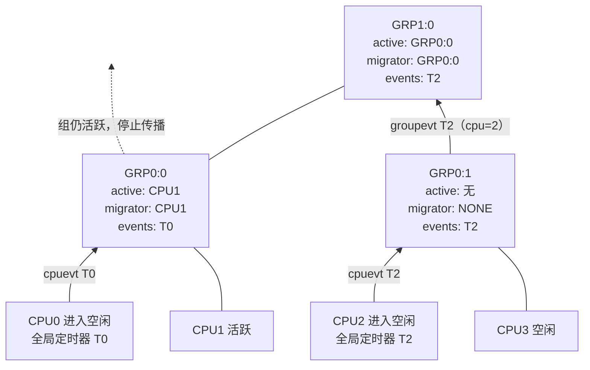
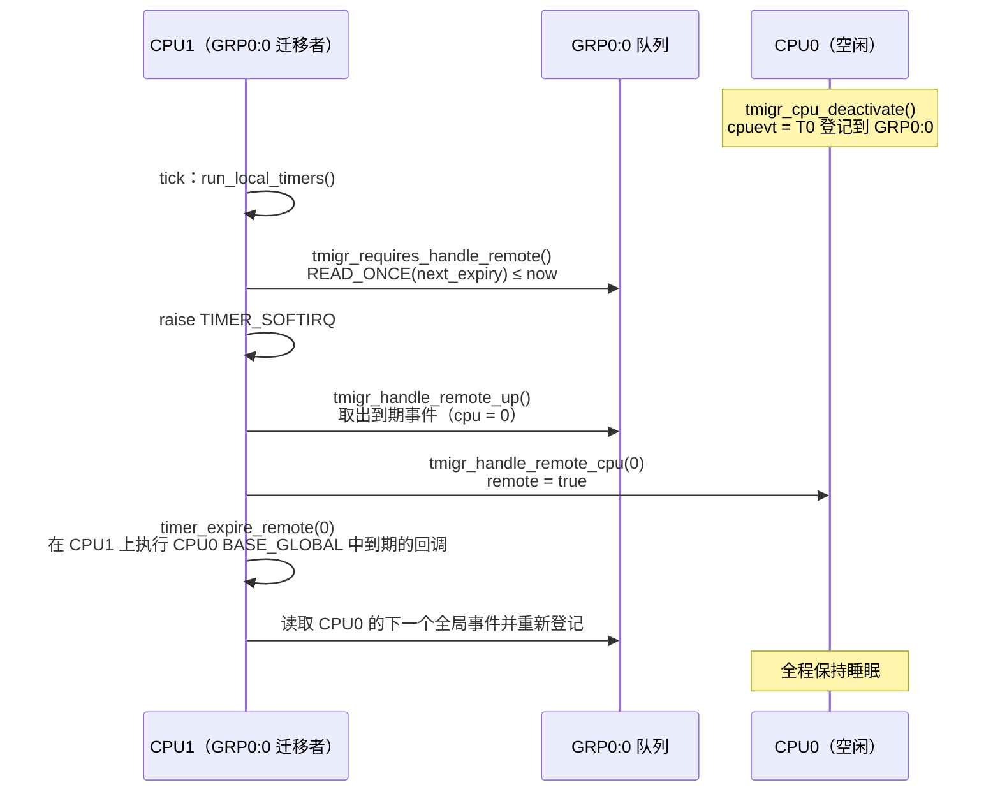

# 8.8 定时器迁移层次：空闲 CPU 的全局定时器

> **本节源码**：[`kernel/time/timer_migration.c`](../../linux/kernel/time/timer_migration.c)、[`kernel/time/timer_migration.h`](../../linux/kernel/time/timer_migration.h)、[`kernel/time/timer.c`](../../linux/kernel/time/timer.c)
> **关键函数**：`tmigr_cpu_deactivate()`、`tmigr_cpu_activate()`、`tmigr_inactive_up()`、`tmigr_active_up()`、`tmigr_update_events()`、`tmigr_new_timer()`、`tmigr_requires_handle_remote()`、`tmigr_handle_remote()`、`tmigr_handle_remote_cpu()`、`timer_use_tmigr()`、`__get_next_timer_interrupt()`
> **前置知识**：8.7 时间轮定时器、8.10 tick 模拟与无 tick 模式（可与本节对照阅读）、7.2 原子操作

## 概述

空闲 CPU 想停掉 tick、进入深度睡眠，它必须先回答一个问题：我这里还有没有定时器要到期？如果有一个 5 ms 后到期的定时器，CPU 就只能睡 5 ms。可是大量定时器并不在乎由哪个 CPU 执行——它们只是"某个时刻要做的事"。让一个反正醒着的 CPU 代为执行，空闲 CPU 就可以睡得更久。

v6.9 之前的做法是在**插入时**猜测：`mod_timer()` 调用 `get_nohz_timer_target()`，若本 CPU 空闲就把定时器放到某个忙碌 CPU 上。这有两个问题：插入时的猜测往往不准（被选中的 CPU 可能马上也进入空闲），而且定时器被挪到远程 CPU 后，修改它要跨 CPU 加锁、缓存行来回迁移。

v6.9 引入的**定时器迁移层次**（Timer Migration Hierarchy，源码中前缀为 `tmigr`）改为在**到期时**决定：定时器总是插入本 CPU（8.7 节已经看到 `__mod_timer()` 总选本地 base），CPU 进入空闲时把自己最早的"全局"定时器登记到一个按拓扑组织的层次结构中，由仍然活跃的 CPU 在自己的 tick 中检查层次结构，代为执行到期的远程定时器。只有 `BASE_GLOBAL` 中的定时器参与这一机制；`TIMER_PINNED` 定时器（`BASE_LOCAL`）始终由所在 CPU 自己处理，可延迟定时器（`BASE_DEF`）则不唤醒任何 CPU。

本节分析层次结构的组织、CPU 进入与退出空闲时的状态传播、活跃 CPU 代为执行远程定时器的过程，以及这一机制与 tick 停止决策的衔接。

## 层次结构

### 组织方式

源码开头的长注释描述了整体设计（[`kernel/time/timer_migration.c:20-82`](../../linux/kernel/time/timer_migration.c#L20-L82)），以两个 NUMA 节点、每个节点 24 个 CPU 的系统为例：

```
LVL 2                           [GRP2:0]
                             GRP1:0 = GRP1:M

LVL 1            [GRP1:0]                      [GRP1:1]
              GRP0:0 - GRP0:2               GRP0:3 - GRP0:5

LVL 0  [GRP0:0]  [GRP0:1]  [GRP0:2]  [GRP0:3]  [GRP0:4]  [GRP0:5]
CPUS     0-7       8-15      16-23     24-31     32-39     40-47
```

*图 8-11：定时器迁移层次示例（摘自源码注释）*

- 每个组最多有 `TMIGR_CHILDREN_PER_GROUP = 8` 个子节点（[`kernel/time/timer_migration.h:6`](../../linux/kernel/time/timer_migration.h#L6)）；第 0 层的子节点是 CPU，更高层的子节点是下层的组。
- 低层的组按 NUMA 节点划分，同一组内的 CPU 属于同一节点，层次中只有最上面几层跨越节点，从而把锁竞争和缓存行迁移限制在节点内部。
- 层数在启动时按"每节点 CPU 数"与"节点数"估算：`tmigr_init()` 中 `cpulvl = ⌈log₂(每节点 CPU 数) / 3⌉`，`nodelvl = ⌈log₂(节点数) / 3⌉`，总层数为二者之和（[`kernel/time/timer_migration.c:1833-1852`](../../linux/kernel/time/timer_migration.c#L1833-L1852)）。启动日志中会打印 "Timer migration: %d hierarchy levels; 8 children per group; %d crossnode level"。
- 组在 CPU 第一次上线时按需创建，此后不再销毁（注释中的 "Lifetime rules"）。

### 每个组的状态

[`kernel/time/timer_migration.h:61-73`](../../linux/kernel/time/timer_migration.h#L61-L73)（v6.18.60）

```c
struct tmigr_group {
	raw_spinlock_t		lock;
	struct tmigr_group	*parent;
	struct tmigr_event	groupevt;	// [注] 本组作为子节点挂在父组队列中的事件
	u64			next_expiry;	// [注] 本组队列中最早的事件，供无锁快速检查
	struct timerqueue_head	events;		// [注] 空闲子节点登记的事件，按到期时间排序
	atomic_t		migr_state;	// [注] 活跃子节点位图 + 迁移者 + 序号
	unsigned int		level;
	int			numa_node;
	unsigned int		num_children;
	u8			groupmask;	// [注] 本组在父组中的位
	struct list_head	list;
};
```

[`kernel/time/timer_migration.h:124-131`](../../linux/kernel/time/timer_migration.h#L124-L131)（v6.18.60）

```c
union tmigr_state {
	u32 state;
	struct {
		u8	active;
		u8	migrator;
		u16	seq;
	} __packed;
};
```

组的核心状态压缩在一个 32 位原子变量里，可以用一次 `atomic_try_cmpxchg()` 整体更新：

- `active`：8 位位图，每位对应一个子节点，表示该子节点是否活跃（对 CPU 而言即"未进入空闲"，对组而言即"至少有一个活跃子孙"）。
- `migrator`：迁移者（Migrator），即负责代为处理本组事件的子节点的位，没有活跃子节点时为 `TMIGR_NONE`（`0xFF`）。指定唯一的迁移者，是为了避免组内所有活跃 CPU 同时去处理远程定时器、互相争锁。
- `seq`：每次更新加 1。注释用一个四步的例子说明了它的必要性（[`kernel/time/timer_migration.c:111-207`](../../linux/kernel/time/timer_migration.c#L111-L207)）：两个 CPU 分别进入、退出空闲，并各自自下而上逐层更新，若高层的更新顺序与低层相反，组状态会不一致；加入序号后，过时的 cmpxchg 必然失败。

### 每个 CPU 的状态

[`kernel/time/timer_migration.h:98-107`](../../linux/kernel/time/timer_migration.h#L98-L107)（v6.18.60）

```c
struct tmigr_cpu {
	raw_spinlock_t		lock;
	bool			online;
	bool			idle;		// [注] 在层次中是否处于空闲
	bool			remote;		// [注] 其全局定时器正在被其他 CPU 代为执行
	struct tmigr_group	*tmgroup;	// [注] 所属第 0 层组
	u8			groupmask;	// [注] 在第 0 层组中的位
	u64			wakeup;		// [注] 层次完全空闲时本 CPU 需要醒来的时刻
	struct tmigr_event	cpuevt;		// [注] 本 CPU 登记到第 0 层组的事件
};
```

`struct tmigr_event`（[`kernel/time/timer_migration.h:15-19`](../../linux/kernel/time/timer_migration.h#L15-L19)）包含一个 `timerqueue_node`、事件所属的 CPU 号以及 `ignore` 标志。CPU 或组重新活跃时并不立即从父组队列中删除自己的事件（那需要加锁），而是无锁地置位 `ignore`，等下次有人持锁访问该队列时再清理。

## CPU 进入空闲：tmigr_cpu_deactivate()

### 与停 tick 的衔接

8.10 节的 `tick_nohz_stop_tick()` 在确定要停 tick 时调用 `timer_base_try_to_set_idle()`，后者进入 `__get_next_timer_interrupt()`。8.7 节的 `fetch_next_timer_interrupt()` 已经分别算出本 CPU 最早的局部定时器 `tevt.local` 与全局定时器 `tevt.global`。若下一个事件在 1 个 jiffy 以外，CPU 才有可能空闲，此时调用 `timer_use_tmigr()`：

[`kernel/time/timer.c:2139-2169`](../../linux/kernel/time/timer.c#L2139-L2169)（v6.18.60）

```c
static void timer_use_tmigr(unsigned long basej, u64 basem,
			    unsigned long *nextevt, bool *tick_stop_path,
			    bool timer_base_idle, struct timer_events *tevt)
{
	u64 next_tmigr;

	if (timer_base_idle)
		next_tmigr = tmigr_cpu_new_timer(tevt->global);
	else if (tick_stop_path)
		next_tmigr = tmigr_cpu_deactivate(tevt->global);
	else
		next_tmigr = tmigr_quick_check(tevt->global);

	/*
	 * If the CPU is the last going idle in timer migration hierarchy, make
	 * sure the CPU will wake up in time to handle remote timers.
	 * next_tmigr == KTIME_MAX if other CPUs are still active.
	 */
	if (next_tmigr < tevt->local) {
		u64 tmp;

		/* If we missed a tick already, force 0 delta */
		if (next_tmigr < basem)
			next_tmigr = basem;

		tmp = div_u64(next_tmigr - basem, TICK_NSEC);

		*nextevt = basej + (unsigned long)tmp;
		tevt->local = next_tmigr;
	}
}
```

三个调用点对应三种情况：

| 情况 | 调用 | 作用 |
|---|---|---|
| 真正停 tick（`tick_stop_path`） | `tmigr_cpu_deactivate()` | 把本 CPU 标为空闲，登记全局事件 |
| 已经空闲，又有新的全局定时器 | `tmigr_cpu_new_timer()` | 更新已登记的事件 |
| 只是预估睡眠时长（cpuidle 调用 `tick_nohz_get_sleep_length()`） | `tmigr_quick_check()` | 无锁估算，不修改状态 |

*表 8-19：timer_use_tmigr() 的三种调用情形*

返回值是"本 CPU 因层次结构的需要必须醒来的时刻"。通常其他 CPU 仍然活跃，会代为处理本 CPU 的全局定时器，返回 `KTIME_MAX`，于是本 CPU 只需按局部定时器设置唤醒时间——全局定时器被完全排除在睡眠时长的计算之外，这正是整个机制的收益。只有当本 CPU 是**最后一个**进入空闲的 CPU 时，返回值才是整个层次中最早的全局事件，本 CPU 要负责按时醒来处理所有 CPU 的全局定时器。

### 自下而上传播空闲状态

[`kernel/time/timer_migration.c:1331-1383`](../../linux/kernel/time/timer_migration.c#L1331-L1383)（v6.18.60，节选）

```c
static u64 __tmigr_cpu_deactivate(struct tmigr_cpu *tmc, u64 nextexp)
{
	struct tmigr_walk data = { .nextexp = nextexp,
				   .firstexp = KTIME_MAX,
				   .evt = &tmc->cpuevt,
				   .childmask = tmc->groupmask };

	/*
	 * If nextexp is KTIME_MAX, the CPU event will be ignored because the
	 * local timer expires before the global timer, no global timer is set
	 * or CPU goes offline.
	 */
	if (nextexp != KTIME_MAX)
		tmc->cpuevt.ignore = false;

	walk_groups(&tmigr_inactive_up, &data, tmc);
	return data.firstexp;
}
...
u64 tmigr_cpu_deactivate(u64 nextexp)
{
	struct tmigr_cpu *tmc = this_cpu_ptr(&tmigr_cpu);
	u64 ret;

	if (tmigr_is_not_available(tmc))
		return nextexp;

	raw_spin_lock(&tmc->lock);

	ret = __tmigr_cpu_deactivate(tmc, nextexp);

	tmc->idle = true;

	/*
	 * Make sure the reevaluation of timers in idle path will not miss an
	 * event.
	 */
	WRITE_ONCE(tmc->wakeup, ret);
	...
	raw_spin_unlock(&tmc->lock);
	return ret;
}
```

`walk_groups()`（[`kernel/time/timer_migration.c:527-558`](../../linux/kernel/time/timer_migration.c#L527-L558)）从 CPU 所属的第 0 层组开始，对每一层调用回调函数，回调返回真时停止向上。空闲路径的回调是 `tmigr_inactive_up()`：

[`kernel/time/timer_migration.c:1273-1328`](../../linux/kernel/time/timer_migration.c#L1273-L1328)（v6.18.60，节选）

```c
	for (;;) {
		if (child)
			childstate.state = atomic_read(&child->migr_state);

		newstate = curstate;
		walk_done = true;

		/* Reset active bit when the child is no longer active */
		if (!childstate.active)
			newstate.active &= ~childmask;

		if (newstate.migrator == childmask) {
			/*
			 * Find a new migrator for the group, because the child
			 * group is idle!
			 */
			if (!childstate.active) {
				unsigned long new_migr_bit, active = newstate.active;

				new_migr_bit = find_first_bit(&active, BIT_CNT);

				if (new_migr_bit != BIT_CNT) {
					newstate.migrator = BIT(new_migr_bit);
				} else {
					newstate.migrator = TMIGR_NONE;

					/* Changes need to be propagated */
					walk_done = false;
				}
			}
		}

		newstate.seq++;
		...
		if (atomic_try_cmpxchg(&group->migr_state, &curstate.state, newstate.state)) {
			trace_tmigr_group_set_cpu_inactive(group, newstate, childmask);
			break;
		}
		...
	}

	data->remote = false;

	/* Event Handling */
	tmigr_update_events(group, child, data);

	return walk_done;
```

在每一层：

1. 清除本子节点在 `active` 中的位；
2. 若本子节点恰好是迁移者，从剩余的活跃子节点中选第一个作为新的迁移者；
3. 若组里已没有活跃子节点，迁移者设为 `TMIGR_NONE`，本组也变为空闲，需要继续向上传播（`walk_done = false`）；
4. 无论是否继续传播，都调用 `tmigr_update_events()` 把子节点的事件登记到本组队列中。

`tmigr_update_events()`（[`kernel/time/timer_migration.c:727-873`](../../linux/kernel/time/timer_migration.c#L727-L873)）是唯一修改组事件的地方：第 0 层登记的是 CPU 的 `cpuevt`；更高层登记的是子组的 `groupevt`，其到期时间为子组队列中的最早事件，其 `cpu` 字段记录那个事件属于哪个 CPU，于是迁移者从任意一层的队首都能直接找到该去处理哪个 CPU。若到了顶层组且整个层次都已空闲（`migrator == TMIGR_NONE`），就把顶层队列中最早事件的时间通过 `data->firstexp` 交回给调用者——这个最后进入空闲的 CPU 必须在那时醒来。



*图 8-12：CPU 进入空闲时状态与事件的传播*

图中 CPU0 进入空闲后，GRP0:0 仍有活跃的 CPU1，CPU1 成为迁移者，传播到此为止；CPU2 进入空闲后 GRP0:1 全组空闲，GRP0:1 的组事件（最早的 T2，属于 CPU2）被登记到 GRP1:0，由 GRP1:0 的迁移者 GRP0:0（也就是 CPU1）负责。CPU1 在自己的 tick 中检查 GRP0:0 与 GRP1:0 两层的队列，就能发现 T0 与 T2 是否到期。

## CPU 退出空闲：tmigr_cpu_activate()

CPU 恢复 tick 时，`tick_nohz_restart_sched_tick()` 调用 `timer_clear_idle()`（[`kernel/time/timer.c:2320-2336`](../../linux/kernel/time/timer.c#L2320-L2336)），后者调用 `tmigr_cpu_activate()`：

[`kernel/time/timer_migration.c:628-691`](../../linux/kernel/time/timer_migration.c#L628-L691)（v6.18.60，节选）

```c
static bool tmigr_active_up(struct tmigr_group *group,
			    struct tmigr_group *child,
			    struct tmigr_walk *data)
{
	union tmigr_state curstate, newstate;
	bool walk_done;
	u8 childmask;

	childmask = data->childmask;
	...
	curstate.state = atomic_read(&group->migr_state);

	do {
		newstate = curstate;
		walk_done = true;

		if (newstate.migrator == TMIGR_NONE) {
			newstate.migrator = childmask;

			/* Changes need to be propagated */
			walk_done = false;
		}

		newstate.active |= childmask;
		newstate.seq++;

	} while (!atomic_try_cmpxchg(&group->migr_state, &curstate.state, newstate.state));
	...
	WRITE_ONCE(group->groupevt.ignore, true);

	return walk_done;
}

static void __tmigr_cpu_activate(struct tmigr_cpu *tmc)
{
	struct tmigr_walk data;

	data.childmask = tmc->groupmask;

	trace_tmigr_cpu_active(tmc);

	tmc->cpuevt.ignore = true;
	WRITE_ONCE(tmc->wakeup, KTIME_MAX);

	walk_groups(&tmigr_active_up, &data, tmc);
}
```

活跃路径比空闲路径简单得多，也更快——CPU 退出空闲时往往有任务等着运行：

- 不获取任何组锁，只用 cmpxchg 更新状态；
- 置位 `active`；若组原本没有迁移者，自己成为迁移者并继续向上（组从空闲变为活跃，需要通知父组），否则到此为止；
- 自己的 `cpuevt` 与所经过组的 `groupevt` 都只是置位 `ignore`，而不从队列中删除。即使父组的迁移者没能及时看到 `ignore`，最坏结果也只是它代为执行了本该由本 CPU 自己执行的定时器——这是无害的。

## 代为执行远程定时器

### 检查：tmigr_requires_handle_remote()

8.7 节的 `run_local_timers()` 在每个 tick 中检查本地 base 之后，还调用 `tmigr_requires_handle_remote()` 判断是否需要为其他 CPU 处理定时器，需要时触发 `TIMER_SOFTIRQ`：

[`kernel/time/timer_migration.c:1166-1193`](../../linux/kernel/time/timer_migration.c#L1166-L1193)（v6.18.60，节选）

```c
bool tmigr_requires_handle_remote(void)
{
	struct tmigr_cpu *tmc = this_cpu_ptr(&tmigr_cpu);
	struct tmigr_walk data;
	unsigned long jif;
	bool ret = false;

	if (tmigr_is_not_available(tmc))
		return ret;

	data.now = get_jiffies_update(&jif);
	data.childmask = tmc->groupmask;
	data.firstexp = KTIME_MAX;
	data.tmc_active = !tmc->idle;
	data.check = false;

	/*
	 * If the CPU is active, walk the hierarchy to check whether a remote
	 * expiry is required.
	 *
	 * Check is done lockless as interrupts are disabled and @tmc->idle is
	 * set only by the local CPU.
	 */
	if (!tmc->idle) {
		__walk_groups(&tmigr_requires_handle_remote_up, &data, tmc);

		return data.check;
	}
	...
```

活跃 CPU 自下而上检查自己担任迁移者（或组内无迁移者）的每一层，在 64 位平台上无锁读取组的 `next_expiry`，若已到期则需要处理（[`kernel/time/timer_migration.c:1111-1159`](../../linux/kernel/time/timer_migration.c#L1111-L1159)）。一旦遇到自己不是迁移者的组就停止——那一层以上由别的 CPU 负责。空闲 CPU（作为最后一个空闲者被唤醒）则直接比较 `tmc->wakeup`。

这个检查发生在硬中断中，每个 tick 都要执行，因此全程无锁，只读少量缓存行；迁移者只在自己所在路径上的若干层检查，开销与层数（通常 2～3 层）成正比。

### 执行：tmigr_handle_remote()

`run_timer_softirq()` 在处理完本地三个 base 后调用 `tmigr_handle_remote()`（[`kernel/time/timer_migration.c:1068-1109`](../../linux/kernel/time/timer_migration.c#L1068-L1109)），它沿层次向上，对每一层调用 `tmigr_handle_remote_up()`：

[`kernel/time/timer_migration.c:1027-1060`](../../linux/kernel/time/timer_migration.c#L1027-L1060)（v6.18.60）

```c
again:
	/*
	 * Handle the group only if @childmask is the migrator or if the
	 * group has no migrator. Otherwise the group is active and is
	 * handled by its own migrator.
	 */
	if (!tmigr_check_migrator(group, childmask))
		return true;

	raw_spin_lock_irq(&group->lock);

	evt = tmigr_next_expired_groupevt(group, now);

	if (evt) {
		unsigned int remote_cpu = evt->cpu;

		raw_spin_unlock_irq(&group->lock);

		tmigr_handle_remote_cpu(remote_cpu, now, jif);

		/* check if there is another event, that needs to be handled */
		goto again;
	}

	/*
	 * Keep track of the expiry of the first event that needs to be handled
	 * (group->next_expiry was updated by tmigr_next_expired_groupevt(),
	 * next was set by tmigr_handle_remote_cpu()).
	 */
	data->firstexp = group->next_expiry;

	raw_spin_unlock_irq(&group->lock);

	return false;
```

从组队列中逐个取出已到期的事件，按事件的 `cpu` 字段调用 `tmigr_handle_remote_cpu()`：

[`kernel/time/timer_migration.c:935-1005`](../../linux/kernel/time/timer_migration.c#L935-L1005)（v6.18.60，节选）

```c
	if (!tmc->online || tmc->remote || tmc->cpuevt.ignore ||
	    now < tmc->cpuevt.nextevt.expires) {
		raw_spin_unlock_irq(&tmc->lock);
		return;
	}

	trace_tmigr_handle_remote_cpu(tmc);

	tmc->remote = true;
	WRITE_ONCE(tmc->wakeup, KTIME_MAX);

	/* Drop the lock to allow the remote CPU to exit idle */
	raw_spin_unlock_irq(&tmc->lock);
	...
	timer_expire_remote(cpu);
	...
	local_irq_disable();
	timer_lock_remote_bases(cpu);
	raw_spin_lock(&tmc->lock);
	...
	if (!tmc->online || !tmc->idle) {
		timer_unlock_remote_bases(cpu);
		goto unlock;
	}

	/* next	event of CPU */
	fetch_next_timer_interrupt_remote(jif, now, &tevt, cpu);
	timer_unlock_remote_bases(cpu);

	data.nextexp = tevt.global;
	data.firstexp = KTIME_MAX;
	data.evt = &tmc->cpuevt;
	data.remote = true;
	...
	walk_groups(&tmigr_new_timer_up, &data, tmc);
```

1. **检查**：目标 CPU 已下线、正被别人处理（`remote`）、已经醒来（`ignore`）或事件还没到期，都直接返回。
2. **执行**：置位 `remote` 后释放锁（让目标 CPU 可以随时退出空闲），调用 `timer_expire_remote()`，它直接对目标 CPU 的 `BASE_GLOBAL` 执行 8.7 节的 `__run_timer_base()`（[`kernel/time/timer.c:2132-2137`](../../linux/kernel/time/timer.c#L2132-L2137)）——回调在迁移者的 CPU 上、迁移者的软中断上下文中执行。
3. **重新登记**：执行完后，目标 CPU 可能还有下一个全局定时器。迁移者按"先 timer_base 锁、后 tmigr 锁"的顺序加锁，读取目标 CPU 的下一个全局事件，再从目标 CPU 的视角沿层次重新登记（`tmigr_new_timer_up`）。注释中专门有一节解释为什么即使目标没有新定时器也必须走一遍层次（[`kernel/time/timer_migration.c:331-414`](../../linux/kernel/time/timer_migration.c#L331-L414)）：同组其他空闲 CPU 的事件可能排在刚处理完的事件之后，不重新计算组事件就会被遗漏。



*图 8-13：迁移者代为执行空闲 CPU 的全局定时器*

## 关键细节 / 设计考量

### 为什么在到期时迁移

插入时迁移要猜"将来谁醒着"，到期时迁移只需看"现在谁醒着"。后者有几个直接好处：定时器的插入、修改、删除都在本地 base 上完成，没有跨 CPU 加锁；绝大多数超时定时器在到期前就被删除，根本不会触发迁移；只有空闲 CPU 才登记事件、只有真正到期的事件才被代为执行，代价只在需要时付出。代价是回调可能在与插入时不同的 CPU 上执行，因此需要 CPU 亲和性的定时器必须使用 `TIMER_PINNED`（`add_timer_on()`、`add_timer_local()` 或 `timer_setup(..., TIMER_PINNED)`）。

### 无锁快路径与有锁慢路径

层次结构在设计上严格区分了两类操作：CPU 退出空闲与每个 tick 的检查是热路径，全部用原子操作和 `READ_ONCE()` 完成；CPU 进入空闲与代为执行定时器相对少见，才需要获取组锁。`ignore` 标志、`next_expiry` 的无锁读取、`seq` 序号都服务于这种分工。锁的顺序约定为"timer_base 锁 → tmigr_cpu 锁 → 子组锁 → 父组锁"（注释中的 "Locking rules"，[`kernel/time/timer_migration.c:95-108`](../../linux/kernel/time/timer_migration.c#L95-L108)）。

### 最后一个进入空闲的 CPU

当整个系统都空闲时，必须有一个 CPU 负责按时醒来。层次结构的处理是：最后一个进入空闲的 CPU 在顶层发现迁移者变为 `TMIGR_NONE`，`tmigr_update_events()` 把顶层队列中最早的事件时间作为 `firstexp` 交还给它，记入 `tmc->wakeup`，并成为它停 tick 时的唤醒时间。这个 CPU 醒来后，`tmigr_requires_handle_remote()` 比较 `wakeup` 与当前时间，进入远程处理。注释中"Prevent race between new event and last CPU going inactive"一节（[`kernel/time/timer_migration.c:209-330`](../../linux/kernel/time/timer_migration.c#L209-L330)）详细讨论了"最后一个 CPU 进入空闲"与"另一个空闲 CPU 新增定时器"并发时，为什么必须在锁内读取组状态才不会丢失事件。

### CPU 热插拔

CPU 下线时 `tmigr_cpu_offline()` 以 `KTIME_MAX` 为事件走一遍空闲路径，把自己从层次中摘除；若它恰好是最后一个活跃 CPU 而层次中还有待处理的事件，就在另一个在线 CPU 上运行一个空的工作项把那个 CPU 唤醒为活跃状态（[`kernel/time/timer_migration.c:1450-1474`](../../linux/kernel/time/timer_migration.c#L1450-L1474)）。下线 CPU 自己 base 中的定时器由 8.7 节的 `timers_dead_cpu()` 迁移到其他 CPU。

### sysctl kernel.timer_migration

`/proc/sys/kernel/timer_migration`（默认 1）与 `tick_nohz_active` 共同决定静态键 `timers_migration_enabled`（[`kernel/time/timer.c:282-288`](../../linux/kernel/time/timer.c#L282-L288)）。在 v6.18.60 中，这个静态键只被 hrtimer 的目标 CPU 选择使用（`get_target_base()`，8.9 节）；时间轮的全局定时器只要 NO_HZ 处于活动状态就总是参与迁移层次，不受该 sysctl 影响。

## 动手实验

```bash
# 启动日志中的层次结构信息
dmesg | grep 'Timer migration'

# 跟踪 CPU 在层次中的空闲 / 活跃切换与远程处理（需要 debugfs/tracefs）
cd /sys/kernel/tracing
echo 1 > events/timer_migration/tmigr_cpu_idle/enable
echo 1 > events/timer_migration/tmigr_cpu_active/enable
echo 1 > events/timer_migration/tmigr_handle_remote_cpu/enable
sleep 5; head -n 40 trace
echo 0 > events/timer_migration/enable

# 统计每个 CPU 代为执行远程定时器的次数
sudo bpftrace -e 'kprobe:timer_expire_remote { @remote[cpu, arg0] = count(); } interval:s:10 { exit(); }'
```

在多 vCPU 的虚拟机上，空闲时可以看到少数 CPU 频繁出现 `tmigr_handle_remote_cpu` 事件，而其他 CPU 长时间保持 `tmigr_cpu_idle` 状态。bpftrace 输出中的键为"执行者 CPU, 被代理 CPU"。

## 小结

- 定时器迁移层次（v6.9）把"由谁执行全局定时器"的决定从插入时推迟到到期时：定时器总在本地入队，CPU 空闲时把最早的全局定时器登记到层次结构中，由活跃 CPU 代为执行。
- 层次按 NUMA 拓扑组织，每组至多 8 个子节点；组状态（活跃位图、迁移者、序号）压缩在一个 32 位原子变量中，以 cmpxchg 更新，序号防止多层更新乱序。
- 进入空闲走有锁的 `tmigr_inactive_up()` 并登记事件；退出空闲走无锁的 `tmigr_active_up()`，只置位 `ignore` 而不删除事件。
- 每个 tick 中迁移者无锁检查自己负责的各层 `next_expiry`，到期则在 `TIMER_SOFTIRQ` 中通过 `timer_expire_remote()` 执行空闲 CPU 的 `BASE_GLOBAL`，并从对方视角重新登记下一个事件。
- 其他 CPU 仍活跃时，空闲 CPU 计算睡眠时长可完全忽略全局定时器；最后一个进入空闲的 CPU 负责在层次中最早的事件到来时醒来。

## 参考

- `kernel/time/timer_migration.c` 文件开头的设计文档注释
- Anna-Maria Behnsen, "timer: Move from a push remote at enqueue to a pull at expiry model"（LKML 补丁系列，v6.9 合入）
