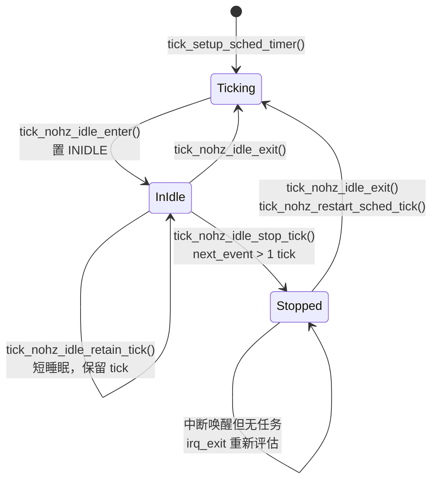

# 8.10 tick 模拟与无 tick 模式

> **本节源码**：[`kernel/time/tick-sched.c`](../../linux/kernel/time/tick-sched.c)、[`kernel/time/tick-sched.h`](../../linux/kernel/time/tick-sched.h)、[`kernel/sched/idle.c`](../../linux/kernel/sched/idle.c)、[`kernel/softirq.c`](../../linux/kernel/softirq.c)、[`kernel/time/timer.c`](../../linux/kernel/time/timer.c)
> **关键函数**：`tick_setup_sched_timer()`、`tick_nohz_handler()`、`tick_sched_do_timer()`、`tick_do_update_jiffies64()`、`tick_sched_handle()`、`tick_nohz_idle_enter()`、`tick_nohz_get_sleep_length()`、`tick_nohz_idle_stop_tick()`、`tick_nohz_next_event()`、`tick_nohz_stop_tick()`、`tick_nohz_restart_sched_tick()`、`tick_nohz_idle_exit()`、`tick_nohz_irq_enter()`、`tick_nohz_irq_exit()`
> **前置知识**：8.6 时钟事件设备与 tick 设备、8.7 时间轮、8.8 定时器迁移层次、8.9 高精度定时器、3.5 调度时钟与抢占模型

## 概述

切换到高精度模式后，时钟事件设备完全由 hrtimer 驱动，不再有天然的周期中断。可是内核仍然需要周期性地做那些"tick 的工作"：推进 jiffies 与 timekeeper、进程时间记账、检查时间轮、驱动调度器的 `sched_tick()`、RCU 的静止状态检测……解决办法是用一个每 CPU 的 hrtimer 来**模拟** tick：它每 `TICK_NSEC` 到期一次，回调中完成上述工作并把自己推后一个周期。

模拟 tick 带来一个自然的好处：它只是一个普通的定时器，想停就停。无 tick 模式（Dynticks，`NO_HZ`）正是利用这一点：

- **空闲时停 tick**（`NO_HZ_IDLE` 语义，`CONFIG_NO_HZ_COMMON`）：CPU 空闲时，把模拟 tick 推迟到下一个真正需要处理的事件，让 CPU 长时间睡眠；
- **运行时停 tick**（`CONFIG_NO_HZ_FULL`）：`nohz_full=` 指定的 CPU 上只有一个可运行任务时也停掉 tick，消除对计算密集型或延迟敏感任务的打扰。

本节分析每 CPU 的 `struct tick_sched`、模拟 tick 的回调、jiffies 的更新与计时职责的转移、空闲时停止与恢复 tick 的完整过程，以及空闲时间统计。`NO_HZ_FULL` 的 tick 依赖机制与远程 tick 已在 3.5 节从调度器的角度分析过，这里只做补充。本书配置开启了 `CONFIG_NO_HZ_FULL`（它选中 `CONFIG_NO_HZ_COMMON`），但未在启动参数中指定 `nohz_full=` 时，所有 CPU 都只使用空闲停 tick。

## 核心数据结构

### struct tick_sched

[`kernel/time/tick-sched.h:64-103`](../../linux/kernel/time/tick-sched.h#L64-L103)（v6.18.60）

```c
struct tick_sched {
	/* Common flags */
	unsigned long			flags;			// [注] TS_FLAG_*

	/* Tick handling: jiffies stall check */
	unsigned int			stalled_jiffies;
	unsigned long			last_tick_jiffies;

	/* Tick handling */
	struct hrtimer			sched_timer;		// [注] 模拟 tick 的 hrtimer
	ktime_t				last_tick;		// [注] 停 tick 前最后一个 tick 的时刻
	ktime_t				next_tick;		// [注] 停 tick 后编程的下一次唤醒
	unsigned long			idle_jiffies;		// [注] 进入空闲时的 jiffies，用于 tick 记账
	ktime_t				idle_waketime;
	unsigned int			got_idle_tick;

	/* Idle entry */
	seqcount_t			idle_sleeptime_seq;
	ktime_t				idle_entrytime;

	/* Tick stop */
	unsigned long			last_jiffies;
	u64				timer_expires_base;	// [注] 计算 timer_expires 时的基准单调时间
	u64				timer_expires;		// [注] 预计的下一次事件
	u64				next_timer;
	ktime_t				idle_expires;
	unsigned long			idle_calls;		// [注] 尝试停 tick 的次数
	unsigned long			idle_sleeps;		// [注] 实际停了 tick 的次数

	/* Idle exit */
	ktime_t				idle_exittime;
	ktime_t				idle_sleeptime;		// [注] 累计空闲时间
	ktime_t				iowait_sleeptime;	// [注] 累计 iowait 时间

	/* Full dynticks handling */
	atomic_t			tick_dep_mask;		// [注] 本 CPU 的 tick 依赖（3.5 节）

	/* Clocksource changes */
	unsigned long			check_clocks;		// [注] 时钟源 / 设备变化通知
};
```

[`kernel/time/tick-sched.h:17-31`](../../linux/kernel/time/tick-sched.h#L17-L31)（v6.18.60）

```c
/* The CPU is in the tick idle mode */
#define TS_FLAG_INIDLE		BIT(0)
/* The idle tick has been stopped */
#define TS_FLAG_STOPPED		BIT(1)
/*
 * Indicator that the CPU is actively in the tick idle mode;
 * it is reset during irq handling phases.
 */
#define TS_FLAG_IDLE_ACTIVE	BIT(2)
/* CPU was the last one doing do_timer before going idle */
#define TS_FLAG_DO_TIMER_LAST	BIT(3)
/* NO_HZ is enabled */
#define TS_FLAG_NOHZ		BIT(4)
/* High resolution tick mode */
#define TS_FLAG_HIGHRES		BIT(5)
```

| 标志 | 含义 |
|---|---|
| `INIDLE` | CPU 位于空闲循环中（`tick_nohz_idle_enter()` 与 `tick_nohz_idle_exit()` 之间） |
| `STOPPED` | tick 已停止 |
| `IDLE_ACTIVE` | 正在统计空闲时间；中断处理期间清除，中断退出后重新置位 |
| `DO_TIMER_LAST` | 停 tick 前本 CPU 是负责计时的 CPU |
| `NOHZ` | 本 CPU 的 NO_HZ 已激活 |
| `HIGHRES` | tick 由高精度模式下的 hrtimer 模拟（否则为低精度 NO_HZ 模式） |

*表 8-22：tick_sched 的状态标志*

每个 CPU 一个 `tick_cpu_sched`（[`kernel/time/tick-sched.c:40`](../../linux/kernel/time/tick-sched.c#L40)）。

## tick 的三种实现方式

| 模式 | tick 设备状态 | `event_handler` | tick 由谁产生 | 何时使用 |
|---|---|---|---|---|
| 周期模式 | 周期 / 单次模拟周期 | `tick_handle_periodic()` | 硬件周期中断 | 启动早期；`nohz=off highres=off` |
| 高精度模式 | 单次 | `hrtimer_interrupt()` | `sched_timer` 这个 hrtimer | 默认 |
| 低精度 NO_HZ 模式 | 单次 | `tick_nohz_lowres_handler()` | 直接编程 tick 设备，`sched_timer` 仅用于记录时刻 | `highres=off` 且 NO_HZ 可用 |

*表 8-23：tick 的三种实现方式*

### 建立模拟 tick

[`kernel/time/tick-sched.c:1571-1598`](../../linux/kernel/time/tick-sched.c#L1571-L1598)（v6.18.60）

```c
void tick_setup_sched_timer(bool hrtimer)
{
	struct tick_sched *ts = this_cpu_ptr(&tick_cpu_sched);

	/* Emulate tick processing via per-CPU hrtimers: */
	hrtimer_setup(&ts->sched_timer, tick_nohz_handler, CLOCK_MONOTONIC, HRTIMER_MODE_ABS_HARD);

	if (IS_ENABLED(CONFIG_HIGH_RES_TIMERS) && hrtimer)
		tick_sched_flag_set(ts, TS_FLAG_HIGHRES);

	/* Get the next period (per-CPU) */
	hrtimer_set_expires(&ts->sched_timer, tick_init_jiffy_update());

	/* Offset the tick to avert 'jiffies_lock' contention. */
	if (sched_skew_tick) {
		u64 offset = TICK_NSEC >> 1;
		do_div(offset, num_possible_cpus());
		offset *= smp_processor_id();
		hrtimer_add_expires_ns(&ts->sched_timer, offset);
	}

	hrtimer_forward_now(&ts->sched_timer, TICK_NSEC);
	if (IS_ENABLED(CONFIG_HIGH_RES_TIMERS) && hrtimer)
		hrtimer_start_expires(&ts->sched_timer, HRTIMER_MODE_ABS_PINNED_HARD);
	else
		tick_program_event(hrtimer_get_expires(&ts->sched_timer), 1);
	tick_nohz_activate(ts);
}
```

- 无论哪种 NO_HZ 模式，`sched_timer` 都被初始化，低精度模式下它不入队，只用来保存"下一个 tick 的时刻"，以便共享同一套代码（`tick_nohz_switch_to_nohz()` 中的注释称之为"回收利用"，[`kernel/time/tick-sched.c:1504-1517`](../../linux/kernel/time/tick-sched.c#L1504-L1517)）。
- 定时器以 `HRTIMER_MODE_ABS_PINNED_HARD` 启动：固定在本 CPU、在硬中断中到期，即使在 `PREEMPT_RT` 下也是如此（3.5 节）。
- 所有 CPU 的 tick 默认对齐到同一个时刻：`tick_init_jiffy_update()` 把第一次的 `tick_next_period` 对齐到 `TICK_NSEC` 的整数倍（[`kernel/time/tick-sched.c:155-182`](../../linux/kernel/time/tick-sched.c#L155-L182)），各 CPU 以此为基准。对齐使各 CPU 的 tick 同时到来，空闲 CPU 可以同时被唤醒、同时睡下，有利于整个封装进入更深的节能状态。代价是所有 CPU 同时争抢 `jiffies_lock` 等全局资源，启动参数 `skew_tick=1` 可以让各 CPU 的 tick 错开 `TICK_NSEC / 2 / CPU 数` 的倍数。
- `tick_nohz_activate()`（[`kernel/time/tick-sched.c:1491-1499`](../../linux/kernel/time/tick-sched.c#L1491-L1499)）置位 `TS_FLAG_NOHZ`，并在第一次激活时设置全局的 `tick_nohz_active`、调用 `timers_update_nohz()`，打开时间轮的 NO_HZ 相关静态键（8.7、8.8 节）。启动参数 `nohz=off` 会使 `tick_nohz_enabled` 为假，此时不激活。

## 模拟 tick 的回调

[`kernel/time/tick-sched.c:284-312`](../../linux/kernel/time/tick-sched.c#L284-L312)（v6.18.60）

```c
static enum hrtimer_restart tick_nohz_handler(struct hrtimer *timer)
{
	struct tick_sched *ts =	container_of(timer, struct tick_sched, sched_timer);
	struct pt_regs *regs = get_irq_regs();
	ktime_t now = ktime_get();

	tick_sched_do_timer(ts, now);

	/*
	 * Do not call when we are not in IRQ context and have
	 * no valid 'regs' pointer
	 */
	if (regs)
		tick_sched_handle(ts, regs);
	else
		ts->next_tick = 0;

	/*
	 * In dynticks mode, tick reprogram is deferred:
	 * - to the idle task if in dynticks-idle
	 * - to IRQ exit if in full-dynticks.
	 */
	if (unlikely(tick_sched_flag_test(ts, TS_FLAG_STOPPED)))
		return HRTIMER_NORESTART;

	hrtimer_forward(timer, now, TICK_NSEC);

	return HRTIMER_RESTART;
}
```

回调分两部分：`tick_sched_do_timer()` 负责全局的计时工作，`tick_sched_handle()` 负责本 CPU 的工作。tick 未停止时，把定时器推后一个周期并返回 `HRTIMER_RESTART`；tick 已停止时（此次到期是停 tick 后编程的唤醒），返回 `HRTIMER_NORESTART`，由空闲任务或中断退出路径决定下一次何时唤醒。低精度 NO_HZ 模式的 `tick_nohz_lowres_handler()` 直接调用同一个函数，再根据返回值编程 tick 设备（[`kernel/time/tick-sched.c:1481-1489`](../../linux/kernel/time/tick-sched.c#L1481-L1489)）。

### 本 CPU 的工作：tick_sched_handle()

[`kernel/time/tick-sched.c:253-278`](../../linux/kernel/time/tick-sched.c#L253-L278)（v6.18.60）

```c
static void tick_sched_handle(struct tick_sched *ts, struct pt_regs *regs)
{
	/*
	 * When we are idle and the tick is stopped, we have to touch
	 * the watchdog as we might not schedule for a really long
	 * time. This happens on completely idle SMP systems while
	 * waiting on the login prompt. We also increment the "start of
	 * idle" jiffy stamp so the idle accounting adjustment we do
	 * when we go busy again does not account too many ticks.
	 */
	if (IS_ENABLED(CONFIG_NO_HZ_COMMON) &&
	    tick_sched_flag_test(ts, TS_FLAG_STOPPED)) {
		touch_softlockup_watchdog_sched();
		if (is_idle_task(current))
			ts->idle_jiffies++;
		/*
		 * In case the current tick fired too early past its expected
		 * expiration, make sure we don't bypass the next clock reprogramming
		 * to the same deadline.
		 */
		ts->next_tick = 0;
	}

	update_process_times(user_mode(regs));
	profile_tick(CPU_PROFILING);
}
```

核心是 `update_process_times()`（3.5 节、8.7 节）。tick 停止期间偶尔到来的唤醒也会走到这里：此时要喂一下软锁死看门狗（长时间不调度是空闲的正常现象），并把 `idle_jiffies` 加 1——`update_process_times()` 已经把这个 tick 记为空闲时间，退出空闲时补记的 tick 数要相应减少。

### 全局的工作：tick_sched_do_timer()

[`kernel/time/tick-sched.c:206-251`](../../linux/kernel/time/tick-sched.c#L206-L251)（v6.18.60）

```c
static void tick_sched_do_timer(struct tick_sched *ts, ktime_t now)
{
	int tick_cpu, cpu = smp_processor_id();

	/*
	 * Check if the do_timer duty was dropped. We don't care about
	 * concurrency: This happens only when the CPU in charge went
	 * into a long sleep. If two CPUs happen to assign themselves to
	 * this duty, then the jiffies update is still serialized by
	 * 'jiffies_lock'.
	 *
	 * If nohz_full is enabled, this should not happen because the
	 * 'tick_do_timer_cpu' CPU never relinquishes.
	 */
	tick_cpu = READ_ONCE(tick_do_timer_cpu);

	if (IS_ENABLED(CONFIG_NO_HZ_COMMON) && unlikely(tick_cpu == TICK_DO_TIMER_NONE)) {
#ifdef CONFIG_NO_HZ_FULL
		WARN_ON_ONCE(tick_nohz_full_running);
#endif
		WRITE_ONCE(tick_do_timer_cpu, cpu);
		tick_cpu = cpu;
	}

	/* Check if jiffies need an update */
	if (tick_cpu == cpu)
		tick_do_update_jiffies64(now);

	/*
	 * If the jiffies update stalled for too long (timekeeper in stop_machine()
	 * or VMEXIT'ed for several msecs), force an update.
	 */
	if (ts->last_tick_jiffies != jiffies) {
		ts->stalled_jiffies = 0;
		ts->last_tick_jiffies = READ_ONCE(jiffies);
	} else {
		if (++ts->stalled_jiffies == MAX_STALLED_JIFFIES) {
			tick_do_update_jiffies64(now);
			ts->stalled_jiffies = 0;
			ts->last_tick_jiffies = READ_ONCE(jiffies);
		}
	}

	if (tick_sched_flag_test(ts, TS_FLAG_INIDLE))
		ts->got_idle_tick = 1;
}
```

- **接手计时职责**：负责计时的 CPU 停 tick 时会把 `tick_do_timer_cpu` 设为 `TICK_DO_TIMER_NONE`（见下文），下一个处理 tick 的 CPU 发现后就接手。注释坦然承认这里没有处理并发：两个 CPU 同时接手也没关系，jiffies 的更新本身在锁内会重新检查。
- **停滞检测**：若本 CPU 连续 5 个 tick（`MAX_STALLED_JIFFIES`）都看到 jiffies 没有变化，说明负责计时的 CPU 卡住了（例如处于 `stop_machine()` 中，或虚拟机中被宿主长时间挂起），就由本 CPU 强制更新一次。
- `got_idle_tick` 告诉 cpuidle 管理器"这次唤醒是 tick 引起的"，供 menu/teo 管理器修正睡眠时长预测。

### jiffies 的更新：tick_do_update_jiffies64()

[`kernel/time/tick-sched.c:57-150`](../../linux/kernel/time/tick-sched.c#L57-L150)（v6.18.60，节选）

```c
static void tick_do_update_jiffies64(ktime_t now)
{
	unsigned long ticks = 1;
	ktime_t delta, nextp;

	/*
	 * 64-bit can do a quick check without holding the jiffies lock and
	 * without looking at the sequence count. The smp_load_acquire()
	 * pairs with the update done later in this function.
	 ...
	 */
	if (IS_ENABLED(CONFIG_64BIT)) {
		if (ktime_before(now, smp_load_acquire(&tick_next_period)))
			return;
	} else {
		...
	}

	/* Quick check failed, i.e. update is required. */
	raw_spin_lock(&jiffies_lock);
	/*
	 * Re-evaluate with the lock held. Another CPU might have done the
	 * update already.
	 */
	if (ktime_before(now, tick_next_period)) {
		raw_spin_unlock(&jiffies_lock);
		return;
	}

	write_seqcount_begin(&jiffies_seq);

	delta = ktime_sub(now, tick_next_period);
	if (unlikely(delta >= TICK_NSEC)) {
		/* Slow path for long idle sleep times */
		s64 incr = TICK_NSEC;

		ticks += ktime_divns(delta, incr);

		last_jiffies_update = ktime_add_ns(last_jiffies_update,
						   incr * ticks);
	} else {
		last_jiffies_update = ktime_add_ns(last_jiffies_update,
						   TICK_NSEC);
	}

	/* Advance jiffies to complete the 'jiffies_seq' protected job */
	jiffies_64 += ticks;

	/* Keep the tick_next_period variable up to date */
	nextp = ktime_add_ns(last_jiffies_update, TICK_NSEC);

	if (IS_ENABLED(CONFIG_64BIT)) {
		...
		smp_store_release(&tick_next_period, nextp);
	} else {
		...
	}
	...
	write_seqcount_end(&jiffies_seq);

	calc_global_load();

	raw_spin_unlock(&jiffies_lock);
	update_wall_time();
}
```

与周期模式的 `tick_periodic()`（8.6 节）不同，这里 jiffies 的推进由**时间**驱动而非由中断次数驱动：用当前单调时间与 `tick_next_period` 比较，过去了多少个 `TICK_NSEC` 就加多少。tick 停止了一秒，恢复时一次加 1000，jiffies 依然准确。

- **无锁快速检查**：64 位平台上先用 `smp_load_acquire()` 读 `tick_next_period`，没到时间就直接返回，不碰锁。它与末尾的 `smp_store_release()` 配对，保证看到新的 `tick_next_period` 时也看到了更新后的 `jiffies_64`（7.3 节）。这个快速路径很重要：中断进入时每个空闲 CPU 都可能调用本函数（见下文 `tick_nohz_irq_enter()`）。
- **锁内复查**：多个 CPU 可能同时通过快速检查，持锁后再比较一次，只有一个 CPU 真正更新。
- `last_jiffies_update` 记录最近一次 jiffies 对应的单调时间，`get_jiffies_update()` 以 `jiffies_seq` 保护一并读出 jiffies 与它，供停 tick 的计算使用（[`kernel/time/tick-sched.c:867-880`](../../linux/kernel/time/tick-sched.c#L867-L880)）。
- 更新 jiffies 后在锁内调用 `calc_global_load()` 计算负载均值，释放锁后调用 `update_wall_time()`（8.4 节）。

## 空闲时停 tick

### 调用时机

```
do_idle()                                       kernel/sched/idle.c
├── tick_nohz_idle_enter()                      // 置 INIDLE，开始统计空闲时间
└── while (!need_resched())
    ├── local_irq_disable()
    └── cpuidle_idle_call()
        ├── cpuidle_select()                    // menu / teo 管理器
        │   └── tick_nohz_get_sleep_length()    // 预估能睡多久：tick_nohz_next_event()
        ├── idle_call_stop_or_retain_tick()
        │   ├── tick_nohz_idle_stop_tick()      // 管理器认为值得停 tick
        │   │   └── tick_nohz_stop_tick()
        │   └── tick_nohz_idle_retain_tick()    // 睡眠很短，保留 tick
        └── call_cpuidle() → mwait / hlt ...    // 中断唤醒
            irq_enter_rcu() → tick_irq_enter() → tick_nohz_irq_enter()    // 停止空闲统计，补更新 jiffies
            irq_exit_rcu()  → tick_irq_exit()  → tick_nohz_irq_exit()     // 重新开始空闲统计
└── tick_nohz_idle_exit()                       // 有任务可运行：恢复 tick，补记空闲 tick
```

空闲循环中，是否停 tick 由 cpuidle 管理器参与决定（[`kernel/sched/idle.c:163-169`](../../linux/kernel/sched/idle.c#L163-L169)、[`kernel/sched/idle.c:236-245`](../../linux/kernel/sched/idle.c#L236-L245)）：管理器调用 `tick_nohz_get_sleep_length()` 得到"若停 tick 能睡多久"与"若保留 tick 下一次 tick 在何时"，再结合历史唤醒模式选择 C-state，并通过 `stop_tick` 告诉空闲循环是否值得停 tick——如果预计很快就会被其他中断唤醒，停 tick 再恢复的开销反而不划算。

### 能否停：can_stop_idle_tick()

[`kernel/time/tick-sched.c:1169-1198`](../../linux/kernel/time/tick-sched.c#L1169-L1198)（v6.18.60）

```c
static bool can_stop_idle_tick(int cpu, struct tick_sched *ts)
{
	WARN_ON_ONCE(cpu_is_offline(cpu));

	if (unlikely(!tick_sched_flag_test(ts, TS_FLAG_NOHZ)))
		return false;

	if (need_resched())
		return false;

	if (unlikely(report_idle_softirq()))
		return false;

	if (tick_nohz_full_enabled()) {
		int tick_cpu = READ_ONCE(tick_do_timer_cpu);

		/*
		 * Keep the tick alive to guarantee timekeeping progression
		 * if there are full dynticks CPUs around
		 */
		if (tick_cpu == cpu)
			return false;

		/* Should not happen for nohz-full */
		if (WARN_ON_ONCE(tick_cpu == TICK_DO_TIMER_NONE))
			return false;
	}

	return true;
}
```

不能停 tick 的情况：NO_HZ 未激活、有任务要调度、还有软中断待处理（此时应由 ksoftirqd 处理，`report_idle_softirq()` 会告警），以及在启用了 `nohz_full` 的系统中本 CPU 是负责计时的 CPU——nohz_full CPU 依赖这个 housekeeping CPU 推进时间，它必须一直保持 tick。

### 下一个事件在何时：tick_nohz_next_event()

[`kernel/time/tick-sched.c:892-968`](../../linux/kernel/time/tick-sched.c#L892-L968)（v6.18.60，节选）

```c
static ktime_t tick_nohz_next_event(struct tick_sched *ts, int cpu)
{
	u64 basemono, next_tick, delta, expires;
	unsigned long basejiff;
	int tick_cpu;

	basemono = get_jiffies_update(&basejiff);
	ts->last_jiffies = basejiff;
	ts->timer_expires_base = basemono;

	/*
	 * Keep the periodic tick, when RCU, architecture or irq_work
	 * requests it.
	 * Aside of that, check whether the local timer softirq is
	 * pending. If so, its a bad idea to call get_next_timer_interrupt(),
	 * because there is an already expired timer, so it will request
	 * immediate expiry, which rearms the hardware timer with a
	 * minimal delta, which brings us back to this place
	 * immediately. Lather, rinse and repeat...
	 */
	if (rcu_needs_cpu() || arch_needs_cpu() ||
	    irq_work_needs_cpu() || local_timer_softirq_pending()) {
		next_tick = basemono + TICK_NSEC;
	} else {
		/*
		 * Get the next pending timer. If high resolution
		 * timers are enabled this only takes the timer wheel
		 * timers into account. If high resolution timers are
		 * disabled this also looks at the next expiring
		 * hrtimer.
		 */
		next_tick = get_next_timer_interrupt(basejiff, basemono);
		ts->next_timer = next_tick;
	}
	...
	/*
	 * If the tick is due in the next period, keep it ticking or
	 * force prod the timer.
	 */
	delta = next_tick - basemono;
	if (delta <= (u64)TICK_NSEC) {
		...
		if (!tick_sched_flag_test(ts, TS_FLAG_STOPPED)) {
			ts->timer_expires = 0;
			goto out;
		}
	}

	/*
	 * If this CPU is the one which had the do_timer() duty last, we limit
	 * the sleep time to the timekeeping 'max_deferment' value.
	 * Otherwise we can sleep as long as we want.
	 */
	delta = timekeeping_max_deferment();
	tick_cpu = READ_ONCE(tick_do_timer_cpu);
	if (tick_cpu != cpu &&
	    (tick_cpu != TICK_DO_TIMER_NONE || !tick_sched_flag_test(ts, TS_FLAG_DO_TIMER_LAST)))
		delta = KTIME_MAX;

	/* Calculate the next expiry time */
	if (delta < (KTIME_MAX - basemono))
		expires = basemono + delta;
	else
		expires = KTIME_MAX;

	ts->timer_expires = min_t(u64, expires, next_tick);

out:
	return ts->timer_expires;
}
```

这个函数汇总了所有"需要 tick"的来源：

1. **需要每个 tick 都在的子系统**：RCU 有待处理的回调或宽限期需要本 CPU 参与（`rcu_needs_cpu()`，7.10 节）、irq_work 等待 tick 处理、已有定时器软中断待执行——这些情况下下一个事件就是下一个 tick。
2. **时间轮**：`get_next_timer_interrupt()`（8.7 节）返回本 CPU 局部定时器与（经定时器迁移层次处理后的）全局定时器中最早者，以 tick 为单位对齐。高精度模式下 hrtimer 由 tick 设备直接编程，不必在这里考虑；低精度模式下 `cmp_next_hrtimer_event()` 会把 hrtimer 也算进来（[`kernel/time/timer.c:1933-1960`](../../linux/kernel/time/timer.c#L1933-L1960)）。
3. **下一个事件在一个 tick 以内**：停 tick 没有意义，返回 0 表示保留 tick。
4. **计时 CPU 的上限**：如果本 CPU 负责计时，或者它是最后一个负责计时的 CPU 且职责仍未被接手，睡眠时长不能超过 `timekeeping_max_deferment()`，即时钟源的 `max_idle_ns`（8.2 节）。否则 timekeeper 可能因长时间没有读时钟源而溢出。其他 CPU 则可以无限期睡眠。

结果保存在 `ts->timer_expires` 中，紧接着调用的 `tick_nohz_idle_stop_tick()` 直接使用它，不必重复计算。

### 停止：tick_nohz_stop_tick()

[`kernel/time/tick-sched.c:970-1071`](../../linux/kernel/time/tick-sched.c#L970-L1071)（v6.18.60，节选）

```c
static void tick_nohz_stop_tick(struct tick_sched *ts, int cpu)
{
	struct clock_event_device *dev = __this_cpu_read(tick_cpu_device.evtdev);
	unsigned long basejiff = ts->last_jiffies;
	u64 basemono = ts->timer_expires_base;
	bool timer_idle = tick_sched_flag_test(ts, TS_FLAG_STOPPED);
	int tick_cpu;
	u64 expires;

	/* Make sure we won't be trying to stop it twice in a row. */
	ts->timer_expires_base = 0;

	/*
	 * Now the tick should be stopped definitely - so the timer base needs
	 * to be marked idle as well to not miss a newly queued timer.
	 */
	expires = timer_base_try_to_set_idle(basejiff, basemono, &timer_idle);
	if (expires > ts->timer_expires) {
		...
		expires = ts->timer_expires;
	}

	/* If the timer base is not idle, retain the not yet stopped tick. */
	if (!timer_idle)
		return;

	/*
	 * If this CPU is the one which updates jiffies, then give up
	 * the assignment and let it be taken by the CPU which runs
	 * the tick timer next, which might be this CPU as well. If we
	 * don't drop this here, the jiffies might be stale and
	 * do_timer() never gets invoked. Keep track of the fact that it
	 * was the one which had the do_timer() duty last.
	 */
	tick_cpu = READ_ONCE(tick_do_timer_cpu);
	if (tick_cpu == cpu) {
		WRITE_ONCE(tick_do_timer_cpu, TICK_DO_TIMER_NONE);
		tick_sched_flag_set(ts, TS_FLAG_DO_TIMER_LAST);
	} else if (tick_cpu != TICK_DO_TIMER_NONE) {
		tick_sched_flag_clear(ts, TS_FLAG_DO_TIMER_LAST);
	}
	...
	if (!tick_sched_flag_test(ts, TS_FLAG_STOPPED)) {
		calc_load_nohz_start();
		quiet_vmstat();

		ts->last_tick = hrtimer_get_expires(&ts->sched_timer);
		tick_sched_flag_set(ts, TS_FLAG_STOPPED);
		trace_tick_stop(1, TICK_DEP_MASK_NONE);
	}

	ts->next_tick = expires;

	/*
	 * If the expiration time == KTIME_MAX, then we simply stop
	 * the tick timer.
	 */
	if (unlikely(expires == KTIME_MAX)) {
		if (tick_sched_flag_test(ts, TS_FLAG_HIGHRES))
			hrtimer_cancel(&ts->sched_timer);
		else
			tick_program_event(KTIME_MAX, 1);
		return;
	}

	if (tick_sched_flag_test(ts, TS_FLAG_HIGHRES)) {
		hrtimer_start(&ts->sched_timer, expires,
			      HRTIMER_MODE_ABS_PINNED_HARD);
	} else {
		hrtimer_set_expires(&ts->sched_timer, expires);
		tick_program_event(expires, 1);
	}
}
```

1. **标记 timer base 空闲**：`timer_base_try_to_set_idle()` 在 timer base 锁内重新计算下一个事件、把 `BASE_LOCAL` 标为 `is_idle`，并调用 `tmigr_cpu_deactivate()` 把本 CPU 的全局定时器交给迁移层次（8.7、8.8 节）。此后其他 CPU 向本 CPU 添加固定定时器时会发 IPI 唤醒它。若此期间第一个定时器被删除导致新结果更晚，仍沿用原来的值：cpuidle 管理器已经按原值选择了 C-state，睡更久可能使选中的浅 C-state 不划算。
2. **放弃计时职责**：若本 CPU 负责计时，把 `tick_do_timer_cpu` 设为 `NONE`，记下 `DO_TIMER_LAST`。这样下一个处理 tick 的 CPU 会接手；若所有 CPU 都空闲，最后一个放弃职责的 CPU 按上文第 4 点限制自己的睡眠时长，保证时间不会停滞过久。
3. **第一次停 tick**：通知负载均值计算（3.5 节）与 vmstat 刷新进入静止状态，记下停 tick 前最后一个 tick 的时刻 `last_tick`，置位 `STOPPED`。
4. **编程唤醒**：把 `sched_timer` 改到 `expires` 到期（若为 `KTIME_MAX` 则取消，tick 设备随之进入 `ONESHOT_STOPPED`，8.6 节）。注意 tick 定时器从此不再每 `TICK_NSEC` 到期，而是在下一个真实事件到期。

`tick_nohz_idle_stop_tick()`（[`kernel/time/tick-sched.c:1205-1239`](../../linux/kernel/time/tick-sched.c#L1205-L1239)）在第一次停 tick 时还调用 `nohz_balance_enter_idle()`，把本 CPU 登记到调度器的 nohz 空闲掩码中（3.9 节），并更新 `idle_calls`、`idle_sleeps` 统计。



*图 8-15：空闲停 tick 的状态转换*

## 中断与空闲

### 中断进入：tick_nohz_irq_enter()

停 tick 的 CPU 被中断唤醒时，jiffies 可能已经过时（负责计时的 CPU 可能也在睡）。中断处理函数可能读 jiffies，因此必须在进入中断时就补更新。`irq_enter_rcu()` 在中断打断空闲任务（且是最外层中断）或 nohz_full CPU 时调用 `tick_irq_enter()`（[`kernel/softirq.c:662-671`](../../linux/kernel/softirq.c#L662-L671)，5.2 节）：

[`kernel/time/tick-sched.c:1519-1538`](../../linux/kernel/time/tick-sched.c#L1519-L1538)（v6.18.60）

```c
static inline void tick_nohz_irq_enter(void)
{
	struct tick_sched *ts = this_cpu_ptr(&tick_cpu_sched);
	ktime_t now;

	if (!tick_sched_flag_test(ts, TS_FLAG_STOPPED | TS_FLAG_IDLE_ACTIVE))
		return;
	now = ktime_get();
	if (tick_sched_flag_test(ts, TS_FLAG_IDLE_ACTIVE))
		tick_nohz_stop_idle(ts, now);
	/*
	 * If all CPUs are idle we may need to update a stale jiffies value.
	 * Note nohz_full is a special case: a timekeeper is guaranteed to stay
	 * alive but it might be busy looping with interrupts disabled in some
	 * rare case (typically stop machine). So we must make sure we have a
	 * last resort.
	 */
	if (tick_sched_flag_test(ts, TS_FLAG_STOPPED))
		tick_nohz_update_jiffies(now);
}
```

两件事：暂停空闲时间统计（中断处理时间不算空闲），以及调用 `tick_nohz_update_jiffies()` → `tick_do_update_jiffies64()` 补更新 jiffies（[`kernel/time/tick-sched.c:710-721`](../../linux/kernel/time/tick-sched.c#L710-L721)）。由于 `tick_do_update_jiffies64()` 有无锁快速检查，所有 CPU 都这样做也不会造成锁竞争。`tick_irq_enter()` 还会先调用 `tick_check_oneshot_broadcast_this_cpu()`：若本 CPU 正处于 tick 广播模式，就把已关闭的本地时钟事件设备恢复为单次模式（[`kernel/time/tick-broadcast.c:678-693`](../../linux/kernel/time/tick-broadcast.c#L678-L693)，8.6 节）。

### 中断退出：tick_nohz_irq_exit()

[`kernel/time/tick-sched.c:1288-1296`](../../linux/kernel/time/tick-sched.c#L1288-L1296)（v6.18.60）

```c
void tick_nohz_irq_exit(void)
{
	struct tick_sched *ts = this_cpu_ptr(&tick_cpu_sched);

	if (tick_sched_flag_test(ts, TS_FLAG_INIDLE))
		tick_nohz_start_idle(ts);
	else
		tick_nohz_full_update_tick(ts);
}
```

`irq_exit_rcu()` 处理完软中断后，若本 CPU 空闲（且无需调度）或是 nohz_full CPU，调用 `tick_irq_exit()` → `tick_nohz_irq_exit()`（[`kernel/softirq.c:682-693`](../../linux/kernel/softirq.c#L682-L693)）。空闲 CPU 只是重新开始统计空闲时间，**不在这里重新计算下一次 tick**——中断可能添加了新定时器，但空闲循环的下一轮迭代会再次调用 `tick_nohz_idle_stop_tick()` 重新计算（源码注释的第 1 种情况）。nohz_full CPU 则在这里重新评估 tick 依赖并决定停止或恢复 tick（3.5 节）。

### 退出空闲：tick_nohz_idle_exit()

[`kernel/time/tick-sched.c:1448-1473`](../../linux/kernel/time/tick-sched.c#L1448-L1473)（v6.18.60）

```c
void tick_nohz_idle_exit(void)
{
	struct tick_sched *ts = this_cpu_ptr(&tick_cpu_sched);
	bool idle_active, tick_stopped;
	ktime_t now;

	local_irq_disable();

	WARN_ON_ONCE(!tick_sched_flag_test(ts, TS_FLAG_INIDLE));
	WARN_ON_ONCE(ts->timer_expires_base);

	tick_sched_flag_clear(ts, TS_FLAG_INIDLE);
	idle_active = tick_sched_flag_test(ts, TS_FLAG_IDLE_ACTIVE);
	tick_stopped = tick_sched_flag_test(ts, TS_FLAG_STOPPED);

	if (idle_active || tick_stopped)
		now = ktime_get();

	if (idle_active)
		tick_nohz_stop_idle(ts, now);

	if (tick_stopped)
		tick_nohz_idle_update_tick(ts, now);

	local_irq_enable();
}
```

有任务需要运行、离开空闲循环时，若 tick 已停止，`tick_nohz_idle_update_tick()` 对普通 CPU 调用 `tick_nohz_restart_sched_tick()` 恢复 tick，对 nohz_full CPU 则重新评估能否继续停 tick，最后补记空闲期间的 tick（[`kernel/time/tick-sched.c:1422-1430`](../../linux/kernel/time/tick-sched.c#L1422-L1430)）。

[`kernel/time/tick-sched.c:1088-1105`](../../linux/kernel/time/tick-sched.c#L1088-L1105)（v6.18.60）

```c
static void tick_nohz_restart_sched_tick(struct tick_sched *ts, ktime_t now)
{
	/* Update jiffies first */
	tick_do_update_jiffies64(now);

	/*
	 * Clear the timer idle flag, so we avoid IPIs on remote queueing and
	 * the clock forward checks in the enqueue path:
	 */
	timer_clear_idle();

	calc_load_nohz_stop();
	touch_softlockup_watchdog_sched();

	/* Cancel the scheduled timer and restore the tick: */
	tick_sched_flag_clear(ts, TS_FLAG_STOPPED);
	tick_nohz_restart(ts, now);
}
```

恢复 tick 的顺序是停 tick 的逆过程：更新 jiffies、清除 timer base 的空闲标志并把本 CPU 在迁移层次中重新标为活跃（`timer_clear_idle()` → `tmigr_cpu_activate()`，8.8 节）、通知负载均值计算、清除 `STOPPED`，最后由 `tick_nohz_restart()` 以停 tick 前保存的 `last_tick` 为基准，`hrtimer_forward()` 到当前时刻之后的第一个 tick 边界重新启动 `sched_timer`（[`kernel/time/tick-sched.c:837-857`](../../linux/kernel/time/tick-sched.c#L837-L857)）——tick 恢复后仍与原来的相位对齐。

## 空闲时间统计

tick 停止后，`update_process_times()` 不再每个 tick 运行，按 tick 采样的进程时间统计就缺失了空闲期间的数据。tick-sched 用两种方式弥补：

**按 tick 补记**：`tick_nohz_account_idle_time()`（[`kernel/time/tick-sched.c:1389-1409`](../../linux/kernel/time/tick-sched.c#L1389-L1409)）在退出空闲时计算 `jiffies − idle_jiffies`，调用 `account_idle_ticks()` 把这些 tick 一次性记为空闲时间。`/proc/stat` 中的 `idle`、`iowait` 列由此保持连续。开启 vtime 记账的 CPU（nohz_full CPU 上的 `CONFIG_VIRT_CPU_ACCOUNTING_GEN`）跳过这一步，因为 vtime 已经精确记录了时间。

**按时间精确统计**：`tick_nohz_start_idle()` 与 `tick_nohz_stop_idle()`（[`kernel/time/tick-sched.c:723-753`](../../linux/kernel/time/tick-sched.c#L723-L753)）在进入空闲、中断进出时记录时间戳，把每段空闲时长累加到 `idle_sleeptime` 或 `iowait_sleeptime`（取决于本 CPU 是否有任务在等 I/O）。`get_cpu_idle_time_us()`、`get_cpu_iowait_time_us()`（[`kernel/time/tick-sched.c:802-835`](../../linux/kernel/time/tick-sched.c#L802-L835)）以 `idle_sleeptime_seq` 保护读出，`/proc/stat` 的空闲时间与 cpufreq 的 ondemand/conservative 管理器都使用这一精确值。注释坦承 iowait 统计"部分是坏的"：`nr_iowait_cpu()` 可能被其他 CPU 无同步地修改，两次读取可能看到时间倒退。

## NO_HZ_FULL 补充

3.5 节已经分析了 tick 依赖掩码、`sched_update_tick_dependency()` 与远程 tick。从 tick-sched 的角度再补充几点：

- **启用条件**：`nohz_full=<cpulist>` 启动参数经 `tick_nohz_full_setup()` 设置 `tick_nohz_full_mask`；`tick_nohz_init()` 在启动时检查架构支持 irq_work 自 IPI（x86 支持），并为这些 CPU 打开用户态上下文跟踪（`ct_cpu_track_user()`，7.10 节），使 RCU 能把运行在用户态的 nohz_full CPU 视为扩展静止状态（[`kernel/time/tick-sched.c:624-663`](../../linux/kernel/time/tick-sched.c#L624-L663)）。
- **计时 CPU**：nohz_full CPU 永远不承担计时职责，计时 CPU 也永远不放弃职责（`can_stop_idle_tick()` 中的检查）且不能被下线（`tick_nohz_cpu_hotpluggable()`，[`kernel/time/tick-sched.c:607-617`](../../linux/kernel/time/tick-sched.c#L607-L617)）。
- **停止判断**：nohz_full CPU 在中断退出与任务切换时检查全局、本 CPU、当前任务、当前进程四个依赖掩码（`can_stop_full_tick()`，[`kernel/time/tick-sched.c:358-378`](../../linux/kernel/time/tick-sched.c#L358-L378)），全部为空时同样走 `tick_nohz_next_event()` + `tick_nohz_stop_tick()` 停 tick。
- **残余 tick**：即使停了 tick，定时器到期、RCU 需要、POSIX CPU 定时器等仍会唤醒 CPU；调度器的统计则由 housekeeping CPU 每秒一次的远程 tick 维护（3.5 节）。因此 `NO_HZ_FULL` 的目标是"尽量少的打扰"，而不是"零打扰"。

## 关键细节 / 设计考量

### 为什么停 tick 而不是降低 HZ

降低 `HZ` 能减少中断次数，但会降低调度精度与时间轮的粒度，而且对空闲 CPU 来说，即使 100 Hz 也意味着每秒被无谓唤醒 100 次。NO_HZ 让繁忙 CPU 保持高 HZ 带来的精度，同时让空闲 CPU 只在真正有事件时醒来。在多核服务器上，空闲 CPU 的深度睡眠直接决定了整机功耗。

### 决策成本与 cpuidle 管理器

停 tick 本身并不免费：要计算下一个事件（锁 timer base、遍历位图）、修改 hrtimer、更新迁移层次；恢复时又要逆向操作一遍。如果 CPU 只睡几十微秒就被唤醒，这些开销得不偿失。因此 v4.17 起，是否停 tick 由 cpuidle 管理器根据预测的睡眠时长决定（`stop_tick` 参数），而 `tick_nohz_get_sleep_length()` 计算出的结果被缓存在 `ts->timer_expires` 中，若最终决定停 tick 就直接复用，避免重复计算。

### 停 tick 与 RCU

`rcu_needs_cpu()` 返回真时，CPU 不能停 tick：本 CPU 上有等待宽限期结束的 RCU 回调，需要 tick 驱动 `rcu_sched_clock_irq()` 推进宽限期。开启 `CONFIG_RCU_NOCB_CPU` 并卸载回调的 CPU（`rcu_nocbs=`，nohz_full CPU 默认卸载）不再持有回调，`rcu_needs_cpu()` 返回假，才能长时间停 tick（7.10 节）。

## 动手实验

```bash
# 每个 CPU 的 tick_sched 状态：.nohz、.highres、.tick_stopped、idle_calls、idle_sleeps、next_timer 等
sudo grep -E 'cpu:|\.nohz|\.highres|tick_stopped|idle_calls|idle_sleeps|idle_jiffies|last_jiffies|next_timer|idle_expires' /proc/timer_list | head -40

# 比较空闲与繁忙时每 CPU 的 LAPIC 定时器中断频率
watch -n1 -d 'grep LOC /proc/interrupts'

# 跟踪 tick 停止 / 恢复事件（tick_stop 跟踪点给出不能停 tick 的原因）
cd /sys/kernel/tracing
echo 1 > events/timer/tick_stop/enable
sleep 2; grep -v '^#' trace | head -20
echo 0 > events/timer/tick_stop/enable

# 统计 tick 模拟回调的执行次数（每 CPU）
sudo bpftrace -e 'tracepoint:timer:hrtimer_expire_entry /ksym(args->function) == "tick_nohz_handler"/ { @[cpu] = count(); } interval:s:10 { exit(); }'
```

空闲系统上 `idle_sleeps` 与 `idle_calls` 应接近，`LOC` 计数增长远低于每秒 1000 次；运行 `stress-ng --cpu N` 后，繁忙 CPU 的 `LOC` 增速接近 1000/s。`tick_stop` 跟踪点中 `success=0` 的记录会给出依赖位（如 `dependency=SCHED`），在配置了 `nohz_full=` 的系统上可用来诊断 tick 为何不能停止。

## 小结

- 高精度模式下 tick 由每 CPU 的 hrtimer `sched_timer` 模拟，回调 `tick_nohz_handler()` 中由计时 CPU 推进 jiffies 与 timekeeper，所有 CPU 执行 `update_process_times()`；各 CPU 的 tick 默认相位对齐，`skew_tick=1` 可错开。
- jiffies 由 `tick_do_update_jiffies64()` 按流逝的时间推进，带无锁快速检查与锁内复查；计时职责可在 CPU 间转移，长时间停滞时由其他 CPU 强制更新。
- 空闲时，cpuidle 管理器决定是否停 tick；`tick_nohz_next_event()` 综合 RCU、irq_work、时间轮与计时职责的约束算出下一次事件，`tick_nohz_stop_tick()` 标记 timer base 空闲、放弃计时职责并把 `sched_timer` 推迟到该时刻。
- 中断进入空闲 CPU 时补更新 jiffies 并暂停空闲统计，中断退出时只恢复统计；离开空闲循环时 `tick_nohz_restart_sched_tick()` 恢复 tick 并保持原相位。
- 空闲时间既按 tick 补记到 `/proc/stat`，也按时间精确累加到 `idle_sleeptime`/`iowait_sleeptime`；`NO_HZ_FULL` 在此基础上让单任务 CPU 也能停 tick，但依赖一个始终保持 tick 的计时 CPU。

## 参考

- `linux/Documentation/timers/no_hz.rst`（NO_HZ 各模式的说明与使用限制）
- `linux/Documentation/admin-guide/kernel-parameters.txt`（`nohz=`、`nohz_full=`、`skew_tick=`、`highres=`）
- LWN, "(Nearly) full tickless operation in 3.10"（2013）
- LWN, "Improving idle behavior in tickless systems"（2018）
- Frederic Weisbecker, "Status of Linux dynticks"，OSPERT 2013
