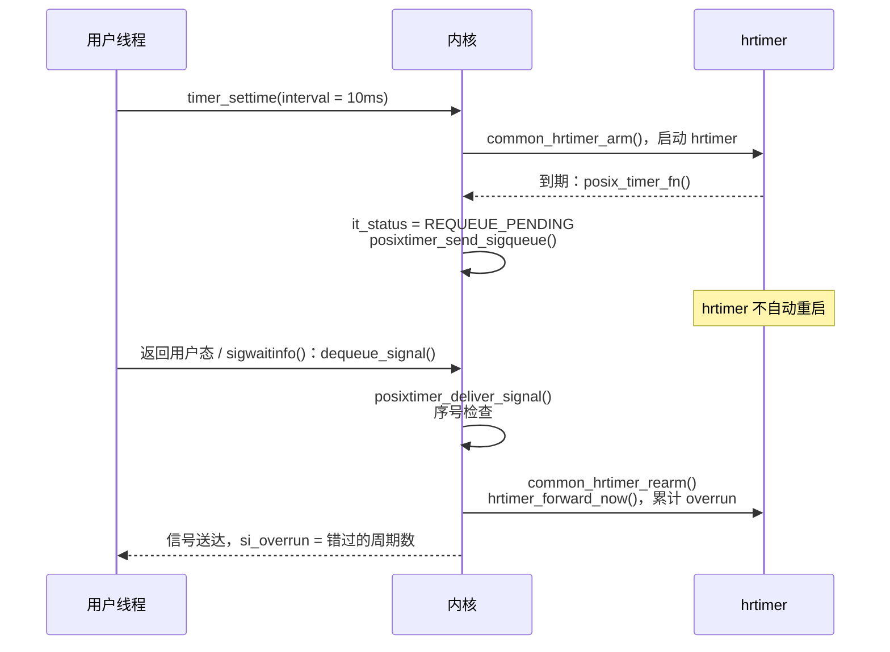

# 8.11 POSIX 时钟与定时器接口

> **本节源码**：[`kernel/time/posix-timers.c`](../../linux/kernel/time/posix-timers.c)、[`kernel/time/posix-timers.h`](../../linux/kernel/time/posix-timers.h)、[`include/linux/posix-timers.h`](../../linux/include/linux/posix-timers.h)、[`include/linux/posix-timers_types.h`](../../linux/include/linux/posix-timers_types.h)、[`kernel/time/itimer.c`](../../linux/kernel/time/itimer.c)、[`kernel/time/posix-cpu-timers.c`](../../linux/kernel/time/posix-cpu-timers.c)、[`kernel/time/alarmtimer.c`](../../linux/kernel/time/alarmtimer.c)、[`fs/timerfd.c`](../../linux/fs/timerfd.c)、[`kernel/signal.c`](../../linux/kernel/signal.c)
> **关键函数**：`clockid_to_kclock()`、`sys_clock_gettime()`、`do_timer_create()`、`common_timer_set()`、`common_hrtimer_arm()`、`posix_timer_fn()`、`posix_timer_queue_signal()`、`posixtimer_deliver_signal()`、`do_setitimer()`、`it_real_fn()`、`run_posix_cpu_timers()`、`alarmtimer_suspend()`、`timerfd_setup()`、`timerfd_read_iter()`
> **前置知识**：8.4 时间维护、8.9 高精度定时器、信号机制（第 2 章）

## 概述

前面几节分析的都是内核内部的时间设施，本节转向它们如何被用户态使用。POSIX 定义了一组以**时钟 ID** 为参数的统一接口：

| 类别 | 系统调用 |
|---|---|
| 时钟 | `clock_gettime`、`clock_settime`、`clock_getres`、`clock_adjtime`、`clock_nanosleep` |
| POSIX 定时器 | `timer_create`、`timer_settime`、`timer_gettime`、`timer_getoverrun`、`timer_delete` |
| 传统间隔定时器 | `setitimer`、`getitimer`、`alarm` |
| 基于文件描述符的定时器 | `timerfd_create`、`timerfd_settime`、`timerfd_gettime` |

*表 8-24：POSIX 时钟与定时器相关的系统调用*

内核用一张以时钟 ID 为下标的函数表 `struct k_clock` 分发这些调用：普通时钟（REALTIME、MONOTONIC、BOOTTIME、TAI）由 timekeeping 与 hrtimer 实现；CPU 时间时钟由 tick 中的进程时间记账驱动；ALARM 时钟在 hrtimer 之上增加了"挂起时由 RTC 唤醒"的能力；以文件描述符编码的动态时钟（Dynamic POSIX Clock）则交给 PTP 等驱动。定时器到期的通知方式也各不相同：POSIX 定时器与间隔定时器发送信号，timerfd 让文件描述符变为可读。

本节首先分析时钟 ID 的分发与 `clock_gettime()`，然后分析 POSIX 定时器的创建、设置、到期与信号投递，再依次介绍间隔定时器、CPU 时间定时器、alarmtimer 与 timerfd。用户态最常用的 `clock_gettime()` 快速路径实际上不进入内核，由 vDSO 完成（8.12 节）。

## 时钟 ID 与 k_clock

### struct k_clock

[`kernel/time/posix-timers.h:10-37`](../../linux/kernel/time/posix-timers.h#L10-L37)（v6.18.60）

```c
struct k_clock {
	int	(*clock_getres)(const clockid_t which_clock,
				struct timespec64 *tp);
	int	(*clock_set)(const clockid_t which_clock,
			     const struct timespec64 *tp);
	/* Returns the clock value in the current time namespace. */
	int	(*clock_get_timespec)(const clockid_t which_clock,
				      struct timespec64 *tp);
	/* Returns the clock value in the root time namespace. */
	ktime_t	(*clock_get_ktime)(const clockid_t which_clock);
	int	(*clock_adj)(const clockid_t which_clock, struct __kernel_timex *tx);
	int	(*timer_create)(struct k_itimer *timer);
	int	(*nsleep)(const clockid_t which_clock, int flags,
			  const struct timespec64 *);
	int	(*timer_set)(struct k_itimer *timr, int flags,
			     struct itimerspec64 *new_setting,
			     struct itimerspec64 *old_setting);
	int	(*timer_del)(struct k_itimer *timr);
	void	(*timer_get)(struct k_itimer *timr,
			     struct itimerspec64 *cur_setting);
	bool	(*timer_rearm)(struct k_itimer *timr);
	s64	(*timer_forward)(struct k_itimer *timr, ktime_t now);
	ktime_t	(*timer_remaining)(struct k_itimer *timr, ktime_t now);
	int	(*timer_try_to_cancel)(struct k_itimer *timr);
	bool	(*timer_arm)(struct k_itimer *timr, ktime_t expires,
			     bool absolute, bool sigev_none);
	void	(*timer_wait_running)(struct k_itimer *timr);
};
```

注意两个读时间的回调有不同的语义：`clock_get_timespec()` 返回**当前时间命名空间**中的值，供 `clock_gettime()` 使用；`clock_get_ktime()` 返回**根命名空间**中的值，供定时器内部计算使用（8.12 节）。

### 分发表

[`kernel/time/posix-timers.c:1518-1548`](../../linux/kernel/time/posix-timers.c#L1518-L1548)（v6.18.60）

```c
static const struct k_clock * const posix_clocks[] = {
	[CLOCK_REALTIME]		= &clock_realtime,
	[CLOCK_MONOTONIC]		= &clock_monotonic,
	[CLOCK_PROCESS_CPUTIME_ID]	= &clock_process,
	[CLOCK_THREAD_CPUTIME_ID]	= &clock_thread,
	[CLOCK_MONOTONIC_RAW]		= &clock_monotonic_raw,
	[CLOCK_REALTIME_COARSE]		= &clock_realtime_coarse,
	[CLOCK_MONOTONIC_COARSE]	= &clock_monotonic_coarse,
	[CLOCK_BOOTTIME]		= &clock_boottime,
	[CLOCK_REALTIME_ALARM]		= &alarm_clock,
	[CLOCK_BOOTTIME_ALARM]		= &alarm_clock,
	[CLOCK_TAI]			= &clock_tai,
#ifdef CONFIG_POSIX_AUX_CLOCKS
	[CLOCK_AUX ... CLOCK_AUX_LAST]	= &clock_aux,
#endif
};

static const struct k_clock *clockid_to_kclock(const clockid_t id)
{
	clockid_t idx = id;

	if (id < 0) {
		return (id & CLOCKFD_MASK) == CLOCKFD ?
			&clock_posix_dynamic : &clock_posix_cpu;
	}

	if (id >= ARRAY_SIZE(posix_clocks))
		return NULL;

	return posix_clocks[array_index_nospec(idx, ARRAY_SIZE(posix_clocks))];
}
```

非负 ID 直接查表，`array_index_nospec()` 防止 Spectre v1 推测越界。负 ID 是一种编码：高 29 位存放取反后的 PID 或文件描述符，低 3 位指明类型（[`include/linux/posix-timers_types.h:9-32`](../../linux/include/linux/posix-timers_types.h#L9-L32)）：

- 低 2 位为 0、1、2：CPU 时间时钟（PROF、VIRT、SCHED），第 2 位表示线程还是进程，用户态的 `clock_getcpuclockid()`、`pthread_getcpuclockid()` 生成这种 ID；
- 低 2 位为 3：动态时钟，由 `FD_TO_CLOCKID(fd)` 从文件描述符生成，典型例子是 PTP 硬件时钟 `/dev/ptp0`（`clock_posix_dynamic`，[`kernel/time/posix-clock.c:313-318`](../../linux/kernel/time/posix-clock.c#L313-L318)）。

各时钟的能力差异很大，`k_clock` 中未实现的回调对应的系统调用会返回 `-EINVAL` 或 `-EOPNOTSUPP`：

| 时钟 | 读 | 设置 | 调频 | 定时器 / 睡眠 | 实现 |
|---|---|---|---|---|---|
| REALTIME | ✓ | ✓ | ✓ | ✓ | timekeeping + hrtimer |
| MONOTONIC / BOOTTIME | ✓ | | | ✓ | timekeeping + hrtimer |
| TAI | ✓ | | | ✓ | timekeeping + hrtimer |
| MONOTONIC_RAW / *_COARSE | ✓ | | | | timekeeping |
| *_ALARM | ✓ | | | ✓ | alarmtimer（需 `CAP_WAKE_ALARM`） |
| PROCESS / THREAD_CPUTIME | ✓ | | | ✓ | posix-cpu-timers |
| AUX | ✓ | ✓ | ✓ | | 辅助 timekeeper |
| 动态（FD） | ✓ | ✓ | ✓ | | 驱动（PTP） |

*表 8-25：各类 POSIX 时钟的能力*

### clock_gettime()

[`kernel/time/posix-timers.c:1136-1152`](../../linux/kernel/time/posix-timers.c#L1136-L1152)（v6.18.60）

```c
SYSCALL_DEFINE2(clock_gettime, const clockid_t, which_clock,
		struct __kernel_timespec __user *, tp)
{
	const struct k_clock *kc = clockid_to_kclock(which_clock);
	struct timespec64 kernel_tp;
	int error;

	if (!kc)
		return -EINVAL;

	error = kc->clock_get_timespec(which_clock, &kernel_tp);

	if (!error && put_timespec64(&kernel_tp, tp))
		error = -EFAULT;

	return error;
}
```

各时钟的读函数只是对 8.4 节接口的包装，例如 MONOTONIC：

[`kernel/time/posix-timers.c:217-222`](../../linux/kernel/time/posix-timers.c#L217-L222)（v6.18.60）

```c
static int posix_get_monotonic_timespec(clockid_t which_clock, struct timespec64 *tp)
{
	ktime_get_ts64(tp);
	timens_add_monotonic(tp);
	return 0;
}
```

`timens_add_monotonic()` 加上当前任务所在时间命名空间的偏移（8.12 节）。`clock_getres()` 对高精度时钟返回 `hrtimer_resolution`——高精度模式下为 1 ns，否则为 1 个 jiffy；COARSE 时钟总是返回 `KTIME_LOW_RES`，即 1 个 jiffy（[`kernel/time/posix-timers.c:250-284`](../../linux/kernel/time/posix-timers.c#L250-L284)）。`clock_settime(CLOCK_REALTIME)` 经 `do_sys_settimeofday64()` 检查 `CAP_SYS_TIME` 后调用 8.4 节的 `do_settimeofday64()`。

## POSIX 定时器

### struct k_itimer

[`include/linux/posix-timers.h:186-223`](../../linux/include/linux/posix-timers.h#L186-L223)（v6.18.60）

```c
struct k_itimer {
	/* 1st cacheline contains read-mostly fields */
	struct hlist_node	t_hash;		// [注] 全局哈希表节点，按（signal_struct，ID）查找
	struct hlist_node	list;		// [注] 进程的定时器链表 signal->posix_timers
	timer_t			it_id;		// [注] 用户可见的定时器 ID
	clockid_t		it_clock;
	int			it_sigev_notify;	// [注] SIGEV_SIGNAL / SIGEV_THREAD_ID / SIGEV_NONE ...
	enum pid_type		it_pid_type;
	struct signal_struct	*it_signal;	// [注] 所属进程；bit 0 置位表示尚未初始化完成
	const struct k_clock	*kclock;

	/* 2nd cacheline and above contain fields which are modified regularly */
	spinlock_t		it_lock;
	int			it_status;	// [注] DISARMED / ARMED / REQUEUE_PENDING
	bool			it_sig_periodic;
	s64			it_overrun;	// [注] 本周期累计的超限次数
	s64			it_overrun_last;	// [注] 上次信号投递时的超限次数
	unsigned int		it_signal_seq;	// [注] 每次修改定时器加 1，用于丢弃过时信号
	unsigned int		it_sigqueue_seq;
	ktime_t			it_interval;	// [注] 周期，0 表示一次性
	struct hlist_node	ignored_list;
	union {
		struct pid		*it_pid;	// [注] 信号接收者
		struct task_struct	*it_process;
	};
	struct sigqueue		sigq;		// [注] 预分配的信号队列项
	rcuref_t		rcuref;
	union {
		struct {
			struct hrtimer	timer;	// [注] 普通时钟：一个 hrtimer
		} real;
		struct cpu_timer	cpu;		// [注] CPU 时间时钟
		struct {
			struct alarm	alarmtimer;	// [注] ALARM 时钟
		} alarm;
	} it;
	struct rcu_head		rcu;
} ____cacheline_aligned_in_smp;
```

两个设计要点：

- **预分配信号**：每个定时器自带一个 `sigqueue`，到期时直接把它挂到目标的待处理信号队列上，不需要在中断上下文中分配内存，也不受 `RLIMIT_SIGPENDING` 限制以外的失败影响。同一个定时器的信号在被处理前不会重复入队，期间的到期只累加 `it_overrun`。
- **底层定时器的联合**：普通时钟的 POSIX 定时器就是一个 hrtimer，CPU 时间定时器与 alarmtimer 各有自己的实现，通过 `k_clock` 的 `timer_*` 回调屏蔽差异。

### 创建：do_timer_create()

[`kernel/time/posix-timers.c:466-572`](../../linux/kernel/time/posix-timers.c#L466-L572)（v6.18.60，节选）

```c
static int do_timer_create(clockid_t which_clock, struct sigevent *event,
			   timer_t __user *created_timer_id)
{
	const struct k_clock *kc = clockid_to_kclock(which_clock);
	timer_t req_id = TIMER_ANY_ID;
	struct k_itimer *new_timer;
	int error, new_timer_id;

	if (!kc)
		return -EINVAL;
	if (!kc->timer_create)
		return -EOPNOTSUPP;
	...
	new_timer = alloc_posix_timer();
	if (unlikely(!new_timer))
		return -EAGAIN;

	spin_lock_init(&new_timer->it_lock);

	/*
	 * Add the timer to the hash table. The timer is not yet valid
	 * after insertion, but has a unique ID allocated.
	 */
	new_timer_id = posix_timer_add(new_timer, req_id);
	...
	new_timer->it_clock = which_clock;
	new_timer->kclock = kc;
	new_timer->it_overrun = -1LL;

	if (event) {
		scoped_guard (rcu)
			new_timer->it_pid = get_pid(good_sigevent(event));
		...
		new_timer->it_sigev_notify     = event->sigev_notify;
		new_timer->sigq.info.si_signo = event->sigev_signo;
		new_timer->sigq.info.si_value = event->sigev_value;
	} else {
		new_timer->it_sigev_notify     = SIGEV_SIGNAL;
		new_timer->sigq.info.si_signo = SIGALRM;
		new_timer->sigq.info.si_value.sival_int = new_timer->it_id;
		new_timer->it_pid = get_pid(task_tgid(current));
	}
	...
	error = kc->timer_create(new_timer);
	if (error)
		goto out;
	...
	scoped_guard (spinlock_irq, &new_timer->it_lock) {
		guard(spinlock)(&current->sighand->siglock);
		...
		WRITE_ONCE(new_timer->it_signal, current->signal);
		hlist_add_head_rcu(&new_timer->list, &current->signal->posix_timers);
	}
	...
	return 0;
```

- **定时器 ID**：每个进程有一个递增计数器 `next_posix_timer_id`，ID 与 `signal_struct` 指针一起散列到一个全局哈希表中（[`kernel/time/posix-timers.c:91-192`](../../linux/kernel/time/posix-timers.c#L91-L192)）。系统调用中以 `(current->signal, id)` 查找定时器，无需遍历进程的定时器链表。插入哈希表时 `it_signal` 的最低位被置 1，表示"ID 已占用但定时器尚未就绪"，查找时因指针不匹配而找不到；初始化完成后才写入真实指针，定时器对系统调用可见。
- **CRIU 支持**：`prctl(PR_TIMER_CREATE_RESTORE_IDS)` 打开后，`timer_create()` 从用户提供的地址读取期望的 ID，用于检查点恢复时重建相同 ID 的定时器（[`kernel/time/posix-timers.c:384-397`](../../linux/kernel/time/posix-timers.c#L384-L397)）。
- **通知方式**：`good_sigevent()` 校验 `sigevent`（[`kernel/time/posix-timers.c:399-421`](../../linux/kernel/time/posix-timers.c#L399-L421)）。`SIGEV_THREAD_ID` 指定同一线程组中的某个线程接收信号，`SIGEV_NONE` 不发信号（只能通过 `timer_gettime()` 轮询）。glibc 的 `SIGEV_THREAD`（到期时创建线程运行回调）在用户态实现，内核看到的是 `SIGEV_THREAD_ID`。
- **底层初始化**：普通时钟的 `timer_create` 回调是 `common_timer_create()`，只是 `hrtimer_setup(&timer->it.real.timer, posix_timer_fn, ...)`（[`kernel/time/posix-timers.c:459-463`](../../linux/kernel/time/posix-timers.c#L459-L463)）。

### 设置：common_timer_set()

`timer_settime()` 经 `do_timer_settime()`（[`kernel/time/posix-timers.c:921-953`](../../linux/kernel/time/posix-timers.c#L921-L953)）锁住定时器后调用 `kclock->timer_set()`，普通时钟为：

[`kernel/time/posix-timers.c:885-919`](../../linux/kernel/time/posix-timers.c#L885-L919)（v6.18.60）

```c
int common_timer_set(struct k_itimer *timr, int flags,
		     struct itimerspec64 *new_setting,
		     struct itimerspec64 *old_setting)
{
	const struct k_clock *kc = timr->kclock;
	bool sigev_none;
	ktime_t expires;

	if (old_setting)
		common_timer_get(timr, old_setting);

	/*
	 * Careful here. On SMP systems the timer expiry function could be
	 * active and spinning on timr->it_lock.
	 */
	if (kc->timer_try_to_cancel(timr) < 0)
		return TIMER_RETRY;

	timr->it_status = POSIX_TIMER_DISARMED;
	posix_timer_set_common(timr, new_setting);

	/* Keep timer disarmed when it_value is zero */
	if (!new_setting->it_value.tv_sec && !new_setting->it_value.tv_nsec)
		return 0;

	expires = timespec64_to_ktime(new_setting->it_value);
	if (flags & TIMER_ABSTIME)
		expires = timens_ktime_to_host(timr->it_clock, expires);
	sigev_none = timr->it_sigev_notify == SIGEV_NONE;

	kc->timer_arm(timr, expires, flags & TIMER_ABSTIME, sigev_none);
	if (!sigev_none)
		timr->it_status = POSIX_TIMER_ARMED;
	return 0;
}
```

- **取消旧设置**：若 hrtimer 回调正在另一个 CPU 上执行（它会去获取 `it_lock`），不能在持有 `it_lock` 时等待它，于是返回 `TIMER_RETRY`。`do_timer_settime()` 释放锁、在 RCU 保护下调用 `timer_wait_running()` 等待回调结束后重试。
- **修改即作废旧信号**：`do_timer_settime()` 在调用 `timer_set` 前先递增 `it_signal_seq`。已经入队、尚未被处理的旧信号在投递时会因序号不符而被丢弃（见下文），避免用户在修改定时器后还收到旧设置产生的信号。
- **时间命名空间**：绝对时间若属于 MONOTONIC 或 BOOTTIME，要从命名空间时间换算为根命名空间时间（`timens_ktime_to_host()`，8.12 节）。

`common_hrtimer_arm()`（[`kernel/time/posix-timers.c:806-834`](../../linux/kernel/time/posix-timers.c#L806-L834)）每次设置都重新调用 `hrtimer_setup()`，因为 8.9 节介绍过的"相对 REALTIME 定时器改用 MONOTONIC"规则取决于本次设置是绝对还是相对时间：

[`kernel/time/posix-timers.c:812-833`](../../linux/kernel/time/posix-timers.c#L812-L833)（v6.18.60）

```c
	mode = absolute ? HRTIMER_MODE_ABS : HRTIMER_MODE_REL;
	/*
	 * Posix magic: Relative CLOCK_REALTIME timers are not affected by
	 * clock modifications, so they become CLOCK_MONOTONIC based under the
	 * hood. See hrtimer_setup(). Update timr->kclock, so the generic
	 * functions which use timr->kclock->clock_get_*() work.
	 *
	 * Note: it_clock stays unmodified, because the next timer_set() might
	 * use ABSTIME, so it needs to switch back.
	 */
	if (timr->it_clock == CLOCK_REALTIME)
		timr->kclock = absolute ? &clock_realtime : &clock_monotonic;

	hrtimer_setup(&timr->it.real.timer, posix_timer_fn, timr->it_clock, mode);

	if (!absolute)
		expires = ktime_add_safe(expires, hrtimer_cb_get_time(timer));
	hrtimer_set_expires(timer, expires);

	if (!sigev_none)
		hrtimer_start_expires(timer, HRTIMER_MODE_ABS);
	return true;
```

### 到期与信号投递

[`kernel/time/posix-timers.c:357-382`](../../linux/kernel/time/posix-timers.c#L357-L382)（v6.18.60）

```c
void posix_timer_queue_signal(struct k_itimer *timr)
{
	lockdep_assert_held(&timr->it_lock);

	if (!posixtimer_valid(timr))
		return;

	timr->it_status = timr->it_interval ? POSIX_TIMER_REQUEUE_PENDING : POSIX_TIMER_DISARMED;
	posixtimer_send_sigqueue(timr);
}

/*
 * This function gets called when a POSIX.1b interval timer expires from
 * the HRTIMER interrupt (soft interrupt on RT kernels).
 *
 * Handles CLOCK_REALTIME, CLOCK_MONOTONIC, CLOCK_BOOTTIME and CLOCK_TAI
 * based timers.
 */
static enum hrtimer_restart posix_timer_fn(struct hrtimer *timer)
{
	struct k_itimer *timr = container_of(timer, struct k_itimer, it.real.timer);

	guard(spinlock_irqsave)(&timr->it_lock);
	posix_timer_queue_signal(timr);
	return HRTIMER_NORESTART;
}
```

一个容易误解的细节：**周期定时器的 hrtimer 回调返回 `HRTIMER_NORESTART`**，并不在中断中重新启动自己。它只把状态设为 `REQUEUE_PENDING` 并发送信号（`posixtimer_send_sigqueue()`，[`kernel/signal.c:2058`](../../linux/kernel/signal.c#L2058)）。真正的重新启动发生在目标线程**取出信号**时：

[`kernel/time/posix-timers.c:307-329`](../../linux/kernel/time/posix-timers.c#L307-L329)（v6.18.60）

```c
static bool __posixtimer_deliver_signal(struct kernel_siginfo *info, struct k_itimer *timr)
{
	guard(spinlock)(&timr->it_lock);

	/*
	 * Check if the timer is still alive or whether it got modified
	 * since the signal was queued. In either case, don't rearm and
	 * drop the signal.
	 */
	if (timr->it_signal_seq != timr->it_sigqueue_seq || WARN_ON_ONCE(!posixtimer_valid(timr)))
		return false;

	if (!timr->it_interval || WARN_ON_ONCE(timr->it_status != POSIX_TIMER_REQUEUE_PENDING))
		return true;

	timr->kclock->timer_rearm(timr);
	timr->it_status = POSIX_TIMER_ARMED;
	timr->it_overrun_last = timr->it_overrun;
	timr->it_overrun = -1LL;
	++timr->it_signal_seq;
	info->si_overrun = timer_overrun_to_int(timr);
	return true;
}
```

`dequeue_signal()` 发现取出的是定时器信号时调用 `posixtimer_deliver_signal()`（[`kernel/signal.c:683-686`](../../linux/kernel/signal.c#L683-L686)）：

- 若信号入队后定时器被修改或删除（序号不符），丢弃这个信号，`dequeue_signal()` 继续取下一个；
- 若是周期定时器，调用 `timer_rearm()`。普通时钟的实现是 `common_hrtimer_rearm()`：`hrtimer_forward_now()` 把到期时间推进到当前时刻之后，返回值即错过的周期数，累加到 `it_overrun`，再重启 hrtimer（[`kernel/time/posix-timers.c:298-305`](../../linux/kernel/time/posix-timers.c#L298-L305)）；
- 超限次数写入 `siginfo` 的 `si_overrun`，`timer_getoverrun()` 也返回它。

这种"在信号投递时重启"的设计有两个目的。一是**防止拒绝服务**：若在中断中按周期自动重启，用户把周期设为 1 ns 就能让 CPU 永远处理定时器中断；现在每个周期必须等用户态处理完上一个信号才会重启，速率被信号处理速度自然限制。二是**语义正确**：POSIX 规定同一个定时器的信号不排队，后续到期计为超限，这里正好以 `hrtimer_forward()` 的返回值统计超限次数。



*图 8-16：周期 POSIX 定时器的到期与重启*

被忽略（`SIG_IGN`）的周期定时器信号是一个特殊情况：信号不会被取出，定时器也就永远不会重启。内核把这类定时器挂到 `signal->ignored_posix_timers` 链表上，等到信号处理方式改为非忽略时再重新启动它们（`posixtimer_send_sigqueue()` 中的处理）。

## 传统间隔定时器：setitimer()

`setitimer(2)` 提供的间隔定时器（Interval Timer，itimer）是比 POSIX 定时器更古老的接口，每个进程只有三个：

| 类型 | 计时依据 | 信号 | 内核实现 |
|---|---|---|---|
| `ITIMER_REAL` | 墙上时间（实际为 MONOTONIC） | `SIGALRM` | `signal->real_timer`，一个 hrtimer |
| `ITIMER_VIRTUAL` | 进程的用户态 CPU 时间 | `SIGVTALRM` | 进程级 CPU 时间定时器 |
| `ITIMER_PROF` | 进程的用户态 + 内核态 CPU 时间 | `SIGPROF` | 进程级 CPU 时间定时器 |

*表 8-26：三种间隔定时器*

`alarm(2)` 是 `ITIMER_REAL` 的简化版本。`ITIMER_REAL` 的到期回调与 POSIX 定时器同样不自行重启：

[`kernel/time/itimer.c:161-185`](../../linux/kernel/time/itimer.c#L161-L185)（v6.18.60）

```c
void posixtimer_rearm_itimer(struct task_struct *tsk)
{
	struct hrtimer *tmr = &tsk->signal->real_timer;

	if (!hrtimer_is_queued(tmr) && tsk->signal->it_real_incr != 0) {
		hrtimer_forward_now(tmr, tsk->signal->it_real_incr);
		hrtimer_restart(tmr);
	}
}

/*
 * Interval timers are restarted in the signal delivery path.  See
 * posixtimer_rearm_itimer().
 */
enum hrtimer_restart it_real_fn(struct hrtimer *timer)
{
	struct signal_struct *sig =
		container_of(timer, struct signal_struct, real_timer);
	struct pid *leader_pid = sig->pids[PIDTYPE_TGID];

	trace_itimer_expire(ITIMER_REAL, leader_pid, 0);
	kill_pid_info(SIGALRM, SEND_SIG_PRIV, leader_pid);

	return HRTIMER_NORESTART;
}
```

`dequeue_signal()` 从进程共享的待处理队列中取出 `SIGALRM` 时调用 `posixtimer_rearm_itimer()` 重启它（[`kernel/signal.c:659-660`](../../linux/kernel/signal.c#L659-L660)）。`ITIMER_VIRTUAL` 与 `ITIMER_PROF` 由 `set_cpu_itimer()` 交给 CPU 时间定时器机制，设置值会额外加上一个 `TICK_NSEC`（[`kernel/time/itimer.c:187-217`](../../linux/kernel/time/itimer.c#L187-L217)），因为 CPU 时间按 tick 采样，加一个 tick 可以保证不会提前到期。

## CPU 时间定时器

`CLOCK_PROCESS_CPUTIME_ID`、`CLOCK_THREAD_CPUTIME_ID` 以及上述两种间隔定时器、`RLIMIT_CPU` 限制，都以任务消耗的 CPU 时间计时。CPU 时间不是由时钟源推进的，而是在调度器与 tick 中记账得到的，因此它的定时器也只能在 tick 中检查。

[`kernel/time/posix-cpu-timers.c:660-683`](../../linux/kernel/time/posix-cpu-timers.c#L660-L683)（v6.18.60）

```c
static void arm_timer(struct k_itimer *timer, struct task_struct *p)
{
	struct posix_cputimer_base *base = timer_base(timer, p);
	struct cpu_timer *ctmr = &timer->it.cpu;
	u64 newexp = cpu_timer_getexpires(ctmr);

	timer->it_status = POSIX_TIMER_ARMED;
	if (!cpu_timer_enqueue(&base->tqhead, ctmr))
		return;

	/*
	 * We are the new earliest-expiring POSIX 1.b timer, hence
	 * need to update expiration cache. Take into account that
	 * for process timers we share expiration cache with itimers
	 * and RLIMIT_CPU and for thread timers with RLIMIT_RTTIME.
	 */
	if (newexp < base->nextevt)
		base->nextevt = newexp;

	if (CPUCLOCK_PERTHREAD(timer->it_clock))
		tick_dep_set_task(p, TICK_DEP_BIT_POSIX_TIMER);
	else
		tick_dep_set_signal(p, TICK_DEP_BIT_POSIX_TIMER);
}
```

CPU 时间定时器按 PROF、VIRT、SCHED 三种时钟分别挂在线程（`task->posix_cputimers`）或进程（`signal->posix_cputimers`）的时间队列中，每个队列缓存最早的到期值 `nextevt`。设置定时器时还会设置 tick 依赖 `TICK_DEP_BIT_POSIX_TIMER`，阻止 nohz_full CPU 停 tick（3.5、8.10 节）——否则 CPU 时间到达时没有 tick 来检查。

每个 tick 中，`update_process_times()` 的最后一步调用 `run_posix_cpu_timers()`：

[`kernel/time/posix-cpu-timers.c:1465-1495`](../../linux/kernel/time/posix-cpu-timers.c#L1465-L1495)（v6.18.60）

```c
void run_posix_cpu_timers(void)
{
	struct task_struct *tsk = current;

	lockdep_assert_irqs_disabled();

	/*
	 * Ensure that release_task(tsk) can't happen while
	 * handle_posix_cpu_timers() is running. Otherwise, a concurrent
	 * posix_cpu_timer_del() may fail to lock_task_sighand(tsk) and
	 * miss timer->it.cpu.firing != 0.
	 */
	if (tsk->exit_state)
		return;

	/*
	 * If the actual expiry is deferred to task work context and the
	 * work is already scheduled there is no point to do anything here.
	 */
	if (posix_cpu_timers_work_scheduled(tsk))
		return;

	/*
	 * The fast path checks that there are no expired thread or thread
	 * group timers.  If that's so, just return.
	 */
	if (!fastpath_timer_check(tsk))
		return;

	__run_posix_cpu_timers(tsk);
}
```

`fastpath_timer_check()`（[`kernel/time/posix-cpu-timers.c:1146-1190`](../../linux/kernel/time/posix-cpu-timers.c#L1146-L1190)）只比较当前任务与其线程组的 CPU 时间采样值和 `nextevt` 缓存，绝大多数 tick 中立即返回。只检查当前任务是合理的：只有正在运行的任务的 CPU 时间在增长。

确有定时器到期时，本书配置（`CONFIG_POSIX_CPU_TIMERS_TASK_WORK=y`）下不在硬中断中处理，而是用 `task_work_add(..., TWA_RESUME)` 安排一个任务工作（[`kernel/time/posix-cpu-timers.c:1279-1287`](../../linux/kernel/time/posix-cpu-timers.c#L1279-L1287)），在任务返回用户态前于进程上下文中执行 `handle_posix_cpu_timers()`：收集到期的定时器、检查 `RLIMIT_CPU` 与 `RLIMIT_RTTIME`（超限时发送 `SIGXCPU` 或 `SIGKILL`）、发送定时器信号。遍历线程组的所有定时器可能很耗时，放在任务上下文中执行可以避免长时间关中断，这对 `PREEMPT_RT` 与 KVM 尤其重要。

## alarmtimer：能唤醒系统的定时器

普通 hrtimer 在系统挂起（suspend-to-RAM）期间不会触发——CPU 已经断电，时钟事件设备也停止了。`CLOCK_REALTIME_ALARM` 与 `CLOCK_BOOTTIME_ALARM` 的定时器则能把系统从挂起中唤醒，手机等设备上的闹钟、定期同步任务依赖于此。使用它们需要 `CAP_WAKE_ALARM` 权限。

alarmtimer 在运行时与普通定时器无异：每种类型（REALTIME、BOOTTIME）一个全局的 `alarm_base`，内部维护一个按到期时间排序的 `timerqueue`，并用一个 hrtimer 实现到期（[`kernel/time/alarmtimer.c:36-50`](../../linux/kernel/time/alarmtimer.c#L36-L50)）。区别在于挂起前的回调：

[`kernel/time/alarmtimer.c:237-282`](../../linux/kernel/time/alarmtimer.c#L237-L282)（v6.18.60，节选）

```c
	/* Find the soonest timer to expire*/
	for (i = 0; i < ALARM_NUMTYPE; i++) {
		struct alarm_base *base = &alarm_bases[i];
		struct timerqueue_node *next;
		ktime_t delta;

		scoped_guard(spinlock_irqsave, &base->lock)
			next = timerqueue_getnext(&base->timerqueue);
		if (!next)
			continue;
		delta = ktime_sub(next->expires, base->get_ktime());
		if (!min || (delta < min)) {
			expires = next->expires;
			min = delta;
			type = i;
		}
	}
	if (min == 0)
		return 0;

	if (ktime_to_ns(min) < 2 * NSEC_PER_SEC) {
		pm_wakeup_event(dev, 2 * MSEC_PER_SEC);
		return -EBUSY;
	}
	...
	/* Setup an rtc timer to fire that far in the future */
	rtc_timer_cancel(rtc, &rtctimer);
	rtc_read_time(rtc, &tm);
	now = rtc_tm_to_ktime(tm);
	...
	min = rtc_bound_alarmtime(rtc, min);

	now = ktime_add(now, min);

	/* Set alarm, if in the past reject suspend briefly to handle */
	ret = rtc_timer_start(rtc, &rtctimer, now, 0);
```

`alarmtimer_suspend()` 作为一个平台设备的 suspend 回调，在挂起前找出最早的 alarm，把它设置为 RTC 的闹钟（x86 上即 CMOS RTC 的闹钟中断，8.5 节）。若 alarm 在 2 秒内就要到期，干脆拒绝挂起（`-EBUSY`）。系统被 RTC 唤醒、timekeeping 恢复后，alarm 对应的 hrtimer 立即到期。

## timerfd：以文件描述符通知的定时器

信号是一种笨拙的事件通知方式：处理函数中能做的事情有限，在多线程程序中还要处理信号屏蔽。timerfd 把定时器包装成文件描述符，到期时文件变为可读，可以与其他事件一起放进 `epoll` 统一等待。

[`fs/timerfd.c:31-47`](../../linux/fs/timerfd.c#L31-L47)（v6.18.60）

```c
struct timerfd_ctx {
	union {
		struct hrtimer tmr;
		struct alarm alarm;
	} t;
	ktime_t tintv;			// [注] 周期
	ktime_t moffs;			// [注] 设置时的 MONOTONIC→REALTIME 偏移，用于检测时间被修改
	wait_queue_head_t wqh;
	u64 ticks;			// [注] 自上次 read 以来的到期次数
	int clockid;
	short unsigned expired;
	short unsigned settime_flags;	/* to show in fdinfo */
	struct rcu_head rcu;
	struct list_head clist;
	spinlock_t cancel_lock;
	bool might_cancel;		// [注] TFD_TIMER_CANCEL_ON_SET
};
```

`timerfd_create()` 只接受 MONOTONIC、REALTIME、BOOTTIME 以及两种 ALARM 时钟（[`fs/timerfd.c:404-415`](../../linux/fs/timerfd.c#L404-L415)）。到期回调只做最少的事：

[`fs/timerfd.c:63-80`](../../linux/fs/timerfd.c#L63-L80)（v6.18.60）

```c
static void timerfd_triggered(struct timerfd_ctx *ctx)
{
	unsigned long flags;

	spin_lock_irqsave(&ctx->wqh.lock, flags);
	ctx->expired = 1;
	ctx->ticks++;
	wake_up_locked_poll(&ctx->wqh, EPOLLIN);
	spin_unlock_irqrestore(&ctx->wqh.lock, flags);
}

static enum hrtimer_restart timerfd_tmrproc(struct hrtimer *htmr)
{
	struct timerfd_ctx *ctx = container_of(htmr, struct timerfd_ctx,
					       t.tmr);
	timerfd_triggered(ctx);
	return HRTIMER_NORESTART;
}
```

与 POSIX 定时器同样的思路，周期 timerfd 也不在中断中重启，而是在用户 `read()` 时：

[`fs/timerfd.c:289-311`](../../linux/fs/timerfd.c#L289-L311)（v6.18.60）

```c
	if (ctx->ticks) {
		ticks = ctx->ticks;

		if (ctx->expired && ctx->tintv) {
			/*
			 * If tintv != 0, this is a periodic timer that
			 * needs to be re-armed. We avoid doing it in the timer
			 * callback to avoid DoS attacks specifying a very
			 * short timer period.
			 */
			if (isalarm(ctx)) {
				ticks += alarm_forward_now(
					&ctx->t.alarm, ctx->tintv) - 1;
				alarm_restart(&ctx->t.alarm);
			} else {
				ticks += hrtimer_forward_now(&ctx->t.tmr,
							     ctx->tintv) - 1;
				hrtimer_restart(&ctx->t.tmr);
			}
		}
		ctx->expired = 0;
		ctx->ticks = 0;
	}
```

`read()` 返回一个 64 位整数，即自上次读取以来的到期次数：回调中计的 1 次，加上 `hrtimer_forward_now()` 推进时跳过的周期数减 1。注释同样点明了不在回调中重启是为了防止以极短周期发起拒绝服务攻击。

`TFD_TIMER_CANCEL_ON_SET` 是 timerfd 独有的能力：对一个绝对时间的 REALTIME timerfd 设置此标志后，若有人修改了系统时间，`read()` 立即返回 `-ECANCELED`。实现上，设置时记下 `moffs = ktime_mono_to_real(0)`（即当时的 `offs_real`），8.9 节的 `clock_was_set()` 末尾调用 `timerfd_clock_was_set()`，比较每个此类 timerfd 记录的偏移与当前偏移，不同就唤醒读者（[`fs/timerfd.c:95-114`](../../linux/fs/timerfd.c#L95-L114)）。systemd 等需要在"墙上时间被修改"时重新计算日历事件的程序正是利用这一点。

## 关键细节 / 设计考量

### 到期回调为什么都不重启

POSIX 定时器、`ITIMER_REAL`、timerfd 三者的周期性重启都被推迟到消费者处理通知时，这是一个统一的设计原则：在中断上下文中重启周期定时器，等于让用户态程序以任意频率在内核中触发中断，而处理通知的速度才是这些定时器真实需要的节奏。代价只是到期时刻与下一周期的重启之间有一段延迟，但由于 `hrtimer_forward()` 以原到期时间为基准累加，周期本身不会漂移，错过的周期以超限计数的形式报告给用户。

### 绝对 REALTIME 定时器与时间修改

一个在"明天 8:00"（REALTIME 绝对时间）到期的定时器，在用户把时钟调快一小时后应当提前一小时到期。这由 hrtimer 的 REALTIME 时钟基自动保证：树中存放的就是墙上时间，`clock_was_set()` 刷新 `offset` 后，换算成单调时间的到期时刻随之改变（8.9 节）。相对定时器则改用 MONOTONIC，不受影响。timerfd 的 `TFD_TIMER_CANCEL_ON_SET` 在此基础上进一步让应用得知时间被修改了。

### 资源限制

每个 POSIX 定时器占用一个 `k_itimer`（约 2 个缓存行以上）与一个预分配的 `sigqueue`。定时器数量本身没有独立的限制，但每个定时器的信号计入 `RLIMIT_SIGPENDING`（`posixtimer_init_sigqueue()` 中计费），这间接限制了每个用户能创建的定时器数量。`/proc/<pid>/timers`（`CONFIG_CHECKPOINT_RESTORE=y` 时可用）列出进程的所有 POSIX 定时器。

## 动手实验

```bash
# 创建一个 1 ms 周期的 POSIX 定时器，但让信号处理很慢，观察 overrun
cat > /tmp/ptimer.c <<'EOF'
#include <signal.h>
#include <stdio.h>
#include <time.h>
#include <unistd.h>
static timer_t t;
static void handler(int sig, siginfo_t *si, void *uc) {
    printf("si_overrun=%d getoverrun=%d\n", si->si_overrun, timer_getoverrun(t));
    usleep(10000);                       /* 处理耗时 10 ms */
}
int main(void) {
    struct sigaction sa = { .sa_sigaction = handler, .sa_flags = SA_SIGINFO };
    sigaction(SIGRTMIN, &sa, NULL);
    struct sigevent sev = { .sigev_notify = SIGEV_SIGNAL, .sigev_signo = SIGRTMIN };
    timer_create(CLOCK_MONOTONIC, &sev, &t);
    struct itimerspec its = { { 0, 1000000 }, { 0, 1000000 } };
    timer_settime(t, 0, &its, NULL);
    for (int i = 0; i < 5; i++) pause();
    system("cat /proc/$PPID/timers 2>/dev/null || true");
    return 0;
}
EOF
gcc -O2 -o /tmp/ptimer /tmp/ptimer.c && /tmp/ptimer

# 观察 timerfd 的 read 返回值与 epoll 配合（Python 3.13+ 提供 os.timerfd_*）
python3 - <<'EOF'
import os, time, select
if hasattr(os, "timerfd_create"):
    fd = os.timerfd_create(time.CLOCK_MONOTONIC)
    os.timerfd_settime(fd, initial=0.001, interval=0.001)
    time.sleep(0.05)
    print("expirations since arm:", int.from_bytes(os.read(fd, 8), "little"))
else:
    print("this Python lacks os.timerfd_create")
EOF

# 跟踪 POSIX 定时器的到期与重启
sudo bpftrace -e 'kprobe:posix_timer_fn { @fire = count(); } kprobe:common_hrtimer_rearm { @rearm = count(); } interval:s:3 { exit(); }' &
/tmp/ptimer >/dev/null; wait
```

第一个程序中，每次信号处理耗时约 10 ms，而定时器周期为 1 ms，`si_overrun` 应在 9～10 左右——中间到期的信号没有排队，而是计为超限。bpftrace 统计中 `@fire` 与 `@rearm` 的次数基本相等，验证了"每次投递重启一次"的机制。

## 小结

- POSIX 时钟与定时器以时钟 ID 为参数，经 `clockid_to_kclock()` 分发到 `struct k_clock`；负 ID 编码 CPU 时间时钟或基于文件描述符的动态时钟（如 PTP）。
- 普通时钟的 POSIX 定时器底层是一个 hrtimer，每个定时器预分配 `sigqueue`；创建时 ID 与 `signal_struct` 一起散列到全局哈希表，`it_signal` 最低位标记尚未就绪。
- 到期回调只发送信号并返回 `HRTIMER_NORESTART`，周期定时器在 `dequeue_signal()` 取出信号时才由 `timer_rearm()` 重启，`hrtimer_forward_now()` 的返回值累计为超限次数；修改定时器会递增 `it_signal_seq`，使旧信号被丢弃。
- `ITIMER_REAL` 同样在投递 `SIGALRM` 时重启；`ITIMER_VIRTUAL`/`PROF` 与 CPU 时间定时器在 tick 中经快速检查发现到期，再以任务工作在返回用户态前处理，并通过 tick 依赖阻止 nohz_full CPU 停 tick。
- alarmtimer 在挂起前把最早的 alarm 设为 RTC 闹钟以唤醒系统；timerfd 把到期转化为文件可读，在 `read()` 时重启周期定时器，并支持在墙上时间被修改时返回 `-ECANCELED`。

## 参考

- `man 2 clock_gettime`、`man 2 timer_create`、`man 2 timer_settime`、`man 2 setitimer`、`man 2 timerfd_create`
- `linux/Documentation/timers/hrtimers.rst`
- `kernel/time/posix-timers.c` 与 `kernel/signal.c` 中关于信号投递时重启定时器的注释
- POSIX.1-2017, "Clocks and Timers"
