# 8.12 vDSO 与时间命名空间

> **本节源码**：[`include/vdso/datapage.h`](../../linux/include/vdso/datapage.h)、[`include/vdso/helpers.h`](../../linux/include/vdso/helpers.h)、[`kernel/time/vsyscall.c`](../../linux/kernel/time/vsyscall.c)、[`lib/vdso/gettimeofday.c`](../../linux/lib/vdso/gettimeofday.c)、[`lib/vdso/datastore.c`](../../linux/lib/vdso/datastore.c)、[`arch/x86/entry/vdso/vclock_gettime.c`](../../linux/arch/x86/entry/vdso/vclock_gettime.c)、[`arch/x86/entry/vdso/vma.c`](../../linux/arch/x86/entry/vdso/vma.c)、[`arch/x86/include/asm/vdso/gettimeofday.h`](../../linux/arch/x86/include/asm/vdso/gettimeofday.h)、[`include/linux/time_namespace.h`](../../linux/include/linux/time_namespace.h)、[`kernel/time/namespace.c`](../../linux/kernel/time/namespace.c)、[`kernel/time/namespace_vdso.c`](../../linux/kernel/time/namespace_vdso.c)
> **关键函数**：`update_vsyscall()`、`update_vdso_time_data()`、`vdso_write_begin()`、`__cvdso_clock_gettime()`、`__cvdso_clock_gettime_common()`、`do_hres()`、`do_coarse()`、`vdso_get_timestamp()`、`__arch_get_hw_counter()`、`vdso_calc_ns()`、`map_vdso()`、`vvar_fault()`、`timens_commit()`、`do_hres_timens()`、`do_timens_ktime_to_host()`
> **前置知识**：8.4 时间维护、8.3 x86 时钟硬件、4.7 进程地址空间

## 概述

`clock_gettime()` 是用户态最频繁的系统调用之一：数据库为每个事务打时间戳，网络服务统计每个请求的延迟，运行时环境实现超时与性能计数。一次系统调用的开销（进入、退出内核，加上页表隔离与推测执行缓解措施）往往是读取时间本身的数十倍。

虚拟动态共享对象（virtual Dynamic Shared Object，vDSO）把读时间的计算搬到了用户态：内核在每个进程的地址空间中映射一个小型共享库 `[vdso]` 和一组只读数据页 `[vvar]`。内核在每次更新 timekeeper 时同步更新数据页，用户态的 vDSO 代码则直接读取数据页中的基准时间与换算参数，再用 `rdtsc` 读硬件计数器，自行完成 8.4 节介绍的那套计算。整个过程不进入内核，耗时只有几十纳秒。

本节先分析 vDSO 数据页的结构与内核侧的更新，再分析用户侧的读取路径与 x86 特有的处理，最后介绍时间命名空间（Time Namespace）：它允许容器拥有不同的 `CLOCK_MONOTONIC` 与 `CLOCK_BOOTTIME` 起点，而 vDSO 用一个巧妙的"假序号"技巧实现了零额外开销的支持。

## 内存布局

### 映射

[`arch/x86/entry/vdso/vma.c:137-199`](../../linux/arch/x86/entry/vdso/vma.c#L137-L199)（v6.18.60，节选）

```c
static int map_vdso(const struct vdso_image *image, unsigned long addr)
{
	struct mm_struct *mm = current->mm;
	struct vm_area_struct *vma;
	unsigned long text_start;
	int ret = 0;
	...
	addr = get_unmapped_area(NULL, addr,
				 image->size + __VDSO_PAGES * PAGE_SIZE, 0, 0);
	...
	text_start = addr + __VDSO_PAGES * PAGE_SIZE;

	/*
	 * MAYWRITE to allow gdb to COW and set breakpoints
	 */
	vma = _install_special_mapping(mm,
				       text_start,
				       image->size,
				       VM_READ|VM_EXEC|
				       VM_MAYREAD|VM_MAYWRITE|VM_MAYEXEC|
				       VM_SEALED_SYSMAP,
				       &vdso_mapping);
	...
	vma = vdso_install_vvar_mapping(mm, addr);
	...
	vma = _install_special_mapping(mm,
				       VDSO_VCLOCK_PAGES_START(addr),
				       VDSO_NR_VCLOCK_PAGES * PAGE_SIZE,
				       VM_READ|VM_MAYREAD|VM_IO|VM_DONTDUMP|
				       VM_PFNMAP|VM_SEALED_SYSMAP,
				       &vvar_vclock_mapping);
	...
	current->mm->context.vdso = (void __user *)text_start;
	current->mm->context.vdso_image = image;
	...
}
```

`execve()` 时 `arch_setup_additional_pages()` 调用 `map_vdso()`，在一段随机地址上依次映射三个特殊 VMA：

```
 低地址 → 高地址
 ┌─────────────────────────────────────────────┐ addr
 │ [vvar]        第 0 页 时间数据 vdso_time_data │  ← vdso_install_vvar_mapping()，4 页
 │               第 1 页 时间命名空间偏移页      │
 │               第 2 页 getrandom 状态          │
 │               第 3 页 架构数据（x86 未使用）   │
 ├─────────────────────────────────────────────┤ VDSO_VCLOCK_PAGES_START(addr)
 │ [vvar_vclock] 第 0 页 pvclock（kvm-clock）    │  ← 2 页
 │               第 1 页 Hyper-V TSC 页          │
 ├─────────────────────────────────────────────┤ text_start = addr + 6 × PAGE_SIZE
 │ [vdso]        vDSO 代码（ELF 共享库）         │
 └─────────────────────────────────────────────┘
```

*图 8-17：x86_64 进程中的 vDSO 映射（地址自上而下递增）*

数据页在 vDSO 代码之前的固定偏移处，vDSO 代码用 PC 相对寻址访问它们，无需重定位（`vdso_u_time_data` 声明为 hidden 可见性，[`include/vdso/datapage.h:158-169`](../../linux/include/vdso/datapage.h#L158-L169)）。三个 VMA 都带有 `VM_SEALED_SYSMAP`，在开启系统映射密封时不能被 `munmap`/`mprotect` 修改。`/proc/self/maps` 中能看到 `[vvar]`、`[vvar_vclock]`、`[vdso]` 三行。

### 页面按需映射

数据页不是在 `execve()` 时就填入页表，而是在第一次访问时通过缺页处理映射：

[`lib/vdso/datastore.c:40-92`](../../linux/lib/vdso/datastore.c#L40-L92)（v6.18.60，节选）

```c
static vm_fault_t vvar_fault(const struct vm_special_mapping *sm,
			     struct vm_area_struct *vma, struct vm_fault *vmf)
{
	struct page *timens_page = find_timens_vvar_page(vma);
	unsigned long addr, pfn;
	vm_fault_t err;

	switch (vmf->pgoff) {
	case VDSO_TIME_PAGE_OFFSET:
		if (!IS_ENABLED(CONFIG_GENERIC_GETTIMEOFDAY))
			return VM_FAULT_SIGBUS;
		pfn = __phys_to_pfn(__pa_symbol(vdso_k_time_data));
		if (timens_page) {
			/*
			 * Fault in VVAR page too, since it will be accessed
			 * to get clock data anyway.
			 */
			addr = vmf->address + VDSO_TIMENS_PAGE_OFFSET * PAGE_SIZE;
			err = vmf_insert_pfn(vma, addr, pfn);
			if (unlikely(err & VM_FAULT_ERROR))
				return err;
			pfn = page_to_pfn(timens_page);
		}
		break;
	case VDSO_TIMENS_PAGE_OFFSET:
		...
		if (!IS_ENABLED(CONFIG_TIME_NS) || !timens_page)
			return VM_FAULT_SIGBUS;
		pfn = __phys_to_pfn(__pa_symbol(vdso_k_time_data));
		break;
	...
	}

	return vmf_insert_pfn(vma, vmf->address, pfn);
}
```

对普通进程，第 0 页映射到内核中唯一的一页全局时间数据 `vdso_time_data_store`（[`lib/vdso/datastore.c:14-21`](../../linux/lib/vdso/datastore.c#L14-L21)），所有进程共享同一个物理页，第 1 页不可访问。对时间命名空间中的进程，第 0 页映射到该命名空间私有的一页，真正的时间数据被挪到第 1 页——这个"交换位置"是下文时间命名空间实现的关键。`[vvar_vclock]` 中的 pvclock 页只在 kvm-clock 曾被用作 vDSO 时钟源（`vclock_was_used(VDSO_CLOCKMODE_PVCLOCK)`）时才映射（[`arch/x86/entry/vdso/vma.c:91-120`](../../linux/arch/x86/entry/vdso/vma.c#L91-L120)），避免把宿主的时间信息暴露给不需要它的进程。

## 数据页结构

[`include/vdso/datapage.h:69-72`](../../linux/include/vdso/datapage.h#L69-L72)（v6.18.60）

```c
struct vdso_timestamp {
	u64	sec;
	u64	nsec;
};
```

[`include/vdso/datapage.h:100-116`](../../linux/include/vdso/datapage.h#L100-L116)（v6.18.60）

```c
struct vdso_clock {
	u32			seq;		// [注] 顺序计数，奇数表示正在更新
	s32			clock_mode;	// [注] VDSO_CLOCKMODE_TSC / PVCLOCK / HVCLOCK / NONE / TIMENS
	u64			cycle_last;	// [注] 对应 tkr->cycle_last
#ifdef CONFIG_GENERIC_VDSO_OVERFLOW_PROTECT
	u64			max_cycles;
#endif
	u64			mask;
	u32			mult;
	u32			shift;

	union {
		struct vdso_timestamp	basetime[VDSO_BASES];	// [注] 每个时钟 ID 的基准时间
		struct timens_offset	offset[VDSO_BASES];	// [注] 时间命名空间页中：每个时钟的偏移
	};
};
```

[`include/vdso/datapage.h:136-146`](../../linux/include/vdso/datapage.h#L136-L146)（v6.18.60）

```c
struct vdso_time_data {
	struct arch_vdso_time_data	arch_data;

	struct vdso_clock		clock_data[CS_BASES];		// [注] [0] 高精度与 COARSE，[1] RAW
	struct vdso_clock		aux_clock_data[MAX_AUX_CLOCKS];	// [注] 辅助时钟

	s32				tz_minuteswest;
	s32				tz_dsttime;
	u32				hrtimer_res;		// [注] clock_getres() 的返回值
	u32				__unused;
} ____cacheline_aligned;
```

`struct vdso_clock` 几乎就是用户态版本的 `tk_read_base`（8.4 节）：`cycle_last`、`mask`、`mult`、`shift` 直接复制自 timekeeper，`basetime[]` 是每个时钟 ID 在 `cycle_last` 时刻的时间。`clock_data[]` 有两个元素：`CS_HRES_COARSE` 对应 `tkr_mono`，服务 REALTIME、MONOTONIC、BOOTTIME、TAI 与两个 COARSE 时钟；`CS_RAW` 对应 `tkr_raw`，服务 MONOTONIC_RAW（[`include/vdso/datapage.h:41-54`](../../linux/include/vdso/datapage.h#L41-L54)）。

高精度时钟的 `basetime[].nsec` 保存的是左移 `shift` 位的纳秒（与 timekeeper 的 `xtime_nsec` 相同），COARSE 时钟的 `nsec` 则是普通纳秒——它们不需要读硬件，直接返回即可。

## 内核侧：update_vsyscall()

8.4 节的 `timekeeping_update_from_shadow()` 在顺序计数写区间内调用 `update_vsyscall()`：

[`kernel/time/vsyscall.c:77-127`](../../linux/kernel/time/vsyscall.c#L77-L127)（v6.18.60）

```c
void update_vsyscall(struct timekeeper *tk)
{
	struct vdso_time_data *vdata = vdso_k_time_data;
	struct vdso_clock *vc = vdata->clock_data;
	struct vdso_timestamp *vdso_ts;
	s32 clock_mode;
	u64 nsec;

	/* copy vsyscall data */
	vdso_write_begin(vdata);

	clock_mode = tk->tkr_mono.clock->vdso_clock_mode;
	vc[CS_HRES_COARSE].clock_mode	= clock_mode;
	vc[CS_RAW].clock_mode		= clock_mode;

	/* CLOCK_REALTIME also required for time() */
	vdso_ts		= &vc[CS_HRES_COARSE].basetime[CLOCK_REALTIME];
	vdso_ts->sec	= tk->xtime_sec;
	vdso_ts->nsec	= tk->tkr_mono.xtime_nsec;

	/* CLOCK_REALTIME_COARSE */
	vdso_ts		= &vc[CS_HRES_COARSE].basetime[CLOCK_REALTIME_COARSE];
	vdso_ts->sec	= tk->xtime_sec;
	vdso_ts->nsec	= tk->coarse_nsec;

	/* CLOCK_MONOTONIC_COARSE */
	vdso_ts		= &vc[CS_HRES_COARSE].basetime[CLOCK_MONOTONIC_COARSE];
	vdso_ts->sec	= tk->xtime_sec + tk->wall_to_monotonic.tv_sec;
	nsec		= tk->coarse_nsec;
	nsec		= nsec + tk->wall_to_monotonic.tv_nsec;
	vdso_ts->sec	+= __iter_div_u64_rem(nsec, NSEC_PER_SEC, &vdso_ts->nsec);

	/*
	 * Read without the seqlock held by clock_getres().
	 */
	WRITE_ONCE(vdata->hrtimer_res, hrtimer_resolution);

	/*
	 * If the current clocksource is not VDSO capable, then spare the
	 * update of the high resolution parts.
	 */
	if (clock_mode != VDSO_CLOCKMODE_NONE)
		update_vdso_time_data(vdata, tk);

	__arch_update_vdso_clock(&vc[CS_HRES_COARSE]);
	__arch_update_vdso_clock(&vc[CS_RAW]);

	vdso_write_end(vdata);

	__arch_sync_vdso_time_data(vdata);
}
```

- `clock_mode` 取自当前时钟源的 `vdso_clock_mode`：TSC 为 `VDSO_CLOCKMODE_TSC`，kvm-clock 为 `PVCLOCK`，Hyper-V 为 `HVCLOCK`，HPET、ACPI PM 为 `NONE`。若为 `NONE`，用户态无法自行读硬件，只更新 COARSE 时钟与 REALTIME 的秒数（`time()` 仍可在 vDSO 中完成），高精度时钟的请求会退回系统调用。
- `update_vdso_time_data()`（[`kernel/time/vsyscall.c:29-75`](../../linux/kernel/time/vsyscall.c#L29-L75)）复制 `mult`/`shift` 等参数，并为 MONOTONIC、BOOTTIME、MONOTONIC_RAW、TAI 计算基准时间。它预先把 `wall_to_monotonic` 与 `monotonic_to_boot` 加进去，所以用户态读 MONOTONIC 与读 REALTIME 的计算量完全相同——这也是 timekeeper 中要冗余保存 `timespec64` 格式的 `monotonic_to_boot` 的原因（8.4 节）。

写端协议与内核的顺序计数相同：

[`include/vdso/helpers.h:65-83`](../../linux/include/vdso/helpers.h#L65-L83)（v6.18.60）

```c
static __always_inline void vdso_write_begin(struct vdso_time_data *vd)
{
	struct vdso_clock *vc = vd->clock_data;

	vdso_write_seq_begin(&vc[CS_HRES_COARSE]);
	vdso_write_seq_begin(&vc[CS_RAW]);
	/* Ensure the sequence invalidation is visible before data is modified */
	smp_wmb();
}

static __always_inline void vdso_write_end(struct vdso_time_data *vd)
{
	struct vdso_clock *vc = vd->clock_data;

	/* Ensure the data update is visible before the sequence is set valid again */
	smp_wmb();
	vdso_write_seq_end(&vc[CS_HRES_COARSE]);
	vdso_write_seq_end(&vc[CS_RAW]);
}
```

序号先加 1 变为奇数，更新数据，再加 1 变回偶数，`smp_wmb()` 保证顺序。由于更新总是在 timekeeper 的 `tk_core.lock` 保护下进行，写者之间无需再互斥。

## 用户侧：读取路径

### 入口

[`arch/x86/entry/vdso/vclock_gettime.c:36-42`](../../linux/arch/x86/entry/vdso/vclock_gettime.c#L36-L42)（v6.18.60）

```c
int __vdso_clock_gettime(clockid_t clock, struct __kernel_timespec *ts)
{
	return __cvdso_clock_gettime(clock, ts);
}

int clock_gettime(clockid_t, struct __kernel_timespec *)
	__attribute__((weak, alias("__vdso_clock_gettime")));
```

x86 的 vDSO 源文件直接 `#include` 通用实现 `lib/vdso/gettimeofday.c`（[`arch/x86/entry/vdso/vclock_gettime.c:16`](../../linux/arch/x86/entry/vdso/vclock_gettime.c#L16)），只提供薄薄一层导出符号。glibc 启动时从 auxv 中的 `AT_SYSINFO_EHDR` 找到 vDSO 的 ELF 头，解析出 `__vdso_clock_gettime` 等符号，此后 `clock_gettime()` 直接调用它们。

### 按时钟分派

[`lib/vdso/gettimeofday.c:287-327`](../../linux/lib/vdso/gettimeofday.c#L287-L327)（v6.18.60）

```c
static __always_inline bool
__cvdso_clock_gettime_common(const struct vdso_time_data *vd, clockid_t clock,
			     struct __kernel_timespec *ts)
{
	const struct vdso_clock *vc = vd->clock_data;
	u32 msk;

	if (!vdso_clockid_valid(clock))
		return false;

	/*
	 * Convert the clockid to a bitmask and use it to check which
	 * clocks are handled in the VDSO directly.
	 */
	msk = 1U << clock;
	if (likely(msk & VDSO_HRES))
		vc = &vc[CS_HRES_COARSE];
	else if (msk & VDSO_COARSE)
		return do_coarse(vd, &vc[CS_HRES_COARSE], clock, ts);
	else if (msk & VDSO_RAW)
		vc = &vc[CS_RAW];
	else if (msk & VDSO_AUX)
		return do_aux(vd, clock, ts);
	else
		return false;

	return do_hres(vd, vc, clock, ts);
}

static __maybe_unused int
__cvdso_clock_gettime_data(const struct vdso_time_data *vd, clockid_t clock,
			   struct __kernel_timespec *ts)
{
	bool ok;

	ok = __cvdso_clock_gettime_common(vd, clock, ts);

	if (unlikely(!ok))
		return clock_gettime_fallback(clock, ts);
	return 0;
}
```

用一次移位与按位与把时钟 ID 分类：REALTIME、MONOTONIC、BOOTTIME、TAI 走 `do_hres()`；两个 COARSE 时钟走 `do_coarse()`；MONOTONIC_RAW 走 `do_hres()` 但使用 `CS_RAW`；辅助时钟走 `do_aux()`。CPU 时间时钟、ALARM 时钟、动态时钟等无法在用户态计算，返回 false，退回 `clock_gettime_fallback()`，即真正的 `syscall` 指令。

### do_hres()

[`lib/vdso/gettimeofday.c:149-187`](../../linux/lib/vdso/gettimeofday.c#L149-L187)（v6.18.60）

```c
static __always_inline
bool do_hres(const struct vdso_time_data *vd, const struct vdso_clock *vc,
	     clockid_t clk, struct __kernel_timespec *ts)
{
	u64 sec, ns;
	u32 seq;

	/* Allows to compile the high resolution parts out */
	if (!__arch_vdso_hres_capable())
		return false;

	do {
		/*
		 * Open coded function vdso_read_begin() to handle
		 * VDSO_CLOCKMODE_TIMENS. Time namespace enabled tasks have a
		 * special VVAR page installed which has vc->seq set to 1 and
		 * vc->clock_mode set to VDSO_CLOCKMODE_TIMENS. For non time
		 * namespace affected tasks this does not affect performance
		 * because if vc->seq is odd, i.e. a concurrent update is in
		 * progress the extra check for vc->clock_mode is just a few
		 * extra instructions while spin waiting for vc->seq to become
		 * even again.
		 */
		while (unlikely((seq = READ_ONCE(vc->seq)) & 1)) {
			if (IS_ENABLED(CONFIG_TIME_NS) &&
			    vc->clock_mode == VDSO_CLOCKMODE_TIMENS)
				return do_hres_timens(vd, vc, clk, ts);
			cpu_relax();
		}
		smp_rmb();

		if (!vdso_get_timestamp(vd, vc, clk, &sec, &ns))
			return false;
	} while (unlikely(vdso_read_retry(vc, seq)));

	vdso_set_timespec(ts, sec, ns);

	return true;
}
```

这是一个标准的顺序计数读区间：序号为奇数时等待，读数据，再检查序号是否变化。序号为奇数时额外检查 `clock_mode` 是否为 `TIMENS`，用于时间命名空间（见下文）。

[`lib/vdso/gettimeofday.c:91-109`](../../linux/lib/vdso/gettimeofday.c#L91-L109)（v6.18.60）

```c
static __always_inline
bool vdso_get_timestamp(const struct vdso_time_data *vd, const struct vdso_clock *vc,
			unsigned int clkidx, u64 *sec, u64 *ns)
{
	const struct vdso_timestamp *vdso_ts = &vc->basetime[clkidx];
	u64 cycles;

	if (unlikely(!vdso_clocksource_ok(vc)))
		return false;

	cycles = __arch_get_hw_counter(vc->clock_mode, vd);
	if (unlikely(!vdso_cycles_ok(cycles)))
		return false;

	*ns = vdso_calc_ns(vc, cycles, vdso_ts->nsec);
	*sec = vdso_ts->sec;

	return true;
}
```

计算与内核的 `timekeeping_cycles_to_ns()` 完全对应：读硬件计数器，算出与 `cycle_last` 的差，乘 `mult` 加基准纳秒再右移 `shift`。秒与纳秒的进位放在读区间之外的 `vdso_set_timespec()` 中（[`lib/vdso/gettimeofday.c:85-89`](../../linux/lib/vdso/gettimeofday.c#L85-L89)），注释解释说若在读区间内执行，竞争可能使 `__iter_div_u64_rem()` 的循环次数异常地多。

### x86 的硬件计数器与负值过滤

[`arch/x86/include/asm/vdso/gettimeofday.h:238-262`](../../linux/arch/x86/include/asm/vdso/gettimeofday.h#L238-L262)（v6.18.60）

```c
static inline u64 __arch_get_hw_counter(s32 clock_mode,
					const struct vdso_time_data *vd)
{
	if (likely(clock_mode == VDSO_CLOCKMODE_TSC))
		return (u64)rdtsc_ordered() & S64_MAX;
	/*
	 * For any memory-mapped vclock type, we need to make sure that gcc
	 * doesn't cleverly hoist a load before the mode check.  Otherwise we
	 * might end up touching the memory-mapped page even if the vclock in
	 * question isn't enabled, which will segfault.  Hence the barriers.
	 */
#ifdef CONFIG_PARAVIRT_CLOCK
	if (clock_mode == VDSO_CLOCKMODE_PVCLOCK) {
		barrier();
		return vread_pvclock();
	}
#endif
#ifdef CONFIG_HYPERV_TIMER
	if (clock_mode == VDSO_CLOCKMODE_HVCLOCK) {
		barrier();
		return vread_hvclock();
	}
#endif
	return U64_MAX;
}
```

TSC 模式下就是一条 `rdtsc_ordered()`（8.3 节），与内核时钟源读法完全相同。pvclock 模式下读 `[vvar_vclock]` 中宿主维护的 pvclock 结构并做 8.3 节介绍的换算；若宿主标记 pvclock 不稳定或 vCPU 正在迁移，`vread_pvclock()` 返回 `U64_MAX`，`vdso_cycles_ok()` 将其视为无效（最高位为 1），退回系统调用。

x86 还覆盖了通用的 `vdso_calc_ns()`：

[`arch/x86/include/asm/vdso/gettimeofday.h:303-331`](../../linux/arch/x86/include/asm/vdso/gettimeofday.h#L303-L331)（v6.18.60）

```c
static __always_inline u64 vdso_calc_ns(const struct vdso_clock *vc, u64 cycles, u64 base)
{
	u64 delta = cycles - vc->cycle_last;

	/*
	 * Negative motion and deltas which can cause multiplication
	 * overflow require special treatment. This check covers both as
	 * negative motion is guaranteed to be greater than @vc::max_cycles
	 * due to unsigned comparison.
	 *
	 * Due to the MSB/Sign-bit being used as invalid marker (see
	 * arch_vdso_cycles_ok() above), the effective mask is S64_MAX, but that
	 * case is also unlikely and will also take the unlikely path here.
	 */
	if (unlikely(delta > vc->max_cycles)) {
		/*
		 * Due to the above mentioned TSC wobbles, filter out
		 * negative motion.  Per the above masking, the effective
		 * sign bit is now bit 62.
		 */
		if (delta & (1ULL << 62))
			return base >> vc->shift;

		/* Handle multiplication overflow gracefully */
		return mul_u64_u32_add_u64_shr(delta & S64_MAX, vc->mult, base, vc->shift);
	}

	return ((delta * vc->mult) + base) >> vc->shift;
}
```

与内核的 `timekeeping_cycles_to_ns()` 一样，它过滤 CPU 之间 TSC 微小偏差造成的负向运动（直接返回基准时间），并处理长时间未更新导致的乘法溢出。由于最高位被用作无效标记，有效掩码是 `S64_MAX`，"负数"的判断位是第 62 位。没有这个过滤，某个 CPU 刚更新完 `cycle_last`、另一个 TSC 略慢的 CPU 立即读取，就可能看到时间向前跳跃数百年。这也是 8.2 节中 `clocksource_arch_init()` 要求 vDSO 时钟源必须是 64 位掩码的原因：这里根本不做掩码运算。

```mermaid
flowchart TD
    A["clock_gettime(clk, ts)<br/>glibc"] --> B[__vdso_clock_gettime]
    B --> C{clk 类别}
    C -->|REALTIME / MONOTONIC<br/>BOOTTIME / TAI| D[do_hres<br/>CS_HRES_COARSE]
    C -->|MONOTONIC_RAW| D2[do_hres<br/>CS_RAW]
    C -->|*_COARSE| E[do_coarse<br/>直接返回 basetime]
    C -->|其他| F[clock_gettime_fallback<br/>syscall]
    D --> G{seq 为奇数？}
    D2 --> G
    G -->|是，clock_mode == TIMENS| H[do_hres_timens]
    G -->|是，正在更新| G
    G -->|否| I[vdso_get_timestamp<br/>rdtsc_ordered / vread_pvclock]
    I -->|clock_mode == NONE<br/>或计数无效| F
    I --> J[vdso_calc_ns<br/>过滤负向运动]
    J --> K{seq 变化？}
    K -->|是| G
    K -->|否| L[vdso_set_timespec]
```



*图 8-18：vDSO 中 clock_gettime() 的执行路径*

### 其他接口

- `__vdso_gettimeofday()` 与 `__vdso_time()`：前者走 `do_hres(CLOCK_REALTIME)` 并换算为微秒，后者只无锁读取 `basetime[CLOCK_REALTIME].sec`，连顺序计数都不需要（[`lib/vdso/gettimeofday.c:362-420`](../../linux/lib/vdso/gettimeofday.c#L362-L420)）。
- `__vdso_clock_getres()`：返回数据页中的 `hrtimer_res` 或 COARSE 时钟的 `LOW_RES_NSEC`（[`lib/vdso/gettimeofday.c:424-465`](../../linux/lib/vdso/gettimeofday.c#L424-L465)）。
- 传统 vsyscall 页：早期 x86_64 把 `gettimeofday` 等函数放在固定地址 `0xffffffffff600000`，存在安全隐患。本书配置为 `CONFIG_LEGACY_VSYSCALL_XONLY=y`：该页只能执行、不能读取，执行时触发缺页由内核模拟为相应的系统调用，仅为兼容古老的静态链接程序而保留。

## 时间命名空间

### 动机与接口

容器检查点恢复（CRIU）把一个容器迁移到另一台机器上时，容器内进程看到的 `CLOCK_MONOTONIC` 与 `CLOCK_BOOTTIME` 会突然跳变（两台机器的启动时间不同），依赖单调时钟计算超时的程序就会出错。时间命名空间（v5.6，`CONFIG_TIME_NS`）为这两种时钟提供每命名空间的偏移：

[`include/linux/time_namespace.h:19-32`](../../linux/include/linux/time_namespace.h#L19-L32)（v6.18.60）

```c
struct timens_offsets {
	struct timespec64 monotonic;
	struct timespec64 boottime;
};

struct time_namespace {
	struct user_namespace	*user_ns;
	struct ucounts		*ucounts;
	struct ns_common	ns;
	struct timens_offsets	offsets;
	struct page		*vvar_page;		// [注] 命名空间私有的 vvar 页
	/* If set prevents changing offsets after any task joined namespace. */
	bool			frozen_offsets;
} __randomize_layout;
```

只有 MONOTONIC 与 BOOTTIME（及其派生的 COARSE、RAW、ALARM 变体）受影响；REALTIME 与 TAI 是全局的绝对时间，不能虚拟化。

使用方式：`unshare(CLONE_NEWTIME)` 创建一个"供子进程使用"的新命名空间（调用者本身不进入，`copy_time_ns()`，[`kernel/time/namespace.c:134-141`](../../linux/kernel/time/namespace.c#L134-L141)），然后向 `/proc/self/timens_offsets` 写入偏移（`proc_timens_set_offset()`，[`kernel/time/namespace.c:268-341`](../../linux/kernel/time/namespace.c#L268-L341)），之后 `fork()` 出的子进程进入该命名空间。一旦有进程进入，偏移被冻结（`frozen_offsets`），不能再修改。

### 内核侧的换算

读时间时，`clock_gettime()` 的各个 `clock_get_timespec` 回调加上偏移（8.11 节的 `timens_add_monotonic()`）。反方向上，用户给出的绝对定时时刻（`clock_nanosleep(TIMER_ABSTIME)`、`timer_settime(TIMER_ABSTIME)`、timerfd）是命名空间时间，要减去偏移才能交给以根命名空间时间运行的 hrtimer：

[`kernel/time/namespace.c:25-59`](../../linux/kernel/time/namespace.c#L25-L59)（v6.18.60，节选）

```c
ktime_t do_timens_ktime_to_host(clockid_t clockid, ktime_t tim,
				struct timens_offsets *ns_offsets)
{
	ktime_t offset;

	switch (clockid) {
	case CLOCK_MONOTONIC:
		offset = timespec64_to_ktime(ns_offsets->monotonic);
		break;
	case CLOCK_BOOTTIME:
	case CLOCK_BOOTTIME_ALARM:
		offset = timespec64_to_ktime(ns_offsets->boottime);
		break;
	default:
		return tim;
	}

	/*
	 * Check that @tim value is in [offset, KTIME_MAX + offset]
	 * and subtract offset.
	 */
	if (tim < offset) {
		/*
		 * User can specify @tim *absolute* value - if it's lesser than
		 * the time namespace's offset - it's already expired.
		 */
		tim = 0;
	} else {
		tim = ktime_sub(tim, offset);
		...
	}

	return tim;
}
```

这就是 8.11 节 `k_clock` 中 `clock_get_timespec()`（命名空间时间）与 `clock_get_ktime()`（根命名空间时间）分开的原因：定时器的内部计算一律使用根命名空间时间，只在用户接口的边界上换算。

### vDSO 中的零开销支持

最精巧的部分在 vDSO。如果在 `do_hres()` 中每次都检查"当前进程是否在时间命名空间中"，所有进程都要为这个罕见特性付出代价。实际实现利用了顺序计数的语义：

[`kernel/time/namespace_vdso.c:55-69`](../../linux/kernel/time/namespace_vdso.c#L55-L69)（v6.18.60）

```c
static void timens_setup_vdso_clock_data(struct vdso_clock *vc,
					 struct time_namespace *ns)
{
	struct timens_offset *offset = vc->offset;
	struct timens_offset monotonic = offset_from_ts(ns->offsets.monotonic);
	struct timens_offset boottime = offset_from_ts(ns->offsets.boottime);

	vc->seq				= 1;
	vc->clock_mode			= VDSO_CLOCKMODE_TIMENS;
	offset[CLOCK_MONOTONIC]		= monotonic;
	offset[CLOCK_MONOTONIC_RAW]	= monotonic;
	offset[CLOCK_MONOTONIC_COARSE]	= monotonic;
	offset[CLOCK_BOOTTIME]		= boottime;
	offset[CLOCK_BOOTTIME_ALARM]	= boottime;
}
```

1. 每个时间命名空间有一页私有的 vvar 页，结构与全局时间数据页相同，但其中每个 `vdso_clock` 的 `seq` **永远为 1**（奇数），`clock_mode` 为 `VDSO_CLOCKMODE_TIMENS`，`basetime[]` 的位置存放的是各时钟的偏移（借助 `union`）。
2. 进程加入命名空间时，`timens_commit()` 先初始化这一页（第一个进程加入时，同时冻结偏移），再清除进程的 `[vvar]` 映射（`vdso_join_timens()`，[`kernel/time/namespace_vdso.c:128-146`](../../linux/kernel/time/namespace_vdso.c#L128-L146)），让下一次访问重新触发缺页。
3. 缺页时 `vvar_fault()` 发现进程属于非根时间命名空间，于是把私有页映射到第 0 页、把真正的全局时间数据映射到第 1 页（见上文）。

于是对时间命名空间中的进程，`do_hres()` 读到的第 0 页 `seq` 恒为奇数，进入"等待更新完成"的循环，在循环里检查 `clock_mode == VDSO_CLOCKMODE_TIMENS`，转入 `do_hres_timens()`：

[`lib/vdso/gettimeofday.c:117-147`](../../linux/lib/vdso/gettimeofday.c#L117-L147)（v6.18.60）

```c
static __always_inline
bool do_hres_timens(const struct vdso_time_data *vdns, const struct vdso_clock *vcns,
		    clockid_t clk, struct __kernel_timespec *ts)
{
	const struct vdso_time_data *vd = __arch_get_vdso_u_timens_data(vdns);
	const struct timens_offset *offs = &vcns->offset[clk];
	const struct vdso_clock *vc = vd->clock_data;
	u32 seq;
	s64 sec;
	u64 ns;

	if (clk != CLOCK_MONOTONIC_RAW)
		vc = &vc[CS_HRES_COARSE];
	else
		vc = &vc[CS_RAW];

	do {
		seq = vdso_read_begin(vc);

		if (!vdso_get_timestamp(vd, vc, clk, &sec, &ns))
			return false;
	} while (unlikely(vdso_read_retry(vc, seq)));

	/* Add the namespace offset */
	sec += offs->sec;
	ns += offs->nsec;

	vdso_set_timespec(ts, sec, ns);

	return true;
}
```

它从下一页（`vd + PAGE_SIZE`，[`lib/vdso/gettimeofday.c:111-115`](../../linux/lib/vdso/gettimeofday.c#L111-L115)）读取真正的时间数据，按正常流程计算后加上本命名空间的偏移。REALTIME、TAI 的偏移为 0，结果不变。

对普通进程而言，额外的 `clock_mode` 检查只在序号为奇数——即恰好与内核更新竞争、本来就要自旋等待——时才执行，正常路径上没有任何额外开销。注释称这是"在 seq begin 魔法的 unlikely 路径中"的检查（[`kernel/time/namespace_vdso.c:28-54`](../../linux/kernel/time/namespace_vdso.c#L28-L54)）。

## 关键细节 / 设计考量

### 为什么 vDSO 数据与 timekeeper 同步更新

`update_vsyscall()` 在 timekeeper 的顺序计数写区间之内调用，8.4 节已经说明原因：若先更新 vDSO 再更新内核 timekeeper，同一个线程先经 vDSO 读到新时间、再经系统调用读到旧时间，就会看到时间倒流。两边在同一个写区间内更新，且读端都在各自的读区间中重试，保证了跨两条路径的单调性。

### vDSO 能否使用，取决于时钟源

vDSO 的快速路径只对 `vdso_clock_mode != NONE` 的时钟源有效。当 TSC 被判定不稳定、系统切换到 HPET 或 ACPI PM 时，所有 `clock_gettime()` 都会退化为系统调用，再加上 HPET 读取本身很慢，应用程序的性能可能骤降。线上遇到 `clock_gettime` 耗时异常时，首先应检查 `current_clocksource`（8.2 节）。

### 虚拟机中的 vDSO

kvm-clock 作为时钟源时，vDSO 读 pvclock 页，比直接读 TSC 多一些计算与一次顺序计数检查；宿主提供不变 TSC 时内核会优先选择 TSC（8.3 节），此时客户机的 vDSO 与物理机上完全相同。

## 动手实验

```bash
# 进程地址空间中的三个特殊映射
grep -E 'vvar|vdso' /proc/self/maps

# 对比 vDSO 与系统调用的开销
cat > /tmp/vdso_bench.c <<'EOF'
#include <stdio.h>
#include <time.h>
#include <unistd.h>
#include <sys/syscall.h>
static long ns(struct timespec a, struct timespec b) { return (b.tv_sec - a.tv_sec) * 1000000000L + b.tv_nsec - a.tv_nsec; }
int main(void) {
    struct timespec s, e, t; const int N = 1000000;
    clock_gettime(CLOCK_MONOTONIC, &s);
    for (int i = 0; i < N; i++) clock_gettime(CLOCK_MONOTONIC, &t);
    clock_gettime(CLOCK_MONOTONIC, &e);
    printf("vDSO    : %.1f ns/call\n", (double)ns(s, e) / N);
    clock_gettime(CLOCK_MONOTONIC, &s);
    for (int i = 0; i < N; i++) syscall(SYS_clock_gettime, CLOCK_MONOTONIC, &t);
    clock_gettime(CLOCK_MONOTONIC, &e);
    printf("syscall : %.1f ns/call\n", (double)ns(s, e) / N);
    return 0;
}
EOF
gcc -O2 -o /tmp/vdso_bench /tmp/vdso_bench.c && /tmp/vdso_bench

# 确认 vDSO 调用确实不进入内核：strace 中看不到 clock_gettime
strace -f -e trace=clock_gettime /tmp/vdso_bench 2>&1 | grep -c clock_gettime

# 时间命名空间：让子进程的 CLOCK_MONOTONIC / BOOTTIME 前移 1 天（需 root 或 user namespace）
sudo unshare --fork --time --monotonic 86400 --boottime 86400 \
    sh -c 'cat /proc/uptime; cat /proc/self/timens_offsets; grep -E "vvar|vdso" /proc/self/maps'
cat /proc/uptime
```

在 TSC 时钟源下，vDSO 版本通常为 20～40 ns/call，系统调用版本为数百纳秒（开启页表隔离等缓解措施时更多）。`strace` 只统计到系统调用版本的一百万次调用。`unshare --time` 示例中，命名空间内 `/proc/uptime` 比外面多出一天，`timens_offsets` 显示设置的偏移——`/proc/uptime` 本身由 `ktime_get_boottime_ts64()` 加上 `timens_add_boottime()` 得出。

## 小结

- vDSO 把 `clock_gettime()`、`gettimeofday()`、`time()`、`clock_getres()` 搬到用户态：内核在每个进程中映射 `[vvar]` 数据页、`[vvar_vclock]` 页与 `[vdso]` 代码，数据页按需在缺页时映射到全局唯一的时间数据页。
- `struct vdso_clock` 是用户态版本的 `tk_read_base`，`update_vsyscall()` 在 timekeeper 写区间内复制 `cycle_last`、`mult`、`shift` 并预先计算各时钟的基准时间，保证 vDSO 与系统调用两条路径的单调性。
- 用户侧 `do_hres()` 在顺序计数读区间内读 TSC（或 pvclock、Hyper-V TSC 页）并做与内核相同的换算；x86 版 `vdso_calc_ns()` 过滤跨 CPU 的 TSC 负向运动；时钟源不支持 vDSO 或计数无效时退回系统调用。
- 时间命名空间为 MONOTONIC 与 BOOTTIME 提供每命名空间偏移，读时间时加偏移，绝对定时时刻减偏移；vDSO 通过把私有页（`seq` 恒为 1、`clock_mode` 为 `TIMENS`）与真实数据页交换位置，实现了对普通进程零开销的支持。

## 参考

- `linux/Documentation/ABI/stable/vdso`
- `man 7 vdso`、`man 7 time_namespaces`、`man 1 unshare`
- `kernel/time/namespace_vdso.c` 中关于 vvar 页布局的注释
- Andrei Vagin, Dmitry Safonov, "Time namespaces"（v5.6 合入的补丁系列说明）
