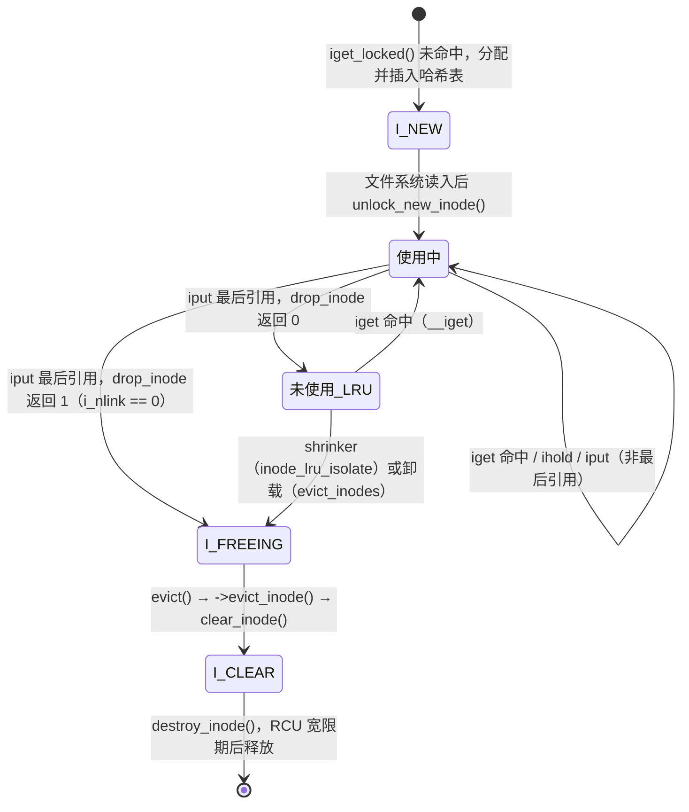

# 9.5 inode 与 inode 缓存

> **本节源码**：[`fs/inode.c`](../../linux/fs/inode.c)、[`include/linux/fs.h`](../../linux/include/linux/fs.h)、[`include/linux/writeback.h`](../../linux/include/linux/writeback.h)、[`fs/ext4/inode.c`](../../linux/fs/ext4/inode.c)、[`fs/ext4/super.c`](../../linux/fs/ext4/super.c)
> **关键函数**：`alloc_inode()`、`inode_init_always_gfp()`、`new_inode()`、`iget_locked()`、`find_inode_fast()`、`unlock_new_inode()`、`insert_inode_locked()`、`iput()`、`iput_final()`、`evict()`、`destroy_inode()`、`__inode_add_lru()`、`inode_lru_isolate()`、`prune_icache_sb()`、`evict_inodes()`
> **前置知识**：9.1 VFS 概述、9.4 目录项缓存

## 概述

磁盘文件系统在磁盘上为每个文件保存一份元数据（ext4 的 `struct ext4_inode`、XFS 的 `xfs_dinode`），格式各不相同。VFS 在内存中为每个被访问的文件对象建立一个 `struct inode`，它既是磁盘 inode 的缓存，又是 VFS 操作文件的统一句柄。内存中的 inode 必须满足一个不变式：**同一文件系统中的同一个对象，在内存中最多只有一个 `struct inode`**——否则两个进程对同一文件的修改将无法互相看见。

围绕这一不变式，`fs/inode.c` 实现了 inode 缓存：

- 一张以（超级块，inode 号）为键的全局哈希表，保证查找的唯一性；
- `I_NEW` 协议，解决多个任务同时读入同一个 inode 的竞争；
- 引用计数 `i_count` 与最后一个引用释放时的处理（`iput_final()`）：留在缓存中，还是驱逐（evict）；
- 未使用 inode 的 LRU 与 shrinker 回收。

inode 的生命周期还决定了"删除文件"何时真正释放磁盘空间：只有链接数为 0 **且**不再被任何人引用时，文件系统才会在驱逐 inode 时回收它占用的磁盘块。

## 核心数据结构

### inode 状态位

[`include/linux/fs.h:755-786`](../../linux/include/linux/fs.h#L755-L786)（v6.18.60）

```c
enum inode_state_bits {
	__I_NEW			= 0U,
	__I_SYNC		= 1U,
	__I_LRU_ISOLATING	= 2U
	/* reserved wait address bit 3 */
};

enum inode_state_flags_t {
	I_NEW			= (1U << __I_NEW),
	I_SYNC			= (1U << __I_SYNC),
	I_LRU_ISOLATING         = (1U << __I_LRU_ISOLATING),
	/* reserved flag bit 3 */
	I_DIRTY_SYNC		= (1U << 4),
	I_DIRTY_DATASYNC	= (1U << 5),
	I_DIRTY_PAGES		= (1U << 6),
	I_WILL_FREE		= (1U << 7),
	I_FREEING		= (1U << 8),
	I_CLEAR			= (1U << 9),
	I_REFERENCED		= (1U << 10),
	I_LINKABLE		= (1U << 11),
	I_DIRTY_TIME		= (1U << 12),
	I_WB_SWITCH		= (1U << 13),
	I_OVL_INUSE		= (1U << 14),
	I_CREATING		= (1U << 15),
	I_DONTCACHE		= (1U << 16),
	I_SYNC_QUEUED		= (1U << 17),
	I_PINNING_NETFS_WB	= (1U << 18)
};

#define I_DIRTY_INODE (I_DIRTY_SYNC | I_DIRTY_DATASYNC)
#define I_DIRTY (I_DIRTY_INODE | I_DIRTY_PAGES)
#define I_DIRTY_ALL (I_DIRTY | I_DIRTY_TIME)
```

`i_state` 受 `i_lock` 保护，记录 inode 当前所处的阶段：

| 状态位 | 含义 |
|---|---|
| `I_NEW` | 刚分配并加入哈希表，内容尚未从磁盘读入；其他任务找到它时必须等待 |
| `I_CREATING` | 正在创建的新文件的 inode（`insert_inode_locked()`），查找者遇到时返回 `-ESTALE` |
| `I_DIRTY_SYNC` / `I_DIRTY_DATASYNC` / `I_DIRTY_PAGES` / `I_DIRTY_TIME` | 不同类型的"脏"：元数据、影响数据完整性的元数据、page cache 中有脏页、仅时间戳（lazytime）（9.10 节） |
| `I_SYNC` | 正在写回，写回线程借此"钉住"inode |
| `I_WILL_FREE` | 即将释放，最后一次同步写回进行中 |
| `I_FREEING` | 正在被驱逐，任何人都不能再获取它 |
| `I_CLEAR` | `clear_inode()` 已完成，可以销毁 |
| `I_REFERENCED` | 在 LRU 上被再次使用过，给予第二次机会 |
| `I_DONTCACHE` | 最后一个引用释放后立即驱逐，不进 LRU |
| `I_LRU_ISOLATING` | 正被 LRU 回收代码临时钉住 |

`I_NEW`、`I_SYNC`、`I_LRU_ISOLATING` 三位还被当作等待地址使用：`inode_state_wait_address()` 取 `&inode->i_state` 加上位号作为 `wait_var_event()` 的键（[`include/linux/fs.h:914-918`](../../linux/include/linux/fs.h#L914-L918)），等待者在对应的哈希等待队列上睡眠，`inode_wake_up_bit()` 唤醒它们。

### inode 哈希表与链表

[`fs/inode.c:32-66`](../../linux/fs/inode.c#L32-L66)（v6.18.60）

```c
/*
 * Inode locking rules:
 *
 * inode->i_lock protects:
 *   inode->i_state, inode->i_hash, __iget(), inode->i_io_list
 * Inode LRU list locks protect:
 *   inode->i_sb->s_inode_lru, inode->i_lru
 * inode->i_sb->s_inode_list_lock protects:
 *   inode->i_sb->s_inodes, inode->i_sb_list
 * bdi->wb.list_lock protects:
 *   bdi->wb.b_{dirty,io,more_io,dirty_time}, inode->i_io_list
 * inode_hash_lock protects:
 *   inode_hashtable, inode->i_hash
 *
 * Lock ordering:
 *
 * inode->i_sb->s_inode_list_lock
 *   inode->i_lock
 *     Inode LRU list locks
 *
 * bdi->wb.list_lock
 *   inode->i_lock
 *
 * inode_hash_lock
 *   inode->i_sb->s_inode_list_lock
 *   inode->i_lock
 *
 * iunique_lock
 *   inode_hash_lock
 */

static unsigned int i_hash_mask __ro_after_init;
static unsigned int i_hash_shift __ro_after_init;
static struct hlist_head *inode_hashtable __ro_after_init;
static __cacheline_aligned_in_smp DEFINE_SPINLOCK(inode_hash_lock);
```

一个 inode 同时挂在多个链表上，分别由不同的锁保护：

| 链表节点 | 所在链表 | 保护锁 | 用途 |
|---|---|---|---|
| `i_hash` | `inode_hashtable` 的某个桶 | `inode_hash_lock` | 按（sb，ino）查找 |
| `i_sb_list` | `sb->s_inodes` | `sb->s_inode_list_lock` | 遍历文件系统的全部 inode（卸载、`sync`、`drop_caches`） |
| `i_lru` | `sb->s_inode_lru` | `list_lru` 内部锁 | 未使用 inode 的回收 |
| `i_io_list` | `wb->b_dirty` / `b_io` / `b_more_io` / `b_dirty_time` | `wb->list_lock` | 脏 inode 的写回（9.10 节） |
| `i_dentry` | inode 的别名链表头 | `i_lock` | 指向该 inode 的所有 dentry |

哈希函数把超级块指针与 inode 号混合：

[`fs/inode.c:645-653`](../../linux/fs/inode.c#L645-L653)（v6.18.60）

```c
static unsigned long hash(struct super_block *sb, unsigned long hashval)
{
	unsigned long tmp;

	tmp = (hashval * (unsigned long)sb) ^ (GOLDEN_RATIO_PRIME + hashval) /
			L1_CACHE_BYTES;
	tmp = tmp ^ ((tmp ^ GOLDEN_RATIO_PRIME) >> i_hash_shift);
	return tmp & i_hash_mask;
}
```

哈希表在启动时按内存大小分配（`inode_init()`，[`fs/inode.c:2522-2546`](../../linux/fs/inode.c#L2522-L2546)），启动参数 `ihash_entries=` 可以指定桶数。

## 主流程分析

### 分配与初始化

[`fs/inode.c:340-365`](../../linux/fs/inode.c#L340-L365)（v6.18.60）

```c
struct inode *alloc_inode(struct super_block *sb)
{
	const struct super_operations *ops = sb->s_op;
	struct inode *inode;

	if (ops->alloc_inode)
		inode = ops->alloc_inode(sb);
	else
		inode = alloc_inode_sb(sb, inode_cachep, GFP_KERNEL);

	if (!inode)
		return NULL;

	if (unlikely(inode_init_always(sb, inode))) {
		if (ops->destroy_inode) {
			ops->destroy_inode(inode);
			if (!ops->free_inode)
				return NULL;
		}
		inode->free_inode = ops->free_inode;
		i_callback(&inode->i_rcu);
		return NULL;
	}

	return inode;
}
```

文件系统若提供了 `->alloc_inode`，就由它分配包含 `struct inode` 的私有结构（9.1 节的 `ext4_alloc_inode()`）；否则从通用的 `inode_cache` slab 分配。然后 `inode_init_always()` 初始化 VFS 关心的全部字段：

[`fs/inode.c:233-296`](../../linux/fs/inode.c#L233-L296)（v6.18.60）

```c
	inode->i_sb = sb;
	inode->i_blkbits = sb->s_blocksize_bits;
	inode->i_flags = 0;
	inode->i_state = 0;
	atomic64_set(&inode->i_sequence, 0);
	atomic_set(&inode->i_count, 1);
	inode->i_op = &empty_iops;
	inode->i_fop = &no_open_fops;
	inode->i_ino = 0;
	inode->__i_nlink = 1;
	inode->i_opflags = 0;
	if (sb->s_xattr)
		inode->i_opflags |= IOP_XATTR;
	if (sb->s_type->fs_flags & FS_MGTIME)
		inode->i_opflags |= IOP_MGTIME;
	...
	mapping->a_ops = &empty_aops;
	mapping->host = inode;
	mapping->flags = 0;
	mapping->wb_err = 0;
	atomic_set(&mapping->i_mmap_writable, 0);
#ifdef CONFIG_READ_ONLY_THP_FOR_FS
	atomic_set(&mapping->nr_thps, 0);
#endif
	mapping_set_gfp_mask(mapping, GFP_HIGHUSER_MOVABLE);
	mapping->i_private_data = NULL;
	mapping->writeback_index = 0;
	init_rwsem(&mapping->invalidate_lock);
	lockdep_set_class_and_name(&mapping->invalidate_lock,
				   &sb->s_type->invalidate_lock_key,
				   "mapping.invalidate_lock");
	if (sb->s_iflags & SB_I_STABLE_WRITES)
		mapping_set_stable_writes(mapping);
	inode->i_private = NULL;
	inode->i_mapping = mapping;
	INIT_HLIST_HEAD(&inode->i_dentry);	/* buggered by rcu freeing */
```

几个值得注意的默认值：`i_count` 为 1（分配者持有第一个引用）、`i_nlink` 为 1、`i_fop` 指向只会返回错误的 `no_open_fops`、内嵌的 `i_data` 被设为 inode 的 `i_mapping`，其 `gfp_mask` 默认为 `GFP_HIGHUSER_MOVABLE`——page cache 页可以来自高端内存，也可以被迁移（4.12 节）。各种锁都用文件系统类型中的 `lock_class_key` 初始化，lockdep 因此能区分 ext4 的 `i_rwsem` 与 XFS 的 `i_rwsem`。

`alloc_inode()` 分配的 inode 不在任何链表上。没有稳定 inode 号的伪文件系统（ramfs、procfs 的大部分、pipefs）使用 `new_inode()`，它只额外把 inode 加入 `sb->s_inodes`，而不加入哈希表——这些文件系统不需要按 inode 号查找，inode 的唯一性由 dentry 保证：

[`fs/inode.c:1137-1146`](../../linux/fs/inode.c#L1137-L1146)（v6.18.60）

```c
struct inode *new_inode(struct super_block *sb)
{
	struct inode *inode;

	inode = alloc_inode(sb);
	if (inode)
		inode_sb_list_add(inode);
	return inode;
}
EXPORT_SYMBOL(new_inode);
```

它们的 inode 号由 `get_next_ino()`（[`fs/inode.c:1101-1122`](../../linux/fs/inode.c#L1101-L1122)）分配：每个 CPU 一次从全局计数器批量领取 1024 个号码，在本地递增使用，避免全局原子变量的争用。

### 查找或创建：iget_locked()

磁盘文件系统在 `->lookup` 中得到目录项里记录的 inode 号后，调用 `iget_locked()` 获取对应的内存 inode：

[`fs/inode.c:1421-1440`](../../linux/fs/inode.c#L1421-L1440)（v6.18.60）

```c
struct inode *iget_locked(struct super_block *sb, unsigned long ino)
{
	struct hlist_head *head = inode_hashtable + hash(sb, ino);
	struct inode *inode;

	might_sleep();

again:
	inode = find_inode_fast(sb, head, ino, false);
	if (inode) {
		if (IS_ERR(inode))
			return NULL;
		wait_on_inode(inode);
		if (unlikely(inode_unhashed(inode))) {
			iput(inode);
			goto again;
		}
		return inode;
	}

```

先在哈希表中查找。`find_inode_fast()` 在 RCU 保护下遍历哈希链：

[`fs/inode.c:1046-1081`](../../linux/fs/inode.c#L1046-L1081)（v6.18.60）

```c
static struct inode *find_inode_fast(struct super_block *sb,
				struct hlist_head *head, unsigned long ino,
				bool is_inode_hash_locked)
{
	struct inode *inode = NULL;

	if (is_inode_hash_locked)
		lockdep_assert_held(&inode_hash_lock);
	else
		lockdep_assert_not_held(&inode_hash_lock);

	rcu_read_lock();
repeat:
	hlist_for_each_entry_rcu(inode, head, i_hash) {
		if (inode->i_ino != ino)
			continue;
		if (inode->i_sb != sb)
			continue;
		spin_lock(&inode->i_lock);
		if (inode->i_state & (I_FREEING|I_WILL_FREE)) {
			__wait_on_freeing_inode(inode, is_inode_hash_locked);
			goto repeat;
		}
		if (unlikely(inode->i_state & I_CREATING)) {
			spin_unlock(&inode->i_lock);
			rcu_read_unlock();
			return ERR_PTR(-ESTALE);
		}
		__iget(inode);
		spin_unlock(&inode->i_lock);
		rcu_read_unlock();
		return inode;
	}
	rcu_read_unlock();
	return NULL;
}
```

找到匹配的 inode 后，在 `i_lock` 下检查其状态：若正在被释放（`I_FREEING`、`I_WILL_FREE`），就在 `__wait_on_freeing_inode()`（[`fs/inode.c:2462-2487`](../../linux/fs/inode.c#L2462-L2487)）中等它彻底从哈希表消失后重新查找——这样就不会把一个即将销毁的 inode 交给调用者；否则 `__iget()` 增加引用计数并返回。回到 `iget_locked()`，还要 `wait_on_inode()` 等待 `I_NEW` 被清除：如果另一个任务刚创建了这个 inode、正在从磁盘读入内容，当前任务必须等它完成。

没找到时分配新 inode：

[`fs/inode.c:1441-1480`](../../linux/fs/inode.c#L1441-L1480)（v6.18.60）

```c
	inode = alloc_inode(sb);
	if (inode) {
		struct inode *old;

		spin_lock(&inode_hash_lock);
		/* We released the lock, so.. */
		old = find_inode_fast(sb, head, ino, true);
		if (!old) {
			inode->i_ino = ino;
			spin_lock(&inode->i_lock);
			inode->i_state = I_NEW;
			hlist_add_head_rcu(&inode->i_hash, head);
			spin_unlock(&inode->i_lock);
			spin_unlock(&inode_hash_lock);
			inode_sb_list_add(inode);

			/* Return the locked inode with I_NEW set, the
			 * caller is responsible for filling in the contents
			 */
			return inode;
		}

		/*
		 * Uhhuh, somebody else created the same inode under
		 * us. Use the old inode instead of the one we just
		 * allocated.
		 */
		spin_unlock(&inode_hash_lock);
		destroy_inode(inode);
		if (IS_ERR(old))
			return NULL;
		inode = old;
		wait_on_inode(inode);
		if (unlikely(inode_unhashed(inode))) {
			iput(inode);
			goto again;
		}
	}
	return inode;
}
```

分配可能睡眠，因此不能持 `inode_hash_lock`。分配完成后再持锁查找一次：如果此间别人已经插入了同一个 inode，就丢弃自己分配的，使用别人的；否则把新 inode 标记为 `I_NEW` 后插入哈希表并返回。**带 `I_NEW` 返回的 inode 由调用者负责填充**：

[`fs/ext4/inode.c:5268-5285`](../../linux/fs/ext4/inode.c#L5268-L5285)（v6.18.60）

```c
		inode = iget_locked(sb, ino);
		if (!inode)
			return ERR_PTR(-ENOMEM);
	}

	if (!(inode->i_state & I_NEW)) {
		ret = check_igot_inode(inode, flags, function, line);
		if (ret) {
			iput(inode);
			return ERR_PTR(ret);
		}
		return inode;
	}

	ei = EXT4_I(inode);
	iloc.bh = NULL;

	ret = __ext4_get_inode_loc_noinmem(inode, &iloc);
```

[`fs/ext4/inode.c:5600-5609`](../../linux/fs/ext4/inode.c#L5600-L5609)（v6.18.60）

```c
	brelse(iloc.bh);

	unlock_new_inode(inode);
	return inode;

bad_inode:
	brelse(iloc.bh);
	iget_failed(inode);
	return ERR_PTR(ret);
}
```

ext4 根据 `I_NEW` 区分两种情况：没有 `I_NEW` 说明 inode 已在缓存中，直接返回；有 `I_NEW` 则从磁盘读入原始 inode、填充 `struct inode` 与 `ext4_inode_info`、设置操作表，最后 `unlock_new_inode()` 清除 `I_NEW` 并唤醒等待者：

[`fs/inode.c:1175-1190`](../../linux/fs/inode.c#L1175-L1190)（v6.18.60）

```c
void unlock_new_inode(struct inode *inode)
{
	lockdep_annotate_inode_mutex_key(inode);
	spin_lock(&inode->i_lock);
	WARN_ON(!(inode->i_state & I_NEW));
	inode->i_state &= ~I_NEW & ~I_CREATING;
	/*
	 * Pairs with the barrier in prepare_to_wait_event() to make sure
	 * ___wait_var_event() either sees the bit cleared or
	 * waitqueue_active() check in wake_up_var() sees the waiter.
	 */
	smp_mb();
	inode_wake_up_bit(inode, __I_NEW);
	spin_unlock(&inode->i_lock);
}
EXPORT_SYMBOL(unlock_new_inode);
```

读入失败时调用 `iget_failed()`，把 inode 标记为坏 inode 并释放，等待者被唤醒后发现它已从哈希表移除，会重新查找。

这一协议使得"第一个访问者负责读盘，其余访问者等待"，既避免了重复 I/O，又保证了唯一性。

| 接口 | 键 | 适用场景 |
|---|---|---|
| `iget_locked(sb, ino)` | inode 号 | inode 号可唯一标识对象的文件系统（ext2/3/4、XFS 等） |
| `iget5_locked(sb, hashval, test, set, data)` | 自定义比较函数 | inode 号不足以唯一标识（Btrfs 的子卷、NFS 的文件句柄、FUSE） |
| `ilookup(sb, ino)` | inode 号 | 只查找不创建 |
| `insert_inode_locked(inode)` | inode 号 | 创建新文件时，把文件系统自己分配并初始化的 inode 插入哈希表（设置 `I_NEW` 与 `I_CREATING`） |

### 引用计数

`i_count` 的增减规则：

- `__iget()`（持 `i_lock`）、`ihold()`（已持有引用时）、`igrab()`（若 inode 未处于释放中）增加计数。
- dentry 持有其 inode 的一个引用（在 `d_instantiate()` 前由调用者获得，在 `dentry_unlink_inode()` 中通过 `iput()` 释放）。
- `struct file` 不直接持有 inode 引用，而是通过 `f_path.dentry` 间接持有。

`iput()` 释放引用：

[`fs/inode.c:1922-1963`](../../linux/fs/inode.c#L1922-L1963)（v6.18.60）

```c
void iput(struct inode *inode)
{
	might_sleep();
	if (unlikely(!inode))
		return;

	...
	if (atomic_add_unless(&inode->i_count, -1, 1))
		return;

	if ((inode->i_state & I_DIRTY_TIME) && inode->i_nlink) {
		trace_writeback_lazytime_iput(inode);
		mark_inode_dirty_sync(inode);
		goto retry;
	}

	spin_lock(&inode->i_lock);
	if (unlikely((inode->i_state & I_DIRTY_TIME) && inode->i_nlink)) {
		spin_unlock(&inode->i_lock);
		goto retry;
	}

	if (!atomic_dec_and_test(&inode->i_count)) {
		spin_unlock(&inode->i_lock);
		return;
	}

	/*
	 * iput_final() drops ->i_lock, we can't assert on it as the inode may
	 * be deallocated by the time the call returns.
	 */
	iput_final(inode);
}
```

`atomic_add_unless(&i_count, -1, 1)` 是快速路径：只要不是最后一个引用，直接减一返回，不加锁。最后一个引用要在 `i_lock` 下处理。若 inode 只有时间戳是脏的（`I_DIRTY_TIME`，lazytime 挂载选项下 atime 等的更新只记在内存里），先把它升级为 `I_DIRTY_SYNC`，保证时间戳在 inode 离开前被写回。然后交给 `iput_final()`：

[`fs/inode.c:1870-1911`](../../linux/fs/inode.c#L1870-L1911)（v6.18.60）

```c
static void iput_final(struct inode *inode)
{
	struct super_block *sb = inode->i_sb;
	const struct super_operations *op = inode->i_sb->s_op;
	unsigned long state;
	int drop;

	WARN_ON(inode->i_state & I_NEW);

	if (op->drop_inode)
		drop = op->drop_inode(inode);
	else
		drop = inode_generic_drop(inode);

	if (!drop &&
	    !(inode->i_state & I_DONTCACHE) &&
	    (sb->s_flags & SB_ACTIVE)) {
		__inode_add_lru(inode, true);
		spin_unlock(&inode->i_lock);
		return;
	}

	state = inode->i_state;
	if (!drop) {
		WRITE_ONCE(inode->i_state, state | I_WILL_FREE);
		spin_unlock(&inode->i_lock);

		write_inode_now(inode, 1);

		spin_lock(&inode->i_lock);
		state = inode->i_state;
		WARN_ON(state & I_NEW);
		state &= ~I_WILL_FREE;
	}

	WRITE_ONCE(inode->i_state, state | I_FREEING);
	if (!list_empty(&inode->i_lru))
		inode_lru_list_del(inode);
	spin_unlock(&inode->i_lock);

	evict(inode);
}
```

`->drop_inode` 决定最后一个引用释放后 inode 的去留，默认实现是 `inode_generic_drop()`：

[`include/linux/fs.h:3345-3348`](../../linux/include/linux/fs.h#L3345-L3348)（v6.18.60）

```c
static inline int inode_generic_drop(struct inode *inode)
{
	return !inode->i_nlink || inode_unhashed(inode);
}
```

- **返回 0，保留**：链接数非零（文件仍有名字），并且仍在哈希表中。若文件系统处于活跃状态，inode 进入 LRU 继续缓存。
- **返回 1，丢弃**：链接数为 0（文件已被删除），或已从哈希表移除（如 `iget_failed()` 的坏 inode）。设置 `I_FREEING`，进入 `evict()`。

ramfs 的 `->drop_inode` 是总返回 1 的 `inode_just_drop()`：它的 inode 没有后备存储，存在的意义只在于被 dentry 引用，一旦没有引用就应立即释放。

文件系统正在卸载（`SB_ACTIVE` 已清除）时，即使 `drop` 为 0 也不能再缓存：先设置 `I_WILL_FREE`，用 `write_inode_now()` 同步写回脏数据与元数据，再驱逐。

### 驱逐：evict()

[`fs/inode.c:782-832`](../../linux/fs/inode.c#L782-L832)（v6.18.60）

```c
static void evict(struct inode *inode)
{
	const struct super_operations *op = inode->i_sb->s_op;

	BUG_ON(!(inode->i_state & I_FREEING));
	BUG_ON(!list_empty(&inode->i_lru));

	if (!list_empty(&inode->i_io_list))
		inode_io_list_del(inode);

	inode_sb_list_del(inode);

	spin_lock(&inode->i_lock);
	inode_wait_for_lru_isolating(inode);

	/*
	 * Wait for flusher thread to be done with the inode so that filesystem
	 * does not start destroying it while writeback is still running. Since
	 * the inode has I_FREEING set, flusher thread won't start new work on
	 * the inode.  We just have to wait for running writeback to finish.
	 */
	inode_wait_for_writeback(inode);
	spin_unlock(&inode->i_lock);

	if (op->evict_inode) {
		op->evict_inode(inode);
	} else {
		truncate_inode_pages_final(&inode->i_data);
		clear_inode(inode);
	}
	if (S_ISCHR(inode->i_mode) && inode->i_cdev)
		cd_forget(inode);

	remove_inode_hash(inode);
	...
	inode_wake_up_bit(inode, __I_NEW);
	BUG_ON(inode->i_state != (I_FREEING | I_CLEAR));

	destroy_inode(inode);
}
```

驱逐的步骤：

1. 从写回链表与超级块链表中移除。
2. 等待 LRU 隔离与正在进行的写回结束（`inode_wait_for_writeback()` 等待 `I_SYNC` 清除）。由于已设置 `I_FREEING`，写回线程不会再对它发起新的写回。
3. 调用文件系统的 `->evict_inode`。没有提供时，默认动作是 `truncate_inode_pages_final()` 丢弃全部 page cache（9.8 节），然后 `clear_inode()`。
4. 从哈希表移除，唤醒在 `__wait_on_freeing_inode()` 中等待的查找者。
5. `destroy_inode()` 释放内存。

`->evict_inode` 是文件系统真正删除文件的地方。以 ext4 为例：

[`fs/ext4/inode.c:186-206`](../../linux/fs/ext4/inode.c#L186-L206)（v6.18.60）

```c
	if (inode->i_nlink) {
		/*
		 * If there's dirty page will lead to data loss, user
		 * could see stale data.
		 */
		if (unlikely(!ext4_emergency_state(inode->i_sb) &&
		    mapping_tagged(&inode->i_data, PAGECACHE_TAG_DIRTY)))
			ext4_warning_inode(inode, "data will be lost");

		truncate_inode_pages_final(&inode->i_data);

		goto no_delete;
	}

	if (is_bad_inode(inode))
		goto no_delete;
	dquot_initialize(inode);

	if (ext4_should_order_data(inode))
		ext4_begin_ordered_truncate(inode, 0);
	truncate_inode_pages_final(&inode->i_data);
```

链接数非零时只需丢弃 page cache；链接数为 0 时，ext4 在一个日志事务中截断文件、释放所有数据块、把 inode 从孤儿链表移除并在 inode 位图中释放它。这就是"删除一个仍被打开的文件"的完整语义：`unlink()` 只把 `i_nlink` 减到 0、删除目录项；打开着的 `struct file` 通过 dentry 间接持有 inode 引用，进程仍可正常读写；最后一个 `close()` 导致 dentry 与 inode 的引用依次释放，`iput_final()` 看到 `i_nlink == 0`，驱逐 inode 并在此刻释放磁盘空间。为了防止在此期间系统崩溃造成空间泄漏，ext4 在 `unlink()` 时把这样的 inode 加入磁盘上的**孤儿链表**，挂载时恢复。

`destroy_inode()` 同样经过 RCU 延迟：

[`fs/inode.c:321-402`](../../linux/fs/inode.c#L321-L402)（v6.18.60）

```c
static void i_callback(struct rcu_head *head)
{
	struct inode *inode = container_of(head, struct inode, i_rcu);
	if (inode->free_inode)
		inode->free_inode(inode);
	else
		free_inode_nonrcu(inode);
}
...
static void destroy_inode(struct inode *inode)
{
	const struct super_operations *ops = inode->i_sb->s_op;

	BUG_ON(!list_empty(&inode->i_lru));
	__destroy_inode(inode);
	if (ops->destroy_inode) {
		ops->destroy_inode(inode);
		if (!ops->free_inode)
			return;
	}
	inode->free_inode = ops->free_inode;
	call_rcu(&inode->i_rcu, i_callback);
}
```

RCU 路径查找会在不持引用的情况下访问 `dentry->d_inode` 指向的 inode（检查权限、类型），因此 inode 内存必须在 RCU 宽限期之后才能被重用。文件系统可以提供 `->free_inode`，在 RCU 回调中释放自己的私有结构；需要在宽限期之前做的清理放在 `->destroy_inode`。

### LRU 与回收

`iput_final()` 中保留的 inode 由 `__inode_add_lru()` 加入超级块的 inode LRU：

[`fs/inode.c:533-548`](../../linux/fs/inode.c#L533-L548)（v6.18.60）

```c
static void __inode_add_lru(struct inode *inode, bool rotate)
{
	if (inode->i_state & (I_DIRTY_ALL | I_SYNC | I_FREEING | I_WILL_FREE))
		return;
	if (icount_read(inode))
		return;
	if (!(inode->i_sb->s_flags & SB_ACTIVE))
		return;
	if (!mapping_shrinkable(&inode->i_data))
		return;

	if (list_lru_add_obj(&inode->i_sb->s_inode_lru, &inode->i_lru))
		this_cpu_inc(nr_unused);
	else if (rotate)
		inode->i_state |= I_REFERENCED;
}
```

有脏数据、正在写回、正在释放、仍有引用的 inode 都不进入 LRU。`mapping_shrinkable()`（[`include/linux/pagemap.h:169-196`](../../linux/include/linux/pagemap.h#L169-L196)）还排除了 page cache 中仍有页的 inode：在未开启 `CONFIG_HIGHMEM` 的系统上（x86_64 即如此），只有 page cache 完全为空、或只剩一个影子项时它才返回真。回收一个仍缓存着数据的 inode 就意味着丢弃这些页，这交给页面回收（4.10 节）按页的冷热决定更合理。当页面回收把 inode 的最后一页从 page cache 删除时，`filemap_remove_folio()` 会再次调用 `inode_add_lru()`（[`mm/filemap.c:259-260`](../../linux/mm/filemap.c#L259-L260)）。

回收由 9.4 节介绍的 `super_cache_scan()` 发起，在回收 dentry 之后调用 `prune_icache_sb()`：

[`fs/inode.c:917-950`](../../linux/fs/inode.c#L917-L950)（v6.18.60）

```c
static enum lru_status inode_lru_isolate(struct list_head *item,
		struct list_lru_one *lru, void *arg)
{
	struct list_head *freeable = arg;
	struct inode	*inode = container_of(item, struct inode, i_lru);

	/*
	 * We are inverting the lru lock/inode->i_lock here, so use a
	 * trylock. If we fail to get the lock, just skip it.
	 */
	if (!spin_trylock(&inode->i_lock))
		return LRU_SKIP;

	/*
	 * Inodes can get referenced, redirtied, or repopulated while
	 * they're already on the LRU, and this can make them
	 * unreclaimable for a while. Remove them lazily here; iput,
	 * sync, or the last page cache deletion will requeue them.
	 */
	if (icount_read(inode) ||
	    (inode->i_state & ~I_REFERENCED) ||
	    !mapping_shrinkable(&inode->i_data)) {
		list_lru_isolate(lru, &inode->i_lru);
		spin_unlock(&inode->i_lock);
		this_cpu_dec(nr_unused);
		return LRU_REMOVED;
	}

	/* Recently referenced inodes get one more pass */
	if (inode->i_state & I_REFERENCED) {
		inode->i_state &= ~I_REFERENCED;
		spin_unlock(&inode->i_lock);
		return LRU_ROTATE;
	}
```

与 dentry LRU 一样，这里也采用惰性移除与"第二次机会"：重新被引用、又变脏、page cache 又被填充的 inode 直接从 LRU 移除；带 `I_REFERENCED` 的清除标志后轮转。余下的部分（[`fs/inode.c:951-981`](../../linux/fs/inode.c#L951-L981)）处理关联着 buffer_head、或 `i_pages` 中还留有影子项的 inode（在 32 位 `CONFIG_HIGHMEM` 系统上还包括仍有页的 inode）：先用 `I_LRU_ISOLATING` 钉住它，释放锁后调用 `remove_inode_buffers()` 与 `invalidate_mapping_pages()` 清理，然后返回 `LRU_RETRY` 再次检查；被顺带丢弃的页计入 `/proc/vmstat` 的 `pginodesteal` 与 `kswapd_inodesteal`。真正可回收的 inode 被设置 `I_FREEING` 并移入私有链表，由 `dispose_list()` 逐个 `evict()`。

卸载文件系统时，`generic_shutdown_super()` 调用 `evict_inodes()`（[`fs/inode.c:863-903`](../../linux/fs/inode.c#L863-L903)）驱逐所有引用计数为 0 的 inode；之后若 `s_inodes` 仍非空，说明有 inode 引用泄漏，内核会打印 `VFS: Busy inodes after unmount`。



*图 9-5：内存 inode 的生命周期*

## 关键细节 / 设计考量

### 锁的使用

`fs/inode.c` 开头的注释（[`fs/inode.c:32-61`](../../linux/fs/inode.c#L32-L61)）规定了 inode 相关锁的保护范围与顺序。最常见的组合是：`inode_hash_lock` → `i_lock`（插入哈希表时），`wb->list_lock` → `i_lock`（写回链表操作时），`s_inode_list_lock` → `i_lock` → LRU 锁。查找走 RCU，`inode_hash_lock` 只在插入与删除时获取，因而不会成为读多写少场景下的瓶颈。

### 为什么 inode 的 page cache 会阻止 inode 回收

一个 inode 可能缓存着数 GB 的文件数据。如果 inode shrinker 以"一个 inode 一个对象"计数，回收一个 inode 就可能顺带丢掉大量热数据，而页面回收对此毫不知情。因此 inode 回收只针对 page cache 已经被页面回收清空（或很小）的 inode，两套回收机制分工明确：页面回收管页，inode shrinker 管"空壳"inode。

### atime 的更新

读取文件会更新访问时间，这意味着纯读操作也要修改 inode、产生写 I/O。为此 Linux 提供了几种策略（挂载选项）：

| 选项 | 行为 |
|---|---|
| `strictatime` | 每次访问都更新 |
| `relatime`（默认） | 仅当 atime 早于 mtime/ctime，或距上次更新已超过一天时才更新（`relatime_need_update()`，[`fs/inode.c:2009-2056`](../../linux/fs/inode.c#L2009-L2056)） |
| `noatime` | 从不更新 |
| `lazytime` | 时间戳只在内存中更新（`I_DIRTY_TIME`），在 inode 因其他原因写回、`fsync`、驱逐或超过 `vm.dirtytime_expire_seconds`（默认 12 小时）时才写盘 |

`touch_atime()`（[`fs/inode.c:2176`](../../linux/fs/inode.c#L2176)）根据这些策略决定是否调用 `inode_update_time()`。

### inode 的内存开销

`struct inode` 本身有数百字节，文件系统的私有结构更大：在 `/proc/slabinfo` 中可以看到 `ext4_inode_cache` 的对象大小在 1 KB 以上，再加上 192 字节的 dentry，每个被缓存的文件要占用超过 1 KB 内存。遍历大量小文件的工作负载（如备份、`find /`）会让 inode 与 dentry 缓存膨胀到数 GB，这正是 `vm.vfs_cache_pressure` 存在的原因。

## 动手实验

### inode 缓存统计

```bash
cat /proc/sys/fs/inode-nr        # 已分配 inode 数、未使用数
grep -E "^(inode_cache|ext4_inode_cache|shmem_inode_cache|proc_inode_cache) " /proc/slabinfo
grep -E "inodesteal" /proc/vmstat
```

### 删除仍被打开的文件

```bash
cd /var/tmp
dd if=/dev/zero of=big bs=1M count=512
exec 3<big                       # 当前 shell 打开该文件
rm big
df -h .                          # 空间尚未释放
ls -l /proc/$$/fd/3              # 显示 /var/tmp/big (deleted)
exec 3<&-                        # 关闭：最后一个引用释放
df -h .                          # 空间被回收
```

在另一个终端跟踪 ext4 的驱逐过程：

```bash
sudo bpftrace -e '
kprobe:ext4_evict_inode {
	$i = (struct inode *)arg0;
	printf("evict ino=%lu nlink=%u size=%lld\n", $i->i_ino, $i->i_nlink, $i->i_size);
}'
```

关闭文件描述符的瞬间会看到 `nlink=0` 的驱逐事件。

### 观察 I_NEW 协议

```bash
sudo bpftrace -e '
kretprobe:iget_locked /retval/ {
	$i = (struct inode *)retval;
	@[$i->i_state & 1 ? "miss(I_NEW)" : "hit"] = count();
}
interval:s:10 { exit(); }'
```

执行 `echo 2 > /proc/sys/vm/drop_caches` 后再 `ls -lR /usr >/dev/null`，可以看到大量 `I_NEW`（未命中，需读盘）；再执行一次则几乎全部命中——不过 inode 命中时通常连 `iget_locked()` 都不会被调用，因为 dcache 命中的 dentry 已经直接指向了 inode。

## 小结

- 内存 inode 是磁盘 inode 的缓存，同一对象在内存中只有一个 `struct inode`，由以（超级块，inode 号）为键的哈希表保证。
- `iget_locked()` 在 RCU 下查找，未命中时解锁分配、加锁重查，插入带 `I_NEW` 的 inode；调用者从磁盘填充后用 `unlock_new_inode()` 唤醒等待者。
- `iput()` 的快速路径无锁递减；最后一个引用由 `->drop_inode`（默认看 `i_nlink` 与是否在哈希表中）决定进入 LRU 还是驱逐。
- `evict()` 等待写回结束后调用 `->evict_inode`，链接数为 0 的文件在此真正释放磁盘空间；inode 内存经 RCU 释放。
- inode LRU 只回收 page cache 已清空的 inode，与页面回收分工；卸载时 `evict_inodes()` 驱逐全部未使用 inode。

## 参考

- `linux/Documentation/filesystems/vfs.rst`（struct super_operations 与 inode 生命周期）
- `linux/Documentation/filesystems/porting.rst`（`->evict_inode`、`->free_inode` 的引入）
- `linux/Documentation/admin-guide/sysctl/fs.rst`（`inode-nr`、`inode-state`）
- `man 8 mount`（`relatime`、`lazytime` 等选项）
