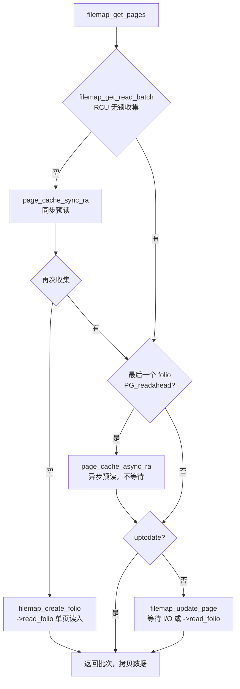

# 9.8 page cache：address_space 与 filemap

> **本节源码**：[`include/linux/fs.h`](../../linux/include/linux/fs.h)、[`include/linux/pagemap.h`](../../linux/include/linux/pagemap.h)、[`mm/filemap.c`](../../linux/mm/filemap.c)、[`mm/truncate.c`](../../linux/mm/truncate.c)、[`include/linux/page-flags.h`](../../linux/include/linux/page-flags.h)
> **关键函数**：`filemap_get_entry()`、`__filemap_get_folio()`、`filemap_add_folio()`、`__filemap_add_folio()`、`filemap_read()`、`filemap_get_pages()`、`filemap_get_read_batch()`、`filemap_update_page()`、`filemap_read_folio()`、`folio_unlock()`、`folio_end_read()`、`folio_wait_bit_common()`、`__filemap_remove_folio()`、`truncate_inode_pages_range()`
> **前置知识**：4.1 物理内存模型（folio）、4.10 页面回收、9.7 读写路径

## 概述

**page cache** 把文件的数据以页（folio）为单位缓存在内存中。它是 Linux I/O 的中心：缓冲读从 page cache 拷出数据，缓冲写把数据写入 page cache，`mmap()` 把 page cache 的页直接映射进进程地址空间，写回把 page cache 中的脏页写到存储，页面回收从 page cache 中驱逐冷页。自 v2.4 起，Linux 只有这一个统一的缓存（早期还有单独的 buffer cache），块设备本身的数据也缓存在块设备 inode 的 page cache 中。

每个被缓存的文件对应一个 `struct address_space`（通常是 inode 内嵌的 `i_data`），文件中的每个 folio 以它在文件中的页偏移（`index`）为键存放在 `address_space` 的 xarray 中。于是 page cache 的核心操作就是对这棵 xarray 的查找、插入与删除，以及围绕 folio 状态位（锁定、最新、脏、写回）的同步。

本节分析 page cache 的组织、查找与插入、缓冲读的完整流程 `filemap_read()`、folio 锁与等待，以及删除与截断。预读、写回、内存映射分别在 9.9、9.10、9.11 节讨论。

## 核心数据结构

### struct address_space

[`include/linux/fs.h:506-526`](../../linux/include/linux/fs.h#L506-L526)（v6.18.60）

```c
struct address_space {
	struct inode		*host;
	struct xarray		i_pages;
	struct rw_semaphore	invalidate_lock;
	gfp_t			gfp_mask;
	atomic_t		i_mmap_writable;
#ifdef CONFIG_READ_ONLY_THP_FOR_FS
	/* number of thp, only for non-shmem files */
	atomic_t		nr_thps;
#endif
	struct rb_root_cached	i_mmap;
	unsigned long		nrpages;
	pgoff_t			writeback_index;
	const struct address_space_operations *a_ops;
	unsigned long		flags;
	errseq_t		wb_err;
	spinlock_t		i_private_lock;
	struct list_head	i_private_list;
	struct rw_semaphore	i_mmap_rwsem;
	void *			i_private_data;
} __attribute__((aligned(sizeof(long)))) __randomize_layout;
```

| 字段 | 含义 |
|---|---|
| `host` | 所属 inode |
| `i_pages` | 以页偏移为索引的 xarray，存放 folio 指针以及影子项 |
| `invalidate_lock` | 保证 page cache 内容与文件块映射之间的一致性：截断、打洞时持写锁，缺页与读入新页时持读锁（v5.15 引入） |
| `gfp_mask` | 为该文件分配 page cache 页时使用的 GFP 标志 |
| `i_mmap` | 映射了该文件的所有 VMA 组成的区间树，用于反向映射（4.9 节） |
| `nrpages` | 缓存的页数（大 folio 计入其包含的页数） |
| `writeback_index` | 周期性写回的续写位置（9.10 节） |
| `a_ops` | 地址空间操作表 |
| `flags` | `AS_*` 标志：写回错误（`AS_EIO`、`AS_ENOSPC`）、不可回收（`AS_UNEVICTABLE`）、允许的 folio 阶范围等 |
| `wb_err` | 最近一次写回错误的 `errseq_t` 序号（9.10 节） |

`flags` 的第 16～25 位记录该文件允许使用的最小与最大 folio 阶（[`include/linux/pagemap.h:201-220`](../../linux/include/linux/pagemap.h#L201-L220)）。文件系统通过 `mapping_set_large_folios()` 声明支持大 folio，之后 page cache 可以用 16 KB、64 KB 乃至 2 MB 的 folio 缓存文件数据，减少每页的管理开销；最小阶大于 0 则用于块大小大于页大小（LBS）的文件系统。

### xarray 与标记

xarray 是一种基数树（radix tree）：每个内部节点有 64 个槽，xarray 的高度随最大索引增长。它为 page cache 提供了几项关键能力：

- **RCU 无锁查找**：读者在 RCU 下遍历，写者持 `xa_lock`（即 `i_pages` 内部的自旋锁，需关中断）修改。
- **标记（mark）**：每个槽有 3 个标记位，并在内部节点中向上汇总，可以快速找到带某个标记的所有项。page cache 用它们标记脏页与写回页：

[`include/linux/fs.h:533-536`](../../linux/include/linux/fs.h#L533-L536)（v6.18.60）

```c
/* XArray tags, for tagging dirty and writeback pages in the pagecache. */
#define PAGECACHE_TAG_DIRTY	XA_MARK_0
#define PAGECACHE_TAG_WRITEBACK	XA_MARK_1
#define PAGECACHE_TAG_TOWRITE	XA_MARK_2
```

- **值项（value entry）**：最低位为 1 的"指针"不是 folio，而是一个整数。page cache 在 folio 被回收后留下**影子项**（shadow entry），记录驱逐时刻，用于工作集检测（4.10 节）；tmpfs 用它存放交换项。
- **多索引项**：一个 2^n 页的大 folio 占据对齐的 2^n 个连续索引，在 xarray 中以一个多索引项存储，查找其中任意索引都返回该 folio。

```
 address_space.i_pages (xarray)
 ┌──────────────────────────────────── 根节点（64 槽）─────────────────────────────────┐
 │ [0]          [1]               [2]      ...                                        │
 └──┬────────────┬────────────────┬───────────────────────────────────────────────────┘
    ▼            ▼                ▼
 ┌───────────┐ ┌──────────────┐  NULL（这一段文件从未被缓存）
 │ 叶节点     │ │ 叶节点        │
 │ [0] folio │ │ [0] shadow   │  ← 值项：曾被回收，记录驱逐时间
 │ [1] folio │ │ [4..7] folio │  ← 多索引项：一个 4 页（16 KB）的大 folio
 │ ...       │ │ ...          │
 │ marks:    │ │ marks:       │
 │  DIRTY    │ │  WRITEBACK   │  ← 标记在内部节点中向上汇总
 └───────────┘ └──────────────┘
```

*图 9-8：page cache 的 xarray 组织*

### folio 的状态位

page cache 中的 folio 通过 `folio->mapping` 指回 `address_space`，`folio->index` 记录它在文件中的起始页偏移。与 page cache 相关的状态位：

| 标志 | 含义 |
|---|---|
| `PG_locked` | folio 已被锁定。读入数据、写回准备、截断、`write_begin` 等都要先锁定 folio |
| `PG_uptodate` | folio 中的数据是最新的（与存储一致或比存储更新），可以直接读取 |
| `PG_dirty` | 数据被修改过、尚未写回 |
| `PG_writeback` | 正在写回 |
| `PG_readahead` | 预读标记（与 `PG_reclaim` 共用同一位，[`include/linux/page-flags.h:132`](../../linux/include/linux/page-flags.h#L132)）：访问到它时触发下一轮异步预读（9.9 节） |
| `PG_waiters` | 有任务在等待这个 folio 的某个状态位，解锁时需要唤醒 |
| `PG_dropbehind` | I/O 完成后立即从 page cache 中丢弃（`RWF_DONTCACHE`） |
| `PG_workingset` | 该 folio 属于工作集（曾被驱逐后很快又被读回） |

`PG_locked` 与 `PG_uptodate` 的组合定义了 folio 的读入协议：新加入 page cache 的 folio 处于"已锁定、非最新"状态；文件系统的读 I/O 完成后，在**同一个原子操作**中设置 `PG_uptodate` 并清除 `PG_locked`（`folio_end_read()`）；等待者被唤醒后检查 `PG_uptodate` 判断读取是否成功。

## 主流程分析

### 查找：filemap_get_entry()

[`mm/filemap.c:1906-1935`](../../linux/mm/filemap.c#L1906-L1935)（v6.18.60）

```c
void *filemap_get_entry(struct address_space *mapping, pgoff_t index)
{
	XA_STATE(xas, &mapping->i_pages, index);
	struct folio *folio;

	rcu_read_lock();
repeat:
	xas_reset(&xas);
	folio = xas_load(&xas);
	if (xas_retry(&xas, folio))
		goto repeat;
	/*
	 * A shadow entry of a recently evicted page, or a swap entry from
	 * shmem/tmpfs.  Return it without attempting to raise page count.
	 */
	if (!folio || xa_is_value(folio))
		goto out;

	if (!folio_try_get(folio))
		goto repeat;

	if (unlikely(folio != xas_reload(&xas))) {
		folio_put(folio);
		goto repeat;
	}
out:
	rcu_read_unlock();

	return folio;
}
```

这是 page cache 无锁查找的标准模式（v2.6.27 由 Nick Piggin 引入的"lockless pagecache"）：

1. 在 RCU 下 `xas_load()` 读出槽中的指针。
2. `folio_try_get()` 尝试增加引用计数：若计数已为 0，说明 folio 正被释放，重试。
3. `xas_reload()` 重新读取槽，确认 folio 仍在原处——在第 1 步与第 2 步之间，folio 可能已被删除、释放并重新分配给了另一个文件。

整个过程不需要 `xa_lock`。这与 9.6 节 `__fget_files_rcu()` 的"获取引用后二次检查"是同一思想：被 RCU 保护的只是内存不被归还给伙伴系统，对象本身可能已被重用。

### 查找或创建：__filemap_get_folio()

大多数调用者使用 `__filemap_get_folio()`，以 `FGP_*` 标志控制行为（[`include/linux/pagemap.h:712-723`](../../linux/include/linux/pagemap.h#L712-L723)）：

| 标志 | 含义 |
|---|---|
| `FGP_LOCK` | 返回已锁定的 folio |
| `FGP_CREAT` | 不存在时分配新 folio 并加入 page cache |
| `FGP_WRITE` | 调用者将写入此 folio（分配时带 `__GFP_WRITE`，参与脏页在节点间的分布） |
| `FGP_STABLE` | 等待写回完成（对要求写回期间数据不变的设备，`AS_STABLE_WRITES`） |
| `FGP_NOWAIT` | 不在锁上阻塞 |
| `FGP_FOR_MMAP` | 新分配的 folio 返回时不锁定 |
| `FGP_ACCESSED` | 标记为最近访问 |

查找部分：

[`mm/filemap.c:1958-1993`](../../linux/mm/filemap.c#L1958-L1993)（v6.18.60）

```c
repeat:
	folio = filemap_get_entry(mapping, index);
	if (xa_is_value(folio))
		folio = NULL;
	if (!folio)
		goto no_page;

	if (fgp_flags & FGP_LOCK) {
		if (fgp_flags & FGP_NOWAIT) {
			if (!folio_trylock(folio)) {
				folio_put(folio);
				return ERR_PTR(-EAGAIN);
			}
		} else {
			folio_lock(folio);
		}

		/* Has the page been truncated? */
		if (unlikely(folio->mapping != mapping)) {
			folio_unlock(folio);
			folio_put(folio);
			goto repeat;
		}
		VM_BUG_ON_FOLIO(!folio_contains(folio, index), folio);
	}

	if (fgp_flags & FGP_ACCESSED)
		folio_mark_accessed(folio);
	else if (fgp_flags & FGP_WRITE) {
		/* Clear idle flag for buffer write */
		if (folio_test_idle(folio))
			folio_clear_idle(folio);
	}

	if (fgp_flags & FGP_STABLE)
		folio_wait_stable(folio);
```

加锁之后必须检查 `folio->mapping` 是否仍是原来的 `mapping`：在查找与加锁之间，folio 可能已被截断出 page cache（截断要先锁定 folio，因此锁定后的检查是可靠的）。

创建部分：

[`mm/filemap.c:1995-2042`](../../linux/mm/filemap.c#L1995-L2042)（v6.18.60）

```c
	if (!folio && (fgp_flags & FGP_CREAT)) {
		unsigned int min_order = mapping_min_folio_order(mapping);
		unsigned int order = max(min_order, FGF_GET_ORDER(fgp_flags));
		int err;
		index = mapping_align_index(mapping, index);

		if ((fgp_flags & FGP_WRITE) && mapping_can_writeback(mapping))
			gfp |= __GFP_WRITE;
		...
		if (WARN_ON_ONCE(!(fgp_flags & (FGP_LOCK | FGP_FOR_MMAP))))
			fgp_flags |= FGP_LOCK;

		if (order > mapping_max_folio_order(mapping))
			order = mapping_max_folio_order(mapping);
		/* If we're not aligned, allocate a smaller folio */
		if (index & ((1UL << order) - 1))
			order = __ffs(index);

		do {
			gfp_t alloc_gfp = gfp;

			err = -ENOMEM;
			if (order > min_order)
				alloc_gfp |= __GFP_NORETRY | __GFP_NOWARN;
			folio = filemap_alloc_folio(alloc_gfp, order);
			if (!folio)
				continue;

			/* Init accessed so avoid atomic mark_page_accessed later */
			if (fgp_flags & FGP_ACCESSED)
				__folio_set_referenced(folio);
			if (fgp_flags & FGP_DONTCACHE)
				__folio_set_dropbehind(folio);

			err = filemap_add_folio(mapping, folio, index, gfp);
			if (!err)
				break;
			folio_put(folio);
			folio = NULL;
		} while (order-- > min_order);

		if (err == -EEXIST)
			goto repeat;
```

新 folio 的阶取调用者通过 `FGF_GET_ORDER()` 请求的阶（如 `write_begin` 根据写入长度请求）与 mapping 允许范围的交集，并且要求索引按该阶对齐，否则降阶。大阶分配带 `__GFP_NORETRY | __GFP_NOWARN`，失败就降阶重试，直到最小阶——大 folio 只是优化，不值得为它触发重度回收。`filemap_add_folio()` 返回 `-EEXIST` 说明别人抢先插入了，回到开头重新查找。

### 插入：filemap_add_folio()

[`mm/filemap.c:968-1008`](../../linux/mm/filemap.c#L968-L1008)（v6.18.60）

```c
int filemap_add_folio(struct address_space *mapping, struct folio *folio,
				pgoff_t index, gfp_t gfp)
{
	void *shadow = NULL;
	int ret;
	struct mem_cgroup *tmp;
	bool kernel_file = test_bit(AS_KERNEL_FILE, &mapping->flags);

	if (kernel_file)
		tmp = set_active_memcg(root_mem_cgroup);
	ret = mem_cgroup_charge(folio, NULL, gfp);
	if (kernel_file)
		set_active_memcg(tmp);
	if (ret)
		return ret;

	__folio_set_locked(folio);
	ret = __filemap_add_folio(mapping, folio, index, gfp, &shadow);
	if (unlikely(ret)) {
		mem_cgroup_uncharge(folio);
		__folio_clear_locked(folio);
	} else {
		/*
		 * The folio might have been evicted from cache only
		 * recently, in which case it should be activated like
		 * any other repeatedly accessed folio.
		 * The exception is folios getting rewritten; evicting other
		 * data from the working set, only to cache data that will
		 * get overwritten with something else, is a waste of memory.
		 */
		WARN_ON_ONCE(folio_test_active(folio));
		if (!(gfp & __GFP_WRITE) && shadow)
			workingset_refault(folio, shadow);
		folio_add_lru(folio);
		if (kernel_file)
			mod_node_page_state(folio_pgdat(folio),
					    NR_KERNEL_FILE_PAGES,
					    folio_nr_pages(folio));
	}
	return ret;
}
```

插入前先把 folio 计费到当前进程的内存控制组（4.14 节）。插入成功后有两件与回收相关的工作：若被替换的是一个影子项，调用 `workingset_refault()` 判断这次"重新读入"是否说明该页属于工作集，是则把 folio 直接放入活跃 LRU 并标记 `PG_workingset`；然后 `folio_add_lru()` 把它加入 LRU 链表，从此它参与页面回收。

`__filemap_add_folio()` 在 xarray 中完成实际插入：

[`mm/filemap.c:879-946`](../../linux/mm/filemap.c#L879-L946)（v6.18.60）

```c
	gfp &= GFP_RECLAIM_MASK;
	folio_ref_add(folio, nr);
	folio->mapping = mapping;
	folio->index = xas.xa_index;

	for (;;) {
		int order = -1;
		void *entry, *old = NULL;

		xas_lock_irq(&xas);
		xas_for_each_conflict(&xas, entry) {
			old = entry;
			if (!xa_is_value(entry)) {
				xas_set_err(&xas, -EEXIST);
				goto unlock;
			}
			/*
			 * If a larger entry exists,
			 * it will be the first and only entry iterated.
			 */
			if (order == -1)
				order = xas_get_order(&xas);
		}

		...
		xas_store(&xas, folio);
		if (xas_error(&xas))
			goto unlock;

		mapping->nrpages += nr;

		/* hugetlb pages do not participate in page cache accounting */
		if (!huge) {
			__lruvec_stat_mod_folio(folio, NR_FILE_PAGES, nr);
			if (folio_test_pmd_mappable(folio))
				__lruvec_stat_mod_folio(folio,
						NR_FILE_THPS, nr);
		}

unlock:
		xas_unlock_irq(&xas);

		if (!xas_nomem(&xas, gfp))
			break;
```

`xas_for_each_conflict()` 遍历目标范围内已有的项：若有真正的 folio，返回 `-EEXIST`；若只有影子项，记录下来交给调用者，并在需要时拆分更大的影子项（[`mm/filemap.c:903-926`](../../linux/mm/filemap.c#L903-L926)）。xarray 节点的内存在锁外分配：`xas_nomem()` 在 `xas_store()` 因缺少节点而失败时，释放锁、分配节点、返回 true 让循环重来——这是 xarray 避免在自旋锁内进行可睡眠分配的标准写法。

### 缓冲读：filemap_read()

9.7 节的 `generic_file_read_iter()` 最终进入 `filemap_read()`：

[`mm/filemap.c:2746-2775`](../../linux/mm/filemap.c#L2746-L2775)（v6.18.60）

```c
	do {
		cond_resched();

		/*
		 * If we've already successfully copied some data, then we
		 * can no longer safely return -EIOCBQUEUED. Hence mark
		 * an async read NOWAIT at that point.
		 */
		if ((iocb->ki_flags & IOCB_WAITQ) && already_read)
			iocb->ki_flags |= IOCB_NOWAIT;

		if (unlikely(iocb->ki_pos >= i_size_read(inode)))
			break;

		error = filemap_get_pages(iocb, iter->count, &fbatch, false);
		if (error < 0)
			break;

		/*
		 * i_size must be checked after we know the pages are Uptodate.
		 *
		 * Checking i_size after the check allows us to calculate
		 * the correct value for "nr", which means the zero-filled
		 * part of the page is not copied back to userspace (unless
		 * another truncate extends the file - this is desired though).
		 */
		isize = i_size_read(inode);
		if (unlikely(iocb->ki_pos >= isize))
			goto put_folios;
		end_offset = min_t(loff_t, isize, iocb->ki_pos + iter->count);
```

每轮循环用 `filemap_get_pages()` 获取一批（`folio_batch`，最多 31 个）覆盖读取范围、并且已经是最新的 folio，然后逐个拷贝：

[`mm/filemap.c:2787-2821`](../../linux/mm/filemap.c#L2787-L2821)（v6.18.60）

```c
		if (!pos_same_folio(iocb->ki_pos, last_pos - 1,
				    fbatch.folios[0]))
			folio_mark_accessed(fbatch.folios[0]);

		for (i = 0; i < folio_batch_count(&fbatch); i++) {
			struct folio *folio = fbatch.folios[i];
			size_t fsize = folio_size(folio);
			size_t offset = iocb->ki_pos & (fsize - 1);
			size_t bytes = min_t(loff_t, end_offset - iocb->ki_pos,
					     fsize - offset);
			size_t copied;

			if (end_offset < folio_pos(folio))
				break;
			if (i > 0)
				folio_mark_accessed(folio);
			/*
			 * If users can be writing to this folio using arbitrary
			 * virtual addresses, take care of potential aliasing
			 * before reading the folio on the kernel side.
			 */
			if (writably_mapped)
				flush_dcache_folio(folio);

			copied = copy_folio_to_iter(folio, offset, bytes, iter);

			already_read += copied;
			iocb->ki_pos += copied;
			last_pos = iocb->ki_pos;

			if (copied < bytes) {
				error = -EFAULT;
				break;
			}
		}
```

注意 i_size 的检查时机：必须在 folio 已是最新之后再读取 `i_size`，并据此计算拷贝长度，这样截断与扩展写入并发时，读者既不会读到文件末尾之后的垃圾数据，也不会漏掉刚写入的数据。`folio_mark_accessed()` 更新 LRU 访问信息，同一 folio 被连续的小读多次访问时只在第一次标记。循环结束后把本次读取的末尾位置记入 `ra->prev_pos`，供预读判断访问是否连续（9.9 节）。

### filemap_get_pages()：获取最新的 folio

[`mm/filemap.c:2636-2677`](../../linux/mm/filemap.c#L2636-L2677)（v6.18.60）

```c
retry:
	if (fatal_signal_pending(current))
		return -EINTR;

	filemap_get_read_batch(mapping, index, last_index - 1, fbatch);
	if (!folio_batch_count(fbatch)) {
		DEFINE_READAHEAD(ractl, filp, &filp->f_ra, mapping, index);

		if (iocb->ki_flags & IOCB_NOIO)
			return -EAGAIN;
		if (iocb->ki_flags & IOCB_NOWAIT)
			flags = memalloc_noio_save();
		if (iocb->ki_flags & IOCB_DONTCACHE)
			ractl.dropbehind = 1;
		page_cache_sync_ra(&ractl, last_index - index);
		if (iocb->ki_flags & IOCB_NOWAIT)
			memalloc_noio_restore(flags);
		filemap_get_read_batch(mapping, index, last_index - 1, fbatch);
	}
	if (!folio_batch_count(fbatch)) {
		err = filemap_create_folio(iocb, fbatch);
		if (err == AOP_TRUNCATED_PAGE)
			goto retry;
		return err;
	}

	folio = fbatch->folios[folio_batch_count(fbatch) - 1];
	if (folio_test_readahead(folio)) {
		err = filemap_readahead(iocb, filp, mapping, folio, last_index);
		if (err)
			goto err;
	}
	if (!folio_test_uptodate(folio)) {
		if (folio_batch_count(fbatch) > 1) {
			err = -EAGAIN;
			goto err;
		}
		err = filemap_update_page(iocb, mapping, count, folio,
					  need_uptodate);
		if (err)
			goto err;
	}
```

这是缓冲读的决策中心：

1. `filemap_get_read_batch()` 在 RCU 下无锁地收集连续的 folio，遇到空洞、非最新的 folio 或带预读标记的 folio 就停下（[`mm/filemap.c:2410-2444`](../../linux/mm/filemap.c#L2410-L2444)）。
2. 一个都没找到：page cache 未命中，调用 `page_cache_sync_ra()` 发起**同步预读**，把请求范围连同预读窗口一起读入，然后再收集一次。
3. 仍然没有（预读被禁止或内存不足）：`filemap_create_folio()` 分配单个 folio、加入 page cache 并调用 `->read_folio` 读入。
4. 批次中最后一个 folio 带 `PG_readahead`：说明读取已推进到上次预读窗口的异步部分，发起**异步预读**（`page_cache_async_ra()`），不等待。
5. 最后一个 folio 不是最新的：通常是预读 I/O 尚未完成。`filemap_update_page()` 等待它（或者在预读失败时重新读）。

### filemap_update_page()：等待或读入

[`mm/filemap.c:2512-2545`](../../linux/mm/filemap.c#L2512-L2545)（v6.18.60）

```c
	if (!folio_trylock(folio)) {
		error = -EAGAIN;
		if (iocb->ki_flags & (IOCB_NOWAIT | IOCB_NOIO))
			goto unlock_mapping;
		if (!(iocb->ki_flags & IOCB_WAITQ)) {
			filemap_invalidate_unlock_shared(mapping);
			/*
			 * This is where we usually end up waiting for a
			 * previously submitted readahead to finish.
			 */
			folio_put_wait_locked(folio, TASK_KILLABLE);
			return AOP_TRUNCATED_PAGE;
		}
		error = __folio_lock_async(folio, iocb->ki_waitq);
		if (error)
			goto unlock_mapping;
	}

	error = AOP_TRUNCATED_PAGE;
	if (!folio->mapping)
		goto unlock;

	error = 0;
	if (filemap_range_uptodate(mapping, iocb->ki_pos, count, folio,
				   need_uptodate))
		goto unlock;

	error = -EAGAIN;
	if (iocb->ki_flags & (IOCB_NOIO | IOCB_NOWAIT | IOCB_WAITQ))
		goto unlock;

	error = filemap_read_folio(iocb->ki_filp, mapping->a_ops->read_folio,
			folio);
	goto unlock_mapping;
```

常见情况是 folio 已由预读提交了 I/O 并处于锁定状态。`folio_trylock()` 失败后，同步读调用 `folio_put_wait_locked()` 等待锁释放（I/O 完成时 `folio_end_read()` 会解锁），返回 `AOP_TRUNCATED_PAGE` 让调用者重新查找；异步读（`IOCB_WAITQ`）则登记等待项后立即返回。拿到锁后，若 folio 已经最新（预读成功）或者所需的部分已是最新（`->is_partially_uptodate`，块大小小于页大小时）就直接使用；否则调用 `->read_folio` 同步读入：

[`mm/filemap.c:2446-2470`](../../linux/mm/filemap.c#L2446-L2470)（v6.18.60）

```c
static int filemap_read_folio(struct file *file, filler_t filler,
		struct folio *folio)
{
	bool workingset = folio_test_workingset(folio);
	unsigned long pflags;
	int error;

	/* Start the actual read. The read will unlock the page. */
	if (unlikely(workingset))
		psi_memstall_enter(&pflags);
	error = filler(file, folio);
	if (unlikely(workingset))
		psi_memstall_leave(&pflags);
	if (error)
		return error;

	error = folio_wait_locked_killable(folio);
	if (error)
		return error;
	if (folio_test_uptodate(folio))
		return 0;
	if (file)
		shrink_readahead_size_eio(&file->f_ra);
	return -EIO;
}
```

`->read_folio` 提交读 I/O 后立即返回，folio 保持锁定；I/O 完成时由块层回调解锁。`filemap_read_folio()` 用 `folio_wait_locked_killable()` 等待，然后检查 `PG_uptodate` 判断成败。若失败，`shrink_readahead_size_eio()` 缩小预读窗口，避免在坏扇区附近反复预读。



*图 9-9：缓冲读获取 folio 的决策流程*

### folio 锁与等待

如果每个 folio 都内嵌一个等待队列，内存开销将无法接受（系统中有数以百万计的 folio）。page cache 使用一张全局的哈希等待队列表：

[`mm/filemap.c:1080-1100`](../../linux/mm/filemap.c#L1080-L1100)（v6.18.60）

```c
#define PAGE_WAIT_TABLE_BITS 8
#define PAGE_WAIT_TABLE_SIZE (1 << PAGE_WAIT_TABLE_BITS)
static wait_queue_head_t folio_wait_table[PAGE_WAIT_TABLE_SIZE] __cacheline_aligned;

static wait_queue_head_t *folio_waitqueue(struct folio *folio)
{
	return &folio_wait_table[hash_ptr(folio, PAGE_WAIT_TABLE_BITS)];
}

/* How many times do we accept lock stealing from under a waiter? */
static int sysctl_page_lock_unfairness = 5;
static const struct ctl_table filemap_sysctl_table[] = {
	{
		.procname	= "page_lock_unfairness",
		.data		= &sysctl_page_lock_unfairness,
		.maxlen		= sizeof(sysctl_page_lock_unfairness),
		.mode		= 0644,
		.proc_handler	= proc_dointvec_minmax,
		.extra1		= SYSCTL_ZERO,
	}
};
```

等待某个 folio 的任务按 folio 地址哈希到 256 个等待队列之一。哈希冲突时，一次唤醒会唤醒等待其他 folio 的任务，被误唤醒者检查条件后继续睡眠；这在冲突罕见时是可以接受的代价。为了让无人等待的常见情况完全不碰等待队列，folio 有一个 `PG_waiters` 位：等待者在睡眠前设置它，解锁者只在它被设置时才去唤醒：

[`mm/filemap.c:1518-1526`](../../linux/mm/filemap.c#L1518-L1526)（v6.18.60）

```c
void folio_unlock(struct folio *folio)
{
	/* Bit 7 allows x86 to check the byte's sign bit */
	BUILD_BUG_ON(PG_waiters != 7);
	BUILD_BUG_ON(PG_locked > 7);
	VM_BUG_ON_FOLIO(!folio_test_locked(folio), folio);
	if (folio_xor_flags_has_waiters(folio, 1 << PG_locked))
		folio_wake_bit(folio, PG_locked);
}
```

`PG_locked` 是第 0 位、`PG_waiters` 是第 7 位，二者在同一个字节中。`folio_xor_flags_has_waiters()` 在 x86 上编译为一条 `lock xorb` 指令清除锁位，并根据结果字节的符号位（即第 7 位）判断是否有等待者——解锁与检查等待者是一个原子操作，不会丢失唤醒。读完成的 `folio_end_read()` 更进一步，把设置 `PG_uptodate`（第 3 位）也合并进同一条指令：

[`mm/filemap.c:1543-1556`](../../linux/mm/filemap.c#L1543-L1556)（v6.18.60）

```c
void folio_end_read(struct folio *folio, bool success)
{
	unsigned long mask = 1 << PG_locked;

	/* Must be in bottom byte for x86 to work */
	BUILD_BUG_ON(PG_uptodate > 7);
	VM_BUG_ON_FOLIO(!folio_test_locked(folio), folio);
	VM_BUG_ON_FOLIO(success && folio_test_uptodate(folio), folio);

	if (likely(success))
		mask |= 1 << PG_uptodate;
	if (folio_xor_flags_has_waiters(folio, mask))
		folio_wake_bit(folio, PG_locked);
}
```

加锁的慢速路径 `__folio_lock()` → `folio_wait_bit_common()`（[`mm/filemap.c:1258`](../../linux/mm/filemap.c#L1258)）以独占方式等待。folio 锁允许"偷锁"：新来的任务可以抢在已等待的任务之前拿到锁，以提高吞吐量。但一个等待者被唤醒后若连续多次（`sysctl_page_lock_unfairness`，默认 5 次）都没抢到，就设置 `WQ_FLAG_CUSTOM`，此后由解锁者在唤醒函数 `wake_page_function()` 中直接替它把锁位设上（锁移交），防止饥饿——这与 7.6 节 mutex 的移交机制思路相同。

### 删除：__filemap_remove_folio()

folio 离开 page cache 有三条路径：页面回收（`__remove_mapping()`，4.10 节）、截断与打洞、失效（`invalidate_mapping_pages()`）。它们最终都调用：

[`mm/filemap.c:128-147`](../../linux/mm/filemap.c#L128-L147)（v6.18.60）

```c
static void page_cache_delete(struct address_space *mapping,
				   struct folio *folio, void *shadow)
{
	XA_STATE(xas, &mapping->i_pages, folio->index);
	long nr = 1;

	mapping_set_update(&xas, mapping);

	xas_set_order(&xas, folio->index, folio_order(folio));
	nr = folio_nr_pages(folio);

	VM_BUG_ON_FOLIO(!folio_test_locked(folio), folio);

	xas_store(&xas, shadow);
	xas_init_marks(&xas);

	folio->mapping = NULL;
	/* Leave folio->index set: truncation lookup relies upon it */
	mapping->nrpages -= nr;
}
```

`xas_store()` 用 `shadow` 替换原来的 folio 指针：回收时传入影子项（记录驱逐时间），截断时传入 `NULL`。`xas_init_marks()` 清除该位置的所有标记。`folio->mapping` 被清空，但 `index` 保留——截断代码依赖它判断 folio 原来的位置。调用者必须已锁定 folio 并持有 `xa_lock`。

### 截断：truncate_inode_pages_range()

`truncate()`、`ftruncate()` 缩小文件，或文件被删除后 inode 被驱逐时，需要把超出新长度的 page cache 全部移除。`truncate_setsize()` 先更新 `i_size`，再调用 `truncate_pagecache()`：它先用 `unmap_mapping_range()` 解除所有进程对这些页的映射，再调用 `truncate_inode_pages()`，最后再解除一次映射，以清理截断期间因写时复制产生的私有页（[`mm/truncate.c:783-800`](../../linux/mm/truncate.c#L783-L800)）。核心是 `truncate_inode_pages_range()`：

[`mm/truncate.c:398-435`](../../linux/mm/truncate.c#L398-L435)（v6.18.60）

```c
	folio_batch_init(&fbatch);
	index = start;
	while (index < end && find_lock_entries(mapping, &index, end - 1,
			&fbatch, indices)) {
		truncate_folio_batch_exceptionals(mapping, &fbatch, indices);
		for (i = 0; i < folio_batch_count(&fbatch); i++)
			truncate_cleanup_folio(fbatch.folios[i]);
		delete_from_page_cache_batch(mapping, &fbatch);
		for (i = 0; i < folio_batch_count(&fbatch); i++)
			folio_unlock(fbatch.folios[i]);
		folio_batch_release(&fbatch);
		cond_resched();
	}

	same_folio = (lstart >> PAGE_SHIFT) == (lend >> PAGE_SHIFT);
	folio = __filemap_get_folio(mapping, lstart >> PAGE_SHIFT, FGP_LOCK, 0);
	if (!IS_ERR(folio)) {
		same_folio = lend < folio_pos(folio) + folio_size(folio);
		if (!truncate_inode_partial_folio(folio, lstart, lend)) {
			start = folio_next_index(folio);
			if (same_folio)
				end = folio->index;
		}
		folio_unlock(folio);
		folio_put(folio);
		folio = NULL;
	}

	if (!same_folio) {
		folio = __filemap_get_folio(mapping, lend >> PAGE_SHIFT,
						FGP_LOCK, 0);
		if (!IS_ERR(folio)) {
			if (!truncate_inode_partial_folio(folio, lstart, lend))
				end = folio->index;
			folio_unlock(folio);
			folio_put(folio);
		}
	}
```

截断分三个阶段：

1. 批量处理**完全**落在截断范围内、当前未被锁定的 folio：`find_lock_entries()` 只收集能立即锁定的 folio，然后批量删除。
2. 处理截断边界上**部分**被截断的 folio：`truncate_inode_partial_folio()` 把被截掉的部分清零；大 folio 可能被拆分，以便把超出部分释放。
3. 再扫描一遍（[`mm/truncate.c:437-466`](../../linux/mm/truncate.c#L437-L466)），对第 1 阶段跳过的（当时被锁定或正在写回的）folio 逐个加锁、等待写回结束后删除，直到范围内再无任何项为止。

截断与并发的读入、缺页之间的竞争由 `invalidate_lock` 协调：文件系统在截断与打洞时持写锁，读入新页（`filemap_create_folio()`、预读）与缺页（`filemap_fault()`）持读锁，从而保证截断完成后不会有新的 folio 被读入已经释放了磁盘块的范围。

## 关键细节 / 设计考量

### page cache 与内存回收

page cache 是系统中最主要的可回收内存。干净的 page cache 页可以直接丢弃；脏页要先写回；被映射的页要先解除映射。`/proc/meminfo` 中的 `Cached` 是 page cache 的总量（不含交换缓存），`Active(file)`、`Inactive(file)` 是文件页在 LRU 上的分布，`Dirty`、`Writeback` 是脏页与写回中的页。`echo 1 > /proc/sys/vm/drop_caches` 会丢弃所有干净且未被映射的 page cache 页。

### 写回错误的记录

写回发生在后台，失败时无法立即告诉写入者。`address_space` 用 `errseq_t wb_err` 记录错误：它是一个包含错误码与序号的 32 位值，每次 `mapping_set_error()` 递增序号；每个 `struct file` 在打开时采样 `f_wb_err`，`fsync()` 时比较二者，只要序号前进过就报告错误，并把自己的采样推进到最新。这保证了每个打开者都能在 `fsync()` 中**恰好一次**地看到打开之后发生的写回错误（9.10 节）。

### buffer_head 与 iomap

page cache 以 folio 为单位，而磁盘以块为单位。传统的块文件系统用 `struct buffer_head` 描述 folio 中每个块与磁盘块的对应关系及其状态（`folio->private` 指向 buffer_head 链表），ext4 的元数据与部分数据路径仍在使用。新的 iomap 框架改为按范围（extent）查询映射，folio 只附加一个小的状态位图，开销更小，也更适合大 folio。XFS、Btrfs 的部分路径以及 ext4 的直接 I/O 已转向 iomap。

## 动手实验

### 查看文件在 page cache 中的驻留情况

```bash
cd /var/tmp
dd if=/dev/urandom of=data bs=1M count=64 status=none
sync; echo 1 > /proc/sys/vm/drop_caches
fincore data                     # util-linux：缓存页数为 0
dd if=data of=/dev/null bs=4k count=100 status=none
fincore data                     # 不止 100 页：预读带入了更多页
cat data > /dev/null; fincore data
```

### 跟踪 page cache 的插入与删除

```bash
sudo perf stat -e filemap:mm_filemap_add_to_page_cache \
	-e filemap:mm_filemap_delete_from_page_cache \
	-e filemap:mm_filemap_get_pages -- cat /var/tmp/data > /dev/null
```

或者用 bpftrace 按进程统计：

```bash
sudo bpftrace -e '
tracepoint:filemap:mm_filemap_add_to_page_cache { @add[comm] = count(); }
tracepoint:filemap:mm_filemap_delete_from_page_cache { @del[comm] = count(); }
interval:s:10 { exit(); }'
```

### posix_fadvise 丢弃缓存

```bash
python3 -c '
import os
fd = os.open("/var/tmp/data", os.O_RDONLY)
os.posix_fadvise(fd, 0, 0, os.POSIX_FADV_DONTNEED)'
fincore /var/tmp/data            # 干净页已被移出 page cache
```

## 小结

- 每个被缓存的文件对应一个 `address_space`，其 `i_pages` xarray 以页偏移为键存放 folio、影子项（工作集检测）与 tmpfs 交换项；DIRTY、WRITEBACK、TOWRITE 三种标记支撑写回扫描。
- 无锁查找采用"RCU 读取 → `folio_try_get()` → `xas_reload()` 二次确认"模式；加锁后还要检查 `folio->mapping` 防止截断竞争。
- `__filemap_get_folio()` 按 `FGP_*` 标志查找或创建 folio，大 folio 分配失败时逐级降阶；`filemap_add_folio()` 完成 memcg 计费、工作集 refault 判断与加入 LRU。
- `filemap_read()` 通过 `filemap_get_pages()` 批量获取最新的 folio：未命中时同步预读，遇到预读标记时异步预读，folio 未就绪时等待或调用 `->read_folio`。
- folio 锁使用全局哈希等待队列与 `PG_waiters` 位，解锁、设置 uptodate 与检查等待者合并为一条原子指令；连续偷锁失败的等待者获得锁移交。
- 截断先解除映射，再分批删除完全落入范围的 folio、清零边界 folio，并在 `invalidate_lock` 保护下与读入、缺页互斥。

## 参考

- `linux/Documentation/core-api/xarray.rst`：xarray 接口
- `linux/Documentation/filesystems/vfs.rst`（struct address_space_operations 一节）
- `linux/Documentation/mm/page_cache.rst`
- Nick Piggin, "lockless pagecache"（v2.6.27）
- Matthew Wilcox, "Memory folios"（v5.16）与后续 page cache 大 folio 支持
- Jan Kara, "fs: Hole punch vs page cache filling races"（v5.15，引入 `invalidate_lock`）
