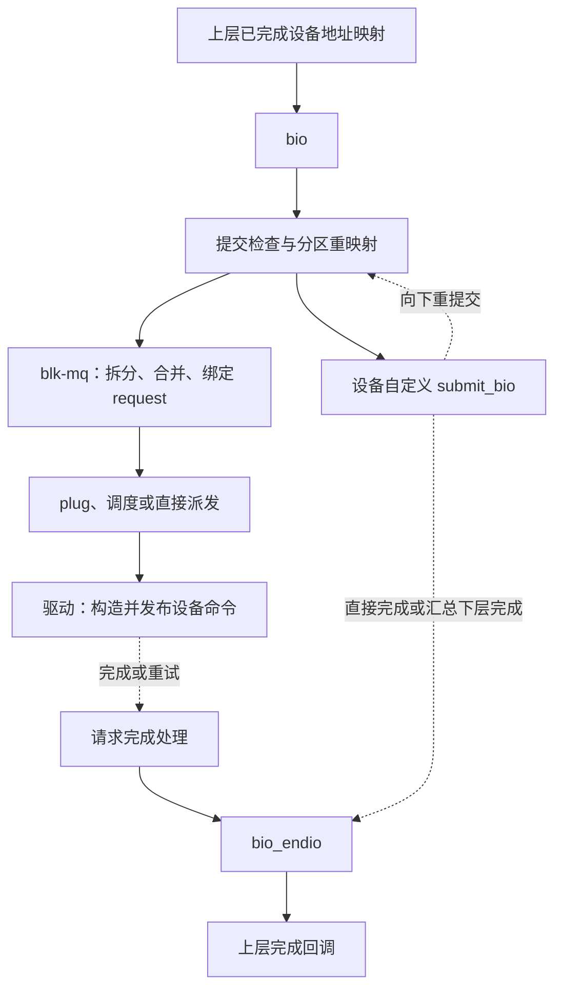

# 10.1 块设备层概览：对象、分层与 I/O 生命周期

> **本节源码**：[`block/blk-core.c`](../../linux/block/blk-core.c)、[`block/blk-mq.c`](../../linux/block/blk-mq.c)、[`block/bio.c`](../../linux/block/bio.c)、[`include/linux/blk_types.h`](../../linux/include/linux/blk_types.h)、[`include/linux/blkdev.h`](../../linux/include/linux/blkdev.h)、[`include/linux/blk-mq.h`](../../linux/include/linux/blk-mq.h)
> **关键函数**：`submit_bio()`、`blk_mq_submit_bio()`、`blk_mq_start_request()`、`blk_mq_end_request()`、`bio_endio()`
> **前置知识**：C 结构体与回调、[9.7 文件读写](../09-vfs/07-read-write.md)、[9.8 page cache](../09-vfs/08-page-cache.md)、[9.10 脏页写回与文件同步](../09-vfs/10-writeback.md)

## 概述

文件系统知道要访问哪些数据，却不应为每种存储设备分别实现队列、传输限制与错误处理。块设备层以 `bio` 接收设备范围和内存描述，再由多队列块层（Multi-Queue Block Layer，blk-mq）为请求型驱动组织 `request`。它既通过合并、批处理与并行提高效率，也在资源不足时施加背压（Backpressure），最后把完成状态传回上层。本节只建立对象、地址和生命周期的共同模型；具体机制由后续各节分别展开。

### 起点：文件地址已经转换为设备地址

`submit_bio()` 接收的是设置好目标设备、扇区和缓冲区的 `bio`，不是文件路径或文件偏移。接口契约见 [`block/blk-core.c:895-920`](../../linux/block/blk-core.c#L895-L920)。以 iomap 为例，文件映射到设备扇区的换算在进入块层之前完成，见 [`include/linux/iomap.h:104-122`](../../linux/include/linux/iomap.h#L104-L122)。

一次应用读写不一定产生一次块 I/O：缓冲读命中已就绪的 page cache 可以不访问设备；缓冲写通常先修改缓存，后续才写回。对应分支见 [`mm/filemap.c:2622-2680`](../../linux/mm/filemap.c#L2622-L2680)、[`mm/filemap.c:4244-4294`](../../linux/mm/filemap.c#L4244-L4294)。因此，应用读写次数不能直接当作块请求次数，`write()` 返回也不能直接当作持久化完成。

## 核心数据结构

### 设备对象与一次 I/O 的对象分开

| 对象 | 本章关注的字段 | 解决的问题 |
|---|---|---|
| `gendisk` | `part0`、`part_tbl`、`queue`、`fops` | 磁盘身份、整盘与分区、设备接口 |
| `block_device` | `bd_start_sect`、`bd_nr_sectors`、`bd_disk`、`bd_queue` | 本次访问针对哪个整盘或分区范围 |
| `request_queue` | `limits`、`mq_ops`、`queue_ctx`、`hctx_table`、`elevator` | 能力限制、驱动方法、多队列与策略入口 |
| `bio` | `bi_bdev`、`bi_opf`、`bi_iter`、`bi_io_vec`、`bi_end_io` | 访问哪里、内存在哪里、如何通知完成 |
| `request` | `bio`、`biotail`、`mq_ctx`、`mq_hctx`、`tag`、`internal_tag` | 怎样占用执行资源并交给驱动 |

定义分别见 [`include/linux/blkdev.h:143-164`](../../linux/include/linux/blkdev.h#L143-L164)、[`include/linux/blk_types.h:41-82`](../../linux/include/linux/blk_types.h#L41-L82)、[`include/linux/blkdev.h:469-552`](../../linux/include/linux/blkdev.h#L469-L552)、[`include/linux/blk_types.h:210-281`](../../linux/include/linux/blk_types.h#L210-L281)、[`include/linux/blk-mq.h:103-171`](../../linux/include/linux/blk-mq.h#L103-L171)。设备对象的建立与撤销见 [10.2](02-device-model.md)，I/O 对象的生命周期见 [10.3](03-bio.md) 和 [10.5](05-blk-mq.md)。

普通读写的 `bio` 描述一个连续设备范围和若干内存向量，不是数据副本。一个 `bio` 可以拆成多个部分，多个兼容的 `bio` 又可以合并到一个请求；这改变的是描述符关系，不要求复制数据。拆分与合并实例见 [`block/blk-merge.c:119-140`](../../linux/block/blk-merge.c#L119-L140)、[`block/blk-merge.c:935-964`](../../linux/block/blk-merge.c#L935-L964)。

### “队列”不是同一个对象

`request_queue` 是设备的块层管理入口；`blk_mq_ctx` 是面向提交 CPU 的软件上下文；`blk_mq_hw_ctx`（简称 `hctx`）是面向驱动队列的块层上下文。多个 CPU 可以映射到同一个 `hctx`，它本身也不是设备直接消费的命令环。结构与映射见 [`block/blk-mq.h:17-32`](../../linux/block/blk-mq.h#L17-L32)、[`block/blk-mq.h:78-113`](../../linux/block/blk-mq.h#L78-L113)、[`include/linux/blk-mq.h:317-424`](../../linux/include/linux/blk-mq.h#L317-L424)。

标签（Tag）是在相应标签集合内标识请求资源的编号，不是全局 I/O 序号。I/O 调度器（I/O Scheduler）则在驱动接收之前决定选择顺序或控制并发。它们分别在 [10.5](05-blk-mq.md) 和 [10.7](07-iosched.md) 展开；多队列、标签和调度器解决的是不同问题。

## 主流程分析

以下图示表示数据与控制的传递，不表示一条同步调用栈。

*图 10-1：块 I/O 的分层与完成回路；自定义提交路径不必在本层创建 `request`*

### 1. 提交返回，不等于操作完成

`submit_bio()` 处理上层记账并进入公共检查；`__submit_bio()` 根据设备接口选择 blk-mq 或自定义 `submit_bio()` 方法，见 [`block/blk-core.c:626-650`](../../linux/block/blk-core.c#L626-L650)、[`block/blk-core.c:780-920`](../../linux/block/blk-core.c#L780-L920)。堆叠设备可以改写目标后向下重提交，并非每一层都创建请求。

提交函数返回类型为 `void`。错误可能在检查阶段立即通过回调报告，设备 I/O 也可能稍后才完成；调用者不能因提交函数返回就复用数据页，更不能假定 `bio` 仍然存在。生命周期依赖 `bi_status` 和 `bi_end_io()` 协议，具体见 [10.3](03-bio.md)、[10.4](04-submit.md)。

### 2. 有请求对象，不等于驱动已经接收

`blk_mq_submit_bio()` 先满足设备限制、尝试合并，再为未合并的 `bio` 取得请求资源并绑定数据。随后可能进入 plug、调度器或直接派发，见 [`block/blk-mq.c:3136-3260`](../../linux/block/blk-mq.c#L3136-L3260)。因此要区分三种等待：**尚未取得请求资源、已有请求但未被驱动接收、驱动已经开始处理**。

`blk_mq_start_request()` 发出 issue 事件、启动超时并设置在途状态，是驱动声明开始处理的软件边界，见 [`block/blk-mq.c:1381-1406`](../../linux/block/blk-mq.c#L1381-L1406)。它不是设备实际开始访问介质的时间戳。请求分配和派发见 [10.5](05-blk-mq.md)～[10.7](07-iosched.md)，实际驱动对接见 [10.13](13-drivers.md)。

### 3. 请求结束，不等于普通写已经持久化

常见结束路径先用 `blk_update_request()` 推进 bio 的完成范围，再由 `__blk_mq_end_request()` 处理请求收尾；`bio_endio()` 还要协调拆分完成链，才通知原提交者。实现见 [`block/blk-mq.c:967-1080`](../../linux/block/blk-mq.c#L967-L1080)、[`block/blk-mq.c:1172-1195`](../../linux/block/blk-mq.c#L1172-L1195)、[`block/bio.c:1631-1677`](../../linux/block/bio.c#L1631-L1677)。

普通写完成可能只意味着数据进入设备易失缓存。持久化要结合 PREFLUSH / FUA 与文件系统同步协议解释，见 [`Documentation/block/writeback_cache_control.rst`](../../linux/Documentation/block/writeback_cache_control.rst)。字节完成、请求结束和持久化序列分别在 [10.8](08-completion.md)、[10.9](09-flush.md) 讨论，不能合成一个模糊的“完成时刻”。

## 关键细节 / 设计考量

### 地址同时具有单位和坐标原点

块层扇区（Sector）固定为 **512 字节**，由 `SECTOR_SHIFT = 9` 定义，见 [`include/linux/blk_types.h:25-36`](../../linux/include/linux/blk_types.h#L25-L36)。设备逻辑块大小（Logical Block Size）和物理块大小（Physical Block Size）保存在 `queue_limits`，并不改变这个单位，见 [`include/linux/blkdev.h:369-385`](../../linux/include/linux/blkdev.h#L369-L385)。

例如，设备逻辑块大小为 4096 字节，分区从整盘扇区 `2048` 开始。访问**分区内**字节偏移 4096、长度 4096 时，提交的 `bi_sector = 8`、`bi_size = 4096`；分区重映射后扇区变为 `2056`，字节长度不变。这是设备范围内的偏移，不能未经文件系统映射就替换成文件偏移。

重映射只调整扇区并设置 `BIO_REMAPPED`，不在这里把 `bi_bdev` 换成整盘对象，见 [`block/blk-core.c:577-591`](../../linux/block/blk-core.c#L577-L591)。后续比较两个事件时，必须同时确定设备身份、单位和重映射阶段。

### 一条业务操作不对应一条固定流水线

拆分、合并、堆叠、重试和 flush 序列都会改变对象数量或执行次数。范围操作甚至可以没有数据向量；zoned 写入又有普通读写以外的顺序约束。不能把本节的普通路径机械套用到所有操作，专题分别见 [10.10](10-range-ops.md)、[10.11](11-zoned.md)。资源控制的位置则见 [10.12](12-blkcg-qos.md)。

## 可观测性

本章以 `CONFIG_BLOCK=y`、`CONFIG_SMP=y` 为基线。事件接口依赖 `CONFIG_TRACEPOINTS=y`、`CONFIG_EVENT_TRACING=y`、`CONFIG_TRACING=y`，sysfs 依赖 `CONFIG_SYSFS=y`；取值见 [`linux/.config`](../../linux/.config)。

| 入口 | 先回答的问题 | 源码与限制 |
|---|---|---|
| `block:block_bio_queue` | 哪个设备范围进入内部提交路径？ | [`block/blk-core.c:725-739`](../../linux/block/blk-core.c#L725-L739)、[`include/trace/events/block.h:335-395`](../../linux/include/trace/events/block.h#L335-L395)；位于限速之后，不是应用入口 |
| `block:block_rq_issue` | 哪个请求开始一次驱动处理？ | [`include/trace/events/block.h:189-258`](../../linux/include/trace/events/block.h#L189-L258)；不是介质开始时间 |
| `block:block_rq_complete` | 哪一部分报告完成、是否出错？ | [`include/trace/events/block.h:116-172`](../../linux/include/trace/events/block.h#L116-L172)；可以是部分完成 |
| `/sys/block/<disk>/queue/logical_block_size`、`physical_block_size` | 对齐单位是什么？ | [`block/blk-sysfs.c:172-185`](../../linux/block/blk-sysfs.c#L172-L185)、[`block/blk-sysfs.c:551-552`](../../linux/block/blk-sysfs.c#L551-L552)；输出单位为字节 |

先看边界是否出现，再分析计数和时延。普通事件文本不提供通用的请求唯一身份，不能只用“设备号 + 扇区”匹配所有并发请求。各节给出机制专属入口，[10.14](14-observability.md) 统一说明统计口径和安全实验，不在此重复实验步骤。

## 小结

- 块层接收设备地址，不解释文件路径和文件偏移。
- 设备对象描述服务入口，`bio` 描述数据，`request` 增加队列、标签与执行资源管理。
- 提交返回、取得请求、驱动开始处理、请求结束和持久化是不同边界。
- 块层扇区固定为 512 字节；读地址还要确定分区或整盘坐标。
- 先确定对象、层次和生命周期阶段，再解释事件数、等待时间与完成顺序。

## 参考

- [`Documentation/block/blk-mq.rst`](../../linux/Documentation/block/blk-mq.rst)
- [`Documentation/block/biovecs.rst`](../../linux/Documentation/block/biovecs.rst)
- [`Documentation/block/writeback_cache_control.rst`](../../linux/Documentation/block/writeback_cache_control.rst)
