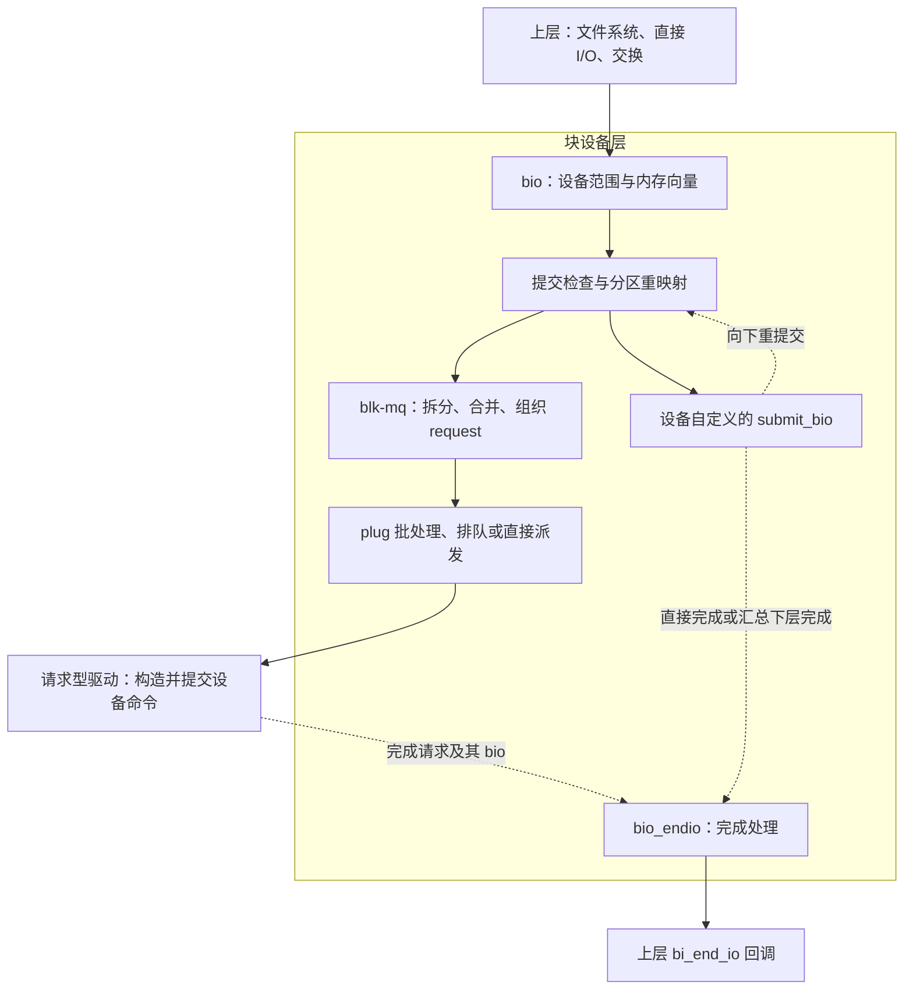

# 10.1 块设备层概览：对象、分层与 I/O 生命周期

> **本节源码**：[`block/blk-core.c`](../../linux/block/blk-core.c)、[`block/blk-mq.c`](../../linux/block/blk-mq.c)、[`block/bio.c`](../../linux/block/bio.c)、[`include/linux/blk_types.h`](../../linux/include/linux/blk_types.h)、[`include/linux/blkdev.h`](../../linux/include/linux/blkdev.h)、[`include/linux/blk-mq.h`](../../linux/include/linux/blk-mq.h)
> **关键函数**：`submit_bio()`、`blk_mq_submit_bio()`、`blk_mq_start_request()`、`blk_mq_end_request()`、`bio_endio()`
> **前置知识**：C 结构体与回调、[9.7 文件读写](../09-vfs/07-read-write.md)、[9.8 page cache](../09-vfs/08-page-cache.md)、[9.10 脏页写回与文件同步](../09-vfs/10-writeback.md)

## 概述

文件系统知道要访问哪些数据，却不应为每种存储设备分别实现队列、传输限制与错误处理。块设备层在二者之间提供统一接口：上层用 `bio` 描述设备范围和内存数据，请求型设备通过多队列块层（Multi-Queue Block Layer，blk-mq）将其组织成 `request`，再交给驱动。这个过程既要利用合并与并行提高效率，也要在资源不足时施加背压（Backpressure），并把完成状态传回上层。本节以 Linux v6.18.60、x86_64 为基准，先建立对象关系和生命周期边界；拆分、标签分配、调度算法与驱动协议留给后续小节。

### 职责边界：块层接收的不是文件偏移

`submit_bio()` 要求调用者传入已经设置好的 `bio`，其中包含目标 `block_device`、设备扇区和数据缓冲区，接口契约见 [`block/blk-core.c:895-920`](../../linux/block/blk-core.c#L895-L920)。因此，需要先区分三层职责：

| 层次 | 回答的问题 | 源码切入点 |
|---|---|---|
| 文件系统及其 I/O 辅助层 | 文件的这个偏移映射到哪个设备范围？是否需要访问存储？ | `iomap_sector()` 把已知文件映射换算为设备扇区，见 [`include/linux/iomap.h:104-122`](../../linux/include/linux/iomap.h#L104-L122) |
| 通用块层 | 这个范围是否有效？怎样满足设备限制并组织请求？ | `submit_bio_noacct()` 与 `blk_mq_submit_bio()`，见 [`block/blk-core.c:780-884`](../../linux/block/blk-core.c#L780-L884)、[`block/blk-mq.c:3136-3260`](../../linux/block/blk-mq.c#L3136-L3260) |
| 块设备驱动 | 怎样把请求编码为设备命令，提交给设备并处理结果？ | 例如 virtio-blk 的请求准备与提交，见 [`drivers/block/virtio_blk.c:404-463`](../../linux/drivers/block/virtio_blk.c#L404-L463) |

这不是每次系统调用都必须走完的流水线。缓冲读命中已就绪的 page cache 时，可以不产生设备 I/O；缓存查找与按需读取的分支见 [`mm/filemap.c:2622-2680`](../../linux/mm/filemap.c#L2622-L2680)。缓冲写则先修改缓存，由写回或同步路径组织设备访问，不能把 `write()` 返回直接解释为设备写入完成；缓存复制路径见 [`mm/filemap.c:4244-4294`](../../linux/mm/filemap.c#L4244-L4294)，写回过程见 [9.10](../09-vfs/10-writeback.md)。

## 核心数据结构

### 设备对象与一次 I/O 的对象分开

`gendisk`、`block_device` 和 `request_queue` 描述设备及其服务入口；`bio` 和 `request` 描述正在处理的 I/O。后者会在 I/O 路径中分配、关联和回收，不应与前者混为一谈。

| 对象 | 本节需要认识的字段 | 职责与定义 |
|---|---|---|
| `gendisk` | `part0` 指向整盘；`part_tbl` 组织分区；`queue` 指向队列；`fops` 指向设备操作 | 磁盘身份及其设备关系，不一定对应物理磁盘；[`include/linux/blkdev.h:143-164`](../../linux/include/linux/blkdev.h#L143-L164) |
| `block_device` | `bd_start_sect`、`bd_nr_sectors` 表示范围；`bd_disk`、`bd_queue` 关联磁盘和队列 | 表示整盘或某个分区；[`include/linux/blk_types.h:41-58`](../../linux/include/linux/blk_types.h#L41-L58) |
| `request_queue` | `limits` 保存设备限制；`mq_ops` 是请求型驱动接口；`queue_ctx`、`hctx_table` 组织多队列上下文；`elevator` 指向 I/O 调度器（I/O Scheduler） | 设备的块层限制与执行管理对象，不是单条待执行链表；[`include/linux/blkdev.h:469-522`](../../linux/include/linux/blkdev.h#L469-L522) |
| `bio` | `bi_bdev` 指定设备；`bi_opf` 指定操作与标志；`bi_iter` 记录当前范围；`bi_io_vec` 描述内存；`bi_status`、`bi_end_io` 传递完成结果 | 上层提交的数据描述；[`include/linux/blk_types.h:210-281`](../../linux/include/linux/blk_types.h#L210-L281) |
| `request` | `q`、`mq_ctx`、`mq_hctx` 关联队列；`bio`、`biotail` 串接数据描述；`tag`、`internal_tag` 保存标签；`state`、`timeout` 管理执行状态 | 请求型驱动处理的工作单元；[`include/linux/blk-mq.h:103-170`](../../linux/include/linux/blk-mq.h#L103-L170) |

标签（Tag）是在相应标签集合中标识请求的编号，不是全局 I/O 序号。两类标签的分配时机与资源约束见 [10.5](05-blk-mq.md)；此处只需知道：`request` 在数据描述之外，还携带执行与资源管理状态。

### `bio` 描述数据，不是数据副本

普通读写 `bio` 同时描述两个范围：设备上的连续范围，以及内存中的若干数据段。`bi_iter.bi_sector` 是当前设备扇区，`bi_iter.bi_size` 是剩余字节数；每个 `bio_vec` 通过 `bv_page`、`bv_offset`、`bv_len` 描述一段物理连续内存，多个向量之间不必连续。字段定义见 [`include/linux/bvec.h:19-32`](../../linux/include/linux/bvec.h#L19-L32)、[`include/linux/bvec.h:77-87`](../../linux/include/linux/bvec.h#L77-L87)。

把多个 `bio` 合并进一个 `request`，主要是在组织描述符，而不是把全部数据复制到一块新缓冲区。例如，在已有请求尾部合并 `bio` 时，通过 `req->biotail->bi_next = bio` 串接描述符并增加请求长度，见 [`block/blk-merge.c:935-964`](../../linux/block/blk-merge.c#L935-L964)。反过来，超过设备限制的 `bio` 也可能拆成多个部分分别提交，见 [`block/blk-merge.c:108-140`](../../linux/block/blk-merge.c#L108-L140)。

## 主流程分析

先看接口层次，再沿普通 blk-mq 路径跟踪一次读写。图中的箭头表示数据与控制的传递，不表示每个节点都在同一个调用栈中执行。



*图 10-1：块 I/O 的分层与完成回路；自定义提交路径不必在本层创建 `request`*

下面的调用链限定为**非堆叠设备、没有在检查中失败的普通读写**，提交侧省略派发细节，完成侧采用 `blk_mq_end_request()` 路径。完成通常由驱动另行触发，也可能在提交调用返回前发生；它不是提交函数同步执行的固定后半段。

[`block/blk-core.c:626-757`](../../linux/block/blk-core.c#L626-L757)、[`block/blk-core.c:780-920`](../../linux/block/blk-core.c#L780-L920)、[`block/blk-mq.c:3136-3260`](../../linux/block/blk-mq.c#L3136-L3260)、[`block/blk-mq.c:967-1080`](../../linux/block/blk-mq.c#L967-L1080)、[`block/blk-mq.c:1172-1195`](../../linux/block/blk-mq.c#L1172-L1195)、[`block/bio.c:1631-1676`](../../linux/block/bio.c#L1631-L1676)（v6.18.60）

```text
提交侧
submit_bio()                              block/blk-core.c
└── submit_bio_noacct()                    block/blk-core.c
    └── submit_bio_noacct_nocheck()        block/blk-core.c
        └── __submit_bio_noacct_mq()       block/blk-core.c
            └── __submit_bio()            block/blk-core.c
                └── blk_mq_submit_bio()   block/blk-mq.c
                    ├── 按设备限制拆分，尝试合并
                    ├── 使用缓存的 request 或分配新 request
                    └── plug / 排队 / 派发 → 驱动接口

完成侧（驱动报告结果；不与上面的调用栈连续）
blk_mq_end_request()                      block/blk-mq.c
├── blk_update_request()                  block/blk-mq.c
│   └── bio_endio()                       block/bio.c
│       └── bio->bi_end_io()              上层回调
└── __blk_mq_end_request()                block/blk-mq.c
```

### 1. 提交：检查范围，再选择设备接口

`submit_bio()` 完成上层提交的记账与 I/O 优先级初始化，然后进入 `submit_bio_noacct()`。后者检查访问范围和操作能力，对分区地址进行重映射，再进入内部提交路径。堆叠驱动向下重提交时使用 `submit_bio_noacct()`，避免重复上层记账；`noacct` 并不表示跳过所有统计与检查，见 [`block/blk-core.c:770-920`](../../linux/block/blk-core.c#L770-L920)。

真正的接口分流发生在 `__submit_bio()`：没有 `BD_HAS_SUBMIT_BIO` 标志时进入 blk-mq，否则调用磁盘的 `disk->fops->submit_bio()`，见 [`block/blk-core.c:626-650`](../../linux/block/blk-core.c#L626-L650)。因此，**块设备可以直接消费或重提交 `bio`，不要求每层都生成 `request`**。分区重映射和堆叠提交的完整流程见 [10.4](04-submit.md)。

### 2. 组织请求：满足限制，减少重复工作

`blk_mq_submit_bio()` 的普通路径按以下顺序推进，见 [`block/blk-mq.c:3136-3224`](../../linux/block/blk-mq.c#L3136-L3224)：

1. 取得队列使用引用，在其保护下检查逻辑块对齐和轮询支持。
2. 按设备限制拆分 `bio`，再尝试与已有请求合并；合并成功就不必为这次提交另建请求。
3. 无法合并时，使用先前取得的缓存请求或分配新请求，把 `bio` 关联到 `request`。

此时“已有请求对象”仍不等于“设备已经收到命令”。请求可以先进入当前任务的 `plug` 批次，之后再集中派发；`plug` 也会在数量、大小达到阈值或任务调度等条件下提前提交，不是无期限等待更多 I/O，见 [`block/blk-core.c:1148-1174`](../../linux/block/blk-core.c#L1148-L1174)。这部分分别在 [10.3](03-bio.md)、[10.5](05-blk-mq.md) 和 [10.6](06-merge-dispatch.md) 展开。

### 3. 派发：驱动接口不是硬件开始执行的时刻

请求可以经调度器或软件队列派发，也可以走直接派发路径。单请求驱动接口是 `mq_ops->queue_rq()`；驱动还可能提供 `queue_rqs()`，接收批量请求。两类入口见 [`block/blk-mq.c:2128-2165`](../../linux/block/blk-mq.c#L2128-L2165)、[`block/blk-mq.c:2902-2921`](../../linux/block/blk-mq.c#L2902-L2921)，不能假定所有请求都先进入同一条软件队列。

驱动调用 `blk_mq_start_request()`，通知块层开始跟踪请求执行：发出 issue 事件、设置超时并将状态置为 `MQ_RQ_IN_FLIGHT`，见 [`block/blk-mq.c:1373-1406`](../../linux/block/blk-mq.c#L1373-L1406)。这是软件协议边界，不是设备实际开始访问介质的精确时刻。例如 virtio-blk 在准备阶段调用它，随后才把请求加入设备队列，后续入队仍可能失败，见 [`drivers/block/virtio_blk.c:404-463`](../../linux/drivers/block/virtio_blk.c#L404-L463)。驱动衔接见 [10.11](11-drivers.md)。

### 4. 完成：先推进数据范围，再结束请求生命周期

在所示路径中，`blk_mq_end_request()` 用请求剩余的全部字节调用 `blk_update_request()`。后者推进 `bio` 的迭代器、记录错误，并对完成的普通 `bio` 调用 `bio_endio()`；之后 `__blk_mq_end_request()` 处理请求记账、请求级回调和资源释放。实现见 [`block/blk-mq.c:967-1080`](../../linux/block/blk-mq.c#L967-L1080)、[`block/blk-mq.c:1172-1195`](../../linux/block/blk-mq.c#L1172-L1195)。

`bio_endio()` 还负责拆分完成链等协调，不一定每调用一次就立即执行 `bi_end_io()`。上层回调只应在其对应的数据处理完成后运行，见 [`block/bio.c:1618-1676`](../../linux/block/bio.c#L1618-L1676)。部分完成、批量完成、完成 CPU 与超时路径见 [10.8](08-completion.md)。

提交者必须遵守回调协议，而不是依赖函数返回：`submit_bio()` 返回类型是 `void`，状态经 `bi_status` 和 `bi_end_io()` 传递；检查失败时可能在返回前就完成，正常设备 I/O 也可能在返回后才完成。调用者在完成前不得重新操作该 `bio`，更不能仅因提交函数返回就复用数据缓冲区；回调可能已经回收描述符，也不能假定返回后它仍存在。接口契约及立即完成的错误分支见 [`block/blk-core.c:879-920`](../../linux/block/blk-core.c#L879-L920)。

## 关键细节 / 设计考量

### 地址要同时标明单位与坐标原点

块层的扇区（Sector）固定为 **512 字节**，由 `SECTOR_SHIFT = 9` 定义，见 [`include/linux/blk_types.h:25-36`](../../linux/include/linux/blk_types.h#L25-L36)。它不是设备逻辑块大小（Logical Block Size），也不是物理块大小（Physical Block Size）：后两者保存在 `queue_limits`，见 [`include/linux/blkdev.h:369-385`](../../linux/include/linux/blkdev.h#L369-L385)。

| 数量 | 单位 | 解读 |
|---|---|---|
| `bi_iter.bi_sector` | 512 字节扇区 | 当前设备地址；分区重映射前后坐标原点会变化 |
| `bi_iter.bi_size` | 字节 | 当前剩余长度，不是扇区数 |
| `bd_start_sect`、`bd_nr_sectors` | 512 字节扇区 | 分区在整盘中的起点、块设备容量 |
| `limits.logical_block_size` | 字节 | 普通读写起始位置与长度的基本对齐单位 |
| `limits.physical_block_size` | 字节 | 设备报告的物理块粒度，不改变块层扇区单位 |

例如，设备逻辑块大小为 4096 字节，某分区从整盘扇区 `2048` 开始。上层要访问**分区内**字节偏移 4096、长度 4096 的范围，则提交时 `bi_sector = 8`、`bi_size = 4096`；分区重映射后 `bi_sector = 2048 + 8 = 2056`，长度仍为 4096 字节。这里的 4096 是设备范围内的偏移，不能未经文件系统映射就替换成文件偏移。

重映射只调整扇区并设置 `BIO_REMAPPED`，并不在这里把 `bi_bdev` 改成整盘对象，见 [`block/blk-core.c:577-591`](../../linux/block/blk-core.c#L577-L591)。普通 blk-mq 路径按逻辑块大小检查地址与长度对齐，见 [`block/blk-mq.c:3112-3121`](../../linux/block/blk-mq.c#L3112-L3121)。

### 多队列不等于每个 CPU 独占一条硬件队列

本章以 `CONFIG_BLOCK=y`、`CONFIG_SMP=y` 为基线，取值见 [`linux/.config`](../../linux/.config)。blk-mq 将面向提交 CPU 的状态与面向驱动队列的状态分开，但“队列”在各层并不指同一对象：

| 对象 | 含义 | 源码 |
|---|---|---|
| `request_queue` | 整体限制、策略和多队列入口 | [`include/linux/blkdev.h:469-522`](../../linux/include/linux/blkdev.h#L469-L522) |
| `blk_mq_ctx` | 面向提交 CPU 的软件上下文，包含请求链表和硬件上下文映射 | [`block/blk-mq.h:17-32`](../../linux/block/blk-mq.h#L17-L32) |
| `blk_mq_hw_ctx` | 面向驱动队列的块层上下文，包含派发链表、标签及关联的软件上下文 | [`include/linux/blk-mq.h:317-424`](../../linux/include/linux/blk-mq.h#L317-L424) |

多个 CPU 可以映射到同一个硬件上下文，操作类型也会参与选择，映射接口见 [`block/blk-mq.h:78-113`](../../linux/block/blk-mq.h#L78-L113)。`blk_mq_hw_ctx` 本身不是设备直接消费的命令环；驱动如何使用设备侧队列，仍由驱动协议决定。

并行化也没有取消资源限制。普通可等待的标签分配在资源不足时可能睡眠，见 [`block/blk-mq-tag.c:137-212`](../../linux/block/blk-mq-tag.c#L137-L212)；驱动暂时无法接收请求时，块层可以保留请求并等待重新派发，见 [`block/blk-mq.c:2160-2202`](../../linux/block/blk-mq.c#L2160-L2202)。分析时应区分“尚未分配请求”“已有请求但未派发”和“驱动已开始处理”三个阶段。

### 请求计数、完成顺序与持久化分别解释

一次应用读写可以不产生块 I/O，也可以产生多个 `bio`；多个 `bio` 可以合并成请求，一个 `bio` 也可能被拆分。堆叠设备还会增加提交层次。因此，**系统调用数、`bio` 数、请求数与设备命令数不能直接画等号**；统计前必须先确定观察的是哪一层。

设备完成也不保证与提交顺序一致，blk-mq 文档对此有明确说明，见 [`Documentation/block/blk-mq.rst`](../../linux/Documentation/block/blk-mq.rst)。尤其对带易失写缓存的设备，普通写完成可能只表示数据已进入设备缓存，而不是已经达到非易失存储。持久化需要结合 `REQ_PREFLUSH`、`REQ_FUA` 与文件系统同步协议解释，见 [`Documentation/block/writeback_cache_control.rst`](../../linux/Documentation/block/writeback_cache_control.rst) 和 [10.9](09-flush-discard.md)。

## 可观测性

概览阶段先把观测入口对齐到上述边界，不急于计算一个笼统的“I/O 时延”。下表中的事件接口依赖 `CONFIG_TRACEPOINTS=y`、`CONFIG_EVENT_TRACING=y`、`CONFIG_TRACING=y`；sysfs 依赖 `CONFIG_SYSFS=y`，均已按 [`linux/.config`](../../linux/.config) 核对。

| 入口 | 看什么 | 对应源码与解释 |
|---|---|---|
| `block:block_bio_queue` | `dev`、`sector`、`nr_sector`、`rwbs`：当前设备、范围与操作 | 事件字段及定义见 [`include/trace/events/block.h:335-393`](../../linux/include/trace/events/block.h#L335-L393)，触发点见 [`block/blk-core.c:728-739`](../../linux/block/blk-core.c#L728-L739)；它不等于应用刚进入 `read()` / `write()` |
| `block:block_rq_issue` | 请求进入驱动开始处理的块层边界 | 定义见 [`include/trace/events/block.h:189-257`](../../linux/include/trace/events/block.h#L189-L257)，触发于 `blk_mq_start_request()`，见 [`block/blk-mq.c:1381-1406`](../../linux/block/blk-mq.c#L1381-L1406)；不是设备开始访问介质的时间戳 |
| `block:block_rq_complete` | 完成范围与 `error`；`nr_sector` 由本次完成字节数换算 | 定义见 [`include/trace/events/block.h:116-172`](../../linux/include/trace/events/block.h#L116-L172)，触发于 `blk_update_request()` 等路径，见 [`block/blk-mq.c:967-975`](../../linux/block/blk-mq.c#L967-L975)；可能只是部分完成，不能把事件次数直接当作完整请求数 |
| `/sys/block/<disk>/queue/logical_block_size`、`physical_block_size` | 设备报告的两种块大小，单位为字节 | 显示函数由宏读取对应的 `limits` 字段，见 [`block/blk-sysfs.c:172-185`](../../linux/block/blk-sysfs.c#L172-L185)，属性登记见 [`block/blk-sysfs.c:551-552`](../../linux/block/blk-sysfs.c#L551-L552) |

这些事件不是天然的一一配对记录：拆分、合并、重提交与部分完成会改变对应关系；事件中的 `comm` 也只是触发该事件时的当前任务，不一定是最初发起应用写入的任务。不要仅用“设备号 + 扇区”把任意 issue 与 complete 相减后就当作可靠时延。完整的事件关联、统计口径和安全实验见 [10.12](12-observability.md)。

## 小结

- 文件系统先解释文件地址；块层接收的是带目标设备和设备范围的 `bio`。
- 设备对象描述服务入口，`bio` 描述数据，`request` 增加队列、标签与执行状态。
- 普通 blk-mq 路径经历检查、拆分与合并、请求组织、派发和完成；自定义提交路径不必在本层创建请求。
- `submit_bio()` 返回、驱动开始处理、I/O 完成和数据持久化是不同边界，生命周期由完成协议管理。
- 块层扇区固定为 512 字节；解释地址时还要明确分区或整盘坐标，不能只看数值。
- 多队列不消除排队与背压；观测前先确定对象、层次和生命周期阶段，再解释次数与时延。

## 参考

- [`Documentation/block/blk-mq.rst`](../../linux/Documentation/block/blk-mq.rst)
- [`Documentation/block/biovecs.rst`](../../linux/Documentation/block/biovecs.rst)
- [`Documentation/block/writeback_cache_control.rst`](../../linux/Documentation/block/writeback_cache_control.rst)
- [`Documentation/ABI/stable/sysfs-block`](../../linux/Documentation/ABI/stable/sysfs-block)
