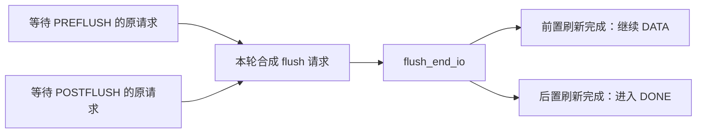

# 10.9 写入持久化：缓存刷新、FUA 与 flush 序列

> **本节源码**：[`block/blk-flush.c`](../../linux/block/blk-flush.c)、[`block/blk-mq.c`](../../linux/block/blk-mq.c)、[`block/blk-core.c`](../../linux/block/blk-core.c)、[`block/blk.h`](../../linux/block/blk.h)
> **关键函数**：`blk_insert_flush()`、`blk_flush_complete_seq()`、`blk_kick_flush()`、`mq_flush_data_end_io()`、`blkdev_issue_flush()`
> **前置知识**：[10.3 bio 完成链](03-bio.md)、[10.6 请求派发](06-merge-dispatch.md)、[10.8 请求完成](08-completion.md)、[9.10 文件同步](../09-vfs/10-writeback.md)

## 概述

普通写请求完成时，数据可能仍在设备的易失缓存中。缓存刷新（Cache Flush）与强制单元访问（Force Unit Access，FUA）分别约束先前写入和本次写入的持久化，不能用普通完成回调替代。通用块层依据设备的缓存与 FUA 能力，把上层要求翻译为前置刷新、数据和后置刷新阶段。本节只讨论持久化序列；范围丢弃与清零见 [10.10](10-range-ops.md)，zone 写入约束见 [10.11](11-zoned.md)。

## 核心数据结构

### 1. 两个标志与一个请求操作码

| 标志 / 操作 | 含义 | 不代表什么 |
|---|---|---|
| `REQ_PREFLUSH` | 数据操作之前，保证先前已完成写入的易失缓存内容达到非易失存储 | 不自动保证本次数据在写完成时持久化 |
| `REQ_FUA` | 本次数据必须达到非易失存储后才能报告完成 | 不替代对先前其他写入的刷新 |
| `REQ_OP_FLUSH` | flush 状态机合成的请求级操作 | 不是可以直接交给 `submit_bio()` 的普通 bio 操作 |

契约见 [`Documentation/block/writeback_cache_control.rst`](../../linux/Documentation/block/writeback_cache_control.rst)；bio 提交路径明确拒绝直接提交 `REQ_OP_FLUSH`，见 [`block/blk-core.c:833-839`](../../linux/block/blk-core.c#L833-L839)。`REQ_SYNC` 是请求分类提示，也不能替代上述持久化要求。

### 2. 原请求与合成 flush 请求

`blk_flush_queue` 保存 `flush_queue[2]`、`flush_pending_idx`、`flush_running_idx`、`flush_data_in_flight` 和专用 `flush_rq`，见 [`block/blk.h:34-44`](../../linux/block/blk.h#L34-L44)。两个链表分别组织等待刷新和正在刷新所覆盖的原请求，不能理解为两个硬件命令环。

原请求的 `flush.seq` 是**已经完成或可以跳过的阶段位图**；`flush.saved_end_io` 保存原完成方法，`RQF_FLUSH_SEQ` 表示它正在执行序列。阶段定义见 [`block/blk-flush.c:79-94`](../../linux/block/blk-flush.c#L79-L94)，初始化见 [`block/blk-flush.c:370-376`](../../linux/block/blk-flush.c#L370-L376)。合成的 `flush_rq` 与携带数据的原请求不是同一个工作单元。

## 主流程分析

以下树状图分开列出初始提交与异步阶段完成，不能按一次同步调用阅读。

[`block/blk-flush.c:148-253`](../../linux/block/blk-flush.c#L148-L253)、[`block/blk-flush.c:275-461`](../../linux/block/blk-flush.c#L275-L461)、[`block/blk-mq.c:3235-3236`](../../linux/block/blk-mq.c#L3235-L3236)（v6.18.60）

```text
初始提交
blk_mq_submit_bio()                       block/blk-mq.c
└── blk_insert_flush()                    block/blk-flush.c
    ├── 决定阶段、调整标志与完成方法
    └── blk_flush_complete_seq()          block/blk-flush.c
        └── blk_kick_flush()              block/blk-flush.c
异步阶段完成
├── flush_end_io()                       block/blk-flush.c
│   └── 推进本次 flush 覆盖的所有原请求
└── mq_flush_data_end_io()                block/blk-flush.c
    └── 推进原请求的数据阶段
共同推进点：blk_flush_complete_seq()
├── PREFLUSH / POSTFLUSH：进入等待刷新链表
├── DATA：进入 requeue_list，重新派发
└── DONE：恢复原请求 → blk_mq_end_request()
```

### 1. bio 层先过滤不需要的要求

若设备未声明易失写缓存，公共提交路径清除 PREFLUSH / FUA；对无数据的空刷新，可以直接报告成功，见 [`block/blk-core.c:806-821`](../../linux/block/blk-core.c#L806-L821)。这是依据设备能力消除不必要工作，而不是证明发生过真实的刷新命令。

纯刷新的助手使用 WRITE 操作加 PREFLUSH 标志：

[`block/blk-flush.c:468-474`](../../linux/block/blk-flush.c#L468-L474)（v6.18.60）

```c
int blkdev_issue_flush(struct block_device *bdev)
{
	struct bio bio;

	bio_init(&bio, bdev, NULL, 0, REQ_OP_WRITE | REQ_PREFLUSH);
	return submit_bio_wait(&bio);
}
```

### 2. 在请求层选择所需阶段

`blk_insert_flush()` 先按数据长度选 DATA，再按写缓存与原生 FUA 能力选前后刷新，见 [`block/blk-flush.c:382-419`](../../linux/block/blk-flush.c#L382-L419)。对**带数据的 PREFLUSH + FUA 写**，策略如下：

| 设备声明 | 执行策略 |
|---|---|
| 无易失写缓存 | DATA；通常已在 bio 层清除刷新要求 |
| 有写缓存，支持原生 FUA | PREFLUSH → 带 FUA 的 DATA |
| 有写缓存，不支持原生 FUA | PREFLUSH → DATA → POSTFLUSH |

原生 FUA 省掉的是模拟本次持久化所需的后置刷新，不是无条件省掉前置刷新。若只有 FUA 且不支持原生 FUA，则直接开始 DATA，再通过完成方法进入 POSTFLUSH。

`blk_insert_flush()` 返回 `true` 表示已消费请求；返回 `false` 表示调用者继续普通派发，**不保证请求没有序列状态**。DATA + POSTFLUSH 分支会先安装序列完成方法再返回 `false`，见 [`block/blk-flush.c:421-460`](../../linux/block/blk-flush.c#L421-L460)。仅凭返回值判断“是否需要后置刷新”会漏掉这个分支。

### 3. 多个原请求可以共享一次刷新

`blk_flush_complete_seq()` 记录刚完成的阶段，然后寻找下一个未完成阶段；出错则转入 DONE。需要刷新时先排入 pending 链表，由 `blk_kick_flush()` 决定何时发出合成请求，见 [`block/blk-flush.c:148-198`](../../linux/block/blk-flush.c#L148-L198)。



*图 10-3：同一个 flush 队列中，一轮设备刷新可以推进多个原请求的不同阶段*

同一 `blk_flush_queue` 同时只允许一轮刷新在途。仍有 DATA 执行时可推迟下一轮，以便合并后置刷新；等待超过 `FLUSH_PENDING_TIMEOUT` 时不再因 DATA 在途而继续推迟。条件见 [`block/blk-flush.c:275-297`](../../linux/block/blk-flush.c#L275-L297)。这是刷新聚合策略，不是保证设备在该超时时间内完成。

无调度器时，合成 flush 借用一个等待原请求的驱动标签，因为这两个工作单元不会同时执行；有调度器时借用其内部标签，再按派发协议取得驱动标签，见 [`block/blk-flush.c:301-336`](../../linux/block/blk-flush.c#L301-L336)。因此，不能把单个标签在序列中出现的每次 issue 都当成新的独立上层写入。

### 4. 数据完成时必须延后上层通知

数据阶段到达 `blk_update_request()` 后会消耗 bio 范围，但 `RQF_FLUSH_SEQ` 阻止立即调用 `bio_endio()`，见 [`block/blk-mq.c:1018-1033`](../../linux/block/blk-mq.c#L1018-L1033)。请求级 `mq_flush_data_end_io()` 再推进 DATA 阶段，且返回 `RQ_END_IO_NONE`，不让通用路径回收原请求，见 [`block/blk-flush.c:339-368`](../../linux/block/blk-flush.c#L339-L368)。

到达 DONE 时，`blk_flush_restore_request()` 从 `biotail` 恢复原 bio，清除序列标志并恢复原完成方法，随后重新进入正常请求结束路径，见 [`block/blk-flush.c:112-126`](../../linux/block/blk-flush.c#L112-L126)、[`block/blk-flush.c:182-192`](../../linux/block/blk-flush.c#L182-L192)。这次才允许通知上层。所谓“完成两次”是数据推进与完整语义结束两个阶段，不是对上层回调重复通知。

## 关键细节 / 设计考量

- **块层持久化不等于完整文件系统事务。** 文件系统还要组织数据、元数据、日志与恢复顺序；本节只解释已编码进 bio 的设备要求。
- **序列错误会结束，而不会无条件继续后续阶段。** `blk_flush_complete_seq()` 的错误分支直接转向 DONE，并把错误传回上层。
- **设备能力声明必须可信。** 虚拟化后端也必须兑现 flush / FUA 语义；不能通过把 `write_cache` 谎报为无缓存来“优化”生产负载。
- **不要用本章 `null_blk` 定时完成实验验证掉电安全。** 它可以验证软件路径，但没有提供断电后数据恢复的证明。

## 可观测性

sysfs 依赖 `CONFIG_SYSFS=y`；事件依赖 `CONFIG_TRACEPOINTS=y`、`CONFIG_EVENT_TRACING=y`、`CONFIG_TRACING=y`，取值见 [`linux/.config`](../../linux/.config)。

| 入口 | 看什么 | 源码与解释 |
|---|---|---|
| `/sys/block/<disk>/queue/write_cache`、`fua` | 队列声明的缓存与 FUA 能力 | [`block/blk-sysfs.c:588-589`](../../linux/block/blk-sysfs.c#L588-L589)；不是实时缓存占用量 |
| `block:block_rq_issue`、`block:block_rq_complete` | 数据与 flush 请求的操作、长度和结果 | [`include/trace/events/block.h:118-258`](../../linux/include/trace/events/block.h#L118-L258)；原请求可有多个阶段，刷新又可共享 |
| 整盘 `stat` 第 16～17 项 | flush 请求完成数与累计时间 | `blk_account_io_flush()`，[`block/blk-flush.c:128-138`](../../linux/block/blk-flush.c#L128-L138)；不等于 PREFLUSH / FUA bio 数 |
| `blk_insert_flush()` 动态探针 | 原请求标志、设备能力与是否被状态机接管 | [`block/blk-flush.c:382-461`](../../linux/block/blk-flush.c#L382-L461)；入口 / 返回值须结合上述 DATA + POSTFLUSH 分支解释 |

动态探针依赖本配置的 `CONFIG_KPROBES=y`、`CONFIG_KPROBE_EVENTS=y`，且须核对运行内核实际可挂载符号。仅观察写请求的第一条完成事件，不能证明整条持久化序列结束。

## 小结

- PREFLUSH 约束先前写入，FUA 约束本次数据达到非易失存储的时刻。
- 通用状态机根据设备能力组合 PREFLUSH、DATA、POSTFLUSH；无需求的阶段被跳过。
- 返回普通派发路径的请求，也可能已经安装后置刷新的完成方法。
- 合成 flush 可由多个原请求共享，其标签和事件不能按上层写入一一计数。
- 数据完成与上层通知分开，必要刷新完成或序列出错后才最终结束。

## 参考

- [`Documentation/block/writeback_cache_control.rst`](../../linux/Documentation/block/writeback_cache_control.rst)
- [`block/blk-flush.c`](../../linux/block/blk-flush.c)
- [`Documentation/ABI/stable/sysfs-block`](../../linux/Documentation/ABI/stable/sysfs-block)
