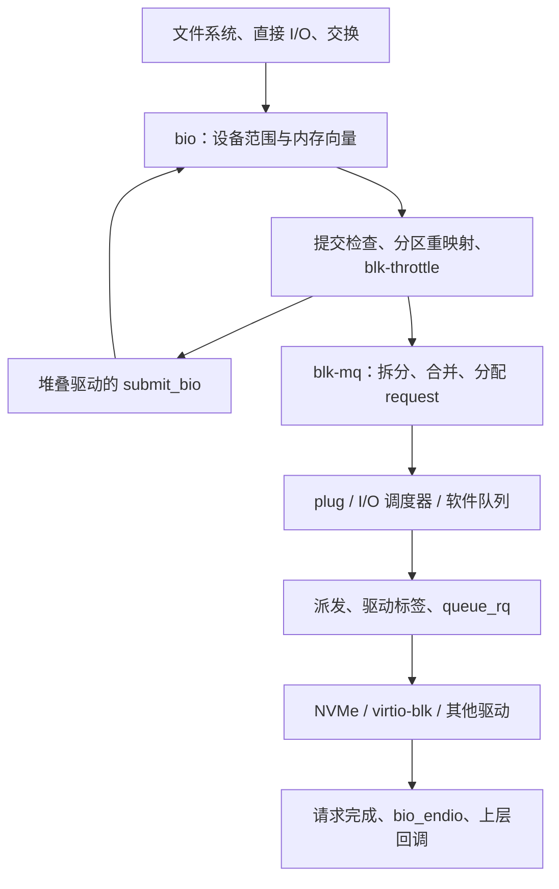

# 第 10 章 块设备层

本章以 Linux v6.18.60、x86_64 为基准，分析块设备层如何把上层的 `bio` 组织成设备可执行的请求，并把完成与错误传回提交者。阅读主线是：**设备与地址 → 数据描述 → 提交检查 → 请求分配 → 合并和调度 → 驱动 → 完成**，持久化语义与资源控制贯穿其中。

这里的“队列”不都是硬件环：`request_queue` 是设备的块层入口，`blk_mq_ctx` 是面向提交 CPU 的软件上下文，`blk_mq_hw_ctx` 是面向驱动队列的块层上下文；NVMe 的提交队列与 virtio 的描述符环还在驱动一侧。理解这些边界，比记住某条调用链更重要。

*图 10-0：块 I/O 的提交与完成主线，省略错误分支及旁路优化*

## 阅读建议

- 先读 10.1，区分设备对象与 I/O 对象，建立提交、派发、完成和持久化的边界；再读 10.2～10.4，展开设备模型、数据描述和提交路径。第 9 章的文件读写与 page cache 提供上层背景，但不影响独立阅读本章。
- 10.5～10.8 是请求路径的核心。对性能问题，先区分“等待分配标签”“等待派发”“驱动已经接收但未完成”三个阶段。
- 10.9 讨论完成与持久化的区别，以及 discard 和分区存储设备的操作边界。
- 10.10 讨论块 I/O 控制组（Block I/O Cgroup，blkcg）与服务质量（Quality of Service，QoS）；它们与 I/O 调度器不是同一个机制。
- 10.11 用 NVMe PCI 与 virtio-blk 对照驱动接口；10.12 汇总观测方法并给出只针对 `null_blk` 的实验。
- 本章涉及的软中断、工作队列、定时器、引用计数与 RCU，可分别对照第 5、7、8 章。

## 本章配置

取值已核对仓库的 [`linux/.config`](../../linux/.config)。编译启用并不等于运行时生效：模块要加载，设备能力要协商，cgroup 控制器要启用。

| 配置 | 取值 | 本章含义 |
|---|---|---|
| `CONFIG_BLOCK` / `CONFIG_SMP` | y / y | 块层与多处理器基线 |
| `CONFIG_MQ_IOSCHED_DEADLINE` | y | 内置 mq-deadline |
| `CONFIG_MQ_IOSCHED_KYBER` / `CONFIG_IOSCHED_BFQ` | m / m | Kyber 与 BFQ 为模块 |
| `CONFIG_BFQ_GROUP_IOSCHED` | y | BFQ 组调度支持 |
| `CONFIG_BLK_CGROUP` / `CONFIG_CGROUP_WRITEBACK` | y / y | blkcg 与回写归属支持 |
| `CONFIG_BLK_DEV_THROTTLING` | y | `io.max` 限速策略 |
| `CONFIG_BLK_WBT` / `CONFIG_BLK_WBT_MQ` | y / y | 回写节流支持 |
| `CONFIG_BLK_CGROUP_IOCOST` | y | I/O 成本控制器 |
| `CONFIG_BLK_CGROUP_IOLATENCY` | n | 本配置不提供 `io.latency` 策略 |
| `CONFIG_BLK_DEV_ZONED` | y | 分区存储设备支持 |
| `CONFIG_BLK_RQ_ALLOC_TIME` | y | 支持记录请求分配起始时间，仍受队列运行时设置控制 |
| `CONFIG_BLK_DEV_NULL_BLK` | m | 实验设备 `null_blk` |
| `CONFIG_VIRTIO_BLK` | y | virtio-blk 驱动 |
| `CONFIG_BLK_DEV_NVME` / `CONFIG_NVME_CORE` | m / m | NVMe PCI 与公共核心 |
| `CONFIG_NVME_MULTIPATH` | y | NVMe 多路径支持；10.11 以单路径为主 |
| `CONFIG_TRACEPOINTS` / `CONFIG_TRACING` / `CONFIG_BLK_DEV_IO_TRACE` | y / y / y | 块事件与 blktrace 支持 |
| `CONFIG_BLK_DEBUG_FS` / `CONFIG_DEBUG_FS` | y / y | 队列内部状态的 debugfs 入口 |
| `CONFIG_SYSFS` / `CONFIG_PROC_FS` | y / y | 队列属性、设备统计 |
| `CONFIG_KPROBES` / `CONFIG_KPROBE_EVENTS` | y / y | 动态函数探针，实际可挂载性须运行时确认 |

## 小节索引

| 小节 | 内容 |
|---|---|
| [10.1 块设备层概览：对象、分层与 I/O 生命周期](01-overview.md) | 职责边界、对象关系、提交与完成、地址口径及最小观测入口 |
| [10.2 设备模型](02-device-model.md) | 磁盘、分区、队列及注册与退出 |
| [10.3 bio](03-bio.md) | 向量、迭代器、内存池、拆分和完成链 |
| [10.4 提交路径](04-submit.md) | 检查、重映射、递归转迭代 |
| [10.5 blk-mq](05-blk-mq.md) | 软件 / 硬件上下文、队列映射与两类标签 |
| [10.6 合并与派发](06-merge-dispatch.md) | plug、合并条件、背压与重启 |
| [10.7 I/O 调度器](07-iosched.md) | mq-deadline、Kyber、BFQ 与 `none` |
| [10.8 完成、超时与轮询](08-completion.md) | 部分完成、完成 CPU、超时工作与轮询 |
| [10.9 持久化与空间操作](09-flush-discard.md) | flush / FUA、discard、清零及 zone 写入约束 |
| [10.10 blkcg 与 QoS](10-blkcg-qos.md) | 归属、限速、WBT、IOCost 与计数口径 |
| [10.11 驱动衔接](11-drivers.md) | NVMe PCI 与 virtio-blk 的命令和完成路径 |
| [10.12 可观测性与实验](12-observability.md) | 事件、统计、时延分段与 `null_blk` |

## 范围与待完善

- 本章覆盖通用块层与两种代表性驱动的主路径；不展开 SCSI 错误恢复、设备映射器各 target、MD RAID、完整的 NVMe 多路径与 fabrics 协议。
- BFQ 与 IOCost 给出数据模型、控制目标及主要入口，不逐行推导其全部调度或反馈算法。
- zone 写入约束已纳入 10.9；原子写、端到端数据完整性、内联加密只标明主路径位置，不作为完整专题。
- [ ] 10.12 的命令已按源码与参数定义核对，但尚未在 `dev` 虚拟机中运行；后续补充内核版本、vCPU 数、队列配置和真实输出，不以推测输出代替测量。
- [ ] Mermaid 图尚需在最终出版渲染器中检查布局。

## 参考

- [`Documentation/block/blk-mq.rst`](../../linux/Documentation/block/blk-mq.rst)
- [`Documentation/block/biovecs.rst`](../../linux/Documentation/block/biovecs.rst)
- [`Documentation/block/writeback_cache_control.rst`](../../linux/Documentation/block/writeback_cache_control.rst)
- [`Documentation/admin-guide/cgroup-v2.rst`](../../linux/Documentation/admin-guide/cgroup-v2.rst)
