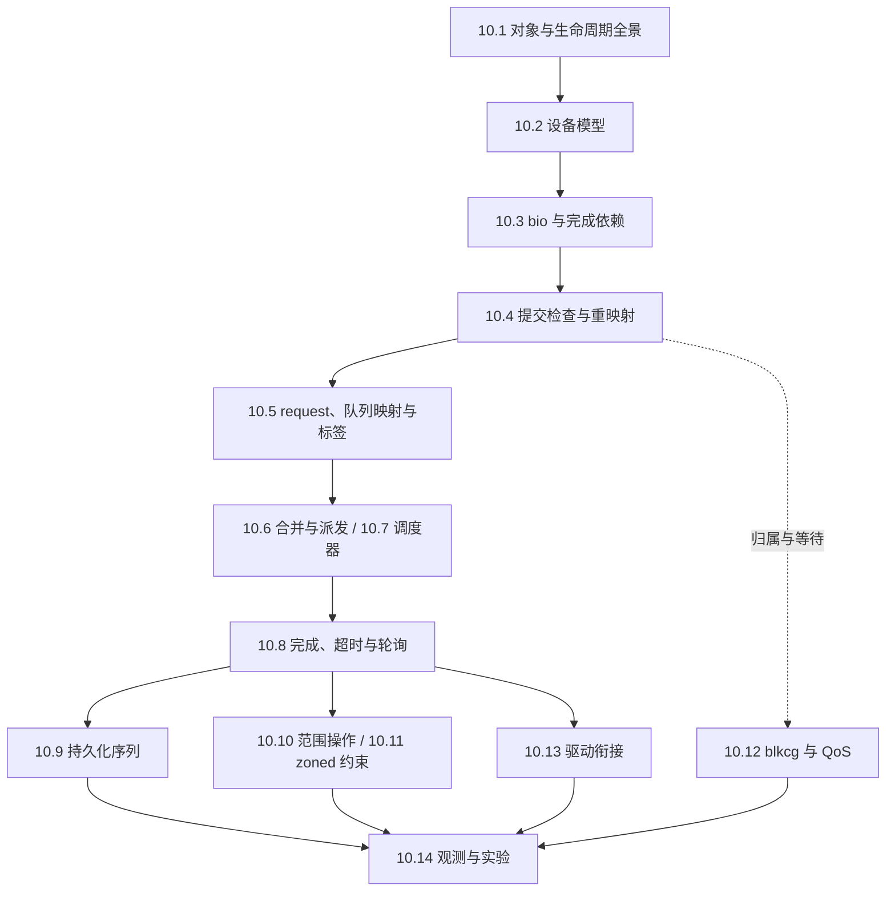

# 第 10 章 块设备层

本章以 Linux v6.18.60、x86_64 为基准，沿 **设备对象 → bio → 提交检查 → request 与标签 → 合并和派发 → 完成** 分析通用块层，再分别讨论持久化、范围操作、zoned 写入约束与资源控制。最后用 NVMe PCI、virtio-blk 对照驱动接口，以只读 `null_blk` 实验连接源码与运行时观测。

全章围绕三个问题展开：**数据范围如何描述，执行资源由谁持有，完成结果在什么边界传回上层**。`submit_bio()` 返回、请求分配成功、驱动接收、字节完成、请求资源归还和数据持久化不是同一时刻；“队列”也不总是设备命令环。先建立这些边界，再看各个优化分支。

## 阅读路线与章节分工

*图 10-0：章节依赖与阅读路线；这是学习顺序，不是每条 I/O 必经的执行路径*

- **第一次阅读**：先读 10.1～10.8，走通普通读写的对象与资源生命周期；再读 10.13，用具体驱动验证 `queue_rq()` 和完成回调的边界。
- **持久化与特殊操作**：10.9 只讨论 flush / FUA；10.10 区分 discard、清零和安全擦除；10.11 独立讨论 zone、append 与顺序写入。三者不能统一解释成“另一种普通写”。
- **性能与隔离**：结合 10.5～10.7、10.12 和 10.14，区分请求分配前等待、派发等待与驱动处理后的时间，先确定计数口径，再做时延统计。
- **上层背景**：第 9 章解释文件读写、page cache 和回写。本章从已经映射好的设备范围开始，不重复文件地址映射；软中断、工作队列、引用计数与定时器分别参照第 5、7、8 章。
- **观测分工**：各节的“可观测性”把本节机制对应到事件、属性或探针；10.14 统一解释关联方法、设备统计与可复现步骤，避免每节重复同一套跟踪命令。

## 小节索引

| 小节 | 核心问题 | 与相邻小节的边界 |
|---|---|---|
| [10.1 块设备层概览：对象、分层与 I/O 生命周期](01-overview.md) | 块层接收什么、管理什么、何时算完成？ | 建立共同模型，不逐函数展开全部路径 |
| [10.2 设备模型：gendisk、block_device 与队列生命周期](02-device-model.md) | 整盘与分区如何共享队列，发布、撤销和引用释放如何衔接？ | 区分对象引用、使用引用与派发同步；提交检查留给 10.4 |
| [10.3 bio：数据描述、分配、拆分与完成链](03-bio.md) | 向量、迭代器与完成依赖如何协作？ | 描述符与数据页生命周期分开 |
| [10.4 提交路径：检查、分区重映射与堆叠设备](04-submit.md) | 哪些检查在何时进行，如何避免递归加深？ | 到达 blk-mq 不代表已取得请求 |
| [10.5 blk-mq：从 bio 到 request、队列映射与标签](05-blk-mq.md) | 请求对象、标签和队列引用如何交接？ | 终点是绑定请求，派发顺序留给后两节 |
| [10.6 plug、请求合并与派发](06-merge-dispatch.md) | 如何批处理，资源不足时谁负责重跑？ | 通用机制，不推导调度器内部算法 |
| [10.7 I/O 调度器：mq-deadline、Kyber 与 BFQ](07-iosched.md) | 顺序、时延反馈与预算公平各控制什么？ | 调度器与 blkcg / QoS 策略不混用 |
| [10.8 请求完成、超时与轮询](08-completion.md) | 完成路由、字节推进与请求归还如何区分？ | 通用结束协议，不等于持久化保证 |
| [10.9 写入持久化：缓存刷新、FUA 与 flush 序列](09-flush.md) | 为什么数据已完成还不能通知上层？ | 原请求与合成 flush 请求分开 |
| [10.10 范围操作：discard、清零与安全擦除](10-range-ops.md) | 无数据向量的范围操作如何构造与回退？ | 丢弃、读回零与不可恢复不是同一语义 |
| [10.11 分区存储设备：zone、append 与写入暂存](11-zoned.md) | 谁选择写入位置，谁协调同一 zone 的写？ | zone 不是 partition，zone 暂存不是任务 plug |
| [10.12 块 I/O 控制组与服务质量](12-blkcg-qos.md) | I/O 属于谁，限制施加在哪个阶段？ | 归属、绝对限速、权重和时延保护分开 |
| [10.13 驱动衔接：NVMe 与 virtio-blk](13-drivers.md) | 请求如何变成协议命令，再从完成项找回？ | 命令尝试与逻辑请求生命周期分开 |
| [10.14 可观测性与 null_blk 实验](14-observability.md) | 如何把事件与统计变成可验证的判断？ | 只读路径实验，不证明真实介质性能或掉电安全 |

## 本章配置

取值已核对仓库的 [`linux/.config`](../../linux/.config)。编译启用不等于运行时生效：模块要加载，设备能力要协商，cgroup 控制器要启用。实验前还必须核对虚拟机实际运行的内核。

| 配置 | 取值 | 本章含义 |
|---|---|---|
| `CONFIG_BLOCK` / `CONFIG_SMP` | y / y | 块层与多处理器基线 |
| `CONFIG_MQ_IOSCHED_DEADLINE` | y | 内置 mq-deadline |
| `CONFIG_MQ_IOSCHED_KYBER` / `CONFIG_IOSCHED_BFQ` | m / m | Kyber 与 BFQ 为模块 |
| `CONFIG_BFQ_GROUP_IOSCHED` | y | BFQ 组调度支持 |
| `CONFIG_BLK_CGROUP` / `CONFIG_CGROUP_WRITEBACK` | y / y | blkcg 与回写归属支持 |
| `CONFIG_BLK_DEV_THROTTLING` | y | `io.max` 限速策略 |
| `CONFIG_BLK_WBT` / `CONFIG_BLK_WBT_MQ` | y / y | 回写节流支持 |
| `CONFIG_BLK_CGROUP_IOCOST` | y | I/O 成本控制器 |
| `CONFIG_BLK_CGROUP_IOLATENCY` | n | 本配置不提供 `io.latency` 策略 |
| `CONFIG_BLK_DEV_ZONED` | y | 分区存储设备支持 |
| `CONFIG_BLK_RQ_ALLOC_TIME` | y | 请求分配起始时间，仍受队列运行时设置控制 |
| `CONFIG_BLK_DEV_NULL_BLK` | m | 实验设备 `null_blk` |
| `CONFIG_VIRTIO_BLK` | y | virtio-blk 驱动 |
| `CONFIG_BLK_DEV_NVME` / `CONFIG_NVME_CORE` | m / m | NVMe PCI 与公共核心 |
| `CONFIG_NVME_MULTIPATH` | y | NVMe 多路径支持；10.13 以单路径为主 |
| `CONFIG_TRACEPOINTS` / `CONFIG_EVENT_TRACING` / `CONFIG_TRACING` | y / y / y | 块跟踪点及 tracefs 事件接口 |
| `CONFIG_BLK_DEV_IO_TRACE` | y | blktrace 支持 |
| `CONFIG_BLK_DEBUG_FS` / `CONFIG_DEBUG_FS` | y / y | 队列内部状态的 debugfs 入口 |
| `CONFIG_SYSFS` / `CONFIG_PROC_FS` | y / y | 队列属性、设备统计 |
| `CONFIG_KPROBES` / `CONFIG_KPROBE_EVENTS` | y / y | 动态探针；实际可挂载性须运行时确认 |

## 范围与待完善

- 本章覆盖通用块层和两种代表性驱动，不展开 SCSI 错误恢复、设备映射器各 target、MD RAID、完整 NVMe 多路径与 fabrics 协议。
- BFQ 与 IOCost 给出数据模型、控制目标和主要入口，不逐行推导全部调度与反馈算法。
- 持久化、范围操作和 zone 写入已分为独立专题；原子写、端到端数据完整性、内联加密仅标明与主路径有关的位置，不作为完整专题。
- 实验只操作本会话创建的 `null_blk`，使用只读负载和独立 trace 实例；不对系统盘执行 discard、清零、zone reset 或调度器切换。
- [ ] 10.14 的脚本已按源码参数核对，但尚未在 `dev` 虚拟机中运行；需补充内核版本、vCPU、队列设置、跟踪丢失情况和真实输出，不以推测输出代替测量。
- [ ] Mermaid 图尚需在最终出版渲染器中检查布局。

## 参考

- [`Documentation/block/blk-mq.rst`](../../linux/Documentation/block/blk-mq.rst)
- [`Documentation/block/biovecs.rst`](../../linux/Documentation/block/biovecs.rst)
- [`Documentation/block/writeback_cache_control.rst`](../../linux/Documentation/block/writeback_cache_control.rst)
- [`Documentation/admin-guide/cgroup-v2.rst`](../../linux/Documentation/admin-guide/cgroup-v2.rst)
- [`Documentation/block/null_blk.rst`](../../linux/Documentation/block/null_blk.rst)
